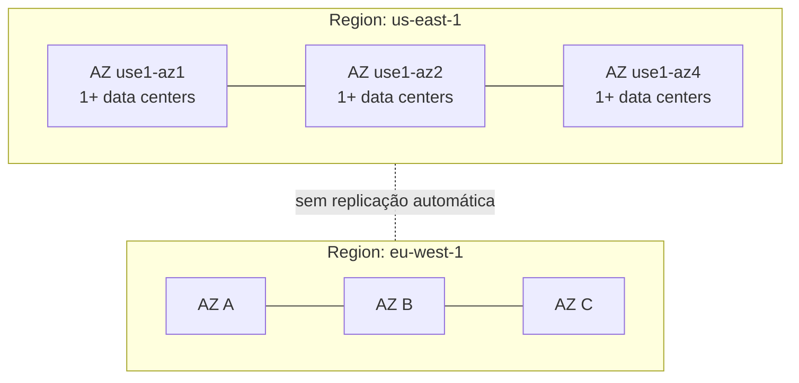

---
aliases:
  - Aula 1.2
modulo: 1
aula: 2
parte: "I Fundamentos"
dominios:
  - 1
  - 2
  - 3
  - 4
lida: false
tags:
  - aula
  - saa-c03
  - modulo-01
---

# Aula 1.2: Regions e Availability Zones, e como escolher uma Região

[[01 - Nuvem e Infraestrutura Global AWS|Voltar ao módulo]]

> [!question] Como a AWS é organizada fisicamente, por que existem Regiões e Zonas de Disponibilidade, e como decidir onde colocar uma carga?
> A [[01.01 - Por que a Nuvem Existe|aula anterior]] disse "projete para a falha". Aqui está o **onde**: a falha que importa (um prédio, uma cidade, um país) define o desenho físico da AWS. O João já escolheu `us-east-1` ao criar recursos; esta aula mostra o que essa escolha significa.

## O problema: um data center só é um ponto único de falha

Um data center, por melhor que seja, está sujeito a eventos que o atingem inteiro: queda de energia na subestação, enchente, incêndio, corte da fibra que o conecta. Se toda a sua aplicação vive nele, qualquer um desses eventos a derruba. A solução física é **ter mais de um**, e a pergunta de projeto é: quão longe um do outro? Muito perto, e o mesmo evento atinge os dois; muito longe, e a [[Latencia|latência]] impede que trabalhem juntos como se fossem um só.

A AWS responde com dois níveis, de propósito:

1. **[[Zona de Disponibilidade|Availability Zones (AZs)]]**: locais isolados entre si, perto o bastante para replicar dados de forma síncrona, longe o bastante para não cair juntos.
2. **[[Regiao AWS|Regions]]**: áreas geográficas inteiras, separadas por distâncias grandes, que **não** compartilham nada entre si por padrão.

## Region

Uma **[[Regiao AWS|Region]]** é uma área geográfica (por exemplo, `us-east-1`, N. Virginia; `sa-east-1`, São Paulo) que contém várias [[Zona de Disponibilidade|AZs]]. Cada Region é projetada para ser **isolada das outras**, buscando a maior [[Tolerancia a Falhas|tolerância a falhas]] e estabilidade possível. Duas consequências decorrem disso, e a prova cobra as duas:

- Quando você lista seus recursos, vê **só os da [[Regiao AWS|Region]] selecionada**. Os recursos pertencem à Region em que foram criados.
- A AWS **não replica recursos entre [[Regiao AWS|Regions]] automaticamente** (verificado em novembro de 2026, [[EC2]] User Guide, "Regions and Zones"). Se você quer um banco em duas Regions, ou um [[Bucket|bucket]] copiado, precisa configurar essa replicação.

Isso é também o fundamento da **[[Residencia de Dados|residência de dados]]**: dados que você coloca em uma [[Regiao AWS|Region]] ficam nela, a menos que você os mova ou replique. Quando uma lei diz "os dados devem permanecer no país", a ferramenta de arquitetura é escolher uma Region naquele país e não configurar replicação para fora.

> [!info] Número de Regions e AZs muda
> A página oficial "AWS Global Infrastructure" afirma, na data desta consulta (novembro de 2026), "124 [[Zona de Disponibilidade|Availability Zones]] dentro de 39 [[Regiao AWS|Regions]] geográficas". A tabela do guia de documentação "AWS Regions and Availability Zones" lista 34 Regions no mesmo período. Os números divergem por **escopo**, não por atraso: a página de infraestrutura global conta todas as partições (inclui GovCloud e China), enquanto a tabela do guia de Regions lista só as Regions acessíveis a uma [[Conta AWS|conta AWS]] comum. **Não decore o número**: a prova não pergunta quantas Regions existem, só que há várias e que cada uma tem múltiplas AZs. Confira a página oficial se precisar do valor atual.

### Regions não são todas iguais

- **[[Regiao AWS|Regions]] habilitadas por padrão vs. opt-in.** Regions introduzidas **depois de 20 de março de 2019** vêm **desabilitadas** e precisam ser habilitadas na conta antes do uso. As anteriores vêm habilitadas. Exemplos desabilitadas por padrão: Africa (Cape Town), Asia Pacific (Hong Kong), Europe (Milan), Middle East (Bahrain). Exemplos habilitadas: US East (N. Virginia), Europe (Ireland), South America (São Paulo). Você habilita pelo console (AWS Global View ou Billing and Cost Management). Verificado em novembro de 2026.
- **Partições separadas.** Uma [[Conta AWS|conta AWS]] comum **não** enxerga as [[Regiao AWS|Regions]] **AWS GovCloud (US)** nem as da **China** (Beijing e Ningxia): elas exigem contas próprias. Isso importa para cargas governamentais dos EUA ou para operar na China continental.
- **Número de [[Zona de Disponibilidade|AZs]] varia.** `us-east-1` tem 6 AZs, `us-east-2` tem 3, `us-west-2` tem 4. Em `us-west-1`, contas novas acessam 2 AZs. Por isso o desenho "uma instância em cada uma de 3 AZs" depende de a [[Regiao AWS|Region]] ter, para a sua conta, 3 AZs.

## Availability Zone

Uma **[[Zona de Disponibilidade|Availability Zone]]** é "um ou mais data centers discretos, com energia, rede e conectividade redundantes e independentes, em uma [[Regiao AWS|Region]]" (whitepaper AWS Fault Isolation [[Permissions Boundary|Boundaries]]). Os pontos que o aluno deve fixar:

- **Isolamento de falhas físicas.** Geradores e refrigeração não são compartilhados entre [[Zona de Disponibilidade|AZs]], e elas são alimentadas por subestações diferentes. O desenho busca evitar falha simultânea por energia, água, fibra, terremoto, incêndio ou enchente.
- **Distância calibrada.** As [[Zona de Disponibilidade|AZs]] de uma [[Regiao AWS|Region]] ficam "significativamente distantes umas das outras, **até cerca de 100 km (60 milhas)**, para evitar falhas correlacionadas, mas perto o bastante para [[Replicacao Sincrona|replicação síncrona]] com [[Latencia|latência]] de poucos milissegundos". Os dois lados importam: a distância protege do desastre local; a proximidade permite que [[Alta Disponibilidade]] não custe consistência.
- **Rede dedicada.** As [[Zona de Disponibilidade|AZs]] de uma [[Regiao AWS|Region]] são interligadas por fibra metropolitana dedicada, redundante, de alta [[Largura de Banda|largura de banda]] e baixa [[Latencia]]. Cada AZ se conecta à internet por dois centros de trânsito.
- **Implantações escalonadas.** A AWS aplica atualizações de seus serviços em [[Zona de Disponibilidade|AZs]] diferentes em momentos diferentes, para que um defeito de software não derrube todas ao mesmo tempo.

Por isso uma aplicação em **duas ou mais [[Zona de Disponibilidade|AZs]]** tolera a falha de uma delas, e **é este o padrão de [[Alta Disponibilidade]] da AWS**. Uma única AZ é um [[Ponto Unico de Falha]]. Várias [[Regiao AWS|Regions]] entram quando o requisito é sobreviver à perda de uma Region inteira, ou aproximar usuários distantes (Módulo 20).

### Nome da AZ não é o local físico

Uma [[Zona de Disponibilidade|AZ]] tem um **nome** de conta, como `us-east-1a` (código da [[Regiao AWS|Region]] mais uma letra), e um **[[AZ ID]]** único, como `use1-az1`. Historicamente a AWS mapeava nomes a locais **de forma independente em cada conta**, para distribuir a carga (muitos clientes escolhiam sempre a "a"). Resultado: `us-east-1a` na sua conta pode ser um local físico diferente de `us-east-1a` na conta de outra empresa.

Segundo o guia de documentação (verificado em novembro de 2026): [[Regiao AWS|Regions]] criadas depois de novembro de 2012 usam mapeamento uniforme; em algumas Regions antigas (US East N. Virginia, US West N. California e Oregon, Asia Pacific Singapore, Sydney e Tokyo, Europe Ireland, South America São Paulo e AWS GovCloud US-West), contas **criadas antes de novembro de 2025** mantêm o mapeamento independente, e contas criadas a partir de novembro de 2025 recebem o mapeamento uniforme.

Quando isso importa? Ao **compartilhar uma subnet entre contas** ou coordenar [[Zona de Disponibilidade|AZs]] entre contas. (Uma [[Sub-rede|subnet]] é uma faixa de endereços IP de uma [[VPC]] que vive em **uma** AZ; o [[RAM|AWS RAM]] permite que uma conta compartilhe a subnet com outras da mesma organização. Redes completas são o assunto do [[03 - Fundamentos de Redes para a Nuvem|Módulo 3]] e do [[06 - VPC a Fundo|Módulo 6]].) O compartilhamento usa o **[[AZ ID]]**: se você compartilha uma subnet da AZ `use1-az2`, ela aparece na outra conta na AZ cujo ID é `use1-az2`, seja qual for o nome. Para ver os IDs da sua conta: o painel Service health do [[EC2]] ou `aws ec2 describe-availability-zones`.

## Como escolher uma Região

Quatro critérios, geralmente nesta **ordem de prioridade**:

1. **Conformidade e [[Residencia de Dados|soberania de dados]].** Se lei, contrato ou política exige que os dados fiquem em um país ou bloco (por exemplo, [[PII|dados pessoais]] de clientes europeus na UE), a escolha da [[Regiao AWS|Region]] é obrigatória, e os demais critérios só valem entre as Regions permitidas. É o único critério que **elimina** opções em vez de ordená-las.
2. **[[Latencia|Latência]] até os usuários.** Quanto mais perto o usuário, menor o tempo de ida e volta (limitado pela velocidade da luz na fibra). Se os usuários estão no Brasil, `sa-east-1` costuma ser mais rápida para eles do que `us-east-1`. A [[01.03 - Borda e Extensoes da Infraestrutura|borda]] ([[CloudFront]]) complementa isso para conteúdo cacheável.
3. **Serviços e recursos disponíveis.** Nem todo serviço ou recurso novo chega a todas as [[Regiao AWS|Regions]] ao mesmo tempo. A AWS publica a lista "AWS Services by Region". Escolher uma Region sem o serviço de que você precisa é um impedimento técnico.
4. **Preço.** Os preços variam entre [[Regiao AWS|Regions]] (o mesmo recurso pode custar mais em uma do que em outra). Confirme na página de preços do serviço, porque os valores mudam.

> [!example] Três cenários, três decisões
> **A.** Uma fintech brasileira atende só clientes no Brasil e a regulação exige dados no país: `sa-east-1`, mesmo que `us-east-1` seja mais barata; critério 1 decide.
> **B.** Uma startup lança um app móvel global, sem exigência legal: começa na [[Regiao AWS|Region]] mais próxima da maioria dos usuários que tenha todos os serviços necessários, e usa [[CloudFront]] para o resto; critérios 2 e 3.
> **C.** Uma carga de [[Processamento em Lote|processamento em lote]], sem usuário final e sem restrição legal: o critério dominante vira o preço; escolhe-se a [[Regiao AWS|Region]] mais barata com o serviço.

Duas armadilhas: (a) escolher a [[Regiao AWS|Region]] por preço **antes** de checar conformidade; (b) esquecer que replicar dados para outra Region (backup, DR) também move dados para fora do país original. Em arquitetura multi-Region sob soberania, as duas Regions precisam ser permitidas.

> [!warning] Uma Region não é o mesmo que "estar no país"
> Pergunta de prova típica: "os dados precisam ficar na Alemanha". A resposta é escolher a [[Regiao AWS|Region]] `eu-central-1` (Frankfurt) e não replicar para fora. Não existe uma configuração mágica que impeça um administrador com permissão de criar recursos em outra Region: para isso se usam [[Controle Preventivo|controles preventivos]] de governança, como as [[SCP|SCPs]] do [[05 - Multiconta Governanca e Federacao|Módulo 5]], que negam o uso de Regions não aprovadas.

## Quanto custa cruzar cada fronteira

[[Zona de Disponibilidade|AZs]] e [[Regiao AWS|Regions]] não são só desenho de resiliência: cada fronteira que o tráfego atravessa tem um preço, e a prova cobra isso no Domínio 4 ("network routes to minimize transfer costs: Region to Region, AZ to AZ, private to public"). A regra qualitativa (os valores mudam; confira a seção [[Data Transfer]] da [página de preços do EC2 On-Demand](https://aws.amazon.com/ec2/pricing/on-demand/)) é:

| Caminho do tráfego | Cobrança | Por quê importa |
|---|---|---|
| Internet para a AWS (entrada) | Grátis | Receber dados não custa; por isso migrar dados para a nuvem sai barato |
| Dentro da mesma [[Zona de Disponibilidade\|AZ]], por [[RFC 1918\|IP privado]] | Grátis | O caminho mais barato; vale para instância e banco conversando |
| Entre [[Zona de Disponibilidade\|AZs]] da mesma [[Regiao AWS\|Region]] | Cobrado, nos dois sentidos | [[Multi-AZ]] não é grátis: réplica em outra AZ gera transferência |
| Entre [[Regiao AWS\|Regions]] | Cobrado (saída da Region de origem) | Replicação multi-Region e DR somam custo de rede |
| AWS para a internet (saída) | Cobrado, com uma faixa mensal gratuita | É a maior parcela típica; [[CloudFront]] costuma reduzir o custo de saída |

> [!warning] Pegadinha de custo
> Colocar réplicas e consumidores em [[Zona de Disponibilidade|AZs]] diferentes aumenta a transferência entre AZs; manter tráfego pesado na mesma AZ, por [[RFC 1918|IP privado]], reduz. Isso **não** significa abrir mão de [[Multi-AZ]] em produção: a [[Disponibilidade|disponibilidade]] vem primeiro, e a conta de transferência é o preço dela. Para tráfego de saída para a internet, servir o conteúdo pelo [[CloudFront]] costuma custar menos que servir direto da origem (Módulo 18).

> [!example] Cache entre AZs
> Uma aplicação em us-east-1a lê 2 TB por mês de um banco cuja réplica está em us-east-1b, só por convenção do time. Cada GB cruza a fronteira de [[Zona de Disponibilidade|AZ]] e é cobrado. Mover os leitores para a mesma AZ da réplica, ou ler de uma réplica local a cada AZ, elimina essa parcela sem tocar na [[Disponibilidade|disponibilidade]] da escrita.

## Como isso cai na prova

Cobre os Task 1.1 e Task 2.2 do exam guide (conhecimento de "AWS global infrastructure ([[Zona de Disponibilidade|AZs]], [[Regiao AWS|Regions]])"), além de Task 3.3 e Task 4.2 (infraestrutura global como parte da decisão) e Task 4.4 (rotas de rede que minimizam o [[Data Transfer|custo de transferência]] entre Regions, entre AZs e para a internet).

**Palavras-chave em inglês e o que apontam:**

- "[[Residencia de Dados|data residency]]", "data sovereignty", "must remain in the country": escolha de [[Regiao AWS|Region]] e não replicar para fora.
- "[[Alta Disponibilidade|highly available]]", "survive the failure of a data center": múltiplas [[Zona de Disponibilidade|AZs]].
- "survive a Region-wide failure", "[[Recuperacao de Desastres|disaster recovery]]": múltiplas [[Regiao AWS|Regions]] (Módulo 20).
- "lowest [[Latencia|latency]] for users in X": [[Regiao AWS|Region]] mais próxima (e [[CloudFront]] para conteúdo estático).
- "newer service not available in the [[Regiao AWS|Region]]": checar serviços disponíveis.

**Pegadinhas clássicas:**

- [[Zona de Disponibilidade|AZ]] não é [[Regiao AWS|Region]]: AZs estão **dentro** de uma Region.
- Dados não são replicados entre [[Regiao AWS|Regions]] sozinhos; entre [[Zona de Disponibilidade|AZs]], depende do serviço ([[S3]] já guarda entre AZs; um [[EBS|volume EBS]] não).
- O nome `us-east-1a` não é o mesmo lugar em todas as contas (use o [[AZ ID]]).
- "Mais barata" só vale depois de conformidade, [[Latencia|latência]] e [[Disponibilidade|disponibilidade]] do serviço.

| Requisito no enunciado | Resposta provável | Por quê |
|---|---|---|
| [[Alta Disponibilidade\|Alta disponibilidade]] contra falha de um data center | Distribuir em 2 ou mais [[Zona de Disponibilidade\|AZs]] da mesma [[Regiao AWS\|Region]] | AZs têm energia e rede independentes, [[Latencia\|latência]] de poucos ms |
| Dados de clientes devem ficar no país X | [[Regiao AWS\|Region]] no país X, sem replicação para fora | Dados ficam na Region onde foram criados |
| Sobreviver à indisponibilidade de uma [[Regiao AWS\|Region]] | Recursos em uma segunda Region | Regions são isoladas |
| Compartilhar [[Sub-rede\|subnet]] entre contas na mesma [[Zona de Disponibilidade\|AZ]] física | Usar [[AZ ID]] | Nome da AZ pode ser mapeado diferente por conta |
| Região recém-lançada não aparece na conta | Habilitar a [[Regiao AWS\|Region]] (opt-in) | Regions pós-março/2019 vêm desabilitadas |
| "MOST cost-effective" com tráfego pesado entre instâncias e banco | Mesma [[Zona de Disponibilidade\|AZ]], [[RFC 1918\|IP privado]], quando a [[Disponibilidade\|disponibilidade]] permite | Tráfego entre AZs e entre [[Regiao AWS\|Regions]] é cobrado; na mesma AZ é grátis |

## Resumo

> [!abstract] A aula em uma frase
> A AWS se organiza em [[Regiao AWS|Regions]] isoladas, cada uma com várias [[Zona de Disponibilidade|AZs]] a até cerca de 100 km umas das outras; AZs protegem de falhas de um prédio ou cidade, Regions de falhas maiores, e a escolha da Region obedece a conformidade, [[Latencia|latência]], serviços e preço, nessa ordem.

**A lógica, em 5 passos**

1. Um único data center é [[Ponto Unico de Falha|ponto único de falha]]; é preciso mais de um.
2. [[Zona de Disponibilidade|AZs]]: perto o bastante para [[Replicacao Sincrona|replicação síncrona]] ([[Latencia|latência]] de poucos ms), longe o bastante para não cair juntas (até ~100 km).
3. [[Regiao AWS|Regions]]: áreas geográficas isoladas entre si, sem replicação automática, o que cria também a [[Residencia de Dados|residência de dados]].
4. Uma aplicação em 2 ou mais [[Zona de Disponibilidade|AZs]] tolera a perda de uma; 2 ou mais [[Regiao AWS|Regions]] toleram a perda de uma Region.
5. A escolha de [[Regiao AWS|Region]] começa por conformidade (elimina), depois [[Latencia|latência]], serviços disponíveis e preço.

**Números para lembrar**

| O quê | Valor | Por que importa |
|---|---|---|
| Distância máxima típica entre [[Zona de Disponibilidade\|AZs]] | até ~100 km (60 milhas) | Equilíbrio entre isolamento e [[Latencia\|latência]] |
| [[Latencia\|Latência]] entre [[Zona de Disponibilidade\|AZs]] | de poucos milissegundos | Permite [[Replicacao Sincrona\|replicação síncrona]] |
| [[Regiao AWS\|Regions]] pós 20/03/2019 | opt-in | Precisam ser habilitadas |
| [[Zona de Disponibilidade\|AZs]] em us-east-1 | 6 | Número varia por [[Regiao AWS\|Region]] |

**Tabela-síntese**

| Nível | O que é | Falha que cobre | Dados replicados sozinhos? |
|---|---|---|---|
| [[Zona de Disponibilidade\|AZ]] | 1+ data centers isolados | prédio, energia, fibra | Depende do serviço |
| [[Regiao AWS\|Region]] | Várias [[Zona de Disponibilidade\|AZs]] numa área | desastre regional, mudanças maiores | Não |

**Na prática, isso significa**

- Produção com requisito de [[Disponibilidade|disponibilidade]]: no mínimo 2 [[Zona de Disponibilidade|AZs]].
- [[Residencia de Dados|Residência de dados]]: [[Regiao AWS|Region]] no país exigido, sem replicar para fora, mais [[SCP]] para barrar outras Regions.
- Use o [[AZ ID]], não o nome, ao coordenar [[Zona de Disponibilidade|AZs]] entre contas.
- Confirme se a [[Regiao AWS|Region]] precisa de opt-in antes de planejar um deploy nela.
- Entrada da internet é grátis; entre [[Zona de Disponibilidade|AZs]] e entre [[Regiao AWS|Regions]] e saída para a internet são cobradas; mesma AZ por [[RFC 1918|IP privado]] é grátis.

> [!tip] Liga com
> Vem da [[01.01 - Por que a Nuvem Existe|aula 1.1]] (projetar para a falha) e leva a [[01.03 - Borda e Extensoes da Infraestrutura|aula 1.3]] (borda e extensões) e à [[01.04 - Escopo dos Recursos Global Regional e Zonal|aula 1.4]] (qual recurso vive em qual nível).

## Erros comuns

- **Confundir [[Zona de Disponibilidade|AZ]] com [[Regiao AWS|Region]].** AZs ficam dentro de uma Region; a [[Latencia|latência]] entre AZs é de milissegundos, entre Regions é muito maior.
- **Supor replicação automática entre [[Regiao AWS|Regions]].** Não existe; é configuração sua.
- **Achar que `us-east-1a` é o mesmo lugar para todos.** Em contas antigas, o nome mapeia independentemente; use [[AZ ID]].
- **Escolher [[Regiao AWS|Region]] só pelo preço.** Conformidade e serviços disponíveis vêm antes.
- **Esquecer opt-in.** [[Regiao AWS|Region]] nova pode não aparecer até ser habilitada.
- **Assumir que uma única [[Zona de Disponibilidade|AZ]] é "[[Alta Disponibilidade|alta disponibilidade]]" porque é da AWS.** Continua sendo um [[Ponto Unico de Falha|ponto único de falha]].
- **Esquecer que cruzar fronteira custa.** Tráfego entre [[Zona de Disponibilidade|AZs]] e entre [[Regiao AWS|Regions]] é cobrado; dentro da mesma AZ, por [[RFC 1918|IP privado]], é grátis.

## Pratique

**1.** Uma conta compartilha uma [[Sub-rede|subnet]] (faixa de IPs que vive em uma única [[Zona de Disponibilidade|AZ]]) com outra conta da mesma organização por meio do [[RAM|AWS RAM]]. As duas contas foram criadas há vários anos em us-east-1. A equipe da segunda conta quer colocar um banco na mesma AZ física da subnet compartilhada. O que deve usar para comparar os locais das duas contas?

- [ ] a) O nome da AZ, como us-east-1a, que aponta para o mesmo local físico em qualquer conta
- [ ] b) O código da Region, que funciona como identificador único de cada AZ
- [ ] c) O AZ ID, como use1-az2, que identifica o mesmo local físico em todas as contas
- [ ] d) O ID da VPC compartilhada, que carrega a localização física da AZ

**2.** Uma empresa alemã processa [[PII|dados pessoais]] de clientes e a lei exige que eles permaneçam na União Europeia. Qual é a abordagem MAIS segura para cumprir a exigência?

- [ ] a) Escolher uma Region da UE e não replicar para fora dela, barrando outras Regions com uma SCP
- [ ] b) Escolher us-east-1, por ter mais AZs, e proteger os dados com criptografia do KMS
- [ ] c) Usar a Region mais barata e confiar que a AWS mantém os dados no país de origem do cliente, sem nenhuma configuração
- [ ] d) Criar os recursos em qualquer Region e aguardar a replicação automática dos dados para a UE

**3.** (Escolha DUAS.) Uma empresa vai implantar uma nova carga para clientes no Chile, sem exigência legal específica. Quais fatores devem pesar na escolha da [[Regiao AWS|Region]]?

- [ ] a) A latência entre a Region e os usuários finais da aplicação
- [ ] b) A disponibilidade, na Region, dos serviços de que a aplicação precisa
- [ ] c) A quantidade de edge locations perto da Region, considerada como único critério
- [ ] d) O fato de a Region ser a que tem o maior número de AZs entre todas
- [ ] e) O menor preço, escolhido antes de verificar conformidade e serviços disponíveis

**4.** Um e-commerce roda todos os servidores web em uma única [[Zona de Disponibilidade|AZ]] de us-east-1. Uma queda de energia afeta essa AZ e o site sai do ar. Qual alteração evita a repetição do problema com a MENOR mudança de arquitetura?

- [ ] a) Trocar as instâncias por uma única instância maior, com mais CPU e memória, na mesma AZ
- [ ] b) Copiar os dados todos os dias para um servidor de backup na mesma AZ
- [ ] c) Distribuir as instâncias em pelo menos duas AZs da mesma Region, atrás de um balanceador
- [ ] d) Mover a aplicação para outra conta AWS, mantendo a mesma AZ de destino

**5.** Uma aplicação em us-east-1a lê vários TB por mês de uma [[Read Replica|réplica de leitura]] que está em us-east-1b, sem que haja motivo para os leitores ficarem em outra [[Zona de Disponibilidade|AZ]]. A equipe quer reduzir o custo de rede sem perder [[Disponibilidade|disponibilidade]] da escrita. Qual ação é a MAIS econômica?

- [ ] a) Acessar a réplica pelo IP público, para evitar a cobrança de transferência entre AZs dentro da mesma Region
- [ ] b) Replicar o banco para outra Region, para que o tráfego deixe de cruzar a fronteira de AZ
- [ ] c) Desativar a réplica e ler sempre do banco primário, mesmo que ele esteja em outra AZ
- [ ] d) Colocar os leitores na AZ da réplica e acessá-la por IP privado, mantendo o failover do primário

**6.** Um serviço de pagamentos precisa continuar acessível se uma [[Regiao AWS|Region]] inteira ficar indisponível. Qual abordagem atende ao requisito?

- [ ] a) Criar mais instâncias em outras AZs da mesma Region, já que cada AZ tem a própria Region
- [ ] b) Contar com a replicação automática entre Regions, que a AWS mantém ativa por padrão
- [ ] c) Replicar os dados e manter capacidade de recuperação em uma segunda Region
- [ ] d) Trocar o tipo de instância por uma família com maior disponibilidade nominal

**7.** Uma equipe tenta criar recursos em Africa (Cape Town) em uma conta criada em 2024 e a [[Regiao AWS|Region]] não aparece como disponível. Qual é a causa mais provável?

- [ ] a) A Region exige abrir um chamado de suporte pago antes do primeiro uso
- [ ] b) Regions lançadas depois de 20 de março de 2019 vêm desabilitadas e precisam ser habilitadas na conta
- [ ] c) A Region só aceita contas que já tenham recursos em pelo menos 3 AZs de us-east-1
- [ ] d) A Region está em manutenção e não aceita novas contas

**8.** Uma agência pública americana quer usar a [[Regiao AWS|Region]] AWS GovCloud (US-West) com a mesma conta comercial que já usa em us-east-1. O que acontece?

- [ ] a) Não funciona: GovCloud (US) exige uma conta própria, separada da conta comercial
- [ ] b) Funciona, bastando habilitar a Region no console como em qualquer outra Region opt-in
- [ ] c) Funciona, desde que a conta tenha o plano de suporte Enterprise
- [ ] d) Funciona por meio de uma IAM role entre a conta comercial e a de GovCloud, sem criar nova conta

**9.** Qual descrição de [[Zona de Disponibilidade|Availability Zone]] está correta?

- [ ] a) Um host físico dedicado a um único cliente dentro de uma Region, usado para licenciamento
- [ ] b) Um ponto de presença da CDN, usado apenas para cache de conteúdo estático perto do usuário final e para terminar conexões TLS
- [ ] c) Um grupo de Regions próximas que compartilham o mesmo plano de controle e a mesma cobrança
- [ ] d) Um ou mais data centers com energia, rede e conectividade independentes, dentro de uma Region

**10.** (Escolha DUAS.) Quais afirmações sobre [[Zona de Disponibilidade|AZs]] e [[Regiao AWS|Regions]] são verdadeiras?

- [ ] a) Cada AZ tem energia, rede e conectividade independentes das demais AZs da mesma Region
- [ ] b) O nome us-east-1a aponta sempre para o mesmo local físico em qualquer conta
- [ ] c) As AZs de uma Region ficam a até cerca de 100 km umas das outras, com latência de poucos milissegundos
- [ ] d) Os recursos criados em uma Region são replicados automaticamente para todas as outras
- [ ] e) Toda Region tem exatamente três AZs, sem exceção

> [!success]- Gabarito
> **1. c)** o [[AZ ID]] é único e consistente entre contas; a) em contas antigas o nome pode apontar para locais diferentes; b) o código da [[Regiao AWS|Region]] é igual para todas as [[Zona de Disponibilidade|AZs]] dela; d) o ID da [[VPC]] não indica a localização física.
> **2. a)** a [[Residencia de Dados|residência de dados]] se resolve com a [[Regiao AWS|Region]] no local exigido, sem replicar para fora, e a [[SCP]] impede que alguém crie recursos em outra Region; b) criptografia não muda onde os dados residem; c) preço não garante localização; d) a AWS não replica entre Regions sozinha.
> **3. a), b)** [[Latencia|latência]] e [[Disponibilidade|disponibilidade]] de serviços são critérios oficiais; c) [[Edge Location|edge locations]] ajudam o conteúdo, mas não decidem a [[Regiao AWS|Region]] sozinhas; d) o número de [[Zona de Disponibilidade|AZs]] não é critério quando duas ou três já atendem; e) conformidade e serviços disponíveis vêm antes do preço.
> **4. c)** duas ou mais [[Zona de Disponibilidade|AZs]] removem o [[Ponto Unico de Falha|ponto único de falha]], e um balanceador distribui o tráfego; a) continua em uma só AZ; b) o backup na mesma AZ cai junto; d) trocar de conta não muda a AZ.
> **5. d)** na mesma [[Zona de Disponibilidade|AZ]], por [[RFC 1918|IP privado]], o tráfego não é cobrado, e o [[Failover|failover]] do primário continua; a) tráfego entre AZs é cobrado também por IP público; b) replicar entre [[Regiao AWS|Regions]] acrescenta [[Data Transfer|custo de transferência]] entre Regions; c) ler do primário em outra AZ continua cruzando a fronteira.
> **6. c)** a segunda [[Regiao AWS|Region]] é o que cobre a falha regional; a) [[Zona de Disponibilidade|AZs]] fazem parte da mesma Region; b) a replicação entre Regions não vem ativa por padrão; d) [[Instance Type|tipo de instância]] não protege contra falha regional.
> **7. b)** [[Regiao AWS|Regions]] pós 20/03/2019 são opt-in; a) não é preciso suporte pago; c) não há relação com [[Zona de Disponibilidade|AZs]] de us-east-1; d) a Region aceita contas novas.
> **8. a)** GovCloud (US) é outra partição e exige conta própria; b) não é uma [[Regiao AWS|Region]] opt-in comum; c) o plano de suporte não muda isso; d) não existe acesso entre partições por role.
> **9. d)** é a definição oficial; a) descreve um [[Dedicated Host]]; b) descreve um [[Edge Location|POP]] da borda; c) inverte a hierarquia: [[Regiao AWS|Regions]] contêm [[Zona de Disponibilidade|AZs]].
> **10. a), c)** independência de infraestrutura e distância calibrada são características oficiais; b) falso em contas antigas; d) não há replicação automática entre [[Regiao AWS|Regions]]; e) o número de [[Zona de Disponibilidade|AZs]] varia (us-east-1 tem 6).

### Laboratório (opcional)

> [!warning] Use uma conta pessoal, nunca a de produção da empresa
> Use uma **[[Conta AWS|conta AWS]] pessoal separada**, com [[Budgets|AWS Budgets]] configurado. Este laboratório só **lê** informação e não cria recursos pagos, mas a boa prática vale para todos os laboratórios do curso: nunca teste na conta de produção.

Custo estimado: zero (apenas chamadas de leitura).

1. Configure a CLI com credenciais da conta pessoal (de preferência uma role ou usuário com permissão somente de leitura).
2. Liste as [[Regiao AWS|Regions]] e o estado de opt-in: `aws ec2 describe-regions --all-regions`. Observe a coluna de opt-in (`opt-in-not-required` ou `not-opted-in`).
3. Liste as [[Zona de Disponibilidade|AZs]] de uma [[Regiao AWS|Region]]: `aws ec2 describe-availability-zones --region us-east-1`. Observe `ZoneName` (por exemplo us-east-1a) e `ZoneId` (por exemplo use1-az1).
4. Repita o passo 3 com `--region sa-east-1` e compare o número de [[Zona de Disponibilidade|AZs]].
5. Compare `ZoneName` e `ZoneId` e anote: o ID é o identificador estável entre contas.
6. Limpeza: não há nada a limpar, pois nenhum recurso foi criado.

## Para aprofundar

- [ ] [Availability Zones (Fault Isolation Boundaries)](https://docs.aws.amazon.com/whitepapers/latest/aws-fault-isolation-boundaries/availability-zones.html) (AWS Whitepapers): a descrição oficial da distância, da [[Latencia|latência]] e do isolamento das [[Zona de Disponibilidade|AZs]].
- [ ] [Regions and Zones (EC2 User Guide)](https://docs.aws.amazon.com/AWSEC2/latest/UserGuide/using-regions-availability-zones.html) (AWS Docs): isolamento de [[Regiao AWS|Regions]], nomes de [[Zona de Disponibilidade|AZ]], [[Local Zone|Local Zones]], [[Wavelength]] e Outposts.
- [ ] [AWS Regions, lista e opt-in](https://docs.aws.amazon.com/global-infrastructure/latest/regions/aws-regions.html) (AWS Docs): tipos de conta, [[Regiao AWS|Regions]] habilitadas por padrão e como habilitar.
- [ ] [AZ IDs](https://docs.aws.amazon.com/global-infrastructure/latest/regions/az-ids.html) (AWS Docs): por que o nome da [[Zona de Disponibilidade|AZ]] pode divergir entre contas e como usar o ID.

Próxima aula: [[01.03 - Borda e Extensoes da Infraestrutura]]
