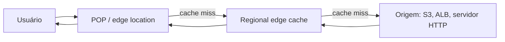

---
aliases:
  - Aula 1.3
modulo: 1
aula: 3
parte: "I Fundamentos"
dominios:
  - 2
  - 3
  - 4
lida: false
tags:
  - aula
  - saa-c03
  - modulo-01
---

# Aula 1.3: Borda e extensões da infraestrutura (edge, Local Zones, Wavelength, Outposts)

[[01 - Nuvem e Infraestrutura Global AWS|Voltar ao módulo]]

> [!question] E quando a Region mais próxima ainda é longe demais, ou a carga não pode sair do prédio do cliente?
> [[Regiao AWS|Regions]] e [[Zona de Disponibilidade|AZs]] resolvem [[Disponibilidade|disponibilidade]]. Mas existem usuários a milhares de quilômetros de qualquer Region, aplicações que precisam responder em poucos milissegundos, e dados que por lei ou por física não podem sair de uma fábrica. A AWS tem uma resposta física diferente para cada um desses casos, e a prova pede que você escolha entre elas pela palavra-chave do enunciado.

## O problema: a velocidade da luz não negocia

[[Latencia]] é o tempo que um pacote leva para ir e voltar. Ela tem um piso físico: a luz na fibra percorre algo em torno de 200 mil km por segundo, então cada 1.000 km de distância custa alguns milissegundos só de propagação, antes de qualquer processamento. Um usuário em Manaus falando com um servidor na Virgínia paga esse tempo em cada requisição, e uma página que faz dezenas delas sente.

Não existe configuração de software que anule a distância. Só se resolve de dois jeitos: **trazer o conteúdo até perto do usuário** (cache) ou **trazer a computação até perto do usuário** (extensões da infraestrutura). Esta aula organiza as peças da AWS nessas duas famílias, mais uma terceira: **levar a AWS até o prédio do cliente**.

## Família 1: a borda (edge) para conteúdo

A AWS mantém uma rede global de **pontos de presença** (POPs, também chamados de **[[Edge Location|edge locations]]**), espalhados em muitas cidades, muito mais numerosos que as [[Regiao AWS|Regions]]. Eles não rodam seus servidores de aplicação: servem principalmente como camada de **cache** e de **entrada na rede da AWS**. O serviço que mais usa essa rede é o [[CloudFront]], a [[CDN]] (content delivery network) da AWS.

### Como o CloudFront atravessa as camadas

Segundo a documentação (verificado em novembro de 2026), o caminho de uma requisição é:

1. O usuário pede um objeto (imagem, HTML, vídeo).
2. O [[DNS]] encaminha a requisição para o [[Edge Location|POP]] que melhor atende, tipicamente o mais próximo em [[Latencia|latência]].
3. O [[Edge Location|POP]] olha em seu cache. Se tem o objeto, devolve na hora (**cache hit**).
4. Se não tem, o [[Edge Location|POP]] normalmente consulta o **[[Regional Edge Cache|regional edge cache]]** mais próximo, e só se este também não tiver o objeto a requisição vai até a **origem** (por exemplo um [[Bucket|bucket]] do [[S3]] ou um [[Application Load Balancer]]).
5. O objeto volta pelo mesmo caminho e é guardado nas camadas intermediárias para as próximas requisições.

### Por que existe o regional edge cache

Cada [[Edge Location|POP]] tem um cache pequeno e, conforme os objetos perdem popularidade, ele os descarta para dar espaço aos mais acessados. O **[[Regional Edge Cache|regional edge cache]]** fica entre os POPs e a origem, com um cache **maior**, de modo que objetos menos populares (fotos antigas de produtos, vídeos gerados por usuários, notícias que ressurgem) permanecem perto dos usuários por mais tempo. O ganho concreto: **todos os POPs de uma área compartilham um cache local, o que elimina requisições repetidas à origem**. Isso reduz a carga e o custo na origem.

Três detalhes que a documentação destaca e que viram pegadinha:

- [[Regional Edge Cache|Regional edge caches]] têm **paridade de funcionalidades** com os [[Edge Location|POPs]]: uma **[[Invalidacao de Cache|invalidação]] de cache** remove o objeto dos POPs **e** dos regional edge caches.
- Métodos [[HTTP]] que modificam (`PUT`, `POST`, `PATCH`, `OPTIONS`, `DELETE`) vão **direto à origem** a partir dos [[Edge Location|POPs]], sem passar pelo [[Regional Edge Cache|regional edge cache]].
- Quando o [[Bucket|bucket]] [[S3]] de origem está na mesma [[Regiao AWS|Region]] do [[Edge Location|POP]], o POP pode ir direto ao S3, pulando o [[Regional Edge Cache|regional edge cache]].

A rede tem dezenas de [[Regional Edge Cache|regional edge caches]] e centenas de [[Edge Location|POPs]]; como os números mudam, não os decore e confira a página de infraestrutura global se precisar do valor atual.

### Outros serviços que usam os POPs

O whitepaper de isolamento de falhas lista serviços cujo **[[Plano de Dados|plano de dados]]** roda na rede de [[Edge Location|POPs]]: [[CloudFront]], [[Route 53]] ([[Hosted Zone|hosted zones]] públicas), [[WAF|AWS WAF]] e [[ACM|Certificate Manager]] para CloudFront, [[Global Accelerator]] e [[Shield]] Advanced. Isso significa que a resolução de [[DNS]], a absorção de ataques e a entrada na rede acontecem perto do usuário, não na [[Regiao AWS|Region]]. O [[18 - Borda e DNS CloudFront Global Accelerator e Route 53|Módulo 18]] aprofunda a configuração; aqui basta saber que "borda" não é só cache.

Há ainda um serviço de armazenamento que usa a mesma rede: o **[[Transfer Acceleration|S3 Transfer Acceleration]]** faz o upload de um usuário distante entrar na rede da AWS pelo [[Edge Location|POP]] mais próximo e viajar pelo [[Backbone|backbone da AWS]] até o [[Bucket]] (fonte: [S3 Transfer Acceleration](https://docs.aws.amazon.com/AmazonS3/latest/userguide/transfer-acceleration.html)). Ele existe porque o [[CloudFront]] é feito para **entregar** conteúdo cacheável, e um upload de arquivo grande não é cacheável.

> [!warning] CloudFront, Global Accelerator ou Transfer Acceleration?
> **Download cacheável** (imagens, vídeo, site estático): [[CloudFront]]. **Upload longo de usuários globais para um [[Bucket|bucket]] [[S3]]**: [[Transfer Acceleration|S3 Transfer Acceleration]]. **Tráfego [[TCP]]/UDP dinâmico ou necessidade de [[Anycast|IPs anycast]] fixos**: [[Global Accelerator]]. A prova descreve o requisito e deixa você escolher o serviço certo entre os três.

> [!example] Loja de fotos
> Uma loja de fotos tem o catálogo em um [[Bucket|bucket]] [[S3]] em `us-east-1`, e clientes em Tóquio. Sem [[CDN]], cada foto atravessa o Pacífico a cada visita. Com [[CloudFront]] na frente do bucket, a primeira visita em Tóquio busca a foto e a guarda no [[Edge Location|POP]] (e no [[Regional Edge Cache|regional edge cache]] da área); os próximos visitantes japoneses a recebem de perto. Fotos antigas, que saem do POP, ainda podem estar no regional edge cache e não voltam à Virgínia.

## Família 2: extensões de uma Region para computação

Quando o conteúdo é dinâmico, ou a aplicação precisa **rodar** perto do usuário, cachear não basta. Aí entram extensões da infraestrutura. Em todas, a regra é: **são extensões lógicas de uma [[Regiao AWS|Region]]**, gerenciadas pelo [[Plano de Controle|plano de controle]] dessa Region ([[Wavelength]] e Outposts documentam isso explicitamente), e você as usa por meio de uma [[VPC]].

### Local Zones

Uma **[[Local Zone]]** é "uma extensão de uma [[Regiao AWS|Region]] em proximidade geográfica dos seus usuários" ([[EC2]] User Guide, verificado em novembro de 2026). Características:

- Coloca recursos como computação e armazenamento em **cidades onde não há [[Regiao AWS|Region]]**, perto de grandes centros populacionais ou industriais.
- Tem **conexões próprias com a internet** e suporta [[Direct Connect]].
- O código segue o padrão [[Regiao AWS|Region]] + local, por exemplo `us-west-2-lax-1` (Los Angeles, extensão de `us-west-2`).
- É **opt-in**: você precisa habilitar a [[Local Zone]], depois criar uma **[[Sub-rede|subnet]]** nela e especificá-la ao lançar recursos. A [[VPC]] pode abranger [[Zona de Disponibilidade|AZs]] e Local Zones ao mesmo tempo.
- Ao lançar uma instância, você aloca IPs de um **network border group**, o conjunto de [[Zona de Disponibilidade|AZs]], [[Local Zone|Local Zones]] ou [[Wavelength|Wavelength Zones]] de onde a AWS anuncia aquele IP.
- Nem todos os serviços existem em todas as [[Local Zone|Local Zones]]. Confira a lista "Available Local Zones".

**Quando escolher:** [[Latencia|latência]] de poucos milissegundos para usuários de uma cidade específica (estúdios de mídia e efeitos visuais, jogos, saúde), ou requisito de **[[Residencia de Dados|residência de dados]]** em uma cidade onde não existe [[Regiao AWS|Region]], mantendo a conexão rápida com os serviços da Region-mãe.

### Wavelength Zones

**[[Wavelength]]** implanta serviços padrão de computação e armazenamento da AWS **dentro da rede 5G de operadoras de telecomunicação**. Uma **Wavelength Zone** é uma zona isolada no local da operadora, atrelada a uma [[Regiao AWS|Region]] (código de exemplo: `us-east-1-wl1-bos-wlz-1`, em Boston). Você estende uma [[VPC]] até ela e roda, por exemplo, [[EC2|instâncias EC2]] que precisam de **[[Latencia|latência]] ultrabaixa para dispositivos móveis**, mantendo conexão com os serviços da Region.

A razão de existir: o tráfego de um celular 5G normalmente sai da operadora, atravessa a internet e chega à [[Regiao AWS|Region]]. Dentro da [[Wavelength|Wavelength Zone]], o tráfego do dispositivo chega à aplicação sem sair da rede da operadora. Cenários típicos: [[Streaming de Dados|streaming]] de jogos, realidade aumentada, vídeo ao vivo com inferência de machine learning, veículos conectados. Na data da consulta, a página de infraestrutura citava 33 Wavelength Zones.

**Quando escolher:** o enunciado menciona "5G", "mobile devices", "ultra-low [[Latencia|latency]]" ligado a uma operadora de telecom. Sem 5G ou operadora no enunciado, a resposta costuma ser [[Local Zone]].

## Família 3: a AWS dentro do prédio do cliente, com Outposts

[[Outposts]] é "um serviço totalmente gerenciado que estende a infraestrutura, os serviços, as APIs e as ferramentas da AWS para as instalações do cliente" (Outposts User Guide). A AWS entrega, instala, opera e monitora hardware **no seu data center, fábrica, hospital ou colocation**, e esse hardware é gerenciado **como parte de uma [[Regiao AWS|Region]]**. Você cria [[Sub-rede|subnets]] na Outpost (faixas de endereços IP da [[VPC]], cada uma presa a um único local; redes completas ficam para os [[03 - Fundamentos de Redes para a Nuvem|Módulo 3]] e [[06 - VPC a Fundo|Módulo 6]]) e lança recursos como [[EC2|instâncias EC2]], [[EBS|volumes EBS]], clusters [[ECS]] e instâncias [[RDS]] usando as mesmas APIs e ferramentas.

Há duas formas de hardware: **Outposts racks** (um rack padrão de 42U) e **Outposts servers** (servidores de 1U ou 2U para locais com pouco espaço ou capacidade). As instâncias na [[Outposts|Outpost]] conversam com a [[Regiao AWS|Region]] pelo mesmo [[VPC]], com endereços IP privados. Detalhe de limite, sem importância para a prova mas útil em projeto: **não é possível conectar uma Outpost a outra Outpost ou a uma [[Local Zone]] dentro da mesma VPC**.
**Por que alguém quer isso?** Três motivos clássicos:

- **[[Latencia|Latência]] local**: a aplicação precisa responder em milissegundos a equipamentos no mesmo prédio (linha de produção, sistemas médicos).
- **Processamento local de dados**: o volume de dados gerado no local é grande demais para enviar à nuvem, ou o transporte custa/demora demais.
- **[[Residencia de Dados|Residência de dados]]** estrita: os dados precisam **fisicamente** ficar naquela instalação (setor financeiro, saúde, governo).

**A pegadinha:** Outposts **não** é "migrar para a nuvem": é a nuvem vindo até você. Se a pergunta diz "must remain on premises" e "consistent AWS APIs and tools", é Outposts. Se diz "migrar VMs do VMware para a AWS", não é Outposts: é [[VMware Cloud on AWS]] ou [[Application Migration Service]] (Módulo 23).

## Como escolher: três perguntas

| Pergunta | Se a resposta for... | Escolha |
|---|---|---|
| O conteúdo é cacheável (estático ou semi-estático) e os usuários estão espalhados? | Sim | [[CloudFront]] (borda), na frente da origem na [[Regiao AWS\|Region]] |
| A aplicação **executa** perto de uma cidade e precisa de [[Latencia\|latência]] de poucos ms? | Sim | [[Local Zone]] |
| A [[Latencia\|latência]] é para **dispositivos 5G** dentro da rede da operadora? | Sim | [[Wavelength\|Wavelength Zone]] |
| Os dados ou a computação precisam estar **fisicamente no prédio do cliente**, com APIs da AWS? | Sim | Outposts |
| Usuários globais enviam arquivos grandes para um [[Bucket\|bucket]] [[S3]] (upload)? | Sim | [[Transfer Acceleration\|S3 Transfer Acceleration]] |
| O tráfego é [[TCP]]/UDP dinâmico, ou precisa de [[Anycast\|IPs anycast]] fixos? | Sim | [[Global Accelerator]] |
| Nada disso, só [[Alta Disponibilidade\|alta disponibilidade]] e escala | Sim | [[Regiao AWS\|Region]] com 2 ou mais [[Zona de Disponibilidade\|AZs]] |

> [!example] Quatro empresas, quatro respostas
> **Estúdio de efeitos visuais em Los Angeles** com artistas que editam vídeo em estações remotas e precisam de resposta quase local: [[Local Zone]] de Los Angeles.
> **Operadora de games na nuvem** para celulares 5G: [[Wavelength|Wavelength Zone]] na operadora.
> **Fábrica** com 200 sensores por linha e controle que deve responder em 5 ms, sem confiar no link com a internet: Outposts.
> **Portal de notícias** com leitores no mundo todo e picos em notícias de última hora: [[CloudFront]] na frente do site, sem nenhuma extensão.

> [!warning] Não confunda extensão com Region
> [[Local Zone|Local Zones]], [[Wavelength|Wavelength Zones]] e Outposts **não são [[Regiao AWS|Regions]]**: dependem do [[Plano de Controle|plano de controle]] de uma Region-mãe. Isso importa para resiliência: se a Region-mãe sofrer um problema no plano de controle, essas extensões podem perder a capacidade de criar e alterar recursos. Uma Local Zone ou [[Outposts|Outpost]] sozinha também **não** é substituta de múltiplas [[Zona de Disponibilidade|AZs]] para [[Alta Disponibilidade|alta disponibilidade]].

## Como isso cai na prova

Cobre Task 3.4 e Task 2.1 ("edge networking services ([[CloudFront]], [[Global Accelerator]])" e "edge accelerators ([[CDN]])"), Task 4.2 e Task 4.4 ("hybrid compute (Outposts)", "distributed compute strategies (edge processing)", "strategic needs for CDNs and edge caching") e Task 3.2 ("distributed computing with global infrastructure and edge services").

**Palavras-chave em inglês e o que apontam:**

- "global users", "static content", "reduce [[Latencia|latency]] for downloads", "offload the origin": [[CloudFront]].
- "single-digit millisecond [[Latencia|latency]] to end users in a specific city": [[Local Zone]].
- "5G", "mobile edge", "carrier network": [[Wavelength]].
- "on-premises", "data must remain on site", "consistent hybrid experience", "same APIs": Outposts.
- "low-latency local data processing": Outposts (ou [[Local Zone]], se o usuário está numa cidade coberta e não precisa estar no prédio).
- "users around the world upload large files to a [[Bucket|bucket]]": [[Transfer Acceleration|S3 Transfer Acceleration]].

**Pegadinhas clássicas:**

- [[Edge Location|Edge location]] não é uma [[Regiao AWS|Region]] nem executa seus servidores: é cache e entrada de rede.
- [[Local Zone]] vs Outposts: Local Zone é infraestrutura **da AWS** em uma cidade; Outposts é hardware da AWS **nas suas instalações**.
- [[Wavelength]] só faz sentido com redes 5G de operadoras.
- [[CloudFront]] acelera conteúdo cacheável; para tráfego [[TCP]]/UDP dinâmico ou IPs fixos, é o [[Global Accelerator]] (Módulo 18).

| Requisito no enunciado | Resposta provável | Por quê |
|---|---|---|
| Usuários globais baixando mídia estática | [[CloudFront]] | [[Cache]] em [[Edge Location\|POPs]] perto do usuário e alívio da origem |
| [[Latencia\|Latência]] de poucos ms para usuários em uma cidade sem [[Regiao AWS\|Region]] | [[Local Zone]] | Extensão da Region com computação perto da cidade |
| App móvel 5G com [[Latencia\|latência]] ultrabaixa | [[Wavelength\|Wavelength Zone]] | Computação dentro da rede da operadora |
| Dados e computação precisam ficar no prédio, com APIs da AWS | Outposts | Hardware gerenciado pela AWS nas instalações do cliente |
| Reduzir idas à origem para conteúdo pouco popular | [[Regional Edge Cache\|Regional edge cache]] (do [[CloudFront]]) | [[Cache]] maior entre [[Edge Location\|POPs]] e origem |

## Resumo

> [!abstract] A aula em uma frase
> A [[Latencia|latência]] tem piso físico, então a AWS aproxima conteúdo ([[Edge Location|edge locations]] e [[Regional Edge Cache|regional edge caches]] do [[CloudFront]]), computação ([[Local Zone|Local Zones]] e [[Wavelength]]) ou a própria AWS (Outposts) do ponto onde o usuário ou o dado está.

**A lógica, em 5 passos**

1. A distância impõe [[Latencia|latência]]; software não a elimina.
2. Conteúdo cacheável: [[Edge Location|POPs]] guardam objetos perto do usuário, [[Regional Edge Cache|regional edge caches]] (maiores) protegem a origem.
3. Computação perto da cidade: [[Local Zone]], extensão de uma [[Regiao AWS|Region]], com [[Sub-rede|subnet]], internet própria e [[Direct Connect]].
4. Computação dentro da rede 5G de uma operadora: [[Wavelength|Wavelength Zone]].
5. Hardware da AWS na instalação do cliente, gerenciado como parte de uma [[Regiao AWS|Region]]: Outposts.

**Números para lembrar**

| O quê | Valor | Por que importa |
|---|---|---|
| Camadas do [[CloudFront]] | [[Edge Location\|POP]], [[Regional Edge Cache\|regional edge cache]], origem | Ordem do caminho de uma requisição |
| Outposts racks | 42U | Forma de hardware de maior capacidade |
| Outposts servers | 1U ou 2U | Locais com pouco espaço |
| Exemplos de código | us-west-2-lax-1 ([[Local Zone]]), us-east-1-wl1-bos-wlz-1 ([[Wavelength]]) | Reconhecer o tipo pelo nome |

**Tabela-síntese**

| Serviço | Onde fica | Executa seu código? | Quando usar |
|---|---|---|---|
| [[Edge Location\|Edge location]] / POP | Muitas cidades | Não, com exceções: [[CloudFront Functions]] rodam nos POPs e [[Lambda@Edge]] roda nos [[Regional Edge Cache\|regional edge caches]] (Módulo 18) | [[Cache]], entrada de rede, [[DNS]] |
| [[Local Zone]] | Cidade, extensão de [[Regiao AWS\|Region]] | Sim | [[Latencia\|Latência]] local, residência por cidade |
| [[Wavelength\|Wavelength Zone]] | Rede 5G da operadora | Sim | Apps móveis de [[Latencia\|latência]] ultrabaixa |
| Outposts | Instalações do cliente | Sim | Dados e computação on-premises com APIs AWS |

**Na prática, isso significa**

- Primeiro tente cache: [[CloudFront]] resolve a maioria dos casos de "usuários longe" a baixo custo.
- Só use [[Local Zone]], [[Wavelength]] ou Outposts quando o enunciado exigir computação perto ou no local.
- Nenhuma dessas extensões substitui múltiplas [[Zona de Disponibilidade|AZs]] para [[Alta Disponibilidade|alta disponibilidade]].

> [!tip] Liga com
> Vem da [[01.02 - Regions e Availability Zones|aula 1.2]] ([[Regiao AWS|Regions]] e [[Zona de Disponibilidade|AZs]]) e leva à [[01.04 - Escopo dos Recursos Global Regional e Zonal|aula 1.4]] (escopo dos recursos). Detalhes de [[CDN]] no [[18 - Borda e DNS CloudFront Global Accelerator e Route 53|Módulo 18]] e de migração híbrida no [[23 - Migracao e Transferencia de Dados|Módulo 23]].

## Erros comuns

- **Achar que [[Edge Location|edge location]] é uma mini-Region.** Não roda a sua aplicação; é cache, [[DNS]] e entrada de rede.
- **Confundir [[Local Zone]] com Outposts.** A primeira é infraestrutura da AWS em uma cidade; a segunda é hardware da AWS no seu prédio.
- **Usar [[Wavelength]] sem 5G ou operadora.** O serviço depende da rede da operadora.
- **Esquecer que métodos como POST não passam pelo cache regional.** Eles vão direto à origem.
- **Achar que Outposts elimina a [[Regiao AWS|Region]].** A [[Outposts|Outpost]] é gerenciada como parte de uma Region e depende dela.

## Pratique

**1.** Um site de imagens guarda as fotos em um [[Bucket|bucket]] [[S3]] em us-east-1 e tem leitores em vários continentes, que reclamam da lentidão no carregamento. Qual solução reduz a [[Latencia|latência]] com o MENOR esforço de mudança?

- [ ] a) Copiar manualmente o bucket para cada continente e manter uma versão do site por região
- [ ] b) Colocar uma distribuição do CloudFront na frente do bucket para cachear as imagens nos POPs
- [ ] c) Migrar o site para uma instância EC2 maior na mesma Region, com mais banda de rede
- [ ] d) Habilitar a replicação do bucket para uma Region fora dos Estados Unidos e apontar parte dos usuários para ela

**2.** Um estúdio de efeitos visuais em Los Angeles precisa que as estações remotas de seus artistas respondam em poucos milissegundos, com computação perto da cidade e integração com os serviços da [[Regiao AWS|Region]] us-west-2. Qual opção atende melhor?

- [ ] a) Usar CloudFront com cache de vídeo na frente da Region
- [ ] b) Instalar um Outposts no escritório de cada artista
- [ ] c) Criar os recursos em uma Local Zone de Los Angeles, extensão de us-west-2
- [ ] d) Usar uma Wavelength Zone, por Los Angeles ter rede 5G

**3.** (Escolha DUAS.) Um arquiteto avalia o uso de [[Local Zone|Local Zones]] para uma nova carga. Quais afirmações sobre elas são corretas?

- [ ] a) É uma extensão de uma Region, localizada perto de grandes centros populacionais
- [ ] b) É uma Region independente, com plano de controle próprio e sem relação com a Region de origem
- [ ] c) Tem conexões próprias com a internet e suporta Direct Connect
- [ ] d) Substitui as AZs da Region de origem e dispensa a criação de subnets
- [ ] e) Só pode ser habilitada por contas do AWS GovCloud (US)

**4.** Uma empresa de jogos em nuvem quer rodar o back-end dentro da rede de uma operadora, para que celulares 5G tenham a MENOR [[Latencia|latência]] possível até a aplicação. Qual opção deve usar?

- [ ] a) Um Outposts instalado no escritório da empresa de jogos
- [ ] b) Uma Local Zone na cidade dos jogadores
- [ ] c) Um regional edge cache do CloudFront na cidade
- [ ] d) Uma Wavelength Zone atrelada à Region que a operadora atende

**5.** Uma fábrica precisa executar cargas dentro da própria planta, com resposta em milissegundos para os equipamentos, dados que permaneçam fisicamente no local e as mesmas APIs e ferramentas da AWS. Qual serviço atende?

- [ ] a) AWS Outposts, hardware da AWS instalado na planta e gerenciado como parte de uma Region
- [ ] b) AWS Local Zones, na cidade mais próxima da fábrica
- [ ] c) Amazon CloudFront, para cachear na planta os dados dos sensores
- [ ] d) AWS Wavelength, ligada à rede 5G da fábrica

**6.** Um portal de notícias usa [[CloudFront]], mas matérias antigas que voltam a ter acessos de forma súbita ainda geram muitas requisições à origem, porque já saíram do cache dos [[Edge Location|POPs]]. Que componente reduz esse efeito?

- [ ] a) O Route 53 com política de roteamento por latência entre as Regions de origem
- [ ] b) O AWS Shield Advanced na frente da distribuição
- [ ] c) O regional edge cache, com cache maior entre os POPs e a origem
- [ ] d) O Lambda@Edge gerando as respostas a partir da origem

**7.** Uma empresa de vídeo recebe uploads de arquivos grandes de criadores espalhados pelo mundo para um único [[Bucket|bucket]] [[S3]] em us-east-1, e os envios de usuários distantes são lentos. Qual solução acelera os uploads com o MENOR esforço de desenvolvimento?

- [ ] a) Criar um bucket por continente e escrever um serviço que roteie cada upload para o bucket mais próximo
- [ ] b) Colocar o CloudFront na frente do bucket, pois ele cacheia uploads nos POPs
- [ ] c) Habilitar o S3 Transfer Acceleration no bucket e usar o endpoint acelerado nos uploads
- [ ] d) Aumentar o tamanho da instância que recebe os arquivos antes de gravá-los no S3

**8.** Um aplicativo envia requisições POST ao [[CloudFront]] para gravar dados. Qual é o caminho dessas requisições?

- [ ] a) Passam pelo POP, pelo regional edge cache e depois pela origem
- [ ] b) Vão direto do POP para a origem, sem passar pelo regional edge cache
- [ ] c) Ficam em fila no POP até que haja um cache hit
- [ ] d) São respondidas direto do regional edge cache, sem consultar a origem

**9.** (Escolha DUAS.) Uma equipe quer saber quais serviços têm o [[Plano de Dados|plano de dados]] na rede de [[Edge Location|pontos de presença]] (POPs) da AWS, e não dentro das [[Regiao AWS|Regions]]. Quais são?

- [ ] a) Amazon CloudFront
- [ ] b) AWS Global Accelerator
- [ ] c) Instâncias EC2 de uma Region
- [ ] d) Subnets de uma VPC
- [ ] e) O armazenamento dos objetos de um bucket S3

**10.** Uma refinaria exige que os dados de controle fiquem fisicamente dentro da planta, com as APIs da AWS. Em outra cidade, sem [[Regiao AWS|Region]] por perto, uma produtora de vídeo precisa de [[Latencia|latência]] de poucos milissegundos para seus editores. Qual combinação atende às duas?

- [ ] a) Local Zone para a refinaria e Outposts para a produtora
- [ ] b) Local Zone nos dois casos, pois ambas são extensões da Region
- [ ] c) Wavelength Zone para a refinaria e CloudFront para a produtora
- [ ] d) Outposts para a refinaria e Local Zone para a produtora

> [!success]- Gabarito
> **1. b)** o [[CloudFront]] cacheia perto dos leitores sem mudar a origem; a) é manual e trabalhoso; c) um servidor maior não reduz a distância; d) replicar para outra [[Regiao AWS|Region]] exige direcionar usuários e não cobre todos os continentes.
> **2. c)** [[Local Zone]] é computação perto de uma cidade, extensão da [[Regiao AWS|Region]]; a) [[CloudFront]] cacheia conteúdo, não executa as estações; b) Outposts vai para instalações do cliente, e as estações já são remotas; d) [[Wavelength]] é para redes 5G de operadoras, e o enunciado não menciona isso.
> **3. a), c)** extensão da [[Regiao AWS|Region]] e conexões próprias com [[Direct Connect]] são características oficiais; b) depende da Region de origem; d) a [[VPC]] continua a usar [[Sub-rede|subnets]] e [[Zona de Disponibilidade|AZs]]; e) é disponível em contas comerciais, com opt-in.
> **4. d)** [[Wavelength]] roda dentro da rede 5G da operadora; a) Outposts fica no cliente, longe da rede da operadora; b) [[Local Zone]] não fica dentro da operadora; c) [[Regional Edge Cache|regional edge cache]] só cacheia conteúdo.
> **5. a)** Outposts leva hardware da AWS para a instalação do cliente, com as mesmas APIs; b) [[Local Zone]] é infraestrutura da AWS em uma cidade, não na planta; c) [[CloudFront]] não executa cargas; d) [[Wavelength]] depende de operadora 5G.
> **6. c)** o [[Regional Edge Cache|regional edge cache]] é maior e mantém objetos menos populares; a) [[Latency-Based Routing|política de latência]] trata [[DNS]]; b) Shield protege contra [[DDoS]], não cacheia; d) [[Lambda@Edge]] executa código e não reduz idas à origem.
> **7. c)** o [[Transfer Acceleration]] faz o upload entrar pelo [[Edge Location|POP]] mais próximo e seguir pelo [[Backbone|backbone da AWS]], sem mudar o [[Bucket|bucket]]; a) multiplica buckets e exige código próprio; b) o [[CloudFront]] acelera entrega de conteúdo cacheável, não uploads grandes; d) a instância maior não reduz a distância.
> **8. b)** métodos como POST, PUT, PATCH, OPTIONS e DELETE vão direto à origem a partir do [[Edge Location|POP]]; a) descreve o caminho de um GET em cache miss; c) não há essa fila; d) o cache regional não responde escritas.
> **9. a), b)** [[CloudFront]] e [[Global Accelerator]] rodam o [[Plano de Dados|plano de dados]] nos [[Edge Location|POPs]]; c), d) e e) vivem dentro das [[Regiao AWS|Regions]].
> **10. d)** Outposts mantém dados e computação fisicamente na planta, e [[Local Zone]] aproxima computação de uma cidade sem [[Regiao AWS|Region]]; a) inverte as duas escolhas; b) Local Zone é da AWS, não fica dentro da planta; c) [[Wavelength]] exige rede 5G de operadora e [[CloudFront]] não executa cargas.

## Para aprofundar

- [ ] [How CloudFront delivers content](https://docs.aws.amazon.com/AmazonCloudFront/latest/DeveloperGuide/HowCloudFrontWorks.html) (AWS Docs): o caminho exato [[Edge Location|POP]], [[Regional Edge Cache|regional edge cache]] e origem, e as exceções.
- [ ] [Regions and Zones (EC2 User Guide)](https://docs.aws.amazon.com/AWSEC2/latest/UserGuide/using-regions-availability-zones.html) (AWS Docs): definição oficial de [[Local Zone|Local Zones]], [[Wavelength]] e Outposts, com códigos de exemplo.
- [ ] [What is AWS Outposts?](https://docs.aws.amazon.com/outposts/latest/userguide/what-is-outposts.html) (AWS Docs): conceitos de site, racks, servers e limites.

Próxima aula: [[01.04 - Escopo dos Recursos Global Regional e Zonal]]
