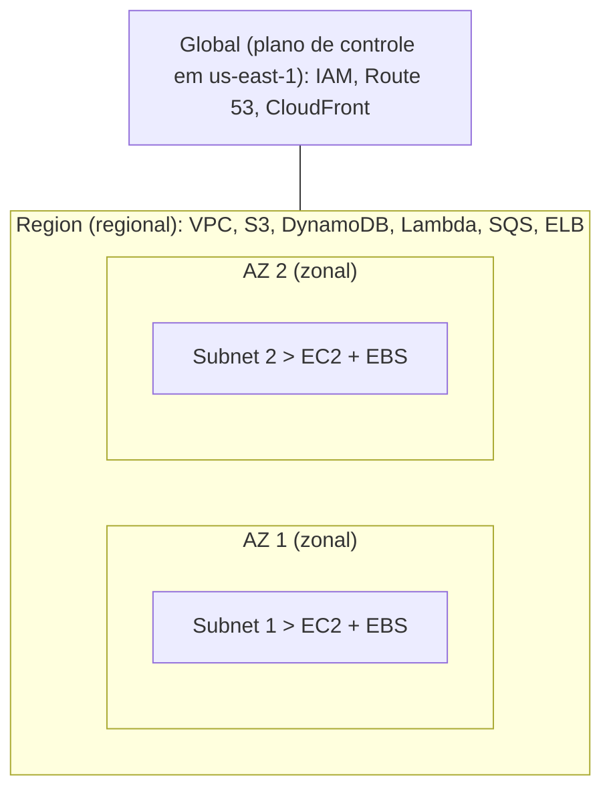

---
aliases:
  - Aula 1.4
modulo: 1
aula: 4
parte: "I Fundamentos"
dominios:
  - 2
  - 3
lida: false
tags:
  - aula
  - saa-c03
  - modulo-01
---

# Aula 1.4: Escopo dos recursos, global, regional e zonal

[[01 - Nuvem e Infraestrutura Global AWS|Voltar ao módulo]]

> [!question] Por que o "onde vive" de cada recurso decide o que acontece quando algo falha?
> Um volume de disco, um [[Bucket|bucket]] e um usuário de [[IAM]] têm escopos diferentes. O escopo diz que tipo de evento derruba o recurso e quem precisa cuidar da redundância: você ou a AWS. Quase toda questão de resiliência da prova depende de saber esse escopo de cabeça.

## O problema: "multi-AZ" não é uma propriedade universal

Na [[01.02 - Regions e Availability Zones|aula 1.2]] vimos que a redundância física existe em dois níveis (AZ e [[Regiao AWS|Region]]). Falta ligar isso aos serviços. Se um serviço é **zonal**, ele vive em uma só [[Zona de Disponibilidade|AZ]]: a falha dela o derruba, e a redundância é por sua conta. Se é **regional**, a AWS espalha o serviço por várias AZs por dentro, e você ganha essa resiliência sem pedir. Se é **global**, o recurso não pertence a uma Region.

Entender o escopo evita dois erros opostos: **pagar por redundância que já vem de graça** (replicar um [[Bucket|bucket]] [[S3]] entre [[Zona de Disponibilidade|AZs]], que o S3 Standard já faz) e **achar que está protegido quando não está** (duas [[EC2|instâncias EC2]] na mesma AZ).

## Os três escopos

### Zonal: vive em uma AZ

Recursos zonais são criados em uma [[Zona de Disponibilidade|AZ]] específica, e **falham independentemente em cada AZ** (o whitepaper chama esse padrão de *Availability Zone Independence*, AZI). Os que mais caem na prova:

| Recurso zonal | Detalhe que importa |
|---|---|
| [[EC2]] instance | Roda em um host de uma [[Zona de Disponibilidade\|AZ]]; se a AZ falhar, a instância some até ser relançada |
| [[EBS]] volume | Fica na [[Zona de Disponibilidade\|AZ]] da instância; só pode ser anexado a instâncias da mesma AZ (replicar para outra AZ é por [[Snapshot\|snapshot]]) |
| [[Sub-rede|Subnet]] (sub-rede) | "Um intervalo de endereços IP dentro de uma [[VPC]] que **deve residir em uma única [[Zona de Disponibilidade\|AZ]]**"; para cobrir 3 AZs você cria 3 subnets |
| [[NAT Gateway]] | Zonal por padrão: criado em uma [[Sub-rede\|subnet]] pública, logo em uma [[Zona de Disponibilidade\|AZ]], e um por AZ para resiliência. Existe também o **modo regional**, em que um único gateway cobre várias AZs e expande e contrai sozinho conforme a carga (não serve para [[NAT]] privado; verificado em novembro de 2026, [Regional NAT gateways](https://docs.aws.amazon.com/vpc/latest/userguide/nat-gateways-regional.html)). Detalhes no [[06 - VPC a Fundo\|Módulo 6]] |
| [[Instance Store\|Instance store]] | Disco local do host físico, ligado à [[Zona de Disponibilidade\|AZ]] e à vida da instância |
| [[EBS]] com [[Multi-Attach]] | Mesmo com um volume anexado a várias instâncias, todas precisam estar na **mesma [[Zona de Disponibilidade\|AZ]]** do volume |
| [[EFS]] One Zone | Sistema de arquivos em uma única [[Zona de Disponibilidade\|AZ]], por escolha de custo (o EFS Standard é regional) |

A consequência de projeto: **para tolerar a perda de uma [[Zona de Disponibilidade|AZ]], você precisa colocar réplicas em outras AZs** (instâncias em um [[Auto Scaling Group]] com [[Sub-rede|subnets]] de várias AZs, por exemplo). A AWS fornece o isolamento; **você** fornece a redundância.

### Regional: vive em uma Region, atravessa suas AZs

Serviços regionais operam sobre várias [[Zona de Disponibilidade|AZs]] de uma [[Regiao AWS|Region]] sem você escolher uma. O recurso pertence à Region inteira, e a AWS mantém a [[Disponibilidade|disponibilidade]] entre AZs. Exemplos:

| Recurso regional | Observação |
|---|---|
| [[VPC]] | Abrange todas as [[Zona de Disponibilidade\|AZs]] da [[Regiao AWS\|Region]] (as [[Sub-rede\|subnets]] dentro dela são zonais) |
| [[S3]] [[Bucket\|bucket]] | Região escolhida na criação; no namespace global padrão o **nome** do bucket é único globalmente (existe também o [[Namespace Regional de Buckets\|namespace regional da conta]], com nomes únicos por conta e [[Regiao AWS\|Region]]), mas o bucket é regional; classes Standard guardam dados em múltiplas [[Zona de Disponibilidade\|AZs]] |
| [[DynamoDB]] tabela | Regional; replicada entre [[Zona de Disponibilidade\|AZs]]; replicar entre [[Regiao AWS\|Regions]] exige [[Global Tables]] (Módulo 14) |
| [[Lambda]] função | Regional; executa em [[Zona de Disponibilidade\|AZs]] da [[Regiao AWS\|Region]] |
| [[SQS]], [[SNS]] | Regionais, com resiliência [[Multi-AZ\|multi-AZ]] gerenciada |
| [[Elastic Load Balancing]] | Regional; o balanceador cria nós nas [[Zona de Disponibilidade\|AZs]] que você habilita |
| [[RDS]] | A instância fica em uma [[Zona de Disponibilidade\|AZ]]; [[Multi-AZ]] é opção que você liga (Módulo 13) |
| [[Aurora]] | O [[Cluster Volume\|volume do cluster]] é replicado em 3 [[Zona de Disponibilidade\|AZs]] por padrão; as instâncias de computação ficam em AZs específicas, então a resiliência de computação (réplicas em outra AZ) ainda é decisão sua |
| [[AMI]] | Regional: a imagem **não aparece em outra [[Regiao AWS\|Region]] até ser copiada** |
| [[Snapshot]] do [[EBS]] | Regional (armazenado no [[S3]] da [[Regiao AWS\|Region]]); é a base para recriar o volume em outra [[Zona de Disponibilidade\|AZ]] ou copiar para outra Region |
| [[KMS]] key | Regional; uma [[Multi-Region Key\|chave multi-Region]] é opção explícita, que cria réplicas em outras [[Regiao AWS\|Regions]] (Módulo 8) |
| [[Security Group]] | Pertence a uma [[VPC]], logo é regional; não atravessa [[Regiao AWS\|Regions]] |
| [[Elastic IP]] | Regional: serve apenas na [[Regiao AWS\|Region]] em que foi alocado |
| [[EFS]] Standard | Regional, [[Multi-AZ\|multi-AZ]] por dentro (a variante One Zone é zonal) |

Duas notas. Primeiro, **regional não significa "resolve tudo"**: o [[RDS]], por exemplo, só é [[Multi-AZ|multi-AZ]] se você pedir, e uma classe de armazenamento "One Zone" do [[S3]] guarda os dados em **uma** [[Zona de Disponibilidade|AZ]] por escolha de custo. Segundo, o whitepaper de isolamento de falhas afirma que [[Regiao AWS|Regions]] públicas têm **no mínimo três AZs**, e é por isso que o desenho padrão de três AZs funciona na maioria das Regions (lembre das exceções da aula 1.2, como contas novas em `us-west-1` com 2 AZs).

### Global: não pertence a uma Region

Alguns serviços têm recursos que **não são específicos de [[Regiao AWS|Region]]**. A lista que mais cai: [[IAM]] (usuários, roles, policies), [[Route 53]], [[CloudFront]], [[Organizations]] e [[Global Accelerator]], além de [[WAF|AWS WAF]] e certificado [[ACM]] **quando usados com CloudFront**. Você cria um usuário de IAM uma vez e ele vale em todas as Regions da partição.

O ponto sutil, que a AWS documenta no whitepaper de isolamento de falhas (verificado em novembro de 2026), é que **global não significa "sem localização"**. Esses serviços separam o **[[Plano de Controle|plano de controle]]** (as operações de criar, alterar, listar e apagar, as chamadas "CRUDL") do **[[Plano de Dados|plano de dados]]** (o que atende o tráfego do dia a dia):

| Serviço global | [[Plano de Controle\|Plano de controle]] (hospedado em) | [[Plano de Dados\|Plano de dados]] |
|---|---|---|
| [[IAM]] | us-east-1 | Em cada [[Regiao AWS\|Region]] da partição |
| [[Organizations\|AWS Organizations]] | us-east-1 | (sem [[Plano de Dados\|plano de dados]] próprio) |
| [[Route 53]] | us-east-1 | Nas [[Regiao AWS\|Regions]] e na rede de [[Edge Location\|POPs]] (zonas privadas e [[Health Check\|health checks]] não ficam nos POPs) |
| [[CloudFront]] | us-east-1 | Nas [[Regiao AWS\|Regions]] e nos [[Edge Location\|POPs]] |
| [[WAF\|AWS WAF]] e [[ACM]] para [[CloudFront]] | us-east-1 | Nos [[Edge Location\|POPs]] |
| [[Global Accelerator\|AWS Global Accelerator]] | us-west-2 | Nos [[Edge Location\|POPs]] |
| [[Shield\|AWS Shield]] Advanced | us-east-1 | Nas [[Regiao AWS\|Regions]] e nos [[Edge Location\|POPs]] |

**Por que isso é cobrado?** Porque cria uma armadilha de resiliência: se o seu plano de [[Recuperacao de Desastres|recuperação de desastre]] (Módulo 20) depende de **criar ou alterar** algo em um serviço global **durante** o evento (editar um registro do Route 53, criar uma role nova), e o problema atinge justamente `us-east-1`, esse passo pode falhar. A recomendação oficial é a **[[Estabilidade Estatica|estabilidade estática]]** (*static stability*): o sistema continua funcionando e se recupera **sem precisar do [[Plano de Controle|plano de controle]]**, usando o [[Plano de Dados|plano de dados]] que já está configurado (por exemplo, [[Route 53]] com [[Health Check|health checks]] e [[Failover Routing|política de failover]] já criados antes do incidente) e **pré-provisionando** recursos e permissões em vez de criá-los na hora.

Um efeito colateral prático: **o certificado do [[ACM]] que você associa ao [[CloudFront]] precisa estar em `us-east-1`**, mesmo que toda a sua aplicação rode em outra [[Regiao AWS|Region]]. É uma consequência direta de o [[Plano de Controle|plano de controle]] do CloudFront viver ali. O mesmo vale para [[Service Quotas|cotas de serviço]] **globais**: a documentação do Service Quotas diz que só se pode pedir aumento de uma "global quota" a partir de US East (N. Virginia), na partição pública (veja a [[01.06 - Tudo e API Endpoints Quotas e Health|aula 1.6]]).

> [!example] A armadilha do failover
> Uma empresa planeja DR em `us-west-2`, com o primário em `us-east-1`. O [[Runbook|runbook]] diz: "durante o desastre, entrar no console do [[Route 53]] e trocar o registro para apontar ao `us-west-2`". Se o problema afeta `us-east-1`, onde o [[Plano de Controle|plano de controle]] do Route 53 vive, a edição pode não funcionar. O desenho resistente usa **[[Failover|failover automático]]**: um [[Health Check|health check]] e uma [[Routing Policy|política de roteamento]] de failover **configurados antes**, que o [[Plano de Dados|plano de dados]] (rede global de [[DNS]]) executa sozinho quando o primário falha.

## Como o escopo decide a resiliência

Ordene as falhas pelo tamanho do estrago e veja quem protege de quê:

| Falha | Atinge | Quem protege |
|---|---|---|
| Host ou disco | Uma instância ou volume | Você (réplicas, [[Auto Scaling Group\|Auto Scaling]]) |
| Uma [[Zona de Disponibilidade\|AZ]] inteira | Todos os recursos zonais dela | Você, com recursos em 2 ou mais AZs; a AWS com serviços regionais [[Multi-AZ\|multi-AZ]] |
| Uma [[Regiao AWS\|Region]] inteira | Todos os recursos regionais dela | Você, com replicação para outra Region |
| [[Plano de Controle\|Plano de controle]] de serviço global | Operações de criar e alterar (não o tráfego já em curso) | Você, com [[Estabilidade Estatica\|estabilidade estática]] |

A regra que a prova recompensa: **use o serviço regional gerenciado quando existir, e distribua os recursos zonais por [[Zona de Disponibilidade|AZs]]**. Quando o enunciado diz "[[Alta Disponibilidade|highly available]]" e a arquitetura tem uma única [[EC2|instância EC2]] ou uma única [[Sub-rede|subnet]], o ponto fraco é um recurso zonal sem réplica.

Um detalhe adicional da AWS para zonais: ela recomenda detectar a falha de **uma** [[Zona de Disponibilidade|AZ]] e **desviar o tráfego** para as outras (a AWS oferece *[[Zonal Shift|zonal shift]]* e *zonal autoshift* no [[Application Recovery Controller]]). É a versão "operacional" de projetar para falha.

## Como isso cai na prova

Cobre Task 2.2 ("global infrastructure ([[Zona de Disponibilidade|AZs]], [[Regiao AWS|Regions]], [[Route 53]])" e "mitigating single points of failure"), Task 2.1 ("storage types (object, file, block)") e Task 3.3 ("global infrastructure" em bancos de dados), com ponte para Task 4.4 ([[NAT Gateway|NAT gateway]] "single shared vs one per AZ").

**Palavras-chave em inglês e o que apontam:**

- "[[Ponto Unico de Falha|single point of failure]]" com uma instância/subnet/AZ única: recurso zonal sem redundância.
- "survive an [[Zona de Disponibilidade|Availability Zone]] failure": recursos em 2+ AZs; serviço regional [[Multi-AZ|multi-AZ]].
- "survive a [[Regiao AWS|Region]] failure": replicação para outra Region.
- "no changes to the application", "least [[Overhead Operacional|operational overhead]]": serviço regional gerenciado em vez de replicar à mão.

**Pegadinhas clássicas:**

- [[Sub-rede|Subnet]] é zonal; [[VPC]] é regional (não confunda).
- [[EBS]] é zonal: não "replica sozinho" para outra [[Zona de Disponibilidade|AZ]].
- [[S3]]: nome global (no namespace padrão), [[Bucket|bucket]] regional.
- [[AMI]] não aparece em outra [[Regiao AWS|Region]] até ser copiada; o mesmo vale para [[Snapshot|snapshots]], que são regionais.
- [[NAT Gateway]] é zonal por padrão; existe um modo regional que cobre várias [[Zona de Disponibilidade|AZs]].
- Serviço global tem [[Plano de Controle|plano de controle]] em uma [[Regiao AWS|Region]]: não conte com ele para [[Failover|failover]].
- Replicar entre [[Regiao AWS|Regions]] nunca é automático.

| Requisito no enunciado | Resposta provável | Por quê |
|---|---|---|
| Tolerar a perda de uma [[Zona de Disponibilidade\|AZ]] | Instâncias em 2+ [[Sub-rede\|subnets]], cada uma em uma AZ | Recursos zonais exigem réplicas em outras AZs |
| Dados duráveis entre [[Zona de Disponibilidade\|AZs]] sem configurar | [[S3]] Standard, [[DynamoDB]] | Regionais, [[Multi-AZ\|multi-AZ]] por dentro |
| Disco compartilhado entre instâncias de [[Zona de Disponibilidade\|AZs]] diferentes | Não é [[EBS]] (zonal); um sistema de arquivos regional ([[EFS]], Módulo 10) | EBS fica numa AZ |
| Plano de DR que não pode depender do console | [[Failover\|Failover automático]] pré-configurado | Evita depender de [[Plano de Controle\|plano de controle]] |
| Certificado [[ACM]] para [[CloudFront]] | Solicitar em us-east-1 | [[Plano de Controle\|Plano de controle]] do CloudFront |
| [[Alta Disponibilidade\|Alta disponibilidade]] de saída para a internet com [[NAT]], sem gerenciar um por [[Zona de Disponibilidade\|AZ]] | [[NAT Gateway]] em modo regional | Um gateway que expande entre AZs sozinho (Módulo 6) |
| Imagem de servidor precisa existir em outra [[Regiao AWS\|Region]] | Copiar a [[AMI]] para a Region de destino | AMI é regional |

## Resumo

> [!abstract] A aula em uma frase
> Cada recurso AWS é zonal, regional ou global; o escopo diz que falha o derruba e quem constrói a redundância, e os serviços "globais" têm [[Plano de Controle|plano de controle]] em uma [[Regiao AWS|Region]], o que não pode ser dependência de um plano de recuperação.

**A lógica, em 5 passos**

1. Falhas atingem uma [[Zona de Disponibilidade|AZ]], uma [[Regiao AWS|Region]] ou o [[Plano de Controle|plano de controle]] de um serviço global.
2. Recursos zonais ([[EC2]], [[EBS]], [[Sub-rede|subnet]]) falham com a [[Zona de Disponibilidade|AZ]]; a redundância é sua (outras AZs).
3. Serviços regionais ([[VPC]], [[S3]], [[DynamoDB]], Lambda, [[SQS]], [[Elastic Load Balancing|ELB]]) atravessam as [[Zona de Disponibilidade|AZs]] de uma [[Regiao AWS|Region]] e entregam [[Multi-AZ|multi-AZ]] gerenciado.
4. Serviços globais ([[IAM]], [[Route 53]], [[CloudFront]], Organizations) têm [[Plano de Controle|plano de controle]] em uma [[Regiao AWS|Region]] e [[Plano de Dados|plano de dados]] distribuído.
5. Resiliência de verdade usa o [[Plano de Dados|plano de dados]] já configurado ([[Estabilidade Estatica|estabilidade estática]]), não operações de [[Plano de Controle|plano de controle]] durante o incidente.

**Tabela-síntese**

| Escopo | Exemplos | Tolera perda de uma [[Zona de Disponibilidade\|AZ]]? | Tolera perda de uma [[Regiao AWS\|Region]]? |
|---|---|---|---|
| Zonal | [[EC2]], [[EBS]], [[Sub-rede\|subnet]] | Só com réplicas suas | Não |
| Regional | [[S3]], [[DynamoDB]], Lambda, [[VPC]] | Sim (gerenciado), exceto opções One Zone e [[RDS]] sem [[Multi-AZ]] | Não, sem replicação configurada |
| Global | [[IAM]], [[Route 53]], [[CloudFront]] | [[Plano de Dados\|Plano de dados]] sim; [[Plano de Controle\|plano de controle]] em us-east-1 | Plano de dados continua; criar e alterar pode falhar |

**Na prática, isso significa**

- Para cada componente da arquitetura, pergunte: é zonal, regional ou global?
- Todo recurso zonal crítico precisa de réplica em outra [[Zona de Disponibilidade|AZ]].
- Prefira serviços regionais gerenciados quando existirem.
- DR com [[Failover|failover automático]] e recursos pré-provisionados, não com cliques durante o desastre.
- Certificado [[ACM]] de [[CloudFront]] em us-east-1.

> [!tip] Liga com
> Vem das [[01.02 - Regions e Availability Zones|Regions e AZs]] e leva ao [[01.05 - Modelo de Responsabilidade Compartilhada|modelo de responsabilidade compartilhada]]. Os detalhes de cada serviço estão nos [[06 - VPC a Fundo|Módulo 6]], [[11 - Amazon S3 a Fundo|Módulo 11]] e [[20 - Alta Disponibilidade e Recuperacao de Desastres|Módulo 20]].

## Erros comuns

- **Achar que a [[VPC]] é zonal ou que a [[Sub-rede|subnet]] atravessa [[Zona de Disponibilidade|AZs]].** A VPC é regional; cada subnet fica em uma AZ.
- **Supor que um [[EBS|volume EBS]] está protegido contra falha de [[Zona de Disponibilidade|AZ]].** Ele é zonal; proteção vem de [[Snapshot|snapshots]] e réplicas.
- **Replicar um [[Bucket|bucket]] [[S3]] Standard "entre [[Zona de Disponibilidade|AZs]]".** Já é [[Multi-AZ|multi-AZ]]; o que você paga a mais é replicação entre [[Regiao AWS|Regions]], quando necessário.
- **Dependência de [[Plano de Controle|plano de controle]] global no [[Runbook|runbook]] de DR.** Preencher registro [[DNS]] durante o desastre falha se a [[Regiao AWS|Region]] que o hospeda é a afetada.
- **Esquecer que [[IAM]] é global.** Uma role criada vale em todas as [[Regiao AWS|Regions]] da partição; não há "IAM por Region".

## Pratique

**1.** Um arquiteto cria uma [[VPC]] em us-east-1 e quer uma única [[Sub-rede|subnet]] que cubra três [[Zona de Disponibilidade|AZs]], para simplificar o desenho. O que acontece?

- [ ] a) Ele marca a opção de abrangência multi-AZ ao criar a subnet e ela passa a cobrir as três AZs
- [ ] b) Não é possível: uma subnet reside em uma única AZ, então é preciso criar uma subnet por AZ
- [ ] c) Uma subnet pública com a tabela de rotas principal se estende automaticamente por todas as AZs
- [ ] d) É possível, mas apenas em Regions que tenham exatamente três AZs

**2.** Uma equipe precisa guardar documentos de forma durável, de modo que sobrevivam à perda de uma [[Zona de Disponibilidade|AZ]], com o MENOR [[Overhead Operacional|overhead operacional]]. Qual opção atende?

- [ ] a) Um volume EBS gp3 anexado a uma instância, na mesma AZ dela
- [ ] b) Instance store de uma família de instâncias com disco local de alto desempenho
- [ ] c) Um bucket S3 Standard, que guarda os objetos em múltiplas AZs da Region
- [ ] d) Um sistema de arquivos EFS One Zone, montado nas instâncias da aplicação

**3.** (Escolha DUAS.) Em uma revisão de resiliência, a equipe classifica os recursos da arquitetura. Quais dos itens abaixo têm escopo global, ou seja, não pertencem a uma [[Regiao AWS|Region]] específica?

- [ ] a) Usuários e roles do IAM
- [ ] b) Um security group
- [ ] c) Uma distribuição do CloudFront
- [ ] d) Um bucket do S3 (o bucket em si, não o nome)
- [ ] e) Uma chave do KMS

**4.** Uma empresa roda toda a aplicação em eu-west-1 e quer servir o site por HTTPS com [[CloudFront]], usando um certificado do [[ACM|AWS Certificate Manager]]. Onde o certificado deve ser solicitado?

- [ ] a) Em us-east-1, a Region do plano de controle do CloudFront
- [ ] b) Em eu-west-1, a mesma Region da aplicação
- [ ] c) Em qualquer Region, pois o ACM é global e o certificado vale em todas
- [ ] d) Na Region mais próxima do usuário final, escolhida pelo próprio CloudFront

**5.** Um plano de DR prevê o [[Failover|failover]] de us-east-1 para us-west-2. O [[Runbook|runbook]] manda editar manualmente um registro no [[Route 53]] durante o desastre. Qual é o risco, e como mitigá-lo de acordo com as boas práticas da AWS?

- [ ] a) Nenhum risco, porque o Route 53 replica o plano de controle em todas as Regions da partição e a edição funciona de qualquer uma
- [ ] b) O risco é o custo das consultas DNS no evento; mitigue aumentando o TTL do registro para reduzir o número de consultas
- [ ] c) O plano de controle fica em us-east-1 e pode falhar; configure antes health check e failover que o plano de dados executa
- [ ] d) O risco é um cliente sem IPv6 não alcançar o site; mitigue criando também um registro AAAA para o endereço secundário

**6.** Uma equipe criou uma [[AMI]] em us-east-1 e tenta lançar instâncias com ela em eu-west-1, mas a imagem não aparece. Qual é a explicação e a solução?

- [ ] a) A AMI foi apagada ao trocar a Region do console; recriar a imagem na nova Region a partir do zero
- [ ] b) AMIs são globais e só aparecem depois que a imagem é compartilhada com a própria conta
- [ ] c) A AMI só pode ser lançada na AZ em que foi criada; escolher a AZ equivalente em eu-west-1
- [ ] d) A AMI é um recurso regional; copiar a imagem para eu-west-1 e lançar a partir da cópia

**7.** Uma empresa tem cargas em [[Sub-rede|subnets]] privadas de três [[Zona de Disponibilidade|AZs]] e quer saída para a internet com [[Alta Disponibilidade|alta disponibilidade]] e o MENOR esforço para manter gateways e rotas a cada nova AZ (sem necessidade de [[NAT]] privado). Qual opção atende?

- [ ] a) Um NAT Gateway zonal em uma única AZ, compartilhado pelas três subnets privadas
- [ ] b) Um NAT Gateway em modo regional, que expande e contrai entre AZs conforme a carga
- [ ] c) Uma NAT instance por AZ, com scripts de failover mantidos pela equipe
- [ ] d) Um Internet Gateway associado diretamente às subnets privadas

**8.** Uma aplicação roda em três [[EC2|instâncias EC2]], todas na mesma [[Zona de Disponibilidade|AZ]], e o requisito é continuar disponível se uma AZ falhar. Qual mudança atende a isso com a menor complexidade?

- [ ] a) Trocar as instâncias por modelos maiores e agendar snapshots horários dos volumes EBS para restauração rápida
- [ ] b) Criar uma segunda VPC na mesma AZ, com os mesmos CIDRs, ligada à primeira por peering
- [ ] c) Distribuir as instâncias em subnets de pelo menos duas AZs, atrás de um balanceador de carga
- [ ] d) Ativar o monitoramento detalhado e um alarme que reinicie a instância se a AZ falhar

**9.** (Escolha DUAS.) Uma equipe quer que o plano de recuperação resista a um problema no [[Plano de Controle|plano de controle]] de um serviço global. Quais práticas ajudam?

- [ ] a) Criar as IAM roles necessárias pelo console durante o failover
- [ ] b) Pré-provisionar capacidade e permissões nas duas Regions antes do incidente
- [ ] c) Reconfigurar o roteamento pelo console do serviço global no momento do incidente
- [ ] d) Confiar que um bucket regional replica o conteúdo sozinho para a Region de standby
- [ ] e) Usar health checks e failover de DNS já configurados, executados pelo plano de dados

**10.** Uma aplicação tem duas [[EC2|instâncias EC2]] e um [[EBS|volume EBS]], todos na mesma [[Zona de Disponibilidade|AZ]], além de um [[Bucket|bucket]] [[S3]] Standard e uma tabela [[DynamoDB]]. Essa AZ sofre uma falha total. O que continua acessível sem nenhuma ação da equipe?

- [ ] a) O bucket S3 e a tabela DynamoDB, que são regionais; as instâncias e o volume, zonais, ficam indisponíveis
- [ ] b) Tudo, pois qualquer recurso criado em uma Region sobrevive à perda de uma de suas AZs
- [ ] c) O volume EBS e o bucket S3, porque o EBS replica seus dados entre as AZs da Region
- [ ] d) As instâncias EC2, que a AWS reinicia automaticamente em outra AZ da mesma Region

> [!success]- Gabarito
> **1. b)** a [[Sub-rede|subnet]] é zonal, uma por [[Zona de Disponibilidade|AZ]]; a) não existe essa opção; c) ser pública ou não não muda o escopo; d) o número de AZs da [[Regiao AWS|Region]] não altera a regra.
> **2. c)** o [[S3]] Standard é regional e guarda os dados em várias [[Zona de Disponibilidade|AZs]] sem configuração; a) o [[EBS]] é zonal e some com a AZ; b) o [[Instance Store|instance store]] é efêmero e ligado ao host; d) o [[EFS]] One Zone fica em uma única AZ por escolha de custo.
> **3. a), c)** [[IAM]] e [[CloudFront]] são serviços globais, com [[Plano de Controle|plano de controle]] em us-east-1; b) o [[Security Group|security group]] pertence a uma [[VPC]], que é regional; d) o [[Bucket|bucket]] é regional, só o nome é único globalmente; e) a chave do [[KMS]] é regional.
> **4. a)** o certificado para uso com [[CloudFront]] deve estar em us-east-1; b) a [[Regiao AWS|Region]] da aplicação não vale para o CloudFront; c) o [[ACM]] é regional, não global; d) o CloudFront não escolhe a Region do certificado.
> **5. c)** o [[Plano de Controle|plano de controle]] do [[Route 53]] fica em us-east-1, e o desenho resistente usa [[Failover|failover automático]] pré-configurado; a) o plano de controle não é replicado em todas as [[Regiao AWS|Regions]]; b) o risco não é o custo nem o [[TTL]]; d) [[IPv6]] não tem relação com o risco.
> **6. d)** a [[AMI]] é regional e precisa ser copiada para a outra [[Regiao AWS|Region]]; a) nada é apagado ao trocar o console de Region; b) AMIs não são globais; c) a AMI não é presa a uma [[Zona de Disponibilidade|AZ]].
> **7. b)** o [[NAT Gateway]] regional expande sozinho entre [[Zona de Disponibilidade|AZs]], sem gerenciar gateways e rotas por AZ; a) um [[NAT]] em uma só AZ é [[Ponto Unico de Falha|ponto único de falha]]; c) a [[NAT Instance|NAT instance]] exige manutenção e [[Failover|failover]] próprios; d) o [[Internet Gateway]] não faz NAT para [[Sub-rede|subnets]] privadas.
> **8. c)** distribuir em 2 ou mais [[Zona de Disponibilidade|AZs]] com um balanceador elimina a dependência de uma única AZ; a) tamanho e [[Snapshot|snapshots]] não mantêm o serviço no ar durante a falha; b) uma segunda [[VPC]] na mesma AZ não muda o escopo, e CIDRs iguais conflitam no peering; d) reiniciar a instância na mesma AZ não resolve a falha da AZ.
> **9. b), e)** pré-provisionar e usar o [[Plano de Dados|plano de dados]] já configurado seguem a [[Estabilidade Estatica|estabilidade estática]]; a) e c) exigem [[Plano de Controle|plano de controle]] na hora; d) a replicação entre [[Regiao AWS|Regions]] não é automática.
> **10. a)** serviços regionais continuam, e recursos zonais caem com a [[Zona de Disponibilidade|AZ]]; b) ignora o escopo zonal; c) o [[EBS]] é zonal e não replica entre AZs; d) a AWS não relança instâncias em outra AZ sozinha, a menos que você configure um [[Auto Scaling Group|Auto Scaling]].

## Para aprofundar

- [ ] [Global services (Fault Isolation Boundaries)](https://docs.aws.amazon.com/whitepapers/latest/aws-fault-isolation-boundaries/global-services.html) (AWS Whitepapers): a tabela de planos de controle e de dados e as práticas de [[Estabilidade Estatica|estabilidade estática]].
- [ ] [Zonal services (Fault Isolation Boundaries)](https://docs.aws.amazon.com/whitepapers/latest/aws-fault-isolation-boundaries/zonal-services.html) (AWS Whitepapers): isolamento por [[Zona de Disponibilidade|AZ]], dependências de [[Local Zone|Local Zones]] e Outposts e [[Zonal Shift|zonal shift]].
- [ ] [Regions (Fault Isolation Boundaries)](https://docs.aws.amazon.com/whitepapers/latest/aws-fault-isolation-boundaries/regions.html) (AWS Whitepapers): isolamento entre [[Regiao AWS|Regions]] e mínimo de três [[Zona de Disponibilidade|AZs]].

Próxima aula: [[01.05 - Modelo de Responsabilidade Compartilhada]]
