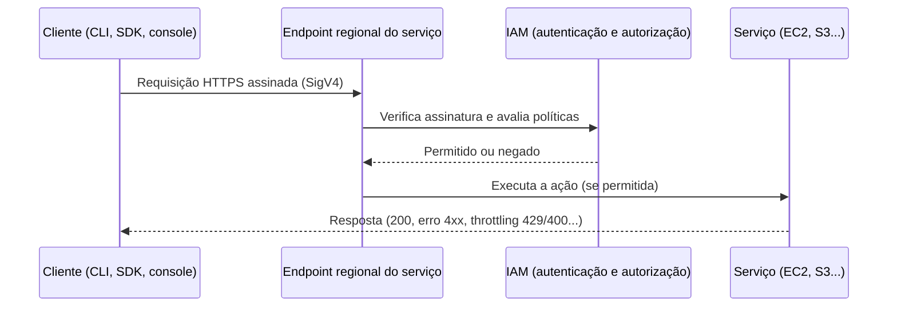

---
aliases:
  - Aula 1.6
modulo: 1
aula: 6
parte: "I Fundamentos"
dominios:
  - 1
  - 2
lida: false
tags:
  - aula
  - saa-c03
  - modulo-01
---

# Aula 1.6: Tudo é API, endpoints, Service Quotas, throttling e Health Dashboard

[[01 - Nuvem e Infraestrutura Global AWS|Voltar ao módulo]]

> [!question] Como uma ação no console, na CLI ou no CloudFormation chega à AWS, e por que ela pode ser negada, limitada ou atrasada?
> Quando você roda `aws s3 ls` ou clica em "Launch instance", uma [[HTTP|requisição HTTP]] assinada atravessa a internet até um endpoint de uma [[Regiao AWS|Region]]. Entender essa viagem explica por que o [[IAM]] controla tudo, por que existem endpoints regionais e FIPS, e por que um plano de DR pode falhar por uma cota na Region de reserva.

## O problema: um único jeito de controlar milhares de ações

A AWS tem centenas de serviços e milhares de ações. Controlar cada uma por um mecanismo próprio seria inviável. A solução é uniforme: **cada serviço expõe uma API [[HTTP]]**, e **cada interface** (o Console de Gerenciamento, a AWS CLI, os SDKs, o [[CloudFormation]], o OpenTofu que o João usa) apenas **monta chamadas dessa API**. Quem não sabe que o console também chama API trata os dois como mundos separados; para a AWS, são o mesmo.

Uma única porta de entrada permite três coisas ao mesmo tempo:

1. **Autenticar**: provar quem fez a chamada.
2. **Autorizar**: o [[IAM]] avalia se aquela identidade pode executar aquela ação naquele recurso.
3. **Registrar**: cada chamada pode ser auditada (o [[CloudTrail]] registra, tema do Módulo 5).

## A anatomia de uma chamada

### Autenticação: Signature Version 4 (SigV4)

Cada requisição precisa de **informação de autenticação**, que inclui uma assinatura. O protocolo é o **[[SigV4|AWS Signature Version 4]] (SigV4)**. Você **nunca envia a secret [[Access Key|access key]]**: ela é usada para **calcular** a assinatura. Os passos (documentação do [[IAM]], verificado em novembro de 2026):

1. Montar uma **requisição canônica** a partir dos detalhes da requisição (método, caminho, cabeçalhos, corpo).
2. **Calcular a assinatura** com suas credenciais.
3. Adicionar a assinatura à requisição, no cabeçalho `Authorization`.

A AWS refaz o mesmo cálculo do lado dela e compara: se bate, a requisição segue para a avaliação de permissões; se não, é rejeitada.

Duas propriedades importam para a prova e para o raciocínio de arquitetura:

- A chave de assinatura é **derivada e restrita a um serviço, uma [[Regiao AWS|Region]] e um dia**. Por isso a assinatura é diferente para cada Region: quem assina precisa saber a Region de destino. Existe uma extensão, o **SigV4a** (assimétrica), que gera assinaturas verificáveis em mais de uma Region, usada, por exemplo, em [[S3]] [[Multi-Region Access Point|Multi-Region Access Points]].
- **Você quase nunca assina à mão**: SDKs e a CLI fazem isso, usando as credenciais configuradas. A documentação recomenda sempre usar SDK ou CLI, salvo motivo forte.

> [!info] Ligando os pontos
> O que alimenta a assinatura são **credenciais**: [[Access Key|chaves de acesso]] de longo prazo (a evitar) ou credenciais **temporárias** de uma role (a preferir). O [[04 - IAM Identidade e Acesso|Módulo 4]] explica por quê. Aqui basta fixar: **sem credencial válida não há assinatura, e sem assinatura não há chamada**. É também por isso que roles de instância ([[EC2]]) e funções ([[Lambda]]) recebem [[Credencial Temporaria|credenciais temporárias]] sem que o código guarde chave alguma.

### Endpoints: para onde a chamada vai

Um **endpoint** é a URL de entrada de um serviço. O padrão mais comum é regional, no formato **`serviço.região.amazonaws.com`** (por exemplo `ec2.eu-west-1.amazonaws.com`). Os tipos que importam (documentação do [[EC2]], verificado em novembro de 2026):

| Tipo de endpoint | Formato de exemplo | Quando usar |
|---|---|---|
| [[IPv4]] regional | `ec2.eu-west-1.amazonaws.com` | Padrão; aceita só IPv4 |
| [[Dual-Stack\|Dual-stack]] | `ec2.eu-west-1.api.aws` | Clientes [[IPv4]] e [[IPv6]] |
| FIPS | endpoints com FIPS no nome (ver tabela de endpoints do serviço) | Exigência de módulos criptográficos validados pela norma FIPS 140 (por exemplo, requisitos do governo dos EUA) |

Um detalhe pegadinha: se você usa o endpoint **geral** `ec2.amazonaws.com` (sem [[Regiao AWS|Region]]), o [[EC2]] envia a chamada para **`us-east-1`**. Um script sem Region explícita pode, sem aviso, criar recursos na Region errada.

**Por que existem endpoints regionais?** Pelo mesmo princípio da [[01.02 - Regions e Availability Zones|aula 1.2]]: [[Regiao AWS|Regions]] são isoladas. Cada Region tem o seu próprio [[Plano de Controle|plano de controle]] de cada serviço; você escolhe qual chamar. Em arquiteturas privadas, os **endpoints de [[VPC]]** ([[VPC Endpoint]], Módulo 6) permitem chamar a API sem passar pela internet.

> [!example] FIPS na prática
> Uma empresa que presta serviço a uma agência federal americana precisa que todo o tráfego de API use criptografia validada por FIPS 140. A equipe configura o SDK para usar o endpoint FIPS dos serviços em [[Regiao AWS|Regions]] dos EUA, em vez do endpoint padrão. Nenhum código de negócio muda: só a configuração do cliente.

## Quotas e throttling: dois limites diferentes

A AWS impõe limites para proteger a plataforma e os outros clientes. Dois conceitos que a prova gosta de misturar:

- **[[Service Quotas|Service quota]]** (cota, antes chamada de *limit*): o **máximo de recursos ou ações** permitido em uma conta ou [[Regiao AWS|Region]]. Exemplos da documentação: número de [[IAM Role|roles IAM]] por conta (quota de conta) e número de [[VPC|VPCs]] por Region (quota regional).
- **[[Throttling]]**: o **[[Rate-Based Rule|limite de taxa]] de requisições** por unidade de tempo. Excedê-lo faz a API recusar chamadas (no [[EC2]], o erro `RequestLimitExceeded`), mesmo que você não tenha criado recurso algum.

### Service Quotas

O serviço **[[Service Quotas]]** é o local central para **ver e gerenciar cotas** de vários serviços (verificado em novembro de 2026, guia do usuário). Termos oficiais:

| Termo | Significado |
|---|---|
| Default value | Valor inicial definido pela AWS |
| Adjustable | A cota pode ser aumentada (o que a prova chama, informalmente, de *soft limit*; as não ajustáveis são *hard limits*) |
| Applied quota | Valor atual depois de um aumento |
| Global quota | Cota no nível da conta, válida em todas as [[Regiao AWS\|Regions]]; aumento só pode ser pedido a partir de US East (N. Virginia) na partição pública |
| Utilization | Percentual da cota em uso |

Regras práticas:

- Para saber se dá para aumentar, o console mostra a coluna **Adjustable**.
- Aumentos **levam tempo** para análise e aprovação, e o suporte pode **aprovar, negar ou aprovar parcialmente**. Portanto, não espere o dia do pico para pedir.
- É possível pedir pelo console, pela API ou pela CLI.
- A **Automatic Management** monitora o uso e avisa (e, no modo Notify and Auto-Adjust, até solicita o aumento) quando você se aproxima do limite.
- Cotas são **por [[Regiao AWS|Region]]** (na maioria dos casos): ter 100 [[vCPU|vCPUs]] de limite em `us-east-1` não dá nada em `us-west-2`.

**Como não ser surpreendido por uma cota.** Há quatro ferramentas, e a prova costuma perguntar "como ser avisado quando o uso se aproxima do limite":

- **Alarme do CloudWatch sobre a cota:** o [[Service Quotas]] integra com o [[CloudWatch]]; nas cotas que suportam, você cria um alarme com um limiar de utilização (por exemplo, 80%) e liga uma notificação a ele (verificado em novembro de 2026, [Service Quotas and CloudWatch alarms](https://docs.aws.amazon.com/servicequotas/latest/userguide/configure-cloudwatch.html)). As métricas de uso ficam no namespace `AWS/Usage`.
- **Automatic Management:** acima, avisa e, no modo Notify and Auto-Adjust, pede o aumento sozinho.
- **[[Trusted Advisor]]:** tem verificações de [[Service Quotas|limites de serviço]] (service limits) que sinalizam recursos perto da cota.
- **Quota request templates do [[Organizations]]:** pedem automaticamente aumentos para contas novas da organização, para que nasçam com as cotas que a empresa precisa.

> [!warning] A cota da Region de reserva
> O exam guide pede, em Task 2.2, **configurar as cotas de uma carga na [[Regiao AWS|Region]] de standby**. Cenário típico: o plano de DR usa [[Warm Standby|warm standby]] em outra Region e, no dia do desastre, o [[Failover|failover]] tenta lançar 300 instâncias lá, mas a cota padrão permite 50. O failover falha por **cota**, não por arquitetura. Solução: **pedir os aumentos antes**, na Region de reserva, com a capacidade que o plano exige. Cota é parte do plano de DR.

### Throttling

O [[EC2]], por exemplo, limita as requisições **por conta e por [[Regiao AWS|Region]]**, usando um **[[Token Bucket|token bucket]]** (balde de fichas): sua conta tem um balde com certo número de fichas; cada chamada consome uma; as fichas se reabastecem a uma taxa fixa. Exemplo oficial: para `DescribeHosts`, o balde tem 100 fichas e reabastece 20 por segundo. Você pode fazer 100 chamadas em um segundo; depois disso, só 20 por segundo. Se ultrapassar, as chamadas excedentes falham com `RequestLimitExceeded`. Algumas ações têm também um **balde por recurso** (por exemplo `RunInstances`, que gasta fichas conforme o número de instâncias).

O remédio padrão, também descrito na documentação, é combinar:

1. **Repetir com espera crescente** (*[[Backoff Exponencial|exponential backoff]]*, e idealmente com *[[Jitter|jitter]]*, ou seja, um pouco de aleatoriedade para os clientes não repetirem todos ao mesmo tempo). Os SDKs normalmente já incluem lógica de retry; confirme o comportamento padrão na documentação do SDK usado.
2. **Reduzir o número de chamadas**: guardar em cache respostas de `Describe*` que mudam pouco, evitar *polling* agressivo.
3. **Pedir aumento do limite**, quando o uso legítimo precisa de mais taxa.

Note a diferença conceitual: aumentar a **cota** de instâncias não aumenta automaticamente a **taxa** de chamadas, e vice-versa.

## AWS Health Dashboard: saber o que a AWS sabe

Quando algo estranho acontece ([[Latencia|latência]] alta, erro em um serviço), a primeira pergunta é: "é meu ou da AWS?". O **[[Health Dashboard|AWS Health Dashboard]]** responde. Ele mostra dois tipos de evento (documentação do AWS Health, verificado em novembro de 2026):

- **Eventos específicos da conta** (*account-specific events*): locais à sua conta ou a contas da sua organização, com os recursos afetados. Exemplo: um problema com um [[Instance Type|tipo de instância]] [[EC2]] em uma [[Regiao AWS|Region]] que você usa. Também incluem mudanças programadas (por exemplo, a descontinuação de uma managed policy do [[IAM]]) e há um log de eventos de 90 dias.
- **Eventos públicos** (*public events*): incidentes de serviço não específicos da sua conta, visíveis **mesmo que você não use o serviço ou a [[Regiao AWS|Region]]** (por exemplo, um problema do [[S3]] em us-east-2).

Você também pode receber esses eventos pela **API do [[Health Dashboard|AWS Health]]**, pelo **[[EventBridge|Amazon EventBridge]]** (para automatizar reações, como abrir um chamado ou iniciar uma [[Remediacao Automatica|remediação]]) e por **AWS User Notifications**. Em organizações, há a **organizational view**, que agrega os eventos de todas as contas na [[Management Account|conta de gerenciamento]]. Três coisas diferentes, com requisitos diferentes:

| O quê | O que é | Exige plano de suporte? |
|---|---|---|
| **[[Health Dashboard]]** (conta) e **Service health** (página pública de status) | Painel que mostra os eventos; o Service health mostra só eventos públicos, sem login | Não |
| **[[Health Dashboard\|Health API]]** | API que dá acesso programático aos mesmos eventos | **Sim**: Business Support+, Enterprise Support ou Unified Operations; sem eles, a chamada retorna `SubscriptionRequiredException` |
| **[[EventBridge]]** | Os [[Health Dashboard\|eventos do Health]] chegam como eventos do bus padrão, e uma regra aciona a automação | A documentação do EventBridge com o Health não lista exigência de plano de suporte (confira a página antes de depender disso em produção) |

> [!warning] Pegadinha de plano de suporte
> "Qual plano de suporte é necessário para usar a [[Health Dashboard|AWS Health]] API?" Business Support+, Enterprise Support ou Unified Operations (fonte: [AWS Health concepts](https://docs.aws.amazon.com/health/latest/ug/aws-health-concepts-and-terms.html)). Para apenas **ver** os eventos, o Dashboard basta. Materiais de prova antigos chamam o Dashboard de **Personal Health Dashboard** (eventos da conta) e **Service Health Dashboard** (status público); são os nomes antigos do mesmo painel.

> [!example] Quando a culpa não é sua
> Às 14h, a aplicação começa a falhar ao gravar no [[S3]] em `us-east-2`. Antes de revirar o código, a equipe abre o [[Health Dashboard]] e vê um evento público: problema de serviço do S3 naquela [[Regiao AWS|Region]]. Decisão: ativar o plano de contingência (por exemplo, o [[Failover|failover]] para outra Region) em vez de depurar o código.

## Como isso cai na prova

Cobre Task 1.2 (conhecimento de **service endpoints**), Task 2.2 (**[[Service Quotas|service quotas]] e [[Throttling|throttling]]**, configurar cotas para uma carga em ambiente standby; backoff e retry como padrões distribuídos), Task 1.1 (autorização via [[IAM]]) e Task 4.4 (estratégia de throttling).

**Palavras-chave em inglês e o que apontam:**

- "[[Throttling|RequestLimitExceeded]]", "ThrottlingException", "throttled": retry com [[Backoff Exponencial|exponential backoff]] e [[Jitter|jitter]]; cache; aumentar limite.
- "[[Service Quotas|service quota]]", "limit": Service Quotas; pedir aumento com antecedência.
- "[[Recuperacao de Desastres|disaster recovery]] [[Regiao AWS|Region]]" com cota: aumentar cotas na Region de standby.
- "FIPS 140", "US government": FIPS endpoints.
- "scheduled maintenance", "service health", "events affecting my account": [[Health Dashboard|AWS Health Dashboard]] ([[EventBridge]] para automatizar).
- "[[Access Key|access key]]", "signed requests": [[SigV4]].

**Pegadinhas clássicas:**

- **Cota** (quantos recursos) não é **[[Throttling|throttling]]** (quantas chamadas por segundo).
- Cotas são em geral por [[Regiao AWS|Region]].
- Aumentar cota não é instantâneo.
- O endpoint geral do [[EC2]] aponta para us-east-1.
- Eventos públicos do Health aparecem mesmo sem o serviço na conta.

| Requisito no enunciado | Resposta provável | Por quê |
|---|---|---|
| API retornando erros de limite de requisições | Retry com [[Backoff Exponencial\|exponential backoff]] e [[Jitter\|jitter]], reduzir chamadas | É o padrão recomendado para [[Throttling\|throttling]] |
| [[Failover]] falhou por não conseguir lançar instâncias | Aumentar antes as cotas na [[Regiao AWS\|Region]] de standby | Cotas são por Region |
| Chamadas devem usar criptografia validada pelo FIPS 140 | Endpoint FIPS do serviço | Usa módulo criptográfico validado |
| Reagir automaticamente a um evento de saúde da AWS | [[EventBridge]] com regra sobre eventos do [[Health Dashboard\|AWS Health]] | Health publica eventos no EventBridge |
| Ver incidentes da AWS que afetam serviços que você usa | [[Health Dashboard\|AWS Health Dashboard]] | Mostra eventos públicos e da conta |
| Consultar [[Health Dashboard\|eventos do Health]] por código (API) | Plano Business Support+, Enterprise ou Unified Operations | A Health API exige plano; sem ele, `SubscriptionRequiredException` |
| Ser avisado quando o uso se aproxima de uma cota | Alarme do [[CloudWatch]] sobre a cota ([[Service Quotas]]) ou Automatic Management | O Service Quotas publica a utilização e permite alarme |

## Resumo

> [!abstract] A aula em uma frase
> Toda ação na AWS é uma requisição de API assinada ([[SigV4]]) enviada a um endpoint regional e avaliada pelo [[IAM]]; quotas limitam quantos recursos você tem, [[Throttling|throttling]] limita a taxa de chamadas, ambos são por conta e em geral por [[Regiao AWS|Region]], e o [[Health Dashboard]] diz quando o problema é da AWS.

**A lógica, em 5 passos**

1. Console, CLI, SDKs e [[Infraestrutura como Codigo|IaC]] apenas montam chamadas de API; por isso o [[IAM]] controla tudo.
2. A chamada é assinada com [[SigV4]] (a secret key nunca é enviada) e vai ao endpoint da [[Regiao AWS|Region]] de destino.
3. A AWS valida a assinatura e o [[IAM]] autoriza ou nega.
4. Dois limites protegem a plataforma: cotas (número de recursos, ajustáveis ou não) e [[Throttling|throttling]] (taxa de chamadas, [[Token Bucket|token bucket]]).
5. O [[Health Dashboard]] e o [[EventBridge]] informam eventos da AWS que afetam a conta; planeje cotas da [[Regiao AWS|Region]] de standby antes do desastre.

**Números para lembrar**

| O quê | Valor | Por que importa |
|---|---|---|
| Escopo da chave [[SigV4]] | 1 serviço, 1 [[Regiao AWS\|Region]], 1 dia | Assinatura difere por Region |
| Log de [[Health Dashboard\|eventos do Health]] | 90 dias | [[Event History\|Histórico de eventos]] da conta |
| Exemplo de [[Token Bucket\|token bucket]] ([[EC2]] DescribeHosts) | 100 fichas, 20 por segundo | Entender burst e taxa sustentada |
| Aumento de cota global | só em US East (N. Virginia) | Pegadinha de onde pedir |

**Na prática, isso significa**

- Use sempre SDK ou CLI para assinar; nunca implemente [[SigV4]] à mão sem motivo.
- Trate `RequestLimitExceeded` com retry e backoff, e cache de respostas que mudam pouco.
- Peça aumentos de cota antes do pico e na [[Regiao AWS|Region]] de DR antes do desastre.
- Configure um endpoint FIPS quando houver exigência regulatória.
- Assine eventos do [[Health Dashboard|AWS Health]] via [[EventBridge]] para automatizar respostas.
- A [[Health Dashboard|Health API]] exige plano Business Support+, Enterprise ou Unified Operations; o Dashboard não. Para ser avisado de cota perto do limite, use [[CloudWatch Alarm|alarme do CloudWatch]] no [[Service Quotas]].

> [!tip] Liga com
> Vem do [[01.05 - Modelo de Responsabilidade Compartilhada|modelo de responsabilidade compartilhada]] (quem configura o acesso) e leva à [[01.07 - A Conta AWS como Fronteira|conta como fronteira]]. DR com cotas no [[20 - Alta Disponibilidade e Recuperacao de Desastres|Módulo 20]], [[IAM]] no [[04 - IAM Identidade e Acesso|Módulo 4]].

## Erros comuns

- **Confundir cota com [[Throttling|throttling]].** Cota limita quantos recursos; throttling limita quantas chamadas por segundo.
- **Pedir aumento de cota só no dia da necessidade.** A análise leva tempo e pode ser parcial ou negada.
- **Esquecer a cota na [[Regiao AWS|Region]] de DR.** O [[Failover|failover]] falha porque a Region de reserva tem cota padrão.
- **Achar que o console "não usa API".** Ele usa; e as mesmas [[IAM Policy|políticas do IAM]] valem.
- **Repetir chamadas [[Throttling|throttled]] imediatamente e em massa.** Piora o problema; use [[Backoff Exponencial|backoff com jitter]].
- **Usar o endpoint geral do [[EC2]] sem [[Regiao AWS|Region]].** A chamada vai para us-east-1.

## Pratique

**1.** Um desenvolvedor pergunta como a AWS CLI prova a identidade do chamador em cada requisição, já que a secret [[Access Key|access key]] "nunca trafega". Qual é o mecanismo?

- [ ] a) Envia a secret access key no cabeçalho Authorization, protegida pelo HTTPS
- [ ] b) Calcula uma assinatura SigV4 com a secret access key e envia só a assinatura
- [ ] c) Usa um certificado TLS de cliente emitido pela AWS para cada conta
- [ ] d) Pede ao usuário uma senha no terminal a cada chamada

**2.** Um script lê o estado de milhares de recursos [[EC2]] com chamadas Describe em loop e recebe `RequestLimitExceeded`. Qual ajuste é o mais adequado, com o MENOR esforço?

- [ ] a) Aumentar a cota de vCPUs da conta, já que o erro indica falta de capacidade
- [ ] b) Migrar a conta para o plano de suporte Enterprise, que remove o throttling das APIs de descrição
- [ ] c) Repetir com espera exponencial e jitter, reduzir chamadas e cachear respostas que mudam pouco
- [ ] d) Executar o mesmo script em paralelo em várias máquinas, para terminar antes do limite

**3.** (Escolha DUAS.) Um time de plataforma estuda o [[Service Quotas]] antes de um grande lançamento. Quais afirmações estão corretas?

- [ ] a) Algumas cotas podem ser aumentadas pelo Service Quotas, e o console indica quais são ajustáveis
- [ ] b) Todas as cotas são globais e valem ao mesmo tempo em todas as Regions da conta
- [ ] c) Existem cotas por Region, como o número de VPCs, e cotas por conta, como roles IAM
- [ ] d) Todo pedido de aumento é aplicado na hora e aprovado automaticamente
- [ ] e) As cotas só podem ser consultadas pelo console, nunca por CLI ou API

**4.** Uma empresa usa [[Warm Standby|warm standby]] em us-west-2 para a aplicação principal em us-east-1. Em um teste de DR, o [[Failover|failover]] falha ao lançar a capacidade necessária porque a cota padrão de instâncias na [[Regiao AWS|Region]] de reserva é baixa. Qual ação deveria ter sido tomada?

- [ ] a) Solicitar com antecedência os aumentos de cota na Region de standby, conforme a capacidade do plano
- [ ] b) Abrir um chamado de suporte no dia do desastre, quando a capacidade for realmente necessária, e aguardar a aprovação
- [ ] c) Usar um tipo de instância mais barato apenas durante o desastre
- [ ] d) Mover a aplicação principal para us-west-2 de forma definitiva

**5.** Uma consultoria atende uma agência federal dos EUA que exige criptografia validada pelo FIPS 140 nas chamadas de API. Qual ação atende com o MENOR impacto no código de negócio?

- [ ] a) Assinar as chamadas com a versão 2 da assinatura, por ser mais antiga e estável
- [ ] b) Habilitar o AWS Shield Advanced na conta para proteger as chamadas
- [ ] c) Criar a conta em uma Region da China para usar endpoints específicos
- [ ] d) Configurar os clientes para usar os endpoints FIPS dos serviços

**6.** Um script chama diretamente o endpoint geral `ec2.amazonaws.com`, sem [[Regiao AWS|Region]] no nome do host. Para qual Region a AWS encaminha a chamada?

- [ ] a) A Region mais próxima do cliente que fez a chamada
- [ ] b) A Region padrão definida no perfil da CLI da máquina
- [ ] c) us-east-1
- [ ] d) Todas as Regions habilitadas na conta, em rodízio

**7.** Uma equipe quer abrir automaticamente um chamado interno sempre que o [[Health Dashboard|AWS Health]] reportar um evento que afeta os recursos da conta, com o MENOR esforço de manutenção. Qual abordagem atende?

- [ ] a) Uma função Lambda que consulta a Health API a cada minuto e compara com a leitura anterior
- [ ] b) Um analista que abre o Health Dashboard a cada hora e registra os eventos novos
- [ ] c) Um alarme do CloudWatch sobre uma métrica de saúde da conta publicada pelo Health
- [ ] d) Uma regra do EventBridge que captura os eventos do AWS Health e aciona a automação

**8.** O [[S3]] tem um problema de serviço em us-east-2. Uma empresa que não tem nenhum [[Bucket|bucket]] naquela [[Regiao AWS|Region]] vê o evento no [[Health Dashboard|AWS Health Dashboard]]. Como o evento é classificado?

- [ ] a) Evento público, não específico da conta, visível mesmo sem usar o serviço na Region
- [ ] b) Evento específico da conta, porque aparece no painel da própria conta
- [ ] c) Finding de segurança, enviado pelo Amazon GuardDuty
- [ ] d) Evento de auditoria, registrado pelo CloudTrail

**9.** (Escolha DUAS.) Uma equipe com um plano de suporte básico quer consultar eventos do [[Health Dashboard|AWS Health]] por programa. Quais afirmações são verdadeiras?

- [ ] a) A AWS Health API exige Business Support+, Enterprise Support ou Unified Operations
- [ ] b) Sem esse plano, a chamada à Health API retorna SubscriptionRequiredException
- [ ] c) O AWS Health Dashboard também deixa de abrir para contas sem esses planos
- [ ] d) A página pública Service health exige login e um plano de suporte pago
- [ ] e) "Personal Health Dashboard" é um serviço diferente do AWS Health Dashboard, ainda disponível

**10.** Uma equipe assina manualmente uma requisição [[SigV4]] para eu-west-1 e tenta reaproveitar a mesma assinatura em uma chamada para us-east-1, que é rejeitada. Qual é a explicação?

- [ ] a) Cada Region tem uma secret access key própria, então a conta precisa de uma chave por Region
- [ ] b) O IAM bloqueia chamadas que mudam de Region em menos de 24 horas
- [ ] c) A assinatura vale só para a Region do console em que a conta foi criada
- [ ] d) A chave de assinatura é derivada e restrita a um serviço, uma Region e um dia

> [!success]- Gabarito
> **1. b)** o [[SigV4]] calcula a assinatura com a secret key e envia só a assinatura; a) a secret key nunca é enviada; c) a autenticação por SigV4 não usa certificado de cliente; d) não há senha por chamada.
> **2. c)** é o padrão para [[Throttling|throttling]]: [[Backoff Exponencial|backoff com jitter]], cache e menos chamadas; a) a cota de [[vCPU|vCPUs]] não limita a taxa de chamadas; b) o plano de suporte não elimina throttling; d) mais paralelismo agrava o throttling.
> **3. a), c)** cotas ajustáveis e escopo por [[Regiao AWS|Region]] ou por conta constam na documentação; b) a maioria é por Region; d) aumentos levam tempo e podem ser negados ou parciais; e) é possível consultar por CLI e API.
> **4. a)** a cota na [[Regiao AWS|Region]] de standby deve ser ajustada antes do evento; b) o chamado no dia atrasa e pode ser negado ou parcial; c) um tipo mais barato não resolve a cota; d) muda a arquitetura sem resolver o motivo.
> **5. d)** os endpoints FIPS usam módulos validados pela FIPS 140 e só mudam a configuração do cliente; a) a versão 2 é legada e não trata criptografia FIPS; b) o Shield trata [[DDoS]]; c) as [[Regiao AWS|Regions]] da China exigem conta própria e não resolvem o requisito.
> **6. c)** o endpoint geral do [[EC2]] encaminha a chamada para us-east-1; a) não escolhe pela proximidade; b) a [[Regiao AWS|Region]] do perfil só vale quando o cliente monta o endpoint regional; d) não há rodízio entre Regions.
> **7. d)** o [[Health Dashboard|AWS Health]] publica eventos no [[EventBridge]], e uma regra aciona a automação sem código de polling; a) o polling da Health API exige plano pago e manutenção; b) é manual; c) o Health não publica [[Metrica|métrica]] de saúde da conta no [[CloudWatch]].
> **8. a)** eventos públicos são visíveis mesmo sem usar o serviço; b) eventos de conta são específicos dos recursos da conta; c) e d) não são categorias do Health.
> **9. a), b)** a [[Health Dashboard|Health API]] exige o plano e, sem ele, retorna SubscriptionRequiredException; c) o Dashboard não exige esses planos; d) a página Service health é pública e não exige login; e) é o nome antigo do mesmo painel.
> **10. d)** a chave de assinatura é derivada e restrita a serviço, [[Regiao AWS|Region]] e dia, por isso a assinatura difere por Region; a) a secret key é uma só por credencial; b) o [[IAM]] não aplica essa regra; c) a Region de criação da conta não entra na assinatura.

### Laboratório (opcional)

> [!warning] Use uma conta pessoal, nunca a de produção da empresa
> Use uma **[[Conta AWS|conta AWS]] pessoal separada**, com [[Budgets|AWS Budgets]] configurado. Os passos abaixo são de leitura e não criam recursos pagos. Não cole a saída do `--debug` em lugar público: ela contém um identificador de credencial.

Custo estimado: zero.

1. Verifique quem a CLI acha que você é: `aws sts get-caller-identity`.
2. Rode uma chamada de leitura com depuração: `aws ec2 describe-availability-zones --region us-east-1 --debug` e procure, na saída, o cabeçalho `Authorization` com o esquema de assinatura (`AWS4-HMAC-SHA256`) e o escopo (data, [[Regiao AWS|Region]], serviço). Observe que a secret key não aparece.
3. Rode a mesma chamada com `--region sa-east-1` e compare o escopo de assinatura: mudou a [[Regiao AWS|Region]] na credencial escopada.
4. Consulte as cotas de um serviço: `aws service-quotas list-service-quotas --service-code ec2 --region us-east-1` e identifique cotas ajustáveis.
5. Limpeza: nada a limpar; apenas apague o terminal ou o arquivo onde guardou a saída do `--debug`.

(Os comandos `sts get-caller-identity` e `service-quotas list-service-quotas` são os nomes oficiais da CLI; os detalhes da saída variam com a versão. A saída do `--debug` depende da versão da CLI.)

## Para aprofundar

- [ ] [AWS Signature Version 4 for API requests](https://docs.aws.amazon.com/IAM/latest/UserGuide/reference_sigv.html) (AWS Docs, [[IAM]]): passos do [[SigV4]] e a extensão SigV4a.
- [ ] [What is Service Quotas?](https://docs.aws.amazon.com/servicequotas/latest/userguide/intro.html) (AWS Docs): terminologia de cotas, aumento e Automatic Management.
- [ ] [Request throttling for the Amazon EC2 API](https://docs.aws.amazon.com/ec2/latest/devguide/ec2-api-throttling.html) (AWS Docs): [[Token Bucket|token bucket]], exemplos numéricos, retry com backoff.
- [ ] [Concepts for AWS Health](https://docs.aws.amazon.com/health/latest/ug/aws-health-concepts-and-terms.html) (AWS Docs): eventos públicos e da conta, [[EventBridge]], organizational view.

Próxima aula: [[01.07 - A Conta AWS como Fronteira]]
