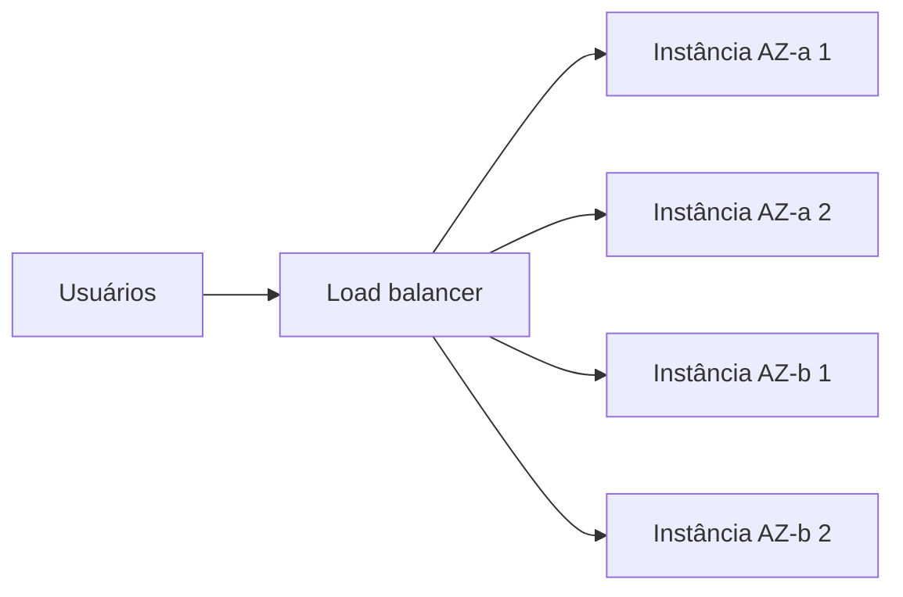

---
aliases:
  - Aula 2.3
modulo: 2
aula: 3
parte: "I Fundamentos"
dominios:
  - 2
  - 3
lida: false
tags:
  - aula
  - saa-c03
  - modulo-02
---

# Aula 2.3: Confiabilidade e Eficiência de Desempenho

[[02 - Well-Architected e o Formato da Prova|Voltar ao módulo]]

> [!question] Pergunta que esta aula responde
> O que significa projetar para falhar sem que o usuário perceba (Confiabilidade) e para responder rápido e continuar rápido quando a demanda e a tecnologia mudam (Eficiência de Desempenho)? Quais princípios a prova usa para formular as respostas desses dois pilares?

## Pilar 3: Confiabilidade (Reliability)

### Por que existe

Tudo falha, cedo ou tarde: roteadores, discos, memória, sistemas operacionais, pacotes de rede, e isso vale para o hardware mais caro e para o mais barato. A documentação do Framework cita essa ideia de Werner Vogels (CTO da Amazon) como ponto de partida do pilar de falha. A pergunta de arquitetura deixa de ser "como evitar toda falha?" (impossível) e passa a ser "o que acontece com o usuário quando algo falhar, e quanto tempo leva para voltar ao normal?".

O pilar define **confiabilidade** como a capacidade de uma workload de "desempenhar sua função pretendida de forma correta e consistente quando se espera que o faça", ao longo de todo o ciclo de vida (verificado em novembro de 2026). O fator principal é a **resiliência**: a capacidade de se recuperar de interrupções de infraestrutura ou de serviço, de adquirir recursos de computação dinamicamente para atender à demanda e de mitigar problemas como configurações erradas ou instabilidades transitórias de rede. Quatro outros fatores influenciam a confiabilidade, cada um com seu pilar: excelência operacional (automatiza mudanças e usa playbooks), segurança (impede acesso indevido que afetaria [[Disponibilidade|disponibilidade]]), eficiência de desempenho (taxas de requisição e [[Latencia|latência]]) e custo (decidir quanto gastar em capacidade de sobra contra confiar no escalonamento automático).

> [!info] Ligando os pontos
> Você já viu a base física no [[01 - Nuvem e Infraestrutura Global AWS|Módulo 1]]: [[Regiao AWS|Regiões]] isoladas, cada uma com várias [[Zona de Disponibilidade|Availability Zones]]. O pilar de Confiabilidade é o uso dessa estrutura. Os conceitos de [[Alta Disponibilidade]], [[RPO]] e [[RTO]] são desenvolvidos no [[20 - Alta Disponibilidade e Recuperacao de Desastres|Módulo 20]].

### Mecanismo: o que a AWS garante e o que é seu

O Framework descreve a [[Modelo de Responsabilidade Compartilhada|responsabilidade compartilhada]] **de resiliência**. A AWS é responsável pela resiliência *da* nuvem: hardware, software, redes e instalações. Cada Região é totalmente isolada e formada por várias [[Zona de Disponibilidade|Availability Zones]], que são "partições fisicamente isoladas de infraestrutura" e isolam falhas para que não se propaguem a outras zonas. As zonas de uma Região se conectam por fibra metropolitana dedicada e totalmente redundante, com alta [[Largura de Banda|largura de banda]] e baixa [[Latencia|latência]], suficientes para **[[Replicacao Sincrona|replicação síncrona]]** entre zonas; todo o tráfego entre zonas é cifrado (página de responsabilidade compartilhada de resiliência, verificado em novembro de 2026).

Sua responsabilidade é a resiliência *na* nuvem, e depende do serviço escolhido. Com [[EC2]], você precisa fazer toda a configuração de resiliência: usar várias zonas, replicar dados, fazer backup, escalar. Com serviços gerenciados, parte disso vem pronta, mas a decisão de ligar o recurso ([[Multi-AZ]], por exemplo) ainda é sua.

> [!example] Uma instância grande contra quatro pequenas
> Uma aplicação precisa de 8 [[vCPU|vCPUs]]. **Opção A:** uma instância de 8 vCPUs em uma [[Zona de Disponibilidade|AZ]]. Se a instância ou a zona falha, 100% da capacidade some. **Opção B:** quatro instâncias de 2 vCPUs, duas em cada uma de duas AZs, atrás de um balanceador. Se uma instância falha, resta 75% da capacidade; se uma zona inteira falha, resta 50%, e o balanceador já para de enviar tráfego às instâncias que não respondem. O custo total por vCPU é parecido, mas a opção B tem um [[Raio de Impacto|raio de impacto]] muito menor. Esse é o princípio "scale horizontally to increase aggregate workload [[Disponibilidade|availability]]".

### Quatro áreas e suas capacidades

| Área | Capacidades | A pergunta de fundo |
|---|---|---|
| **Foundations** (agora no lens de Cloud Foundations) | Manage [[Service Quotas\|service quotas]] and constraints; Plan your network topology | Os limites da conta e a rede suportam a workload e o crescimento? |
| **Workload architecture** | Design your workload service architecture; Design interactions in a distributed system to prevent failures; ... to mitigate or withstand failures | Os componentes são pequenos e independentes, e se comunicam de modo que uma falha não se espalhe? |
| **Change management** | Monitor workload resources; Design your workload to adapt to changes in demand; Implement change | Como a carga e as mudanças (picos, deploys, patches) são absorvidas sem quebrar? |
| **Failure management** | Back up data; Use fault isolation to protect your workload; Design your workload to withstand component failures; Test reliability; Plan for [[Recuperacao de Desastres\|Disaster Recovery]] (DR) | Como o sistema detecta a falha, se recupera e como sabemos que a recuperação funciona? |

Dois pontos de fundação valem destaque para a prova. Primeiro, as **[[Service Quotas]]**: limites por conta e por Região. Um erro clássico é montar um ambiente de recuperação em outra Região e descobrir, na hora do desastre, que a quota de instâncias ali é insuficiente; o exam guide cita explicitamente "configurar quotas para uma workload em um ambiente standby" (Task 2.2). Segundo, a **topologia de rede**: [[Sub-rede|sub-redes]] em várias zonas e CIDRs que não se sobrepõem a outras redes (Módulos 3 e 6).

### Os cinco princípios de design

| Princípio | Significado | Sinal no enunciado |
|---|---|---|
| **Automatically recover from failure** | Monitorar KPIs **de negócio** (não só técnicos) e disparar automação quando um limite é violado; recuperar ou contornar a falha | "automatically", "self-healing", "without manual intervention" |
| **Test recovery procedures** | Na nuvem dá para simular falhas e validar a recuperação, em vez de só provar que o sistema funciona no caminho feliz | "validate", "simulate failure", "[[Game Day\|game day]]" |
| **Scale horizontally to increase aggregate workload [[Disponibilidade\|availability]]** | Trocar um recurso grande por vários pequenos para reduzir o impacto de uma falha e evitar [[Ponto Unico de Falha\|ponto único de falha]] | "[[Alta Disponibilidade\|highly available]]", "no single point of failure" |
| **Stop guessing capacity** | Saturação de recursos é causa comum de falha; monitorar a demanda e adicionar ou remover recursos automaticamente | "unpredictable traffic", "spikes" |
| **Manage change through automation** | Mudanças na infraestrutura por automação, e a própria automação é rastreada e revisada | "[[Infraestrutura como Codigo\|infrastructure as code]]", "repeatable" |

O primeiro princípio tem um detalhe que a prova explora: os KPIs devem medir **valor de negócio** (pedidos por minuto, por exemplo), não o aspecto técnico de operação do serviço. Um alarme de CPU alta diz pouco; um alarme de "pedidos concluídos caíram 40%" diz que o usuário está sendo afetado.

> [!abstract] Três palavras que a prova separa
> **[[Alta Disponibilidade|Alta disponibilidade]]** (HA) é voltar a operar rapidamente depois de uma falha, em geral com várias [[Zona de Disponibilidade|AZs]]. **[[Tolerancia a Falhas|Tolerância a falhas]]** é continuar operando sem interrupção perceptível durante a falha, o que custa mais (capacidade de sobra e [[Replicacao Sincrona|replicação síncrona]]). **[[Recuperacao de Desastres|Recuperação de desastres]]** (DR) é recuperar depois da perda de uma Região inteira, o que aparece nos [[20 - Alta Disponibilidade e Recuperacao de Desastres|Módulo 20]] com [[RPO]] e [[RTO]].

### Estabilidade estática e custo

O texto do pilar menciona um [[Trade-off|trade-off]] com custo: manter capacidade de sobra (o que alguns chamam de **[[Estabilidade Estatica]]**, a workload continua funcionando sem precisar de nenhuma ação durante a falha) contra confiar no escalonamento automático para criar capacidade depois que a falha acontece. Reservar capacidade custa mais; escalar na hora depende de a AWS ter capacidade disponível e de a automação funcionar justamente durante a crise. Para cargas críticas, a diferença importa; para cargas tolerantes, não.

## Pilar 4: Eficiência de Desempenho (Performance Efficiency)

### Por que existe

Em um data center, a capacidade é fixa no momento da compra: se a carga cresce, você espera semanas por hardware; se encolhe, o hardware fica parado. A nuvem remove essa restrição, mas cria outra: com milhares de opções de serviços, [[Instance Type|tipos de instância]] e configurações, escolher bem exige método. O pilar cobre "o uso eficiente de recursos de computação para atender aos seus requisitos e a manutenção dessa eficiência conforme a demanda e as tecnologias evoluem" (verificado em novembro de 2026).

### Mecanismo: cinco capacidades

| Grupo | Capacidade | O que cobre |
|---|---|---|
| **Performance requirements** | Validate workload performance requirements | Definir requisitos e KPIs de negócio, e tolerâncias e alertas |
| **Resource selection and configuration** | Compute and hardware | Escolher, configurar e escalar computação e aceleradores |
| | Data management | Armazenamentos de propósito específico, configurados para o padrão de acesso, com cache e estratégias de consulta |
| | Networking and content delivery | Recursos de rede, conectividade, balanceamento, protocolos e localização da workload |
| **Monitor, test, and improve** | Monitor, test, and improve workload performance | Monitorar onde importa, testar e corrigir antes que o usuário sinta |

A abordagem recomendada é **baseada em dados**: coletar dados sobre todos os aspectos da arquitetura, revisar escolhas regularmente para aproveitar o que a AWS lança, monitorar desvios e fazer [[Trade-off|trade-offs]] deliberados, "como usar compressão ou cache, ou relaxar requisitos de consistência". Repare que o texto oficial diz que relaxar consistência é uma ferramenta legítima: uma leitura levemente atrasada pode custar muito menos e responder muito mais rápido, se o negócio aceitar.

### Os cinco princípios de design

| Princípio | Significado | Exemplo |
|---|---|---|
| **Democratize advanced technologies** | Delegar tarefas complexas ao provedor; consumir a tecnologia como serviço em vez de aprender a operá-la | NoSQL, transcodificação de mídia e machine learning como serviços; o time foca no produto |
| **Go global in minutes** | Implantar em várias [[Regiao AWS\|Regiões]] reduz [[Latencia\|latência]] e melhora a experiência a custo mínimo | Colocar a aplicação perto dos usuários da Ásia |
| **Use [[Serverless\|serverless]] architectures** | Remover a necessidade de operar servidores para tarefas tradicionais | Site estático em [[S3]] sem servidor web; eventos que executam código |
| **Experiment more often** | Recursos virtuais e automatizáveis permitem testes comparativos | Comparar [[Instance Type\|tipos de instância]] ou de armazenamento com um teste de carga |
| **Consider mechanical sympathy** | Entender como os serviços são consumidos e usar a abordagem que combina com o objetivo da workload | Escolher banco e armazenamento pelo padrão de acesso aos dados |

*Mechanical sympathy* (empatia com a máquina) vem da engenharia de alto desempenho: quem conhece como o hardware funciona escreve software que trabalha a favor dele. Na AWS, a tradução é: **o padrão de acesso decide o serviço**. Buscar milhões de itens por chave com [[Latencia|latência]] de poucos milissegundos pede um armazenamento chave-valor; relatórios com junções ad hoc pedem um banco relacional; arquivos compartilhados por muitos servidores Linux pedem [[Armazenamento de Arquivos|armazenamento de arquivos]]; objetos grandes e baratos pedem [[S3]]. Esse raciocínio é o coração dos módulos 10, 11, 13 e 14.

> [!example] Mesma carga, serviço errado
> Um catálogo de produtos recebe 50.000 leituras por segundo, sempre por identificador do produto, e quase nunca faz junções. Rodá-lo em um PostgreSQL maior e mais caro resolve por um tempo, mas cada pico exige uma instância ainda maior, e a escrita continua em um único nó. Um armazenamento chave-valor gerenciado e particionado escala por design nessa forma de acesso. O erro não foi de tecnologia, foi de *simpatia mecânica*: o padrão de acesso apontava para outro serviço.

### Relação entre desempenho, confiabilidade e custo

Desempenho e confiabilidade se reforçam em vários pontos (balanceadores e [[Auto Scaling Group|Auto Scaling]] melhoram os dois), mas há tensão: [[Replicacao Sincrona|replicação síncrona]] entre zonas dá [[Durabilidade|durabilidade]] e custa [[Latencia|latência]]; cache melhora tempo de resposta e pode servir dado antigo. O pilar de custo, por sua vez, pergunta se o ganho de milissegundos justifica o gasto. A aula 2.4 resolve essa tensão explicitamente.

## Como isso cai na prova

Domínio 2 (26%): **Task 2.1** (arquiteturas escaláveis e fracamente acopladas) e **Task 2.2** ([[Alta Disponibilidade|alta disponibilidade]] e [[Tolerancia a Falhas|tolerância a falhas]]). Domínio 3 (24%): **Tasks 3.1 a 3.5** (armazenamento, computação, bancos, redes, ingestão). Esta aula dá o raciocínio; os módulos 9 a 24 dão os serviços.

**Palavras-chave em inglês**

- "[[Alta Disponibilidade|highly available]]", "[[Tolerancia a Falhas|fault tolerant]]", "no [[Ponto Unico de Falha|single point of failure]]", "multiple [[Zona de Disponibilidade|Availability Zones]]" → [[Escalabilidade Horizontal|escalar horizontalmente]] em várias zonas.
- "automatically recover", "self-healing", "replace unhealthy instances" → recuperação automática.
- "unpredictable traffic", "spikes", "elastic" → parar de adivinhar capacidade ([[Auto Scaling Group|Auto Scaling]], serviços elásticos).
- "[[Recuperacao de Desastres|disaster recovery]]", "[[RPO]]", "[[RTO]]", "standby [[Regiao AWS|Region]]" → falha em escala de Região; verifique quotas.
- "lowest [[Latencia|latency]]", "global users" → ir global ([[CloudFront]], [[Global Accelerator]], multi-Região).
- "without managing servers", "fully managed" → [[Serverless|serverless]] e serviços gerenciados.
- "access pattern", "key-value", "ad hoc queries" → escolher o serviço pelo padrão de acesso.

**Pegadinhas clássicas**

- **[[Alta Disponibilidade|Alta disponibilidade]] não é [[Recuperacao de Desastres|recuperação de desastres]]:** [[Multi-AZ]] protege contra falha de zona; perda de uma Região inteira pede outra estratégia (Módulo 20).
- **[[Escalabilidade Vertical|Escalar verticalmente]] não aumenta [[Disponibilidade|disponibilidade]]:** uma instância maior continua sendo um [[Ponto Unico de Falha|ponto único de falha]].
- **Backup que nunca foi restaurado não é backup:** "test recovery procedures" é parte do pilar.
- **[[Cache]] melhora desempenho, não [[Durabilidade|durabilidade]]:** não substitui a fonte de dados.

| Requisito no enunciado | Resposta provável | Por quê |
|---|---|---|
| Aplicação deve sobreviver à falha de uma [[Zona de Disponibilidade\|AZ]] sem ação manual | Recursos distribuídos em várias AZs atrás de um balanceador, com [[Auto Scaling Group\|Auto Scaling]] | Escala horizontal e recuperação automática |
| Tráfego imprevisível, com picos | [[Elasticidade]] ([[Auto Scaling Group\|Auto Scaling]], serviços gerenciados elásticos) | Stop guessing capacity |
| Usuários distribuídos pelo mundo sofrem com [[Latencia\|latência]] | Conteúdo e/ou aplicação mais perto do usuário ([[CDN]], mais [[Regiao AWS\|Regiões]]) | Go global in minutes |
| Time sem experiência para operar um banco especializado | Serviço gerenciado equivalente | Democratize advanced technologies |
| Acesso por chave em altíssima escala | Armazenamento chave-valor gerenciado | Mechanical sympathy |

## Resumo

> [!abstract] A aula em uma frase
> Confiabilidade assume que tudo falha e projeta para recuperar automaticamente (vários recursos pequenos em várias zonas, capacidade que acompanha a demanda, recuperação testada); Eficiência de Desempenho escolhe o serviço pelo padrão de acesso e continua medindo.

**A lógica, em 6 passos**

1. Falhas são inevitáveis, então o objetivo é recuperar rápido e sem o usuário perceber.
2. A AWS isola zonas e [[Regiao AWS|Regiões]]; usar várias zonas é decisão sua.
3. Recursos pequenos e distribuídos reduzem o [[Raio de Impacto|raio de impacto]] de cada falha.
4. Capacidade que acompanha a demanda evita saturação, causa comum de falha.
5. Recuperação só é confiável se foi testada; KPIs de negócio disparam a automação.
6. Para desempenho, defina requisitos, escolha pelo padrão de acesso, monitore e revise.

**Números e fatos para lembrar**

| O quê | Valor | Por que importa |
|---|---|---|
| 1 instância de 8 [[vCPU\|vCPUs]], uma [[Zona de Disponibilidade\|AZ]] | 100% da capacidade some na falha | [[Ponto Unico de Falha\|Ponto único de falha]] |
| 4 instâncias de 2 [[vCPU\|vCPUs]], 2 em cada de 2 [[Zona de Disponibilidade\|AZs]] | Falha de uma instância: 75% restam; falha de uma AZ: 50% restam | [[Raio de Impacto\|Raio de impacto]] menor, custo por vCPU parecido |
| [[Alta Disponibilidade\|Alta disponibilidade]], [[Tolerancia a Falhas\|tolerância a falhas]] e DR | Voltar rápido, continuar sem interrupção perceptível (mais caro), recuperar da perda de uma Região | Palavras diferentes que a prova separa |

**Na prática, isso significa**

- "[[Alta Disponibilidade|Highly available]]" sem outro detalhe pede mais de uma zona.
- Antes de propor DR em outra Região, lembre das quotas de lá.
- Escolher o armazenamento ou banco pelo padrão de acesso, não pelo que a equipe já conhece.
- [[Cache]] e consistência relaxada são [[Trade-off|trade-offs]] legítimos quando o requisito os admite.

> [!tip] Liga com
> Vem da [[02.02 - Excelencia Operacional e Seguranca|aula 2.2]]. Segue na [[02.04 - Custos Sustentabilidade e Tensoes entre Pilares|aula 2.4]]. Aprofundamentos: [[12 - Balanceamento de Carga e Auto Scaling|Módulo 12]], [[14 - DynamoDB Cache e Bancos de Proposito Especifico|Módulo 14]] e [[20 - Alta Disponibilidade e Recuperacao de Desastres|Módulo 20]].

## Erros comuns

- **Confundir confiabilidade com "nunca cair".** O pilar fala em recuperar rápido e de forma correta, não em evitar toda falha.
- **Usar uma instância maior para "ganhar [[Disponibilidade|disponibilidade]]".** Maior capacidade não elimina o [[Ponto Unico de Falha|ponto único de falha]].
- **Medir só CPU e memória.** Os KPIs de recuperação devem refletir valor de negócio.
- **Escolher o banco pelo hábito.** O padrão de acesso é o critério; o resto vem depois.
- **Ignorar quotas na Região de standby.** Um plano de recuperação sem capacidade disponível não recupera.

## Pratique

**1.** Uma aplicação roda em uma única [[EC2|instância EC2]] muito grande, e cada falha causa indisponibilidade total. A empresa quer reduzir o impacto de falhas individuais com poucas mudanças. Qual solução atende?

- [ ] a) Trocar a instância por uma ainda maior, na mesma Availability Zone e com mais memória
- [ ] b) Agendar snapshots do volume da instância a cada hora
- [ ] c) Várias instâncias menores em duas AZs, em um Auto Scaling group atrás de um balanceador
- [ ] d) Manter uma cópia da instância desligada em outra Região, ligada manualmente após a falha

**2.** Um e-commerce monitora os pedidos concluídos por minuto e quer que, quando o valor cair abaixo de um limite, os componentes com falha sejam substituídos sem intervenção humana. Qual solução atende?

- [ ] a) Um alarme do CloudWatch sobre a métrica de pedidos, que aciona a automação de substituição
- [ ] b) Um alarme de CPU que envia um e-mail ao time de plantão para ação manual
- [ ] c) Um painel do CloudWatch que a equipe consulta a cada hora, procurando anomalias
- [ ] d) Aumentar o período de retenção dos logs da aplicação para facilitar a investigação

**3.** Uma empresa verifica que a aplicação funciona em produção, mas nunca restaurou um backup completo. Ela quer ter certeza de que consegue se recuperar de uma falha. Qual ação atende?

- [ ] a) Aumentar a frequência dos backups para uma vez por dia, mantendo o processo atual
- [ ] b) Comprar mais armazenamento para guardar mais cópias dos backups antigos
- [ ] c) Habilitar a criptografia dos backups com uma chave do KMS gerenciada pelo cliente
- [ ] d) Restaurar o backup periodicamente em ambiente de teste, medindo o tempo

**4.** (Escolha DUAS.) Quais afirmações sobre [[Zona de Disponibilidade|Availability Zones]] e a [[Modelo de Responsabilidade Compartilhada|responsabilidade compartilhada]] de resiliência estão corretas?

- [ ] a) Cada AZ é uma partição fisicamente isolada de infraestrutura dentro de uma Região
- [ ] b) O tráfego entre as AZs de uma Região só é cifrado se o cliente ativar a opção
- [ ] c) As AZs são interligadas com rede de alta largura de banda e baixa latência, adequada à replicação síncrona
- [ ] d) Em EC2, a AWS distribui automaticamente as instâncias do cliente entre várias AZs
- [ ] e) O cliente é responsável pela energia e pela rede física entre as AZs

**5.** Uma loja virtual sofre quedas quando o tráfego de uma campanha ultrapassa a capacidade provisionada. A empresa quer que a capacidade acompanhe a demanda automaticamente, com o menor [[Overhead Operacional|overhead operacional]]. Qual solução atende?

- [ ] a) Provisionar de forma permanente a capacidade do pico máximo esperado em toda campanha
- [ ] b) Um Auto Scaling group atrás de um balanceador, com uma política de target tracking
- [ ] c) Adicionar instâncias manualmente antes de cada campanha, conforme a previsão do time
- [ ] d) Trocar as instâncias por um tipo maior, sem escalar horizontalmente nem usar balanceador

**6.** Uma pequena equipe sem especialistas em bancos distribuídos precisa de um armazenamento chave-valor com escala horizontal e quer o MENOR [[Overhead Operacional|overhead operacional]]. Qual solução atende?

- [ ] a) Amazon DynamoDB
- [ ] b) Um cluster Apache Cassandra instalado em instâncias EC2
- [ ] c) Um MongoDB autogerenciado em contêineres
- [ ] d) Um PostgreSQL em EC2, com uma tabela de chave e valor

**7.** Usuários na Ásia relatam alta [[Latencia|latência]] em uma aplicação web hospedada apenas em uma Região da América do Norte. A empresa quer melhorar a experiência com o menor esforço possível. Qual solução atende?

- [ ] a) Aumentar o número de instâncias na Região atual
- [ ] b) Trocar as instâncias por um tipo maior na mesma Região
- [ ] c) Trocar os volumes por um tipo com mais IOPS
- [ ] d) Colocar o Amazon CloudFront na frente da aplicação

**8.** Um jogo precisa atualizar 200.000 pontuações por segundo e exibir um ranking ordenado em tempo real. Qual armazenamento segue o padrão de acesso?

- [ ] a) Uma instância RDS, ordenando a tabela inteira em cada consulta ao ranking
- [ ] b) Arquivos do S3, um por jogador, lidos por varredura a cada atualização
- [ ] c) Amazon ElastiCache for Valkey ou Redis, com estruturas ordenadas em memória
- [ ] d) Um cluster Amazon Redshift para consultas analíticas sobre as pontuações

**9.** (Escolha DUAS.) Uma empresa vai montar um ambiente de [[Recuperacao de Desastres|recuperação de desastres]] em outra Região e quer evitar surpresas durante o desastre. Quais ações atendem?

- [ ] a) Verificar e, se preciso, aumentar as Service Quotas da Região de standby
- [ ] b) Testar o failover periodicamente, medindo o tempo de recuperação
- [ ] c) Presumir que as quotas da Região de produção também valem na outra
- [ ] d) Criar o ambiente de recuperação somente quando o desastre ocorrer, sem automação
- [ ] e) Desativar o monitoramento do standby para reduzir custos

**10.** Um painel de produto aceita dados com até 30 segundos de atraso, e a empresa quer reduzir a [[Latencia|latência]] e a carga do banco com o menor custo. Qual solução atende?

- [ ] a) Replicação síncrona entre Regiões para toda leitura
- [ ] b) Um cache com TTL curto na frente do banco
- [ ] c) Uma instância de banco maior, sem cache
- [ ] d) Desativar qualquer cache e ler sempre o dado mais recente

> [!success]- Gabarito
> **1. c)** Várias instâncias menores em duas [[Zona de Disponibilidade|AZs]] atrás de um balanceador removem o ponto único e reduzem o [[Raio de Impacto|raio de impacto]] (scale horizontally). a) maior capacidade não elimina o ponto único; b) [[Snapshot|snapshots]] protegem dados, não a [[Disponibilidade|disponibilidade]]; d) a recuperação manual é lenta.
> **2. a)** O alarme sobre um KPI de negócio dispara a automação de recuperação (automatically recover from failure). b) e c) dependem de humanos; d) retenção de logs não recupera nada.
> **3. d)** Só uma restauração real valida a recuperação e mostra o tempo (test recovery procedures). a), b) e c) melhoram o backup, mas não provam que a restauração funciona.
> **4. a) e c)** [[Zona de Disponibilidade|AZs]] são partições isoladas, interligadas com rede adequada à [[Replicacao Sincrona|replicação síncrona]]. b) todo o tráfego entre zonas é cifrado, sem ação do cliente; d) em [[EC2]] a distribuição é decisão do cliente; e) a energia e a rede física são da AWS.
> **5. b)** [[Auto Scaling Group|Auto Scaling]] com [[Target Tracking|target tracking]] ajusta a capacidade à demanda sem intervenção (stop guessing capacity). a) paga o pico o tempo todo; c) depende de ação manual; d) escala só verticalmente e mantém o ponto único.
> **6. a)** O [[DynamoDB]] é chave-valor gerenciado e escala sem cluster para operar (democratize advanced technologies). b), c) e d) exigem operar servidores, patches e replicação.
> **7. d)** O [[CloudFront]] aproxima o conteúdo dos usuários, sem mudar a aplicação (go global in minutes). a), b) e c) melhoram capacidade ou disco, mas não a distância até a Ásia.
> **8. c)** Estruturas ordenadas em memória atendem a altas taxas de escrita e leitura do ranking (mechanical sympathy). a) ordena a cada consulta; b) varredura é lenta; d) [[Redshift]] é para análise, não para atualização em tempo real.
> **9. a) e b)** Quotas na Região de standby e [[Failover|failover]] testado evitam descobrir limites na hora do desastre. c) as quotas são por Região; d) sem ambiente e automação, o [[RTO]] explode; e) sem monitoramento, não se sabe se o standby funciona.
> **10. b)** Um cache com [[TTL]] curto reduz [[Latencia|latência]] e carga, e o atraso de 30 segundos é um [[Trade-off|trade-off]] aceito pelo negócio. a) é cara e desnecessária; c) paga mais sem reduzir a distância dos dados; d) ignora a tolerância informada.

## Para aprofundar

- [ ] [Pilar Reliability](https://docs.aws.amazon.com/wellarchitected/latest/framework/reliability.html) (AWS): resiliência, quatro áreas e capacidades.
- [ ] [Pilar Performance efficiency](https://docs.aws.amazon.com/wellarchitected/latest/framework/performance-efficiency.html) (AWS): as cinco capacidades e a abordagem baseada em dados.
- [ ] [Responsabilidade compartilhada para resiliência](https://docs.aws.amazon.com/wellarchitected/latest/framework/rel-shared-responsibility.html) (AWS): o que a AWS garante e o que é seu.

Próxima aula: [[02.04 - Custos Sustentabilidade e Tensoes entre Pilares|Aula 2.4: Custos, Sustentabilidade e Tensões entre Pilares]].
