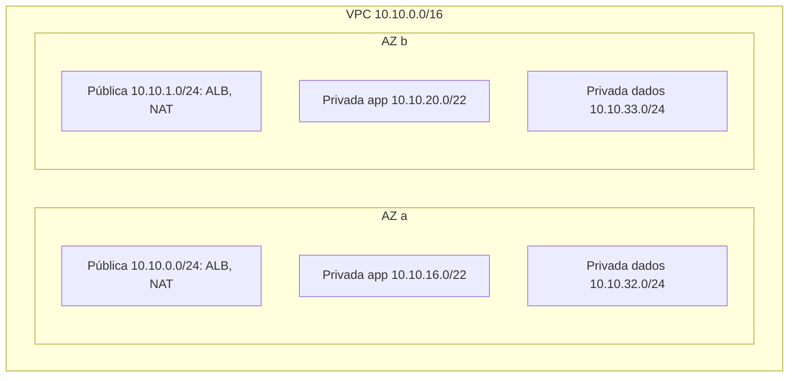

---
aliases:
  - Aula 3.3
modulo: 3
aula: 3
parte: "I Fundamentos"
dominios:
  - 1
  - 3
  - 4
lida: false
tags:
  - aula
  - saa-c03
  - modulo-03
---

# Aula 3.3: Faixas privadas, sub-redes e IPv6

[[03 - Fundamentos de Redes para a Nuvem|Voltar ao módulo]]

> [!question] Pergunta que esta aula responde
> Quais faixas de IP são privadas e por quê, como planejar blocos para que redes diferentes nunca se sobreponham, e por que o [[IPv6]] existe e como ele aparece na AWS?

## Por que existem faixas privadas

O [[IPv4]] tem cerca de 4,3 bilhões de endereços (aula 3.2) e o mundo tem muito mais dispositivos que isso. A solução de 1996, descrita na **[[RFC 1918]]**, foi reservar três faixas que **nunca são roteadas na internet pública**. Qualquer organização pode usá-las dentro de casa, e todas reutilizam os mesmos números sem conflito, porque esses endereços só valem dentro de cada rede. Para sair para a internet, o endereço privado é traduzido para um público ([[NAT]], aula 3.4).

| Faixa [[RFC 1918]] | [[CIDR]] | Endereços | Uso típico |
|---|---|---|---|
| `10.0.0.0` a `10.255.255.255` | `10.0.0.0/8` | 16.777.216 | Grandes redes, muitas [[VPC\|VPCs]] |
| `172.16.0.0` a `172.31.255.255` | `172.16.0.0/12` | 1.048.576 | Redes médias |
| `192.168.0.0` a `192.168.255.255` | `192.168.0.0/16` | 65.536 | Redes domésticas e pequenas |

Cuidado com o limite do meio: `172.16.0.0/12` termina em `172.31.255.255`. Então `172.32.0.0/16` **não** é privado: é um endereço público de outra pessoa.

A documentação da AWS recomenda usar essas faixas ao criar uma [[VPC]] e dá como exemplos `10.0.0.0/16`, `172.31.0.0/16` e `192.168.0.0/20` (esse `172.31.0.0/16` é também o [[CIDR]] da VPC padrão de cada Região). É possível usar um bloco público roteável na VPC, mas a própria documentação chama de "[[RFC 1918|IP privado]]" qualquer endereço dentro do CIDR da VPC, e o uso de blocos que pertencem a terceiros é fonte de problemas.

> [!info] Ligando os pontos
> Na [[03.02 - IPv4 CIDR e Mascaras de Rede|aula 3.2]] você viu que a AWS recusa `169.254.0.0/16` e `127.0.0.0/8`. O `169.254.0.0/16` é a faixa **link-local**, usada por serviços internos da AWS como o [[Instance Metadata Service]] (no módulo de [[EC2]] você verá o endereço `169.254.169.254`). Além disso, a documentação alerta que `172.17.0.0/16` é usada por serviços como o AWS Cloud9 e o [[SageMaker AI]] e conflita com a rede padrão do [[Docker]]: evite essa faixa para sua [[VPC]].

## Endereços públicos na AWS

Um recurso em uma [[Sub-rede Publica|sub-rede pública]] recebe, além do [[RFC 1918|IP privado]], um **[[IPv4]] público** que é mapeado 1 para 1 ao privado pelo [[Internet Gateway]] (ele faz [[NAT]] estático, sem que a instância saiba do endereço público). Um [[Elastic IP]] é um IPv4 público fixo que você reserva na conta e associa a um recurso. Dois pontos que caem na prova de custo:

- A AWS cobra por **todo [[IPv4|endereço IPv4]] público**, em uso ou ocioso, inclusive os anexados a instâncias em execução e os [[Elastic IP|Elastic IPs]]. A documentação de billing indica US$ 0,005 por hora por endereço em uso (verificado em novembro de 2026; confirme o preço atual na página de preços de [[VPC]]).
- Um IP público não é segurança nem acesso: sem rota para o [[Internet Gateway]] e sem regra de [[Security Group]], o recurso continua inalcançável.

Por isso a tendência de arquitetura é manter tudo privado e expor apenas o que precisa (balanceador, [[NAT Gateway|NAT gateway]]) e, quando possível, usar [[IPv6]].

## Sub-redes: de que e por quê

Uma **[[Sub-rede]]** (subnet) é um pedaço do [[CIDR]] da [[VPC]]. Duas razões para dividir:

1. **[[Disponibilidade]]:** a documentação é explícita, cada [[Sub-rede|sub-rede]] existe **em uma única [[Zona de Disponibilidade|AZ]]**. Para uma aplicação [[Alta Disponibilidade|altamente disponível]], você cria sub-redes equivalentes em pelo menos duas AZs.
2. **Segmentação:** separar o que é público do que é privado e aplicar regras diferentes a cada camada.

O que torna uma sub-rede pública ou privada **não é o nome nem o [[CIDR]]**: é a tabela de rotas associada. A documentação define: uma [[Sub-rede|sub-rede]] cuja [[Route Table]] tem rota para um [[Internet Gateway]] é uma **[[Sub-rede Publica|sub-rede pública]]**; sem essa rota, é **[[Sub-rede Privada|privada]]**. Voltaremos a isso na aula 3.4.

Um desenho clássico em três camadas, em duas [[Zona de Disponibilidade|AZs]]:



Repare em dois critérios de dimensionamento: a camada de aplicação, que pode escalar para centenas de tarefas, ganhou `/22` (1.024 endereços, 1.019 utilizáveis); a de dados, que tem poucas instâncias, ganhou `/24`. E sobra espaço no `/16` para novas [[Sub-rede|sub-redes]] (por exemplo uma [[Cache|camada de cache]] ou uma terceira [[Zona de Disponibilidade|AZ]]).

## Por que CIDRs sobrepostos impedem conexão

Roteamento é "para chegar a este destino, vá por ali". Se duas redes conectadas usam o mesmo bloco, a mesma resposta serve para dois destinos diferentes, e o roteador não tem como escolher.

> [!example] O erro que custa caro
> A empresa tem a [[VPC]] de produção `10.0.0.0/16` e a de uma subsidiária adquirida, também `10.0.0.0/16`. Alguém propõe um peering. Uma máquina em produção quer falar com `10.0.5.20`: esse IP existe nas duas VPCs. A [[Route Table|tabela de rotas]] dela diria "10.0.0.0/16 é local" e o pacote nunca sairia. A AWS nem deixa montar: a documentação de [[VPC Peering|VPC peering]] informa que, com CIDRs sobrepostos, a conexão vai a status `failed` imediatamente.

O mesmo vale para VPN, [[Direct Connect]], [[Transit Gateway]] (um hub que conecta várias [[VPC|VPCs]] e redes; Módulo 7) e para o seu data center: a faixa do on-premises não pode se sobrepor com nenhuma VPC alcançável por ele. Como a AWS não permite alterar o [[CIDR]] primário de uma VPC, a correção de um erro desses costuma ser **migrar para uma nova VPC com outro bloco**. Alternativas quando já não dá para renumerar (aprofundadas no [[07 - Conectividade Hibrida e entre VPCs|Módulo 7]]):

- **[[PrivateLink]]:** expor apenas um serviço (atrás de um [[Network Load Balancer]]) para a outra rede, sem rotear redes inteiras; funciona mesmo com CIDRs sobrepostos.
- **[[NAT]] privado:** o [[NAT Gateway|NAT gateway]] do tipo privado traduz os endereços e permite a comunicação com outras [[VPC|VPCs]] ou com o on-premises, sem receber conexões iniciadas de fora.

> [!tip] Plano de endereços
> Antes da primeira [[VPC]], escreva um plano em uma planilha: uma faixa para cada Região, ambiente e conta, mais a do on-premises. Exemplo: `10.10.0.0/16` produção, `10.20.0.0/16` homologação, `10.30.0.0/16` desenvolvimento, `10.40.0.0/16` serviços compartilhados, on-premises em `192.168.0.0/16`. Quando houver muitas contas, a distribuição dos blocos deve ser centralizada em uma conta de rede (o [[Resource Share|compartilhamento de recursos]] entre contas é tema do [[05 - Multiconta Governanca e Federacao|Módulo 5]], com o [[RAM]]).

## Acabaram os IPs da VPC: CIDR secundário e suas regras

A prova pergunta "a [[VPC]] ficou sem endereços, o que fazer?". A resposta é associar um **[[CIDR]] secundário** à VPC existente. As regras (verificado em novembro de 2026, página [VPC CIDR blocks](https://docs.aws.amazon.com/vpc/latest/userguide/vpc-cidr-blocks.html)):

- O **[[CIDR]] primário nunca muda**; só se acrescentam secundários, e eles **não podem se sobrepor** a nenhum já associado nem a rotas existentes.
- Cada bloco tem de ser entre `/16` e `/28`.
- Não se mistura livremente as faixas [[RFC 1918]]: a AWS restringe porque serviços que cruzam [[VPC|VPCs]] e contas precisam de blocos sem conflito.

| Se a [[VPC]] já tem | Não aceita secundário de | Aceita |
|---|---|---|
| `10.0.0.0/8` (um bloco 10.x) | outras [[RFC 1918]] (`172.16.0.0/12` e `192.168.0.0/16`) e `198.19.0.0/16` | outros blocos 10.x (sem sobrepor), qualquer bloco público roteável (não RFC 1918) e **`100.64.0.0/10`** |
| `172.16.0.0/12` | `10.0.0.0/8`, `192.168.0.0/16`, `172.31.0.0/16` e `198.19.0.0/16` | outros blocos 172.16.x a 172.31.x (exceto o 172.31.0.0/16), público roteável e `100.64.0.0/10` |
| `192.168.0.0/16` | `10.0.0.0/8`, `172.16.0.0/12` e `198.19.0.0/16` | outros blocos 192.168.x, público roteável e `100.64.0.0/10` |

> [!example] O caso clássico dos pods do EKS
> Uma [[VPC]] `10.0.0.0/16` está cheia porque cada [[Pod|pod]] de [[Kubernetes]] consome um IP da [[Sub-rede|sub-rede]]. A solução é associar o secundário `100.64.0.0/16`: o `100.64.0.0/10` (faixa de CGNAT, RFC 6598) é permitido para VPC com primário em 10.x e não colide com o data center em [[RFC 1918]]. Já um secundário `172.16.0.0/16` seria recusado, porque o primário está em `10.0.0.0/8`.

O `198.19.0.0/16` é restrito (não pode coexistir com [[RFC 1918]]). Se a faixa nova precisa continuar roteável com o data center, confirme antes que ela não sobrepõe a rede on-premises.

## IPv6: por que existe e como se escreve

O **[[IPv6]]** nasceu para acabar com a escassez: tem endereços de **128 bits** (`2^128`, ordem de 3,4 x 10^38), o suficiente para que cada dispositivo tenha um endereço globalmente único, sem [[NAT]]. Escreve-se em 8 grupos de 4 dígitos hexadecimais separados por dois-pontos, e uma sequência de grupos zero pode ser abreviada **uma vez** com `::`:

```
2001:0db8:1234:1a00:0000:0000:0000:0001
2001:db8:1234:1a00::1        (forma abreviada)
::/0                         (todos os endereços IPv6, equivalente a 0.0.0.0/0)
```

O prefixo funciona como no [[IPv4]]: `2001:db8:1234:1a00::/56` é um bloco com 56 bits de rede e 72 de host.

Como o [[IPv6]] aparece na AWS (verificado em novembro de 2026 na documentação da [[VPC]]):

- A [[VPC]] recebe um bloco [[IPv6]] **fornecido pela Amazon** do tipo `/56` (por exemplo `2001:db8:1234:1a00::/56`); você **não escolhe** a faixa. Também é possível associar até cinco blocos de `/44` a `/60` em incrementos de `/4`.
- Cada [[Sub-rede|sub-rede]] recebe um bloco `/64` desse intervalo (os tamanhos possíveis de sub-rede vão de `/44` a `/64`, em incrementos de `/4`, e na prática se usa `/64`).
- Em cada [[Sub-rede|sub-rede]] [[IPv6]], também são reservados cinco endereços: os quatro primeiros e o último.
- A [[VPC]] pode ser **[[Dual-Stack|dual-stack]]**: cada recurso com [[IPv4]] e [[IPv6]] ao mesmo tempo. As regras de [[Route Table|route table]], [[Security Group|security group]] e [[Network ACL|network ACL]] para IPv4 e IPv6 são avaliadas **separadamente**: se você abrir a porta 443 para `0.0.0.0/0`, ainda precisa abrir para `::/0`.
- Não existe [[NAT]] para [[IPv6]] na lógica habitual: os endereços são únicos globalmente. Para permitir apenas **saída** e bloquear conexões iniciadas de fora, usa-se o **[[Egress-Only Internet Gateway|egress-only internet gateway]]** (a documentação indica que ele é a opção para comunicação IPv6 somente de saída; também há NAT64 e DNS64 em casos de acesso a destinos [[IPv4]]). Detalhes no [[06 - VPC a Fundo|Módulo 6]].

> [!example] Saída só IPv6 para atualizações
> Uma frota de instâncias em [[Sub-rede Privada|sub-rede privada]] precisa baixar pacotes de repositórios que têm [[IPv6]]. Em vez de pagar um [[NAT Gateway]] (cobrado por hora e por GB processado), a equipe habilita IPv6 na [[VPC]], adiciona a rota `::/0` para um [[Egress-Only Internet Gateway|egress-only internet gateway]] (o custo dele não foi verificado nesta aula; confira na página de preços) e as instâncias saem sem receber tráfego iniciado pela internet.

O ponto central do [[IPv6]] para a prova: ele **economiza endereços e custo de [[IPv4]] público**, não é "mais seguro" por si e **exige configuração separada** nas regras de rede.

## Como isso cai na prova

Tasks do exam guide cobertas: **1.2** (segmentação com [[Sub-rede Publica|sub-redes públicas]] e privadas), **3.4** (design de camadas de [[Sub-rede|sub-redes]] e endereçamento IP) e **4.4** (peering e custo).

**Padrões de cenário**
- "A [[VPC]] deve se conectar ao data center": o [[CIDR]] da VPC não pode se sobrepor ao da rede on-premises.
- "Duas [[VPC|VPCs]] com o mesmo [[CIDR]] precisam compartilhar apenas um serviço": [[PrivateLink]].
- "Instâncias em [[Sub-rede Privada|sub-rede privada]] precisam de saída para a internet via [[IPv6]], sem receber conexões": [[Egress-Only Internet Gateway|egress-only internet gateway]].
- "Reduzir custo de [[IPv4|endereços IPv4]] públicos": remover IPs públicos desnecessários, usar [[IPv6]] e manter recursos em [[Sub-rede Privada|sub-redes privadas]].

**Palavras-chave em inglês:** "overlapping [[CIDR]]", "private IP address range", "[[Dual-Stack|dual-stack]]", "[[Egress-Only Internet Gateway|egress-only internet gateway]]", "[[Sub-rede Publica|public subnet]]", "[[Sub-rede Privada|private subnet]]".

**Pegadinhas clássicas**
- `172.32.x.x` não é privado (a faixa `172.16.0.0/12` termina em `172.31.255.255`).
- "[[Sub-rede Publica|Sub-rede pública]]" é definida pela rota para o [[Internet Gateway]], não por ter IP público ou pelo nome.
- [[NAT Gateway|NAT gateway]] para [[IPv6]] versus [[Egress-Only Internet Gateway|egress-only internet gateway]]: a segunda é a opção típica de saída só IPv6.
- Esquecer que [[IPv4]] e [[IPv6]] têm regras separadas em [[Security Group|security groups]] e [[Network ACL|network ACLs]].

| Requisito no enunciado | Resposta provável | Por quê |
|---|---|---|
| Conectar [[VPC]] e data center sem conflito | Planejar CIDRs sem sobreposição desde o início | Roteamento não distingue endereços iguais |
| Compartilhar um serviço entre redes com [[CIDR]] igual | [[PrivateLink]] | Não roteia redes, só expõe um serviço |
| Saída [[IPv6]] sem aceitar conexões de fora | [[Egress-Only Internet Gateway\|Egress-only internet gateway]] | Permite iniciar de dentro e bloqueia o inverso |
| Cortar custo de [[IPv4]] público | [[IPv6]] e [[Sub-rede Privada\|sub-redes privadas]] | Cada IPv4 público é cobrado por hora |
| [[Alta Disponibilidade\|Alta disponibilidade]] das [[Sub-rede\|sub-redes]] | Uma sub-rede equivalente por [[Zona de Disponibilidade\|AZ]] | Cada sub-rede vive em uma única AZ |

## Resumo

> [!abstract] A aula em uma frase
> As faixas [[RFC 1918]] existem para reutilizar endereços dentro de redes privadas, a [[VPC]] se divide em [[Sub-rede|sub-redes]] (cada uma em uma [[Zona de Disponibilidade|AZ]]) que viram públicas ou privadas pela [[Route Table|route table]], e redes que se conectam não podem ter CIDRs sobrepostos; o [[IPv6]] resolve a escassez com 128 bits.

**A lógica, em 5 passos**
1. Os [[IPv4|endereços IPv4]] são escassos, então três [[RFC 1918|faixas privadas]] são reusadas por todos e traduzidas por [[NAT]] na saída.
2. Reutilizar faixas é seguro até conectar duas redes: aí os blocos não podem se sobrepor.
3. Por isso o plano de endereços vem antes da primeira [[VPC]] e inclui o on-premises.
4. A [[VPC]] se divide em [[Sub-rede|sub-redes]], uma por [[Zona de Disponibilidade|AZ]] e por camada; a rota para o [[Internet Gateway]] define a pública.
5. O [[IPv6]] (/56 por [[VPC]] e /64 por [[Sub-rede|sub-rede]]) não precisa de [[NAT]], mas exige regras e rotas próprias.

**Números para lembrar**

| O quê | Valor | Por que importa |
|---|---|---|
| `10.0.0.0/8` | 16.777.216 endereços | Maior [[RFC 1918\|faixa privada]] |
| `172.16.0.0/12` | termina em `172.31.255.255` | `172.32.x.x` já é público |
| `192.168.0.0/16` | 65.536 endereços | Menor [[RFC 1918\|faixa privada]] |
| [[IPv6]] na [[VPC]] | /56 por VPC, /64 por [[Sub-rede\|sub-rede]] | Padrão de dimensionamento |
| [[IPv4]] público | cobrado por hora (US$ 0,005 na doc) | Entra nas questões de custo |

**Na prática, isso significa**
- Escreva um plano de CIDRs por ambiente e por Região antes de criar [[VPC|VPCs]].
- Sempre crie [[Sub-rede|sub-redes]] equivalentes em mais de uma [[Zona de Disponibilidade|AZ]].
- Nunca confie no "nome" público/privado: confira a rota para o [[Internet Gateway]].
- Em [[Dual-Stack|dual-stack]], replique as regras para `::/0`.

> [!tip] Liga com
> Vem da [[03.02 - IPv4 CIDR e Mascaras de Rede|aula 3.2]]. Segue para a [[03.04 - Roteamento NAT e Tabelas de Rotas|aula 3.4]] (como o tráfego é conduzido) e para os Módulos [[06 - VPC a Fundo|6]] e [[07 - Conectividade Hibrida e entre VPCs|7]].

## Erros comuns

- **Usar `172.17.0.0/16` na [[VPC]].** Conflita com o [[Docker]] e com serviços da AWS que usam a mesma faixa.
- **Escolher a mesma faixa `10.0.0.0/16` para todas as [[VPC|VPCs]] "porque é padrão".** Impede peering e [[Transit Gateway]] entre elas.
- **Achar que ter IP público torna a [[Sub-rede Publica|sub-rede pública]].** O que a torna pública é a rota para o [[Internet Gateway]].
- **Esquecer o [[IPv6]] nas regras.** O tráfego IPv6 é tratado à parte do [[IPv4]].
- **Dimensionar todas as [[Sub-rede|sub-redes]] com o mesmo tamanho.** A camada de aplicação costuma precisar de bem mais endereços que a de dados.

## Pratique

**1.** Uma empresa escolheu os blocos abaixo para as [[VPC|VPCs]] internas, sem querer conflitar com endereços públicos da internet. Um deles, na verdade, é público e roteável. Qual?

- [ ] a) 10.200.0.0/16
- [ ] b) 172.20.0.0/16
- [ ] c) 172.32.0.0/16
- [ ] d) 192.168.5.0/24

**2.** O data center de uma empresa usa `10.0.0.0/8` e `192.168.0.0/16`. A empresa vai criar uma [[VPC]] para conectar por VPN. Qual [[CIDR]] evita conflito?

- [ ] a) 172.16.0.0/16
- [ ] b) 10.50.0.0/16
- [ ] c) 192.168.50.0/24
- [ ] d) 169.254.10.0/24

**3.** Duas [[VPC|VPCs]] de empresas fundidas usam o mesmo [[CIDR]] `10.0.0.0/16`, e só um serviço de pedidos precisa ser acessado entre elas, sem renumerar nada. Qual solução atende?

- [ ] a) VPC peering entre as duas VPCs
- [ ] b) Transit Gateway com as duas VPCs associadas à mesma route table do hub
- [ ] c) Uma VPN Site-to-Site entre as duas redes
- [ ] d) PrivateLink expondo o serviço por um Network Load Balancer

**4.** Uma empresa vai habilitar [[IPv6]] em uma [[VPC]] nova com o bloco fornecido pela Amazon e precisa planejar quantas [[Sub-rede|sub-redes]] terá. Qual combinação descreve o padrão da VPC e de cada sub-rede?

- [ ] a) VPC com /64 e cada sub-rede com /56, para ter espaço de sobra
- [ ] b) VPC com /56 e sub-redes com /64
- [ ] c) VPC com /32 e cada sub-rede com /48, como no bloco de um provedor de internet
- [ ] d) VPC com /128 e cada sub-rede com /128, um endereço por recurso

**5.** Instâncias em uma [[Sub-rede Privada|sub-rede privada]] precisam acessar repositórios por [[IPv6]] para baixar atualizações, mas não podem receber conexões iniciadas da internet. Qual recurso usar?

- [ ] a) Internet Gateway com rota `::/0`
- [ ] b) NAT gateway público com Elastic IP IPv6
- [ ] c) Egress-only internet gateway com rota `::/0`
- [ ] d) Gateway endpoint para o repositório

**6.** Uma [[VPC]] com [[CIDR]] primário `10.0.0.0/16` ficou sem endereços livres porque cada [[Pod|pod]] de um cluster [[Kubernetes]] consome um IP, e o data center usa [[RFC 1918]]. O que a equipe pode fazer sem recriar a VPC?

- [ ] a) Associar à VPC um CIDR secundário `100.64.0.0/16`
- [ ] b) Associar à VPC um CIDR secundário `172.16.0.0/16`, que não conflita com o primário
- [ ] c) Alterar o CIDR primário para `10.0.0.0/15`, que dobra o espaço
- [ ] d) Associar à VPC um CIDR secundário `192.168.0.0/16`, igual ao do data center

**7.** Um engenheiro herdou uma [[VPC]] com [[Sub-rede|sub-redes]] chamadas `public-a` e `app-b` e precisa descobrir quais são realmente públicas. Qual critério usar?

- [ ] a) As instâncias recebem nomes DNS públicos assim que são lançadas
- [ ] b) O nome da sub-rede contém a palavra public, seguindo o padrão da equipe
- [ ] c) O CIDR da sub-rede pertence a uma faixa de endereços públicos roteáveis
- [ ] d) A route table tem rota para um Internet Gateway

**8.** Uma equipe quer que uma aplicação continue disponível se uma [[Zona de Disponibilidade|AZ]] falhar. Como devem ser organizadas as [[Sub-rede|sub-redes]]?

- [ ] a) Uma única sub-rede grande que abrange todas as AZs
- [ ] b) Sub-redes equivalentes em pelo menos duas AZs
- [ ] c) Uma sub-rede por camada, todas na mesma AZ
- [ ] d) Sub-redes públicas apenas, para evitar NAT

**9.** (Escolha DUAS.) A equipe de rede vai alinhar o plano de endereçamento das [[VPC|VPCs]] ao data center e lista candidatos. Quais blocos estão dentro das [[RFC 1918|faixas privadas]] da RFC 1918?

- [ ] a) 10.0.0.0/8
- [ ] b) 172.16.0.0/12
- [ ] c) 169.254.0.0/16
- [ ] d) 192.0.2.0/24
- [ ] e) 100.64.0.0/10

**10.** (Escolha DUAS.) Quais práticas ajudam a planejar o endereçamento de uma empresa que usa várias [[VPC|VPCs]] e um data center?

- [ ] a) Usar CIDRs distintos por VPC e por ambiente
- [ ] b) Escolher /28 para a VPC a fim de economizar endereços
- [ ] c) Reservar faixas que não se sobreponham à rede on-premises
- [ ] d) Usar blocos públicos de terceiros nas VPCs de desenvolvimento, já que não saem da VPC
- [ ] e) Reutilizar o mesmo CIDR em todas as contas para padronizar

> [!success]- Gabarito
> **1. c)** `172.16.0.0/12` termina em `172.31.255.255`, então `172.32.0.0/16` é público. a), b) e d) estão dentro das [[RFC 1918|faixas privadas]].
> **2. a)** `172.16.0.0/16` está fora de `10.0.0.0/8` e de `192.168.0.0/16`. b) está dentro do `10.0.0.0/8`. c) está dentro do `192.168.0.0/16`. d) `169.254.0.0/16` é link-local e a AWS recusa.
> **3. d)** o [[PrivateLink]] expõe apenas o serviço e tolera CIDRs sobrepostos. a) o peering falha com CIDRs sobrepostos. b) o [[Transit Gateway]] não resolve rotas sobrepostas. c) a VPN também depende de roteamento sem ambiguidade.
> **4. b)** a [[VPC]] recebe um /56 e cada [[Sub-rede|sub-rede]] um /64. a) inverte os tamanhos (um /64 não comporta sub-redes /56). c) /32 está fora do intervalo /44 a /60 de VPC. d) /128 é um único endereço, não um bloco de sub-rede.
> **5. c)** o [[Egress-Only Internet Gateway|egress-only internet gateway]] permite saída [[IPv6]] e bloqueia conexões iniciadas de fora. a) o [[Internet Gateway]] aceitaria conexões de entrada. b) não existe [[Elastic IP]] IPv6 em [[NAT Gateway|NAT gateway]] e o custo seria maior. d) [[Gateway Endpoint|gateway endpoint]] só atende [[S3]] e [[DynamoDB]].
> **6. a)** o `100.64.0.0/10` é permitido como secundário para uma [[VPC]] com primário em 10.x e não colide com [[RFC 1918]] do data center. b) um primário em `10.0.0.0/8` não aceita secundário de `172.16.0.0/12`. c) o [[CIDR]] primário não pode ser alterado. d) além de ser RFC 1918 restrita ao primário 10.x, sobreporia o data center.
> **7. d)** a [[Sub-rede|sub-rede]] é pública quando a [[Route Table|route table]] tem rota para um [[Internet Gateway]]. a) nome [[DNS]] público depende de IP público e das opções da [[VPC]], não define a sub-rede. b) o nome é só um rótulo. c) o [[CIDR]] da sub-rede não define se é pública.
> **8. b)** cada [[Sub-rede|sub-rede]] vive em uma única [[Zona de Disponibilidade|AZ]], então é preciso ter equivalentes em mais de uma. a) uma sub-rede não abrange AZs. c) tudo em uma AZ falha junto. d) [[NAT]] não tem relação com a [[Disponibilidade|disponibilidade]] da sub-rede.
> **9. a) e b)** são duas das três faixas da [[RFC 1918]]. c) é link-local, reservada pela AWS. d) é uma faixa de documentação. e) é a faixa de CGNAT (RFC 6598), permitida como secundário, mas não é RFC 1918.
> **10. a) e c)** CIDRs distintos e sem sobreposição com o on-premises permitem conectar tudo depois. b) /28 limitaria muito o crescimento. d) blocos públicos de terceiros causam conflito de roteamento com os donos reais dos endereços. e) o mesmo [[CIDR]] impede peering e roteamento.

### Laboratório (opcional): sub-redes no papel e no terminal

> [!warning] Sem conta AWS
> Roda só local, sem custo. Requer Python 3.

1. Desenhe em papel o plano da seção "Plano de endereços" e confirme, com `ipaddress.ip_network(...).overlaps(...)`, que nenhum par de redes se sobrepõe (a mesma função da aula 3.2).
2. Gere as [[Sub-rede|sub-redes]]: `python -c "import ipaddress as i; print([str(s) for s in i.ip_network('10.10.0.0/16').subnets(new_prefix=24)][:4])"` e escolha quais ficam públicas e quais privadas.
3. Teste o [[IPv6]]: `python -c "import ipaddress as i; print(i.ip_network('2001:db8:1234:1a00::/56').num_addresses, list(i.ip_network('2001:db8:1234:1a00::/56').subnets(new_prefix=64))[:2])"`. Há `2^72` endereços no /56 e 256 [[Sub-rede|sub-redes]] /64.

## Para aprofundar

- [ ] [VPC CIDR blocks](https://docs.aws.amazon.com/vpc/latest/userguide/vpc-cidr-blocks.html) (AWS Docs): [[RFC 1918|faixas privadas]], blocos proibidos e [[IPv6]] (/56 e /44 a /60).
- [ ] [Enable internet access for a VPC using an internet gateway](https://docs.aws.amazon.com/vpc/latest/userguide/VPC_Internet_Gateway.html) (AWS Docs): definição de [[Sub-rede Publica|sub-rede pública]] e privada pela rota ao [[Internet Gateway]].

Próxima aula: [[03.04 - Roteamento NAT e Tabelas de Rotas]]
