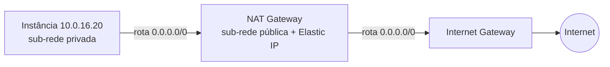

---
aliases:
  - Aula 3.4
modulo: 3
aula: 4
parte: "I Fundamentos"
dominios:
  - 1
  - 3
  - 4
lida: false
tags:
  - aula
  - saa-c03
  - modulo-03
---

# Aula 3.4: Roteamento, NAT e tabelas de rotas

[[03 - Fundamentos de Redes para a Nuvem|Voltar ao módulo]]

> [!question] Pergunta que esta aula responde
> Como um pacote descobre o caminho até o destino, o que é [[Longest Prefix Match|longest prefix match]], e por que o [[NAT]] é necessário para uma instância em [[Sub-rede Privada|sub-rede privada]] sair para a internet sem poder ser acessada de fora?

## Por que roteamento existe

Um computador só consegue entregar um pacote diretamente a quem está no mesmo segmento de rede. Para qualquer outro destino, ele precisa entregar o pacote a um **roteador** e confiar que a cadeia de roteadores o leve adiante. A pergunta que cada roteador responde, milhões de vezes por segundo, é: "para este endereço de destino, qual é o **próximo salto** (next hop)?".

A resposta vem de uma **[[Route Table|tabela de rotas]]** (route table): uma lista de linhas "destino (um [[CIDR|bloco CIDR]]) → alvo (para onde mandar)". Sem tabela de rotas, não há comunicação entre redes. Na AWS, a tabela de rotas é onde você decide, de fato, quem alcança o quê: por isso o assunto pesa tanto nas questões de [[VPC]].

## Como um computador decide: local ou roteador

Quando uma instância quer enviar um pacote para um IP de destino, ela compara o destino com a sua **máscara** (aula 3.2):

1. Se o destino está dentro do mesmo bloco da [[Sub-rede|sub-rede]], entrega diretamente (camada 2).
2. Se não está, envia o pacote ao **gateway padrão** (default gateway), que é o roteador da rede. Na [[VPC]], esse roteador é o endereço `.1` da [[Sub-rede|sub-rede]] (a documentação reserva o `10.0.0.1` em uma sub-rede `10.0.0.0/24` para o roteador da VPC).

O roteador da [[VPC]] consulta a **[[Route Table|route table]] associada à [[Sub-rede|sub-rede]] de origem** e decide o próximo salto. Toda sub-rede está associada a exatamente uma route table; várias sub-redes podem compartilhar a mesma. A **main route table** é a tabela que a VPC cria sozinha: toda sub-rede sem associação explícita a uma tabela personalizada usa a main. Por segurança, é boa prática deixar a main só com a rota local e criar tabelas personalizadas para as [[Sub-rede Publica|sub-redes públicas]], de modo que uma sub-rede nova nunca vire pública por acidente. Toda tabela de rotas de VPC já nasce com a **rota local**: o [[CIDR]] da VPC apontando para `local`, que permite que qualquer recurso da VPC fale com qualquer outro, em qualquer sub-rede, sem configuração (o que decide o isolamento são os firewalls da aula 3.5, não a rota).

## A estrutura de uma route table

| Destino | Alvo | Significado |
|---|---|---|
| `10.0.0.0/16` | `local` | Tráfego dentro da [[VPC]] |
| `192.168.0.0/16` | [[Virtual Private Gateway]] (ponta da AWS de uma VPN ou [[Direct Connect]], Módulo 7) ou [[Transit Gateway]] (hub que conecta várias [[VPC\|VPCs]] e redes, Módulo 7) | Rede on-premises por VPN ou Direct Connect |
| `10.20.0.0/16` | [[VPC Peering\|conexão de peering]] | Outra [[VPC]] |
| `0.0.0.0/0` | [[Internet Gateway]] ou [[NAT Gateway]] | Todo o resto ([[Rota Padrao\|rota padrão]]) |

O **alvo** (target) é o "próximo salto" e pode ser: `local`, um [[Internet Gateway]], um [[NAT Gateway]], uma conexão de [[VPC Peering]], um [[Transit Gateway]], um [[Virtual Private Gateway|virtual private gateway]], um [[VPC Endpoint]] (do tipo gateway) e outros. Cada um é explicado no módulo certo; aqui importa a ideia: a rota é a pergunta "para este bloco, quem é o próximo salto?".

## Longest prefix match: a regra que desempata

Quando mais de uma rota cobre o endereço de destino, vale a **mais específica**: aquela com o **[[Longest Prefix Match|prefixo mais longo]]** (maior `/n`, menor bloco). Isso se chama **longest prefix match**.

> [!example] Qual rota o pacote usa?
> [[Route Table|Route table]] da [[VPC]]:
>
> | Destino | Alvo |
> |---|---|
> | `10.0.0.0/16` | local |
> | `172.16.0.0/12` | [[Virtual Private Gateway|virtual private gateway]] |
> | `172.16.8.0/24` | [[Transit Gateway]] |
> | `0.0.0.0/0` | [[Internet Gateway]] |
>
> - Pacote para `10.0.3.9`: casa com `10.0.0.0/16` (/16) e com `0.0.0.0/0` (/0). Vence o /16: **local**.
> - Pacote para `172.16.20.5`: casa com `172.16.0.0/12` e com `0.0.0.0/0`. Vence o /12: **[[Virtual Private Gateway|virtual private gateway]]**.
> - Pacote para `172.16.8.50`: casa com `172.16.0.0/12`, `172.16.8.0/24` e `0.0.0.0/0`. Vence o /24, o mais longo: **[[Transit Gateway]]**.
> - Pacote para `8.8.8.8`: só casa com `0.0.0.0/0`: **[[Internet Gateway]]**.

A **[[Rota Padrao|rota padrão]]** `0.0.0.0/0` (no [[IPv6]], `::/0`) é a de prefixo zero: casa com tudo e, justamente por ser a menos específica, só é usada quando nada mais específico existe. É assim que "tudo o que não é conhecido sai pela internet".

A documentação da AWS dá um exemplo: o [[Internet Gateway]] pode ser o alvo da [[Rota Padrao|rota padrão]] da [[Sub-rede Publica|sub-rede pública]], e também pode ser usado com uma rota mais estreita (por exemplo, apenas para os IPs públicos dos endpoints da sua empresa). Para empates entre rotas de mesmo prefixo (estática versus propagada por [[BGP]], por exemplo), há regras de prioridade que aparecem no [[07 - Conectividade Hibrida e entre VPCs|Módulo 7]].

## O que torna uma sub-rede pública ou privada

Reveja a definição da AWS (verificado em novembro de 2026): [[Sub-rede|sub-rede]] associada a uma [[Route Table|route table]] **com rota para um [[Internet Gateway]]** é pública; **sem** essa rota é privada.

- **Pública:** [[Route Table|route table]] com `0.0.0.0/0 → Internet Gateway`. Ainda assim, o recurso só é acessível pela internet se tiver um [[IPv4]] público (ou [[Elastic IP]], ou [[IPv6|endereço IPv6]]) e se o [[Security Group|security group]] permitir.
- **Privada:** sem rota para o [[Internet Gateway]]. Pode ter `0.0.0.0/0 → NAT Gateway` (saída) ou nenhuma rota de saída.

O [[Internet Gateway]] é um componente escalável horizontalmente, redundante e de [[Alta Disponibilidade|alta disponibilidade]] que, segundo a documentação, não impõe risco de [[Disponibilidade|disponibilidade]] nem restrição de banda. Sem custo próprio, mas há [[Data Transfer|custo de transferência]] de dados dos recursos que o usam.

## NAT: por que e como

Uma instância em [[Sub-rede Privada|sub-rede privada]] tem [[RFC 1918|IP privado]], que não é roteável na internet (aula 3.3). Se ela envia um pacote para `8.8.8.8` com origem `10.0.16.20`, o destino não saberia devolver a resposta. A solução é **[[NAT]]** (Network Address Translation): um dispositivo no caminho **troca o endereço de origem** por um público na saída e **desfaz a troca** na volta.

O mecanismo, em termos de tabela:

1. A instância `10.0.16.20` abre uma conexão da [[Porta Efemera|porta efêmera]] `50001` (a porta alta que o cliente sorteia como origem; detalhe na [[03.05 - Firewalls Portas e Portas Efemeras|aula 3.5]]) para `8.8.8.8:443`.
2. O [[NAT]] troca a origem por seu próprio endereço público (digamos `54.1.2.3`) e por uma porta própria (`1024`), e guarda na **tabela de tradução**: `1024 ↔ 10.0.16.20:50001`.
3. A resposta de `8.8.8.8` volta para `54.1.2.3:1024`. O [[NAT]] consulta a tabela, restaura o destino original `10.0.16.20:50001` e entrega.
4. Como muitos hosts internos compartilham um só endereço público, a tradução usa também as **portas** (é por isso que se chama às vezes PAT, port address translation).

A consequência fundamental: **só existe entrada na tabela para conexões que alguém de dentro iniciou.** Um pacote que chega de fora sem entrada correspondente não tem para quem ser entregue e é descartado. Isso dá ao [[NAT]] um efeito colateral parecido com um firewall (impede conexões de entrada), mas **NAT não é o controle de segurança**: ele existe para resolver o problema de endereços; a proteção de verdade vem de [[Security Group|security groups]] e [[Network ACL|network ACLs]].

## NAT Gateway na AWS

O **[[NAT Gateway]]** é o serviço gerenciado. Fatos confirmados na documentação (verificado em novembro de 2026):

- Permite que instâncias em [[Sub-rede Privada|sub-rede privada]] se conectem a serviços fora da [[VPC]], enquanto os serviços externos **não conseguem iniciar** conexão com elas. As conexões devem sempre ser iniciadas de dentro da VPC.
- Tipo **público** (o padrão): você o cria em uma **[[Sub-rede Publica|sub-rede pública]]** e **precisa** associar a ele um [[Elastic IP]] na criação. O tráfego do [[NAT Gateway|NAT gateway]] sai pelo [[Internet Gateway]] da [[VPC]]. A origem das instâncias é mapeada ao [[RFC 1918|IP privado]] do [[NAT]] gateway e o Internet Gateway mapeia esse IP privado para o Elastic IP.
- Tipo **privado:** sem [[Elastic IP]], para falar com outras [[VPC|VPCs]] ou com o on-premises por [[Transit Gateway]] ou [[Virtual Private Gateway|virtual private gateway]]; se você encaminhar o tráfego dele para um [[Internet Gateway]], o IGW descarta.
- Existem dois **modos de [[Disponibilidade|disponibilidade]]**: o **zonal** (o clássico: nasce em uma [[Sub-rede|sub-rede]], logo em uma [[Zona de Disponibilidade|AZ]], com redundância interna só dentro dela) e o **regional** (descrito abaixo).
- Limites do zonal (verificado em novembro de 2026): 5 Gbps de banda, escalando sozinho até 100 Gbps; até 10 milhões de pacotes por segundo; cada [[IPv4|endereço IPv4]] sustenta cerca de **55.000 conexões simultâneas por destino único** (combinação de IP, porta e protocolo de destino), e dá para associar até 8 endereços para elevar isso. Não aceita [[Security Group|security group]] (use SG nas instâncias e [[Network ACL|NACL]] na [[Sub-rede|sub-rede]] do [[NAT]]). A cobrança é por **hora** de existência mais por **GB processado**, inclusive quando o tráfego é interno à AWS; valores atuais na página de preços da [[VPC]].

> [!info] NAT gateway regional (modo automático)
> A documentação atual traz o **[[Regional NAT Gateway|regional NAT gateway]]** (verificado em novembro de 2026): um único [[NAT Gateway|NAT gateway]] que **expande e contrai sozinho entre as [[Zona de Disponibilidade|AZs]]** em que há interfaces de rede de workload. Você não cria [[Sub-rede Publica|sub-rede pública]] para ele, usa **uma única rota** `0.0.0.0/0` para o mesmo ID em todas as AZs, e no modo **automático** a AWS gerencia os [[Elastic IP|Elastic IPs]] por AZ (até 32 por AZ, contra 8 do zonal). Ele entrega [[Alta Disponibilidade|alta disponibilidade]] por padrão; a expansão para uma AZ nova pode levar até 60 minutos (até lá o tráfego passa por outra AZ). **Não suporta [[NAT]] privado**: para isso, só o zonal. Para a prova: "um NAT por AZ" (zonal) e "NAT regional" são **dois desenhos de alta disponibilidade**; o regional troca várias peças por uma. Se o enunciado diz "NAT gateways zonais", vale a regra de um por AZ.
- Para [[IPv6]], o [[NAT Gateway|NAT gateway]] só entra com DNS64 e NAT64 (acesso a destinos [[IPv4]]); a saída IPv6 simples usa o [[Egress-Only Internet Gateway|egress-only internet gateway]] (aula 3.3).

Para a instância sair, são necessárias **duas rotas**: na [[Route Table|route table]] da **[[Sub-rede Privada|sub-rede privada]]**, `0.0.0.0/0 → NAT Gateway`; e, na route table da **[[Sub-rede Publica|sub-rede pública]]** onde o [[NAT]] mora, `0.0.0.0/0 → Internet Gateway`. Erro clássico: colocar o [[NAT Gateway|NAT gateway]] em uma sub-rede privada. Sem rota ao [[Internet Gateway|IGW]] ele não alcança a internet.

**[[NAT Gateway]] versus [[NAT]] Instance.** A [[NAT Instance]] é o NAT feito à mão: uma [[EC2|instância EC2]] que você escala, atualiza, protege e coloca em [[Alta Disponibilidade|alta disponibilidade]] (e em que se desativa a verificação de origem e destino da instância para que ela possa repassar pacotes de outros hosts). É a alternativa legada: pode sair mais barata em tráfego baixo, mas todo o trabalho operacional é seu (banda limitada pelo [[Instance Type|tipo de instância]], patches, [[Failover|failover]]). O NAT Gateway é gerenciado e escala sozinho. A prova favorece o NAT Gateway quando o enunciado diz "least [[Overhead Operacional|operational overhead]]".

**Custo e resiliência.** O [[NAT Gateway]] é cobrado por hora de existência e por GB processado (confira os valores atuais na página de preços de [[NAT]] gateway da Região; não foram verificados aqui). Dois efeitos que a Task 4.4 cobra:

- **Um [[NAT Gateway|NAT gateway]] zonal por [[Zona de Disponibilidade|AZ]]** (ou um **[[Regional NAT Gateway|NAT gateway regional]]**, que faz essa expansão sozinho) é mais resiliente: se a AZ do [[NAT]] cair, as outras AZs seguem. Custa mais horas e evita tráfego entre AZs.
- **Um [[NAT Gateway|NAT gateway]] compartilhado** é mais barato, mas introduz um [[Ponto Unico de Falha|ponto único de falha]] (se a [[Zona de Disponibilidade|AZ]] cair, as outras perdem a saída) e gera cobrança de transferência entre AZs para as [[Sub-rede|sub-redes]] que atravessam a AZ.
- Em ambientes de desenvolvimento, um único [[NAT]] costuma bastar; em produção, um por [[Zona de Disponibilidade|AZ]]. Quando o tráfego pesado vai para [[S3]] ou [[DynamoDB]], um **[[Gateway Endpoint|gateway endpoint]]** (Módulo 6) elimina esse tráfego do NAT e reduz custo.

> [!example] A conta do NAT na prova
> Uma frota de 40 instâncias em três [[Sub-rede Privada|sub-redes privadas]] baixa 2 TB por mês do [[S3]] pelo [[NAT Gateway|NAT gateway]]. Cada GB passa pela cobrança do [[NAT]]. A correção de maior retorno não é trocar o NAT por outro, e sim criar um [[Gateway Endpoint|gateway endpoint]] para o S3 (sem custo por hora nem por GB) e adicionar a rota do prefixo do S3 ao alvo `vpce`: o tráfego deixa de passar pelo NAT.

## Do que depende alcançar o destino

Quando "a instância não alcança X", ande de fora para dentro, na ordem em que o pacote anda: 1) tem **rota** para o destino ([[Route Table|route table]])? 2) o **[[Network ACL|network ACL]]** da [[Sub-rede|sub-rede]] de saída e o da de entrada permitem? 3) o **[[Security Group|security group]]** de origem e o de destino permitem? 4) o firewall do sistema operacional e a aplicação estão ouvindo? A aula 3.5 cobre os passos 2 e 3.

## Como isso cai na prova

Tasks do exam guide cobertas: **1.2** ([[Route Table|route tables]], [[NAT Gateway|NAT gateways]], [[Sub-rede Publica|sub-redes públicas]] e privadas) e **4.4** (configuração de [[NAT]] gateway, único compartilhado ou um por [[Zona de Disponibilidade|AZ]], e rotas que reduzem [[Data Transfer|custo de transferência]]).

**Padrões de cenário**
- "Instâncias em [[Sub-rede Privada|sub-rede privada]] precisam baixar atualizações da internet, sem receber conexões": [[NAT Gateway|NAT gateway]] em [[Sub-rede Publica|sub-rede pública]], rota `0.0.0.0/0` na [[Route Table|route table]] privada.
- "Menor [[Overhead Operacional|overhead operacional]]" com [[NAT]]: [[NAT Gateway]], não [[NAT Instance]].
- "[[Alta Disponibilidade|Alta disponibilidade]] da saída para a internet": um [[NAT Gateway|NAT gateway]] zonal por [[Zona de Disponibilidade|AZ]] (cada AZ roteando ao seu) ou, se a opção existir, um [[Regional NAT Gateway|NAT gateway regional]].
- "Reduzir custos de [[NAT]] para tráfego de [[S3]]": [[Gateway Endpoint|gateway endpoint]].
- "[[Sub-rede Publica|Sub-rede pública]]": rota `0.0.0.0/0` para o [[Internet Gateway]].

**Palavras-chave em inglês:** "outbound internet access", "[[Sub-rede Privada|private subnet]]", "[[NAT Gateway|NAT gateway]]", "[[Route Table|route table]]", "[[Rota Padrao|default route]]", "most specific route", "[[Internet Gateway|internet gateway]]", "unsolicited inbound".

**Pegadinhas clássicas**
- [[NAT Gateway|NAT gateway]] criado em [[Sub-rede Privada|sub-rede privada]] não alcança a internet.
- [[Internet Gateway]] versus [[NAT Gateway]]: o IGW atende a [[Sub-rede Publica|sub-redes públicas]] (entrada e saída); o [[NAT]], a privadas (só saída).
- Achar que o [[NAT]] "protege": a proteção é de [[Security Group|security group]] e [[Network ACL|network ACL]].
- Esquecer a rota na tabela da [[Sub-rede Privada|sub-rede privada]]: sem `0.0.0.0/0 → NAT`, nada sai.
- [[Egress-Only Internet Gateway|Egress-only internet gateway]] é só [[IPv6]]; [[NAT Gateway|NAT gateway]] é para [[IPv4]].

| Requisito no enunciado | Resposta provável | Por quê |
|---|---|---|
| Saída [[IPv4]] para instâncias privadas | [[NAT Gateway\|NAT gateway]] em [[Sub-rede Publica\|sub-rede pública]] | Traduz origem e não aceita conexões iniciadas de fora |
| Saída só [[IPv6]] | [[Egress-Only Internet Gateway\|Egress-only internet gateway]] | Bloqueia entrada, sem [[NAT]] |
| [[Sub-rede]] com acesso bidirecional à internet | Rota para o [[Internet Gateway]] e IP público | Define a [[Sub-rede Publica\|sub-rede pública]] |
| Resiliência de saída em duas [[Zona de Disponibilidade\|AZs]] | Um [[NAT Gateway\|NAT gateway]] zonal por AZ (ou um regional) | Evita [[Ponto Unico de Falha\|ponto único de falha]] da AZ |
| Reduzir custo de [[NAT]] para [[S3]] | [[Gateway Endpoint\|Gateway endpoint]] | Retira o tráfego do NAT |

## Resumo

> [!abstract] A aula em uma frase
> A [[Route Table|route table]] diz, por [[CIDR|bloco CIDR]], qual é o próximo salto (e vence a [[Longest Prefix Match|rota mais específica]]), e o [[NAT]] permite que [[RFC 1918|endereços privados]] saiam para a internet trocando a origem por um endereço público e só aceitando respostas a conexões iniciadas de dentro.

**A lógica, em 6 passos**
1. Fora da própria [[Sub-rede|sub-rede]], o pacote vai ao roteador da [[VPC]].
2. O roteador consulta a [[Route Table|route table]] da [[Sub-rede|sub-rede]] de origem.
3. Entre rotas que casam, vence o [[Longest Prefix Match|prefixo mais longo]] (longest prefix match).
4. A rota `0.0.0.0/0` pega o que sobra: [[Internet Gateway]] (pública) ou [[NAT Gateway]] (privada).
5. O [[NAT]] troca origem privada por pública e guarda uma tabela de tradução com as portas.
6. Sem entrada na tabela, o pacote de fora é descartado: o [[NAT]] só atende a conexões iniciadas de dentro.

**Números para lembrar**

| O quê | Valor | Por que importa |
|---|---|---|
| [[Rota Padrao\|Rota padrão]] | `0.0.0.0/0` ([[IPv4]]) e `::/0` ([[IPv6]]) | A menos específica; pega o resto |
| Roteador da [[VPC]] | endereço `.1` da [[Sub-rede\|sub-rede]] | Gateway padrão |
| Rota local | [[CIDR]] da [[VPC]] → local | Comunicação interna automática |

**Tabela-síntese**

| Componente | Direção | Onde fica | Tipo de IP |
|---|---|---|---|
| [[Internet Gateway]] | Entrada e saída | Anexado à [[VPC]] | [[IPv4]] público e [[IPv6]] |
| [[NAT Gateway]] | Só saída | [[Sub-rede Publica\|Sub-rede pública]], com [[Elastic IP]] | [[IPv4]] |
| [[Egress-Only Internet Gateway\|Egress-only IGW]] | Só saída | Anexado à [[VPC]] | [[IPv6]] |

**Na prática, isso significa**
- Para saída de [[Sub-rede Privada|sub-rede privada]]: [[NAT Gateway|NAT gateway]] na pública, mais as duas rotas.
- Para produção, planeje um [[NAT]] por [[Zona de Disponibilidade|AZ]]; para dev, aceite um só.
- Tráfego pesado para [[S3]] e [[DynamoDB]] deve ir por [[Gateway Endpoint|gateway endpoint]], não pelo [[NAT]].

> [!tip] Liga com
> Vem da [[03.03 - Faixas Privadas Sub-redes e IPv6|aula 3.3]] ([[Sub-rede|sub-redes]] e [[RFC 1918|faixas privadas]]). Segue para a [[03.05 - Firewalls Portas e Portas Efemeras|aula 3.5]] (o que filtra o tráfego) e para o [[06 - VPC a Fundo|Módulo 6]] ([[NAT]] e [[Internet Gateway|IGW]] na prática).

## Erros comuns

- **Pôr o [[NAT Gateway|NAT gateway]] em [[Sub-rede Privada|sub-rede privada]].** Ele precisa de rota ao [[Internet Gateway]].
- **Esquecer de editar a [[Route Table|route table]] da [[Sub-rede Privada|sub-rede privada]].** O [[NAT]] sozinho não faz nada.
- **Confundir "[[Sub-rede Publica|sub-rede pública]]" com "tem IP público".** A pública é definida pela rota ao [[Internet Gateway|IGW]].
- **Achar que [[NAT]] é firewall.** Ele impede entrada como efeito colateral, mas não filtra por porta ou origem.
- **Usar um só [[NAT]] em produção [[Multi-AZ|multi-AZ]] sem registrar o risco.** É economia com [[Ponto Unico de Falha|ponto único de falha]].

## Pratique

**1.** Uma empresa ligou a [[VPC]] ao data center por VPN e a uma rede de parceiro por [[Transit Gateway]]. A [[Route Table|route table]] tem `10.0.0.0/16 → local`, `172.16.0.0/12 → virtual private gateway`, `172.16.8.0/24 → Transit Gateway` e `0.0.0.0/0 → Internet Gateway`. Um servidor do parceiro em `172.16.8.50` fica inalcançável pela VPN. Por que o tráfego não segue para o [[Virtual Private Gateway|virtual private gateway]]?

- [ ] a) Porque a rota local tem prioridade sobre todas as outras
- [ ] b) Porque a rota `/12` foi criada primeiro e a tabela usa a ordem de criação
- [ ] c) Porque a rota padrão é avaliada por último e substitui as demais
- [ ] d) Porque o `/24` é o prefixo mais longo e leva ao Transit Gateway

**2.** Instâncias em [[Sub-rede Privada|sub-redes privadas]] precisam baixar atualizações da internet, sem aceitar conexões iniciadas de fora e com o menor [[Overhead Operacional|overhead operacional]]. O que fazer?

- [ ] a) Adicionar rota para o Internet Gateway na route table da sub-rede privada
- [ ] b) Criar NAT gateway em sub-rede pública e rotear `0.0.0.0/0` a ele
- [ ] c) Associar um Elastic IP a cada instância da sub-rede privada
- [ ] d) Criar um VPC peering com a VPC padrão da conta

**3.** Uma equipe criou um [[NAT Gateway|NAT gateway]] em uma [[Sub-rede Privada|sub-rede privada]], e as instâncias continuam sem acesso à internet. Qual é a causa mais provável?

- [ ] a) O security group do NAT gateway não libera a saída das instâncias
- [ ] b) Falta um gateway endpoint para o S3 na VPC, sem ele o NAT gateway não encaminha tráfego
- [ ] c) A sub-rede do NAT não tem rota para um Internet Gateway
- [ ] d) A network ACL da sub-rede privada precisa de uma regra de entrada para a porta 443

**4.** Uma [[VPC]] `10.0.0.0/16` tem a aplicação em `10.0.1.0/24` e o PostgreSQL em `10.0.2.0/24`, ambas privadas, com as rotas `10.0.0.0/16 → local` e `0.0.0.0/0 → NAT gateway`. A aplicação recebe [[Timeout|timeout]] ao conectar na porta 5432. O que a equipe deve concluir primeiro?

- [ ] a) A rota local já leva o tráfego entre as sub-redes; o bloqueio está em security group ou network ACL
- [ ] b) É preciso adicionar uma rota `10.0.2.0/24 → NAT gateway` para a aplicação alcançar o banco
- [ ] c) É preciso criar um VPC peering entre as duas sub-redes para elas se enxergarem
- [ ] d) É preciso criar um gateway endpoint para que o tráfego chegue ao banco

**5.** Um ambiente de desenvolvimento tem três [[Zona de Disponibilidade|AZs]] com [[Sub-rede Privada|sub-redes privadas]]. A equipe aceita perder a saída para a internet se uma AZ falhar e quer o MENOR custo. O que escolher?

- [ ] a) Um NAT gateway zonal por AZ, cada sub-rede roteando ao NAT da sua AZ
- [ ] b) Um NAT gateway regional, para a saída acompanhar as três AZs automaticamente
- [ ] c) Uma NAT instance em cada AZ, com Auto Scaling para repor falhas
- [ ] d) Um único NAT gateway zonal compartilhado

**6.** Um servidor web em [[Sub-rede Privada|sub-rede privada]], com saída por [[NAT Gateway|NAT gateway]], precisa receber clientes da internet na porta 443. Um engenheiro abriu a 443 no [[Security Group|security group]], mas a conexão continua falhando. Qual é o motivo?

- [ ] a) O security group de instâncias atrás de NAT só aceita tráfego da porta 80
- [ ] b) O NAT só traduz conexões iniciadas de dentro, e falta um caminho público de entrada
- [ ] c) A rota padrão precisa apontar para um egress-only internet gateway para aceitar entrada IPv4
- [ ] d) A sub-rede privada precisa de uma rota `local` extra apontando para o Internet Gateway

**7.** Uma [[Sub-rede|sub-rede]] hospeda um [[Application Load Balancer|ALB]] voltado à internet. O que a [[Route Table|route table]] dessa sub-rede precisa ter?

- [ ] a) Rota `0.0.0.0/0` para um Internet Gateway
- [ ] b) Rota `0.0.0.0/0` para um NAT gateway
- [ ] c) Rota `0.0.0.0/0` para um virtual private gateway
- [ ] d) Nenhuma rota extra, porque o IP público basta

**8.** Instâncias em [[Sub-rede Privada|sub-rede privada]] acessam a internet por um [[NAT Gateway|NAT gateway]] público. Qual endereço de origem o servidor de destino vê?

- [ ] a) O IP privado da instância
- [ ] b) O IP privado do NAT gateway
- [ ] c) O Elastic IP do NAT gateway
- [ ] d) O IP público do Internet Gateway da VPC

**9.** (Escolha DUAS.) Uma [[Route Table|route table]] tem `10.0.0.0/16 → local`, `192.168.0.0/16 → virtual private gateway`, `192.168.40.0/24 → Transit Gateway` e `0.0.0.0/0 → NAT gateway`. Quais previsões de roteamento estão corretas?

- [ ] a) Tráfego para `192.168.7.9` segue ao NAT gateway, porque `0.0.0.0/0` abrange qualquer destino
- [ ] b) Tráfego para `192.168.40.9` segue ao Transit Gateway
- [ ] c) Tráfego para `10.0.3.4` segue ao NAT gateway, porque a rota padrão vale para qualquer IP
- [ ] d) Tráfego para `192.168.7.9` segue ao virtual private gateway
- [ ] e) Tráfego para `8.8.8.8` é descartado, pois nenhuma rota específica casa

**10.** (Escolha DUAS.) Instâncias em [[Sub-rede Privada|sub-rede privada]], só com [[IPv4]], precisam baixar patches de um repositório público na internet. Quais soluções atendem?

- [ ] a) NAT gateway público em sub-rede pública
- [ ] b) NAT instance em sub-rede pública
- [ ] c) Egress-only internet gateway
- [ ] d) Gateway endpoint para o S3
- [ ] e) NAT gateway público criado em outra sub-rede privada

> [!success]- Gabarito
> **1. d)** o `/24` casa e é o [[Longest Prefix Match|prefixo mais longo]], então vence e leva ao [[Transit Gateway]]. a) a rota local só cobre `10.0.0.0/16`. b) a tabela não usa ordem de criação, e sim o prefixo mais longo. c) a [[Rota Padrao|rota padrão]] é a menos específica, só vale quando nada mais casa.
> **2. b)** o [[NAT Gateway|NAT gateway]] gerenciado em [[Sub-rede Publica|sub-rede pública]], com a rota `0.0.0.0/0` na tabela privada, permite saída e bloqueia entrada. a) tornaria a sub-rede pública, sem [[NAT]]. c) IPs públicos nas instâncias permitiriam conexões de fora. d) peering não dá acesso à internet.
> **3. c)** o [[NAT Gateway|NAT gateway]] público precisa estar em [[Sub-rede|sub-rede]] com rota ao [[Internet Gateway]]. a) o [[NAT]] gateway não aceita [[Security Group|security group]]. b) o [[Gateway Endpoint|gateway endpoint]] do [[S3]] é outro recurso e não condiciona o NAT. d) a [[Network ACL|NACL]] precisaria liberar as respostas ([[Porta Efemera|portas efêmeras]]), não a 443 de entrada, e não é a causa descrita.
> **4. a)** a rota local já liga todos os recursos do [[CIDR]] da [[VPC]], então o [[Timeout|timeout]] vem de filtro ([[Security Group|security group]] do banco ou [[Network ACL|NACL]]). b) a rota local é mais específica que `0.0.0.0/0` e já cobre o destino; mandar ao [[NAT]] piora. c) peering liga VPCs, não [[Sub-rede|sub-redes]] da mesma VPC. d) [[Gateway Endpoint|gateway endpoint]] é para [[S3]] e [[DynamoDB]], não para um banco em sub-rede.
> **5. d)** um [[NAT]] zonal compartilhado é o mais barato e, no desenvolvimento, o risco é aceitável. a) é o mais resiliente, porém custa mais horas de NAT. b) o regional dá [[Alta Disponibilidade|alta disponibilidade]] por padrão, que o enunciado não pede, e não é a opção mais barata. c) [[NAT Instance|NAT instance]] traz custo operacional e não é o mais barato com [[Auto Scaling Group|Auto Scaling]].
> **6. b)** o [[NAT Gateway|NAT gateway]] só mantém mapeamento para conexões iniciadas de dentro; para receber clientes é preciso IP público com rota ao [[Internet Gateway|IGW]] ou um balanceador em [[Sub-rede Publica|sub-rede pública]]. a) [[Security Group|security group]] não tem essa restrição de porta. c) [[Egress-Only Internet Gateway|egress-only internet gateway]] é só [[IPv6]] e só para saída. d) a rota local é automática e não aponta para o IGW.
> **7. a)** [[Sub-rede Publica|sub-rede pública]] é a que tem rota para o [[Internet Gateway]]. b) [[NAT]] é para [[Sub-rede Privada|sub-redes privadas]]. c) o [[Virtual Private Gateway|virtual private gateway]] leva ao data center, não à internet. d) sem rota, o IP público não funciona.
> **8. c)** o [[Internet Gateway]] mapeia o [[RFC 1918|IP privado]] do [[NAT]] para o [[Elastic IP]] e esse é o endereço visto. a) o NAT troca a origem. b) o IP privado não é roteável na internet. d) o Internet Gateway faz só a tradução 1:1 e o seu endereço não aparece como origem.
> **9. b) e d)** `192.168.40.9` casa `/16` e `/24`, vence o `/24` ([[Transit Gateway]]); `192.168.7.9` casa só `/16` e `/0`, vence o `/16` ([[Virtual Private Gateway|virtual private gateway]]). a) o `/16` é mais longo que o `/0`. c) `10.0.3.4` casa a rota local `/16`, mais específica. e) `0.0.0.0/0` casa tudo, então `8.8.8.8` vai ao [[NAT]].
> **10. a) e b)** [[NAT Gateway|NAT gateway]] e [[NAT Instance|NAT instance]], ambos em [[Sub-rede Publica|sub-rede pública]] com rota ao [[Internet Gateway|IGW]], dão saída [[IPv4]]. c) é só [[IPv6]]. d) [[Gateway Endpoint|gateway endpoint]] alcança só [[S3]] e [[DynamoDB]], não um repositório público. e) um [[NAT]] em [[Sub-rede Privada|sub-rede privada]] não tem rota ao IGW, então não chega à internet.

### Laboratório (opcional): longest prefix match no seu computador

> [!warning] Sem conta AWS
> Roda só local, sem custo. Requer Python 3.

1. Rode: `python -c "import ipaddress as i; rotas={'10.0.0.0/16':'local','172.16.0.0/12':'vgw','172.16.8.0/24':'tgw','0.0.0.0/0':'igw'}; d=i.ip_address('172.16.8.50'); print(max((i.ip_network(r) for r in rotas if d in i.ip_network(r)), key=lambda n:n.prefixlen))"`
2. Deve imprimir `172.16.8.0/24`. Troque o destino por `10.0.3.9`, `172.16.20.5` e `8.8.8.8` e confira que cada um escolhe a rota prevista.
3. Em Windows, `route print` mostra a [[Route Table|tabela de rotas]] do seu computador; em Linux, `ip route`. Procure a [[Rota Padrao|rota padrão]] (`0.0.0.0` ou `default`) e o gateway.

## Para aprofundar

- [ ] [NAT gateways](https://docs.aws.amazon.com/vpc/latest/userguide/vpc-nat-gateway.html) (AWS Docs): tipos público e privado, [[Elastic IP]] e mapeamento de endereços, base desta aula.
- [ ] [Enable internet access for a VPC using an internet gateway](https://docs.aws.amazon.com/vpc/latest/userguide/VPC_Internet_Gateway.html) (AWS Docs): [[Internet Gateway|IGW]], [[NAT]] de [[IPv4]] e definição de [[Sub-rede Publica|sub-rede pública]].

Próxima aula: [[03.05 - Firewalls Portas e Portas Efemeras]]
