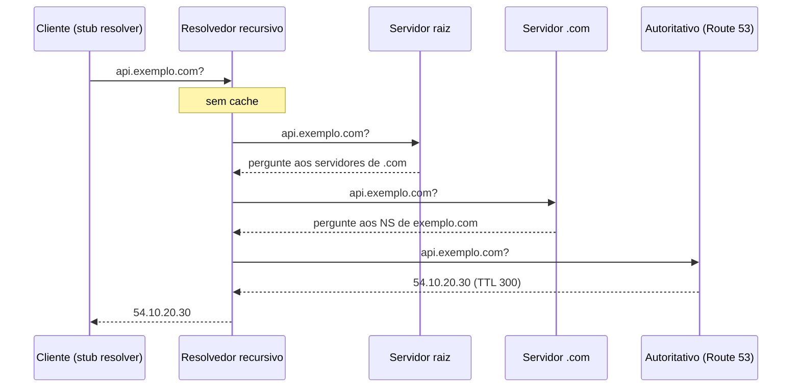

---
aliases:
  - Aula 3.6
modulo: 3
aula: 6
parte: "I Fundamentos"
dominios:
  - 1
  - 2
  - 3
  - 4
lida: false
tags:
  - aula
  - saa-c03
  - modulo-03
---

# Aula 3.6: DNS e resolução de nomes

[[03 - Fundamentos de Redes para a Nuvem|Voltar ao módulo]]

> [!question] Pergunta que esta aula responde
> Como um nome como `api.exemplo.com` vira um endereço IP, o que cada tipo de registro faz, por que o [[TTL]] decide a velocidade de uma mudança, e por que o [[Alias Record|registro alias]] do [[Route 53]] existe se já há o [[CNAME]]?

## O problema que o DNS resolve

Computadores se falam por IP (`54.10.20.30`), mas pessoas e sistemas preferem nomes (`api.exemplo.com`). Há mais um motivo, mais importante para um arquiteto: **os IPs mudam**. Um balanceador da AWS escala e troca de IP; uma instância é substituída; um banco faz [[Failover|failover]] para outra [[Zona de Disponibilidade|AZ]]. Se um cliente guardasse o IP, quebraria a cada mudança. O nome é a camada de indireção estável: o cliente guarda o nome, e o **[[DNS]]** (Domain Name System, o "catálogo de nomes" da internet, [[Modelo OSI|camada 7]], porta 53) devolve o endereço atual.

Nas arquiteturas da AWS, nunca se fixa um IP de [[Elastic Load Balancing|ELB]], de endpoint de [[RDS]] ou de [[ElastiCache]] em código ou configuração: usa-se sempre o nome [[DNS]]. Isso é regra de resiliência cobrada na prova.

## A estrutura: uma árvore de zonas

O [[DNS]] é **hierárquico**. Um nome se lê da direita para a esquerda:

```
api.exemplo.com.
 |     |      |  └── raiz (o ponto final, normalmente omitido)
 |     |      └───── TLD (top-level domain): com
 |     └──────────── domínio: exemplo
 └────────────────── subdomínio / host: api
```

Cada nível é gerenciado por quem é dono dele, em **zonas**. Em cada zona há **servidores de nomes autoritativos** (authoritative name servers): os que têm a resposta oficial. Os servidores raiz sabem quem cuida de `.com`; os de `.com` sabem quem cuida de `exemplo.com`; este último sabe o IP de `api.exemplo.com`. O [[Route 53]] é um serviço de [[DNS]] autoritativo (o nome vem da porta 53).

## Como uma consulta é resolvida

Quem faz o trabalho pesado é o **[[Resolvedor Recursivo|resolvedor recursivo]]** (recursive resolver): um servidor, do seu provedor, do Google, ou, dentro da [[VPC]], o **[[Route 53 Resolver|Amazon DNS]]** (o resolvedor da VPC fica no endereço base da VPC + 2, como visto na aula 3.2). Seu computador tem só um **stub resolver**, que pergunta ao recursivo.



Os passos:

1. O cliente pergunta ao [[Resolvedor Recursivo|resolvedor recursivo]].
2. Se o recursivo já tem a resposta em **cache**, responde na hora (a maioria das consultas).
3. Senão, ele pergunta à raiz, depois ao TLD, depois ao autoritativo, seguindo as indicações ("pergunte àqueles servidores").
4. O autoritativo responde com o registro e um **[[TTL]]**. O recursivo guarda em cache por esse tempo e entrega ao cliente.

O [[DNS]] usa **[[UDP]] na porta 53** para consultas curtas e cai para **[[TCP]] na 53** quando a resposta é grande ou em transferências de zona. Por isso [[Security Group|security groups]] e [[Network ACL|NACLs]] que cercam resolvedores precisam permitir 53 nos dois protocolos (a aula 3.5 mostrou que o security group não filtra o tráfego para o DNS da Amazon, mas isso vale só para o [[Route 53 Resolver|Amazon DNS]] da [[VPC]]).

## TTL: a velocidade da mudança

O **[[TTL]]** (time to live) é o número de segundos que um resolvedor pode guardar a resposta em cache. É uma troca clássica:

| [[TTL]] | Vantagem | Desvantagem |
|---|---|---|
| Baixo (ex.: 60 s) | Mudanças e [[Failover\|failovers]] chegam rápido aos clientes | Mais consultas ao autoritativo (mais custo e [[Latencia\|latência]] de resolução) |
| Alto (ex.: 86400 s) | Poucas consultas, mais velocidade, menos custo | Mudanças demoram até um dia para valer para todos |

Não existe "propagação" no sentido de o [[DNS]] empurrar a mudança: o que acontece é **cada cache expirar no seu tempo**. Por isso o procedimento padrão antes de uma migração é **baixar o [[TTL]] com antecedência** (pelo menos o valor do TTL antigo antes da troca), fazer a mudança, e depois subir de novo. Em [[Failover|failovers]] por DNS (Módulo 18 e 20), o TTL baixo é parte do tempo de recuperação ([[RTO]]).

> [!example] Migração com 1 hora de tolerância
> O site `exemplo.com` tem [[TTL]] de 24 horas e vai migrar de servidor. Se trocar o registro hoje, alguns clientes continuam indo ao servidor antigo por até 24 horas. O plano certo: reduzir o TTL para 60 segundos **dois dias antes**, esperar o cache antigo expirar, trocar o IP no dia D e, com tudo estável, voltar o TTL para um valor alto.

## Os registros que caem na prova

| Tipo | Mapeia | Exemplo | Observação |
|---|---|---|---|
| **A** | Nome para [[IPv4]] | `api.exemplo.com A 54.10.20.30` | O mais comum |
| **AAAA** | Nome para [[IPv6]] | `api.exemplo.com AAAA 2001:db8::1` | O "A" do IPv6 |
| **[[CNAME]]** | Nome para outro nome | `www CNAME exemplo.com` | Não pode ser criado no [[Zone Apex\|apex]] e não convive com outros registros no mesmo nome |
| **MX** | Servidores de e-mail do domínio, com prioridade | `exemplo.com MX 10 mail.exemplo.com` | Aponta para um nome que tem A ou AAAA |
| **TXT** | Texto livre | `"v=spf1 include:..."` | Verificação de domínio, SPF, DKIM |
| **NS** | Servidores de nomes da zona | `exemplo.com NS ns-1.awsdns-xx.org` | Delegação: quem é autoritativo |
| **SOA** | Metadados da zona (servidor primário, e-mail do responsável, números de controle) | Um por zona | Criado automaticamente |
| **PTR** | IP para nome (resolução reversa) | `30.20.10.54.in-addr.arpa PTR api.exemplo.com` | Usado, por exemplo, em verificação de e-mail |
| **SRV, CAA, e outros** | Localização de serviços e CAs autorizadas a emitir certificados | | A documentação do [[Route 53]] lista também registros como DS, HTTPS, NAPTR, SPF, SSHFP, SVCB, TLSA |

(verificado em novembro de 2026 na documentação do [[Route 53]]; o [[CNAME]] e suas restrições estão na página "Supported [[DNS]] record types".)

## CNAME e o problema do zone apex

O **[[Zone Apex|zone apex]]** é o nome "pelado" do domínio (`exemplo.com`, sem `www.` na frente). Dois fatos da documentação do [[Route 53]]:

- O protocolo [[DNS]] **não permite [[CNAME]] no [[Zone Apex|zone apex]]** (o apex já tem SOA e NS, e um CNAME não pode coexistir com outro registro no mesmo nome).
- Se você cria um [[CNAME]] para `www.exemplo.com`, não pode criar nenhum outro registro com esse nome.

Mas a empresa quer que `exemplo.com` (sem www) aponte para um [[Application Load Balancer|ALB]], cujo endereço é um nome [[DNS]] (como `meu-alb-123.us-east-1.elb.amazonaws.com`). [[CNAME]] seria a ferramenta natural e é proibida no [[Zone Apex|apex]].

### Alias: a solução do Route 53

O **[[Alias Record|registro alias]]** é uma extensão do [[Route 53]] (não é padrão [[DNS]]). Parece um [[CNAME]], mas a resposta que o cliente recebe é um **A ou AAAA** com os IPs atuais do alvo, porque o Route 53 resolve o alvo por dentro. Consequências confirmadas na documentação (verificado em novembro de 2026):

| | [[CNAME]] | Alias ([[Route 53]]) |
|---|---|---|
| Pode ser usado no [[Zone Apex\|zone apex]] | Não | **Sim** |
| Aponta para | Qualquer nome [[DNS]] | Recursos AWS selecionados: [[CloudFront]], [[Elastic Load Balancing\|ELB]], [[S3]] configurado como website, [[API Gateway]], [[Global Accelerator]], endpoint de interface de [[VPC]], [[Elastic Beanstalk]] e outros, e para outro registro da mesma zona. **Não** aponta para o nome DNS de uma [[EC2\|instância EC2]] |
| [[TTL]] | Você define | **Não se configura** quando o alvo é recurso AWS: o [[Route 53]] usa o TTL padrão do recurso (se o alvo é outro registro da mesma zona, herda o TTL dele) |
| Mudança de IP do alvo | Segue o nome | O [[Route 53]] detecta a mudança de IP do recurso automaticamente |
| Custo das consultas | Cobradas | **Sem cobrança** quando o alvo é recurso AWS |
| Padrão | [[DNS]] universal | Específico do [[Route 53]] |

> [!example] O apex apontando para o ALB, passo a passo
> A empresa quer `exemplo.com` (sem `www`) abrindo o site no [[Application Load Balancer|ALB]] `meu-alb-123.us-east-1.elb.amazonaws.com`. Tentativa 1: criar `exemplo.com CNAME meu-alb-123...elb.amazonaws.com`. O [[Route 53]] recusa, porque o [[Zone Apex|apex]] já tem SOA e NS e [[CNAME]] não convive com outros registros. Tentativa 2: criar `exemplo.com A` do tipo **alias**, com alvo o ALB. Funciona: quando o ALB trocar de IP, o Route 53 passa a responder com o novo IP sozinho. Para clientes [[IPv6]], cria-se também o `AAAA` alias.

**Regra da prova: apontar domínio (principalmente o [[Zone Apex|apex]]) para recurso AWS: alias.** Para apontar para um nome fora da AWS, em subdomínio: [[CNAME]].

## Zonas públicas e privadas, e quem é autoritativo

Uma **[[Hosted Zone]]** é o [[Container|contêiner]] de registros de um domínio no [[Route 53]]:

- **Pública:** responde a qualquer pessoa na internet. É a que você usa para `exemplo.com`.
- **Privada:** responde **somente a consultas vindas das [[VPC|VPCs]] associadas a ela**. Serve para nomes internos (`db.interno.exemplo`) que apontam para IPs privados e não devem existir na internet. Um mesmo nome pode ter uma zona pública e outra privada ("[[Split-View DNS|split-horizon DNS]]"): de dentro da VPC, resolve para o [[RFC 1918|IP privado]]; de fora, para o público. Para funcionar, a VPC precisa de resolução e nomes [[DNS]] habilitados (as opções `enableDnsSupport` e `enableDnsHostnames`, aula do Módulo 6).

**Registrador versus servidor de [[DNS]].** O **registrador** (registrar) é onde você comprou o domínio e que informa ao TLD quem são os NS do seu domínio. O **serviço de DNS** é quem hospeda os registros. Podem ser empresas diferentes. Para usar o [[Route 53]] como DNS de um domínio comprado em outro lugar, você cria a [[Hosted Zone|hosted zone]] e atualiza, **no registrador**, os registros **NS** do domínio para os servidores de nomes da hosted zone. Esse é o passo que quase todo mundo esquece.

Dois fatos de [[Route 53]] que a prova repete: o resolvedor da [[VPC]] ([[Route 53 Resolver]], o "Amazon DNS") responde em `base da VPC + 2`, em `169.254.169.253` ([[IPv4]]) e em `fd00:ec2::253` ([[IPv6]]) (verificado em novembro de 2026); e o [[Plano de Dados|plano de dados]] do Route 53 (responder consultas) tem **[[SLA]] de 100% de [[Disponibilidade|disponibilidade]]**, frase típica em enunciados de [[Alta Disponibilidade|alta disponibilidade]] (o [[Plano de Controle|plano de controle]], que cria e edita registros, não tem esse SLA).

Outros pontos que aparecem mais adiante: as **[[Routing Policy|routing policies]]** (simple, weighted, [[Latencia|latency]], [[Failover|failover]], geolocation e outras) e os **[[Health Check|health checks]]** do [[Route 53]] estão no [[18 - Borda e DNS CloudFront Global Accelerator e Route 53|Módulo 18]]; o [[DNS]] híbrido com o [[Route 53 Resolver]] (endpoints de entrada e saída) está no [[07 - Conectividade Hibrida e entre VPCs|Módulo 7]].

> [!info] Ligando os pontos
> Na [[03.01 - Por que Redes Pesam e as Camadas de Rede|aula 3.1]] o [[DNS]] foi o primeiro passo da viagem de uma requisição. Aqui você vê que ele também é um mecanismo de **[[Alta Disponibilidade|alta disponibilidade]]**: apontar o nome para outro destino ([[Failover|failover]]) é a forma mais simples de redirecionar clientes, e o [[TTL]] é quem limita a velocidade dessa troca.

## Como isso cai na prova

Tasks do exam guide cobertas: **3.4** (serviços de [[DNS]] e borda), **4.4** (serviços de rede: DNS) e a base para **2.2** ([[Failover|failover]] por DNS).

**Padrões de cenário**
- "Apontar `exemplo.com` (sem www) para um [[Application Load Balancer|ALB]] ou [[CloudFront]]": [[Alias Record|registro alias]] no [[Route 53]] ([[CNAME]] não funciona no [[Zone Apex|apex]]).
- "Nomes internos que só a [[VPC]] resolve": [[Private Hosted Zone|private hosted zone]].
- "Reduzir o tempo para uma troca de [[DNS]] valer": baixar o [[TTL]] antes.
- "Aplicação quebrou depois que o IP do balanceador mudou": usar o nome [[DNS]], não o IP.
- "Usar o [[Route 53]] para um domínio registrado em outro lugar": criar a [[Hosted Zone|hosted zone]] e atualizar os NS no registrador.

**Palavras-chave em inglês:** "[[Alias Record|alias record]]", "[[Zone Apex|zone apex]]", "root domain", "[[CNAME]]", "[[TTL]]", "[[Private Hosted Zone|private hosted zone]]", "authoritative", "name servers".

**Pegadinhas clássicas**
- [[CNAME]] no [[Zone Apex|apex]]: impossível; a resposta é alias.
- Alias para qualquer site da internet: não, alias só aponta para recursos AWS (e registros da mesma zona).
- "A mudança propaga sozinha": o que existe é expiração de cache por [[TTL]].
- Hosted zone pública usada para nomes internos: expõe os nomes (e IPs privados) para a internet; use [[Private Hosted Zone|zona privada]].
- [[Route 53]] não registra domínio sozinho: o registro de domínio é um serviço à parte (Route 53 também é registrador, Módulo 18), e o domínio comprado em outro registrador precisa dos NS atualizados.

| Requisito no enunciado | Resposta provável | Por quê |
|---|---|---|
| [[Zone Apex\|Domínio raiz]] para [[Application Load Balancer\|ALB]] | Alias A (e AAAA se [[IPv6]]) | [[CNAME]] é proibido no apex; alias não cobra consulta |
| Nomes só para a [[VPC]] | [[Private Hosted Zone\|Private hosted zone]] associada à VPC | Responde apenas às VPCs associadas |
| [[Failover]] por [[DNS]] rápido | [[TTL]] baixo e [[Health Check\|health check]] | O cache limita a velocidade de troca |
| Roteamento de e-mail do domínio | Registro MX | Lista os servidores de e-mail e prioridades |
| Verificar a propriedade de um domínio | Registro TXT | Texto livre para provas e políticas |
| Usar [[Route 53]] com domínio de outro registrador | Atualizar NS no registrador | Delegação da zona |

## Resumo

> [!abstract] A aula em uma frase
> O [[DNS]] traduz nomes em endereços por uma árvore de servidores consultada por um [[Resolvedor Recursivo|resolvedor recursivo]] com cache; o [[TTL]] controla a velocidade das mudanças, e o alias do [[Route 53]] resolve o que o [[CNAME]] não pode, apontar o [[Zone Apex|apex]] para recursos da AWS.

**A lógica, em 6 passos**
1. IPs mudam; o nome é a indireção estável, então nunca se fixa o IP de um recurso gerenciado.
2. O cliente pergunta a um [[Resolvedor Recursivo|resolvedor recursivo]], que usa cache ou percorre raiz, TLD e autoritativo.
3. A resposta traz um [[TTL]], que dita por quanto tempo os caches a reutilizam.
4. Mudar um registro vale à medida que os caches expiram; por isso se baixa o [[TTL]] antes de migrar.
5. [[CNAME]] não existe no [[Zone Apex|apex]] e não convive com outros registros; o alias do [[Route 53]] supre isso.
6. Zona pública responde à internet; [[Private Hosted Zone|zona privada]] só às [[VPC|VPCs]] associadas; os NS no registrador completam a delegação.

**Números para lembrar**

| O quê | Valor | Por que importa |
|---|---|---|
| Porta do [[DNS]] | 53 ([[UDP]] e [[TCP]]) | Regras de firewall |
| Resolvedor da [[VPC]] | base da VPC + 2 | [[Route 53 Resolver\|Amazon DNS]] |
| Registros | A, AAAA, [[CNAME]], MX, TXT, NS, SOA | Vocabulário da prova |

**Tabela-síntese**

| Preciso apontar para | Use |
|---|---|
| IP fixo ([[IPv4]]) | A |
| IP ([[IPv6]]) | AAAA |
| Outro nome, em subdomínio | [[CNAME]] |
| Recurso AWS, inclusive no [[Zone Apex\|apex]] | Alias |
| Servidor de e-mail | MX |

**Na prática, isso significa**
- Use sempre nomes [[DNS]] de serviços gerenciados, nunca IPs.
- Planeje [[TTL]] baixo para quem precisa de [[Failover|failover]]; alto para o que raramente muda.
- Para o [[Zone Apex|apex]] apontando para [[Application Load Balancer|ALB]] ou [[CloudFront]], alias.
- Nomes internos em [[Private Hosted Zone|zona privada]].

> [!tip] Liga com
> Vem da [[03.05 - Firewalls Portas e Portas Efemeras|aula 3.5]] (porta 53). Segue para a [[03.07 - TLS HTTPS e Certificados|aula 3.7]] (o nome também precisa casar com o certificado) e para o [[18 - Borda e DNS CloudFront Global Accelerator e Route 53|Módulo 18]] ([[Routing Policy|routing policies]]).

## Erros comuns

- **Tentar criar [[CNAME]] no [[Zone Apex|domínio raiz]].** Use alias no [[Route 53]].
- **Colocar IP de [[Elastic Load Balancing|ELB]], [[RDS]] ou [[ElastiCache]] no código.** Eles mudam; use o nome.
- **Esperar que a mudança seja instantânea.** O [[TTL]] antigo ainda está em caches.
- **Esquecer de atualizar os NS no registrador** ao mover o [[DNS]] para o [[Route 53]].
- **Usar zona pública para nomes internos.** Expõe a topologia; use [[Private Hosted Zone|zona privada]].

## Pratique

**1.** A empresa quer que `exemplo.com` (sem www) abra o site servido por um [[Application Load Balancer]], com o menor custo e esforço no [[Route 53]]. Qual registro criar?

- [ ] a) CNAME apontando para o nome DNS do ALB
- [ ] b) Alias do tipo A apontando para o ALB
- [ ] c) MX apontando para o nome DNS do ALB
- [ ] d) NS com os servidores do ALB

**2.** Uma migração de servidor está marcada para o fim de semana, e o registro tem [[TTL]] de 24 horas. A equipe quer que a troca valha para quase todos em poucos minutos. O que fazer?

- [ ] a) Aumentar o TTL para 7 dias antes da troca
- [ ] b) Reduzir o TTL para 60 segundos apenas no momento da troca
- [ ] c) Manter o TTL de 24 horas e trocar o registro A por um alias do ALB
- [ ] d) Baixar o TTL com antecedência

**3.** Uma empresa quer que `db.interno.exemplo` resolva para o [[RFC 1918|IP privado]] do banco apenas dentro da [[VPC]]. Qual solução atende?

- [ ] a) Private hosted zone associada à VPC
- [ ] b) Public hosted zone com o IP privado do banco
- [ ] c) Arquivo hosts em cada instância
- [ ] d) Elastic IP para o banco de dados

**4.** Uma aplicação grava em arquivo de configuração o IP do [[Application Load Balancer|ALB]] e parou de funcionar semanas depois, sem ninguém ter alterado nada. Qual é a causa mais provável?

- [ ] a) O ALB só aceita conexões por nome em IPv6
- [ ] b) O ALB usa um Elastic IP fixo e ele expirou
- [ ] c) Os IPs dos nós do ALB mudam e o certo é usar o nome DNS
- [ ] d) O security group do ALB bloqueia IPs fixos

**5.** Uma empresa migra o e-mail corporativo para um provedor externo e precisa que os e-mails enviados para `@exemplo.com` cheguem aos servidores do provedor. Qual registro criar na zona?

- [ ] a) TXT com a política SPF do provedor, que orienta a entrega
- [ ] b) MX com os servidores do provedor e suas prioridades
- [ ] c) CNAME de `exemplo.com` para o nome do provedor
- [ ] d) PTR do IP do provedor para `exemplo.com`

**6.** A empresa comprou o domínio em um registrador externo e criou uma [[Hosted Zone|hosted zone]] no [[Route 53]], mas o site não resolve pelo Route 53. O que falta?

- [ ] a) Criar no registrador um CNAME do domínio para a hosted zone do Route 53
- [ ] b) Habilitar DNSSEC na hosted zone do Route 53
- [ ] c) Associar a hosted zone à VPC onde o site roda
- [ ] d) Apontar os NS do registrador para a hosted zone

**7.** Depois de trocar o IP de um registro com [[TTL]] de 1 hora, um engenheiro vê que alguns clientes ainda chegam ao servidor antigo, embora o servidor autoritativo já responda o IP novo. O que explica isso?

- [ ] a) Caches de resolvedores guardam a resposta antiga
- [ ] b) O servidor raiz mantém o IP antigo até a próxima atualização global do DNS
- [ ] c) O registrador do domínio ainda não propagou o IP novo para os clientes
- [ ] d) O servidor autoritativo envia o IP novo só aos clientes que já conhecem o antigo

**8.** Uma equipe quer apontar `exemplo.com` (o [[Zone Apex|apex]], sem subdomínio) para uma [[CloudFront Distribution|distribuição do CloudFront]] dentro do [[Route 53]] e hesita entre [[CNAME]] e alias. Por que o alias é a escolha certa?

- [ ] a) O alias é um tipo de registro padrão do DNS, aceito por qualquer provedor
- [ ] b) O alias pode apontar para qualquer site da internet, inclusive fora da AWS
- [ ] c) O alias funciona no apex e as consultas a recursos AWS não são cobradas
- [ ] d) O alias dispensa a existência de uma hosted zone para o domínio

**9.** (Escolha DUAS.) Quais associações entre tipo de registro e função estão corretas?

- [ ] a) A mapeia um nome para um endereço IPv4
- [ ] b) AAAA mapeia um nome para um endereço IPv6
- [ ] c) CNAME pode coexistir com outros registros no mesmo nome
- [ ] d) TXT é usado para direcionar e-mails
- [ ] e) NS guarda os endereços IP dos servidores web

**10.** (Escolha DUAS.) Quais afirmações sobre [[TTL]] e cache de [[DNS]] estão corretas?

- [ ] a) O TTL define por quanto tempo resolvedores podem guardar a resposta
- [ ] b) TTL baixo acelera mudanças, mas aumenta o volume de consultas
- [ ] c) Um alias para um ALB permite definir o TTL manualmente
- [ ] d) Reduzir o TTL faz as respostas já em cache expirarem no novo prazo imediatamente
- [ ] e) Resolvedores recursivos ignoram o TTL e consultam o autoritativo sempre

> [!success]- Gabarito
> **1. b)** o alias funciona no [[Zone Apex|apex]] e não cobra consultas para recursos AWS. a) [[CNAME]] é proibido no apex. c) MX é para e-mail. d) NS delega zonas, não aponta para recursos.
> **2. d)** com [[TTL]] baixo previamente, os caches expiram rápido na hora da troca. a) aumentaria a demora. b) baixar o TTL só na hora da troca não atinge os caches que já guardaram o valor de 24 horas. c) alias herda o TTL do recurso e não encurta o cache já formado.
> **3. a)** a [[Private Hosted Zone|private hosted zone]] só responde às [[VPC|VPCs]] associadas. b) expõe o nome na internet. c) não escala e exige mexer em cada instância. d) um [[Elastic IP]] é público e não resolve nomes.
> **4. c)** os IPs dos nós de um [[Elastic Load Balancing|ELB]] podem mudar; o contrato é o nome [[DNS]]. a) o [[Application Load Balancer|ALB]] aceita [[IPv4]] e [[IPv6]]. b) o ALB não usa [[Elastic IP]]. d) [[Security Group|security groups]] não bloqueiam IPs por serem fixos.
> **5. b)** o MX lista os servidores de e-mail e as prioridades. a) o SPF em TXT autoriza quem pode enviar, não direciona a entrega. c) [[CNAME]] não convive com os registros do [[Zone Apex|apex]], como SOA e NS, e não roteia e-mail. d) PTR faz a resolução reversa de IP para nome.
> **6. d)** o registrador precisa apontar os NS para os servidores de nomes da [[Hosted Zone|hosted zone]], senão a delegação não acontece. a) [[CNAME]] não delega zona. b) [[DNSSEC]] assina respostas e não faz a delegação. c) associar à [[VPC]] só vale para [[Private Hosted Zone|zona privada]].
> **7. a)** o [[Resolvedor Recursivo|resolvedor recursivo]] guarda a resposta em cache até o [[TTL]] expirar. b) a raiz só indica quem cuida do TLD, não guarda IPs de domínios. c) o registrador informa os NS ao TLD e não entrega IPs a clientes. d) o autoritativo responde igual a quem perguntar; o atraso vem do cache.
> **8. c)** o alias vale no [[Zone Apex|apex]] e consultas a recursos AWS não são cobradas. a) alias é específico do [[Route 53]]. b) alias só aponta para recursos AWS e outros registros da zona. d) alias existe dentro de uma [[Hosted Zone|hosted zone]].
> **9. a) e b)** A é [[IPv4]] e AAAA é [[IPv6]]. c) [[CNAME]] não convive com outros registros no mesmo nome. d) e-mail usa MX; TXT guarda texto. e) NS guarda servidores de nomes, não IPs de servidores web.
> **10. a) e b)** [[TTL]] define o cache; baixo acelera mudanças e aumenta consultas. c) para alias a recurso AWS o TTL não é configurável; o [[Route 53]] usa o padrão do recurso. d) o que já está em cache só expira no prazo antigo. e) resolvedores respeitam o TTL.

### Laboratório (opcional): ver o DNS funcionando

> [!warning] Sem conta AWS
> Roda só local, sem custo. Use `nslookup` (todos os sistemas) ou `dig` (Linux, macOS).

1. `nslookup example.com` (ou `dig example.com`): veja o IP e o servidor que respondeu.
2. `dig +trace example.com` (Linux ou macOS): acompanha a resolução da raiz, ao TLD, ao autoritativo, igual ao diagrama.
3. `dig example.com A` e depois `dig example.com AAAA`, `dig example.com MX`, `dig example.com NS`, `dig example.com SOA` para ver cada tipo de registro. No `dig`, a coluna do meio da resposta é o [[TTL]] restante em segundos: repita o comando e veja o número diminuir (é o cache).
4. `dig www.github.com CNAME` mostra um [[CNAME]] real.

## Para aprofundar

- [ ] [Supported DNS record types](https://docs.aws.amazon.com/Route53/latest/DeveloperGuide/ResourceRecordTypes.html) (AWS Docs): lista de tipos de registro do [[Route 53]] e as restrições do [[CNAME]] no [[Zone Apex|apex]].
- [ ] [Choosing between alias and non-alias records](https://docs.aws.amazon.com/Route53/latest/DeveloperGuide/resource-record-sets-choosing-alias-non-alias.html) (AWS Docs): quando usar alias em vez de [[CNAME]] (página localizada na busca da documentação).

Próxima aula: [[03.07 - TLS HTTPS e Certificados]]
