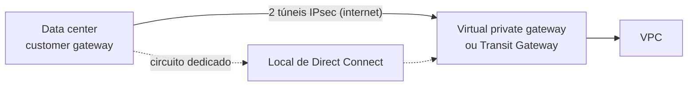

---
aliases:
  - Aula 3.8
modulo: 3
aula: 8
parte: "I Fundamentos"
dominios:
  - 1
  - 3
  - 4
lida: false
tags:
  - aula
  - saa-c03
  - modulo-03
---

# Aula 3.8: Latência, largura de banda, VPN, circuito dedicado e BGP

[[03 - Fundamentos de Redes para a Nuvem|Voltar ao módulo]]

> [!question] Pergunta que esta aula responde
> Qual é a diferença física e prática entre [[Latencia|latência]], [[Largura de Banda|largura de banda]] e [[Throughput|throughput]], e como isso leva à escolha entre [[Site-to-Site VPN|VPN IPsec]] pela internet e um circuito dedicado, com o [[BGP]] anunciando as rotas?

## Por que isso importa

Os Módulos 7 e 18 e as Tasks 3.4 e 4.4 giram em torno de uma escolha: como ligar o data center à AWS, e como levar o conteúdo perto do usuário. Quem decorou "VPN é barata, [[Direct Connect]] é cara" erra quando o enunciado pede "[[Latencia|latência]] consistente" ou "criptografado em dois dias". A decisão sai de cinco grandezas que esta aula define: latência, [[Largura de Banda|largura de banda]], [[Throughput|throughput]], [[Jitter|jitter]] e perda.

## Latência: o atraso que a física impõe

**[[Latencia|Latência]]** é o tempo para um pacote ir de A a B (ou, mais usado, de ida e volta: **RTT**, round-trip time). Tem quatro fontes: **propagação** (o sinal viaja), **transmissão** (colocar os bits no fio), **processamento** (cada roteador) e **fila** (espera em congestionamento).

A propagação é a que ninguém compra para eliminar. A luz na fibra óptica viaja a cerca de dois terços da velocidade da luz no vácuo, ou **aproximadamente 200.000 km/s**: 1 milissegundo a cada 200 km, por sentido, ou 1 ms de [[Latencia|RTT]] a cada 100 km.

> [!example] O piso do RTT entre dois continentes
> São Paulo e a Virgínia do Norte (us-east-1) estão a cerca de 7.700 km em linha reta. Ida: 7.700 / 200.000 = 38,5 ms. Ida e volta: **cerca de 77 ms como mínimo teórico**. O valor real é maior porque o cabo não segue linha reta e há equipamentos no caminho. Nenhum serviço consegue ficar abaixo desse piso: o único jeito de reduzir é **aproximar** o conteúdo do usuário (Região mais próxima, [[CloudFront]]) ou **encurtar o caminho de internet** ([[Global Accelerator]]).

É por isso que a escolha de Região (Módulo 1) considera onde estão os usuários, e que a borda ([[CloudFront]], [[Global Accelerator]]) existe.

## Largura de banda, throughput, jitter e perda

| Grandeza | Definição | Analogia (cano de água) | Unidade |
|---|---|---|---|
| **[[Largura de Banda\|Largura de banda]]** (bandwidth) | Capacidade máxima do enlace | Diâmetro do cano | bits por segundo (Mbps, Gbps) |
| **[[Throughput]]** | Taxa efetivamente alcançada | Água que realmente sai | bits por segundo |
| **[[Latencia\|Latência]]** | Tempo de ida (ou ida e volta) | Comprimento do cano | ms |
| **[[Jitter]]** | Variação da [[Latencia\|latência]] de pacote para pacote | Água que chega em intervalos irregulares | ms |
| **Perda de pacotes** | Fração de pacotes que não chega | Vazamento | % |

Atenção às unidades: rede usa **bits** (b minúsculo); arquivos usam **bytes** (B). `1 Gbps = 125 MB/s`.

**[[Throughput]] quase sempre é menor que a [[Largura de Banda|largura de banda]].** Dois motivos clássicos:

1. **O [[TCP]] espera confirmações.** Uma conexão TCP só tem uma quantidade limitada de bytes "em voo" sem confirmação (a **janela**). Em consequência, `throughput máximo ≈ janela / RTT`. Com janela de 64 KB e [[Latencia|RTT]] de 100 ms: `65.535 bytes x 8 / 0,1 s ≈ 5,2 Mbps`, **mesmo que o link seja de 1 Gbps**. Para encher um link de 1 Gbps com RTT de 100 ms, a janela precisa ser `10^9 x 0,1 = 10^8 bits = 12,5 MB` (o produto [[Largura de Banda|largura de banda]] x atraso). Sistemas modernos aumentam a janela dinamicamente, mas a regra explica por que distância limita transferência de um único fluxo e por que **paralelismo** (várias conexões, [[Multipart Upload|multipart upload]] do [[S3]]) e **aceleração** ([[Transfer Acceleration|S3 Transfer Acceleration]], [[Global Accelerator]]) ajudam.
2. **Perda de pacotes faz o [[TCP]] reduzir a taxa**, porque ele interpreta perda como congestionamento e retransmite. Um link com perda tem [[Throughput|throughput]] pior do que a [[Largura de Banda|largura de banda]] sugere.

**[[Jitter]]** não derruba um download, mas destrói voz e vídeo em tempo real, que precisam de pacotes em cadência. Por isso essas aplicações toleram perda ([[UDP]]) melhor que irregularidade.

> [!example] A conta que decide o método de transferência
> Transferir 1 TB (8 x 10^12 bits):
> - Link de 100 Mbps: `8 x 10^12 / 10^8 = 80.000 s ≈ 22 horas` (a 100% de uso).
> - Link de 1 Gbps: `8.000 s ≈ 2,2 horas` (a 100% de uso; na prática, conte mais).
> Com 100 TB no link de 1 Gbps, são cerca de 9 dias a 100% de uso; e a linha ainda atrapalharia o resto da empresa. Essa conta é o argumento para transferência offline ([[Snow Family]], Módulo 23) e para circuitos dedicados.

## Ligar o data center à AWS: três caminhos

A AWS descreve duas formas de conectar uma rede externa à [[VPC]] privadamente, e a internet pública como terceira. As propriedades que importam:

| | Internet pública | [[Site-to-Site VPN]] ([[IPsec]]) | [[Direct Connect]] (circuito dedicado) |
|---|---|---|---|
| Caminho | Internet compartilhada | Túneis criptografados **sobre a internet** | Circuito privado até um local de [[Direct Connect]], sem passar pela internet pública |
| Criptografia | Só a da aplicação ([[TLS]]) | **Sim** ([[IPsec]]) | **Não por padrão** (a documentação é explícita); [[MACsec]] ou VPN sobre o circuito |
| [[Latencia\|Latência]] e [[Jitter\|jitter]] | Variáveis | Variáveis (herda a internet) | **Consistentes** e previsíveis |
| Banda | Variável | Até **1,25 Gbps por túnel** (como a banda soma entre túneis: veja o quadro abaixo) | Portas de capacidade fixa e alta (velocidades no Módulo 7) |
| Prazo para ficar pronto | Imediato | Minutos a horas | Longo: depende de fibra e do local (tipicamente semanas ou mais; prazo exato não confirmado) |
| Custo | Só transferência | Baixo (por hora de conexão e dados) | Maior (porta, circuito e transferência), mas pode reduzir o custo de saída de dados |
| Quando usar | Tráfego público | Rápido, barato, volume moderado, backup | Banda alta e sustentada, [[Latencia\|latência]] estável, grandes volumes de dados |

Confirmado na documentação (verificado em novembro de 2026): cada conexão de [[Site-to-Site VPN]] tem **dois túneis**, cada um com um endereço IP público próprio e terminando em uma [[Zona de Disponibilidade|AZ]] diferente, para dar redundância (se um fica indisponível, o tráfego vai para o outro). A AWS recomenda configurar os dois. [[Largura de Banda|Largura de banda]] por túnel: 1,25 Gbps (existe também um túnel de banda maior, o Large Bandwidth Tunnel de 5 Gbps, só com [[Transit Gateway]]; detalhe no Módulo 7).

> [!info] Como a VPN escala
> "1,25 Gbps por túnel" **não** é o teto da VPN como solução. Com a VPN ligada a um [[Transit Gateway]], o roteamento **[[ECMP]]** (equal-cost multi-path) soma a banda de vários túneis e conexões; a **[[Accelerated VPN|VPN acelerada]]** (accelerated Site-to-Site VPN) leva os túneis pela rede do [[Global Accelerator]] para reduzir a variação de [[Latencia|latência]] da internet, também só com Transit Gateway (verificado em novembro de 2026); e dá para rodar uma VPN com IPs privados **sobre o [[Direct Connect]]** (private IP VPN). Para a SAA-C03, guarde o raciocínio e deixe o detalhe para o [[07 - Conectividade Hibrida e entre VPCs|Módulo 7]].

E sobre criptografia: a documentação do [[Direct Connect]] afirma que ele **não criptografa o tráfego em trânsito por padrão**. Para cifrar, usam-se as opções de [[Criptografia em Transito|criptografia em trânsito]]: **[[MACsec]]** (padrão IEEE de criptografia na camada de enlace, entre o seu data center e o local de Direct Connect, em conexões que o suportam) ou **[[Site-to-Site VPN]] sobre o Direct Connect**, combinação que, nas palavras da documentação, dá uma conexão privada com [[IPsec]], mais consistente que a VPN pela internet.

O desenho mostra o objetivo do [[07 - Conectividade Hibrida e entre VPCs|Módulo 7]]: o circuito dedicado como caminho principal e a VPN como backup. Os componentes, os modelos de resiliência, as velocidades e as interfaces virtuais ficam lá; aqui entram só as bases.

## IPsec: o que é a VPN por dentro

O **[[IPsec]]** é um conjunto de protocolos que cifra pacotes IP inteiros na **[[Modelo OSI|camada 3]]**. Em uma [[Site-to-Site VPN]], dois pontos de extremidade (o dispositivo da sua rede, chamado **[[Customer Gateway|customer gateway]]**, e o da AWS: um **[[Virtual Private Gateway|virtual private gateway]]** ou um **[[Transit Gateway]]**) formam um **túnel**: o pacote original (com [[RFC 1918|IP privado]]) é cifrado e embrulhado dentro de outro pacote cujo IP é público, atravessa a internet e é aberto do outro lado.

- **IKE** (Internet Key Exchange): negocia chaves e autentica os dois lados. Usa **[[UDP]] 500** e, quando há [[NAT]] no caminho, **UDP 4500** (NAT traversal).
- **ESP** (Encapsulating Security Payload): carrega os dados cifrados. É um protocolo IP próprio (número 50), não uma porta.

Por isso, o firewall do seu data center precisa permitir [[UDP]] 500, UDP 4500 e ESP vindos dos endereços da AWS. Para [[IPsec]] não importa a camada de aplicação: tudo que passa pelo túnel é protegido, seja [[HTTP]], banco ou [[NFS]].

## BGP: como as redes anunciam o que alcançam

A internet é uma coleção de redes independentes chamadas **[[Sistema Autonomo|sistemas autônomos]]** (AS), cada um com um número (**ASN**). O **[[BGP]]** (Border Gateway Protocol, **[[TCP]] porta 179**) é o protocolo pelo qual um AS **anuncia** aos vizinhos quais [[CIDR|blocos CIDR]] (prefixos) ele alcança, e aprende os prefixos dos outros. É o "mapa de rotas" dinâmico do mundo.

Quando um roteador aprende **mais de um caminho** para o mesmo prefixo, escolhe por critérios em sequência. Em linguagem simples, e sem entrar em todos os atributos: primeiro uma **preferência de política** que o administrador define, depois o **menor [[Sistema Autonomo|AS path]]** (menos redes pelo caminho). Importante: **o prefixo mais específico sempre vence** (a regra do [[Longest Prefix Match|longest prefix match]] da aula 3.4 vem antes de qualquer critério de caminho).

Por que isso aparece na prova:

- Em uma VPN com **roteamento dinâmico**, o seu roteador e a AWS trocam rotas por [[BGP]]: a AWS anuncia o [[CIDR]] da [[VPC]]; o seu lado anuncia os prefixos do data center. Se um túnel cai, a rota é retirada e o tráfego vai pelo outro **sem intervenção**. Com **roteamento estático**, você escreve as rotas à mão e a detecção de falha é mais limitada; a documentação e o Módulo 7 detalham.
- O [[Direct Connect]] depende de [[BGP]] para trocar rotas entre o seu roteador e a AWS (o detalhe das interfaces virtuais fica no Módulo 7).
- Anunciar um prefixo mais específico ou preferir um caminho é como se **escolhe qual conexão é a principal e qual é o backup** ([[Direct Connect|DX]] principal, VPN de reserva).

> [!info] Ligando os pontos
> Na [[03.04 - Roteamento NAT e Tabelas de Rotas|aula 3.4]], uma rota do tipo "192.168.0.0/16 para o [[Virtual Private Gateway|virtual private gateway]]" era escrita à mão. O [[BGP]] é o que faz essa rota **aparecer e sumir sozinha** (propagação de rotas), e a regra do [[Longest Prefix Match|prefixo mais longo]] continua valendo. E na [[03.03 - Faixas Privadas Sub-redes e IPv6|aula 3.3]], CIDRs sobrepostos entre a [[VPC]] e o data center quebram exatamente esse roteamento.

## Como escolher: uma árvore simples

1. **Precisa funcionar em horas ou poucos dias, volume moderado, orçamento baixo, criptografia obrigatória?** [[Site-to-Site VPN]].
2. **Precisa de [[Latencia|latência]] estável, banda alta e sustentada, ou move grandes volumes?** [[Direct Connect]] (o prazo é maior).
3. **Precisa de ambos: banda dedicada com criptografia [[IPsec]]?** VPN sobre [[Direct Connect]] (ou [[MACsec]], se o circuito suportar).
4. **Precisa de [[Alta Disponibilidade|alta disponibilidade]] da conexão?** Dois caminhos independentes: [[Direct Connect]] com VPN de backup, ou dois Direct Connect em locais diferentes (Módulo 7).
5. **Só precisa levar conteúdo ao usuário final mais rápido?** Nada disso: [[CloudFront]] ou [[Global Accelerator]] (Módulo 18).

## Como isso cai na prova

Tasks do exam guide cobertas: **1.2** (proteger conexões externas com VPN e [[Direct Connect]]), **3.4** (opções de conexão: VPN, Direct Connect; topologia global e híbrida) e **4.4** (Direct Connect versus VPN, alocação de banda).

**Padrões de cenário**
- "Conectar o data center à [[VPC]] rapidamente, com criptografia e baixo custo": [[Site-to-Site VPN]].
- "[[Latencia|Latência]] consistente e alta banda para um data center": [[Direct Connect]].
- "[[Direct Connect]] com criptografia": [[Site-to-Site VPN|VPN IPsec]] sobre o Direct Connect (ou [[MACsec]]).
- "Conexão híbrida resiliente": [[Direct Connect]] com VPN de backup, ou dois Direct Connect.
- "Transferir centenas de TB com link limitado": conta de tempo, e transferência offline.

**Palavras-chave em inglês:** "consistent network performance", "dedicated connection", "private connectivity", "[[IPsec]]", "encrypted over the internet", "quickly", "low [[Latencia|latency]]", "[[BGP]]".

**Pegadinhas clássicas**
- Achar que o [[Direct Connect]] já vem criptografado: não vem.
- Esquecer o prazo do [[Direct Connect]] quando o enunciado exige entrega em poucos dias.
- Contar um só túnel da VPN: a conexão tem dois, e a redundância só vale se os dois estiverem configurados.
- Confundir bits e bytes nas contas de transferência (1 Gbps = 125 MB/s).
- Achar que mais banda resolve [[Latencia|latência]]: não resolve; só aproximar ou encurtar o caminho.

| Requisito no enunciado | Resposta provável | Por quê |
|---|---|---|
| Ligação rápida, barata e cifrada ao data center | [[Site-to-Site VPN]] | Sobe em minutos, usa a internet, [[IPsec]] |
| Banda sustentada e [[Latencia\|latência]] previsível | [[Direct Connect]] | Circuito privado dedicado |
| [[Direct Connect]] e [[IPsec]] ao mesmo tempo | VPN sobre Direct Connect | O circuito não cifra por padrão |
| Backup de um [[Direct Connect]] | [[Site-to-Site VPN]] | Rápida de provisionar e barata |
| Usuários distantes com alta [[Latencia\|latência]] | [[CloudFront]] ou [[Global Accelerator]] | A física exige aproximar o conteúdo |
| [[Failover\|Failover automático]] entre túneis | Roteamento dinâmico ([[BGP]]) | A rota some e o tráfego usa o outro caminho |

## Resumo

> [!abstract] A aula em uma frase
> [[Latencia|Latência]] é limitada pela física e só se reduz aproximando o conteúdo; [[Largura de Banda|largura de banda]] é capacidade e o [[Throughput|throughput]] real depende de RTT e perda; a [[Site-to-Site VPN|VPN IPsec]] dá conectividade rápida e cifrada pela internet, o [[Direct Connect]] dá banda e latência consistentes sem criptografia por padrão, e o [[BGP]] troca as rotas entre as redes.

**A lógica, em 6 passos**
1. A luz na fibra limita o [[Latencia|RTT]] (cerca de 1 ms por 100 km): só aproximar o conteúdo reduz a latência.
2. [[Largura de Banda|Largura de banda]] é capacidade; [[Throughput|throughput]] é o que se consegue, limitado por janela/RTT e por perda.
3. [[Jitter]] e perda importam para voz e vídeo; [[Throughput|throughput]] importa para transferências.
4. A [[Site-to-Site VPN|VPN IPsec]] cria túneis cifrados pela internet: rápida de montar e barata, com desempenho variável.
5. O [[Direct Connect]] é um circuito privado: desempenho previsível, prazo longo e sem cifra por padrão.
6. O [[BGP]] anuncia prefixos entre as redes e permite [[Failover|failover automático]]; o prefixo mais específico vence.

**Números para lembrar**

| O quê | Valor | Por que importa |
|---|---|---|
| Luz na fibra | cerca de 200.000 km/s (1 ms por 100 km de [[Latencia\|RTT]]) | Piso físico de latência |
| Túneis por conexão VPN | 2, em [[Zona de Disponibilidade\|AZs]] diferentes | Redundância |
| Banda por túnel VPN | 1,25 Gbps | Dimensionamento ([[ECMP]] soma túneis, Módulo 7) |
| 1 Gbps | 125 MB/s | Contas de transferência |
| Portas | [[UDP]] 500 e 4500 (IKE), [[TCP]] 179 ([[BGP]]) | Regras de firewall |

**Tabela-síntese**

| Critério | [[Site-to-Site VPN]] | [[Direct Connect]] |
|---|---|---|
| Prazo | Minutos | Semanas ou mais |
| [[Latencia\|Latência]] | Variável | Consistente |
| Criptografia | [[IPsec]] | Não por padrão ([[MACsec]] ou VPN sobre [[Direct Connect\|DX]]) |
| Custo | Baixo | Maior |

**Na prática, isso significa**
- Para conectividade urgente ou de backup, VPN; para volume e previsibilidade, [[Direct Connect]].
- Dê aos dois túneis a mesma atenção; um só não é redundância.
- Calcule o tempo de transferência antes de escolher: se passa de poucos dias, pense em transferência offline ou circuito dedicado.

> [!tip] Liga com
> Vem da [[03.07 - TLS HTTPS e Certificados|aula 3.7]] (o handshake soma RTTs). Segue para o [[07 - Conectividade Hibrida e entre VPCs|Módulo 7]] (VPN, [[Direct Connect]] e [[Transit Gateway]]) e para o [[18 - Borda e DNS CloudFront Global Accelerator e Route 53|Módulo 18]] (borda).

## Erros comuns

- **Tratar [[Latencia|latência]] como problema de banda.** Mais [[Largura de Banda|largura de banda]] não reduz o RTT.
- **Dizer que o [[Direct Connect]] é seguro "porque é privado".** Privado não é cifrado; a AWS exige [[MACsec]] ou VPN para cifrar.
- **Planejar prazo de VPN para o [[Direct Connect]].** O circuito físico leva muito mais.
- **Configurar um túnel só.** A manutenção em um dos lados derruba a conexão.
- **Misturar Mbps e MB/s.** Divida por 8.

## Pratique

**1.** Uma empresa precisa ligar o data center a uma [[VPC]] em até um dia, com criptografia e baixo custo, para cerca de 500 Mbps. O que escolher?

- [ ] a) Direct Connect com conexão dedicada
- [ ] b) AWS Snowball Edge
- [ ] c) Client VPN com um endpoint para cada servidor do data center
- [ ] d) Site-to-Site VPN com os dois túneis

**2.** Uma empresa precisa de 10 Gbps sustentados entre o data center e a AWS, com [[Latencia|latência]] previsível, e tem tempo para provisionar. Qual solução atende?

- [ ] a) Site-to-Site VPN com roteamento estático
- [ ] b) AWS Direct Connect
- [ ] c) Site-to-Site VPN com Large Bandwidth Tunnel em cada conexão
- [ ] d) Dois Direct Connect de 1 Gbps agregados em um LAG

**3.** Uma empresa que já usa [[Direct Connect]] precisa que o tráfego seja criptografado com [[IPsec]]. O que fazer?

- [ ] a) Criar uma Site-to-Site VPN sobre a conexão do Direct Connect
- [ ] b) Nada, pois o Direct Connect já criptografa o tráfego
- [ ] c) Habilitar criptografia em um security group
- [ ] d) Usar uma network ACL com regras de criptografia

**4.** Uma empresa copia um arquivo de 50 GB do data center para a AWS por uma única conexão [[TCP]] (janela de 64 KB, [[Latencia|RTT]] de 100 ms) em um link de 1 Gbps, e o [[Throughput|throughput]] fica perto de 5 Mbps. O que melhora MAIS o throughput?

- [ ] a) Contratar um link de 10 Gbps, mantendo uma única conexão
- [ ] b) Dividir a cópia em várias conexões em paralelo
- [ ] c) Trocar para instâncias EC2 com mais CPU no destino
- [ ] d) Habilitar IPv6 nas duas pontas do link

**5.** Uma empresa precisa migrar 100 TB para a AWS em até 5 dias, por um [[Direct Connect]] de 1 Gbps que fica 100% dedicado à migração. A migração é viável pela rede?

- [ ] a) Sim, em cerca de 22 horas
- [ ] b) Sim, em cerca de 4 dias, com o link a 100%
- [ ] c) Não: leva cerca de 9 dias, então vale avaliar a Snow Family
- [ ] d) Não: leva cerca de 90 dias, e só a Snow Family resolve

**6.** Uma empresa liga o data center à [[VPC]] por [[Site-to-Site VPN]] e quer que as novas [[Sub-rede|sub-redes]] on-premises sejam descobertas sem editar rotas estáticas na AWS a cada mudança. O que resolve e por quê?

- [ ] a) Roteamento dinâmico com BGP, que anuncia e aprende prefixos entre as redes
- [ ] b) IPsec, que cifra os pacotes e propaga as sub-redes novas automaticamente
- [ ] c) DHCP option sets, que distribuem as rotas do data center às instâncias
- [ ] d) Route 53 Resolver, que traduz os nomes das novas sub-redes em rotas

**7.** Uma equipe configurou apenas um dos túneis de uma conexão [[Site-to-Site VPN]], e a conectividade cai durante manutenção da AWS. Qual é a causa?

- [ ] a) A VPN suporta só um túnel por Região, e a manutenção é um limite do serviço
- [ ] b) A VPN não suporta manutenção sem queda
- [ ] c) Cada conexão tem dois túneis e só um foi configurado
- [ ] d) O túnel único deveria ter 5 Gbps de banda

**8.** Uma central de atendimento envia chamadas de voz do data center à AWS por uma [[Site-to-Site VPN]] pela internet. As chamadas ficam entrecortadas, embora haja banda de sobra e quase nenhuma perda. Qual é a causa mais provável e uma saída?

- [ ] a) Jitter da internet pública; usar Direct Connect para variação de latência consistente
- [ ] b) Largura de banda insuficiente; contratar um túnel VPN adicional e dividir a banda entre os túneis
- [ ] c) Perda de pacotes; trocar o UDP da voz por TCP para garantir a entrega de cada pacote
- [ ] d) RTT mínimo imposto pela física; mover a aplicação de voz para uma Região mais distante

**9.** (Escolha DUAS.) Quais afirmações sobre o [[Direct Connect|AWS Direct Connect]] estão corretas?

- [ ] a) Oferece um circuito privado com latência consistente
- [ ] b) Não criptografa o tráfego por padrão
- [ ] c) Criptografa todo o tráfego por padrão
- [ ] d) É provisionado em minutos em qualquer cenário
- [ ] e) Exige um Transit Gateway para funcionar

**10.** (Escolha DUAS.) Usuários na Europa acessam uma aplicação hospedada apenas em sa-east-1 e reclamam de lentidão. Quais ações reduzem a [[Latencia|latência]] percebida?

- [ ] a) Servir a aplicação de uma Região mais próxima dos usuários
- [ ] b) Usar o CloudFront para colocar conteúdo em cache perto deles
- [ ] c) Aumentar o tamanho das instâncias EC2
- [ ] d) Aumentar a largura de banda do link da VPC
- [ ] e) Trocar IPv4 por IPv6 nas instâncias

> [!success]- Gabarito
> **1. d)** a VPN sobe em minutos ou horas, é cifrada e barata, e 500 Mbps cabe nos túneis. a) o [[Direct Connect]] leva muito mais que um dia. b) o [[Snowball Edge|Snowball]] é transferência offline. c) a [[Client VPN]] conecta usuários individuais, não uma rede de data center.
> **2. b)** o [[Direct Connect]] dá banda e [[Latencia|latência]] previsíveis (portas de 10 Gbps existem). a) a VPN usa a internet e limita a banda por túnel. c) mesmo com 5 Gbps por túnel a latência continua variável e o teto é menor que 10 Gbps. d) dois links de 1 Gbps somam apenas 2 Gbps.
> **3. a)** o [[Direct Connect]] não criptografa por padrão e a [[Site-to-Site VPN|VPN IPsec]] sobre ele resolve. b) o Direct Connect não criptografa por padrão. c) e d) [[Security Group|security groups]] e [[Network ACL|NACLs]] filtram, não criptografam.
> **4. b)** o limite é `janela / RTT`: `65.535 x 8 / 0,1 s ≈ 5,2 Mbps` por conexão, e várias conexões somam. a) mais banda não muda o limite de uma conexão. c) CPU não é o gargalo. d) a versão do IP não muda janela nem [[Latencia|RTT]].
> **5. c)** `100 TB = 8 x 10^14 bits`; a 10^9 bits/s são 800.000 s, cerca de 9,3 dias a 100% de uso, acima dos 5 dias. a) é o tempo de 1 TB a 100 Mbps, não de 100 TB a 1 Gbps. b) subestima por um fator de mais de 2. d) superestima por um fator de 10.
> **6. a)** o [[BGP]] troca prefixos e escolhe caminhos, então [[Sub-rede|sub-redes]] novas passam a ser aprendidas sem editar rotas. b) o [[IPsec]] só cifra o túnel e não propaga rotas. c) o DHCP entrega endereço e opções de rede às instâncias, não rotas de roteadores. d) o [[DNS]] traduz nomes, não monta [[Route Table|tabelas de rotas]].
> **7. c)** cada conexão tem dois túneis em [[Zona de Disponibilidade|AZs]] diferentes, e a redundância só vale com os dois configurados. a) a conexão tem dois túneis, não um. b) a VPN suporta a manutenção por meio do segundo túnel. d) a banda do túnel não é a causa.
> **8. a)** [[Jitter|jitter]] é a variação da [[Latencia|latência]] entre pacotes, que estraga voz; o [[Direct Connect]] entrega latência consistente. b) a banda sobra, então mais túneis não resolvem. c) a voz tolera perda, e [[TCP]] retransmitindo piora o atraso. d) o piso físico não varia, e afastar a aplicação aumentaria o RTT.
> **9. a) e b)** circuito privado e consistente, sem criptografia padrão. c) é o oposto: a criptografia é opcional ([[MACsec]] ou VPN). d) o provisionamento é longo. e) o [[Direct Connect]] funciona com [[Virtual Private Gateway|virtual private gateway]] ou [[Direct Connect Gateway|Direct Connect gateway]]; o [[Transit Gateway]] não é requisito.
> **10. a) e b)** aproximar o conteúdo ou a aplicação reduz o [[Latencia|RTT]]. c) o tamanho da instância não diminui a distância. d) mais banda não reduz o RTT. e) a versão do IP não muda o caminho físico.

### Laboratório (opcional): medir latência e throughput

> [!warning] Sem conta AWS
> Roda só local, sem custo.

1. `ping -c 10 example.com` (Linux ou macOS) ou `ping -n 10 example.com` (Windows): leia o [[Latencia|RTT]] mínimo, médio e máximo, e a perda. A diferença entre mínimo e máximo é o [[Jitter|jitter]] aproximado.
2. `traceroute example.com` ou `tracert example.com`: veja em qual salto o [[Latencia|RTT]] dá o grande salto (geralmente a travessia intercontinental).
3. Calcule: com o seu [[Latencia|RTT]] medido e uma janela de 64 KB, qual o [[Throughput|throughput]] máximo de uma única conexão? `65.535 x 8 / RTT em segundos`.
4. Calcule quanto tempo levaria para transferir 500 GB pelo seu link de internet (divida `500 x 8 x 10^9` bits pela sua velocidade em bits por segundo).

## Para aprofundar

- [ ] [Tunnel options for your AWS Site-to-Site VPN connection](https://docs.aws.amazon.com/vpn/latest/s2svpn/VPNTunnels.html) (AWS Docs): dois túneis por conexão e opções de banda por túnel, confirmados nesta aula.
- [ ] [Encryption in AWS Direct Connect](https://docs.aws.amazon.com/directconnect/latest/UserGuide/encryption-in-transit.html) (AWS Docs): por que o [[Direct Connect]] não cifra por padrão e como cifrar com [[MACsec]] ou VPN.

Próximo módulo: [[04 - IAM Identidade e Acesso|Módulo 4: IAM Identidade e Acesso]]
