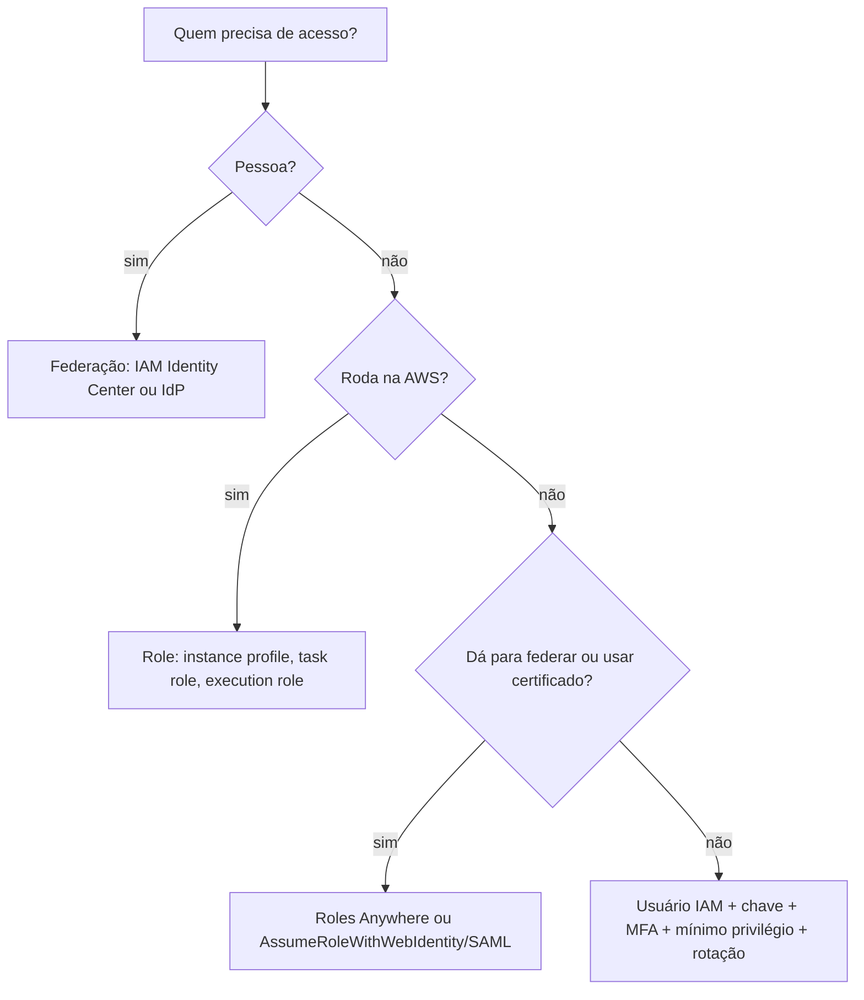

---
aliases:
  - Aula 4.2
modulo: 4
aula: 2
parte: "II Identidade, rede e dados"
dominios:
  - 1
lida: false
tags:
  - aula
  - saa-c03
  - modulo-04
---

# Aula 4.2: Usuários, grupos, credenciais de longo prazo e MFA

[[04 - IAM Identidade e Acesso|Voltar ao módulo]]

> [!question] Pergunta desta aula
> Por que a AWS recomenda evitar [[IAM User|usuários IAM]] e [[Access Key|chaves de acesso]], e o que usar no lugar? Quando um usuário [[IAM]] ainda é a resposta certa?

## O problema: credencial que não expira

Na [[04.01 - Por que IAM Autenticacao Autorizacao e Principals|Aula 4.1]] você viu que toda requisição precisa de uma credencial. A forma mais antiga de dar uma credencial a alguém é criar um **[[IAM User|IAM user]]**: uma identidade permanente dentro da conta, com senha para o Console e/ou **[[Access Key|chaves de acesso]] (access keys)** para CLI, SDK e API.

O defeito está no adjetivo "permanente". Uma [[Access Key|chave de acesso]] é um par (ID da chave e chave secreta) que **não expira sozinho** e vale de qualquer lugar do mundo. Ela vaza em repositório público, em log, em [[Imagem de Container|imagem de container]], em notebook compartilhado, em print de tela. Quem a encontra age como o dono da chave, por tempo indeterminado, até alguém perceber e revogar. Esse é o cenário real de boa parte dos incidentes de custo ("alguém minerou criptomoeda na minha conta") e de vazamento de dados.

A solução moderna não é "guardar melhor a chave", é **não ter a chave**: usar [[Credencial Temporaria|credenciais temporárias]], que expiram em minutos ou horas. A documentação de best practices diz isso em duas frases:

- **Humanos:** exija que os usuários acessem a AWS por **[[Federacao|federação]]** com um [[Identity Provider|provedor de identidade]] (IdP), recebendo [[Credencial Temporaria|credenciais temporárias]]. Para gestão central, a AWS recomenda o [[IAM Identity Center]].
- **Workloads:** exija que cargas de trabalho usem [[Credencial Temporaria|credenciais temporárias]] de **[[IAM Role|roles]]**.

(verificado em novembro de 2026, página "Security best practices in [[IAM]]"). Roles e [[STS]] são a [[04.06 - Roles e STS Credenciais Temporarias|Aula 4.6]]; [[Federacao|federação]] em detalhe é o [[05 - Multiconta Governanca e Federacao|Módulo 5]]. Aqui você aprende o que vem antes: como o [[IAM User|usuário IAM]] funciona, porque ele é exceção e como protegê-lo quando precisa existir.

> [!info] Ligando os pontos
> No seu dia a dia, o serviço no [[ECS]] não tem [[Access Key|chave de acesso]]: a [[Task Role|task role]] entrega [[Credencial Temporaria|credenciais temporárias]] ao [[Container|container]]. Você já vive o modelo "sem chave". O [[IAM User|usuário IAM]] com chave de acesso é o que sobrou para quem **não consegue** usar uma role.

## O IAM user por dentro

Um [[IAM User|usuário IAM]] tem:

- um **nome** único na conta (os nomes de usuários, grupos, roles e [[Instance Profile|instance profiles]] não distinguem maiúscula de minúscula: `ADMINS` e `admins` colidem);
- uma **senha de console** opcional (login profile, de 1 a 128 caracteres ASCII);
- até **duas [[Access Key|chaves de acesso]]** ativas ao mesmo tempo (o [[Credential Report|credential report]] também lista só as duas primeiras por usuário; nota confirmada na documentação do relatório). Duas servem para **rotação sem parada**: cria a chave 2, atualiza a aplicação, desativa a chave 1, confirma que nada quebrou, apaga a chave 1;
- zero ou mais **[[MFA]] devices**, até oito;
- policies anexadas direto ou herdadas dos grupos.

O limite de **managed policies por usuário** é 10 por padrão (ajustável até 20). Por role é 20 (até 25), por grupo é 10 (sem aumento), segundo a página de quotas (verificado em novembro de 2026). Tamanhos relevantes: uma managed policy tem no máximo 6.144 caracteres (sem contar espaços); as inline somadas por entidade têm 2.048 (usuário), 5.120 (grupo) e 10.240 (role). O ponto de prova é o princípio, não o número: policies têm tamanho limitado, então usar grupos e policies gerenciadas ajuda.

### Política de senha da conta

Senhas de console de [[IAM]] users seguem uma **[[Account Password Policy|account password policy]]**, configurável no IAM (console ou `aws iam update-account-password-policy`). Sem política customizada vale a padrão: 8 a 128 caracteres, ao menos três dos quatro tipos de caractere, diferente do nome da conta e do e-mail, e **sem expiração**. A política customizada permite (verificado em novembro de 2026):

- comprimento mínimo de 6 a 128 caracteres e exigência de maiúscula, minúscula, número e símbolo;
- **expiração** de 1 a 1.095 dias (aplicada na hora a quem tem senha mais velha), com opção de exigir que um administrador faça o reset;
- **impedir reuso** das últimas 1 a 24 senhas;
- **permitir que os usuários troquem a própria senha** (aplica `iam:ChangePassword` só ao próprio usuário, no nível da conta).

Limites que a prova explora: a política vale para **[[IAM]] users da conta**, não para o root nem para usuários do [[IAM Identity Center|Identity Center]]; não afeta [[Access Key|chaves de acesso]] (com a senha expirada, o usuário perde o Console, mas a chave continua funcionando); e **não existe política de bloqueio** por tentativas erradas, por isso a recomendação é combinar senha forte com [[MFA]]. Fonte: [Set an account password policy for IAM users](https://docs.aws.amazon.com/IAM/latest/UserGuide/id_credentials_passwords_account-policy.html).

## Grupos IAM: organizar permissões, não identidades

Um **[[IAM Group|IAM group]]** é uma coleção de usuários que recebe policies para todos de uma vez. Ana entra no grupo `Developers` e ganha as permissões do grupo; muda de área, sai de um grupo e entra em outro. O problema que resolve é o de manter permissão usuário por usuário.

Características que caem na prova (página "[[IAM User|IAM user]] groups"):

- um grupo contém muitos usuários e um usuário pode estar em vários grupos;
- **grupos não podem ser aninhados**: só contêm usuários, nunca outros grupos;
- **não existe grupo padrão** que inclua todos os usuários da conta: se quiser um, você cria e adiciona cada novo usuário;
- **grupo não é principal**: não aparece em `Principal` de [[Resource-Based Policy|resource-based policy]], porque representa permissão, não autenticação;
- limite padrão de 300 grupos por conta, ajustável até 500.

> [!example] Um desenho de grupos
> Uma startup tem `Developers` (acesso a [[EC2]], Lambda e logs de desenvolvimento), `DBAs` ([[RDS]]) e `Billing` (só leitura de custos). Cada pessoa nova entra em um ou dois grupos. Quando a política de acesso a logs muda, edita-se a policy do grupo uma vez, e todos herdam. Sem grupos, seriam dezenas de edições.

## Por que não chave de acesso (e quando ela ainda é a resposta)

A página oficial lista os casos em que um [[IAM User|usuário IAM]] com credencial de longo prazo ainda se justifica:

| Situação | Por que role não serve |
|---|---|
| Workload fora da AWS que não consegue obter [[Credencial Temporaria\|credencial temporária]] | Ex.: plugin de software legado que só aceita chave estática |
| Cliente de terceiros que não suporta [[IAM Identity Center\|Identity Center]] | Ferramenta sem integração com SSO |
| Acesso a [[Keyspaces\|Amazon Keyspaces]] com credencial específica de serviço (testes) | Existe alternativa temporária, mas o caso de teste justifica |
| Acesso de emergência (break-glass) quando o [[Identity Provider\|IdP]] está fora do ar | Precisa funcionar sem depender de terceiros |

(A lista também cita AWS CodeCommit, que está fora do escopo da prova.) Mesmo nesses casos, a recomendação é: exija [[MFA]], atribua o mínimo de permissões, **atualize as chaves quando necessário** (por exemplo, quando um funcionário sai) e use a informação de **último uso (access last used)** para remover chaves sem uso com segurança.

Para workloads fora da AWS, a documentação traz alternativas que dão [[Credencial Temporaria|credencial temporária]] **sem** chave estática:

- **[[IAM Roles Anywhere]]:** o servidor on-premises apresenta um certificado X.509 da sua própria PKI e recebe [[Credencial Temporaria|credenciais temporárias]].
- **`AssumeRoleWithSAML`:** usa uma asserção [[SAML]] de um [[Identity Provider|IdP]] configurado na conta.
- **`AssumeRoleWithWebIdentity`:** usa um [[JWT|token JWT]] de um [[Identity Provider|IdP]] [[OIDC]]. É o caso de um pipeline no GitHub Actions: em vez de guardar [[Access Key|chave de acesso]] no repositório, o workflow troca o JWT do GitHub por [[Credencial Temporaria|credenciais temporárias]] de uma role (a documentação de OIDC federation cita exatamente esse exemplo). O JWT tem a data de expiração `exp`, e o [[IAM]] aceita uma janela de cinco minutos além dela para absorver diferença de relógio.
- Integrações de serviço: **[[ECS Anywhere]]**, **[[EKS Hybrid Nodes]]** e **[[Systems Manager]] Hybrid Activations** entregam [[Credencial Temporaria|credenciais temporárias]] a cargas fora da AWS.

## Higiene de chaves de acesso

Se uma chave precisa existir, trate-a como radioativa:

1. **Nunca** coloque em código, `.env` versionado, imagem ou ticket. Em aplicações na AWS, o SDK descobre sozinho as credenciais da role, então **não existe motivo** para chave em [[EC2]], Lambda ou [[ECS]].
2. **Rotacione**: crie a segunda chave, migre, desative a antiga, apague.
3. **Use o último uso:** o [[IAM]] registra quando e em qual serviço cada chave foi usada pela última vez. Chave sem uso por meses sai.
4. **Audite pelo [[Credential Report|credential report]]** (Aula 4.8): ele mostra senha, [[MFA]] e idade de chaves por usuário.
5. **Não crie chave para o root** (Aula 4.1).
6. **Limite o dano:** quem tem chave deve ter só o necessário, e as policies podem exigir [[MFA]] ou IP de origem (Aula 4.4).
7. **Automatize a detecção:** a regra gerenciada `access-keys-rotated` do [[Config|AWS Config]] marca chaves mais velhas que o prazo definido (Módulo 5), e o [[Trusted Advisor]] traz uma checagem de rotação de [[Access Key|chaves de acesso]] (Módulo 21). O alarme de uso do root vem pelo [[CloudTrail]] (Aula 4.1).

> [!warning] Armadilha clássica de prova
> "Uma aplicação em [[EC2|instâncias EC2]] precisa acessar o [[S3]]. Qual a forma mais segura?" **Role anexada à instância** ([[Instance Profile|instance profile]]), nunca [[Access Key|chave de acesso]] guardada em arquivo na instância, nem em variável de ambiente, nem no [[AMI]]. A resposta com "armazenar a chave no [[Secrets Manager]]" também é pior do que não ter chave: o segredo ainda existe e alguém precisa ter acesso a ele.

## MFA: o segundo fator

**[[MFA]] (multi-factor authentication)** exige algo que você sabe (senha) e algo que você tem (dispositivo) para entrar. A documentação lista três tipos (verificado em novembro de 2026):

| Tipo | Como funciona | Observações |
|---|---|---|
| Passkeys e security keys (FIDO) | Criptografia de chave pública; **resistentes a phishing**, man-in-the-middle e replay | Chave física (ex.: YubiKey) ou passkey sincronizada por gerenciador de credenciais; uma chave de segurança pode servir a vários usuários |
| Aplicativo autenticador virtual | Código TOTP gerado no celular | Recomendado só como solução provisória enquanto o hardware não chega |
| Token TOTP de hardware | Dispositivo físico que gera o código | Alternativa quando se quer hardware dedicado |

Fatos para lembrar: root e [[IAM]] users podem registrar **até 8 dispositivos [[MFA]] de qualquer tipo** (reduz o risco de ficar sem acesso se perder um); só **um** é necessário para entrar; o MFA do root afeta **apenas** o root, cada [[IAM User|usuário IAM]] tem o seu; e no [[IAM Identity Center]] o MFA é configurado ali quando o [[Identity Source|identity source]] é o diretório do próprio Identity Center, [[Directory Service|AWS Managed Microsoft AD]] ou [[AD Connector]].

Há ainda duas aplicações do [[MFA]] que serão detalhadas depois: exigir MFA **dentro de uma policy** com a condição `aws:MultiFactorAuthPresent` ([[04.04 - Conditions e Condition Keys|Aula 4.4]]) e pedir token MFA ao obter [[Credencial Temporaria|credenciais temporárias]] com `GetSessionToken` ou `AssumeRole` ([[04.06 - Roles e STS Credenciais Temporarias|Aula 4.6]]).

## Humanos e máquinas: o resumo de decisão

| Quem | Onde roda | Credencial recomendada |
|---|---|---|
| Pessoa da empresa | Console, CLI | [[Federacao\|Federação]] ([[IAM Identity Center\|Identity Center]] ou [[Identity Provider\|IdP]]) + [[MFA]] |
| Aplicação em [[EC2]] | AWS | Role via [[Instance Profile\|instance profile]] |
| Função Lambda | AWS | Execution role |
| [[Container]] [[ECS]] | AWS | [[Task Role\|Task role]] (e [[Task Execution Role\|task execution role]] para o agente) |
| Servidor on-premises | Data center | [[IAM Roles Anywhere\|Roles Anywhere]] (certificado) |
| Pipeline CI/CD (ex.: GitHub Actions) | SaaS | Role via [[OIDC]] (`AssumeRoleWithWebIdentity`) |
| Software legado sem suporte a role | Qualquer | [[IAM User\|Usuário IAM]] com chave, rotação e mínimo privilégio (exceção) |
| Emergência sem [[Identity Provider\|IdP]] | Qualquer | [[IAM User\|Usuário IAM]] de emergência com [[MFA]], cofre e alarme |

> [!tip] Como a AWS pensa
> Se a questão pergunta "o que **elimina** o risco de vazar credenciais", a resposta é trocar credencial de longo prazo por temporária (role, [[Federacao|federação]]). Se pergunta como **reduzir** o risco, a resposta é [[MFA]], rotação, mínimo privilégio e monitoramento.

## Como isso cai na prova

**Task 1.1**, skill "applying AWS security best practices to [[IAM]] users and root users (including [[MFA]])" e "designing a flexible authorization model that includes IAM users, groups, roles, and policies".

Palavras-chave em inglês e o que puxam:

- "**long-term credentials**", "[[Access Key|access keys]] hardcoded", "rotate", "leaked": role ou [[Credencial Temporaria|credencial temporária]].
- "**Application running on [[EC2]]** needs access to ...": [[IAM Role|IAM role]] ([[Instance Profile|instance profile]]).
- "**on-premises** servers need to call AWS APIs without storing [[Access Key|access keys]]": [[IAM Roles Anywhere]].
- "**Employees** use existing corporate directory credentials": [[Federacao|federação]] com [[IAM Identity Center]] ou [[SAML]] (Módulo 5).
- "Group of **administrators**/developers with the same permissions": [[IAM Group|IAM group]] com policy.
- "Protect from **phishing**": security key ou passkey (FIDO).
- "**Least [[Overhead Operacional|operational overhead]]**": [[IAM Identity Center|Identity Center]] em vez de criar [[IAM User|usuários IAM]] em cada conta.

Pegadinhas: grupos não podem ser aninhados nem ser `Principal`; o [[MFA]] do root não protege [[IAM User|usuários IAM]]; "usar o [[Usuario Root|usuário root]] com MFA" **não** resolve a questão de uso diário.

| Requisito no enunciado | Resposta provável | Por quê |
|---|---|---|
| App na [[EC2]] precisa ler um [[Bucket\|bucket]] [[S3]] | Role anexada à instância | [[Credencial Temporaria\|Credencial temporária]] entregue pelo serviço, sem chave |
| Servidor on-premises chama APIs da AWS sem chave estática | [[IAM Roles Anywhere]] | Certificado X.509 troca por [[Credencial Temporaria\|credencial temporária]] |
| 50 desenvolvedores com as mesmas permissões | [[IAM Group\|IAM group]] com managed policy | Permissão por grupo, não por usuário |
| Colaborador sai da empresa, havia [[Access Key\|chave de acesso]] | Desativar e apagar a chave, auditar último uso | Credencial de longo prazo precisa ser revogada |
| Requisito de [[MFA]] resistente a phishing | Chave de segurança FIDO ou passkey | TOTP é vulnerável a phishing |

## Resumo

> [!abstract] A aula em uma frase
> [[IAM User|Usuário IAM]] e [[Access Key|chave de acesso]] são credenciais de longo prazo que vazam e não expiram, então a regra é usar [[Federacao|federação]] para humanos e roles para máquinas, e reservar usuário [[IAM]] com [[MFA]], rotação e mínimo privilégio para as exceções.

**A lógica, em 5 passos**

1. Credencial permanente vaza e vale indefinidamente, a causa de muitos incidentes.
2. Humanos: [[Federacao|federação]] com [[Identity Provider|IdP]] ou [[IAM Identity Center|Identity Center]]; [[Credencial Temporaria|credenciais temporárias]].
3. Workloads na AWS: role ([[Instance Profile|instance profile]], execution role, [[Task Role|task role]]); fora da AWS: [[IAM Roles Anywhere|Roles Anywhere]] ou [[OIDC]].
4. Quando um [[IAM User|usuário IAM]] é inevitável: duas chaves para rotação, último uso para limpar, [[MFA]], mínimo privilégio.
5. Grupos organizam permissões de usuários, mas não são [[Principal|principals]] e não aninham.

**Números para lembrar**

| O quê | Valor | Por que importa |
|---|---|---|
| [[Access Key\|Chaves de acesso]] por usuário | 2 | Rotação sem parada |
| Dispositivos [[MFA]] por identidade | até 8 | Redundância |
| Managed policies por usuário/role/grupo | 10 (até 20) / 20 (até 25) / 10 | Pergunta de limite, verificado em novembro de 2026 |
| Grupos por conta | 300 (até 500) | Pergunta de limite |

**Tabela-síntese**

| Identidade | Credencial | Dura | Preferida para |
|---|---|---|---|
| [[IAM User\|IAM user]] | Senha, [[Access Key\|access key]] | Até revogar | Exceções |
| Role | [[STS]] | 15 min a 12 h | Máquinas e acesso cross-account |
| Usuário [[IAM Identity Center\|Identity Center]] | Sessão SSO | Sessão | Humanos |

**Na prática, isso significa**

- Não crie [[IAM]] users para pessoas em empresas com várias contas; use [[IAM Identity Center|Identity Center]].
- Se encontrar chave em código, revogue primeiro e investigue depois.
- Toda exceção com chave estática leva [[MFA]] (quando humana), mínimo privilégio e rotação.

> [!tip] Liga com
> Vem da [[04.01 - Por que IAM Autenticacao Autorizacao e Principals|Aula 4.1]] (root e [[Principal|principals]]). Segue para a linguagem das policies na [[04.03 - Anatomia de uma Policy IAM|Aula 4.3]].

## Erros comuns

- **"Chave guardada no [[Secrets Manager]] é tão segura quanto role."** Role não tem segredo para vazar; o segredo guardado ainda é credencial de longo prazo.
- **"Dá para colocar grupo dentro de grupo para refletir a hierarquia da empresa."** Não dá; use mais grupos, ou [[Federacao|federação]] com [[ABAC]] (Aula 4.8).
- **"[[MFA]] do root protege os [[IAM User|usuários IAM]]."** Cada identidade tem seu MFA.
- **"Aplicativo de [[MFA]] no celular é a opção mais forte."** Chave de segurança ou passkey FIDO resiste a phishing; TOTP não.
- **"Desativar a chave é o mesmo que apagar."** Desativar permite reverter; para rotação, só apague depois de confirmar que nada quebrou.

## Pratique

**1.** Uma aplicação em [[EC2|instâncias EC2]] grava arquivos em um [[Bucket|bucket]] [[S3]]. Qual solução é a mais segura e simples de operar?

- [ ] a) Criar um usuário IAM, gerar chaves e colocá-las em variáveis de ambiente das instâncias
- [ ] b) Anexar às instâncias uma IAM role com permissão de escrita no bucket, via instance profile
- [ ] c) Guardar as chaves de um usuário IAM no Secrets Manager e lê-las na inicialização
- [ ] d) Embutir as chaves de acesso no AMI usado pelas instâncias para evitar configuração

**2.** Uma empresa quer que servidores on-premises chamem APIs da AWS sem armazenar [[Access Key|chaves de acesso]] de longo prazo, usando certificados da sua PKI. Qual serviço atende?

- [ ] a) IAM Roles Anywhere, trocando o certificado por credenciais
- [ ] b) AWS Directory Service com AD Connector
- [ ] c) Amazon Cognito Identity Pools para autenticar os servidores
- [ ] d) Um usuário IAM por servidor, com as chaves rotacionadas mensalmente

**3.** Um colaborador com [[Access Key|chave de acesso]] ativa deixou a empresa. Qual ação do administrador segue as boas práticas?

- [ ] a) Apagar apenas a senha do console, porque a chave de acesso expira sozinha
- [ ] b) Mover o usuário para outro grupo sem permissões, mantendo a chave ativa por precaução
- [ ] c) Desativar e remover o usuário e as chaves, consultando o último uso delas
- [ ] d) Pedir ao colaborador que devolva a chave e confiar que ele não guardou nenhuma cópia

**4.** Uma startup quer refletir a hierarquia da empresa colocando o grupo `Developers` dentro do grupo `Engineering` e esperar que as permissões se somem. Qual afirmação sobre [[IAM Group|grupos IAM]] está correta?

- [ ] a) Um grupo pode conter outros grupos, com até três níveis de aninhamento hierárquico
- [ ] b) Um grupo pode ser listado como Principal em uma bucket policy
- [ ] c) Existe um grupo padrão que contém automaticamente todos os usuários da conta
- [ ] d) Um usuário pode estar em vários grupos, e as permissões se somam

**5.** Uma empresa quer [[MFA]] resistente a phishing para os administradores de contas. Quais opções atendem? (Escolha DUAS.)

- [ ] a) Aplicativo autenticador TOTP no celular dos administradores
- [ ] b) Token TOTP de hardware que exibe um código de seis dígitos
- [ ] c) Chave de segurança física compatível com FIDO
- [ ] d) Passkey FIDO sincronizada por um gerenciador de credenciais
- [ ] e) Senha longa e complexa, trocada a cada 90 dias pelo administrador

**6.** Um pipeline de CI/CD hospedado em um SaaS externo precisa implantar na AWS sem [[Access Key|chaves de acesso]] estáticas. Qual é a abordagem recomendada?

- [ ] a) Criar um usuário IAM com permissões mínimas e guardar a chave como segredo do pipeline
- [ ] b) Compartilhar as credenciais do administrador do Identity Center com o SaaS
- [ ] c) Federar via OIDC e assumir uma role com AssumeRoleWithWebIdentity, sem chave estática no pipeline
- [ ] d) Abrir o acesso do pipeline por uma bucket policy pública no artefato

**7.** Quantas [[Access Key|chaves de acesso]] ativas um [[IAM User|usuário IAM]] pode ter simultaneamente, e qual a utilidade disso?

- [ ] a) Uma, para limitar a superfície de ataque do usuário
- [ ] b) Quatro, uma por ambiente: desenvolvimento, teste, homologação e produção
- [ ] c) Ilimitadas, desde que cada uma seja marcada com uma tag
- [ ] d) Duas, o que permite rotacionar sem interromper a aplicação

**8.** Depois de habilitar o [[MFA]] no [[Usuario Root|usuário root]], o CISO afirma que a conta toda está protegida por segundo fator. O que isso significa de fato para os [[IAM User|usuários IAM]] da mesma conta?

- [ ] a) Todos passam a ser obrigados a usar MFA automaticamente no próximo login no Console
- [ ] b) Nada muda: cada usuário IAM é uma identidade com MFA próprio
- [ ] c) Os usuários IAM herdam o dispositivo MFA do root para o login no Console da conta
- [ ] d) O Console deixa de aceitar senhas de qualquer usuário IAM na conta

**9.** Uma empresa de software mantém um plugin legado que só aceita [[Access Key|chave de acesso]] estática para chamar a AWS e não pode ser alterado. Qual é a abordagem aceitável?

- [ ] a) Usar o root, que não depende de chaves de acesso do IAM
- [ ] b) Dar AdministratorAccess ao usuário do plugin, para evitar falhas de permissão em produção
- [ ] c) Usar um usuário IAM com mínimo privilégio, rotação de chaves e último uso
- [ ] d) Hospedar o plugin em uma instância EC2 sem role, para evitar conflito entre credenciais

**10.** Um administrador teme que um usuário fique sem acesso se perder o celular com o aplicativo de [[MFA]]. Qual afirmação sobre o limite de dispositivos MFA, segundo a documentação do [[IAM]], resolve a dúvida?

- [ ] a) Até oito dispositivos MFA, e só um é necessário para entrar
- [ ] b) Cada identidade pode ter um único dispositivo MFA registrado, para evitar a perda de controle do acesso
- [ ] c) São permitidos dois dispositivos MFA, um virtual e um de hardware
- [ ] d) Os usuários IAM não têm limite de dispositivos MFA, mas o root só pode ter um dispositivo

**11.** A equipe de segurança precisa organizar 200 desenvolvedores com as mesmas permissões e quer atualizar o acesso em um só lugar. O que usar?

- [ ] a) Anexar a mesma policy inline a cada um dos 200 usuários
- [ ] b) Criar 200 roles, uma por desenvolvedor, com a mesma policy
- [ ] c) Compartilhar um único usuário IAM entre os 200 desenvolvedores
- [ ] d) Criar um IAM group e anexar a managed policy ao grupo, adicionando os 200 usuários

**12.** Uma empresa está em um incidente: o [[Identity Provider|IdP]] corporativo caiu e ninguém consegue entrar nas [[Conta AWS|contas AWS]]. Qual medida planejada com antecedência resolve?

- [ ] a) Usuários IAM de emergência (break-glass) com MFA e uso monitorado
- [ ] b) Usar o root diariamente e sem MFA enquanto o IdP estiver fora do ar
- [ ] c) Abrir um caso no AWS Support para pedir acesso imediato às contas afetadas
- [ ] d) Federar com um segundo IdP externo, que também fica fora das contas AWS

**13.** Um [[IAM User|usuário IAM]] deve ter a senha forte e [[MFA]] para o Console, mas também precisa de acesso por CLI. O que a documentação recomenda para a CLI de pessoas?

- [ ] a) Federar e usar credenciais temporárias, como as do IAM Identity Center
- [ ] b) Gerar chaves de acesso permanentes e salvá-las em um arquivo na máquina
- [ ] c) Compartilhar as chaves do administrador da conta com todos da equipe
- [ ] d) Usar sempre o usuário root pela CLI, pois ele não tem limites de permissão

**14.** Uma empresa quer que todos os [[IAM]] users da conta tenham senhas de 14 caracteres, troca a cada 90 dias e possam trocar a própria senha, com o menor esforço. O que configurar?

- [ ] a) A account password policy do IAM, com comprimento, expiração e troca pelo próprio usuário
- [ ] b) Uma SCP que negue `iam:CreateLoginProfile` quando a senha tiver menos de 14 caracteres
- [ ] c) Uma regra do AWS Config que apague as senhas fora do padrão, uma por usuário
- [ ] d) Uma permission set do Identity Center com a política de senha embutida na policy

**15.** Uma equipe herdou um [[IAM User|IAM user]] com [[Access Key|chaves de acesso]] que não pode ser eliminado. Quais DUAS medidas reduzem o risco, segundo as boas práticas? (Escolha DUAS.)

- [ ] a) Usar o último uso da chave para remover chaves sem uso e rotacionar as demais
- [ ] b) Manter a mesma chave por anos, para evitar quebra de integrações antigas
- [ ] c) Conceder só as permissões necessárias e exigir MFA nas ações sensíveis
- [ ] d) Compartilhar a chave com a equipe por um canal interno de mensagens
- [ ] e) Salvar a chave em um repositório privado da empresa, ao lado do código

> [!success]- Gabarito
> **1. b)** a role entrega [[Credencial Temporaria|credenciais temporárias]] sem segredo para guardar; a) e d) deixam chave de longo prazo na instância ou no [[AMI]], que vaza; c) o segredo no [[Secrets Manager]] continua sendo chave estática.
> **2. a)** o [[IAM Roles Anywhere|Roles Anywhere]] troca o certificado X.509 da sua PKI por [[Credencial Temporaria|credenciais temporárias]]; b) [[AD Connector]] é para diretório, não para chamar APIs; c) Identity Pools são para usuários de apps; d) mantém chave estática.
> **3. c)** desativar e remover o usuário e as chaves, consultando o último uso, é a prática; a) chave não expira sozinha; b) mantém a chave ativa; d) confiar em devolução não é controle.
> **4. d)** usuário em vários grupos tem a soma das permissões; a) grupos não aninham; b) grupo não é principal; c) não existe grupo padrão.
> **5. c) e d)** chave de segurança e passkey FIDO usam criptografia de chave pública e resistem a phishing; a) TOTP pode ser interceptado por phishing; b) o código do token de hardware também pode ser digitado em um site falso e reaproveitado; e) senha forte é um só fator, não resiste a phishing.
> **6. c)** [[OIDC]] com AssumeRoleWithWebIdentity dá [[Credencial Temporaria|credencial temporária]]; a) guarda chave estática no SaaS; b) compartilha credencial humana; d) [[Bucket|bucket]] público não autentica deploy.
> **7. d)** duas chaves permitem criar a nova, migrar e só então apagar a antiga; a) uma impediria rotação sem parada; b) e c) o limite não é esse.
> **8. b)** o [[MFA]] do root só afeta o root; a), c) e d) supõem herança que não existe.
> **9. c)** quando a exceção é inevitável, mínimo privilégio, rotação e último uso reduzem o risco; a) root nunca; b) viola [[Menor Privilegio|menor privilégio]]; d) sem role e sem chave o plugin não autentica.
> **10. a)** até oito dispositivos, e só um é necessário; b) e c) subestimam o limite; d) o root também pode ter até oito.
> **11. d)** um grupo com managed policy permite mudar em um lugar só; a) multiplica edições; b) é trabalho por usuário; c) compartilhar usuário elimina rastreabilidade.
> **12. a)** usuários de emergência com [[MFA]] e monitoramento são a prática de resiliência citada na documentação; b) root diário é errado; c) o Support não abre contas na hora; d) um segundo [[Identity Provider|IdP]] externo continua sendo dependência fora da AWS, sem garantia de acesso.
> **13. a)** pessoas devem usar [[Credencial Temporaria|credenciais temporárias]] via [[Federacao|federação]], como as do [[IAM Identity Center|Identity Center]]; b) e c) criam credenciais de longo prazo; d) root nunca para uso diário.
> **14. a)** a [[Account Password Policy|account password policy]] cobre comprimento mínimo, expiração e a troca da própria senha para todos os [[IAM]] users; b) [[SCP]] não avalia o conteúdo da senha; c) o Config não apaga senhas nem verifica o comprimento delas; d) [[Permission Set|permission set]] concede permissões e não define política de senha de IAM users.
> **15. a) e c)** limpar chaves sem uso, rotacionar, dar o mínimo de permissões e exigir [[MFA]] são as medidas oficiais; b) chave antiga aumenta a janela de exposição; d) compartilhar a chave destrói a rastreabilidade; e) chave em repositório, mesmo privado, vaza com facilidade.

### Laboratório (opcional)

> [!warning] Use uma conta pessoal
> Faça este laboratório em uma **[[Conta AWS|conta AWS]] pessoal separada**, com [[Budgets|AWS Budgets]] configurado. **Nunca na conta de produção da empresa.** Custo estimado: zero ([[IAM]] não cria recurso cobrado nestes passos).

1. Crie um grupo: `aws iam create-group --group-name lab-readonly`.
2. Anexe uma managed policy ao grupo: `aws iam attach-group-policy --group-name lab-readonly --policy-arn arn:aws:iam::aws:policy/IAMReadOnlyAccess`.
3. Crie um usuário e o coloque no grupo: `aws iam create-user --user-name lab-user` e `aws iam add-user-to-group --user-name lab-user --group-name lab-readonly`.
4. Confirme as permissões herdadas com `aws iam list-attached-group-policies --group-name lab-readonly`.
5. Simule uma criação de chave e liste: `aws iam create-access-key --user-name lab-user` (anote que o segredo só aparece uma vez) e `aws iam list-access-keys --user-name lab-user`.

Limpeza: `aws iam delete-access-key` (com o ID da chave), `aws iam remove-user-from-group`, `aws iam delete-user`, `aws iam detach-group-policy` e `aws iam delete-group`.

## Para aprofundar

- [ ] [Security best practices in IAM](https://docs.aws.amazon.com/IAM/latest/UserGuide/best-practices.html) (documentação AWS): [[Federacao|federação]] para humanos, roles para workloads, [[IAM Roles Anywhere|Roles Anywhere]]
- [ ] [AWS Multi-factor authentication in IAM](https://docs.aws.amazon.com/IAM/latest/UserGuide/id_credentials_mfa.html) (documentação AWS): tipos de [[MFA]], limite de oito dispositivos
- [ ] [IAM user groups](https://docs.aws.amazon.com/IAM/latest/UserGuide/id_groups.html) (documentação AWS): características e limites de grupos
- [ ] [OIDC federation](https://docs.aws.amazon.com/IAM/latest/UserGuide/id_roles_providers_oidc.html) (documentação AWS): GitHub Actions e [[Credencial Temporaria|credenciais temporárias]]

Próxima aula: [[04.03 - Anatomia de uma Policy IAM|Aula 4.3: Anatomia de uma policy IAM]]
