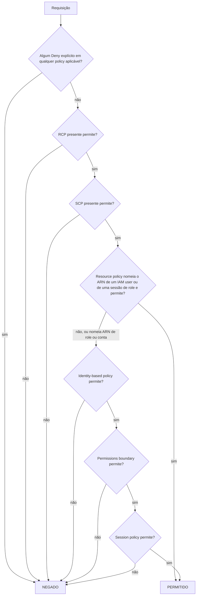

---
aliases:
  - Aula 4.5
modulo: 4
aula: 5
parte: "II Identidade, rede e dados"
dominios:
  - 1
lida: false
tags:
  - aula
  - saa-c03
  - modulo-04
---

# Aula 4.5: Lógica de avaliação de policies

[[04 - IAM Identidade e Acesso|Voltar ao módulo]]

> [!question] Pergunta desta aula
> Quando várias policies de tipos diferentes (identidade, recurso, [[Permissions Boundary|boundary]], [[SCP]], session) se aplicam à mesma requisição, como a AWS decide permitir ou negar? E por que, entre contas, as duas pontas precisam permitir?

## O problema: muitas policies, uma decisão

Você já sabe que existem dez tipos de policy ([[04.01 - Por que IAM Autenticacao Autorizacao e Principals|Aula 4.1]]). Em uma conta real, uma única chamada `s3:GetObject` pode ser afetada por uma policy anexada ao usuário, uma ao grupo dele, uma [[Bucket Policy|bucket policy]], uma [[Permissions Boundary|permissions boundary]], uma [[SCP]] da organização e uma [[Session Policy|session policy]]. Se cada tipo pudesse "ganhar" por regras próprias, ninguém conseguiria prever o resultado. A AWS resolve isso com **uma máquina de decisão única**, com poucas regras, que a prova cobra em quase todo enunciado de acesso negado ou cross-account.

## As três regras de ouro

A página "How AWS enforcement code logic evaluates requests" resume tudo em três linhas:

1. **Por padrão, tudo é negado** (**implicit deny**), com a exceção do [[Usuario Root|usuário root]] da conta, que tem acesso total.
2. Para ser permitida, a requisição precisa ser **explicitamente permitida** (**explicit allow**) por uma policy ou conjunto de policies.
3. Um **explicit deny sempre vence** um allow.

Três estados, portanto: **implicit deny** (nenhuma policy fala do assunto), **explicit allow** e **explicit deny**. O padrão é "negado" e só um allow muda isso, mas um deny explícito em qualquer policy aplicável, de qualquer tipo, encerra a discussão.

> [!example] A leitura rápida
> Carlos tem `s3:*` no [[Bucket|bucket]] `meus-docs` e uma policy com `Deny` em `s3:*` para qualquer bucket com `log` no nome. Ao gravar em `meus-docs-logs`, o deny explícito encontra a requisição e o resultado é negado, mesmo que outra policy (identidade ou [[Bucket Policy|bucket policy]]) permita. Ao gravar em `meus-docs`, não há deny aplicável, há allow, e a requisição passa. Este é um exemplo oficial da documentação.

## A ordem de avaliação, passo a passo

Para um principal na própria conta, a documentação descreve este encadeamento (verificado em novembro de 2026):

O ramo do nó E é uma simplificação: só uma [[Resource-Based Policy|resource-based policy]] que nomeia o **[[ARN]] de um [[IAM User|IAM user]]** (não federado) ou de uma **sessão de role** concede direto, sem passar por identidade, [[Permissions Boundary|boundary]] e session. Se ela nomeia o **ARN da role** ou a **conta**, o fluxo segue para a [[Identity-Based Policy|identity-based policy]] e para os funis (detalhe na seção sobre resource-based policy na mesma conta).

Em palavras:

1. **Deny evaluation:** o motor procura **qualquer** `Deny` aplicável em [[SCP|SCPs]], [[RCP|RCPs]], [[Resource-Based Policy|resource-based policies]], [[Identity-Based Policy|identity-based policies]], [[Permissions Boundary|boundaries]] e [[Session Policy|session policies]]. Achou um: **negado**.
2. **[[RCP]] (resource control policy):** se há RCP e ela não permite a ação, **negado**. (Quando RCPs estão habilitadas, uma managed `RCPFullAWSAccess` é anexada a tudo e não dá para desanexar, então sempre existe um allow base.)
3. **[[SCP]]:** se há SCP e ela não permite, **negado**. A SCP é um teto, nunca concede (Módulo 5).
4. **[[Resource-Based Policy|Resource-based policy]]:** pode conceder acesso, com nuances por tipo de principal (abaixo).
5. **[[Identity-Based Policy|Identity-based policy]]:** se nenhuma permite, **negado**. Para um usuário, contam as policies dele e as dos grupos.
6. **[[Permissions Boundary|Permissions boundary]]:** se existe e não permite, **negado**.
7. **[[Session Policy|Session policy]]:** para sessões de role ou federated user, se foi passada e não permite, **negado**. Sem session policy, segue.

A leitura prática: **identity-based** e **resource-based** concedem; **[[SCP]], [[RCP]], [[Permissions Boundary|boundary]] e session** só **limitam** (intersecção); **deny** em qualquer lugar vence.

## Dois conjuntos de regras: união e intersecção

O que fica fácil de errar é quais camadas se **somam** e quais se **cruzam**:

| Combinação | Resultado | Fonte |
|---|---|---|
| Identity-based **e** resource-based, mesma conta | **União:** um allow em qualquer dos dois basta | Docs, "Evaluating [[Identity-Based Policy\|identity-based policies]] with [[Resource-Based Policy\|resource-based policies]]" |
| Identity-based **e** [[Permissions Boundary\|permissions boundary]] | **Intersecção:** a ação precisa estar nos dois | Docs, boundaries |
| Identity-based **e** [[SCP]]/RCP | **Intersecção:** precisa estar permitida em todas | Docs, evaluation logic |
| Identity-based **e** [[Session Policy\|session policy]] | **Intersecção** | Docs, [[STS]] comparison |

Em todas, **deny explícito** em qualquer uma sobrepõe o allow.

> [!info] Ligando os pontos
> Pense em camadas de filtro. A [[Identity-Based Policy|identity-based policy]] é a "lista de permissões" da pessoa. O [[Permissions Boundary|boundary]], a [[SCP]] e a [[Session Policy|session policy]] são **funis**: cada um deixa passar só o que cabe nele. O resource-based é a "lista de convidados" do recurso: dentro da mesma conta, estar nela já basta.

## O caso especial: resource-based policy dentro da mesma conta

Para a maioria dos recursos, basta **um allow** em identity-based **ou** resource-based. Mas a documentação atual detalha nuances que a prova de associate raramente exige, e vale conhecer a regra geral:

- **Role [[Trust Policy|trust policies]]** e **[[Key Policy|key policies]] do [[KMS]]** são exceções: elas precisam **permitir explicitamente** o principal. Uma [[Identity-Based Policy|identity-based policy]] de [[IAM]] que diz "pode usar a chave X" não adianta se a key policy não deixa a conta (ou o principal) delegar. Por isso, no [[08 - Criptografia e Protecao de Dados|Módulo 8]], a key policy é "a raiz da autorização".
- [[Resource-Based Policy|Resource-based policy]] que nomeia o **[[ARN]] de um [[IAM User|IAM user]]** (que não seja federado) concede direto: um implicit deny na [[Identity-Based Policy|identity-based policy]] ou na [[Permissions Boundary|boundary]] **não** o impede.
- [[Resource-Based Policy|Resource-based policy]] que nomeia o **[[ARN]] da role** é limitada por [[Permissions Boundary|boundary]] e [[Session Policy|session policy]]; já a que nomeia o **ARN da sessão** (`arn:aws:sts::123456789012:assumed-role/role/sessao`) concede direto à sessão e não é limitada por implicit deny em identidade, boundary ou session policy.
- Alguns serviços, fora [[IAM]] e [[KMS]], também podem exigir um allow explícito na própria policy do recurso.

Para a prova, o que fica é: **dentro da mesma conta**, um allow em uma das duas policies costuma bastar; **o deny explícito vence**; e **[[Trust Policy|trust policy]] e [[Key Policy|key policy]] exigem allow explícito**.

## Cross-account: duas avaliações, duas aprovações

Quando o principal e o recurso estão em **contas diferentes**, a AWS faz **duas avaliações**: na conta confiante (**trusting**, dona do recurso) e na conta confiável (**trusted**, a do principal). A requisição só é permitida se **as duas** devolverem Allow.

- Na conta do **recurso** (trusting): a **[[Resource-Based Policy|resource-based policy]]** precisa nomear o principal (ou a conta dele).
- Na conta do **principal** (trusted): a **[[Identity-Based Policy|identity-based policy]]** precisa permitir a ação sobre o recurso da outra conta.

Se um dos lados faltar, o resultado é negado. Essa é a **resposta clássica** de "por que o acesso cross-account falhou, mesmo com a [[Bucket Policy|bucket policy]] certa?": o usuário da outra conta não tinha permissão na própria conta. E o inverso: [[Identity-Based Policy|policy de identidade]] sem bucket policy também não basta.

Quando o acesso passa por **role** (a forma mais comum entre contas), o desenho é equivalente: a **[[Trust Policy|trust policy]]** da role (no recurso) deixa o principal assumir, e a **[[Identity-Based Policy|identity policy]]** do principal precisa permitir `sts:AssumeRole` naquela role. Depois de assumir, as permissões vêm da permissions policy da role (Aula 4.7).

> [!example] Cross-account em números
> Conta B (`222233334444`) é dona do [[Bucket|bucket]] `dados-b`. O usuário `ana` está na conta A (`111122223333`).
> - [[Bucket Policy|Bucket policy]] em B permite `arn:aws:iam::111122223333:user/ana` fazer `s3:GetObject`, mas `ana` **não** tem [[Identity-Based Policy|policy de identidade]] em A: **negado**.
> - `ana` tem [[Identity-Based Policy|policy de identidade]] em A permitindo `s3:GetObject` em `arn:aws:s3:::dados-b/*`, mas B **não** tem [[Bucket Policy|bucket policy]] nomeando a conta A: **negado**.
> - As duas existem: **permitido**.
> - Existem as duas, mas há uma [[SCP]] em A que nega `s3:*` fora das [[Regiao AWS|Regiões]] da empresa e o [[Bucket|bucket]] está em outra: **negado**.

## Seis exemplos resolvidos

**1. Identidade permite, sem [[Resource-Based Policy|resource policy]].** Usuário com `s3:GetObject` no [[Bucket|bucket]], sem [[Bucket Policy|bucket policy]]: **permitido** (identidade basta na mesma conta).

**2. Resource permite, identidade não diz nada.** Mesma conta, [[Bucket Policy|bucket policy]] nomeia o [[ARN]] do usuário com `s3:GetObject`, sem [[Identity-Based Policy|policy de identidade]]: **permitido** (união, e ARN de usuário não é limitado por implicit deny na identidade).

**3. Identidade permite, [[Bucket Policy|bucket policy]] nega.** `Deny` na bucket policy ao principal: **negado** (explicit deny vence).

**4. [[Permissions Boundary|Permissions boundary]].** Identidade permite `ec2:*` e `s3:*`; boundary permite só `s3:*`. Pedido de `ec2:StartInstances`: **negado** (intersecção); `s3:GetObject`: **permitido**.

**5. [[SCP]].** Identidade permite `s3:*`; a SCP da OU permite só `ec2:*`. Pedido de `s3:GetObject`: **negado** (SCP é teto, e o allow precisa existir nas duas). Sem SCP, seria permitido.

**6. [[Key Policy|Key policy]] do [[KMS]].** O [[IAM User|IAM user]] tem `kms:Decrypt` na identidade, mas a key policy não delega à conta nem lista o principal: **negado** (key policy exige allow explícito; Módulo 8).

## Depurando um AccessDenied

As mensagens de erro de vários serviços dizem **qual camada** negou, o que acelera o diagnóstico (exemplos da documentação de troubleshooting do [[S3]] e do [[IAM]]):

- "... because **no [[Identity-Based Policy|identity-based policy]] allows** the s3:GetObject action": **implicit deny** na identidade (falta allow).
- "... with an **explicit deny in an [[Identity-Based Policy|identity-based policy]]**" (com o [[ARN]] da policy): deny explícito na identidade.
- "... **explicit deny in a [[SCP|service control policy]]**": SCP nega.

A rotina: leia a mensagem (implícito ou explícito, e em qual tipo), use o **[[Policy Simulator|IAM Policy Simulator]]** (Aula 4.8) para reproduzir, procure um deny ou uma condição que não casou, e consulte o [[CloudTrail]] para ver quem chamou o quê. O resultado do simulador pode divergir do ambiente real, então confirme na conta.

> [!tip] Consistência eventual
> Mudanças no [[IAM]] são **eventualmente consistentes**: uma policy recém-anexada ou uma role recém-criada pode levar alguns segundos para valer em todas as [[Regiao AWS|Regiões]], e isso é origem de `AccessDenied` falso logo depois de um deploy. Antes de reescrever a policy, espere e tente de novo; em automação, use retry com espera (verificado em novembro de 2026, página "Troubleshooting IAM").

## Como isso cai na prova

**Task 1.1** ([[RBAC]] strategy, cross-account access, multi-account strategy, [[Resource-Based Policy|resource policies]]). Padrões de enunciado:

- "User in **Account A** needs access to a [[Bucket|bucket]] in **Account B**": [[Resource-Based Policy|resource policy]] no B **e** identidade no A (ou role assumida), e ambos precisam permitir.
- "Permissions **restricted despite** an Allow policy": procure um **deny explícito**, uma **[[SCP]]**, uma **[[Permissions Boundary|permissions boundary]]** ou uma **[[Session Policy|session policy]]**.
- "Developers can create [[IAM Role|IAM roles]] but **cannot exceed** certain permissions": [[Permissions Boundary|permissions boundary]] (Aula 4.8).
- "Organization-wide **guardrail**": [[SCP]] (e [[RCP]] para recursos).
- "Which policy wins": **deny explícito**.

Pegadinhas: allow na [[Identity-Based Policy|identity policy]] **não** supera deny na [[SCP]] ou na [[Bucket Policy|bucket policy]]; SCP **não concede**; [[Permissions Boundary|boundary]] **não concede**; em cross-account, só um lado **não** basta; [[Trust Policy|trust policy]] e [[Key Policy|key policy]] exigem allow explícito.

| Requisito no enunciado | Resposta provável | Por quê |
|---|---|---|
| Usuário de outra conta precisa ler [[Bucket\|bucket]] | [[Bucket Policy\|Bucket policy]] nomeando a conta ou o usuário, mais [[Identity-Based Policy\|identity policy]] do usuário | Duas avaliações, as duas precisam permitir |
| Allow na identidade, mas AccessDenied | Procurar deny explícito, [[SCP]], [[Permissions Boundary\|boundary]] ou [[Session Policy\|session policy]] | Qualquer deny ou ausência de allow em camada limitadora nega |
| Limitar o teto de permissões de uma conta inteira | [[SCP]] (Organizations) | Teto, nunca concede |
| Limitar o máximo que um desenvolvedor pode delegar | [[Permissions Boundary\|Permissions boundary]] | Intersecção com a identidade |
| Qual policy vence em conflito | Deny explícito | Sempre sobrepõe allow |

## Resumo

> [!abstract] A aula em uma frase
> A decisão é única: tudo é negado por padrão, um allow explícito é necessário, um deny explícito sempre vence, identity e [[Resource-Based Policy|resource policies]] concedem (união na mesma conta), [[SCP]], [[RCP]], [[Permissions Boundary|boundary]] e session só limitam (intersecção), e entre contas as duas pontas precisam permitir.

**A lógica, em 6 passos**

1. Implicit deny é o padrão (exceto root).
2. Procure qualquer deny explícito em qualquer policy aplicável: achou, negado.
3. Verifique os tetos: [[RCP]], [[SCP]].
4. Verifique quem concede: identity-based e resource-based (união na mesma conta).
5. Aplique os funis: [[Permissions Boundary|permissions boundary]] e [[Session Policy|session policy]] (intersecção).
6. Cross-account: faça isso nas duas contas; as duas precisam permitir.

**Tabela-síntese**

| Policy | Concede? | Combinação |
|---|---|---|
| Identity-based | Sim | União com resource-based (mesma conta) |
| Resource-based | Sim | União com identity-based (mesma conta); nomeia principal |
| [[Permissions Boundary\|Permissions boundary]] | Não | Intersecção com a identidade |
| [[SCP]] / [[RCP]] | Não | Intersecção (teto) |
| [[Session Policy\|Session policy]] | Não | Intersecção |
| Qualquer Deny | Nega | Vence tudo |

**Na prática, isso significa**

- Em AccessDenied, descubra se é implícito ou explícito e em qual camada.
- Em cross-account, configure os dois lados.
- Use [[SCP]] e [[Permissions Boundary|boundary]] como guardrails, nunca como substitutos de allow.
- [[Trust Policy|Trust policy]] e [[Key Policy|key policy]] sempre exigem allow explícito.

> [!tip] Liga com
> Vem das [[04.03 - Anatomia de uma Policy IAM|policies]] e [[04.04 - Conditions e Condition Keys|conditions]]. Segue para roles e [[STS]] na [[04.06 - Roles e STS Credenciais Temporarias|Aula 4.6]].

## Erros comuns

- **"Allow na [[Identity-Based Policy|identity policy]] sempre basta."** Falha se houver deny explícito, [[SCP]], [[Permissions Boundary|boundary]] ou [[Session Policy|session policy]] que não permita.
- **"[[SCP]] concede acesso à conta."** Só limita; sem allow na identidade, nada acontece.
- **"[[Permissions Boundary|Permissions boundary]] dá permissões."** Só define o máximo.
- **"Cross-account precisa apenas da [[Resource-Based Policy|resource policy]]."** Falta a [[Identity-Based Policy|identity policy]] do outro lado.
- **"Um allow numa policy cancela um deny em outra."** O deny explícito sempre vence.

## Pratique

**1.** Um [[IAM User|usuário IAM]] tem `s3:GetObject` permitido na própria [[Identity-Based Policy|identity policy]]. A [[Bucket Policy|bucket policy]] tem um `Deny` explícito para o [[ARN]] do usuário. O que acontece com `GetObject`?

- [ ] a) Permitido, porque a identity policy tem prioridade sobre a resource policy
- [ ] b) Permitido apenas se a identity policy for AWS managed
- [ ] c) Negado, porque um deny explícito em qualquer policy sobrepõe o allow
- [ ] d) Depende da ordem em que as policies foram criadas

**2.** Um usuário da conta A tenta ler um [[Bucket|bucket]] da conta B. A [[Bucket Policy|bucket policy]] nomeia a conta A como principal. O usuário não tem [[Identity-Based Policy|policy de identidade]] na conta A. Qual é o resultado?

- [ ] a) Negado, porque falta o allow na identity policy do usuário, na conta A
- [ ] b) Permitido, porque a bucket policy basta para cross-account
- [ ] c) Permitido, porque a conta A é a conta do root da organização
- [ ] d) Negado apenas se o bucket estiver em outra Região da AWS

**3.** A [[Identity-Based Policy|identity policy]] de um desenvolvedor permite `ec2:*` e `s3:*`. A [[Permissions Boundary|permissions boundary]] permite só `s3:*`. Qual ação é permitida?

- [ ] a) `ec2:StartInstances`, pois a identity policy a permite
- [ ] b) Nenhuma, porque a boundary invalida a identity policy
- [ ] c) `ec2:StartInstances` e `s3:GetObject`, pela união das duas policies
- [ ] d) `s3:GetObject`, pela intersecção entre identity policy e boundary

**4.** Uma [[SCP]] da OU permite apenas `ec2:*`. Uma [[Identity-Based Policy|identity policy]] na mesma conta permite `s3:*`. Qual afirmação é correta sobre `s3:GetObject`?

- [ ] a) Permitido, pois a identity policy concede e a SCP só se aplica à management account
- [ ] b) Negado, pois a ação precisa estar permitida também na SCP, que é um teto
- [ ] c) Permitido, porque a SCP concede ec2 e não interfere em s3
- [ ] d) Negado apenas durante a primeira hora após aplicar a SCP

**5.** Quais DUAS afirmações descrevem corretamente a avaliação de policies? (Escolha DUAS.)

- [ ] a) O padrão é negar tudo, e só um allow explícito permite
- [ ] b) Um allow em qualquer policy sobrepõe um deny em outra
- [ ] c) Permissions boundaries e SCPs concedem permissões adicionais às identidades
- [ ] d) Um deny explícito em qualquer policy aplicável vence os allows
- [ ] e) Resource-based policies são ignoradas se existir identity-based policy

**6.** Uma role precisa ser assumida por um principal de outra conta. O que é necessário? (Escolha DUAS.)

- [ ] a) Uma trust policy na role que permita o principal
- [ ] b) Uma bucket policy pública
- [ ] c) Uma permissão `sts:AssumeRole` na identidade do principal
- [ ] d) Uma SCP que conceda `sts:AssumeRole` à conta
- [ ] e) Um grupo IAM na conta da role contendo o principal

**7.** Dentro da mesma conta, uma [[Bucket Policy|bucket policy]] nomeia o [[ARN]] de um [[IAM User|IAM user]] com `s3:GetObject`. O usuário não tem [[Identity-Based Policy|policy de identidade]]. O que acontece?

- [ ] a) Negado, porque falta uma identity policy para o usuário na conta
- [ ] b) Permitido: a união basta e o ARN do usuário é concedido diretamente na policy
- [ ] c) Negado, porque policies de recurso só valem entre contas diferentes
- [ ] d) Permitido apenas se houver uma boundary anexada ao usuário na conta

**8.** O [[IAM User|IAM user]] tem `kms:Decrypt` na [[Identity-Based Policy|identity policy]], mas a [[Key Policy|key policy]] da chave não menciona o usuário nem delega à conta. Qual é o resultado?

- [ ] a) Permitido, pois a identity policy concede e a key policy não nega
- [ ] b) Permitido, porque o KMS ignora a key policy se a chave for gerenciada pela AWS
- [ ] c) Negado, porque a key policy precisa permitir explicitamente
- [ ] d) Negado apenas para operações de Encrypt, não de Decrypt

**9.** Qual mensagem de erro indica que falta um allow na identidade, e não um deny explícito?

- [ ] a) "... with an explicit deny in a service control policy"
- [ ] b) "... because no identity-based policy allows the action"
- [ ] c) "... with an explicit deny in an identity-based policy"
- [ ] d) "... because the requested bucket does not exist in this Region"

**10.** Uma organização habilitou [[RCP|RCPs]]. O que descreve melhor a diferença entre [[SCP]] e RCP?

- [ ] a) SCP limita principals; RCP limita o que os recursos aceitam
- [ ] b) SCP limita recursos das contas; RCP limita principals da organização
- [ ] c) SCP concede acesso às contas; RCP nega o acesso a recursos
- [ ] d) RCP só vale para a management account da organização

**11.** Um desenvolvedor recebeu AccessDenied apesar de a [[Identity-Based Policy|identity policy]] permitir a ação. Qual NÃO é uma causa plausível?

- [ ] a) Um deny explícito em outra policy aplicável à identidade
- [ ] b) Uma SCP da organização que não permite a ação pedida
- [ ] c) Uma permissions boundary que não inclui a ação pedida
- [ ] d) O fato de a policy ser uma customer managed

**12.** Uma [[Session Policy|session policy]] foi passada ao [[AssumeRole|assumir a role]] com `s3:GetObject` apenas. A role tem [[Identity-Based Policy|identity policy]] com `s3:*`. Qual é a permissão efetiva da sessão?

- [ ] a) `s3:*`, pois a identity policy da role concede tudo
- [ ] b) `s3:GetObject`, pela intersecção entre identity policy e session policy
- [ ] c) Nenhuma, porque session policies não podem ser combinadas com identity policies
- [ ] d) `s3:*` mais `s3:GetObject`, pela soma

> [!success]- Gabarito
> **1. c)** deny explícito vence; a) não há prioridade da [[Identity-Based Policy|identity policy]]; b) o tipo não muda; d) ordem de criação não conta.
> **2. a)** em cross-account as duas contas precisam permitir; b) só a [[Resource-Based Policy|resource policy]] não basta; c) a conta A não é "do root" do recurso; d) Região não decide.
> **3. d)** a permissão efetiva é a intersecção; a) a [[Permissions Boundary|boundary]] impede ec2; b) s3 passa; c) não é união.
> **4. b)** a [[SCP]] é teto e a ação precisa estar permitida nela; a) SCP vale para as contas membro; c) SCP não concede nada; d) não há atraso como descrito.
> **5. a) e d)** padrão é negar e deny explícito vence; b) allow não supera deny; c) [[Permissions Boundary|boundaries]] e [[SCP|SCPs]] só limitam; e) [[Resource-Based Policy|resource policies]] contam na avaliação.
> **6. a) e c)** a [[Trust Policy|trust policy]] na role e a permissão `sts:AssumeRole` na identidade do principal; b) [[Bucket Policy|bucket policy]] pública é irrelevante; d) [[SCP]] não concede; e) grupos não ficam na conta da role.
> **7. b)** a união basta e o [[ARN]] de usuário não é limitado por implicit deny na identidade; a) a [[Identity-Based Policy|identity policy]] não é obrigatória na mesma conta; c) valem na mesma conta; d) [[Permissions Boundary|boundary]] não é requisito.
> **8. c)** a [[Key Policy|key policy]] exige allow explícito; a) a identidade sozinha não basta; b) a regra vale para chaves gerenciadas pelo cliente; d) não distingue operações assim.
> **9. b)** é a mensagem de implicit deny na identidade; a) e c) são explicit deny; d) é outro erro.
> **10. a)** [[SCP]] limita [[Principal|principals]] e [[RCP]] limita recursos; b) inverte; c) nenhuma concede; d) RCP vale para recursos das contas da organização.
> **11. d)** o tipo de policy (customer managed) não causa o deny; a), b) e c) são causas reais.
> **12. b)** permissão efetiva é a intersecção; a) ignora a [[Session Policy|session policy]]; c) elas se combinam por intersecção; d) não há soma.

### Laboratório (opcional)

> [!warning] Use uma conta pessoal
> Faça este laboratório em uma **[[Conta AWS|conta AWS]] pessoal separada**, com [[Budgets|AWS Budgets]] configurado. **Nunca na conta de produção da empresa.** Custo estimado: zero.

1. Crie um usuário de teste: `aws iam create-user --user-name lab-user-45`.
2. Anexe uma managed policy de leitura do [[S3]]: `aws iam attach-user-policy --user-name lab-user-45 --policy-arn arn:aws:iam::aws:policy/AmazonS3ReadOnlyAccess`.
3. Simule com `aws iam simulate-principal-policy --policy-source-arn <ARN do lab-user-45> --action-names s3:GetObject s3:PutObject --resource-arns arn:aws:s3:::SEU-BUCKET-LAB/arquivo.txt` (o [[Bucket|bucket]] não precisa existir). Esperado: `s3:GetObject` com `allowed` e `s3:PutObject` com `implicitDeny` (nenhum allow).
4. Salve em `deny-get.json` uma policy com `Effect` `Deny`, `Action` `s3:GetObject` e `Resource` `*`, e aplique como inline: `aws iam put-user-policy --user-name lab-user-45 --policy-name deny-get --policy-document file://deny-get.json`.
5. Rode a simulação do passo 3 de novo: `s3:GetObject` passa a `explicitDeny`, mesmo com o allow da managed policy. Em `MatchedStatements` do resultado você vê qual policy negou.

Limpeza: `aws iam delete-user-policy --user-name lab-user-45 --policy-name deny-get`, `aws iam detach-user-policy` (mesma policy do passo 2) e `aws iam delete-user --user-name lab-user-45`.

## Para aprofundar

- [ ] [Policy evaluation logic](https://docs.aws.amazon.com/IAM/latest/UserGuide/reference_policies_evaluation-logic.html) (documentação AWS): união, intersecção, [[SCP]], [[RCP]], [[Permissions Boundary|boundary]]
- [ ] [How AWS enforcement code logic evaluates requests](https://docs.aws.amazon.com/IAM/latest/UserGuide/reference_policies_evaluation-logic_policy-eval-denyallow.html) (documentação AWS): o passo a passo de deny, [[RCP]], [[SCP]], resource, identity, [[Permissions Boundary|boundary]] e session
- [ ] [Cross-account policy evaluation logic](https://docs.aws.amazon.com/IAM/latest/UserGuide/reference_policies_evaluation-logic-cross-account.html) (documentação AWS): as duas avaliações
- [ ] [Policy evaluation for requests within a single account](https://docs.aws.amazon.com/IAM/latest/UserGuide/reference_policies_evaluation-logic_policy-eval-basics.html) (documentação AWS): o exemplo do Carlos

Próxima aula: [[04.06 - Roles e STS Credenciais Temporarias|Aula 4.6: Roles e STS, credenciais temporárias]]
