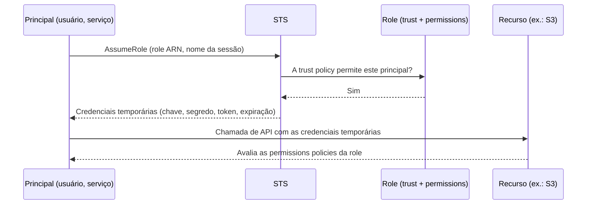

---
aliases:
  - Aula 4.6
modulo: 4
aula: 6
parte: "II Identidade, rede e dados"
dominios:
  - 1
lida: false
tags:
  - aula
  - saa-c03
  - modulo-04
---

# Aula 4.6: Roles e STS, credenciais temporárias

[[04 - IAM Identidade e Acesso|Voltar ao módulo]]

> [!question] Pergunta desta aula
> O que é, por dentro, uma [[IAM Role|IAM role]]? Como o [[STS]] entrega [[Credencial Temporaria|credenciais temporárias]], quem pode [[AssumeRole|assumir uma role]], e como [[EC2]], Lambda e [[ECS]] recebem permissão sem [[Access Key|chave de acesso]]?

## O problema: identidade sem segredo fixo

Na [[04.02 - Usuarios Grupos Credenciais e MFA|Aula 4.2]] você viu o defeito da credencial permanente. A alternativa é uma identidade **sem credencial própria**, que alguém **assume** por um tempo limitado. Essa identidade é a **role**. A documentação define: uma role é uma identidade [[IAM]] com permissões, parecida com um usuário, mas **destinada a ser assumida por qualquer pessoa ou serviço que precise dela**, sem senha nem [[Access Key|chave de acesso]] padrão. Quando alguém assume a role, recebe **credenciais de segurança temporárias** para a sessão.

Quem pode assumir (página "[[IAM Role|IAM roles]]"): um [[IAM User|usuário IAM]] da mesma conta ou de outra, outra role da mesma conta, um **service principal** (como `lambda.amazonaws.com`, `ec2.amazonaws.com` ou recursos que agem por você), ou um usuário externo autenticado por um [[Identity Provider|IdP]] compatível com **[[SAML|SAML 2.0]]** ou **[[OIDC|OpenID Connect]]**.

Na sua rotina: a [[Task Role|task role]] do [[Container|container]] no [[ECS]], a execution role da [[Lambda]] e o acesso do pipeline cross-account são todos roles. Esta aula mostra o que acontece embaixo.

## As duas metades de uma role

Uma role tem sempre **duas** policies, e confundi-las é a pegadinha mais comum da prova:

| Policy | Responde | Tipo | O que contém |
|---|---|---|---|
| [[Trust Policy\|Trust policy]] | **Quem** pode assumir esta role? | Resource-based (a única do [[IAM]]) | `Principal` (conta, usuário, role, serviço, [[Identity Provider\|IdP]]) e `Action` como `sts:AssumeRole` |
| Permissions policy | **O que** a role pode fazer depois de assumida? | Identity-based | `Action`, `Resource`, `Condition` como qualquer policy |

```json
{
  "Version": "2012-10-17",
  "Statement": {
    "Effect": "Allow",
    "Principal": { "Service": "lambda.amazonaws.com" },
    "Action": "sts:AssumeRole"
  }
}
```

Esse é o formato da [[Trust Policy|trust policy]] de uma execution role: o serviço Lambda tem permissão de **assumir** a role. Regras importantes:

- Na [[Trust Policy|trust policy]] **não é permitido curinga como parte de um [[ARN]]** no `Principal`.
- O comprimento padrão da [[Trust Policy|trust policy]] é **2.048 caracteres**, ajustável até 8.192.
- A [[Trust Policy|trust policy]] é a metade do trabalho; a outra metade, quando o chamador é um usuário, é uma permissão `sts:AssumeRole` **na identidade dele** (Aula 4.5). Dentro da mesma conta, a regra de [[Resource-Based Policy|resource policy]] permite que o [[ARN]] do usuário na trust policy baste; entre contas, as duas pontas precisam permitir.

> [!info] Ligando os pontos
> Na [[04.05 - Logica de Avaliacao de Policies|lógica de avaliação]] você viu que a [[Trust Policy|trust policy]] é uma **exceção**: ela precisa permitir explicitamente o principal. Não existe "allow na identidade basta" para [[AssumeRole|assumir role]] de outra conta.

## O que o STS entrega

O **AWS [[STS|Security Token Service]] (STS)** é o serviço que emite as [[Credencial Temporaria|credenciais temporárias]]. Cada sessão traz **três** valores: um **[[Access Key|access key ID]]**, uma **secret access key** e um **session token**. O token é obrigatório nas chamadas; sem ele, a chave temporária não funciona. As credenciais **expiram** e não podem ser estendidas depois de emitidas.



O principal que faz a chamada depois não é "a role" em si, é a **sessão**: o [[ARN]] fica no formato `arn:aws:sts::123456789012:assumed-role/NomeDaRole/NomeDaSessao`. É essa a identidade que aparece no [[CloudTrail]], por isso o **nome da sessão** (até 64 caracteres) é útil para auditoria: use algo que identifique quem assumiu.

### As APIs do STS que a prova cobra

Da página "Compare [[STS|AWS STS]] credentials" (verificado em novembro de 2026):

| API | Quem chama | Duração (mín a máx, padrão) | [[MFA]] | Uso típico |
|---|---|---|---|---|
| **[[AssumeRole]]** | [[IAM User\|Usuário IAM]] ou role com credenciais | 15 min a o máximo da role (1 a 12 h), padrão 1 h | Sim | Cross-account, troca de role, delegação |
| **[[SAML\|AssumeRoleWithSAML]]** | Qualquer um com asserção SAML | 15 min a o máximo da role, padrão 1 h | Não | [[Federacao\|Federação]] corporativa (Módulo 5) |
| **[[OIDC\|AssumeRoleWithWebIdentity]]** | Qualquer um com [[JWT]] OIDC | 15 min a o máximo da role, padrão 1 h | Não | Apps móveis/web, GitHub Actions, [[EKS]] |
| **GetSessionToken** | [[IAM User\|Usuário IAM]] ou root | Usuário: 15 min a 36 h (padrão 12 h); root: 15 min a 1 h | **Sim** | Obter [[Credencial Temporaria\|credenciais temporárias]] **com [[MFA]]** para CLI |
| **GetFederationToken** | [[IAM User\|Usuário IAM]] ou root | Usuário: 15 min a 36 h (padrão 12 h); root: até 1 h | Não | Broker de identidade próprio (legado) |

Observações que viram pergunta de prova:

- **[[MFA]] na linha de comando:** um [[IAM User|usuário IAM]] com [[Access Key|chave de acesso]] chama `GetSessionToken` (ou `AssumeRole`) informando o número do dispositivo e o código MFA. As credenciais resultantes trazem `aws:MultiFactorAuthPresent` igual a `true` e passam em policies que exigem MFA (Aula 4.4). `GetSessionToken` **não** serve para SSO no console e só permite chamadas de [[IAM]] se o MFA estiver na requisição.
- **Duração da role:** o padrão de sessão é **1 hora**. O **máximo** é configurado na role e vai de **1 a 12 horas**; quem usa a CLI ou a API pode pedir entre 15 minutos e esse máximo (`DurationSeconds`). No Console, quem troca de role recebe o máximo ou o tempo restante da sessão, o que for menor.
- **[[Role Chaining|Role chaining]]:** usar uma role para assumir outra limita a sessão a **no máximo 1 hora**, independente da configuração de cada role; pedir mais que isso falha.
- **Cota do [[STS]]:** 600 requisições por segundo, por conta e por Região, compartilhadas entre `AssumeRole`, `GetCallerIdentity`, `GetSessionToken` e outras. Em `AssumeRole` cross-account, só a conta que **chama** consome a cota. Chamadas de service [[Principal|principals]] não contam.
- **Endpoints regionais:** a documentação recomenda escolher o endpoint regional mais próximo para reduzir [[Latencia|latência]] e permite usar outro como alternativa se perder comunicação com o original. Há também uma mudança em andamento no endpoint global do [[STS]] (cota separada por Região de origem).
- **`GetCallerIdentity`** não exige permissão e é o comando para descobrir "quem eu sou agora" (`aws sts get-caller-identity`).

## Roles para serviços da AWS

Quando o chamador é um **serviço** que age por você, o desenho é o mesmo ([[Trust Policy|trust policy]] + permissions policy), mudando o tipo de role e a forma de entregar:

| Cenário | Mecanismo | Pontos de prova |
|---|---|---|
| Código em instância **[[EC2]]** | **[[Instance Profile\|Instance profile]]** ([[Container\|contêiner]] que passa a role à instância) | O console cria o profile com o mesmo nome da role; **uma role por profile** (limite fixo); remover a role de um profile pode levar **até 1 hora** para valer; para trocar permissões, troque o profile |
| Função **Lambda** | **Execution role** | [[Trust Policy\|Trust policy]] com `lambda.amazonaws.com`; o console cria uma role com `AWSLambdaBasicExecutionRole` (logs no [[CloudWatch]]). Não chame `sts:AssumeRole` à mão nela |
| [[Container]] **[[ECS]]** | **[[Task Role\|Task role]]** (permissões do **seu código**) e **[[Task Execution Role\|task execution role]]** (permissões do **agente**: puxar imagem do [[ECR]], enviar logs, ler segredos referenciados na [[Task Definition\|task definition]]) | O container não acessa a execution role; as duas são papéis diferentes |
| Qualquer serviço agindo por você | **Service role** (você cria) ou **[[Service-Linked Role\|service-linked role]]** (pertence ao serviço; você vê e não edita) | A service-linked role é criada pelo serviço e só se apaga depois de remover os recursos dela |

(verificado em novembro de 2026, páginas "[[IAM Role|IAM roles]]", "Use [[Instance Profile|instance profiles]]", "Lambda execution role" e "[[Tarefa ECS|ECS task]] execution role").

> [!example] ECS no seu dia a dia
> Seu serviço NestJS em [[Fargate]] lê um segredo do [[Secrets Manager]] na inicialização e grava no [[S3]] em runtime. **Quem lê o segredo para injetá-lo como variável de ambiente** antes do [[Container|container]] subir é o **agente**, então a permissão `secretsmanager:GetSecretValue` vai na **[[Task Execution Role|task execution role]]**. **Quem grava no S3** é o seu código, então a permissão `s3:PutObject` vai na **[[Task Role|task role]]**. Trocar uma pela outra é um erro clássico.

### Instâncias EC2 e o instance profile

Para a prova, o fluxo é: criar uma role com [[Trust Policy|trust policy]] para `ec2.amazonaws.com`, anexar a permissions policy, colocar a role em um [[Instance Profile|instance profile]] e associar o profile à instância (ou ao [[Launch Template]]). O SDK na instância obtém as [[Credencial Temporaria|credenciais temporárias]] pelo [[Instance Metadata Service|serviço de metadados]] e as renova sozinho; não há chave em disco. Em consoles, o profile se cria junto com a role de [[EC2]]; via CLI ou API, são duas ações separadas, e os nomes podem divergir.

### `iam:PassRole`: quem pode entregar uma role a um serviço

Associar uma role a um serviço (lançar uma [[EC2]] com [[Instance Profile|instance profile]], criar uma Lambda com execution role, registrar uma [[Task Definition|task definition]] do [[ECS]]) é uma **entrega** da role, e a AWS exige uma permissão própria para isso: **[[PassRole|`iam:PassRole`]]**, concedida à identidade de quem configura o serviço. O motivo é de segurança: sem ela, qualquer pessoa que pudesse criar uma instância poderia anexar a ela uma role com mais poder do que o dela e, de dentro da instância, usar esse poder. É o caminho clássico de **[[Escalada de Privilegio|escalada de privilégio]]**, e por isso `PassRole` está entre as ações de permissions management que a Aula 4.3 mandou revisar primeiro.

Como controlar (página "[[Grant]] a user permissions to pass a role to an AWS service", verificado em novembro de 2026):

- limite o **`Resource`** aos [[ARN|ARNs]] das roles aprovadas, nunca `*`;
- use a condição **`iam:PassedToService`** para dizer a qual serviço a role pode ser entregue (por exemplo `ec2.amazonaws.com`);
- só vale para roles da **mesma conta** do serviço; entre contas, a conta de destino cria uma role que assume a da outra;
- a documentação avisa para **não** controlar `PassRole` por tag da role com `ResourceTag`, pois o resultado não é confiável.

```json
{
  "Effect": "Allow",
  "Action": "iam:PassRole",
  "Resource": "arn:aws:iam::111122223333:role/app-backend",
  "Condition": { "StringEquals": { "iam:PassedToService": "ec2.amazonaws.com" } }
}
```

> [!example] O erro que todo mundo vê
> A pessoa desenvolvedora tem `ec2:RunInstances` e tenta lançar uma instância com o [[Instance Profile|instance profile]] `app-backend`. O console responde "not authorized to perform [[PassRole|iam:PassRole]]". Falta o allow acima na identidade dela: ter `RunInstances` não basta.

Na [[04.08 - Guardrails e Menor Privilegio na Pratica|Aula 4.8]], `PassRole` reaparece como o furo que a [[Permissions Boundary|permissions boundary]] e a restrição de `Resource` precisam fechar quando você delega a criação de roles.

## Trocar de role e acesso entre contas

Em **conta única**, uma role serve para separar privilégios: o usuário `ana` navega com permissões mínimas e **troca de role** (`switch role`) para `Admin` só quando precisa, e pode ser exigido **[[MFA]]** na [[Trust Policy|trust policy]] da role (`aws:MultiFactorAuthPresent`). Na CLI, o mesmo com `aws sts assume-role` ou perfis com `role_arn`.

Entre **contas**, é o padrão do multiconta: uma conta de **ferramentas** ou de **identidade** é confiável, as contas de **workload** têm roles com [[Trust Policy|trust policy]] apontando para ela. O usuário (ou a [[Federacao|federação]]) autentica em um lugar só e assume roles nas outras contas (Módulo 5 e Aula 4.7).

> [!tip] Política de duas camadas para humanos
> Boas práticas oficiais: pessoas acessam por **[[Federacao|federação]]** ([[IAM Identity Center|Identity Center]] ou [[Identity Provider|IdP]]), recebendo roles temporárias; as roles têm duração curta e [[MFA]]. Quando uma pessoa precisa de "mais privilégio", ela assume outra role. Isso materializa o [[Menor Privilegio|menor privilégio]] no tempo.

## Session tags, session policies e source identity (visão geral)

Ao [[AssumeRole|assumir uma role]], você pode passar:

- **[[Session Policy|Session policy]]:** uma policy que **limita** a sessão (intersecção, nunca concede mais); até 10 [[ARN|ARNs]] de managed policies e 1 documento JSON, com tamanho combinado de até 2.048 caracteres.
- **Session tags:** até 50 tags de sessão (chave até 128, valor até 256 caracteres), úteis para [[ABAC]] (Aula 4.8). Tags **transitivas** passam adiante no [[Role Chaining|role chaining]].

- **[[Source Identity]]:** um valor definido em `AssumeRole` (permissão `sts:SetSourceIdentity`) que identifica a pessoa ou o sistema **original** e **persiste** nas assunções seguintes do [[Role Chaining|role chaining]]; não pode ser trocado depois e aparece no [[CloudTrail]], o que serve para auditoria (quem está por trás de uma sessão de uma role compartilhada).

As duas primeiras aumentam o tamanho do token de sessão, que tem limite separado. A aula 4.8 trata o uso para [[Menor Privilegio|menor privilégio]].

## Como isso cai na prova

**Task 1.1** ([[RBAC|role-based access control]] strategy, [[STS]], role switching, cross-account access). Palavras-chave em inglês:

- "**[[EC2]] / Lambda / [[Tarefa ECS|ECS task]]** needs to access an AWS service": role ([[Instance Profile|instance profile]], execution role, [[Task Role|task role]]). Nunca chave.
- "**Temporary credentials**", "no long-term credentials": [[STS]] e roles.
- "**Cross-account access**": role na conta de destino com [[Trust Policy|trust policy]] para a conta de origem.
- "**Switch role**", "elevated privileges only when needed": [[AssumeRole]].
- "**[[MFA]]** required for CLI": `GetSessionToken` com MFA ou [[AssumeRole]] com MFA.
- "**[[OIDC|Web identity]]**", "mobile app users", "GitHub Actions": AssumeRoleWithWebIdentity (ou um [[Cognito|Cognito identity pool]], tema do [[19 - Seguranca de Aplicacoes e Deteccao de Ameacas|Módulo 19]]).
- "**[[SAML]]**", "corporate [[Identity Provider|IdP]]": AssumeRoleWithSAML.
- "**[[Container]] task** reads secrets at startup": [[Task Execution Role|task execution role]]; "app code writes to [[S3]]": [[Task Role|task role]].

Pegadinhas: [[Trust Policy|trust policy]] x permissions policy; [[Task Role|task role]] x [[Task Execution Role|task execution role]]; [[Instance Profile|instance profile]] x role; `GetSessionToken` não faz SSO no console; [[Role Chaining|role chaining]] limita a 1 hora; sessão de role não é a role ([[ARN]] assumed-role).

| Requisito no enunciado | Resposta provável | Por quê |
|---|---|---|
| App em [[EC2]] precisa escrever no [[DynamoDB]] | Role com [[Instance Profile\|instance profile]] | [[Credencial Temporaria\|Credenciais temporárias]] entregues à instância |
| Função Lambda precisa ler uma [[SQS\|fila SQS]] | Execution role com permissão na fila | A role é assumida pelo serviço Lambda |
| [[Container\|Contêiner]] [[ECS]] precisa puxar a imagem privada e enviar logs | [[Task Execution Role\|Task execution role]] | Permissões do agente, não do código |
| Parceiro externo precisa auditar sua conta | Role com [[Trust Policy\|trust policy]] para a conta dele e [[External ID\|external ID]] | Cross-account sem compartilhar credencial (Aula 4.7) |
| Usuário precisa de admin apenas ocasionalmente, com [[MFA]] | Role Admin com `MultiFactorAuthPresent` na [[Trust Policy\|trust policy]] | Privilégio sob demanda |

## Resumo

> [!abstract] A aula em uma frase
> Uma role é uma identidade sem credencial própria que o [[STS]] entrega como [[Credencial Temporaria|credencial temporária]] a quem passa na [[Trust Policy|trust policy]], e serviços como [[EC2]], Lambda e [[ECS]] recebem as suas via [[Instance Profile|instance profile]], execution role e [[Task Role|task role]], nunca por chave.

**A lógica, em 6 passos**

1. A role tem uma [[Trust Policy|trust policy]] (quem assume) e uma permissions policy (o que pode).
2. O principal chama `AssumeRole`; o [[STS]] verifica a [[Trust Policy|trust policy]].
3. O [[STS]] devolve chave, segredo e session token, com expiração.
4. A sessão ([[ARN]] `assumed-role`) é quem faz as chamadas e aparece no [[CloudTrail]].
5. Serviços usam o mesmo desenho: [[Instance Profile|instance profile]] ([[EC2]]), execution role (Lambda), [[Task Role|task role]] e execution role ([[ECS]]).
6. [[Role Chaining|Role chaining]] limita a 1 hora; sessões usam `DurationSeconds` até o máximo da role (1 a 12 horas).

**Números para lembrar**

| O quê | Valor | Por que importa |
|---|---|---|
| Duração padrão de sessão de role | 1 hora | Padrão de [[AssumeRole]] |
| Máximo da role | 1 a 12 horas | Configurável; CLI e API pedem de 15 min até o máximo |
| [[Role Chaining\|Role chaining]] | 1 hora no máximo | Pegadinha de prova |
| `GetSessionToken` ([[IAM User\|usuário IAM]]) | 15 min a 36 h, padrão 12 h | [[MFA]] na CLI |
| Cota do [[STS]] | 600 req/s por conta e Região | Em alto volume, [[Throttling\|throttling]] |
| Role por [[Instance Profile\|instance profile]] | 1 | Limite fixo |

**Tabela-síntese**

| Preciso | Use |
|---|---|
| Permissão para código na [[EC2]] | [[Instance Profile\|Instance profile]] |
| Permissão para código na Lambda | Execution role |
| Permissão para o código no [[ECS]] | [[Task Role\|Task role]] |
| Permissão para o agente do [[ECS]] | [[Task Execution Role\|Task execution role]] |
| [[MFA]] na CLI | `GetSessionToken` |
| Acesso entre contas | `AssumeRole` com [[Trust Policy\|trust policy]] |

**Na prática, isso significa**

- Nunca coloque [[Access Key|chave de acesso]] em instância, função ou [[Container|container]].
- Em [[Trust Policy|trust policy]], descreva com precisão quem assume e, se preciso, exija [[MFA]] ou [[External ID|external ID]].
- Use nome de sessão que identifique o chamador, para auditar.
- Em [[ECS]], separe a [[Task Role|task role]] da [[Task Execution Role|task execution role]].

> [!tip] Liga com
> Vem da [[04.05 - Logica de Avaliacao de Policies|avaliação de policies]] ([[Trust Policy|trust policy]] exige allow explícito). Segue para acesso entre contas, [[Resource-Based Policy|resource-based policies]] e [[Confused Deputy|confused deputy]] na [[04.07 - Acesso entre Contas Resource Policies e Confused Deputy|Aula 4.7]].

## Erros comuns

- **"A [[Trust Policy|trust policy]] define o que a role pode fazer."** Ela define **quem pode assumir**; o que a role pode fazer é a permissions policy.
- **"Role precisa de [[Access Key|chave de acesso]]."** Role nunca tem chave própria; recebe [[Credencial Temporaria|credenciais temporárias]].
- **"A [[Task Execution Role|task execution role]] é a role do meu código no [[ECS]]."** É a do agente; a do código é a [[Task Role|task role]].
- **"Posso pedir sessão de 12 horas em [[Role Chaining|role chaining]]."** Falha: o limite é 1 hora.
- **"`GetSessionToken` loga no Console."** Não permite SSO no console.

## Pratique

**1.** Uma aplicação em [[EC2|instâncias EC2]] grava no [[DynamoDB]]. A equipe não quer [[Access Key|chaves de acesso]] em disco. Qual configuração atende?

- [ ] a) Salvar o par de chaves de um usuário IAM em um arquivo de credenciais das instâncias, com leitura restrita
- [ ] b) Criar um usuário IAM por instância e rotacionar as chaves de cada um a cada 90 dias por script
- [ ] c) Role com trust para `ec2.amazonaws.com`, ligada às instâncias por um instance profile da conta
- [ ] d) Gravar as chaves em um bucket S3 privado e baixá-las ao iniciar a instância, apagando depois

**2.** Uma [[Lambda|função Lambda]] precisa ler mensagens de uma [[SQS|fila SQS]]. Qual elemento concede essa permissão?

- [ ] a) A bucket policy do S3 que guarda o código da função, concedendo acesso à fila
- [ ] b) Uma chave de acesso de usuário IAM, guardada nas variáveis de ambiente da função
- [ ] c) O security group da função, liberando a porta de acesso à fila
- [ ] d) A execution role, com permissão na fila e trust para `lambda.amazonaws.com`

**3.** Um serviço no [[ECS]] [[Fargate]] puxa a imagem do [[ECR]] privado, envia logs ao [[CloudWatch]] e lê um segredo referenciado na [[Task Definition|task definition]]. Qual role cobre essas ações?

- [ ] a) A task role, que é a role usada pelo código da aplicação dentro do contêiner
- [ ] b) A task execution role, usada pelo agente do ECS e do Fargate
- [ ] c) A service-linked role do EC2, criada automaticamente na conta
- [ ] d) Um instance profile associado ao cluster do ECS

**4.** O código dentro de um [[Container|container]] [[ECS]] precisa gravar objetos no [[S3]]. Em qual role a permissão `s3:PutObject` deve ficar?

- [ ] a) Na task role, a role que o código da aplicação assume para chamar os serviços da AWS
- [ ] b) Na task execution role, porque ela é a role que o contêiner enxerga e usa em runtime
- [ ] c) Em uma policy anexada ao cluster ECS, herdada por todas as tasks do serviço
- [ ] d) No usuário root da conta, delegado às tasks por meio de uma bucket policy

**5.** Quais DUAS afirmações sobre a [[Trust Policy|trust policy]] de uma role estão corretas? (Escolha DUAS.)

- [ ] a) É uma resource-based policy que define quem pode assumir a role
- [ ] b) Define quais ações a role pode executar após ser assumida
- [ ] c) É anexada ao usuário que assume a role
- [ ] d) Não aceita curinga como parte de um ARN no elemento Principal
- [ ] e) Pode ser omitida se a role for usada só dentro da mesma conta

**6.** Um [[IAM User|usuário IAM]] com [[Access Key|chave de acesso]] precisa usar a CLI com [[Credencial Temporaria|credenciais temporárias]] que comprovem [[MFA]]. Qual API do [[STS]] usar?

- [ ] a) `GetSessionToken`, informando o número de série e o código do dispositivo MFA
- [ ] b) `AssumeRoleWithSAML`, informando a asserção do IdP e o código MFA do dispositivo
- [ ] c) `GetFederationToken`, que aceita número de série e código do MFA como parâmetros
- [ ] d) `GetCallerIdentity`, que valida o MFA e devolve credenciais temporárias

**7.** Uma role foi configurada com duração máxima de sessão de 12 horas. Um operador usa a role A para [[AssumeRole|assumir a role]] B ([[Role Chaining|role chaining]]) e pede 6 horas. O que acontece?

- [ ] a) A operação funciona, pois o máximo configurado na role B é de 12 horas
- [ ] b) A operação funciona, mas só se o MFA tiver sido usado na primeira assunção
- [ ] c) A operação funciona, e a sessão é encurtada automaticamente para 15 minutos
- [ ] d) A operação falha, pois role chaining limita a sessão a 1 hora no máximo

**8.** Uma aplicação móvel autentica usuários com um provedor [[OIDC]] e precisa de credenciais AWS temporárias para esses usuários. Qual API do [[STS]] é a base?

- [ ] a) `GetSessionToken` com MFA para cada usuário do aplicativo
- [ ] b) `AssumeRoleWithSAML`, com a asserção do provedor OIDC
- [ ] c) `AssumeRoleWithWebIdentity`, trocando o JWT do provedor
- [ ] d) Criar um usuário IAM para cada usuário do aplicativo, com chaves embutidas

**9.** Qual afirmação sobre [[Instance Profile|instance profiles]] está correta?

- [ ] a) Cada instance profile pode conter várias roles ao mesmo tempo, sem limite fixo
- [ ] b) Contém uma única role, e esse limite fixo não pode ser aumentado por cota
- [ ] c) Remover a role de um profile vale imediatamente em todas as instâncias associadas
- [ ] d) São usados por funções Lambda para obter as credenciais de execução

**10.** Por que o [[ARN]] de quem aparece nos logs do [[CloudTrail]] após [[AssumeRole|assumir uma role]] tem o formato `assumed-role/NomeDaRole/NomeDaSessao`?

- [ ] a) Porque a role pertence ao serviço CloudTrail e usa o identificador dele no ARN
- [ ] b) Porque o nome da sessão é gerado pelo STS e não pode ser definido por quem assume
- [ ] c) Porque roles que exigem MFA mudam o formato do ARN para identificar o segundo fator
- [ ] d) Porque a sessão é o principal e o nome dela ajuda a auditar quem assumiu a role

**11.** Um desenvolvedor assume uma role de administrador por 1 hora com [[MFA]] e vê a sessão expirar. Qual é o comportamento correto?

- [ ] a) O STS renova a sessão automaticamente a cada 15 minutos, enquanto houver MFA
- [ ] b) A AWS estende a sessão até o fim do dia quando o MFA foi usado na assunção
- [ ] c) Não há renovação; é preciso assumir a role de novo, informando o código MFA
- [ ] d) O usuário precisa recriar a role de administrador para continuar trabalhando

**12.** Qual combinação entrega permissões ao código em uma [[EC2|instância EC2]] sem [[Access Key|chaves de acesso]] e permite trocar permissões sem mexer no código?

- [ ] a) Role com instance profile, ajustando a permissions policy da role quando preciso
- [ ] b) Variáveis de ambiente com chave e segredo de um usuário IAM, trocadas quando preciso
- [ ] c) Arquivo `.env` com chaves, atualizado manualmente pelo administrador nas instâncias
- [ ] d) Credenciais do root guardadas na AMI usada para lançar as instâncias

**13.** Uma desenvolvedora tem `ec2:RunInstances` e tenta lançar uma instância com o [[Instance Profile|instance profile]] `app-backend`. O console responde "not authorized to perform [[PassRole|iam:PassRole]]". O que falta?

- [ ] a) Um allow de `iam:PassRole` no ARN da role `app-backend`, com `iam:PassedToService` igual a `ec2.amazonaws.com`
- [ ] b) Um allow de `sts:AssumeRole` na identidade dela para a role `app-backend`
- [ ] c) Incluir o usuário dela como Principal na trust policy da role `app-backend`
- [ ] d) A permissão `iam:CreateRole`, para que ela crie a própria role no momento do lançamento

**14.** Uma equipe de plataforma quer permitir que desenvolvedores entreguem roles a serviços sem abrir caminho para [[Escalada de Privilegio|escalada de privilégio]]. Quais DUAS afirmações sobre `iam:PassRole` estão corretas? (Escolha DUAS.)

- [ ] a) É permissão da identidade de quem configura o serviço, não da role nem do serviço
- [ ] b) O elemento `Resource` pode limitar quais roles a pessoa consegue entregar
- [ ] c) Precisa ser avaliada a cada chamada que o serviço faz usando as credenciais da role
- [ ] d) Permite entregar a um serviço de uma conta B uma role da conta A, sem etapas extras
- [ ] e) Deve ser controlada com a condição `ResourceTag` na role, segundo a documentação

> [!success]- Gabarito
> **1. c)** role com [[Instance Profile|instance profile]] entrega [[Credencial Temporaria|credenciais temporárias]] sem chave em disco; a), b) e d) mantêm chave de longo prazo na instância ou no [[S3]].
> **2. d)** a execution role é assumida pelo Lambda e traz a permissão na fila; a) a [[Bucket Policy|bucket policy]] que guarda o código não tem relação com a fila; b) funciona, mas é credencial de longo prazo exposta na configuração da função; c) [[Security Group|security group]] é rede, não permissão.
> **3. b)** puxar imagem, enviar logs e ler segredos da [[Task Definition|task definition]] são tarefas do agente, na [[Task Execution Role|task execution role]]; a) a [[Task Role|task role]] é do código da aplicação; c) [[Service-Linked Role|service-linked role]] do [[EC2]] é outro tipo; d) [[Instance Profile|instance profile]] é de EC2.
> **4. a)** o código usa a [[Task Role|task role]]; b) a execution role é do agente e o [[Container|container]] não a acessa; c) não existe policy anexada ao cluster para isso; d) root nunca.
> **5. a) e d)** [[Trust Policy|trust policy]] é a resource-based que define quem assume e não aceita curinga em [[ARN]] de Principal; b) é a permissions policy; c) ela é anexada à role; e) é obrigatória em toda role.
> **6. a)** `GetSessionToken` aceita [[MFA]] e devolve [[Credencial Temporaria|credenciais temporárias]]; b) é [[SAML]]; c) `GetFederationToken` não suporta MFA; d) `GetCallerIdentity` só mostra a identidade.
> **7. d)** [[Role Chaining|role chaining]] limita a 1 hora e pedir mais falha; a) ignora o limite; b) [[MFA]] não altera o limite; c) a operação falha, não encurta.
> **8. c)** é a API para [[JWT]] de [[Identity Provider|IdP]] [[OIDC]]; a) é para [[IAM User|usuário IAM]]; b) é para [[SAML]]; d) não escala e usa chave de longo prazo.
> **9. b)** só uma role por profile, limite fixo; a) um profile aceita uma; c) a remoção pode levar até 1 hora; d) Lambda usa execution role.
> **10. d)** a sessão é o principal que age e o nome ajuda a rastrear; a) a role não é do [[CloudTrail]]; b) o nome é definido por quem assume; c) [[MFA]] não muda o formato.
> **11. c)** [[Credencial Temporaria|credenciais temporárias]] não são renováveis; é preciso assumir de novo; a) e b) não há renovação automática; d) recriar a role é desnecessário.
> **12. a)** [[Instance Profile|instance profile]] entrega [[Credencial Temporaria|credenciais temporárias]] e o ajuste é feito na role; b) e c) usam chaves; d) o root e a [[AMI]] são más práticas.
> **13. a)** entregar a role ao serviço exige `iam:PassRole` sobre aquele [[ARN]], e `iam:PassedToService` restringe o serviço de destino; b) `AssumeRole` é feito pelo serviço via [[Trust Policy|trust policy]], não pela pessoa; c) a trust policy nomeia o serviço (`ec2.amazonaws.com`), não quem configura; d) criar uma role nova não é o que o erro pede e ainda escalaria privilégio.
> **14. a) e b)** `PassRole` é concedida à identidade de quem entrega, e `Resource` restringe as roles aprováveis; c) a entrega acontece na configuração, não a cada uso da role; d) a documentação diz que só vale na mesma conta, entre contas é preciso uma role intermediária; e) a documentação desaconselha `ResourceTag` com `PassRole`.

### Laboratório (opcional)

> [!warning] Use uma conta pessoal
> Faça este laboratório em uma **[[Conta AWS|conta AWS]] pessoal separada**, com [[Budgets|AWS Budgets]] configurado. **Nunca na conta de produção da empresa.** Custo estimado: zero.

1. Descubra seu ID de conta: `aws sts get-caller-identity` (campo `Account`).
2. Crie `trust.json` com a [[Trust Policy|trust policy]] abaixo, trocando `ID_DA_CONTA`:

   ```json
   {"Version":"2012-10-17","Statement":{"Effect":"Allow","Principal":{"AWS":"arn:aws:iam::ID_DA_CONTA:root"},"Action":"sts:AssumeRole"}}
   ```

3. Crie a role: `aws iam create-role --role-name lab-role --assume-role-policy-document file://trust.json`.
4. Anexe uma managed policy de leitura: `aws iam attach-role-policy --role-name lab-role --policy-arn arn:aws:iam::aws:policy/IAMReadOnlyAccess`.
5. Rode com um **[[IAM User|IAM user]] ou role (nunca o root)** que tenha `sts:AssumeRole`: o root não pode assumir roles. Se o [[ARN]] do passo 1 for o root, crie antes um usuário administrativo. Assuma a role: `aws sts assume-role --role-arn arn:aws:iam::ID_DA_CONTA:role/lab-role --role-session-name lab-sessao --duration-seconds 900`.
6. Configure as três variáveis de ambiente retornadas (`AWS_ACCESS_KEY_ID`, `AWS_SECRET_ACCESS_KEY`, `AWS_SESSION_TOKEN`) e rode `aws sts get-caller-identity`: o [[ARN]] será `assumed-role/lab-role/lab-sessao`.

Limpeza: remova as variáveis de ambiente, rode `aws iam detach-role-policy` com a mesma policy e `aws iam delete-role --role-name lab-role`.

## Para aprofundar

- [ ] [IAM roles](https://docs.aws.amazon.com/IAM/latest/UserGuide/id_roles_terms-and-concepts.html) (documentação AWS): termos, [[Role Chaining|role chaining]], [[Trust Policy|trust policy]], [[Service-Linked Role|service-linked role]]
- [ ] [Compare AWS STS credentials](https://docs.aws.amazon.com/IAM/latest/UserGuide/id_credentials_sts-comparison.html) (documentação AWS): a tabela de APIs e durações
- [ ] [Use instance profiles](https://docs.aws.amazon.com/IAM/latest/UserGuide/id_roles_use_switch-role-ec2_instance-profiles.html) (documentação AWS): limite de uma role por profile
- [ ] [Amazon ECS task execution IAM role](https://docs.aws.amazon.com/AmazonECS/latest/developerguide/task_execution_IAM_role.html) (documentação AWS): execution role versus [[Task Role|task role]]

Próxima aula: [[04.07 - Acesso entre Contas Resource Policies e Confused Deputy|Aula 4.7: Acesso entre contas, resource policies e confused deputy]]
