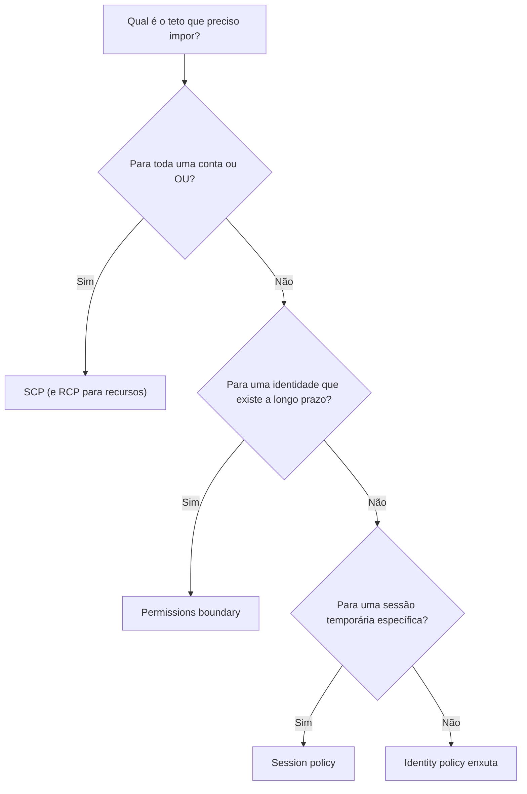

---
aliases:
  - Aula 4.8
modulo: 4
aula: 8
parte: "II Identidade, rede e dados"
dominios:
  - 1
lida: false
tags:
  - aula
  - saa-c03
  - modulo-04
---

# Aula 4.8: Guardrails e menor privilégio na prática

[[04 - IAM Identidade e Acesso|Voltar ao módulo]]

> [!question] Pergunta desta aula
> Como dar autonomia às equipes sem entregar a chave do reino? Como limitar o teto de permissões de quem cria roles, escalar o controle com tags e descobrir (com dados, não com chute) o que cada identidade realmente usa para chegar ao [[Menor Privilegio|menor privilégio]]?

## O problema: autonomia e segurança puxam em direções opostas

Nas aulas anteriores você aprendeu a escrever policies (4.3), condicioná-las (4.4), entender a avaliação (4.5) e entregar [[Credencial Temporaria|credenciais temporárias]] (4.6 e 4.7). Falta o desafio de **escala e governança**: uma empresa com 200 desenvolvedores, 40 contas e centenas de roles não pode ter um time de segurança aprovando cada policy. Se todo pedido passar por ele, vira gargalo; se qualquer dev puder criar qualquer policy, ele consegue conceder a si mesmo `AdministratorAccess`, o que se chama **[[Escalada de Privilegio|escalada de privilégio]]**.

A saída é trocar a pergunta. Em vez de "o que esta pessoa pode fazer?", pergunte "**qual é o teto do que qualquer um nesta área pode vir a fazer?**" e deixe as equipes se movimentarem **abaixo** do teto. Esse teto é um **guardrail** (grade de proteção). Esta aula mostra as ferramentas que a AWS oferece para isso e, depois, as ferramentas para **refinar** permissões com base em uso real.

## As quatro camadas de teto

Você já viu, na Aula 4.5, que algumas policies nunca concedem nada e só **limitam**. São elas, da mais ampla para a mais estreita:

| Guardrail | Onde se aplica | Quem controla | Concede permissão? |
|---|---|---|---|
| [[SCP]] (Service Control Policy) | Contas e OUs da organização | Administrador da organização | Não, só limita |
| [[RCP]] (Resource Control Policy) | Recursos das contas da organização | Administrador da organização | Não, só limita |
| [[Permissions Boundary]] | Um usuário ou uma role específica | Quem administra o [[IAM]] da conta | Não, só limita |
| [[Session Policy]] | Uma sessão temporária específica | Quem assume a role ou federa | Não, só limita |

A regra de ouro, repetida desde a Aula 4.5: a permissão efetiva é a **interseção** de tudo que concede ([[Identity-Based Policy|identity policy]], [[Resource-Based Policy|resource policy]]) com tudo que limita ([[SCP]], [[RCP]], [[Permissions Boundary|boundary]], [[Session Policy|session policy]]). Um `Deny` explícito em qualquer lugar vence tudo. SCPs e RCPs são o assunto do Módulo 5; aqui o foco é nos dois que vivem **dentro da conta**: boundary e session policy.



## Permissions boundary: o teto de uma identidade

Uma **[[Permissions Boundary|permissions boundary]]** é uma **managed policy** (da AWS ou sua) usada para definir o **máximo** de permissões que uma [[Identity-Based Policy|identity-based policy]] pode conceder a um **usuário ou role** (não a grupos). A documentação é direta: a boundary **não concede** nada, só limita.

**Exemplo clássico.** Um usuário tem a [[Permissions Boundary|boundary]] que permite `s3:*`, `cloudwatch:*` e `ec2:*`, e uma [[Identity-Based Policy|identity policy]] que permite `iam:CreateUser`. Resultado: ele **não consegue** criar usuários, porque `iam:CreateUser` está fora do teto, mesmo concedido pela identity policy. Se ele tivesse só a boundary e nenhuma identity policy, também não conseguiria nada: o teto sem concessão é zero.

| | [[Identity-Based Policy\|Identity policy]] permite | [[Permissions Boundary\|Boundary]] permite | Efetivo |
|---|---|---|---|
| Caso 1 | `s3:*`, `ec2:*` | `s3:*`, `sqs:*` | Só `s3:*` |
| Caso 2 | `iam:CreateUser` | `s3:*`, `ec2:*` | Nada |
| Caso 3 | (nenhuma) | `s3:*` | Nada |

> [!info] Ligando os pontos
> Na Aula 4.5 você viu que, no mesmo acesso, [[Resource-Based Policy|resource-based policy]] e [[Identity-Based Policy|identity policy]] fazem **união**, e que [[Permissions Boundary|boundary]], [[SCP]] e [[Session Policy|session policy]] fazem **interseção**. A boundary tem uma exceção importante: ela **não limita** uma resource-based policy que nomeia diretamente o [[ARN]] de um **[[IAM User|IAM user]]** (ou de uma **sessão de role**); se a policy nomeia o ARN da **role**, a boundary a limita (Aula 4.5). Por isso o comportamento depende de onde a permissão vem; releia a Aula 4.5 se isso ainda estiver nebuloso.

### O caso de uso que a prova ama: delegar a administração do IAM

O problema: você quer que os **desenvolvedores criem roles para as próprias aplicações** (para não depender de um time central), mas **sem poder criar uma role mais poderosa que eles próprios**.

A solução é em duas partes:

1. **O teto:** crie uma managed policy `DevBoundary` com o conjunto máximo de ações que as aplicações podem precisar (por exemplo, [[S3]], [[DynamoDB]], [[SQS]], Lambda). Nada de `iam:*` nem de ações sensíveis.
2. **A obrigação:** dê aos desenvolvedores permissão de `iam:CreateRole`, `iam:AttachRolePolicy` e semelhantes **somente se** a chamada incluir a [[Permissions Boundary|boundary]], usando a [[Condition Key|condition key]] `iam:PermissionsBoundary`:

```json
{
  "Effect": "Allow",
  "Action": ["iam:CreateRole", "iam:AttachRolePolicy", "iam:PutRolePolicy"],
  "Resource": "*",
  "Condition": {
    "StringEquals": {
      "iam:PermissionsBoundary": "arn:aws:iam::123456789012:policy/DevBoundary"
    }
  }
}
```

Com isso, toda role criada pelo desenvolvedor nasce com a `DevBoundary`, e por mais poderosa que seja a policy que ele anexar, o teto vale. Para fechar a porta, a documentação recomenda também **negar** a remoção ou troca da [[Permissions Boundary|boundary]] (`iam:DeleteRolePermissionsBoundary`, `iam:PutRolePermissionsBoundary`) e a edição da própria policy de boundary. Sem essas negações, o desenvolvedor poderia tirar a boundary da role e voltar ao ponto inicial.

**O furo do `iam:PassRole`.** Mesmo com a [[Permissions Boundary|boundary]], o desenvolvedor pode tentar **entregar uma role já existente e poderosa** a um serviço que ele controla (uma [[EC2]], uma Lambda) e usar o poder dela. O fecho é duplo: a permissão `iam:PassRole` deve ter `Resource` restrito aos [[ARN|ARNs]] das roles aprovadas (nunca `*`), idealmente com `iam:PassedToService` (Aula 4.6), e as roles poderosas ficam **fora** desse conjunto. Sem isso, a boundary protege as roles novas, mas não as antigas.

> [!warning] O padrão de pegadinha
> Se o enunciado diz "os desenvolvedores devem criar roles **mas não podem conceder mais permissões do que eles têm**", a resposta é **[[Permissions Boundary|permissions boundary]] com a condição `iam:PermissionsBoundary`**. Se o enunciado fala de **todas as contas da organização**, a resposta é **[[SCP]]**. A boundary é por identidade, a SCP é por conta ou OU.

### Quando usar a boundary e quando não

Use quando a **administração do [[IAM]] é delegada** (equipes criam roles e usuários) ou quando uma identidade específica precisa de um teto fixo. Não use no lugar de [[Identity-Based Policy|identity policies]] bem escritas: a [[Permissions Boundary|boundary]] é uma rede de segurança, não o mecanismo principal de concessão. E lembre que ela tem as mesmas cotas de tamanho de uma managed policy, e que cada usuário ou role aceita **uma** boundary.

## Session policy: o teto de uma sessão

Uma **[[Session Policy|session policy]]** é passada **como parâmetro** quando você cria uma sessão temporária programaticamente (`AssumeRole`, `AssumeRoleWithSAML`, `AssumeRoleWithWebIdentity`, `GetFederationToken`). Ela serve para **reduzir** as permissões daquela sessão específica, sem alterar a role.

Exemplo: uma role `app-s3` permite `s3:*` e `dynamodb:*`. Uma aplicação [[Multi-Tenant|multi-tenant]] assume essa role em nome de cada cliente e passa uma [[Session Policy|session policy]] que só permite `s3:*` em `arn:aws:s3:::dados/cliente-42/*`. A sessão daquele cliente **só alcança o prefixo dele**, mesmo que a role tenha mais. A permissão efetiva é a interseção entre as [[Identity-Based Policy|identity policies]] da role e a session policy.

Duas observações que caem em prova:

- A [[Session Policy|session policy]] **nunca amplia**: ela só pode reduzir. Se a role não tem a ação, a session policy permitindo não a cria.
- O caso do **`GetFederationToken`** (Aula 4.6) é especial: as permissões da sessão resultam da interseção entre as policies do usuário que chamou e a [[Session Policy|session policy]].

Quando usar: **escopo dinâmico por usuário ou por [[Tenant|tenant]]** em aplicações que fazem broker de acesso, sem criar uma role por cliente. Isso também ajuda a contornar o limite de roles por conta.

## ABAC: autorização por tags (e por que ela escala)

Há dois estilos de organizar permissões:

- **[[RBAC]] (role-based):** você cria roles por função de trabalho (`dev-projeto-a`, `dev-projeto-b`) e cada projeto novo exige uma role e uma policy novas. Funciona, mas cresce linearmente.
- **[[ABAC]] (attribute-based):** você usa **atributos (tags)** em [[Principal|principals]] e em recursos, e **uma única policy** compara os dois. Projeto novo? Marque os recursos e as identidades com a tag certa e nada na policy muda.

A documentação traz o exemplo canônico: uma policy permite iniciar e parar [[EC2|instâncias EC2]] **somente se** a tag `projeto` do recurso for igual à tag `projeto` do principal.

```json
{
  "Effect": "Allow",
  "Action": ["ec2:StartInstances", "ec2:StopInstances"],
  "Resource": "arn:aws:ec2:*:*:instance/*",
  "Condition": {
    "StringEquals": {
      "aws:ResourceTag/projeto": "${aws:PrincipalTag/projeto}"
    }
  }
}
```

Como você viu na Aula 4.4, `aws:ResourceTag` compara com a tag do **recurso** e `aws:PrincipalTag` com a tag do **principal**, e a variável `${aws:PrincipalTag/projeto}` evita escrever uma policy por projeto.

**Tags de sessão.** Para identidades federadas (pessoas que entram por [[Identity Provider|IdP]] externo) ou para sessões de role, você pode **passar tags na hora de assumir** (`sts:TagSession`), de modo que o atributo venha do diretório corporativo e não do cadastro do [[IAM]]. A documentação permite até **50** tags de sessão (verificado em novembro de 2026), e elas podem ser marcadas como **transitivas** para continuar valendo em [[Role Chaining|role chaining]].

| | [[RBAC]] | [[ABAC]] |
|---|---|---|
| Unidade de permissão | A role por função | Uma policy + tags |
| Novo projeto | Nova role e policy | Marcar recursos e identidades |
| Crescimento | Linear | Praticamente constante |
| Risco típico | Explosão de roles | Quem pode **editar tags** vira administrador de fato |

> [!warning] Proteja as tags
> No [[ABAC]], as tags **são** a permissão. Se um usuário puder editar a tag `projeto` do próprio principal ou do recurso, ele muda o que consegue acessar. Negue `iam:TagUser`/`iam:TagRole` e `ec2:CreateTags`/`ec2:DeleteTags` a quem não deve mexer nelas, ou condicione essas ações. O ABAC também não elimina o [[Menor Privilegio|menor privilégio]]: a policy ainda deve limitar as **ações**.

## Chegando ao menor privilégio com dados

[[Menor Privilegio|Menor privilégio]] não se alcança de uma vez. A prática recomendada é **começar largo dentro de um teto, observar o uso e apertar**. A AWS fornece as ferramentas.

### IAM Access Analyzer

O [[IAM Access Analyzer]] tem várias funções, e a prova cobra principalmente quatro:

1. **Achados de acesso externo (external [[IAM Access Analyzer|access analyzer]]).** Você cria um analisador com uma **zona de confiança** (sua conta ou sua organização). Ele analisa as [[Resource-Based Policy|resource-based policies]] de recursos suportados ([[S3]], roles, chaves do [[KMS]], filas do [[SQS]], [[Lambda|funções Lambda]], secrets e outros) e gera um **[[Finding|finding]]** para cada recurso que concede acesso a um principal **de fora da zona de confiança**. Os achados aparecem em cerca de 30 minutos após a criação ou a alteração (verificado em novembro de 2026), e o analisador é **por Região**: para cobrir várias [[Regiao AWS|Regiões]], crie um em cada.
2. **Achados de acesso interno (internal [[IAM Access Analyzer|access analyzer]]).** Mostra quais identidades **dentro** da organização acessam recursos críticos selecionados, útil para validar o acesso pretendido.
3. **Achados de acesso não utilizado (unused [[IAM Access Analyzer|access analyzer]]).** Aponta roles, usuários e [[Access Key|chaves de acesso]] **sem uso** em um período definido, e permissões concedidas que nunca foram usadas.
4. **Geração de policy** a partir da atividade do [[CloudTrail]]: você escolhe uma role ou usuário e um período, e o [[IAM Access Analyzer|Access Analyzer]] gera uma policy com **apenas as ações observadas**, como ponto de partida para o [[Menor Privilegio|menor privilégio]]. Ele exige que o CloudTrail esteja habilitado e grava o resultado como sugestão, não aplica sozinho.

Há ainda a **validação de policies** (checa sintaxe e boas práticas, e é usada no Console quando você edita uma policy) e as **verificações customizadas** (por exemplo, "esta nova policy concede mais acesso do que a versão anterior?"), que se encaixam em pipelines de CI/CD.

> [!tip] Como diferenciar na prova
> "Quais recursos estão **expostos** a fora da conta ou da organização?" é o [[IAM Access Analyzer|analisador de acesso]] externo. "Quais permissões ou credenciais **ninguém usa**?" é o de acesso não utilizado. "Crie uma policy **a partir da atividade real**" é a geração de policy com [[CloudTrail]]. O Access Analyzer **detecta**, não bloqueia: para impedir, use [[SCP]], [[Permissions Boundary|boundary]] ou policy.

### Last accessed information

Para cada usuário, grupo, role ou policy, o [[IAM]] mostra quais **serviços** (e, para alguns serviços, quais **ações**) foram acessados e quando. Com isso você remove permissões que existem há meses sem uso. A informação aparece na aba **Access Advisor** do Console e pode ser consultada por API e CLI. Ela é a base da regra de bolso: "se ninguém usa há 90 dias, provavelmente pode sair".

### Credential report

O **[[Credential Report]]** é um arquivo CSV com **todos os [[IAM User|usuários IAM]]** da conta e o estado de suas credenciais: idade da senha, último uso, [[MFA]] ativado, idade e último uso das [[Access Key|chaves de acesso]] e idade dos certificados. É a ferramenta de **auditoria de higiene de credenciais** (controles como "todos os usuários têm MFA", "nenhuma chave tem mais de 90 dias"). Pontos de prova: é gerado **sob demanda** e o [[IAM]] só gera um novo se o anterior tiver **mais de 4 horas** (verificado em novembro de 2026), e ele traz apenas as **duas primeiras** chaves de acesso de cada usuário, as quais são o máximo permitido.

### Policy simulator

O **[[Policy Simulator|IAM policy simulator]]** avalia o efeito de policies **sem fazer chamadas reais**. Você escolhe uma identidade (ou cola uma policy no modo customizado), as ações e os recursos, e ele mostra permitido ou negado e **qual statement decidiu**. É a ferramenta para testar uma policy **antes** de aplicá-la e para depurar "por que está negado". Ressalva da documentação: o resultado pode **divergir do ambiente real** (por exemplo, quando faltam itens do contexto de requisição que a policy usa), então a simulação orienta, não substitui, o teste.

| Ferramenta | Pergunta que responde | Quando |
|---|---|---|
| [[IAM Access Analyzer\|Access Analyzer]] (externo) | Quem de fora acessa meus recursos? | Contínuo |
| [[IAM Access Analyzer\|Access Analyzer]] (não usado) | O que ninguém usa? | Revisão periódica |
| Geração de policy | Qual é o mínimo que esta role usa de fato? | Apertar uma role larga |
| Last accessed | Esta identidade ainda usa este serviço? | Revisão de acesso |
| [[Credential Report\|Credential report]] | Minhas credenciais estão saudáveis? | Auditoria |
| [[Policy Simulator\|Policy simulator]] | Esta policy faz o que eu espero? | Antes de aplicar |

## Como isso cai na prova

**Task 1.1** (design de acesso seguro, [[Menor Privilegio|menor privilégio]], delegação) e, em parte, **1.2** (múltiplas contas). Frases-chave em inglês:

- "Developers must be able to **create [[IAM Role|IAM roles]]**, but **not exceed** their own permissions": **[[Permissions Boundary|permissions boundary]]** com `iam:PermissionsBoundary`.
- "Restrict permissions for **all accounts** in an OU": [[SCP]] (Módulo 5).
- "[[Grant]] access to resources **based on tags**" / "scale without updating policies": **[[ABAC]]**.
- "Identify resources **shared with external** entities": [[IAM Access Analyzer|Access Analyzer]] (external access).
- "Identify **unused** roles, users or permissions": [[IAM Access Analyzer|Access Analyzer]] (unused access) ou last accessed information.
- "Generate a **[[Menor Privilegio|least privilege]] policy** based on [[CloudTrail]] activity": policy generation.
- "Audit **password and [[Access Key|access key]] age**, [[MFA]] status": **[[Credential Report|credential report]]**.
- "**Test** a policy before applying": [[Policy Simulator|policy simulator]].
- "Temporarily **restrict** a role's permissions for one session": **[[Session Policy|session policy]]**.

| Requisito no enunciado | Resposta provável | Por quê |
|---|---|---|
| Dev cria roles sem escalar privilégio | [[Permissions Boundary\|Boundary]] + condição `iam:PermissionsBoundary` | Teto obrigatório em cada role criada |
| Projeto novo sem editar policies | [[ABAC]] com `aws:PrincipalTag` e `aws:ResourceTag` | A policy compara tags |
| Descobrir buckets abertos a outras contas | [[IAM Access Analyzer\|Access Analyzer]] (acesso externo) | Achados por zona de confiança |
| Reduzir uma role larga ao que usa | Geração de policy com [[CloudTrail]] | Parte do uso real |
| Auditoria de [[MFA]] e chaves antigas | [[Credential Report\|Credential report]] | CSV com o estado das credenciais |
| Escopo por cliente numa app [[Multi-Tenant\|multi-tenant]] | [[Session Policy\|Session policy]] | Reduz só aquela sessão |

## Resumo

> [!abstract] A aula em uma frase
> Guardrails ([[SCP]], [[RCP]], [[Permissions Boundary|permissions boundary]] e [[Session Policy|session policy]]) definem o teto sem conceder nada, o [[ABAC]] escala o controle com tags, e as ferramentas de análise ([[IAM Access Analyzer|Access Analyzer]], last accessed, [[Credential Report|credential report]], [[Policy Simulator|policy simulator]]) trazem os dados para apertar o acesso até o [[Menor Privilegio|menor privilégio]].

**A lógica, em 5 passos**

1. Autonomia sem teto vira [[Escalada de Privilegio|escalada de privilégio]]; centralizar tudo vira gargalo.
2. O teto vem de policies que só limitam: [[SCP]] e [[RCP]] (organização), [[Permissions Boundary|boundary]] (identidade) e [[Session Policy|session policy]] (sessão).
3. Para delegar a criação de roles, anexe uma [[Permissions Boundary|boundary]] obrigatória com a condição `iam:PermissionsBoundary`.
4. Para escalar, use [[ABAC]]: uma policy compara as tags do principal e do recurso.
5. Comece largo dentro do teto, observe o uso ([[CloudTrail]], last accessed, [[IAM Access Analyzer|Access Analyzer]]) e aperte.

**Números para lembrar**

| O quê | Valor | Por que importa |
|---|---|---|
| [[Permissions Boundary\|Boundary]] por usuário ou role | 1 | Não se empilham |
| Tags de sessão | Até 50 | Atributos vindos do [[Identity Provider\|IdP]] |
| [[Credential Report\|Credential report]] | Novo a cada 4 horas | Cota de geração |
| Achados do [[IAM Access Analyzer\|Access Analyzer]] | Cerca de 30 minutos | Não é tempo real |
| [[Access Key\|Chaves de acesso]] por usuário | 2 | O relatório lista as duas |

**Tabela-síntese**

| Preciso | Use |
|---|---|
| Teto para a organização | [[SCP]] e [[RCP]] |
| Teto para uma identidade | [[Permissions Boundary\|Permissions boundary]] |
| Teto para uma sessão | [[Session Policy\|Session policy]] |
| Escalar por atributos | [[ABAC]] com tags |
| Ver acesso externo | [[IAM Access Analyzer\|Access Analyzer]] |
| Gerar policy mínima | Geração de policy |
| Auditar credenciais | [[Credential Report\|Credential report]] |
| Testar policy | [[Policy Simulator\|Policy simulator]] |

**Na prática, isso significa**

- Toda role criada por equipe delegada leva a [[Permissions Boundary|boundary]], e a boundary é protegida contra remoção.
- Crie o [[IAM Access Analyzer|analisador de acesso]] externo em cada Região usada, com a organização como zona de confiança.
- Reveja o [[Credential Report|credential report]] e o last accessed com regularidade e remova o que não é usado.
- Teste policies novas no simulador e, depois, em uma conta de teste.

> [!tip] Liga com
> Fecha o Módulo 4 retomando a [[04.05 - Logica de Avaliacao de Policies|avaliação de policies]] (interseções) e antecipa o [[05 - Multiconta Governanca e Federacao|Módulo 5]], onde [[SCP|SCPs]], [[RCP|RCPs]] e o [[IAM Identity Center|Identity Center]] organizam esses tetos em escala.

## Erros comuns

- **"A [[Permissions Boundary|boundary]] dá permissões."** Nunca concede; só limita o que a [[Identity-Based Policy|identity policy]] concede.
- **"A [[Session Policy|session policy]] pode ampliar o acesso da role."** Só reduz.
- **"O [[IAM Access Analyzer|Access Analyzer]] bloqueia o acesso externo."** Ele só detecta e reporta; o bloqueio vem de policies.
- **"[[ABAC]] dispensa limitar as ações."** A policy ainda precisa restringir as ações e proteger a edição das tags.
- **"O [[Credential Report|credential report]] é em tempo real."** É gerado sob demanda e reaproveitado por até 4 horas.
- **"A [[Permissions Boundary|boundary]] vale para grupos."** Só para usuários e roles.

## Pratique

**1.** Uma empresa quer que os desenvolvedores criem roles para as próprias aplicações sem depender do time de segurança, mas nenhuma role criada pode ter mais permissões do que o teto aprovado. Qual mecanismo atende melhor?

- [ ] a) Uma SCP anexada à raiz da organização que nega todas as ações de IAM
- [ ] b) Um grupo IAM com a policy `AdministratorAccess` e MFA obrigatório para os desenvolvedores
- [ ] c) Uma permissions boundary obrigatória nas roles criadas, via `iam:PermissionsBoundary`
- [ ] d) Uma session policy com as ações aprovadas anexada ao usuário de cada desenvolvedor

**2.** Um usuário tem uma [[Permissions Boundary|permissions boundary]] que permite `s3:*` e `sqs:*`, e uma [[Identity-Based Policy|identity policy]] que permite `s3:*` e `ec2:*`. Quais ações ele consegue executar?

- [ ] a) Somente as ações de `s3:*`, presentes nas duas policies
- [ ] b) Todas as ações de S3, SQS e EC2 reunidas pelas duas policies
- [ ] c) Somente as ações de `ec2:*` e de `sqs:*` somadas
- [ ] d) Nenhuma ação, pois as duas policies divergem

**3.** Uma empresa abre dezenas de projetos por mês e cada projeto tem [[EC2]] e buckets próprios. A equipe de segurança quer que cada engenheiro acesse apenas os recursos do próprio projeto, sem editar policies a cada novo projeto. Qual abordagem?

- [ ] a) Criar uma role e uma policy por projeto e atualizar o mapeamento dos engenheiros
- [ ] b) Colocar todos os engenheiros no mesmo grupo e separar os projetos por Região
- [ ] c) Usar uma SCP por projeto, anexada a uma OU criada para ele
- [ ] d) ABAC: uma policy que compara a tag do recurso com a tag do principal

**4.** Quais DUAS funcionalidades do [[IAM Access Analyzer]] ajudam a chegar ao [[Menor Privilegio|menor privilégio]]? (Escolha DUAS.)

- [ ] a) Gerar uma policy com as ações observadas na atividade do CloudTrail
- [ ] b) Bloquear automaticamente qualquer acesso feito por principais de outras contas
- [ ] c) Apontar roles, usuários, chaves e permissões que não foram usados em um período
- [ ] d) Criptografar com KMS todos os dados dos recursos analisados
- [ ] e) Substituir o MFA na autenticação de usuários IAM

**5.** Uma role permite `s3:*` e `ec2:*`. Uma aplicação assume essa role passando uma [[Session Policy|session policy]] que permite apenas `s3:GetObject`. O que a sessão resultante pode fazer?

- [ ] a) Todas as ações de S3 e de EC2, porque a role as permite
- [ ] b) Somente `s3:GetObject`, a interseção com a session policy
- [ ] c) `s3:GetObject` e todas as ações de EC2, somadas
- [ ] d) Nada, porque a session policy substitui as policies da role e as zera

**6.** Um auditor precisa de um relatório com a idade das senhas, o status de [[MFA]] e a idade das [[Access Key|chaves de acesso]] de todos os [[IAM User|usuários IAM]] da conta. O que usar?

- [ ] a) O IAM policy simulator, escolhendo cada usuário e cada ação
- [ ] b) O CloudFormation drift detection executado sobre a conta
- [ ] c) O credential report do IAM, baixado como arquivo CSV
- [ ] d) O analisador de acesso externo do Access Analyzer

**7.** Antes de aplicar uma nova policy em produção, um engenheiro quer verificar se um usuário conseguiria executar `dynamodb:PutItem` em uma tabela, sem fazer chamadas reais. O que usar?

- [ ] a) O credential report, filtrando pelo usuário
- [ ] b) O CloudTrail Insights em modo de análise de custos
- [ ] c) O Access Analyzer de acesso externo, que mostra todos os resultados em tempo real
- [ ] d) O IAM policy simulator, informando a identidade, a ação e o recurso

**8.** Um time concedeu a uma role permissões amplas de vários serviços e, meses depois, suspeita que muitos nunca foram usados. Como identificar com dados quais serviços foram realmente acessados?

- [ ] a) Aplicar uma SCP negando todos os serviços e liberar os que derem erro
- [ ] b) Consultar a last accessed information (Access Advisor) da role
- [ ] c) Gerar um credential report e ler a coluna de chaves de acesso
- [ ] d) Criar um novo grupo com a mesma policy e comparar os custos

**9.** Um administrador quer impedir que qualquer identidade das contas de uma OU, inclusive administradores locais, desabilite o [[CloudTrail]]. Qual é o mecanismo adequado?

- [ ] a) Uma SCP com Deny em `cloudtrail:StopLogging`, anexada à OU
- [ ] b) Uma permissions boundary anexada ao usuário root de cada conta
- [ ] c) Uma session policy aplicada a todas as sessões da OU
- [ ] d) Uma identity policy anexada a um grupo em cada conta

**10.** Para garantir que os desenvolvedores só criem roles que já nasçam com a [[Permissions Boundary|boundary]] correta, qual condição deve constar na policy que concede `iam:CreateRole`?

- [ ] a) `aws:SourceIp` com o intervalo de endereços do escritório
- [ ] b) `aws:MultiFactorAuthPresent` igual a `true`
- [ ] c) `iam:PermissionsBoundary` com o ARN da policy de boundary
- [ ] d) `aws:RequestedRegion` restrita à Região principal da empresa

**11.** Um usuário tem uma [[Permissions Boundary|permissions boundary]] que permite `s3:*` e nenhuma [[Identity-Based Policy|identity policy]]. O que acontece quando ele tenta `s3:GetObject` em um [[Bucket|bucket]] da própria conta sem [[Bucket Policy|bucket policy]]?

- [ ] a) Permitido, porque a boundary autoriza `s3:*`
- [ ] b) Permitido, porque o bucket é da mesma conta do usuário e não há Deny
- [ ] c) Permitido apenas se o usuário também tiver MFA ativo na sessão
- [ ] d) Negado, pois a boundary só limita e não concede nenhum acesso

**12.** Qual é a principal vantagem do [[ABAC]] sobre o [[RBAC]] tradicional em uma empresa que cria novos projetos o tempo todo?

- [ ] a) Elimina a necessidade de qualquer policy de permissão
- [ ] b) Recursos novos com a tag certa passam a funcionar sem editar policies
- [ ] c) Dispensa o controle sobre quem pode editar as tags de recursos
- [ ] d) Torna desnecessário o uso de MFA para as pessoas que acessam

> [!success]- Gabarito
> **1. c)** a [[Permissions Boundary|boundary]] obrigatória com `iam:PermissionsBoundary` impõe o teto em cada role criada; a) nega [[IAM]] para todos, inclusive quem precisa criar roles; b) concede administrador, o oposto do teto; d) [[Session Policy|session policy]] vale para sessões, não para usuários.
> **2. a)** a efetiva é a interseção: só `s3:*` está nas duas; b) seria a união, que não é a regra; c) `ec2:*` está fora da [[Permissions Boundary|boundary]] e `sqs:*` fora da [[Identity-Based Policy|identity policy]]; d) há uma ação em comum.
> **3. d)** o [[ABAC]] compara a tag do recurso com a do principal e escala sem novas policies; a) cresce linearmente; b) Região não separa projetos; c) [[SCP]] é por conta ou OU e não resolve identidades.
> **4. a) e c)** a geração de policy a partir do [[CloudTrail]] e os achados de acesso não utilizado ajudam a apertar permissões; b) o [[IAM Access Analyzer|Access Analyzer]] não bloqueia; d) não criptografa dados; e) não substitui [[MFA]].
> **5. b)** a sessão fica com a interseção, só `s3:GetObject`; a) ignora a [[Session Policy|session policy]]; c) a session policy nunca soma; d) ela reduz, não zera as permissões da role.
> **6. c)** o [[Credential Report|credential report]] traz senhas, [[MFA]] e chaves de todos os usuários; a) o simulador testa policies; b) drift é de [[CloudFormation]]; d) o acesso externo trata de recursos compartilhados.
> **7. d)** o simulador avalia a policy sem chamadas reais; a) o relatório não avalia ações; b) o Insights não simula permissões; c) o [[IAM Access Analyzer|Access Analyzer]] não testa uma ação específica.
> **8. b)** a last accessed information mostra os serviços acessados e quando; a) derrubar tudo gera incidentes; c) o relatório trata de credenciais de usuários; d) custos não mostram permissões usadas.
> **9. a)** a [[SCP]] é o teto de toda a OU e vale até para administradores locais; b) a [[Permissions Boundary|boundary]] não se aplica ao root nem a toda a OU; c) [[Session Policy|session policy]] é por sessão; d) [[Identity-Based Policy|identity policy]] local pode ser removida por um administrador.
> **10. c)** `iam:PermissionsBoundary` obriga a anexar a [[Permissions Boundary|boundary]] indicada; a), b) e d) restringem origem, [[MFA]] e Região, não a boundary.
> **11. d)** a [[Permissions Boundary|boundary]] só limita e sem [[Identity-Based Policy|identity policy]] o resultado é negado; a) confunde limite com concessão; b) a mesma conta não basta sem allow; c) [[MFA]] não substitui a concessão.
> **12. b)** com [[ABAC]], a tag certa dá acesso sem editar policies; a) ainda existe policy; c) quem edita tags passa a controlar o acesso; d) [[MFA]] continua útil.

### Laboratório (opcional)

> [!warning] Use uma conta pessoal
> Faça este laboratório em uma **[[Conta AWS|conta AWS]] pessoal separada**, com [[Budgets|AWS Budgets]] configurado. **Nunca na conta de produção da empresa.** Custo estimado: zero para o [[Credential Report|credential report]] e para o simulador. O [[IAM Access Analyzer|analisador de acesso]] externo não tem custo adicional segundo a documentação; **não** crie o analisador de acesso não utilizado neste laboratório, pois ele tem cobrança própria (consulte a página de preços).

1. **[[Credential Report|Credential report]].** Rode `aws iam generate-credential-report` e depois `aws iam get-credential-report --query Content --output text` (o conteúdo vem em base64; decodifique para ler o CSV). Localize as colunas de [[MFA]] e de último uso das chaves.
2. **[[Permissions Boundary|Boundary]] na prática.** Crie um usuário `lab-bound` com a policy gerenciada `AmazonS3FullAccess` e defina como boundary a policy gerenciada `AmazonDynamoDBReadOnlyAccess`.
3. **Simulador.** Rode `aws iam simulate-principal-policy --policy-source-arn <ARN do lab-bound> --action-names s3:ListAllMyBuckets` e leia `EvalDecision`. O resultado esperado é `implicitDeny`, porque a [[Permissions Boundary|boundary]] não permite [[S3]], mesmo com a [[Identity-Based Policy|identity policy]] permitindo.
4. **[[IAM Access Analyzer|Access Analyzer]].** Crie um analisador de acesso externo com a conta como zona de confiança (`aws accessanalyzer create-analyzer --analyzer-name lab-externo --type ACCOUNT`) e veja os achados com `aws accessanalyzer list-findings-v2 --analyzer-arn <ARN>` (a lista pode estar vazia).

Limpeza: apague o usuário `lab-bound` (remova a [[Permissions Boundary|boundary]] e a policy antes) e exclua o analisador com `aws accessanalyzer delete-analyzer --analyzer-name lab-externo`.

## Para aprofundar

- [ ] [Permissions boundaries for IAM entities](https://docs.aws.amazon.com/IAM/latest/UserGuide/access_policies_boundaries.html) (documentação AWS): como a [[Permissions Boundary|boundary]] limita e o exemplo de delegação
- [ ] [What is ABAC for AWS?](https://docs.aws.amazon.com/IAM/latest/UserGuide/introduction_attribute-based-access-control.html) (documentação AWS): tags de principal, de recurso e de sessão
- [ ] [What is IAM Access Analyzer?](https://docs.aws.amazon.com/IAM/latest/UserGuide/what-is-access-analyzer.html) (documentação AWS): analisadores externos, internos e de acesso não utilizado
- [ ] [Getting credential reports for your AWS account](https://docs.aws.amazon.com/IAM/latest/UserGuide/id_credentials_getting-report.html) (documentação AWS): colunas do relatório e frequência de geração

Próximo passo: voltar à nota do [[04 - IAM Identidade e Acesso|módulo]] para o Teste-se e seguir para o [[05 - Multiconta Governanca e Federacao|Módulo 5]].
