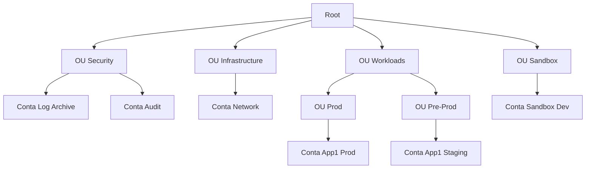

---
aliases:
  - Aula 5.1
modulo: 5
aula: 1
parte: "II Identidade, rede e dados"
dominios:
  - 1
lida: false
tags:
  - aula
  - saa-c03
  - modulo-05
---

# Aula 5.1: Por que várias contas e como o Organizations organiza

[[05 - Multiconta Governanca e Federacao|Voltar ao módulo]]

> [!question] Por que uma conta AWS só não basta, e como o Organizations transforma dezenas de contas em uma estrutura que se governa de um lugar só?

## O problema: tudo na mesma conta

Imagine a empresa que o João conhece bem: um produto SaaS com [[ECS]], [[RDS]], [[S3]] e filas. No começo, produção, staging e experimentos moram na mesma [[Conta AWS|conta AWS]]. Funciona, até o dia em que:

- uma [[Access Key|access key]] de um desenvolvedor vaza e o atacante enxerga o banco de produção ([[RDS]]), porque tudo está no mesmo lugar;
- um teste de carga em staging consome a [[Service Quotas|quota]] de instâncias ou de [[NAT Gateway|NAT gateways]] e a produção não consegue escalar;
- o auditor pergunta "onde estão os dados de cartão?" e a resposta é "em alguns buckets e tabelas misturados com o resto";
- a fatura chega num número só e ninguém sabe quanto custa cada produto.

Todos esses problemas têm a mesma raiz: **a [[Conta AWS|conta AWS]] é a fronteira mais forte que a AWS oferece**. Dentro de uma conta, o isolamento depende de políticas [[IAM]] bem escritas, tags e disciplina humana. Entre contas, o isolamento é o padrão: um recurso de outra conta só é acessível se as duas contas concordarem explicitamente (você viu isso no [[04 - IAM Identidade e Acesso|Módulo 4]], no acesso cross-account que exige permissão dos dois lados).

## O que a conta isola

A conta é, ao mesmo tempo, quatro fronteiras:

| Fronteira | O que significa na prática |
|---|---|
| Segurança | Credenciais, [[IAM Role|roles]], [[Resource-Based Policy|resource policies]] e recursos são por conta. Um comprometimento fica contido na conta (o [[Raio de Impacto|raio de impacto]], ou blast radius). |
| Cobrança | A conta é a unidade de faturamento. É a única forma de separar custos, inclusive [[Data Transfer\|transferência de dados]], sem depender de tags. |
| Quotas | As [[Service Quotas|Service Quotas]] são por conta e por [[Regiao AWS|Região]]. Cada workload ganha o seu próprio teto. |
| Governança | Políticas ([[SCP|SCPs]]), logs e controles de conformidade se aplicam a contas ou grupos de contas. |

A documentação do [[Control Tower]] resume os motivos para dividir em múltiplas contas: controles de segurança distintos por aplicação (é mais simples mostrar ao auditor "o workload PCI vive nesta conta"), isolamento, times diferentes sem interferência, isolamento de dados (ajuda em conformidade como a GDPR), processos de negócio distintos, cobrança separada e quotas individuais (verificado em novembro de 2026).

> [!example] Conta única contra contas separadas
> Cenário: a empresa tem `prod`, `staging` e `dev` numa conta. Um desenvolvedor roda um script com uma [[Access Key|access key]] que tem `ec2:*` e termina por engano instâncias de produção. Com contas separadas, a key de `dev` simplesmente não tem nenhuma permissão na conta de `prod`: o erro seria impossível, não apenas improvável. Mesma lógica para um vazamento: o atacante com a key de dev nunca chega ao [[RDS]] de produção.

## Padrões de divisão

Não existe um número certo de contas. Os eixos de divisão que a AWS recomenda, e que a prova usa:

- **Por ambiente**: produção, pré-produção (staging) e sandbox em OUs e contas diferentes, com controles diferentes. A AWS recomenda no mínimo separar produção de staging.
- **Por workload ou time**: cada produto ou equipe com a sua conta, cada uma com a sua fatura e as suas quotas.
- **Por função**: contas "de infraestrutura" que não rodam aplicações. As mais comuns são a conta de **[[Conta Log Archive|log archive]]** (recebe os logs de todas as outras, num lugar que os desenvolvedores não alteram), a de **auditoria ou segurança** (ferramentas de detecção, acesso somente leitura a tudo) e a de **rede** (hospeda o [[Transit Gateway]] e a saída para a internet compartilhados).
- **Por requisito regulatório**: o workload com PCI ou [[PII|dados pessoais]] numa conta própria reduz o escopo da auditoria.

Uma conta de sandbox para experimentação, com orçamento baixo e [[SCP|SCPs]] restritivas, é um padrão clássico: o desenvolvedor aprende sem risco para o resto.

## O mecanismo: AWS Organizations

Dezenas de contas sem coordenação virariam um caos (cada uma com seus usuários, sua fatura, suas regras). O **[[Organizations|AWS Organizations]]** é o serviço que agrupa contas numa estrutura única. Os conceitos, na ordem em que se encaixam:

- **Organização**: o conjunto de contas gerenciadas juntas.
- **Root** (raiz): o topo da hierarquia, só existe uma por organização. Não confunda com o [[Usuario Root|usuário root]] de uma conta: aqui "root" é o [[Container|contêiner]] de OUs e contas.
- **[[Organizational Unit|Organizational Unit (OU)]]**: um grupo de contas, que pode conter outras OUs. É o lugar onde se anexam políticas para que valham para um grupo de contas. A hierarquia pode ter **cinco níveis de OUs** abaixo do root, e uma organização pode ter até 2.000 OUs (verificado em novembro de 2026).
- **[[Management Account|Management account]]**: a conta que criou a organização. Paga as faturas de todas as outras e é a única que executa certas operações administrativas.
- **[[Member Account|Member accounts]]**: todas as outras contas.
- **Políticas**: [[SCP|SCPs]], [[RCP|RCPs]], [[Tag Policy|tag policies]], [[Backup Policy|backup policies]] e outras, anexadas ao root, a OUs ou a contas, com **herança** de cima para baixo (aula [[05.02 - SCPs e Politicas de Organizacao|5.2]]).

A [[Management Account|management account]] fica no próprio root, fora dessas OUs. A figura é um exemplo, não uma estrutura obrigatória.

### Os dois conjuntos de funcionalidades

Toda organização tem um de dois feature sets:

| Feature set | O que oferece |
|---|---|
| **All features** (recomendado e padrão) | Tudo do [[Consolidated Billing\|consolidated billing]], mais políticas ([[SCP]] etc.), integração com outros serviços ([[Acesso Confiavel\|acesso confiável]] e [[Delegated Administrator\|administrador delegado]]) e criação centralizada de contas. |
| **[[Consolidated Billing\|Consolidated billing]]** | Só a fatura única. Sem [[SCP]], sem integração de serviços. |

Dá para migrar de [[Consolidated Billing|consolidated billing]] para all features, mas todas as [[Member Account|contas membros]] convidadas precisam aceitar o convite que o processo envia. Daí um clássico de prova: "a empresa tem organização só com cobrança consolidada e quer aplicar [[SCP|SCPs]]; o que fazer?" Habilitar all features.

## Como contas entram e saem

Há duas formas de uma conta virar membro:

1. **Criar** a conta pelo Organizations (API `CreateAccount`). A conta nasce já dentro da organização. O Organizations cria nela automaticamente um [[IAM Role|IAM role]], por padrão chamado `OrganizationAccountAccessRole`, que a [[Management Account|management account]] pode assumir para administrar a conta. Essa é a ponte de acesso: um usuário da management account faz [[AssumeRole]] (permissão `sts:AssumeRole`) nesse role.
2. **Convidar** uma conta que já existe. Ela aceita o convite e passa a ser membro. O Organizations **não** cria o `OrganizationAccountAccessRole` em contas convidadas: se você quiser o mesmo acesso, cria o role manualmente.

Duas observações atuais da documentação (verificadas em novembro de 2026):

- Contas novas criadas no Organizations **não têm credenciais do [[Usuario Root|usuário root]]** por padrão: não dá fazer login como root nem recuperar a senha, a menos que a recuperação de conta seja habilitada. Existe um recurso de **acesso root centralizado** para remover as credenciais root de [[Member Account|contas membros]] existentes. É coerente com o princípio do Módulo 4: root só para o raríssimo caso que exige.
- Para organizações criadas pelo console depois de 10 de julho de 2026, uma [[SCP]] no root que nega `organizations:LeaveOrganization` e `account:CloseAccount` é aplicada automaticamente. Em organizações criadas pela CLI, SDK, [[CloudFormation]] ou antes dessa data, é preciso criar e anexar essa SCP manualmente (conferido na página de [controles de segurança padrão](https://docs.aws.amazon.com/organizations/latest/userguide/orgs_security_default_controls.html)). O objetivo: um membro não sair nem se fechar sem aprovação.

Duas pegadinhas de movimentação (verificadas em novembro de 2026, [remover conta](https://docs.aws.amazon.com/organizations/latest/userguide/orgs_manage_accounts_remove.html)):

- **Uma conta pertence a uma organização só.** Para mudar de organização, a conta sai da atual (a [[Management Account|management account]] a remove, ou ela mesma sai) e só então aceita o convite da nova. Convites pendentes contam na quota de contas.
- **A [[Management Account|management account]] não sai nem é removida da organização.** Para trocar a conta de gerenciamento é preciso criar uma nova organização, remover todas as [[Member Account|contas membros]] da antiga e convidá-las para a nova.

### Limites que a prova e o dia a dia respeitam

| O quê | Valor documentado | Observação |
|---|---|---|
| Contas por organização | O padrão listado é 10; ajustável pelo [[Service Quotas]], só pela [[Management Account\|management account]], com aumentos concedidos até 50.000 conforme qualificação | Organizações e contas novas podem ter quota ainda menor. Convites pendentes contam. |
| Roots por organização | 1 | |
| OUs por organização | 2.000 | |
| Níveis de OU sob o root | 5 | |
| Contas criadas ao mesmo tempo | 5 | Cada nova só começa quando uma termina. |
| Contas fechadas ao mesmo tempo | 3 | Há também um teto por 30 dias. |
| Idade mínima para remover uma conta criada | 4 dias | |
| Tags por root, OU ou conta | 50 | |

Organizations é um serviço global hospedado em `us-east-1`: para consultar as quotas dele no [[Service Quotas]], na CLI ou no SDK, use essa Região.

## A management account: a conta que você protege e não usa

A [[Management Account|management account]] tem três características que ditam a conduta:

1. **As [[SCP|SCPs]] não valem para ela.** Qualquer usuário ou role nela escapa dos guardrails. Por isso a AWS recomenda não colocar workloads lá: um workload na [[Management Account|management account]] ficaria fora do alcance das proibições que você aplica ao resto.
2. Ela **paga a fatura de todos**. Misturar workloads nela confunde a leitura da fatura.
3. Quem a controla, controla a organização inteira: acessos devem ser mínimos, revistos todo mês ou trimestre (incluindo quem tem acesso ao e-mail, senha, [[MFA]] e telefone da [[Usuario Root|conta root]]), e o processo de recuperação não pode depender de uma pessoa só.

A solução de escala é o **[[Delegated Administrator|administrador delegado]]**: para muitos serviços integrados ao Organizations ([[GuardDuty]], [[Security Hub]], [[CloudTrail]], [[Config]] e outros), a [[Management Account|management account]] designa uma [[Member Account|conta membro]] para administrar o serviço em nome da organização. Assim o dia a dia de segurança acontece na conta de segurança, não na management account. Uma conta delegada continua sujeita às [[SCP|SCPs]], porque é uma conta membro.

Para esses serviços funcionarem em toda a organização é preciso habilitar o **[[Acesso Confiavel|acesso confiável]]** (trusted access, ou service access) do serviço no Organizations, o que exige all features. O console do serviço costuma fazer isso por você, mas é a causa clássica de "o serviço não enxerga as outras contas". Por isso o padrão de menor esforço para "habilitar o [[GuardDuty]] ou o [[Security Hub]] em todas as contas atuais e futuras" é: acesso confiável, [[Delegated Administrator|administrador delegado]] e **auto-enable** da organização para contas novas ([integração de serviços](https://docs.aws.amazon.com/organizations/latest/userguide/orgs_integrate_services.html)).

> [!info] Ligando os pontos
> A estrutura dessa aula é o esqueleto do restante do módulo. As [[SCP|SCPs]] (aula [[05.02 - SCPs e Politicas de Organizacao|5.2]]) são anexadas a OUs; a fatura consolidada (aula [[05.03 - Cobranca Consolidada e Custos Multiconta|5.3]]) existe porque há uma [[Management Account|management account]]; o [[Control Tower]] (aula [[05.04 - Control Tower e Landing Zone|5.4]]) automatiza a criação desta estrutura com as contas de [[Conta Log Archive|log archive]] e auditoria já posicionadas.

## Como isso cai na prova

Task 1.1 do exam guide ("Design secure access to AWS resources"), na habilidade "designing a security strategy for multiple [[Conta AWS|AWS accounts]] ([[Control Tower]], [[SCP|SCPs]])". Aparece também em Task 4.1 (multi-account billing) e em perguntas de [[Defesa em Profundidade]].

**Palavras-chave em inglês e o que apontam**

- "isolate workloads", "limit the [[Raio de Impacto|blast radius]]", "separate production and development" aponta para contas separadas dentro de uma organização, não para [[VPC|VPCs]] ou tags.
- "centrally manage multiple accounts", "apply policies to multiple accounts" aponta para [[Organizations|AWS Organizations]] (e [[SCP|SCPs]]).
- "[[Consolidated Billing|consolidated billing]]", "single bill" aponta para Organizations.
- "least [[Overhead Operacional|operational overhead]]" para criar muitas contas padronizadas aponta para [[Control Tower]] (aula 5.4), não para scripts próprios.
- "restrict what accounts can do even for administrators" aponta para [[SCP]].

**Pegadinhas clássicas**

- Separar ambientes por [[VPC]] ou por tag na mesma conta **não** oferece o isolamento de segurança que a conta oferece.
- A [[Management Account|management account]] **não** é restringida por [[SCP]].
- Conta convidada **não** ganha o `OrganizationAccountAccessRole`; conta criada pelo Organizations ganha.
- [[Consolidated Billing|Consolidated billing]] sozinho **não** permite [[SCP]]; é preciso all features.

| Requisito no enunciado | Resposta provável | Por quê |
|---|---|---|
| Limitar o impacto de credenciais comprometidas de desenvolvimento | Contas separadas por ambiente | A conta é a fronteira de segurança |
| Aplicar a mesma restrição a dezenas de contas | OUs com [[SCP]] | A política é herdada pelas contas da OU |
| Uma fatura para todas as contas | Organizations ([[Consolidated Billing\|consolidated billing]]) | A [[Management Account\|management account]] paga tudo |
| Quotas de produção protegidas de testes | Conta própria para produção | Quotas são por conta |
| Log de auditoria que os desenvolvedores não alteram | Conta dedicada de [[Conta Log Archive\|log archive]] | [[Menor Privilegio\|Menor privilégio]] e separação de funções |
| Habilitar [[SCP]] em organização só com cobrança | Habilitar all features | SCP exige all features |

## Resumo

> [!abstract] A aula em uma frase
> A **[[Conta AWS|conta AWS]]** é a fronteira de segurança, cobrança, quotas e governança; o **Organizations** agrupa contas numa hierarquia (root, OUs, contas) para aplicar políticas e cobrança num só lugar.

**A lógica, em 5 passos**
1. Dentro de uma conta o isolamento depende de políticas bem escritas; entre contas o isolamento é o padrão.
2. Separar por ambiente, workload, função e requisito regulatório limita o [[Raio de Impacto|raio de impacto]], as quotas e a fatura.
3. O Organizations organiza as contas em root, OUs (até 5 níveis) e contas; políticas anexadas a um nível descem por herança.
4. A [[Management Account|management account]] paga tudo, não sofre [[SCP]] e deve ficar sem workloads e com acesso mínimo; a administração diária vai para [[Member Account|contas membros]] via [[Delegated Administrator|administrador delegado]].
5. Contas criadas pelo Organizations ganham o `OrganizationAccountAccessRole`; convidadas, não.

**Números para lembrar**

| O quê | Valor | Por que importa |
|---|---|---|
| Níveis de OU sob o root | 5 | Limite de profundidade da hierarquia |
| OUs por organização | 2.000 | Teto padrão |
| Contas criadas em paralelo | 5 | Ritmo de criação em massa |
| Idade mínima para remover conta criada | 4 dias | Não dá para criar e remover na hora |
| Roots | 1 | A hierarquia tem um topo só |

**Na prática, isso significa**
- Produção, staging e sandbox em contas separadas, em OUs diferentes.
- Contas de [[Conta Log Archive|log archive]] e auditoria separadas, com acesso mínimo.
- Nenhum workload na [[Management Account|management account]].
- All features habilitado, senão não há [[SCP]].
- Administrar serviços de segurança por [[Delegated Administrator|administrador delegado]].

> [!tip] Liga com
> Vem do [[04 - IAM Identidade e Acesso|Módulo 4]] (acesso cross-account exige os dois lados). Segue para as [[SCP|SCPs]] na aula [[05.02 - SCPs e Politicas de Organizacao|5.2]], que dão força à estrutura.

## Erros comuns

1. **"Separar por [[VPC]] já isola ambientes."** Uma VPC separa a rede, mas as credenciais [[IAM]], as quotas e a fatura continuam compartilhadas. Corrija usando contas.
2. **"A [[Management Account|management account]] é a conta de administração do dia a dia."** Ela escapa das [[SCP|SCPs]] e concentra o poder da organização. Corrija delegando a administração a [[Member Account|contas membros]].
3. **"Convidei a conta, então posso assumir `OrganizationAccountAccessRole`."** O role só é criado automaticamente em contas criadas pelo Organizations. Corrija criando o role manualmente na conta convidada.
4. **"[[Consolidated Billing|Consolidated billing]] já traz as [[SCP|SCPs]]."** Só o feature set all features traz. Corrija habilitando all features (os membros convidados aceitam a mudança).
5. **"Mais contas é sempre melhor."** Cada conta tem custo de gestão; por isso a automação (aula [[05.04 - Control Tower e Landing Zone|5.4]]) existe. Corrija dividindo pelos eixos que realmente separam risco, custo ou time.

## Pratique

**1.** Uma empresa mantém produção, desenvolvimento e dados de cartão de crédito na mesma [[Conta AWS|conta AWS]]. Uma [[Access Key|access key]] de um desenvolvedor foi exposta, e a empresa precisa limitar o [[Raio de Impacto|raio de impacto]] de incidentes assim e reduzir o escopo da auditoria PCI. Qual solução atende melhor?

- [ ] a) Separar os ambientes em VPCs diferentes dentro da mesma conta e controlar o acesso aos recursos por tags de ambiente
- [ ] b) Criar contas separadas por ambiente e uma conta dedicada aos dados de cartão, agrupadas em OUs do Organizations
- [ ] c) Replicar os recursos de produção em outra Região da mesma conta, para que um incidente não os alcance
- [ ] d) Habilitar MFA para todos os usuários IAM, rotacionar as access keys todo mês e revisar as policies a cada trimestre

**2.** Um arquiteto propõe hospedar o pipeline de CI/CD na [[Management Account|management account]] da organização "porque ela já enxerga todas as contas". Qual é o principal argumento contra?

- [ ] a) A management account não consegue assumir roles em contas membros, então o pipeline não conseguiria fazer deploys
- [ ] b) A cobrança consolidada faz o consumo dos recursos da management account custar mais do que nas contas membros
- [ ] c) A management account tem quotas de serviço menores, por ser reservada às operações administrativas da organização
- [ ] d) As SCPs não restringem a management account, então o workload ficaria fora dos guardrails

**3.** (Escolha DUAS.) Uma empresa avalia dividir um monólito em várias [[Conta AWS|contas AWS]]. Quais são vantagens reais dessa divisão?

- [ ] a) As quotas de serviço são por conta, então o consumo de um workload não esgota o limite de outro
- [ ] b) O custo total de computação cai automaticamente por causa do isolamento entre contas
- [ ] c) Credenciais comprometidas ficam contidas na conta, o que limita o raio de impacto
- [ ] d) O IAM deixa de ser necessário dentro de cada conta, porque a conta já controla quem acessa
- [ ] e) Os security groups passam a ser compartilhados entre contas sem nenhum serviço adicional

**4.** Uma equipe cria uma [[Member Account|conta membro]] pela API CreateAccount do Organizations e quer administrá-la a partir da [[Management Account|management account]]. O que já existe na conta nova para isso?

- [ ] a) Um IAM role chamado OrganizationAccountAccessRole, que a management account pode assumir
- [ ] b) Um usuário IAM administrador, cuja senha provisória é enviada ao e-mail informado na criação da conta
- [ ] c) Credenciais do usuário root da conta nova, com MFA já configurado pelo Organizations para a equipe
- [ ] d) Uma SCP anexada à conta que concede AdministratorAccess ao usuário da management account

**5.** Uma empresa convidou uma [[Conta AWS|conta AWS]] existente para a organização. Ao tentar assumir o [[OrganizationAccountAccessRole]] nela, a equipe da [[Management Account|management account]] recebe erro de que o role não existe. O que explica o erro e qual é a correção?

- [ ] a) O convite ainda propaga, e o role aparece sozinho em até 24 horas, com a confiança já apontando para a management account
- [ ] b) O role depende da Região padrão da conta convidada, que precisa ser habilitada antes de o Organizations recriá-lo
- [ ] c) O Organizations só cria esse role em contas que ele mesmo cria, então a equipe deve criá-lo manualmente na conta convidada, com confiança na management account
- [ ] d) Uma SCP do root removeu o role, e a correção é remover a SCP para que ele seja recriado automaticamente

**6.** Uma empresa quer espelhar no Organizations a estrutura da empresa: diretoria, área, departamento, time, squad, subsquad e célula, cada nível numa OU aninhada. O que acontece?

- [ ] a) Funciona, desde que a organização esteja com o feature set all features habilitado
- [ ] b) Funciona até 10 níveis, desde que a management account peça o aumento pelo Service Quotas
- [ ] c) Funciona, mas a herança das SCPs deixa de valer a partir do terceiro nível de OU
- [ ] d) Não funciona: o limite é de cinco níveis de OUs sob o root, então é preciso achatar a estrutura

**7.** (Escolha DUAS.) O time de segurança está revisando as práticas para a [[Management Account|management account]] de uma organização. Quais práticas a AWS recomenda?

- [ ] a) Hospedar aplicações críticas nela para aproveitar o acesso centralizado às demais contas
- [ ] b) Limitar quem tem acesso e revisar periodicamente quem controla o e-mail, a senha e o MFA da conta root
- [ ] c) Desabilitar o MFA para evitar bloqueio quando a pessoa responsável sair da empresa
- [ ] d) Anexar a ela a SCP de bloqueio de Regiões, para que valha também para a própria management account
- [ ] e) Delegar a administração de serviços como GuardDuty e Security Hub a uma conta membro

**8.** Uma organização foi criada só com o feature set de [[Consolidated Billing|consolidated billing]]. Agora a segurança quer aplicar [[SCP|SCPs]] para negar [[Regiao AWS|Regiões]] não usadas. Qual é o caminho?

- [ ] a) Criar uma organização nova com SCPs e migrar as contas uma a uma
- [ ] b) Habilitar all features na organização; os membros convidados precisam aceitar a mudança
- [ ] c) Anexar políticas IAM com Deny em cada conta, pois SCPs só funcionam em organizações criadas pelo Control Tower
- [ ] d) Usar tag policies, que bloqueiam o uso das Regiões da mesma forma que uma SCP

**9.** A empresa A foi adquirida pela empresa B. A [[Conta AWS|conta AWS]] da empresa A, hoje membro da organização de A, deve passar a ser membro da organização de B. Qual é o procedimento correto?

- [ ] a) Enviar o convite da organização de B; a conta o aceita e passa a pertencer às duas organizações até o fim da migração
- [ ] b) Pedir ao suporte da AWS que mova a conta entre as organizações sem remover a conta da organização de A
- [ ] c) Remover a conta da organização de A, enviar o convite pela organização de B e aceitar o convite na conta
- [ ] d) Fechar a conta e recriar os recursos numa conta criada dentro da organização de B

**10.** Uma empresa com 120 contas quer habilitar o [[GuardDuty|Amazon GuardDuty]] em todas as contas existentes e futuras, centralizando a visualização dos achados numa conta de segurança, com o MENOR [[Overhead Operacional|esforço operacional]]. O que fazer?

- [ ] a) Habilitar o acesso confiável do GuardDuty, designar a conta de segurança como administrador delegado e ativar o auto-enable
- [ ] b) Criar um IAM user em cada conta com permissão para habilitar o GuardDuty e rodar um script mensal que procure contas novas sem o serviço
- [ ] c) Habilitar o GuardDuty manualmente na management account e anexar uma SCP que o replique nas contas membros
- [ ] d) Convidar cada conta para o GuardDuty da conta de segurança por e-mail e aceitar os convites um a um

**11.** Uma startup quer que os logs de auditoria de todas as contas fiquem num local que os desenvolvedores não consigam alterar ou apagar, e que a equipe de segurança consiga consultar. Qual desenho segue as práticas multiconta?

- [ ] a) Gravar os logs num bucket S3 de cada time, com acesso total aos desenvolvedores para facilitar as consultas
- [ ] b) Gravar os logs na management account, que tem acesso a tudo e centraliza a administração da organização
- [ ] c) Manter os logs só no CloudWatch Logs de cada conta, com retenção de um dia para reduzir custo e superfície de ataque
- [ ] d) Criar uma conta dedicada de log archive, numa OU de segurança, com acesso restrito

**12.** Um engenheiro em sa-east-1 não encontra as quotas do Organizations no [[Service Quotas]] da Região em que trabalha. Qual é a explicação?

- [ ] a) As quotas do Organizations só existem nas Regiões em que o Control Tower foi habilitado
- [ ] b) O Organizations é regional e precisa ser habilitado em cada Região antes de expor quotas
- [ ] c) O Organizations é um serviço global hospedado em us-east-1, e as quotas se consultam nessa Região
- [ ] d) As quotas são fixas e definidas pela AWS, por isso não aparecem no Service Quotas

**13.** (Escolha DUAS.) A equipe de segurança quer administrar o [[Security Hub]] de toda a organização a partir de uma conta de segurança, sem usar a [[Management Account|management account]] no dia a dia. Quais ações são necessárias?

- [ ] a) Habilitar o acesso confiável do Security Hub no Organizations, com all features
- [ ] b) Designar a conta de segurança como administrador delegado do Security Hub
- [ ] c) Criar um IAM user com AdministratorAccess em cada conta membro
- [ ] d) Anexar uma SCP que conceda AdministratorAccess à conta de segurança
- [ ] e) Mover a conta de segurança para o root, fora de qualquer OU, para herdar as permissões da management account

> [!success]- Gabarito
> **1. b)** Contas por ambiente isolam credenciais, quotas e escopo de auditoria, e a conta dedicada aos dados de cartão reduz o escopo PCI. a) [[VPC|VPCs]] e tags não isolam credenciais [[IAM]] nem quotas; c) outra Região na mesma conta não separa credenciais; d) [[MFA]] e rotação reduzem a chance de vazamento, mas não limitam o [[Raio de Impacto|raio de impacto]] nem o escopo da auditoria.
> **2. d)** [[SCP|SCPs]] não afetam a [[Management Account|management account]], então o workload escaparia dos guardrails, além de misturar custos. a) ela assume roles normalmente; b) não existe cobrança maior por ser a conta pagadora; c) não há quota menor por ser management account.
> **3. a) e c)** Quotas por conta e contenção de credenciais são benefícios reais do isolamento. b) isolar não reduz custo por si; d) o [[IAM]] continua necessário dentro de cada conta; e) compartilhar [[Security Group|security groups]] entre contas exige o [[RAM]] e tem restrições, não é automático.
> **4. a)** O Organizations cria o [[OrganizationAccountAccessRole]] em contas criadas por ele. b) não cria [[IAM User|usuário IAM]] com senha; c) contas novas nem têm credenciais root por padrão; d) uma [[SCP]] nunca concede permissões.
> **5. c)** O role só é criado automaticamente em contas criadas pelo Organizations; na convidada ele precisa ser criado à mão. a) não existe espera de 24 horas; b) o [[IAM]] é global e não depende da Região padrão; d) [[SCP]] não remove roles, só limita o que eles podem fazer.
> **6. d)** O limite é de cinco níveis de OUs sob o root, então a estrutura precisa ser achatada (OUs por função, não por organograma). a) o feature set não muda o limite; b) não há aumento para 10 níveis; c) a herança vale em todos os níveis permitidos.
> **7. b) e e)** Restringir e revisar o acesso, e delegar a administração de serviços, são recomendações da AWS. a) workloads devem ficar fora da [[Management Account|management account]]; c) o [[MFA]] deve permanecer, e a recuperação não pode depender de uma pessoa; d) [[SCP|SCPs]] não se aplicam à management account.
> **8. b)** [[SCP|SCPs]] exigem all features, e os membros convidados aceitam a mudança. a) criar nova organização é desnecessário; c) SCP não exige [[Control Tower]], e Deny por conta não escala; d) [[Tag Policy|tag policies]] padronizam tags e não bloqueiam ações.
> **9. c)** Uma conta só pode pertencer a uma organização: ela sai da atual (removida pela [[Management Account|management account]] ou saindo por conta própria) e só então aceita o convite da nova. a) não há pertencimento duplo; b) o suporte não move contas entre organizações; d) fechar a conta destrói recursos sem necessidade.
> **10. a)** [[Acesso Confiavel|Acesso confiável]], [[Delegated Administrator|administrador delegado]] e auto-enable cobrem contas atuais e futuras sem trabalho por conta. b) é manual e não escala; c) [[SCP]] nunca habilita serviços, só restringe; d) convites por e-mail são o modelo antigo e exigem trabalho em cada conta.
> **11. d)** A [[Conta Log Archive|conta de log archive]] separa funções e aplica [[Menor Privilegio|menor privilégio]]. a) os desenvolvedores poderiam apagar evidências; b) a [[Management Account|management account]] não deve guardar workloads nem logs de aplicação; c) um dia de retenção e logs dentro das contas dos times não atendem a auditoria.
> **12. c)** O Organizations é global, hospedado em us-east-1, e as quotas se consultam lá. a) não depende do [[Control Tower]]; b) não é regional; d) as quotas aparecem no [[Service Quotas]] e algumas são ajustáveis.
> **13. a) e b)** O [[Acesso Confiavel|acesso confiável]] permite ao serviço operar na organização, e o [[Delegated Administrator|administrador delegado]] designa a conta de segurança. c) [[IAM]] users em cada conta não escalam e não são necessários; d) [[SCP]] nunca concede permissões; e) estar no root não dá permissões, e SCPs ainda se aplicam a ela.

## Para aprofundar

- [ ] [Terminology and concepts for AWS Organizations](https://docs.aws.amazon.com/organizations/latest/userguide/orgs_getting-started_concepts.html) (AWS): definições oficiais de root, OU, feature sets e políticas.
- [ ] [Quotas and service limits for AWS Organizations](https://docs.aws.amazon.com/organizations/latest/userguide/orgs_reference_limits.html) (AWS): os limites desta aula, sempre atualizados.
- [ ] [Best practices for the management account](https://docs.aws.amazon.com/organizations/latest/userguide/orgs_best-practices_mgmt-acct.html) (AWS): por que e como proteger a [[Management Account|management account]].
- [ ] [AWS multi-account strategy for your landing zone](https://docs.aws.amazon.com/controltower/latest/userguide/aws-multi-account-landing-zone.html) (AWS): os motivos para múltiplas contas e para múltiplas OUs.

Próxima aula: [[05.02 - SCPs e Politicas de Organizacao|Aula 5.2: SCPs e políticas de organização]]
