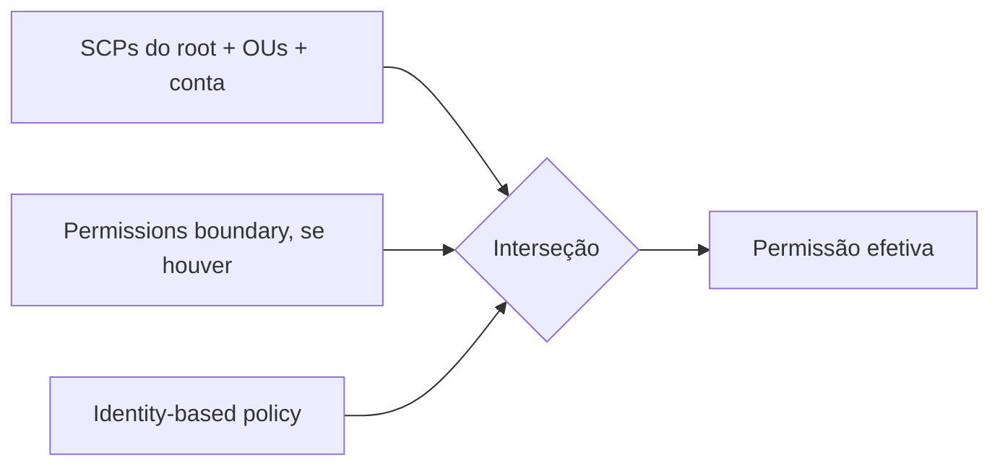

---
aliases:
  - Aula 5.2
modulo: 5
aula: 2
parte: "II Identidade, rede e dados"
dominios:
  - 1
lida: false
tags:
  - aula
  - saa-c03
  - modulo-05
---

# Aula 5.2: SCPs e políticas de organização

[[05 - Multiconta Governanca e Federacao|Voltar ao módulo]]

> [!question] Como impedir, para dezenas de contas ao mesmo tempo, que até um administrador faça algo proibido, sem depender de cada time escrever as políticas certas?

## O problema: o administrador da conta manda na conta

Em cada [[Conta AWS|conta]], quem tem `AdministratorAccess` pode criar qualquer [[IAM Policy|política]], desligar o [[CloudTrail]], liberar um [[Bucket|bucket]] para o mundo. Se a segurança da empresa depende de cada administrador de cada conta fazer a coisa certa, ela é tão forte quanto o mais distraído deles. Precisamos de um **teto** que o administrador da conta não consiga levantar, definido por quem governa a organização.

Esse teto é a **[[SCP|Service Control Policy (SCP)]]**, uma política do [[Organizations|AWS Organizations]] anexada ao root, a uma [[Organizational Unit|OU]] ou a uma conta.

## O mecanismo: SCP é teto, não concessão

Uma [[SCP]] **nunca concede permissão**. Ela define o máximo que os usuários e [[IAM Role|roles IAM]] das contas afetadas podem vir a ter. A permissão efetiva é a **interseção** entre o que a SCP permite e o que as políticas [[IAM]] (identity-based e resource-based) concedem:



Consequências diretas:

- Usuário sem política [[IAM]] que conceda a ação **não** tem acesso, mesmo que a [[SCP]] permita tudo.
- Ação concedida pelo [[IAM]] mas não permitida (ou negada) pela [[SCP]] **falha**, mesmo com `AdministratorAccess`.
- Se há também um [[Permissions Boundary|permissions boundary]] no usuário ou role, o boundary, a [[SCP]] e a política de identidade precisam **todos** permitir a ação.

### O que a SCP afeta e o que não afeta (verificado em novembro de 2026)

| A [[SCP]] **afeta** | A SCP **não afeta** |
|---|---|
| Usuários e [[IAM Role\|roles IAM]] das [[Member Account\|contas membros]] | Qualquer ação da **[[Management Account\|management account]]** |
| O [[Usuario Root|usuário root]] da [[Member Account\|conta membro]] | Roles vinculados a serviço ([[Service-Linked Role|service-linked roles]]) |
| [[Member Account\|Contas membros]] designadas administradoras delegadas | [[Principal\|Principals]] de contas **fora** da organização, mesmo quando acessam recursos da organização por uma [[Resource-Based Policy\|resource-based policy]] |
| | Algumas tarefas raras da conta, que a documentação lista à parte (por exemplo, registrar o plano Enterprise Support como root). Para a prova, decore só a regra: [[SCP]] não restringe tarefas de serviço desse tipo |

O terceiro item merece um exemplo: um [[Bucket|bucket]] [[S3]] da conta A (dentro da organização) tem [[Bucket Policy|bucket policy]] liberando acesso a usuários da conta B (fora). A [[SCP]] da conta A **não** se aplica aos usuários da B. Para esse caso existe a [[RCP]], mais adiante.

## Como a avaliação funciona: Allow em todos os níveis, Deny em qualquer um

Este é o ponto que mais derruba candidatos. Quando você ativa [[SCP|SCPs]], o Organizations anexa a todo root, OU e conta a política gerenciada **`FullAWSAccess`**, que permite todos os serviços e ações. As regras:

1. **Para uma ação ser permitida**, precisa existir um `Allow` explícito em **cada nível** do caminho: root, cada OU no caminho e a própria conta. A avaliação é deny-by-default: o que nenhum nível permite, está negado.
2. **Para uma ação ser negada**, basta um `Deny` explícito **em qualquer nível** acima da conta. Um `Allow` em outro nível não desfaz um `Deny`.

> [!example] Os dois cenários clássicos
> Estrutura: Root > OU Prod > Conta B.
> - **Deny vence:** Root e Conta B têm `FullAWSAccess`. A OU Prod tem uma [[SCP]] com `Deny s3:*`. Resultado: ninguém na Conta B (nem na Conta A, irmã) usa [[S3]]. O `Allow` do root e da conta não anula o `Deny` da OU.
> - **Falta de Allow:** a OU Prod tem apenas `Allow ec2:*` (sem `FullAWSAccess`). Resultado: as contas sob ela só usam [[EC2]], porque nenhum `Allow` cobre os outros serviços naquele nível.
> Se alguém remove `FullAWSAccess` do root e anexa só um `Deny`, **todas** as [[Member Account|contas membros]] perdem **todas** as ações: não sobrou nenhum `Allow` no caminho.

A documentação recomenda não remover `FullAWSAccess` sem substituí-la por outra política com ações permitidas, senão todas as ações dos membros falham.

### Duas estratégias

| Estratégia | Como funciona | Quando usar |
|---|---|---|
| **[[Deny List\|Deny list]]** (lista de negação) | Mantém `FullAWSAccess` e acrescenta [[SCP\|SCPs]] com `Deny` para o que é proibido | O mais comum: proíbe o que é perigoso e deixa o resto liberado |
| **[[Allow List\|Allow list]]** (lista de permissão) | Remove `FullAWSAccess` e permite só serviços específicos | Quando só um conjunto pequeno de serviços é aprovado; serviços novos da AWS ficam bloqueados até você liberar |

> [!example] Allow list na prática
> A OU `Sandbox-Restrita` tem 30 contas de treinamento que só podem usar [[EC2]], [[S3]] e [[CloudWatch]]. O Root mantém `FullAWSAccess`; na OU `Sandbox-Restrita` o `FullAWSAccess` é desanexado e entra uma [[SCP]] com `Allow` apenas para `ec2:*`, `s3:*`, `cloudwatch:*` e `logs:*` (e as ações de [[IAM]] que o time usa). Resultado: um aluno com `AdministratorAccess` cria instâncias, mas recebe `AccessDenied` ao tentar [[RDS]] ou Lambda, e um serviço lançado pela AWS amanhã também fica bloqueado até alguém liberá-lo. É a manutenção extra que faz a [[Deny List|deny list]] ser a escolha padrão.

O `Deny` tem a vantagem de valer sobre um escopo largo sem ser enfraquecido por um `Allow` em outro lugar. A documentação alerta que depender só de `Allow` e do deny implícito pode dar acesso involuntário, porque `Allow`s amplos e sobrepostos podem anular os mais restritivos.

## Exemplos que a prova usa

**1. Bloquear [[Regiao AWS|Regiões]]** (conformidade, [[Residencia de Dados|soberania de dados]], redução de superfície). O cuidado é excluir os serviços globais, que são atendidos por endpoints em `us-east-1`, senão você quebra o próprio [[IAM]]:

```json
{
  "Version": "2012-10-17",
  "Statement": [{
    "Sid": "DenyOutsideAllowedRegions",
    "Effect": "Deny",
    "NotAction": ["cloudfront:*", "iam:*", "organizations:*", "route53:*", "support:*"],
    "Resource": "*",
    "Condition": {
      "StringNotEquals": {
        "aws:RequestedRegion": ["eu-central-1", "eu-west-1"]
      }
    }
  }]
}
```

O padrão vem do exemplo oficial de política que nega acesso fora das [[Regiao AWS|Regiões]] escolhidas, com `NotAction` para os serviços globais. A lista exata de serviços globais a excluir depende do seu uso: revise antes de aplicar.

**2. Proteger a trilha de auditoria** (impedir que alguém desligue o que registra suas ações):

```json
{
  "Version": "2012-10-17",
  "Statement": [{
    "Sid": "ProtectCloudTrail",
    "Effect": "Deny",
    "Action": ["cloudtrail:StopLogging", "cloudtrail:DeleteTrail", "cloudtrail:UpdateTrail"],
    "Resource": "*"
  }]
}
```

Um raciocínio paralelo vale para o [[Config]] (negar `config:StopConfigurationRecorder`, `config:DeleteConfigurationRecorder`) e o [[GuardDuty]].

**3. Exigir criptografia**: negar a criação de [[EBS|volumes EBS]] não criptografados, usando a [[Condition Key|condition key]] `ec2:Encrypted`, ou negar `s3:PutObject` sem o cabeçalho de [[Criptografia em Repouso|criptografia]]. A [[SCP]] **proíbe o não conforme**; ela não cifra nada sozinha.

**4. Impedir saída da organização:** `Deny organizations:LeaveOrganization` (a AWS recomenda também `account:CloseAccount`, como visto na aula [[05.01 - Por que Varias Contas e Como o Organizations Organiza|5.1]]).

**5. Neutralizar o root das [[Member Account|contas membros]]:** um `Deny *` com condição de que o principal seja o root da conta (`aws:PrincipalArn` casando com `arn:aws:iam::*:root`), exceto exceções específicas. Faz sentido porque a [[SCP]] afeta o root de contas membros.

## Limites e boas práticas

| O quê | Valor | Observação |
|---|---|---|
| Tamanho máximo de uma [[SCP]] | 10.240 caracteres | Pelo console, espaços e quebras de linha desnecessários são removidos; pela CLI/SDK, a política é salva como enviada |
| [[SCP\|SCPs]] anexáveis a um root, OU ou conta | 10 | Valor da tabela de tipos de política (verificado em novembro de 2026) |
| [[SCP\|SCPs]] por organização | 10.000 | |
| Alvos de uma mesma política | ilimitado | |

Boas práticas oficiais:

- **Teste antes de anexar ao root.** Crie uma OU de teste, mova as contas aos poucos e acompanhe o impacto. Use os dados de último acesso do [[IAM]] (service last accessed data) e o [[CloudTrail]] para saber quais serviços cada conta usa de verdade.
- Prefira anexar a **OUs** a anexar a contas individuais: a política segue as contas que entram na OU.
- Ao **desabilitar** o tipo de política [[SCP]] num root, todas as SCPs são desanexadas; ao reabilitar, só `FullAWSAccess` volta. As anexações anteriores se perdem.
- Diagnóstico: um `AccessDenied` pode dizer que a causa é uma [[SCP]]; confira as SCPs de cima para baixo e as demais camadas de [[IAM]].

## `aws:PrincipalOrgID`: compartilhar com a organização inteira sem listar contas

Esta é a pegadinha mais clássica do tema. O cenário: "um [[Bucket|bucket]] (ou uma chave [[KMS]], [[SQS|fila SQS]], tópico [[SNS]]) precisa ser acessível por **todas as contas da organização**, inclusive as futuras, **sem manter uma lista de IDs de conta**". A resposta é uma **[[Resource-Based Policy|resource-based policy]]** com a [[Condition Key|condition key]] `aws:PrincipalOrgID`, que compara o ID da organização do principal que faz a chamada:

```json
{
  "Version": "2012-10-17",
  "Statement": [{
    "Sid": "AllowOrgRead",
    "Effect": "Allow",
    "Principal": "*",
    "Action": ["s3:GetObject", "s3:ListBucket"],
    "Resource": ["arn:aws:s3:::meu-bucket", "arn:aws:s3:::meu-bucket/*"],
    "Condition": {
      "StringEquals": {"aws:PrincipalOrgID": "o-exemplo123456"}
    }
  }]
}
```

Conta nova que entra na organização ganha o acesso sem editar a política; conta que sai o perde. Variações para o mesmo raciocínio: `aws:PrincipalOrgPaths` (limita a uma OU específica) e `aws:SourceOrgID` (para quando é um **serviço AWS** que acessa o recurso em nome de uma conta da organização). Atenção a dois detalhes: a [[Bucket Policy|bucket policy]] **concede** (ela é um Allow); [[SCP]] e [[RCP]] não concedem nada, só limitam. E o outro lado da conta ainda precisa ter permissão [[IAM]] para a ação, porque o acesso entre contas exige os dois lados (Módulo 4). A mesma condição, num `Deny` com `StringNotEqualsIfExists`, vira o "perímetro de dados" que a RCP aplica de forma central (próxima seção).

## Resource control policies (RCPs): o teto dos recursos

A [[SCP]] controla **o que os [[Principal|principals]] da organização podem fazer**. A **[[RCP]]** controla **o que pode ser feito nos recursos da organização, por qualquer principal**, inclusive de fora. Ambas são "guardrails" (não concedem). Características (verificado em novembro de 2026):

- Disponíveis só com all features.
- Valem para recursos das [[Member Account|contas membros]], **não** para recursos da [[Management Account|management account]].
- Funcionam para uma lista de serviços suportados (por exemplo [[S3]], [[SQS]], [[SNS]], [[DynamoDB]], [[ECR]], [[EFS]], [[Cognito]], [[CloudWatch Logs]], entre muitos outros; consulte a lista oficial, que cresce).
- Máximo de **5** [[RCP|RCPs]] por alvo e **5.120** caracteres por política.

> [!example] O caso típico de RCP
> Uma equipe, por engano, escreve uma [[Bucket Policy|bucket policy]] que libera um [[Bucket|bucket]] para uma conta externa. Uma [[SCP]] não ajuda, porque ela só olha para [[Principal|principals]] da organização. Uma [[RCP]] no root, negando acesso ao [[S3]] para principals que não pertencem à organização (condição com `aws:PrincipalOrgID`), bloqueia o acesso externo **mesmo com a bucket policy permissiva**. Isso é um "perímetro de dados" central.

| | [[SCP]] | [[RCP]] |
|---|---|---|
| Limita | O que os **[[Principal\|principals]]** da organização fazem | O que se faz nos **recursos** da organização |
| Atinge [[Principal\|principals]] externos? | Não | Sim |
| Concede permissão? | Não | Não |
| Afeta a [[Management Account\|management account]]? | Não | Não |
| Limite de anexação por alvo | 10 | 5 |

## Os outros tipos de política (sem confundir)

O Organizations tem mais tipos, mas eles servem a outros fins. A diferença que importa: os **declarativos** afetam também a **[[Management Account|management account]]**, as [[SCP|SCPs]] e [[RCP|RCPs]] não.

- **[[Tag Policy|Tag policies]]**: padronizam chaves e valores de tags (por exemplo `Environment` com valores fixos). Úteis para [[Cost Allocation Tag|alocação de custos]] (aula [[05.03 - Cobranca Consolidada e Custos Multiconta|5.3]]) e controle de acesso por atributo. Não bloqueiam ações de [[IAM]].
- **[[Backup Policy|Backup policies]]**: aplicam planos do [[Backup|AWS Backup]] a contas e recursos de toda a organização.
- **Declarative policies** (como a de [[EC2]]): declaram e mantêm uma configuração desejada de um serviço, mesmo quando o serviço ganha novas APIs.
- **AI services opt-out**, **chat applications**, **[[Security Hub]]**, **Inspector**, **[[GuardDuty]]**, **[[S3]]** e outras: configuração central de serviços específicos.

Para a prova, o par decisivo é: **[[SCP]]/RCP limitam permissões; tag e [[Backup Policy|backup policies]] padronizam e automatizam**. Pergunta que fala em "impedir uma ação" nunca é [[Tag Policy|tag policy]].

> [!info] Ligando os pontos
> No [[04 - IAM Identidade e Acesso|Módulo 4]] você viu a lógica de avaliação: deny explícito vence, deny implícito por padrão. A [[SCP]] é mais uma camada dessa mesma lógica, aplicada no nível da organização. Na aula [[05.04 - Control Tower e Landing Zone|5.4]], os controles **preventivos** do [[Control Tower]] são implementados exatamente com SCPs e [[RCP|RCPs]].

## Como isso cai na prova

Task 1.1 (designing a security strategy for multiple [[Conta AWS|AWS accounts]]: [[Control Tower]], [[SCP|SCPs]]) e, indiretamente, Task 1.3 (policies de proteção de dados).

**Palavras-chave em inglês**

- "prevent users, **including administrators**, from..." / "even the [[Usuario Root|root user]] of [[Member Account|member accounts]]" aponta para [[SCP]].
- "restrict the AWS [[Regiao AWS|Regions]] that can be used across all accounts" aponta para [[SCP]] com `aws:RequestedRegion`.
- "ensure [[CloudTrail]] cannot be disabled" aponta para [[SCP]] negando `cloudtrail:StopLogging` e similares.
- "prevent access to [[S3]] buckets from outside the organization" / "data perimeter" aponta para [[RCP]] (ou `aws:PrincipalOrgID` em [[Bucket Policy|bucket policy]], no nível do [[Bucket|bucket]]).
- "enforce tagging standards" aponta para [[Tag Policy|tag policy]].
- "central backup plans across accounts" aponta para [[Backup Policy|backup policy]] ou [[Backup|AWS Backup]] com Organizations.

**Pegadinhas clássicas**

- [[SCP]] **não concede**: "dar permissão a todas as contas" nunca é SCP.
- [[SCP]] **não afeta** a [[Management Account|management account]].
- Uma [[SCP]] com `Allow` não desfaz um `Deny` em outro nível.
- [[Permissions Boundary|Permissions boundary]] é por usuário/role, **na conta**; [[SCP]] é por conta/OU, **na organização**.
- Bloquear [[Regiao AWS|Regiões]] sem `NotAction` para serviços globais quebra o [[IAM]], o [[Route 53]] e o [[CloudFront]].

| Requisito no enunciado | Resposta provável | Por quê |
|---|---|---|
| Proibir uma ação em todas as contas, até para admins | [[SCP]] com Deny no root ou na OU | Teto de permissões herdado |
| Limitar as [[Regiao AWS\|Regiões]] usadas | [[SCP]] com `aws:RequestedRegion` e `NotAction` global | [[Condition Key\|Condition key]] de Região |
| Impedir desligar o log de auditoria | [[SCP]] negando ações do [[CloudTrail]] | Protege o controle de detecção |
| Bloquear acesso externo a dados mesmo com policy permissiva | [[RCP]] | Controla o recurso, inclusive para externos |
| Padronizar tags | [[Tag Policy\|Tag policy]] | Não bloqueia ações, padroniza valores |
| Permitir só uma lista pequena de serviços | Remover [[FullAWSAccess]] e permitir os serviços | Estratégia de [[Allow List\|allow list]] |

## Resumo

> [!abstract] A aula em uma frase
> A **[[SCP]]** é um **teto** de permissões para as [[Member Account|contas membros]] (não concede nada e não alcança a [[Management Account|management account]]), enquanto a **[[RCP]]** é o teto aplicado aos **recursos**, inclusive contra [[Principal|principals]] externos.

**A lógica, em 5 passos**
1. O administrador de uma conta manda na conta; é preciso um teto definido de fora.
2. A [[SCP]], anexada ao root, a OUs ou a contas, define o máximo de permissões; a permissão efetiva é a interseção com as políticas [[IAM]].
3. Allow precisa existir em todos os níveis ([[FullAWSAccess]] faz isso por padrão); Deny em qualquer nível basta.
4. [[Deny List|Deny list]] (padrão) proíbe o perigoso; [[Allow List|allow list]] libera só o aprovado.
5. A [[RCP]] faz o mesmo para os recursos e vale contra externos; tag e [[Backup Policy|backup policies]] padronizam e automatizam.

**Números para lembrar**

| O quê | Valor | Por que importa |
|---|---|---|
| Tamanho de [[SCP]] | 10.240 caracteres | Limite de política |
| Tamanho de [[RCP]] | 5.120 caracteres | Metade do da [[SCP]] |
| [[SCP\|SCPs]] por alvo | 10 | Limite de anexação |
| [[RCP\|RCPs]] por alvo | 5 | Limite de anexação |

**Tabela-síntese**

| Ferramenta | Faz | Não faz |
|---|---|---|
| [[SCP]] | Limita [[Principal\|principals]] da organização | Não concede, não afeta [[Management Account\|management account]] |
| [[RCP]] | Limita acesso aos recursos | Não concede, não afeta recursos da [[Management Account\|management account]] |
| [[Permissions Boundary\|Permissions boundary]] | Limita um usuário ou role | Não vale para a organização |
| [[Tag Policy\|Tag policy]] | Padroniza tags | Não bloqueia ações |

**Na prática, isso significa**
- Mantenha [[FullAWSAccess]] e aplique Deny nas coisas críticas ([[Regiao AWS|Regiões]], [[CloudTrail]], saída da organização).
- Teste numa OU piloto antes do root.
- Para proteger dados de acessos externos, [[RCP]] no root.

> [!tip] Liga com
> Vem da hierarquia de OUs (aula [[05.01 - Por que Varias Contas e Como o Organizations Organiza|5.1]]). Os [[Controle Preventivo|controles preventivos]] do [[Control Tower]] (aula [[05.04 - Control Tower e Landing Zone|5.4]]) são [[SCP|SCPs]] e [[RCP|RCPs]] prontas.

## Erros comuns

1. **"Anexei uma [[SCP]] que permite [[S3]], então o time já pode usar S3."** SCP não concede: sem política [[IAM]] que conceda a ação, não há acesso. Corrija escrevendo também a política de identidade.
2. **"A [[SCP]] do root vale para a [[Management Account|management account]]."** Não vale. Corrija mantendo workloads fora dela e usando administradores delegados.
3. **"Um Allow na conta desfaz o Deny da OU."** Deny explícito em qualquer nível vence. Corrija removendo ou ajustando a [[SCP]] da OU.
4. **"Neguei a Região com Deny simples."** Serviços globais como [[IAM]] e [[Route 53]] passam a falhar. Corrija usando `NotAction` ou condição que preserve os serviços globais.
5. **"Uma [[SCP]] bloqueia o acesso de contas externas ao meu [[Bucket|bucket]]."** SCP só alcança [[Principal|principals]] da organização. Corrija com [[RCP]] ou com condição `aws:PrincipalOrgID` na [[Bucket Policy|bucket policy]].

## Pratique

**1.** A estrutura é Root > OU Prod > Conta B. O Root e a Conta B têm [[FullAWSAccess]]. A OU Prod tem uma [[SCP]] com Deny s3:*, e a Conta B ainda tem uma SCP adicional com Allow s3:*. Um administrador da Conta B, com AdministratorAccess no [[IAM]], tenta listar um [[Bucket|bucket]]. O que acontece?

- [ ] a) A listagem funciona, porque o Allow na própria conta prevalece sobre o Deny aplicado à OU que a contém
- [ ] b) A listagem funciona, pois o AdministratorAccess do IAM sobrepõe qualquer SCP aplicada à conta
- [ ] c) A listagem falha, porque um Deny explícito em qualquer nível acima da conta vence qualquer Allow, até o da conta
- [ ] d) A listagem falha somente se o administrador estiver usando o usuário root da conta em vez de um role

**2.** Uma empresa aplicou no root da organização uma [[SCP]] negando todas as ações de [[EC2]] fora de eu-west-1. Um administrador da [[Management Account|management account]] tenta lançar uma instância em us-west-2. Qual é o resultado?

- [ ] a) A operação é permitida: SCPs não afetam a management account
- [ ] b) A operação é negada, pois a SCP do root vale para todas as contas, incluindo a de gerenciamento
- [ ] c) A operação é negada para usuários IAM, mas roles assumidos continuam passando pela SCP
- [ ] d) A operação só é permitida se a management account tiver o MFA habilitado no usuário

**3.** (Escolha DUAS.) Quais afirmações sobre [[SCP|SCPs]] são verdadeiras?

- [ ] a) SCPs restringem o que roles vinculados a serviço (service-linked roles) podem fazer
- [ ] b) SCPs afetam o usuário root das contas membros
- [ ] c) Uma SCP anexada à OU pode conceder AdministratorAccess às contas dela
- [ ] d) Um usuário sem política IAM que conceda a ação continua sem acesso, mesmo que a SCP permita tudo
- [ ] e) SCPs bloqueiam usuários de uma conta externa que acessam um bucket por bucket policy

**4.** O time de segurança quer garantir que nenhuma [[Member Account|conta membro]], nem mesmo um administrador, consiga parar o registro do [[CloudTrail]]. Qual abordagem atende com o MENOR [[Overhead Operacional|esforço operacional]]?

- [ ] a) Escrever em cada conta uma política IAM negando cloudtrail:StopLogging e anexá-la a todos os usuários e roles
- [ ] b) Criar uma regra do AWS Config que reabilita o CloudTrail a cada hora, em todas as contas da organização
- [ ] c) Aplicar um permissions boundary a cada usuário e role de cada conta, negando as ações do CloudTrail
- [ ] d) Anexar ao root uma SCP que nega StopLogging, DeleteTrail e UpdateTrail

**5.** A empresa precisa limitar o uso a duas [[Regiao AWS|Regiões]] europeias em todas as [[Member Account|contas membros]], sem quebrar os serviços globais. Qual [[SCP]] é a mais adequada?

- [ ] a) Um Deny com Action "*" e a condição aws:RequestedRegion diferente das duas Regiões, sem exceções, aplicado ao root, para que nenhum serviço escape da regra
- [ ] b) Um Deny com NotAction para os serviços globais (IAM, Route 53, CloudFront) e a condição aws:RequestedRegion diferente das duas Regiões
- [ ] c) Uma tag policy que exige a tag Region nos recursos, com as duas Regiões como únicos valores aceitos
- [ ] d) Uma SCP que remove ec2:RunInstances em todas as Regiões, anexada a cada conta, impedindo lançamentos fora da Europa

**6.** (Escolha DUAS.) A equipe de dados avalia as [[RCP|resource control policies]] (RCPs). Quais afirmações são verdadeiras?

- [ ] a) Limitam as permissões máximas sobre os recursos, inclusive para principals fora da organização
- [ ] b) Aplicam-se também aos recursos da management account
- [ ] c) Substituem as SCPs, que ficam obsoletas quando uma RCP é anexada
- [ ] d) Funcionam para qualquer serviço da AWS, sem lista de suporte
- [ ] e) Não concedem permissões: apenas definem um teto

**7.** Uma empresa com 300 contas e novas contas chegando toda semana mantém um [[Bucket|bucket]] [[S3]] de dados de referência. Todas as contas da organização, atuais e futuras, devem poder ler o bucket, sem que ninguém mantenha uma lista de IDs de conta. Qual solução atende com o MENOR overhead?

- [ ] a) Uma bucket policy com Allow para as ações de leitura e a condição aws:PrincipalOrgID igual ao ID da organização
- [ ] b) Uma SCP no root que concede s3:GetObject às contas, já que ela vale para toda a organização
- [ ] c) Uma bucket policy listando cada ID de conta, atualizada por uma função Lambda a cada conta criada
- [ ] d) Uma RCP no root que permite o s3:GetObject aos principals da organização

**8.** Uma equipe escreveu por engano uma [[Bucket Policy|bucket policy]] que libera um [[Bucket|bucket]] [[S3]] para uma conta externa. O arquiteto quer uma barreira central que bloqueie [[Principal|principals]] fora da organização em todos os buckets, mesmo com bucket policies permissivas. O que usar?

- [ ] a) Uma SCP no root negando s3:GetObject para todos os principals das contas membros
- [ ] b) Uma bucket policy com Allow e aws:PrincipalOrgID, replicada em cada bucket da organização
- [ ] c) O Amazon Macie, para descobrir dados sensíveis nos buckets e bloquear o acesso externo
- [ ] d) Uma RCP no root negando o acesso ao S3 a principals que não pertencem à organização

**9.** Um usuário tem uma política de identidade permitindo s3:* e ec2:*. O [[Permissions Boundary|permissions boundary]] dele permite apenas ec2:*. As [[SCP|SCPs]] aplicáveis permitem [[S3]] e [[EC2]]. Qual é a permissão efetiva?

- [ ] a) S3 e EC2, porque a política de identidade vence o boundary quando as duas concedem a ação
- [ ] b) Somente S3, pois a SCP o permite explicitamente e o boundary só vale para ações de EC2
- [ ] c) Somente EC2, pois o efetivo é a interseção das três camadas de permissão
- [ ] d) Nenhum dos dois, porque o boundary e a SCP conflitantes se anulam por padrão

**10.** Um administrador desanexou [[FullAWSAccess]] do root e anexou apenas uma [[SCP]] com Deny para organizations:LeaveOrganization. Em seguida, todas as [[Member Account|contas membros]] perderam o acesso a todos os serviços. Por quê?

- [ ] a) Uma SCP com Deny desabilita automaticamente todas as outras SCPs da organização
- [ ] b) Sem nenhum Allow no caminho, tudo é negado por padrão
- [ ] c) O Organizations exige que a management account reaprove cada conta após a mudança no root
- [ ] d) O tipo de política SCP foi desabilitado sozinho no root após a alteração

**11.** A equipe de plataforma vai aplicar uma [[SCP]] restritiva em toda a organização, com centenas de contas em produção. Qual é a abordagem recomendada?

- [ ] a) Anexar direto ao root e corrigir os problemas conforme os times reclamarem
- [ ] b) Anexar a cada conta individualmente, para que os efeitos fiquem isolados em cada uma
- [ ] c) Aplicar a SCP fora do horário comercial, para reduzir o impacto de qualquer bloqueio
- [ ] d) Testar numa OU piloto, mover as contas aos poucos e usar o último acesso do IAM e o CloudTrail para prever o impacto

**12.** Uma OU usa a estratégia de [[Allow List|allow list]]: o [[FullAWSAccess]] foi removido e uma [[SCP]] permite apenas [[EC2]], [[S3]] e [[CloudWatch]]. A AWS lança um serviço novo e os times da OU, todos com AdministratorAccess, não conseguem usá-lo. Qual é a causa?

- [ ] a) O serviço novo precisa ser habilitado pela management account em cada Região antes de qualquer uso
- [ ] b) Serviços lançados depois da criação da SCP só valem para contas criadas depois dela
- [ ] c) Nenhum Allow na OU cobre o serviço novo, então a avaliação o nega até que a SCP seja atualizada
- [ ] d) O AdministratorAccess é uma política gerenciada antiga e não inclui serviços novos da AWS

**13.** (Escolha DUAS.) A empresa quer padronizar a chave de tag CostCenter, com valores fixos, em todas as contas e também impedir que as contas desabilitem o [[Config|AWS Config]]. Quais ações atendem aos dois requisitos?

- [ ] a) Anexar uma tag policy com a chave CostCenter e os valores aceitos
- [ ] b) Anexar uma SCP que nega config:StopConfigurationRecorder e config:DeleteConfigurationRecorder
- [ ] c) Anexar uma RCP que nega o acesso ao Config a principals externos
- [ ] d) Anexar uma backup policy com um plano que inclui a tag CostCenter
- [ ] e) Aplicar um permissions boundary ao usuário root de cada conta membro

> [!success]- Gabarito
> **1. c)** Deny explícito em qualquer nível acima da conta vence qualquer Allow. a) um Allow em outro nível não desfaz o Deny; b) o [[IAM]] concede, mas o teto da [[SCP]] vale para administradores; d) a SCP afeta qualquer principal da conta, não só o root.
> **2. a)** [[SCP|SCPs]] não afetam a [[Management Account|management account]], então o administrador escapa da restrição. b) a SCP do root vale para membros, não para a management account; c) não há distinção entre usuários e roles; d) [[MFA]] não altera a avaliação de SCP.
> **3. b) e d)** [[SCP|SCPs]] alcançam o root das [[Member Account|contas membros]] e não concedem permissão. a) [[Service-Linked Role|service-linked roles]] não são restringidos por SCPs; c) SCP não concede permissões; e) SCPs não alcançam [[Principal|principals]] externos à organização.
> **4. d)** Uma [[SCP]] com Deny nessas ações no root vale para todas as contas, incluindo administradores. a) depende de cada conta, e um administrador pode remover a política; b) detecta e corrige depois, não impede, e deixa janela de exposição; c) [[Permissions Boundary|boundaries]] são por identidade e outro administrador pode alterá-los.
> **5. b)** O Deny com NotAction preserva os serviços globais e bloqueia as [[Regiao AWS|Regiões]] fora da lista. a) sem exceções, os serviços globais (atendidos em us-east-1) quebram; c) [[Tag Policy|tag policy]] não bloqueia ações; d) remover ec2:RunInstances não limita Regiões nem os outros serviços.
> **6. a) e e)** [[RCP|RCPs]] fixam o teto sobre recursos, inclusive contra [[Principal|principals]] externos, e não concedem permissões. b) não afetam recursos da [[Management Account|management account]]; c) coexistem com [[SCP|SCPs]], que limitam principals; d) só funcionam para serviços da lista suportada.
> **7. a)** A condição aws:PrincipalOrgID numa [[Resource-Based Policy|resource policy]] cobre contas atuais e futuras sem lista de IDs. b) [[SCP]] nunca concede; c) funciona, mas exige automação e manutenção constantes; d) [[RCP]] também só limita e nunca concede, então sem a [[Bucket Policy|bucket policy]] ninguém leria o [[Bucket|bucket]].
> **8. d)** A [[RCP]] controla o acesso ao recurso, inclusive de externos, mesmo com [[Bucket Policy|bucket policy]] permissiva. a) negar GetObject a todos quebra o uso legítimo, e a [[SCP]] não alcança externos; b) um Allow não bloqueia outra bucket policy permissiva e exigiria replicação manual; c) o [[Macie]] descobre dados sensíveis, não bloqueia acesso.
> **9. c)** O efetivo é a interseção: o [[Permissions Boundary|boundary]] só permite ec2:*, então [[S3]] fica fora. a) a política de identidade não vence o boundary, os dois precisam permitir; b) o boundary vale para todas as ações da identidade; d) [[EC2]] é permitido pelas três camadas.
> **10. b)** Sem nenhum Allow no caminho, a avaliação deny-by-default nega tudo. a) um Deny não desabilita outras [[SCP|SCPs]]; c) não existe reaprovação de contas; d) o tipo de política continua habilitado.
> **11. d)** A prática oficial é testar numa OU piloto e acompanhar o impacto com dados de último acesso e [[CloudTrail]]. a) bloqueia produção antes de entender o impacto; b) escala mal e perde a herança por OU; c) o horário não reduz o risco de bloquear serviços usados.
> **12. c)** Na [[Allow List|allow list]], o que nenhum Allow cobre está negado, inclusive serviços novos. a) não existe habilitação de serviço pela [[Management Account|management account]] nesse sentido; b) a [[SCP]] vale para todas as contas da OU, não pela data de criação; d) o AdministratorAccess concede todas as ações, mas o teto da SCP continua valendo.
> **13. a) e b)** [[Tag Policy|Tag policy]] padroniza a tag e a [[SCP]] com Deny protege o recorder do Config. c) [[RCP]] limita acesso a recursos e não impede desligar o recorder; d) [[Backup Policy|backup policy]] não padroniza chaves de tag; e) [[Permissions Boundary|boundaries]] não se aplicam ao [[Usuario Root|usuário root]].

## Para aprofundar

- [ ] [Service control policies (SCPs)](https://docs.aws.amazon.com/organizations/latest/userguide/orgs_manage_policies_scps.html) (AWS): efeitos, tarefas não restritas e boas práticas.
- [ ] [SCP evaluation](https://docs.aws.amazon.com/organizations/latest/userguide/orgs_manage_policies_scps_evaluation.html) (AWS): os cenários oficiais de Allow e Deny com diagramas.
- [ ] [Resource control policies (RCPs)](https://docs.aws.amazon.com/organizations/latest/userguide/orgs_manage_policies_rcps.html) (AWS): serviços suportados e diferença entre [[SCP]] e [[RCP]].
- [ ] [Managing organization policies](https://docs.aws.amazon.com/organizations/latest/userguide/orgs_manage_policies.html) (AWS): todos os tipos de política e seus limites.

Próxima aula: [[05.03 - Cobranca Consolidada e Custos Multiconta|Aula 5.3: Cobrança consolidada e custos multiconta]]
