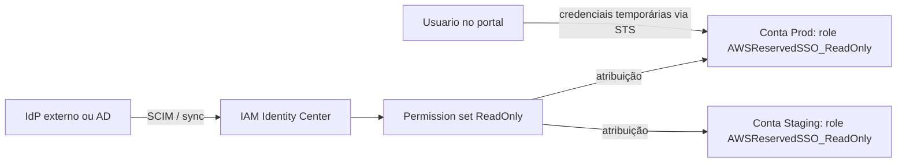

---
aliases:
  - Aula 5.5
modulo: 5
aula: 5
parte: "II Identidade, rede e dados"
dominios:
  - 1
lida: false
tags:
  - aula
  - saa-c03
  - modulo-05
---

# Aula 5.5: IAM Identity Center

[[05 - Multiconta Governanca e Federacao|Voltar ao módulo]]

> [!question] Como dar acesso a pessoas a dezenas de contas AWS, com o diretório da empresa, sem criar usuários IAM em cada conta nem distribuir access keys?

## O problema: pessoas × contas

Com 40 contas e 60 engenheiros, criar um [[IAM User|usuário IAM]] por pessoa por conta dá **2.400 identidades** com senha, [[MFA]] e possivelmente [[Access Key|access keys]] de longo prazo. Quando alguém sai da empresa, é preciso lembrar de apagar o usuário em 40 lugares. Quando alguém muda de time, o acesso a 40 contas muda. Credenciais de longo prazo vazam (você viu no [[04 - IAM Identidade e Acesso|Módulo 4]] por que a AWS recomenda evitá-las).

O que queremos é o oposto: **uma identidade por pessoa, no diretório da empresa, e acesso temporário às contas conforme o papel**. É o que o **[[IAM Identity Center]]** (antes chamado AWS Single Sign-On, renomeado em 26 de julho de 2022) oferece: um ponto único de [[Federacao|federação]] para dar acesso da força de trabalho (workforce) às [[Conta AWS|contas AWS]] e a aplicações. O usuário federa uma vez e o acesso às contas é concedido por **[[Credencial Temporaria|credenciais temporárias]]**.

> [!example] A diferença no dia a dia
> Sem [[IAM Identity Center|Identity Center]], Ana tem três [[IAM User|usuários IAM]] (dev, staging, prod) com três senhas e três MFAs. Com Identity Center, Ana entra no **portal de acesso da AWS** com o login da empresa, vê a lista "Prod: ReadOnly, Staging: PowerUser, Dev: Admin" e escolhe. No dia em que ela sai, desativar o usuário no diretório da empresa corta tudo.

## Os dois tipos de instância

Uma **instância** é uma implantação do serviço:

| Capacidade | Organization instance (recomendada) | Account instance |
|---|---|---|
| Onde é habilitada | Na **[[Management Account\|management account]]** do Organizations | Numa [[Member Account\|conta membro]] ou conta avulsa |
| Acesso às [[Conta AWS\|contas AWS]] ([[Permission Set\|permission sets]], multi-account) | **Sim** | Não |
| Portal de acesso para aplicações gerenciadas pela AWS | Sim | Sim |
| Aplicativos [[SAML\|SAML 2.0]] gerenciados pelo cliente | Sim | Não |
| [[Delegated Administrator\|Administrador delegado]] pode gerenciar | Sim | Não |
| Chave [[KMS]] gerenciada pelo cliente e replicação para outras [[Regiao AWS\|Regiões]] | Sim | Não |

A organization instance é a única que gerencia o acesso a [[Conta AWS|contas AWS]], e é a recomendada para todo uso de produção (verificado em novembro de 2026). A account instance serve a casos isolados, só para aplicações.

### O Identity Center é regional

Diferente do [[IAM]] (global), a instância do [[IAM Identity Center|Identity Center]] **vive numa Região**: o portal, os [[Permission Set|permission sets]] e as atribuições dependem dela. A **Região primária é escolhida na hora de habilitar e não muda depois**; trocar de Região significa apagar a instância e recriá-la na nova, com a configuração refeita (veja a [página de troca de Região](https://docs.aws.amazon.com/singlesignon/latest/userguide/switching-regions.html)). Por isso escolher a Região é um passo de planejamento, e é o assunto das questões de resiliência: se a Região da instância ficar indisponível, as pessoas perdem o portal. A resposta atual da AWS é a instância **multi-Region**: a organization instance, com chave [[KMS]] gerenciada pelo cliente (multi-Region), é replicada para [[Regiao AWS|Regiões]] adicionais, e o acesso às contas continua nelas (verificado em novembro de 2026, [organization instances](https://docs.aws.amazon.com/singlesignon/latest/userguide/organization-instances-identity-center.html)). Para Regiões opt-in, confira na [página de Regiões](https://docs.aws.amazon.com/singlesignon/latest/userguide/regions.html) o que a instância e as contas exigem antes de planejar.

## De onde vêm as identidades: a identity source

Cada organização tem **uma [[Identity Source|identity source]]** (fonte de identidade). Opções:

Um **[[Identity Provider|IdP]]** (provedor de identidade, identity provider) é o sistema que autentica a pessoa e emite uma afirmação assinada de quem ela é, no padrão [[SAML]]; a aula [[05.06 - Federacao com IAM e Directory Service|5.6]] detalha o mecanismo. As fontes possíveis:

1. **Diretório do [[IAM Identity Center|Identity Center]]**: você cria usuários e grupos direto no serviço. Bom para quem não tem um [[Identity Provider|IdP]].
2. **[[Active Directory]]**: conecta o AD existente, via [[Directory Service|AWS Managed Microsoft AD]] ou [[AD Connector]] (aula [[05.06 - Federacao com IAM e Directory Service|5.6]]).
3. **[[Identity Provider|Provedor de identidade]] externo (IdP)** por [[SAML]] 2.0, como Okta, Microsoft Entra ID, Google Workspace, JumpCloud, Ping Identity, OneLogin e CyberArk (todos com tutoriais oficiais). O usuário se autentica no IdP e o IdP afirma a identidade ao [[IAM Identity Center|Identity Center]].

Com um [[Identity Provider|IdP]] externo, o **[[SCIM]]** (System for Cross-domain Identity Management, versão 2.0) mantém usuários e grupos **sincronizados automaticamente** do IdP para o [[IAM Identity Center|Identity Center]], evitando cadastro manual duplicado. Detalhes que a documentação destaca e que causam problemas reais:

- Todo usuário precisa ter **nome, sobrenome, nome de usuário e nome de exibição** preenchidos; senão **não é provisionado**.
- O atributo que o [[Identity Provider|IdP]] envia como `NameID` do [[SAML]] deve ser **o mesmo** mapeado para o nome de usuário no [[SCIM]]; se diferirem, o login falha.
- A frequência das atualizações é controlada pelo **[[Identity Provider|IdP]]**, não pelo [[IAM Identity Center|Identity Center]]: uma mudança no IdP só aparece depois que o IdP a envia.

Mudar de fonte tem regra: de [[Active Directory]] para o diretório do [[IAM Identity Center|Identity Center]] ou [[Identity Provider|IdP]] externo, usuários, grupos, associações e atribuições são **mantidos**; **para** Active Directory (vindo do diretório ou de IdP), são **removidos**. Entre diretório do Identity Center e IdP externo, ou entre dois IdPs, são preservados. (Verificado em novembro de 2026.)

## Permission sets: o "papel" que você atribui

Um **[[Permission Set|permission set]]** é um **modelo** que define um conjunto de políticas [[IAM]]: [[IAM Policy|políticas]] gerenciadas pela AWS (incluindo as de funções de trabalho, como `PowerUserAccess` e `ReadOnlyAccess`), políticas gerenciadas pelo cliente, políticas inline e, opcionalmente, um [[Permissions Boundary|permissions boundary]].

A **atribuição** liga três coisas: **quem** (usuário ou grupo) + **qual [[Permission Set|permission set]]** + **qual conta**. O que o [[IAM Identity Center|Identity Center]] faz ao atribuir:

- Cria, em cada conta alvo, um **[[IAM Role|IAM role]]** correspondente, com prefixo `AWSReservedSSO_`, e anexa as políticas do [[Permission Set|permission set]].
- O role pertence ao [[IAM Identity Center|Identity Center]]: só ele pode modificá-lo, **só usuários do Identity Center** o assumem (não [[IAM]] users, nem federados do IAM, nem contas de serviço), e a [[Trust Policy|trust policy]] não pode ser editada para admitir [[Principal|principals]] de fora.
- Se você muda o [[Permission Set|permission set]], o [[IAM Identity Center|Identity Center]] **reprovisiona** os roles das contas.

**Sessão.** Ao entrar no portal, o [[Permission Set|permission set]] aparece como um role disponível, e o [[IAM Identity Center|Identity Center]] cria uma sessão separada para ele, de **1 a 12 horas** (padrão: **1 hora**), conforme a duração configurada no permission set. A documentação também trata a sessão interativa do usuário no portal, configurável de 15 minutos a 90 dias (verificado em novembro de 2026). Quando o engenheiro reclama que a CLI expira de hora em hora, a resposta é aumentar a duração do permission set (até 12 horas), não criar chaves de longo prazo.

> [!tip] Atribua a grupos, não a pessoas
> O padrão é atribuir [[Permission Set|permission sets]] a **grupos** do diretório (`Engenharia-ReadOnly`, `Plataforma-Admin`). Entrada e saída de pessoas vira só alteração de grupo no diretório, e a sincronização faz o resto. É o mesmo princípio de "[[IAM Group]]" do Módulo 4, só que numa escala de organização.

## O fluxo de acesso na prática

1. O usuário abre o **AWS access portal** (URL do tipo `https://d-xxxxxxxxxx.awsapps.com/start`, ou o URL [[Dual-Stack|dual-stack]] da instância, ou um alias personalizado).
2. Autentica no diretório ou [[Identity Provider|IdP]] (com [[MFA]] configurado no [[IAM Identity Center|Identity Center]] ou no IdP).
3. Vê as contas e os [[Permission Set|permission sets]] atribuídos e escolhe a combinação.
4. Para a CLI, `aws configure sso` registra o perfil e o login do portal gera [[Credencial Temporaria|credenciais temporárias]] do role correspondente.

Cada acesso gera um evento no [[CloudTrail]] (aula [[05.08 - CloudTrail e a Trilha de Auditoria|5.8]]), com a identidade do usuário do [[IAM Identity Center|Identity Center]] na sessão do role. A documentação ainda destaca a **propagação confiável de identidade** (trusted identity propagation): aplicações gerenciadas pela AWS compartilham a identidade do usuário entre si, e os eventos do CloudTrail saem identificados por usuário.

## Menor privilégio com Identity Center

- Crie primeiro um [[Permission Set|permission set]] administrativo e depois permission sets **mais restritivos** (por exemplo `PowerUserAccess`, que não gerencia usuários e [[IAM Group|grupos IAM]]). O administrador usa o restrito no dia a dia e o administrativo só quando precisa.
- Use o [[IAM Access Analyzer]] para observar o que as pessoas realmente usam e então escrever uma política personalizada com só o necessário (veja o [[04 - IAM Identidade e Acesso|Módulo 4]]).
- **[[ABAC]]** (controle de acesso por atributos): o [[IAM Identity Center|Identity Center]] pode enviar atributos do usuário (por exemplo, departamento) para usar em condições de política, controlando acesso por atributos em vez de uma política por papel.
- A administração do próprio [[IAM Identity Center|Identity Center]] pode ser **delegada** a uma [[Member Account|conta membro]], tirando a gestão do dia a dia da [[Management Account|management account]] (mesma lógica da aula [[05.01 - Por que Varias Contas e Como o Organizations Organiza|5.1]]).

## Onde o Identity Center se encaixa entre as opções de federação

A documentação de [[IAM]] resume três caminhos de [[Federacao|federação]]:

| Opção | Escopo | Para quem | [[Identity Source\|Fontes de identidade]] |
|---|---|---|---|
| **[[IAM Identity Center]]** | Múltiplas contas (Organizations) | **Força de trabalho** (pessoas) | [[SAML\|SAML 2.0]], [[Active Directory\|AD]] gerenciado, diretório do Identity Center |
| **[[Federacao\|Federação]] com [[IAM]]** (provedor [[SAML]]/OIDC no IAM) | Uma conta avulsa | Pequenos casos e identidades de máquina | SAML 2.0, [[OIDC]] |
| **[[Cognito\|Amazon Cognito]] [[Identity Pool\|identity pools]]** | Qualquer | **Usuários de aplicações** que precisam de credenciais [[IAM]] | [[SAML\|SAML 2.0]], [[OIDC]], provedores sociais selecionados |

Regra que a prova repete: **pessoas da empresa em várias contas = [[IAM Identity Center|Identity Center]]**; **clientes do seu aplicativo = [[Cognito]]** (Módulo 19). A aula seguinte detalha a [[Federacao|federação]] direta com [[IAM]].

A documentação mais recente também descreve o **account access manager**, um recurso do [[IAM]] que permite atribuir **[[IAM Role|roles IAM]] já existentes** a usuários e grupos do [[IAM Identity Center|Identity Center]], usado sozinho ou junto com [[Permission Set|permission sets]], para quem precisa de recursos de role que o permission set não oferece ([[Trust Policy|trust policy]] própria, tags de role, caminhos configuráveis). É um detalhe novo: não confirmei que ele aparece na prova, então trate como contexto.

> [!info] Ligando os pontos
> O [[Control Tower]] (aula [[05.04 - Control Tower e Landing Zone|5.4]]) cria por padrão um diretório do [[IAM Identity Center|Identity Center]] com grupos pré-configurados, ou deixa você manter o seu [[Identity Provider|IdP]]. As [[Permission Set|permission sets]] que você atribui usam as mesmas políticas [[IAM]] do Módulo 4, e as [[SCP|SCPs]] da aula [[05.02 - SCPs e Politicas de Organizacao|5.2]] continuam limitando os roles criados nas [[Member Account|contas membros]].

## Como isso cai na prova

Task 1.1 ("AWS federated access and identity services ([[IAM]], [[IAM Identity Center]])"; "determining when to federate a directory service with [[IAM Role|IAM roles]]") e Task 1.2 (integração de IAM Identity Center para proteger aplicações).

**Palavras-chave em inglês**

- "centrally manage access to multiple [[Conta AWS|AWS accounts]]", "single sign-on", "workforce" / "employees" aponta para [[IAM Identity Center]].
- "use the company's existing [[Identity Provider|identity provider]] (Okta, Microsoft Entra ID, [[Active Directory]])" aponta para [[IAM Identity Center]] com IdP externo ([[SAML]] e [[SCIM]]) ou com AD.
- "temporary credentials", "avoid long-term [[Access Key|access keys]] / [[IAM]] users" aponta para [[IAM Identity Center|Identity Center]] (ou roles).
- "customers", "mobile app users", "sign up and sign in" aponta para **[[Cognito]]**, não [[IAM Identity Center|Identity Center]].

**Pegadinhas clássicas**

- [[IAM Identity Center|Identity Center]] é **workforce**; [[Cognito]] é **usuários da aplicação**.
- [[Permission Set|Permission set]] **não** é um [[IAM Role|IAM role]] que você cria: é um modelo, e o [[IAM Identity Center|Identity Center]] cria os roles nas contas.
- A **organization instance** é a única que gerencia acesso às contas.
- [[Identity Provider|IdP]] externo precisa de **[[SCIM]]** para sincronização automática; sem ele, o provisionamento é manual.
- Sessão de [[Permission Set|permission set]] vai de **1 a 12 horas** (padrão 1).

| Requisito no enunciado | Resposta provável | Por quê |
|---|---|---|
| SSO para centenas de funcionários em dezenas de contas com o [[Identity Provider\|IdP]] atual | [[IAM Identity Center]] com IdP externo ([[SAML]] + [[SCIM]]) | Um ponto de [[Federacao\|federação]] e acesso temporário |
| Dar o mesmo papel (ex.: ReadOnly) em várias contas | Um [[Permission Set\|permission set]] atribuído a um grupo para essas contas | O [[IAM Identity Center\|Identity Center]] cria os roles |
| Sincronizar usuários e grupos do [[Identity Provider\|IdP]] automaticamente | [[SCIM]] | Provisionamento automático |
| Usuários finais de um app móvel entrando com Google | [[Cognito]] | [[IAM Identity Center\|Identity Center]] é para a força de trabalho |
| CLI com [[Credencial Temporaria\|credenciais temporárias]] por login | `aws configure sso` com [[IAM Identity Center\|Identity Center]] | Sem chaves de longo prazo |
| Sessões de 8 horas para a equipe | Aumentar a duração do [[Permission Set\|permission set]] | Vai até 12 horas |

## Resumo

> [!abstract] A aula em uma frase
> O **[[IAM Identity Center]]** é o ponto único de acesso da **força de trabalho** a muitas contas: a identidade vem do diretório da empresa, o **[[Permission Set|permission set]]** vira um role nas contas atribuídas, e o acesso é por **[[Credencial Temporaria|credenciais temporárias]]**.

**A lógica, em 5 passos**
1. [[IAM]] users por conta não escalam e usam credenciais de longo prazo.
2. A organization instance, na [[Management Account|management account]], centraliza o acesso às contas.
3. A [[Identity Source|identity source]] (diretório do [[IAM Identity Center|Identity Center]], [[Active Directory|AD]] ou [[Identity Provider|IdP]] externo) fornece usuários e grupos; [[SCIM]] sincroniza com IdP.
4. Atribuição = principal + [[Permission Set|permission set]] + conta; o serviço cria roles `AWSReservedSSO_` nas contas e reprovisiona quando o permission set muda.
5. O usuário entra no portal, escolhe conta e [[Permission Set|permission set]] e recebe [[Credencial Temporaria|credenciais temporárias]] de 1 a 12 horas.

**Números para lembrar**

| O quê | Valor | Por que importa |
|---|---|---|
| Duração da sessão do [[Permission Set\|permission set]] | 1 a 12 horas (padrão 1) | Explica expiração da CLI |
| Identity sources por organização | 1 | Não há várias ao mesmo tempo |
| [[SCIM]] | versão 2.0 | Requisito de sincronização com [[Identity Provider\|IdP]] |

**Tabela-síntese**

| Peça | Papel |
|---|---|
| Organization instance | Gerencia acesso às contas |
| [[Identity Source\|Identity source]] | De onde vêm usuários e grupos |
| [[SCIM]] | Sincroniza o [[Identity Provider\|IdP]] com o [[IAM Identity Center\|Identity Center]] |
| [[Permission Set\|Permission set]] | Modelo de políticas atribuído a contas |
| Role AWSReservedSSO_ | Role criado em cada conta, só assumível pelo [[IAM Identity Center\|Identity Center]] |

**Na prática, isso significa**
- Habilite a organization instance na [[Management Account|management account]] (ou delegue a administração).
- Atribua [[Permission Set|permission sets]] a grupos, não a pessoas.
- Dê a cada pessoa um [[Permission Set|permission set]] restritivo para o dia a dia.
- Para clientes do aplicativo, use [[Cognito]].

> [!tip] Liga com
> Vem do [[IAM]] (Módulo 4) e do [[Control Tower]] (aula [[05.04 - Control Tower e Landing Zone|5.4]]). A aula [[05.06 - Federacao com IAM e Directory Service|5.6]] cobre [[Federacao|federação]] direta com IAM e o [[Directory Service|AWS Directory Service]].

## Erros comuns

1. **"[[IAM Identity Center|Identity Center]] serve também para os usuários finais do meu aplicativo."** É para a força de trabalho. Para clientes, use [[Cognito]].
2. **"Vou criar o role manualmente e amarrar ao [[Permission Set|permission set]]."** O [[IAM Identity Center|Identity Center]] cria e gerencia o role; roles próprios só via account access manager. Corrija usando o permission set.
3. **"Sincronizei o [[Identity Provider|IdP]], mas alguns usuários não aparecem."** Falta de nome, sobrenome, usuário ou nome de exibição impede o provisionamento. Corrija preenchendo os atributos.
4. **"Atribuo permissões a cada pessoa."** Não escala e dificulta a auditoria. Corrija atribuindo a grupos.
5. **"Uma account instance gerencia o acesso às contas."** Só a organization instance faz isso. Corrija habilitando na [[Management Account|management account]].

## Pratique

**1.** Uma empresa com 30 [[Conta AWS|contas AWS]] e 60 engenheiros já usa o Okta como [[Identity Provider|provedor de identidade]]. Quer SSO para o console e para a CLI, com [[Credencial Temporaria|credenciais temporárias]] e o menor esforço de administração. Qual solução atende?

- [ ] a) Criar um usuário IAM com MFA para cada engenheiro em cada conta, com política de rotação de senhas
- [ ] b) Habilitar o IAM Identity Center com o Okta como IdP externo (SAML e SCIM) e atribuir permission sets a grupos
- [ ] c) Criar um user pool do Cognito para os engenheiros e entregar credenciais temporárias por meio de um identity pool
- [ ] d) Configurar um provedor SAML do IAM e um role de federação separado em cada uma das 30 contas, mantendo tudo à mão

**2.** Uma empresa já usa o Organizations com 25 contas e quer SSO multiconta para a força de trabalho, com [[Permission Set|permission sets]] atribuídos às contas. Onde e como habilitar o [[IAM Identity Center]]?

- [ ] a) Como organization instance, habilitada na management account (com a administração podendo ser delegada a uma conta membro)
- [ ] b) Como account instance numa conta membro de segurança, que passa a gerenciar o acesso às demais contas
- [ ] c) Como account instance em cada conta membro, com as atribuições replicadas entre elas por um script
- [ ] d) Como organization instance habilitada em qualquer conta membro de produção, escolhida pela equipe de plataforma

**3.** (Escolha DUAS.) Quais afirmações sobre [[Permission Set|permission sets]] estão corretas?

- [ ] a) São usuários IAM pré-configurados nas contas
- [ ] b) Têm duração de sessão fixa de 24 horas
- [ ] c) Quando atribuídos, o Identity Center cria um role correspondente na conta alvo, com as políticas do conjunto
- [ ] d) Podem ser atribuídos a usuários IAM já existentes nas contas
- [ ] e) Uma mesma pessoa pode ter vários permission sets, por exemplo um administrativo e um restritivo

**4.** Após configurar a sincronização com o Microsoft Entra ID, alguns usuários não aparecem no [[IAM Identity Center]]. O que pode explicar o problema?

- [ ] a) Só os 100 primeiros usuários de cada grupo são sincronizados por padrão pelo SCIM
- [ ] b) Usuários só são sincronizados se tiverem uma access key IAM criada previamente
- [ ] c) Usuários sem nome, sobrenome, nome de usuário ou nome de exibição não são provisionados
- [ ] d) O SCIM sincroniza só os grupos, e os usuários precisam ser criados manualmente no Identity Center

**5.** A instância do [[IAM Identity Center|Identity Center]] de uma empresa foi habilitada em us-east-1. A nova exigência é que as pessoas continuem acessando as contas pelo portal mesmo se essa Região ficar indisponível. Qual solução atende?

- [ ] a) Criar uma segunda organization instance em outra Região, mantendo as duas ativas em paralelo
- [ ] b) Habilitar uma account instance em outra Região, que passa a atender o acesso às contas
- [ ] c) Distribuir access keys de longo prazo a todos os engenheiros, para usar durante a indisponibilidade
- [ ] d) Replicar a organization instance para uma Região adicional, usando uma chave KMS gerenciada pelo cliente

**6.** Uma empresa migra do [[Active Directory]] (conectado via [[AD Connector]]) para o Okta como [[Identity Source|fonte de identidade]] do [[IAM Identity Center]]. Os administradores temem perder as atribuições de [[Permission Set|permission sets]]. O que acontece?

- [ ] a) Usuários, grupos, associações e atribuições são removidos, e tudo precisa ser reatribuído depois da troca
- [ ] b) Usuários, grupos, associações e atribuições são mantidos ao trocar do AD para um IdP externo
- [ ] c) A troca é impossível enquanto existirem atribuições, que precisam ser apagadas antes
- [ ] d) Só os grupos são mantidos, e as atribuições individuais de usuários precisam ser refeitas

**7.** Os engenheiros reclamam que a sessão da CLI expira a cada hora, e a equipe quer sessões de 8 horas. Qual é a abordagem correta?

- [ ] a) Aumentar a duração da sessão do permission set, que suporta até 12 horas
- [ ] b) Criar access keys de longo prazo para cada engenheiro e guardá-las nos perfis da CLI de cada máquina
- [ ] c) Desabilitar o MFA no IdP, para que a sessão não precise ser renovada
- [ ] d) Trocar para uma account instance, que permite sessões mais longas que a organization instance

**8.** Um administrador usa o [[Permission Set|permission set]] AdministratorAccess todos os dias, em todas as contas. Qual prática segue o princípio do [[Menor Privilegio|menor privilégio]]?

- [ ] a) Remover o MFA do IdP para evitar bloqueios nas contas de produção
- [ ] b) Dar o permission set administrativo a todos os engenheiros, evitando chamados de acesso no dia a dia
- [ ] c) Substituir os permission sets por um usuário IAM compartilhado pela equipe, com uma senha única
- [ ] d) Atribuir também um permission set mais restritivo, como PowerUserAccess, para o uso diário

**9.** Uma startup quer que os clientes do seu aplicativo móvel entrem com contas do Google e recebam [[Credencial Temporaria|credenciais temporárias]] para ler um [[Bucket|bucket]] [[S3]]. O que usar?

- [ ] a) IAM Identity Center com um IdP social, atribuindo um permission set a cada cliente do aplicativo
- [ ] b) Um user pool do Cognito sozinho, usado para acessar o S3 diretamente sem credenciais IAM
- [ ] c) Amazon Cognito, com um identity pool federando o provedor social
- [ ] d) Um usuário IAM por cliente, com a política de leitura do bucket e rotação trimestral das chaves

**10.** Prestadores de serviço precisam de acesso somente leitura a duas contas específicas, com facilidade de revogar o acesso. Qual desenho é o melhor?

- [ ] a) Um grupo no diretório, com um permission set ReadOnly atribuído às duas contas
- [ ] b) Dois usuários IAM compartilhados entre todos os prestadores, com senhas trocadas a cada mês
- [ ] c) As credenciais root das duas contas entregues aos prestadores, com o MFA compartilhado por todos
- [ ] d) Uma access key de longo prazo por prestador, desativada manualmente no fim do contrato

**11.** (Escolha DUAS.) Quais práticas seguem as recomendações para o acesso humano multiconta com o [[IAM Identity Center|Identity Center]]?

- [ ] a) Atribuir os permission sets a grupos do diretório, e não a pessoas individuais
- [ ] b) Dar a cada pessoa um permission set restritivo para o dia a dia e o administrativo só quando necessário
- [ ] c) Criar um usuário IAM por pessoa em cada conta, como reserva caso o portal falhe
- [ ] d) Compartilhar uma única sessão administrativa entre a equipe, para facilitar a auditoria
- [ ] e) Habilitar o Identity Center em cada conta membro, para que cada time gerencie o seu acesso

**12.** Um engenheiro com o [[Permission Set|permission set]] AdministratorAccess na conta de desenvolvimento consegue criar buckets em eu-west-1, mas recebe AccessDenied ao criar um [[Bucket|bucket]] em sa-east-1. A equipe de segurança confirma que o permission set e a sessão estão corretos. Qual é a causa mais provável?

- [ ] a) O role AWSReservedSSO só funciona em us-east-1 e em eu-west-1, as Regiões do portal
- [ ] b) O Identity Center não permite o S3 em Regiões diferentes da Região da instância
- [ ] c) Uma SCP, aplicada à OU ou ao root, nega as ações fora das Regiões aprovadas
- [ ] d) A sessão de 1 hora expirou, o que bloqueia só as Regiões em que ele ainda não trabalhou

**13.** (Escolha DUAS.) Uma equipe configura o Okta como [[Identity Provider|IdP]] do [[IAM Identity Center]] e quer provisionamento automático. Quais afirmações estão corretas?

- [ ] a) O SCIM mantém usuários e grupos sincronizados automaticamente do IdP para o Identity Center
- [ ] b) O atributo enviado como NameID no SAML deve corresponder ao nome de usuário mapeado no SCIM
- [ ] c) O Identity Center busca as alterações no IdP a cada minuto, e a frequência é definida por ele
- [ ] d) O SCIM substitui o SAML, que deixa de ser necessário para autenticar os usuários
- [ ] e) O SCIM exige que os usuários também existam como usuários IAM em cada conta

> [!success]- Gabarito
> **1. b)** [[IAM Identity Center|Identity Center]] com o [[Identity Provider|IdP]] externo, [[SCIM]] e [[Permission Set|permission sets]] por grupo dá SSO centralizado com [[Credencial Temporaria|credenciais temporárias]] e baixo esforço. a) 1.800 [[IAM User|usuários IAM]] não escalam e usam credenciais de longo prazo; c) o [[Cognito]] serve aos usuários da aplicação, não à força de trabalho; d) funciona, mas exige um provedor e um role por conta, com muito mais manutenção.
> **2. a)** Só a organization instance gerencia acesso às contas, e ela é habilitada na [[Management Account|management account]], com administração delegável. b) e c) account instances não gerenciam acesso às contas; d) a organization instance não se habilita em [[Member Account|conta membro]].
> **3. c) e e)** O [[IAM Identity Center|Identity Center]] cria o role na conta alvo, e uma pessoa pode ter vários [[Permission Set|permission sets]]. a) permission sets não são [[IAM User|usuários IAM]]; b) a sessão vai de 1 a 12 horas; d) só usuários do Identity Center assumem os roles.
> **4. c)** Para o [[SCIM]] provisionar, nome, sobrenome, usuário e nome de exibição precisam existir. a) não há esse limite padrão; b) [[Access Key|access keys]] não têm relação; d) o SCIM sincroniza usuários e grupos.
> **5. d)** A organization instance pode ser replicada para [[Regiao AWS|Regiões]] adicionais, com chave [[KMS]] gerenciada pelo cliente, mantendo o acesso às contas. a) há uma instância por organização; b) account instances não gerenciam o acesso às contas; c) chaves de longo prazo contrariam as boas práticas.
> **6. b)** Do [[Active Directory]] para um [[Identity Provider|IdP]] externo, usuários, grupos, associações e atribuições são mantidos. a) quem perde tudo é a troca para o AD; c) a troca não exige apagar atribuições; d) as atribuições também são mantidas.
> **7. a)** A duração da sessão do [[Permission Set|permission set]] é configurável de 1 a 12 horas. b) chaves de longo prazo vão contra a prática; c) desabilitar o [[MFA]] não altera a duração; d) account instance não gerencia acesso às contas.
> **8. d)** Atribuir um [[Permission Set|permission set]] restritivo para o uso diário segue o [[Menor Privilegio|menor privilégio]]. a) o [[MFA]] deve ficar; b) dar administração a todos é o oposto do menor privilégio; c) usuário compartilhado perde a rastreabilidade.
> **9. c)** [[Cognito]] com identity pool federa provedores sociais e entrega [[Credencial Temporaria|credenciais temporárias]] aos usuários do aplicativo. a) o [[IAM Identity Center|Identity Center]] é para a força de trabalho, não para clientes; b) o [[User Pool|user pool]] autentica, mas sozinho não entrega credenciais AWS para o [[S3]]; d) um [[IAM User|usuário IAM]] por cliente não escala e usa credenciais longas.
> **10. a)** Grupo com [[Permission Set|permission set]] ReadOnly nas duas contas dá [[Menor Privilegio|menor privilégio]] e revogação simples. b) usuários compartilhados perdem a rastreabilidade; c) credenciais root nunca devem ser entregues; d) chaves de longo prazo são difíceis de revogar e vazam.
> **11. a) e b)** Grupos facilitam a entrada e a saída de pessoas, e o [[Permission Set|permission set]] restritivo no dia a dia reduz o risco. c) [[IAM User|usuários IAM]] por conta reproduzem o problema original; d) sessão compartilhada perde a rastreabilidade; e) account instances não gerenciam acesso às contas.
> **12. c)** Uma [[SCP]] de [[Regiao AWS|Regiões]] nega as ações fora das aprovadas, mesmo com AdministratorAccess. a) o role não depende de Região do portal; b) o [[IAM Identity Center|Identity Center]] não limita serviços por Região; d) sessão expirada bloquearia todas as Regiões, não só uma.
> **13. a) e b)** O [[SCIM]] sincroniza usuários e grupos, e o NameID do [[SAML]] deve casar com o nome de usuário do SCIM. c) a frequência é controlada pelo [[Identity Provider|IdP]], não pelo [[IAM Identity Center|Identity Center]]; d) o SCIM provisiona e o SAML autentica, os dois são usados; e) os usuários não precisam existir como [[IAM User|usuários IAM]].

## Para aprofundar

- [ ] [What is IAM Identity Center?](https://docs.aws.amazon.com/singlesignon/latest/userguide/what-is.html) (AWS): visão geral, [[Instance Type|tipos de instância]] e portal de acesso.
- [ ] [Manage AWS accounts with permission sets](https://docs.aws.amazon.com/singlesignon/latest/userguide/permissionsetsconcept.html) (AWS): [[Permission Set|permission sets]] e [[Menor Privilegio|menor privilégio]].
- [ ] [Provision users and groups from an external identity provider using SCIM](https://docs.aws.amazon.com/singlesignon/latest/userguide/provision-automatically.html) (AWS): requisitos e armadilhas do [[SCIM]].
- [ ] [Identity providers and federation into AWS](https://docs.aws.amazon.com/IAM/latest/UserGuide/id_roles_providers.html) (AWS): tabela comparando [[IAM Identity Center|Identity Center]], [[IAM]] e [[Cognito]].

Próxima aula: [[05.06 - Federacao com IAM e Directory Service|Aula 5.6: Federação com IAM e Directory Service]]
