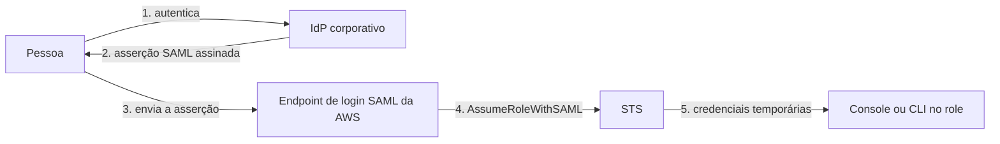

---
aliases:
  - Aula 5.6
modulo: 5
aula: 6
parte: "II Identidade, rede e dados"
dominios:
  - 1
lida: false
tags:
  - aula
  - saa-c03
  - modulo-05
---

# Aula 5.6: Federação com IAM e Directory Service

[[05 - Multiconta Governanca e Federacao|Voltar ao módulo]]

> [!question] Como deixar quem já tem identidade fora da AWS (no Active Directory da empresa, no Okta, no GitHub, no Google) entrar na AWS sem duplicar essas pessoas como usuários IAM, e quando vale ter um diretório dentro da AWS?

## O problema: identidades que já existem em outro lugar

Uma empresa quase nunca começa na AWS do zero. Ela já tem um diretório com milhares de pessoas, grupos, senhas, políticas de bloqueio e [[MFA]]. Os pipelines de deploy rodam no GitHub. Os clientes já têm conta no Google. Se cada uma dessas identidades virasse um [[IAM User|usuário IAM]], você teria três problemas: duplicação (a mesma pessoa em dois lugares, e o desligamento no diretório não corta o acesso na AWS), credenciais de longo prazo (senhas e [[Access Key|access keys]] que vazam) e administração manual.

A solução é a **[[Federacao|federação]]**: a AWS **confia** num sistema externo para dizer quem é a pessoa, e troca essa afirmação por **[[Credencial Temporaria|credenciais temporárias]]** de um [[IAM Role|role]]. Ninguém cria [[IAM User|usuário IAM]]; o que existe é uma relação de confiança entre o sistema externo e a [[Conta AWS|conta AWS]]. Quem emite as credenciais é o [[STS]] (Security Token Service), que você conheceu no [[04 - IAM Identidade e Acesso|Módulo 4]]. A federação é, no fundo, uma forma de chamar o STS com uma prova de identidade que a AWS aceita.

> [!example] Três pessoas, três caminhos
> Marina é funcionária e usa o login do [[Active Directory]] da empresa. O pipeline do GitHub precisa publicar uma imagem no [[ECR]] sem guardar chave nenhuma. O Pedro é cliente do aplicativo da empresa e entra com a conta do Google. Os três acabam com [[Credencial Temporaria|credenciais temporárias]], mas por três mecanismos diferentes: [[SAML]] ou [[IAM Identity Center|Identity Center]] para a Marina, [[OIDC]] com [[IAM]] para o pipeline, [[Cognito]] para o Pedro.

Esta aula tem duas metades. A primeira cobre a **[[Federacao|federação]] direta com o [[IAM]]** ([[SAML]] e [[OIDC]]). A segunda cobre o **[[Directory Service|AWS Directory Service]]**, que é o que você usa quando o que existe, ou o que a aplicação exige, é um [[Active Directory]].

## Como a federação funciona por baixo

Toda [[Federacao|federação]] com a AWS segue o mesmo padrão de quatro peças.

1. Um **[[Identity Provider|provedor de identidade]] (IdP)** autentica a pessoa ou a carga de trabalho e emite uma **afirmação** assinada: um documento [[SAML]] ou um token [[OIDC]] ([[JWT]]).
2. Na [[Conta AWS|conta AWS]] existe um **[[Identity Provider|provedor de identidade]] [[IAM]]**, que é o cadastro "confio nos documentos assinados por este IdP".
3. Existe um **role** cuja **[[Trust Policy|política de confiança]]** diz: "quem vem deste provedor, com estas condições, pode me assumir".
4. O chamador troca a afirmação por [[Credencial Temporaria|credenciais temporárias]] no [[STS]], com a operação certa para cada protocolo, e passa a agir com as permissões do role.

O que muda entre [[SAML]] e [[OIDC]] é o formato do documento e a operação do [[STS]]. O que não muda é o princípio: **a permissão está no role, e a identidade vem de fora**.

## SAML 2.0 com o IAM

O **[[SAML]]** (Security Assertion Markup Language 2.0) é o padrão dos [[Identity Provider|IdPs]] corporativos: [[Active Directory]] Federation Services (AD FS), Okta, Microsoft Entra ID, Ping e outros. A [[Federacao|federação]] SAML com o [[IAM]] funciona assim, em passos:

1. A pessoa abre o portal do [[Identity Provider|IdP]] da empresa e se autentica (senha, [[MFA]]).
2. O [[Identity Provider|IdP]] gera uma **asserção [[SAML]]** assinada, que inclui, entre outros atributos, **qual role** a pessoa pode usar.
3. O navegador envia a asserção ao endpoint de login [[SAML]] da AWS.
4. A AWS chama [[SAML|`AssumeRoleWithSAML`]] no [[STS]], valida a assinatura contra o provedor SAML cadastrado e devolve [[Credencial Temporaria|credenciais temporárias]].
5. A pessoa cai no console da AWS já dentro do role, sem nunca ter tido [[IAM User|usuário IAM]].



Para isso funcionar, a conta precisa de duas coisas. A primeira é o **[[Identity Provider|provedor de identidade]] [[SAML]] do [[IAM]]**, criado a partir do arquivo de metadados que o IdP publica. A segunda é um **role** com uma [[Trust Policy|política de confiança]] que cita esse provedor como principal federado:

```json
{
  "Version": "2012-10-17",
  "Statement": [
    {
      "Effect": "Allow",
      "Principal": { "Federated": "arn:aws:iam::111122223333:saml-provider/ExemploIdP" },
      "Action": "sts:AssumeRoleWithSAML",
      "Condition": {
        "StringEquals": { "saml:aud": "https://region-code.signin.aws.amazon.com/saml" }
      }
    }
  ]
}
```

O ponto de atenção da política é o `Principal`: em vez de uma conta ou um role, aparece `Federated`, apontando para o provedor [[SAML]]. A condição `saml:aud` garante que a asserção foi emitida para o endpoint de login SAML da AWS; na documentação atual o valor segue o formato regional `https://region-code.signin.aws.amazon.com/saml` (verificado em novembro de 2026). Um detalhe que a documentação destaca: o provedor SAML precisa estar **na mesma conta** do role que ele autoriza ([fonte](https://docs.aws.amazon.com/IAM/latest/UserGuide/id_roles_providers_saml.html)).

Na prova você não precisa decorar o JSON. Precisa reconhecer: "o `Principal` é um provedor federado, a ação é `AssumeRoleWithSAML`, o resultado são [[Credencial Temporaria|credenciais temporárias]]".

### SAML direto com o IAM ou Identity Center?

Na aula [[05.05 - IAM Identity Center|5.5]] você viu o [[IAM Identity Center]], que também usa [[SAML]] com um [[Identity Provider|IdP]] externo. A diferença prática é de escala e de administração:

| Critério | [[Federacao\|Federação]] [[SAML]] direta com o [[IAM]] | [[IAM Identity Center]] |
|---|---|---|
| Onde se configura | Em **cada conta**: provedor [[SAML]] e roles | **Uma vez**, na organização |
| Acesso a várias contas | Você repete provedor e roles em cada conta | Um [[Permission Set\|permission set]] atribuído a muitas contas |
| Portal de acesso | O do próprio [[Identity Provider\|IdP]] | Portal de acesso da AWS, com todas as contas e roles |
| CLI com [[Credencial Temporaria\|credenciais temporárias]] | Depende do [[Identity Provider\|IdP]] e de ferramentas que chamem o [[STS]] | `aws configure sso` nativo |
| Quando faz sentido | Uma conta só, requisito de manter o fluxo antigo, ou [[Identity Provider\|IdPs]] adicionais por conta | Padrão recomendado para a força de trabalho em ambiente multiconta |

Para o exame, a regra é simples: **força de trabalho com várias contas e um [[Identity Provider|IdP]] existente aponta para [[IAM Identity Center|Identity Center]]**. A [[Federacao|federação]] direta com [[IAM]] aparece quando o enunciado fala de uma única conta, de um provedor [[SAML]] configurado no IAM, ou quando a pergunta quer saber "como o IAM confia num IdP externo".

## OIDC: federação para cargas de trabalho e para a web

O **[[OIDC]]** (OpenID Connect) é uma camada de identidade sobre o [[OAuth 2.0]]. O [[Identity Provider|IdP]] emite um **[[JWT|token JWT]]** assinado. O [[IAM]] aceita provedores OIDC, e a operação do [[STS]] é [[OIDC|`AssumeRoleWithWebIdentity`]]. Os usos clássicos:

- **Cargas de trabalho fora da AWS** que precisam falar com a AWS sem guardar [[Access Key|access keys]], sendo o exemplo mais cobrado o **GitHub Actions**: o pipeline pede um token ao GitHub, troca no [[STS]] por [[Credencial Temporaria|credenciais temporárias]] de um role e publica a imagem ou aplica a infraestrutura. Não existe segredo para vazar nem rotacionar.
- **Aplicativos que aceitam login de provedores sociais** (Google, Facebook, Amazon). Aqui a recomendação é usar o **[[Cognito]]**, que faz essa troca por você, e não chamar o [[STS]] diretamente do aplicativo.

Uma [[Trust Policy|política de confiança]] típica para o GitHub Actions restringe o token ao repositório e à audiência corretos:

```json
{
  "Version": "2012-10-17",
  "Statement": [
    {
      "Effect": "Allow",
      "Principal": {
        "Federated": "arn:aws:iam::111122223333:oidc-provider/token.actions.githubusercontent.com"
      },
      "Action": "sts:AssumeRoleWithWebIdentity",
      "Condition": {
        "StringEquals": {
          "token.actions.githubusercontent.com:aud": "sts.amazonaws.com"
        },
        "StringLike": {
          "token.actions.githubusercontent.com:sub": "repo:minha-org/meu-repo:*"
        }
      }
    }
  ]
}
```

A condição sobre `sub` é a parte que impede que **qualquer** repositório do GitHub assuma o role. Sem ela, a confiança no provedor seria ampla demais.

> [!warning] Cuidado com a confiança ampla
> Um provedor [[OIDC]] cadastrado só diz "confio nos tokens deste emissor". Quem pode assumir cada role é decidido pelas **condições** da [[Trust Policy|política de confiança]]. Role OIDC sem condição de `aud` e `sub` é uma porta aberta para qualquer conta do emissor.

### SAML, OIDC, Identity Center ou Cognito?

| Quem precisa de acesso | Escolha provável | Por quê |
|---|---|---|
| Funcionários, várias contas, [[Identity Provider\|IdP]] corporativo | [[IAM Identity Center]] | Ponto único, [[Credencial Temporaria\|credenciais temporárias]], CLI nativa |
| Funcionários, uma conta, [[Identity Provider\|IdP]] [[SAML]] | Provedor SAML do [[IAM]] e role | [[Federacao\|Federação]] direta com `AssumeRoleWithSAML` |
| Pipeline do GitHub ou outra carga fora da AWS | Provedor [[OIDC]] do [[IAM]] e role | Sem [[Access Key\|access keys]], `AssumeRoleWithWebIdentity` |
| Clientes de um app web ou móvel, com login social | [[Cognito\|Amazon Cognito]] | Feito para usuários da aplicação, em grande escala |
| Quem precisa de um [[Active Directory]] dentro da AWS | [[Directory Service\|AWS Directory Service]] | Serviço de diretório gerenciado, com [[LDAP]] e [[Kerberos]] |

## Por que existe o AWS Directory Service

Até aqui o diretório vivia fora da AWS e a [[Federacao|federação]] o consultava. Mas há situações em que a AWS precisa **de um diretório**: aplicações Windows que exigem domínio (SharePoint, .NET, SQL Server), [[EC2|instâncias EC2]] que precisam ser **ingressadas num domínio** com Group Policy, o [[WorkSpaces|Amazon WorkSpaces]], o [[FSx for Windows File Server|Amazon FSx for Windows File Server]], ou bancos [[RDS]] que autenticam via AD. O **[[Active Directory]]** (AD) é o diretório da Microsoft: guarda usuários, grupos e computadores, autentica por **[[Kerberos]]** e consulta por **[[LDAP]]**, e aplica políticas por Group Policy.

Operar domain controllers em [[EC2]] por conta própria dá trabalho: [[Alta Disponibilidade|alta disponibilidade]], replicação, backup, patches. O **[[Directory Service]]** entrega o [[Active Directory|AD]] como serviço gerenciado ou como ponte para o AD que você já tem. A documentação lista as opções e a escolha depende de uma pergunta: **onde estão as identidades e o que a aplicação precisa?**

| Opção | O que é | Quando usar |
|---|---|---|
| **[[Directory Service\|AWS Managed Microsoft AD]]** | [[Active Directory]] real (Windows Server 2019), gerenciado pela AWS | Aplicações dependentes de AD na AWS, trusts, Group Policy, schema |
| **[[AD Connector]]** | Gateway que repassa as requisições ao seu [[Active Directory\|AD]], sem armazenar dados na nuvem | Você quer só usar o AD local com serviços da AWS |
| **[[Simple AD]]** | Diretório compatível com [[Active Directory\|AD]] baseado em Samba | Casos simples; veja o aviso mais adiante |
| **[[Directory Service\|Managed Microsoft AD]] (Hybrid Edition)** | Estende o [[Active Directory\|AD]] próprio para a AWS | Redundância e AD-dependência na AWS sem criar trust |

## AWS Managed Microsoft AD

O [[Directory Service|Managed Microsoft AD]] roda o **[[Active Directory]] de verdade**, em Windows Server 2019, como serviço gerenciado. Ele cria **um par de domain controllers** na sua [[VPC]], em **[[Zona de Disponibilidade|Zonas de Disponibilidade]] diferentes**, e a AWS cuida de monitoramento, recuperação, replicação, [[Snapshot|snapshots]] e atualizações. Você administra usuários, grupos e Group Policy; a AWS administra os servidores (verificado em novembro de 2026).

Pontos que a documentação destaca e que caem na prova:

- **Edições**: Standard, para até cerca de **30.000 objetos** do diretório, e Enterprise, até cerca de **500.000 objetos**, com suporte a **multi-Region**.
- **Relação de confiança (trust)** com o seu [[Active Directory|AD]] local, na AWS ou em outra nuvem. O [[Directory Service|Managed AD]] cria uma **floresta de recursos**: as identidades continuam no AD de origem e os recursos da AWS ficam na floresta gerenciada. É por isso que a pessoa entra com a credencial de sempre e não há duplicação de senhas.
- **Compartilhamento entre contas**: o diretório pode ser compartilhado com várias [[Conta AWS|contas AWS]], permitindo ingressar [[EC2|instâncias EC2]] no domínio em contas diferentes sem criar um diretório por conta.
- **Extensões de schema**, políticas de senha, **[[LDAP|LDAP seguro]]** ([[TLS|SSL/TLS]]) e **[[MFA]]** para quem acessa aplicações AWS pela internet.
- **Integração** com [[WorkSpaces]], [[FSx for Windows File Server|FSx for Windows]], [[EC2]], [[RDS]] (SQL Server e outros) e **[[IAM Identity Center]]**. Isoladamente, o [[Directory Service|Managed AD]] permite entrar no console; com Identity Center, também se obtêm [[Credencial Temporaria|credenciais temporárias]] para SDK e CLI.
- Os logs de segurança podem ser enviados ao [[CloudWatch Logs]] para auditoria.

> [!warning] A direção do trust (a pegadinha de Managed AD)
> A direção de um trust é descrita **de cada lado**: o que é *outgoing* num domínio é *incoming* no outro. A regra de leitura: o domínio que **confia** (trusting) tem o trust *outgoing* e é onde ficam os **recursos**; o domínio **confiado** (trusted) tem o trust *incoming* e é onde ficam as **identidades**. Para o desenho "usuários do [[Active Directory|AD]] local acessam recursos no [[Directory Service|Managed AD]]", o Managed AD (floresta de recursos) confia no AD local.
>
> | Tipo de trust | O que permite | Quando exigir |
> |---|---|---|
> | **One-way** ([[Directory Service|Managed AD]] confia no [[Active Directory|AD]] local) | Usuários do AD local usam recursos do domínio na AWS, sem o contrário | [[EC2]], [[RDS]] e [[FSx]] funcionam com one-way ou two-way |
> | **Two-way** | As duas direções: o [[Directory Service|Managed AD]] consegue consultar usuários e grupos do [[Active Directory|AD]] local | **Obrigatório** para as aplicações corporativas da AWS, como [[WorkSpaces]], [[IAM Identity Center]] e acesso ao console |
>
> Há ainda o **external trust** (entre dois domínios, [[Roteamento Transitivo|não transitivo]]) e o **forest trust** (entre florestas, transitivo entre os domínios delas). O trust só funciona com **conectividade de rede privada** (VPN ou [[Direct Connect]]) entre o [[Active Directory|AD]] local e a [[VPC]] do [[Directory Service|Managed AD]], e com [[DNS]] conditional forwarders configurados no AD local (fonte: [criação de trust](https://docs.aws.amazon.com/directoryservice/latest/admin-guide/ms_ad_setup_trust.html), verificado em novembro de 2026).

O [[Directory Service|Managed AD]] também oferece o **seamless domain join**: [[EC2|instâncias EC2]] (Windows ou Linux) entram no domínio automaticamente na criação, sem o administrador ingressar uma a uma, e o diretório compartilhado permite o mesmo em outras contas.

O [[Directory Service|Managed AD]] é a resposta quando o enunciado diz "migrar aplicações dependentes do [[Active Directory]] para a AWS", "Group Policy", "trust com o AD local" ou "SharePoint e SQL Server Always On".

### Managed Microsoft AD (Hybrid Edition)

A **Hybrid Edition** é a opção mais nova da documentação: conecta o seu [[Active Directory|AD]] autogerenciado ao [[Directory Service|Managed AD]] para **estender o diretório para a AWS sem criar uma relação de confiança** e sem sincronizar as identidades manualmente, com credenciais e associações de grupo consistentes nos dois lados e avaliações periódicas do diretório. Serve para facilitar a migração de cargas dependentes de AD e aumentar a redundância do AD. É uma novidade que provavelmente aparece pouco no exame; o que importa é saber que ela existe e para quê (verificado em novembro de 2026).

## AD Connector

O **[[AD Connector]]** é um **gateway de diretório**: encaminha as requisições de autenticação ao seu [[Active Directory]] **sem guardar nenhuma informação na nuvem**. A documentação diz que ele vem em dois tamanhos, pequeno e grande, e que não há limites aplicados de usuários ou conexões. O que ele entrega:

- Funcionários entram em aplicações como [[WorkSpaces]], WorkDocs e WorkMail com as credenciais corporativas.
- Acesso ao console por [[IAM Role|role IAM]] com credenciais do [[Active Directory|AD]].
- As políticas do [[Active Directory|AD]] (expiração e histórico de senha, bloqueio de conta) valem também para o acesso na nuvem, porque a autenticação é feita no AD de origem.
- **[[MFA]]** via a sua infraestrutura **RADIUS** existente.

As limitações que a documentação faz questão de destacar (verificado em novembro de 2026):

- O [[AD Connector]] **não pode ser compartilhado com outras [[Conta AWS|contas AWS]]**. Para compartilhar, use o [[Directory Service|Managed AD]].
- Ele **não conhece várias [[VPC|VPCs]]**: aplicações como o [[WorkSpaces]] precisam estar **na mesma VPC** do conector.
- Relação **1 para 1 com o domínio**: para cada domínio do [[Active Directory|AD]] local (inclusive domínios filhos de uma floresta), é preciso um [[AD Connector]] próprio. Não há suporte a trusts transitivos.
- Como ele só repassa, **precisa de conectividade de rede** com o [[Active Directory|AD]] (VPN ou [[Direct Connect]]) sempre disponível. Se o link cair, a autenticação cai.

A resposta típica de prova: "a empresa quer usar o [[Active Directory|AD]] local existente com [[WorkSpaces]], **sem replicar os dados** e **sem manter nenhum diretório ou domain controller na AWS**" aponta para [[AD Connector]]. Note que o [[Directory Service|Managed AD]] com trust de duas direções **também** serve ao WorkSpaces (a AWS exige o two-way para ele), mas ele cria um diretório na AWS: o [[Qualificador|qualificador]] que decide é "sem diretório na AWS, só repassar as consultas".

> [!example] AD Connector ou Managed AD? Um caso com números
> Uma empresa tem [[Active Directory|AD]] local, 200 funcionários e dois pedidos: (1) [[WorkSpaces]] para o escritório e (2) migrar um SharePoint com SQL Server para [[EC2]] na AWS. Para o pedido 1, que só precisa autenticar com o login corporativo, o [[AD Connector]] (1 conector, na [[VPC]] dos WorkSpaces, pela VPN) basta e não guarda dados na nuvem. Para o pedido 2, as instâncias precisam de um domínio com Group Policy, e um conector não hospeda domínio: entra o [[Directory Service|Managed Microsoft AD]], com trust para o AD local. É comum a empresa acabar com os dois, cada um atendendo a um pedido.

## Simple AD

O **[[Simple AD]]** é um diretório **baseado em Samba**, compatível com um subconjunto das funções do [[Active Directory|AD]], indicado para cargas simples (domínio para [[EC2]], autenticação básica). Não é um Active Directory de verdade e por isso não oferece o mesmo conjunto de recursos do [[Directory Service|Managed AD]] (por exemplo, trusts e extensões de schema).

> [!warning] Simple AD está fechado a novos clientes
> A documentação informa que **novos clientes não podem mais aderir** ao [[Simple AD]], enquanto os clientes existentes mantêm a funcionalidade completa e podem continuar criando diretórios (verificado em novembro de 2026). As alternativas recomendadas pela AWS são o **[[Directory Service|Managed Microsoft AD]]** (quando você precisa de [[Active Directory|AD]] de verdade) e o **[[AD Connector]]** (quando você já tem um AD). Provas atualizadas tendem a evitar o Simple AD; se ele aparecer, é na posição de "opção mais simples e barata sem trust", e a escolha moderna é outra.

## Como as peças se ligam: um desenho de ponta a ponta

Considere uma empresa com [[Active Directory|AD]] local, 40 [[Conta AWS|contas AWS]] e uma aplicação Windows migrando para a AWS.

1. **Acesso das pessoas às contas**: [[IAM Identity Center]] com o [[Active Directory|AD]] como [[Identity Source|identity source]] (ou [[Identity Provider|IdP]] externo com [[SCIM]]), como na aula 5.5. As pessoas entram no portal com o login do AD.
2. **Aplicação Windows que exige domínio**: [[Directory Service|Managed Microsoft AD]] numa conta de serviços compartilhados, com trust para o [[Active Directory|AD]] local, **compartilhado** com as contas que precisam ingressar [[EC2|instâncias EC2]].
3. **[[WorkSpaces]] dos escritórios, sem replicar identidades**: [[AD Connector]] apontando para o [[Active Directory|AD]] local pela VPN, na [[VPC]] dos WorkSpaces.
4. **Pipelines no GitHub**: provedor [[OIDC]] e roles com condição de repositório, sem [[Access Key|access keys]].
5. **App de clientes**: [[Cognito]].

Cinco necessidades, cinco mecanismos. A prova mede se você reconhece qual é qual.

## Como isso cai na prova

Task 1.1 ("AWS federated access and identity services ([[IAM]], [[IAM Identity Center]])" e "determining when to federate a directory service with [[IAM Role|IAM roles]]").

**Palavras-chave em inglês**

- "existing on-premises [[Active Directory]]", "corporate credentials", "without replicating directory data" aponta para **[[AD Connector]]**.
- "migrate AD-dependent applications to AWS", "Group Policy", "trust relationship", "SharePoint", "domain join [[EC2]]" aponta para **[[Directory Service|AWS Managed Microsoft AD]]**.
- "[[SAML|SAML 2.0]] [[Identity Provider|identity provider]]", "federate with [[IAM Role|IAM roles]]", "AssumeRoleWithSAML" aponta para [[Federacao|federação]] SAML direta com o [[IAM]].
- "GitHub Actions", "no long-term credentials", "[[OIDC]]" aponta para provedor OIDC do [[IAM]] com `AssumeRoleWithWebIdentity`.
- "mobile app users", "social login (Google, Facebook)", "sign up and sign in" aponta para **[[Cognito]]**.
- "centrally manage SSO access across many accounts" aponta para **[[IAM Identity Center]]**.

**Pegadinhas clássicas**

- A [[Federacao|federação]] troca uma prova de identidade por **[[Credencial Temporaria|credenciais temporárias]]**; não cria [[IAM User|usuário IAM]].
- [[AD Connector]] **não** armazena dados e **não** é compartilhável entre contas; [[Directory Service|Managed AD]] é compartilhável.
- [[AD Connector]] depende de **conectividade** (VPN ou [[Direct Connect]]) com o [[Active Directory|AD]] local o tempo todo.
- Para clientes do aplicativo, a resposta é [[Cognito]], nunca um provedor [[SAML]] corporativo.
- Role [[OIDC]] sem condição em `sub` e `aud` autoriza qualquer um do emissor.
- [[Simple AD]] está fechado a novos clientes; a escolha moderna é [[Directory Service|Managed AD]] ou [[AD Connector]].

| Requisito no enunciado | Resposta provável | Por quê |
|---|---|---|
| Usar o [[Active Directory\|AD]] local com [[WorkSpaces]] sem copiar dados para a AWS | [[AD Connector]] | Gateway que repassa a autenticação |
| Rodar SharePoint e SQL Server Always On na AWS com domínio | [[Directory Service\|Managed Microsoft AD]] | [[Active Directory\|AD]] real com trust e Group Policy |
| Funcionários entram no console pelo login do [[Identity Provider\|IdP]] [[SAML]], em uma conta | Provedor SAML do [[IAM]] e role | `AssumeRoleWithSAML` |
| Pipeline do GitHub publica na AWS sem [[Access Key\|access keys]] | Provedor [[OIDC]] do [[IAM]] e role com condições | `AssumeRoleWithWebIdentity`, [[Credencial Temporaria\|credenciais temporárias]] |
| Compartilhar o diretório entre várias [[Conta AWS\|contas AWS]] | [[Directory Service\|Managed Microsoft AD]] compartilhado | O [[AD Connector]] não pode ser compartilhado |
| Usuários finais de um app com login Google | [[Cognito]] | [[Federacao\|Federação]] social para a aplicação |

## Resumo

> [!abstract] A aula em uma frase
> [[Federacao|Federação]] é trocar uma **identidade que já existe fora da AWS** ([[SAML]], [[OIDC]]) por **[[Credencial Temporaria|credenciais temporárias]] de um role**, e o **[[Directory Service]]** é o que você usa quando a AWS ou a aplicação precisa de um **[[Active Directory]]**: Managed AD para AD de verdade, [[AD Connector]] para usar o seu AD sem replicar.

**A lógica, em 5 passos**
1. Identidades que vivem fora da AWS não devem virar [[IAM User|usuários IAM]]; a AWS confia no [[Identity Provider|IdP]] e troca a prova por [[Credencial Temporaria|credenciais temporárias]].
2. Para [[SAML]], a conta tem um provedor SAML e um role cuja [[Trust Policy|política de confiança]] cita o provedor; a operação é `AssumeRoleWithSAML`.
3. Para [[OIDC]] (GitHub Actions, web), a conta tem um provedor OIDC; a operação é `AssumeRoleWithWebIdentity`, e as condições `aud` e `sub` limitam quem assume.
4. Quando a AWS ou uma aplicação precisa de diretório, o [[Directory Service]] oferece Managed Microsoft AD, [[AD Connector]] e (para clientes existentes) [[Simple AD]].
5. Em ambiente multiconta, o caminho recomendado para a força de trabalho é o [[IAM Identity Center]], usando o [[Active Directory|AD]] ou um [[Identity Provider|IdP]] como fonte.

**Números para lembrar**

| O quê | Valor | Por que importa |
|---|---|---|
| [[Directory Service\|Managed Microsoft AD]] Standard | Até cerca de 30.000 objetos | Dimensionamento da edição |
| [[Directory Service\|Managed Microsoft AD]] Enterprise | Até cerca de 500.000 objetos e multi-Region | Diretórios grandes e globais |
| Domain controllers do [[Directory Service\|Managed AD]] | Um par, em [[Zona de Disponibilidade\|AZs]] diferentes | [[Alta Disponibilidade\|Alta disponibilidade]] já embutida |

**Tabela-síntese**

| Peça | Papel |
|---|---|
| Provedor [[SAML]] ou [[OIDC]] do [[IAM]] | Cadastro do [[Identity Provider\|IdP]] em que a conta confia |
| Role com [[Trust Policy\|política de confiança]] federada | Define quem pode assumir e com quais condições |
| [[Directory Service\|Managed Microsoft AD]] | [[Active Directory\|AD]] real gerenciado, com trust e compartilhamento entre contas |
| [[AD Connector]] | Gateway para o [[Active Directory\|AD]] existente, sem dados na nuvem |

**Na prática, isso significa**
- Pipelines externos usam provedor [[OIDC]] e role com condições restritas, nunca [[Access Key|access keys]].
- [[AD Connector]] exige link estável (VPN ou [[Direct Connect]]) com o [[Active Directory|AD]] local; [[Directory Service|Managed AD]] é o que se compartilha entre contas, e [[WorkSpaces]] e [[IAM Identity Center|Identity Center]] pedem trust de duas direções.
- Em ambiente multiconta, prefira [[IAM Identity Center|Identity Center]] a federar [[SAML]] conta por conta.

> [!tip] Liga com
> Usa o [[STS]] e as políticas de confiança do [[04 - IAM Identidade e Acesso|Módulo 4]] e é a base do [[IAM Identity Center|Identity Center]] da aula [[05.05 - IAM Identity Center|5.5]]. O [[Resource Share|compartilhamento de recursos]] entre contas, que também aparece com o [[Directory Service|Managed AD]], tem sua aula própria: [[05.07 - RAM e Compartilhamento entre Contas|5.7]].

## Erros comuns

1. **"Vou criar um [[IAM User|usuário IAM]] para cada integrante do GitHub Actions."** Gera chave de longo prazo para vazar. Corrija usando um provedor [[OIDC]] e um role com condições de repositório.
2. **"Como a empresa tem [[Active Directory]], o [[Simple AD]] resolve."** O Simple AD não é um AD real e está fechado a novos clientes. Corrija escolhendo [[Directory Service|Managed AD]] (AD de verdade) ou [[AD Connector]] (para o AD existente).
3. **"[[AD Connector]] guarda uma cópia do diretório na nuvem."** Ele só repassa as requisições; se o link com o [[Active Directory|AD]] cair, a autenticação cai. Corrija planejando conectividade redundante.
4. **"Compartilho o [[AD Connector]] com todas as contas."** Ele não pode ser compartilhado. Corrija usando [[Directory Service|Managed AD]] compartilhado.
5. **"Um provedor [[OIDC]] cadastrado já basta."** Sem condições em `aud` e `sub`, qualquer um do emissor pode assumir o role. Corrija restringindo a [[Trust Policy|política de confiança]].
6. **"Para entrar com Google no app dos clientes, uso [[SAML]] corporativo."** Usuários finais são território do [[Cognito]]. Corrija usando identity pool federado a provedores sociais.

## Pratique

**1.** Uma empresa quer que o pipeline de CI no GitHub publique imagens num repositório do [[ECR|Amazon ECR]] sem armazenar [[Access Key|chaves de acesso]]. Qual abordagem é a mais segura?

- [ ] a) Criar um usuário IAM para o pipeline e guardar a access key como segredo criptografado do repositório do GitHub
- [ ] b) Criar um role com AdministratorAccess e anexar ao pipeline uma credencial root, para simplificar o acesso ao ECR
- [ ] c) Cadastrar o GitHub como provedor OIDC no IAM e criar um role com política de confiança restrita ao repositório
- [ ] d) Copiar manualmente as credenciais temporárias de um engenheiro para o pipeline antes de cada execução

**2.** Uma empresa tem um [[Active Directory]] local e quer que os usuários do Amazon [[WorkSpaces]] entrem com as credenciais corporativas. Ela NÃO quer manter nenhum diretório nem domain controller na AWS: as consultas de autenticação devem ser repassadas ao AD local. Qual serviço atende?

- [ ] a) Managed Microsoft AD, com uma relação de confiança de duas direções para o AD local
- [ ] b) AD Connector, apontado para o AD local por VPN ou Direct Connect
- [ ] c) Um user pool do Cognito, com importação em massa de todos os funcionários
- [ ] d) Um usuário IAM para cada funcionário, com a mesma senha do AD, sincronizada por script

**3.** (Escolha DUAS.) Quais afirmações sobre o [[AD Connector]] estão corretas?

- [ ] a) Armazena uma cópia completa do diretório na nuvem
- [ ] b) Não pode ser compartilhado com outras contas AWS
- [ ] c) Substitui o uso de VPN ou Direct Connect, pois se comunica pela internet pública
- [ ] d) Repassa as requisições ao AD existente, sem guardar informações do diretório na nuvem
- [ ] e) Tem suporte a trusts transitivos entre domínios

**4.** Uma empresa precisa migrar uma aplicação SharePoint e um SQL Server com Always On para a AWS, ingressando as [[EC2|instâncias EC2]] num domínio com Group Policy e mantendo a relação de confiança com o [[Active Directory|AD]] local. O que usar?

- [ ] a) AD Connector, que aplica Group Policy nas instâncias EC2 ingressadas
- [ ] b) Simple AD, por ser a opção mais barata e dispensar o trust
- [ ] c) Um provedor SAML do IAM, com um role de federação para cada instância
- [ ] d) AWS Managed Microsoft AD, com trust para o AD local

**5.** Uma empresa vai usar o [[Directory Service|AWS Managed Microsoft AD]] para que usuários do [[Active Directory|AD]] local acessem [[EC2|instâncias EC2]] ingressadas no domínio e um [[FSx for Windows File Server]] na AWS. O AD local e a [[VPC]] já estão ligados por [[Direct Connect]]. Qual trust atende ao requisito?

- [ ] a) Um trust em que o Managed AD (floresta de recursos) confia no AD local, que mantém as identidades
- [ ] b) Um trust em que o AD local confia no Managed AD, de modo que os usuários passem a viver no domínio da AWS
- [ ] c) Nenhum trust, porque um Lambda copia senhas e usuários do AD local para o Managed AD a cada hora
- [ ] d) Um AD Connector com trust transitivo para todos os domínios, instalado em cada instância

**6.** Uma equipe configura a [[Federacao|federação]] [[SAML]] direta com o [[IAM]] para o console de uma única conta, usando o [[Identity Provider|IdP]] corporativo. Depois da autenticação no IdP, qual operação do [[STS]] a AWS usa para entregar as [[Credencial Temporaria|credenciais temporárias]]?

- [ ] a) AssumeRoleWithWebIdentity, que valida o token JWT emitido pelo IdP corporativo
- [ ] b) AssumeRoleWithSAML, que valida a asserção contra o provedor SAML cadastrado
- [ ] c) GetSessionToken, usando a access key do usuário que se autenticou no IdP
- [ ] d) CreateUser seguido de AttachUserPolicy, criando um usuário IAM temporário para cada login

**7.** Um engenheiro configurou um provedor [[OIDC]] do GitHub, mas qualquer repositório do GitHub consegue assumir o role. Qual é a causa mais provável?

- [ ] a) O role é válido apenas em us-east-1, a Região do provedor de identidade
- [ ] b) O STS não valida o emissor do token, então a política de confiança precisa de uma SCP
- [ ] c) A política de confiança não tem condições sobre as chaves de audiência e de assunto do token
- [ ] d) O provedor OIDC deveria ser cadastrado na conta de cobrança, e não na conta do role

**8.** (Escolha DUAS.) Quais são características do [[Directory Service|AWS Managed Microsoft AD]]?

- [ ] a) Cria um par de domain controllers em Zonas de Disponibilidade diferentes, com a AWS gerenciando recuperação e atualizações
- [ ] b) É um diretório baseado em Samba sem suporte a trusts
- [ ] c) Só funciona se o AD local estiver desligado
- [ ] d) Não pode ser integrado ao Amazon WorkSpaces
- [ ] e) Pode ser compartilhado com outras contas AWS para o ingresso de instâncias EC2 no domínio

**9.** Uma organização com 25 [[Conta AWS|contas AWS]] e um [[Identity Provider|IdP]] corporativo quer SSO centralizado para o console e a CLI, com [[Credencial Temporaria|credenciais temporárias]] e o menor esforço de manutenção. Qual solução é a mais indicada?

- [ ] a) IAM Identity Center, com o IdP corporativo como identity source
- [ ] b) Um provedor SAML e roles do IAM criados manualmente em cada uma das 25 contas
- [ ] c) Um usuário IAM por pessoa em cada conta, com MFA obrigatório e rotação de chaves
- [ ] d) Um identity pool do Cognito para os funcionários, federado ao IdP corporativo

**10.** Os usuários de um aplicativo móvel de consumo querem entrar com a conta do Google e ler os próprios arquivos no [[S3]] com [[Credencial Temporaria|credenciais temporárias]]. O que a arquitetura deve usar?

- [ ] a) Um user pool do Cognito sozinho, usado pelo aplicativo para ler o S3 diretamente com o token do usuário
- [ ] b) IAM Identity Center com um IdP social, atribuindo um permission set a cada cliente do aplicativo
- [ ] c) Um usuário IAM por cliente, criado automaticamente no cadastro, com acesso apenas ao próprio prefixo
- [ ] d) Amazon Cognito, com um identity pool federado ao provedor social do Google

**11.** Uma empresa que usa um [[AD Connector]] precisa que três outras [[Conta AWS|contas AWS]] ingressem [[EC2|instâncias EC2]] no mesmo domínio. O que é necessário?

- [ ] a) Aumentar o AD Connector de pequeno para grande, que passa a aceitar contas adicionais
- [ ] b) Compartilhar o AD Connector pelo AWS RAM, com as três contas na mesma organização
- [ ] c) Migrar para o AWS Managed Microsoft AD e compartilhar o diretório com as outras contas
- [ ] d) Criar três usuários IAM com acesso ao AD Connector, um em cada conta

**12.** Uma equipe criou o trust entre o [[Directory Service|Managed Microsoft AD]] e o [[Active Directory|AD]] local como one-way, para que o domínio AWS confie no local. As [[EC2|instâncias EC2]] e o [[FSx]] funcionam, mas os usuários não conseguem entrar no [[WorkSpaces]] nem no [[IAM Identity Center]]. Qual é a causa?

- [ ] a) O WorkSpaces e o Identity Center só aceitam o AD Connector, nunca o Managed AD
- [ ] b) A conectividade com o AD local caiu, e o trust one-way só funciona com conexão contínua
- [ ] c) Os usuários precisam de um usuário IAM adicional para cada serviço da AWS
- [ ] d) Essas aplicações exigem trust de duas direções, para o Managed AD consultar o AD local

**13.** (Escolha DUAS.) A equipe vai criar um trust entre o [[Directory Service|Managed Microsoft AD]] e o [[Active Directory|AD]] local. Quais são pré-requisitos documentados?

- [ ] a) Conectividade de rede privada (VPN ou Direct Connect) entre o AD local e a VPC do Managed AD
- [ ] b) DNS conditional forwarders configurados no AD local, apontando para os DNS do Managed AD
- [ ] c) Desligar o AD local durante a criação do trust, para evitar conflito de identidades
- [ ] d) Instalar um AD Connector em cada VPC que enxergue o diretório
- [ ] e) Criar um usuário IAM com AdministratorAccess para cada integrante do AD local

> [!success]- Gabarito
> **1. c)** O provedor [[OIDC]] com role restrito ao repositório troca o token do GitHub por [[Credencial Temporaria|credenciais temporárias]], sem segredo de longo prazo. a) a [[Access Key|access key]] é uma credencial de longo prazo que pode vazar; b) a credencial root nunca deve ser usada e AdministratorAccess é amplo demais; d) manual, inseguro e sem auditoria.
> **2. b)** O [[AD Connector]] só repassa a autenticação ao [[Active Directory|AD]] local, sem diretório nem domain controller na AWS. a) o [[Directory Service|Managed AD]] com trust de duas direções também serve ao [[WorkSpaces]], mas cria um diretório na AWS, o que o enunciado proíbe; c) o [[Cognito]] é para usuários de aplicação e exigiria importar os dados; d) [[IAM User|usuários IAM]] duplicam identidades.
> **3. b) e d)** O [[AD Connector]] não é compartilhável e só repassa as requisições. a) não guarda cópia; c) depende de conectividade privada com o [[Active Directory|AD]]; e) a documentação diz que ele não suporta trusts transitivos.
> **4. d)** O [[Directory Service|Managed AD]] é o [[Active Directory|AD]] real, com Group Policy, trust e suporte a SharePoint e SQL Server Always On. a) o [[AD Connector]] não hospeda o domínio, só repassa; b) o [[Simple AD]] não tem trusts e está fechado a novos clientes; c) provedor [[SAML]] não é um domínio para ingressar instâncias.
> **5. a)** O [[Directory Service|Managed AD]] é a floresta de recursos e confia no [[Active Directory|AD]] local, que mantém as identidades; para [[EC2]] e [[FSx]] basta o one-way. b) inverte a direção e moveria as identidades; c) é uma réplica manual frágil que o trust dispensa; d) o [[AD Connector]] não é instalado em instâncias nem faz trust transitivo.
> **6. b)** `AssumeRoleWithSAML` troca a asserção [[SAML]] por credenciais. a) é para tokens [[OIDC]]; c) o [[Identity Provider|IdP]] não emite [[Access Key|access key]] da AWS; d) a [[Federacao|federação]] não cria [[IAM User|usuários IAM]].
> **7. c)** Sem condições em `aud` e `sub`, a confiança no emissor é ampla e qualquer repositório assume o role. a) a Região não é o motivo; b) o [[STS]] valida o emissor, quem restringe o assunto é a [[Trust Policy|política de confiança]]; d) [[Identity Provider|provedores de identidade]] ficam na conta do role.
> **8. a) e e)** O par de DCs em [[Zona de Disponibilidade|AZs]] diferentes e o compartilhamento entre contas são características documentadas. b) descreve o [[Simple AD]]; c) o [[Directory Service|Managed AD]] faz trust com o [[Active Directory|AD]] local, que continua ligado; d) integra-se ao [[WorkSpaces]].
> **9. a)** O [[IAM Identity Center|Identity Center]] configura uma vez e atribui acesso às 25 contas, com CLI nativa. b) funciona, mas repete a configuração em cada conta; c) multiplica as credenciais de longo prazo por pessoa; d) o [[Cognito]] é para usuários de aplicação.
> **10. d)** O [[Cognito]] com identity pool federa provedores sociais e entrega [[Credencial Temporaria|credenciais temporárias]]. a) o [[User Pool|user pool]] autentica, mas sozinho não entrega credenciais AWS para o [[S3]]; b) o [[IAM Identity Center|Identity Center]] é para a força de trabalho; c) não escala e usa credenciais de longo prazo.
> **11. c)** Só o [[Directory Service|Managed AD]] pode ser compartilhado entre contas. a) o tamanho não muda a limitação; b) o [[AD Connector]] não pode ser compartilhado, nem pelo [[RAM]]; d) [[IAM User|usuários IAM]] não ingressam instâncias em domínio.
> **12. d)** [[WorkSpaces]], [[IAM Identity Center|Identity Center]] e o console exigem two-way, porque o [[Directory Service|Managed AD]] precisa consultar usuários e grupos do [[Active Directory|AD]] local; [[EC2]], [[RDS]] e [[FSx]] funcionam com one-way. a) o Managed AD é suportado; b) a queda de conectividade afetaria também EC2 e FSx; c) o [[IAM User|IAM user]] não é necessário.
> **13. a) e b)** O trust exige rede privada entre o [[Active Directory|AD]] local e a [[VPC]] e os conditional forwarders no AD local. c) o AD local precisa continuar ligado; d) o [[AD Connector]] não participa do trust; e) [[IAM User|usuários IAM]] não fazem parte do desenho.

## Para aprofundar

- [ ] [What is AWS Directory Service?](https://docs.aws.amazon.com/directoryservice/latest/admin-guide/what_is.html) (AWS): as opções de diretório e quando usar cada uma.
- [ ] [AD Connector](https://docs.aws.amazon.com/directoryservice/latest/admin-guide/directory_ad_connector.html) (AWS): funcionamento, limites de compartilhamento e de [[VPC]].
- [ ] [AWS Managed Microsoft AD](https://docs.aws.amazon.com/directoryservice/latest/admin-guide/directory_microsoft_ad.html) (AWS): arquitetura, Hybrid Edition e quando escolher.
- [ ] [Simple AD availability changes](https://docs.aws.amazon.com/directoryservice/latest/admin-guide/simple-ad-availability-change.html) (AWS): fechamento a novos clientes e alternativas.
- [ ] [Identity providers and federation into AWS](https://docs.aws.amazon.com/IAM/latest/UserGuide/id_roles_providers.html) (AWS): [[SAML]], [[OIDC]] e a comparação com [[IAM Identity Center|Identity Center]] e [[Cognito]].

Próxima aula: [[05.07 - RAM e Compartilhamento entre Contas|Aula 5.7: RAM e Compartilhamento entre Contas]]
