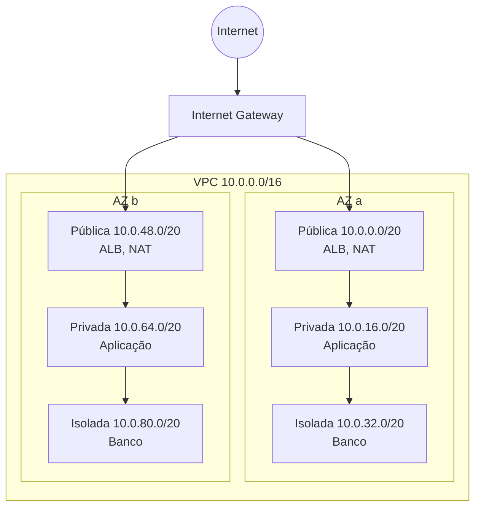

---
aliases:
  - Aula 6.2
modulo: 6
aula: 2
parte: "II Identidade, rede e dados"
dominios:
  - 1
  - 2
  - 3
lida: false
tags:
  - aula
  - saa-c03
  - modulo-06
---

# Aula 6.2: Sub-redes e arquitetura em camadas

[[06 - VPC a Fundo|Voltar ao módulo]]

> [!question] Pergunta que esta aula responde
> Por que a [[VPC]] é dividida em [[Sub-rede|sub-redes]], o que torna uma [[Sub-rede Publica|sub-rede pública]], privada ou isolada, e como organizar web, aplicação e dados em camadas que sobrevivem à falha de uma [[Zona de Disponibilidade|AZ]]?

## Por que dividir a VPC em sub-redes

A [[VPC]] é um bloco de endereços, mas **nenhuma política de rede se aplica a "um bloco inteiro"**. Duas necessidades obrigam a dividir:

1. **Resiliência.** A [[VPC]] atravessa as [[Zona de Disponibilidade|AZs]], mas um data center falha por AZ. Se cada recurso tem de estar em uma AZ específica, é preciso um objeto de rede que seja zonal: a [[Sub-rede|sub-rede]]. É por isso que "[[Alta Disponibilidade|alta disponibilidade]]" em VPC significa "uma sub-rede equivalente em cada AZ".
2. **Segmentação.** Cada [[Sub-rede|sub-rede]] se associa a uma [[Route Table]] e a uma [[Network ACL]]. Para que o servidor web tenha caminho para a internet e o banco de dados não tenha, os dois precisam estar em sub-redes diferentes, com tabelas de rotas diferentes.

Em resumo: **a [[Sub-rede|sub-rede]] é a menor unidade de roteamento e de filtro [[Stateless|stateless]]**, e é zonal. Isso explica três regras que a prova cobra:

- uma [[Sub-rede|sub-rede]] existe em **exatamente uma [[Zona de Disponibilidade|AZ]]** e nunca abrange duas;
- o [[CIDR]] de uma [[Sub-rede|sub-rede]] é um pedaço do CIDR da [[VPC]], de `/16` a `/28`, e sub-redes da mesma VPC **não podem se sobrepor**;
- cada [[Sub-rede|sub-rede]] está associada a **uma** [[Route Table|route table]] (várias sub-redes podem compartilhar a mesma) e a **uma** [[Network ACL|network ACL]]. Quando você não associa explicitamente, vale a main route table e a network ACL padrão (aula 6.3 e 6.6).

> [!info] Ligando os pontos
> No [[01 - Nuvem e Infraestrutura Global AWS|Módulo 1]] você viu que [[EC2]], [[EBS]] e [[Sub-rede|sub-rede]] são recursos zonais, e a [[VPC]], regional. Esta aula é a consequência prática: o recurso de rede que fixa onde cada instância mora é a sub-rede.

## O que torna uma sub-rede pública, privada ou isolada

Nenhuma caixinha chamada "pública" existe na criação da [[Sub-rede|sub-rede]]. O que existe é **a rota**. Segundo a documentação (verificado em novembro de 2026): uma sub-rede associada a uma [[Route Table|route table]] **com rota para um [[Internet Gateway]]** é uma [[Sub-rede Publica|sub-rede pública]]; sem essa rota, é uma [[Sub-rede Privada|sub-rede privada]].

Dois requisitos precisam estar atendidos para um recurso falar com a internet por [[IPv4]]:

1. a [[Sub-rede|sub-rede]] dele tem rota `0.0.0.0/0` para o [[Internet Gateway]];
2. ele tem um **IP público** (ou [[Elastic IP]]). Sem isso o pacote sai com origem privada e a internet não sabe responder.

Na prática, quatro "sabores" aparecem em arquiteturas:

| Tipo | Rota para fora | Para que serve |
|---|---|---|
| Pública | `0.0.0.0/0` para o [[Internet Gateway]] | Load balancers públicos, [[NAT Gateway\|NAT gateway]], [[Bastion Host\|bastion]] |
| Privada com saída | `0.0.0.0/0` para um [[NAT Gateway]] | Aplicações que precisam baixar pacotes ou chamar APIs externas |
| Privada isolada | Apenas a rota `local` (mais endpoints, se houver) | Bancos de dados, dados sensíveis |
| Somente VPN | Rota para um [[Virtual Private Gateway\|virtual private gateway]] | Cargas que só falam com o data center |

"Privada isolada" não é um tipo oficial da AWS: é apenas uma [[Sub-rede Privada|sub-rede privada]] **sem rota nenhuma além da local**, e é o nome que arquitetos usam. Instâncias numa [[Sub-rede|sub-rede]] assim não alcançam nem a internet nem as APIs públicas da AWS, a menos que você crie [[VPC Endpoint|VPC endpoints]] (aulas 6.8 e 6.9).

> [!warning] Pegadinha: IP público não torna a sub-rede pública
> A documentação é explícita: em uma [[Sub-rede Privada|sub-rede privada]], instâncias **não se comunicam com a internet mesmo com IP público**, porque não há rota para o [[Internet Gateway]]. O inverso também vale: rota para o IGW sem IP público deixa a instância sem acesso. Rota e IP são condições independentes e as duas são necessárias.

## A arquitetura em três camadas

O padrão mais cobrado é o **multi-tier**: cada camada em [[Sub-rede|sub-redes]] próprias, em pelo menos duas [[Zona de Disponibilidade|AZs]].

O raciocínio por trás de cada camada:

- **Web (pública):** só o que precisa ser alcançável da internet, tipicamente o [[Application Load Balancer]] (parte do [[Elastic Load Balancing]]), mais o [[NAT Gateway|NAT gateway]]. O ALB exige **pelo menos duas [[Sub-rede|sub-redes]] em [[Zona de Disponibilidade|AZs]] diferentes**; cada uma deve ter um bloco de pelo menos `/27` e ao menos 8 endereços livres, que o ELB usa para escalar os seus nós (verificado em novembro de 2026).
- **Aplicação (privada):** instâncias, tarefas [[ECS]] e funções [[Lambda]] em [[VPC]]. Não recebem tráfego direto da internet; só o [[Application Load Balancer|ALB]] fala com elas. A saída para atualizações vai pelo [[NAT Gateway|NAT gateway]].
- **Dados (privada isolada):** [[RDS]], [[ElastiCache]]. Só a camada de aplicação chega até elas. Um **[[DB Subnet Group|DB subnet group]]** do RDS exige [[Sub-rede|sub-redes]] em **pelo menos duas [[Zona de Disponibilidade|AZs]]** (verificado em novembro de 2026), o que força você a ter sub-redes de dados em mais de uma AZ mesmo antes de ligar o [[Multi-AZ]]. Isso é o mínimo: um RDS [[Multi-AZ DB Cluster|Multi-AZ DB cluster]] usa 3 AZs, e o [[Aurora]] replica o armazenamento em 3 AZs, então planeje sub-redes de dados em 3 AZs onde a Região tiver (detalhes no [[13 - Bancos Relacionais RDS e Aurora|Módulo 13]]).

Isso é **defesa em profundidade** ([[Defesa em Profundidade]]) aplicada à rede: se um servidor web é comprometido, o banco ainda está atrás de uma [[Sub-rede|sub-rede]] sem rota para a internet e de um [[Security Group]] que só aceita o grupo da aplicação (aula 6.5).

### Por que uma sub-rede por camada por AZ

Duas alternativas parecem mais simples e são piores:

- **Uma [[Sub-rede|sub-rede]] por camada, só em uma [[Zona de Disponibilidade|AZ]]:** barata, mas a falha da AZ derruba tudo. É um [[Ponto Unico de Falha]].
- **Uma [[Sub-rede|sub-rede]] grande para tudo:** impede rotas e ACLs diferentes por camada. Ou o banco ganha acesso à internet, ou o web perde.

A regra de ouro: **N camadas x M [[Zona de Disponibilidade|AZs]] = N x M [[Sub-rede|sub-redes]]**. No exemplo acima, 3 x 2 = 6.

## Dimensionar sub-redes: quem consome endereços

Os 5 endereços reservados da [[06.01 - VPC CIDR e Planejamento de Enderecos|aula 6.1]] são só o começo. Quem consome IPs da [[Sub-rede|sub-rede]]:

- **[[EC2|instâncias EC2]]**, cada uma com uma [[ENI]];
- **tarefas [[ECS]] no modo `awsvpc`**, cada tarefa com a própria [[ENI]] e o próprio IP (Módulo 17);
- **nós de [[Elastic Load Balancing|load balancer]]**, com interfaces reservadas;
- **interfaces de [[VPC Endpoint|VPC endpoint]]** do tipo interface;
- **[[NAT Gateway|NAT gateways]]** e **interfaces de Lambda em [[VPC]]**, que também ocupam endereços.

> [!example] Conta resolvida: quantas tarefas cabem?
> Um serviço no [[ECS]] [[Fargate]] (modo `awsvpc`) escala até 600 tarefas, cada uma com 1 IP, e durante um deploy o número chega a 1,5 vez (900 tarefas) porque as antigas e as novas coexistem. Em uma [[Sub-rede|sub-rede]] `/24` (251 utilizáveis), faltam 650 IPs. Espalhando em 3 sub-redes `/22` (1.019 utilizáveis cada, 3.057 no total), sobra folga e ainda há tolerância a falha de [[Zona de Disponibilidade|AZ]]: se uma cair, restam 2.038 endereços para 900 tarefas.

Para a prova, a regra é simples: [[Sub-rede|sub-rede]] pequena demais gera "sem IPs disponíveis" ([[Application Load Balancer|ALB]] que não escala, tarefas que não iniciam), e o remédio é um bloco maior ou mais sub-redes. Para a [[VPC]] real, prefira `/20` a `/24` nas camadas de aplicação.

## Atributos de uma sub-rede

- **Atribuir [[IPv4]] público automaticamente.** Todas as [[Sub-rede|sub-redes]] têm esse atributo. Se estiver ligado, a interface criada na sub-rede ganha um IP público. O lançamento de uma instância pode **sobrescrever** o atributo da sub-rede. Em [[VPC|VPCs]] não padrão ele vem desligado, na default VPC vem ligado.
- **[[IPv6]].** Uma [[Sub-rede|sub-rede]] pode receber um `/64` do bloco IPv6 da [[VPC]]. Existem também sub-redes **somente IPv6** (aula 6.10).
- **Associação de [[Route Table|route table]] e de [[Network ACL|network ACL]]**, vistas acima.

O console oferece o assistente **[[VPC]] and more**, que cria VPC, [[Sub-rede|sub-redes]] por [[Zona de Disponibilidade|AZ]], [[Route Table|route tables]], [[Internet Gateway]] e opcionalmente [[NAT Gateway|NAT gateways]] em um passo. Você escolhe o número de AZs e de [[Sub-rede Publica|sub-redes públicas]] e privadas. Na vida real, o assistente é um atalho; em [[Infraestrutura como Codigo|IaC]] (você usa OpenTofu), cada peça vira um recurso explícito e a prova cobra as peças, não o assistente.

### Compartilhar sub-redes entre contas

Em organizações com muitas contas, em vez de uma [[VPC]] por conta, uma conta de rede pode **[[VPC Sharing|compartilhar sub-redes]]** com outras contas por meio do AWS RAM ([[RAM]], visto no [[05 - Multiconta Governanca e Federacao|Módulo 5]]). As contas participantes lançam seus recursos nas sub-redes compartilhadas, mas a VPC pertence à conta dona. A quota padrão é de 100 contas participantes por VPC e 100 sub-redes compartilhadas com uma conta (verificado em novembro de 2026). É um padrão para reduzir o número de VPCs e de conexões entre elas.

## Como isso cai na prova

Cobre **Task 1.2** (segmentação com [[Sub-rede Publica|sub-redes públicas]] e privadas; [[VPC]] com [[Security Group|security groups]], [[Route Table|route tables]], [[Network ACL|NACLs]] e [[NAT]]), **Task 3.4** ([[Sub-rede|subnet]] tiers, colocação de recursos) e **Task 2.2** (rotas e [[Zona de Disponibilidade|AZs]] em [[Alta Disponibilidade|alta disponibilidade]]).

**Padrões de cenário**
- "Banco não pode ser acessível da internet" leva a [[Sub-rede Privada|sub-rede privada]] (ou isolada) mais [[Security Group|security group]] que só aceita a camada de aplicação.
- "[[Alta Disponibilidade|Alta disponibilidade]]" para qualquer camada: [[Sub-rede|sub-redes]] em **pelo menos duas [[Zona de Disponibilidade|AZs]]**.
- "Servidores web em [[Sub-rede Privada|sub-redes privadas]] atrás de [[Application Load Balancer|ALB]] público": o ALB mora nas [[Sub-rede Publica|sub-redes públicas]].

**Palavras-chave em inglês**: "[[Sub-rede Publica|public subnet]]", "[[Sub-rede Privada|private subnet]]", "multi-tier", "not accessible from the internet", "[[Alta Disponibilidade|highly available]] across [[Zona de Disponibilidade|Availability Zones]]", "isolated".

**Pegadinhas clássicas**
- IP público em [[Sub-rede Privada|sub-rede privada]] não dá acesso à internet.
- A [[Sub-rede|sub-rede]] é zonal; "sub-rede em duas [[Zona de Disponibilidade|AZs]]" não existe.
- [[Application Load Balancer|ALB]] exige [[Sub-rede|sub-redes]] em pelo menos duas [[Zona de Disponibilidade|AZs]].
- [[RDS]] [[Multi-AZ]] exige [[DB Subnet Group|DB subnet group]] em pelo menos duas [[Zona de Disponibilidade|AZs]].

| Requisito no enunciado | Resposta provável | Por quê |
|---|---|---|
| Banco sem acesso à internet | [[Sub-rede Privada\|Sub-rede privada]] isolada | Sem rota para [[Internet Gateway\|IGW]] ou [[NAT]] |
| [[Application Load Balancer\|ALB]] público e app protegida | ALB em pública, app em privada | O ALB faz a ponte |
| Sobreviver à falha de uma [[Zona de Disponibilidade\|AZ]] | [[Sub-rede]] por camada em 2+ AZs | Sub-rede é zonal |
| [[Application Load Balancer\|ALB]] com erro ao escalar | [[Sub-rede]] maior que `/27` com IPs livres | O [[Elastic Load Balancing\|ELB]] precisa de 8 IPs livres |
| Menos [[VPC\|VPCs]] para muitas contas | [[VPC Sharing\|Compartilhar sub-redes]] via [[RAM]] | Contas usam a mesma VPC |

## Resumo

> [!abstract] A aula em uma frase
> A [[Sub-rede|sub-rede]] é o bloco zonal de roteamento e filtro da [[VPC]], e ela é pública, privada ou isolada conforme a rota que a sua [[Route Table|route table]] tem, não conforme um rótulo.

**A lógica, em 5 passos**
1. A [[VPC]] é regional; a [[Sub-rede|sub-rede]] é zonal e cobre uma única [[Zona de Disponibilidade|AZ]].
2. Cada [[Sub-rede|sub-rede]] ganha uma [[Route Table|route table]] e uma [[Network ACL|network ACL]].
3. Rota para o [[Internet Gateway]] mais IP público tornam um recurso alcançável da internet.
4. Três camadas (web, aplicação, dados) em [[Sub-rede|sub-redes]] diferentes limitam o [[Raio de Impacto|raio de impacto]].
5. Cada camada é replicada em pelo menos duas [[Zona de Disponibilidade|AZs]]: N camadas x M AZs [[Sub-rede|sub-redes]].

**Números para lembrar**

| O quê | Valor | Por que importa |
|---|---|---|
| [[Sub-rede\|Sub-redes]] por [[VPC]] | 200 (ajustável) | Quota padrão |
| [[Application Load Balancer\|ALB]]: [[Sub-rede\|sub-redes]] | 2+ em [[Zona de Disponibilidade\|AZs]] diferentes, `/27`, 8 IPs livres | Para o [[Elastic Load Balancing\|ELB]] escalar |
| [[DB Subnet Group\|DB subnet group]] | 2+ [[Zona de Disponibilidade\|AZs]] | Requisito para [[Multi-AZ]] |
| [[VPC Sharing\|Sub-redes compartilhadas]] por [[RAM]] | 100 por conta, 100 participantes | Quotas de [[VPC]] sharing |

**Tabela-síntese**

| Tipo | Rota `0.0.0.0/0` | Exemplo |
|---|---|---|
| Pública | [[Internet Gateway]] | [[Application Load Balancer\|ALB]], [[NAT Gateway\|NAT gateway]] |
| Privada com saída | [[NAT Gateway\|NAT gateway]] | Aplicação |
| Isolada | Nenhuma | Banco de dados |

**Na prática, isso significa**
- Ponha só o que precisa ser público em [[Sub-rede Publica|sub-rede pública]].
- Dimensione [[Sub-rede|sub-redes]] de aplicação com folga (`/20`).
- Replique cada camada em duas ou mais [[Zona de Disponibilidade|AZs]].
- Use [[Security Group|security groups]] em cascata para que cada camada só fale com a anterior.

> [!tip] Liga com
> Vem da [[06.01 - VPC CIDR e Planejamento de Enderecos|aula 6.1]] ([[CIDR]] e IPs reservados). Segue para a [[06.03 - Route Tables Internet Gateway e IPs Publicos|aula 6.3]] (rotas, [[Internet Gateway|IGW]] e IPs públicos).

## Erros comuns

- **"Dá para criar uma [[Sub-rede|sub-rede]] que abrange duas [[Zona de Disponibilidade|AZs]]."** Não dá: sub-rede é zonal.
- **"[[Sub-rede Publica|Sub-rede pública]] é a que tem IP público."** O que a torna pública é a rota para o [[Internet Gateway|IGW]].
- **"Basta uma [[Sub-rede|sub-rede]] de dados, porque o [[RDS]] é gerenciado."** O [[DB Subnet Group|DB subnet group]] exige duas [[Zona de Disponibilidade|AZs]].
- **"O [[Application Load Balancer|ALB]] cabe em um `/28`."** Ele precisa de pelo menos `/27` e 8 IPs livres.
- **"Mais [[Sub-rede|sub-redes]] pequenas é sempre melhor."** Cada uma perde 5 endereços e limita o crescimento.

## Pratique

**1.** Um [[Application Load Balancer|ALB]] público fica com 5xx e atrasos quando tenta escalar. As [[Sub-rede|sub-redes]] dele são `/28` e quase sem IPs livres. Qual é a ação correta?

- [ ] a) Trocar o ALB por um Classic Load Balancer
- [ ] b) Anexar um segundo Internet Gateway à VPC
- [ ] c) Habilitar o atributo de IP público nas sub-redes
- [ ] d) Usar sub-redes `/27` ou maiores com IPs livres

**2.** Uma equipe quer criar uma única [[Sub-rede|sub-rede]] `10.0.0.0/22` que sirva as [[Zona de Disponibilidade|AZs]] a e b para simplificar o desenho. Qual restrição da AWS impede isso?

- [ ] a) Uma sub-rede aceita no máximo 251 instâncias por AZ
- [ ] b) Cada sub-rede existe em exatamente uma AZ, então é preciso uma sub-rede por AZ
- [ ] c) Uma VPC só aceita uma sub-rede por Região, com o mesmo CIDR
- [ ] d) Sub-redes de AZs diferentes precisam ter a mesma route table e a mesma NACL

**3.** Quais DUAS práticas fazem parte de uma arquitetura web em três camadas segura e resiliente? (Escolha DUAS.)

- [ ] a) Colocar o banco em sub-rede pública restringida por security group
- [ ] b) Colocar o ALB em sub-redes públicas de pelo menos duas AZs
- [ ] c) Usar uma única sub-rede para todas as camadas, por simplicidade
- [ ] d) Colocar o banco em sub-redes privadas sem rota para a internet
- [ ] e) Concentrar todas as camadas em uma única AZ para reduzir custo

**4.** Um time cria um banco [[RDS]] [[Multi-AZ]], mas a criação falha porque a [[VPC]] só tem [[Sub-rede|sub-redes]] de dados em uma [[Zona de Disponibilidade|AZ]]. Qual é a causa?

- [ ] a) O RDS não funciona em sub-redes privadas, apenas em públicas
- [ ] b) O Multi-AZ exige uma sub-rede pública na segunda AZ
- [ ] c) O DB subnet group exige sub-redes em pelo menos duas AZs
- [ ] d) A VPC precisa de um segundo CIDR para o Multi-AZ

**5.** A equipe de segurança audita uma [[VPC]] e quer listar quais [[Sub-rede|sub-redes]] são públicas. O que ela deve inspecionar em cada sub-rede?

- [ ] a) Se a route table associada tem uma rota para um Internet Gateway
- [ ] b) Se o atributo de IPv4 público automático da sub-rede está ligado
- [ ] c) Se a network ACL da sub-rede permite todo o tráfego de entrada
- [ ] d) Se existe algum security group com regra de entrada aberta ao mundo

**6.** Uma instância em uma [[Sub-rede|sub-rede]] cuja [[Route Table|route table]] não tem rota para o [[Internet Gateway]] recebeu um IP público, mas não acessa a internet. Por quê?

- [ ] a) O IP público leva alguns minutos para ser ativado
- [ ] b) Sem rota para o IGW, o IP público é inútil
- [ ] c) Instâncias com IP público precisam de um NAT gateway
- [ ] d) O IP público só funciona com o Elastic Load Balancing

**7.** Um serviço [[ECS]] [[Fargate]] (modo `awsvpc`) vai escalar até 900 tarefas, cada uma com um IP da [[Sub-rede|sub-rede]], em uma única sub-rede `/24`. Mantendo o modo `awsvpc`, o que fazer para evitar falta de IPs?

- [ ] a) Trocar para o launch type EC2 e reduzir as tarefas por instância
- [ ] b) Reduzir as tarefas a 250 e aceitar o limite da sub-rede
- [ ] c) Habilitar um NAT gateway na sub-rede de aplicação
- [ ] d) Usar sub-redes `/22` em várias AZs, pois cada tarefa precisa de um IP

**8.** Quais DUAS afirmações sobre [[Sub-rede|sub-redes]] e [[Route Table|route tables]] estão corretas? (Escolha DUAS.)

- [ ] a) Para resiliência, cada camada deve ter uma sub-rede em cada AZ usada
- [ ] b) Uma sub-rede privada pode ter rota direta para um Internet Gateway
- [ ] c) O IPv6 só funciona se a sub-rede tiver um CIDR IPv4 secundário
- [ ] d) Todas as sub-redes sem associação explícita usam um mesmo IGW
- [ ] e) Sub-redes sem associação explícita seguem a main route table

**9.** Uma equipe quer que instâncias lançadas em uma [[Sub-rede Privada|sub-rede privada]] não recebam IP público por engano. Qual configuração controla isso por padrão?

- [ ] a) O security group padrão da VPC, associado a cada instância lançada
- [ ] b) O CIDR da VPC onde a sub-rede está, que define o intervalo dos IPs
- [ ] c) O atributo de IPv4 público automático da sub-rede, que o lançamento pode sobrescrever
- [ ] d) A quantidade de ENIs anexadas à instância no momento do lançamento

**10.** O banco de dados de uma empresa não pode ter acesso à internet, nem de saída. Qual é a configuração de [[Sub-rede|sub-rede]] mais adequada?

- [ ] a) Sub-rede privada sem rota para IGW ou NAT
- [ ] b) Sub-rede pública com security group fechado
- [ ] c) Sub-rede privada com rota para um NAT gateway
- [ ] d) Sub-rede pública com network ACL restritiva

**11.** Uma organização com 40 contas quer reduzir o número de [[VPC|VPCs]] e conexões entre elas, deixando uma conta de rede dona das [[Sub-rede|sub-redes]]. Qual recurso permite isso?

- [ ] a) AWS Organizations com uma SCP de rede
- [ ] b) Compartilhamento de sub-redes pelo AWS RAM
- [ ] c) Um VPC peering em malha entre todas as contas
- [ ] d) Um Transit Gateway com um attachment por conta

> [!success]- Gabarito
> **1. d)** o [[Application Load Balancer|ALB]] precisa de [[Sub-rede|sub-redes]] de pelo menos `/27` com 8 IPs livres para escalar; a) o Classic não resolve a falta de IPs e é legado; b) um segundo [[Internet Gateway|IGW]] não existe (um por [[VPC]]); c) o IP público não afeta a escalabilidade do [[Elastic Load Balancing|ELB]].
> **2. b)** a [[Sub-rede|sub-rede]] é zonal e existe em uma única [[Zona de Disponibilidade|AZ]]; a) não existe esse limite por AZ (a conta é o [[CIDR]] menos 5); c) não há limite de uma sub-rede por Região (a quota é 200 por [[VPC]]); d) sub-redes podem ter [[Route Table|route tables]] e [[Network ACL|NACLs]] diferentes.
> **3. b) e d)** [[Application Load Balancer|ALB]] em [[Sub-rede Publica|sub-redes públicas]] de duas [[Zona de Disponibilidade|AZs]] e banco em [[Sub-rede Privada|sub-redes privadas]] sem rota para a internet; a) expõe o banco a uma [[Sub-rede|sub-rede]] com rota para a internet; c) elimina a segmentação; e) cria um [[Ponto Unico de Falha|ponto único de falha]].
> **4. c)** o [[DB Subnet Group|DB subnet group]] precisa de [[Sub-rede|sub-redes]] em pelo menos duas [[Zona de Disponibilidade|AZs]]; a) o [[RDS]] roda em [[Sub-rede Privada|sub-redes privadas]]; b) não precisa de [[Sub-rede Publica|sub-rede pública]]; d) um segundo [[CIDR]] não é requisito.
> **5. a)** é a rota para o [[Internet Gateway|IGW]] que define a [[Sub-rede Publica|sub-rede pública]]; b) o atributo só decide se a instância recebe IP público, e sem rota o IP não ajuda; c) a [[Network ACL|NACL]] filtra, não cria rota; d) um [[Security Group|security group]] aberto não cria caminho para a internet.
> **6. b)** sem rota para o [[Internet Gateway|IGW]] o IP público não tem efeito; a) não há atraso de ativação; c) [[NAT Gateway|NAT gateway]] é para instâncias sem IP público; d) o IP público funciona sem balanceador.
> **7. d)** [[Sub-rede|sub-redes]] `/22` (1.019 IPs cada) em várias [[Zona de Disponibilidade|AZs]] acomodam as 900 tarefas com folga; a) em modo `awsvpc` o launch type [[EC2]] também usa uma [[ENI]] e um IP da sub-rede por tarefa (só em bridge ou host seria diferente); b) reduzir tarefas não atende ao requisito; c) o [[NAT]] não cria IPs.
> **8. a) e e)** uma [[Sub-rede|sub-rede]] por camada em cada [[Zona de Disponibilidade|AZ]] dá resiliência, e as não associadas seguem a main [[Route Table|route table]]; b) sub-rede com rota para o [[Internet Gateway|IGW]] é pública por definição; c) [[IPv6]] não exige [[CIDR]] [[IPv4]] secundário; d) não existe "IGW compartilhado" por associação implícita.
> **9. c)** o atributo de [[IPv4]] público automático da [[Sub-rede|sub-rede]], desligado, define o padrão (o lançamento pode sobrescrever); a) o [[Security Group|security group]] filtra tráfego, não atribui IP; b) o [[CIDR]] não define; d) o número de [[ENI|ENIs]] não define o padrão.
> **10. a)** sem rota para [[Internet Gateway|IGW]] nem para [[NAT]], não há saída; b) e d) [[Sub-rede Publica|sub-rede pública]] tem rota para a internet, e a [[Network ACL|NACL]] é uma camada extra; c) o NAT dá saída para a internet, o que o enunciado proíbe.
> **11. b)** o [[RAM]] compartilha [[Sub-rede|sub-redes]] de uma [[VPC]] com outras contas; a) uma [[SCP]] não compartilha rede; c) peering em malha aumenta as conexões, o oposto do pedido; d) funciona, mas mantém uma VPC por conta e tem custo por attachment.

### Laboratório (opcional): duas sub-redes, uma pública

> [!warning] Use uma conta AWS pessoal
> Faça isto apenas em uma **[[Conta AWS|conta AWS]] pessoal separada**, com [[Budgets|AWS Budgets]] configurado. **Nunca na conta de produção da empresa.** [[Sub-rede|Sub-redes]] e [[Internet Gateway]] não têm custo por hora; ainda assim, apague tudo no fim.

Custo estimado: zero.

1. Crie uma [[VPC]] `10.0.0.0/16` (veja a aula 6.1) e anote o `VpcId`.
2. Crie a [[Sub-rede|sub-rede]] "web": `aws ec2 create-subnet --vpc-id <VpcId> --cidr-block 10.0.0.0/24 --availability-zone <AZ-a>`.
3. Crie a [[Sub-rede|sub-rede]] "dados" em outra [[Zona de Disponibilidade|AZ]]: `aws ec2 create-subnet --vpc-id <VpcId> --cidr-block 10.0.1.0/24 --availability-zone <AZ-b>`.
4. Crie e anexe um [[Internet Gateway]]: `aws ec2 create-internet-gateway`, depois `aws ec2 attach-internet-gateway --internet-gateway-id <IgwId> --vpc-id <VpcId>`.
5. Crie uma [[Route Table|route table]] para a [[Sub-rede Publica|sub-rede pública]] e uma rota `0.0.0.0/0` para o [[Internet Gateway|IGW]] (a aula 6.3 detalha): `aws ec2 create-route-table --vpc-id <VpcId>`, `aws ec2 create-route --route-table-id <RtbId> --destination-cidr-block 0.0.0.0/0 --gateway-id <IgwId>` e `aws ec2 associate-route-table --route-table-id <RtbId> --subnet-id <SubnetWeb>`.
6. Confira com `aws ec2 describe-route-tables --filters Name=vpc-id,Values=<VpcId>` que só a [[Sub-rede|sub-rede]] "web" tem rota para o [[Internet Gateway|IGW]].

**Limpeza:** desassocie e apague a [[Route Table|route table]], desanexe e apague o [[Internet Gateway|IGW]] (`detach-internet-gateway`, `delete-internet-gateway`), apague as duas [[Sub-rede|sub-redes]] e a [[VPC]].

## Para aprofundar

- [ ] [Subnet CIDR blocks](https://docs.aws.amazon.com/vpc/latest/userguide/subnet-sizing.html) (AWS Docs): tamanhos de [[Sub-rede|sub-rede]] e endereços reservados.
- [ ] [Enable internet access for a VPC using an internet gateway](https://docs.aws.amazon.com/vpc/latest/userguide/VPC_Internet_Gateway.html) (AWS Docs): definição de [[Sub-rede Publica|sub-rede pública]] e privada.
- [ ] [Application Load Balancers](https://docs.aws.amazon.com/elasticloadbalancing/latest/application/application-load-balancers.html) (AWS Docs): requisitos de [[Sub-rede|sub-rede]] do [[Application Load Balancer|ALB]] (seção "Subnets for your [[Elastic Load Balancing|load balancer]]").

Próxima aula: [[06.03 - Route Tables Internet Gateway e IPs Publicos]]
