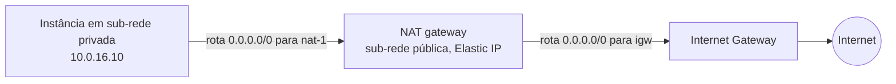

---
aliases:
  - Aula 6.4
modulo: 6
aula: 4
parte: "II Identidade, rede e dados"
dominios:
  - 1
  - 3
  - 4
lida: false
tags:
  - aula
  - saa-c03
  - modulo-06
---

# Aula 6.4: NAT Gateway, NAT Instance e egress-only internet gateway

[[06 - VPC a Fundo|Voltar ao módulo]]

> [!question] Pergunta que esta aula responde
> Como recursos em [[Sub-rede Privada|sub-redes privadas]] saem para a internet sem serem alcançáveis de fora, qual a diferença entre [[NAT Gateway]] e [[NAT Instance]], quando usar um [[NAT]] por [[Zona de Disponibilidade|AZ]], e como o [[IPv6]] resolve o mesmo problema?

## Por que o NAT existe (e por que ele pesa na conta)

Uma aplicação em [[Sub-rede Privada|sub-rede privada]] precisa, de vez em quando, falar com o mundo: baixar pacotes do SO, chamar a API de um parceiro, consultar um serviço de pagamento. A [[Sub-rede|sub-rede]] é privada de propósito, então não tem rota para o [[Internet Gateway]] (aula 6.3). A solução é um intermediário que **traduz** o endereço de origem: o servidor privado manda o pacote ao [[NAT]], o NAT o reenvia com o seu próprio IP público, e só aceita respostas a conexões iniciadas de dentro. O princípio (tabela de tradução com portas) está no [[03 - Fundamentos de Redes para a Nuvem|Módulo 3]]; aqui está a implementação da AWS.

Há um segundo motivo para estudar [[NAT]] com atenção: **é a linha de custo de rede que mais surpreende**. O [[NAT Gateway|NAT gateway]] cobra por hora **e** por GB processado, e na prova o tema "reduzir o custo do NAT" aparece em quase todos os simulados de [[VPC]].

## NAT gateway: como funciona

Segundo a documentação (verificado em novembro de 2026), um [[NAT Gateway|NAT gateway]] é um serviço de [[NAT|tradução de endereços]] gerenciado. Você escolhe um tipo de conectividade:

- **Público** (padrão): instâncias em [[Sub-rede Privada|sub-redes privadas]] saem para a internet, mas não recebem conexões iniciadas de fora. Fica em uma **[[Sub-rede Publica|sub-rede pública]]** e **exige um [[Elastic IP]]** associado na criação. O tráfego do [[NAT]] vai ao [[Internet Gateway]].
- **Privado**: serve para falar com **outras [[VPC|VPCs]] ou com a rede on-premises**, passando por um [[Transit Gateway]] ou [[Virtual Private Gateway|virtual private gateway]]. Não aceita [[Elastic IP]]. Se você rotear o tráfego de um [[NAT]] privado para o [[Internet Gateway|IGW]], o IGW descarta.

O desenho para o caso público são **duas [[Route Table|route tables]]**:

1. A [[Route Table|route table]] da **[[Sub-rede Privada|sub-rede privada]]** tem `0.0.0.0/0` apontando para o [[NAT Gateway|NAT gateway]].
2. A [[Route Table|route table]] da **[[Sub-rede Publica|sub-rede pública]]** onde o [[NAT]] mora tem `0.0.0.0/0` apontando para o [[Internet Gateway]].

Um erro clássico é criar o [[NAT]] em [[Sub-rede Privada|sub-rede privada]] ou esquecer a rota do [[Internet Gateway|IGW]] na [[Sub-rede|sub-rede]] dele: o NAT é criado e nada sai.

### Características e limites (verificado em novembro de 2026)

| Característica | Valor |
|---|---|
| Protocolos | [[TCP]], [[UDP]] e ICMP |
| [[Largura de Banda\|Largura de banda]] | 5 Gbps, escala automaticamente até 100 Gbps |
| Pacotes por segundo | 1 milhão, escala até 10 milhões (acima disso descarta pacotes) |
| Conexões simultâneas | Até 55.000 por IP para cada destino único (IP de destino, porta e protocolo) |
| IPs por [[NAT Gateway\|NAT gateway]] | Até 8 (1 primário e 7 secundários); por padrão 2 [[Elastic IP\|Elastic IPs]] |
| [[Security Group\|Security group]] | Não se associa ao [[NAT]]; use security groups nos recursos atrás dele |
| [[Network ACL]] | Aplica-se à [[Sub-rede\|sub-rede]] do [[NAT]]; ele usa as portas 1024 a 65535 |
| Roteamento | Não aceita tráfego vindo de VPN ou [[Direct Connect]] por [[Virtual Private Gateway\|virtual private gateway]] (com [[Transit Gateway]], sim); não é alcançável por [[VPC Peering\|VPC peering]] |
| Quota | 5 [[NAT Gateway\|NAT gateways]] por [[Zona de Disponibilidade\|AZ]] (ajustável) |

Duas consequências práticas:

- **"Não consigo abrir muitas conexões para o mesmo destino"**: se a aplicação mantém dezenas de milhares de conexões simultâneas a **um mesmo IP e porta** (uma API única), o limite de 55.000 por IP é atingido e a [[Metrica|métrica]] `ErrorPortAllocation` do [[CloudWatch]] sobe. A solução é associar IPs adicionais ao [[NAT Gateway|NAT gateway]] (até 8) ou dividir os recursos em várias [[Sub-rede|sub-redes]], cada uma com seu [[NAT]].
- **Monitoramento:** o [[NAT Gateway|NAT gateway]] publica métricas no [[CloudWatch]] a cada 1 minuto (`ActiveConnectionCount`, `BytesOutToDestination`, `ErrorPortAllocation`, entre outras) e sua interface aparece nos [[VPC Flow Logs]].

### Alta disponibilidade: um NAT por AZ

O [[NAT Gateway|NAT gateway]] é criado em **uma [[Zona de Disponibilidade|AZ]]** e implementado com redundância **dentro dela**. Se várias AZs compartilham um [[NAT]] e a AZ dele cai, **as outras AZs perdem a internet**. A recomendação da documentação é criar um NAT gateway em cada AZ e configurar o roteamento para que cada [[Sub-rede Privada|sub-rede privada]] use o **NAT da mesma AZ**.

Isso gera um [[Trade-off|trade-off]] de custo, que a Task 4.4 cobra diretamente: **um [[NAT]] por [[Zona de Disponibilidade|AZ]]** (resiliente, sem tráfego entre AZs) ou **um NAT compartilhado** (barato, mas [[Ponto Unico de Falha|ponto único de falha]] e com cobrança de transferência entre AZs).

| Estratégia | Resiliência | Custo | Quando |
|---|---|---|---|
| Um [[NAT]] compartilhado | Baixa: a [[Zona de Disponibilidade\|AZ]] do NAT falha, todos perdem saída | Menor | Desenvolvimento, teste |
| Um [[NAT]] por [[Zona de Disponibilidade\|AZ]] | Alta: falha de AZ isolada | Maior, mais horas de NAT | Produção |

> [!example] Conta resolvida: o preço de resiliência
> Preço de exemplo da página de preços de [[VPC]] (verificado em novembro de 2026): US$ 0,045 por hora por [[NAT Gateway|NAT gateway]] e US$ 0,045 por GB processado (valores de exemplo da região US East; confira a sua Região).
> - 1 [[NAT]]: 0,045 x 730 horas = **US$ 32,85/mês**.
> - 3 NATs (um por [[Zona de Disponibilidade|AZ]]): 3 x 32,85 = **US$ 98,55/mês**, ou seja, US$ 65,70 a mais por mês, **mais** o mesmo processamento por GB.
> - Processando 5 TB/mês (5.120 GB): 5.120 x 0,045 = **US$ 230,40** em dados, independentemente do número de NATs.
> Em dev, 1 [[NAT]] é razoável; em produção, os US$ 65,70 compram isolamento de falha de [[Zona de Disponibilidade|AZ]]. A transferência entre AZs de quem usa um NAT remoto é cobrada à parte (confira o valor atual na página de preços de [[EC2]]).

### O NAT regional

A AWS oferece hoje o **[[Regional NAT Gateway|regional NAT gateway]]** (verificado em novembro de 2026): em vez de criar um [[NAT]] por [[Zona de Disponibilidade|AZ]], você cria **um único [[NAT Gateway|NAT gateway]] em modo regional**, escolhe a [[VPC]], e ele **se expande e se contrai automaticamente pelas AZs onde há cargas**.

- **Não exige [[Sub-rede Publica|sub-rede pública]]** para hospedá-lo; ele é um recurso próprio, com a sua [[Route Table|route table]].
- **Um só ID** para todas as [[Zona de Disponibilidade|AZs]]: a mesma rota `0.0.0.0/0` serve às [[Sub-rede Privada|sub-redes privadas]] de todas elas.
- **[[Alta Disponibilidade|Alta disponibilidade]] por padrão**, com afinidade de zona.
- **Até 32 IPs por [[Zona de Disponibilidade|AZ]]** (contra 8 do zonal).
- A expansão para uma [[Zona de Disponibilidade|AZ]] nova pode levar **até 60 minutos**; nesse intervalo o tráfego é processado entre zonas por uma AZ existente.
- **Não oferece [[NAT]] privado**: para isso continue usando [[NAT Gateway|NAT gateways]] zonais.
- Dois modos: **automático** (a AWS gerencia IPs e [[Zona de Disponibilidade|AZs]]; recomendado) e **manual**.
- Cobrança: por hora **por [[Zona de Disponibilidade|AZ]]** em que está presente, mais o processamento por GB. O valor de US$ 0,045 por hora por AZ que circula em materiais de estudo **não foi confirmado** na documentação técnica (que remete à página de preços); confirme na [página de preços de VPC](https://aws.amazon.com/vpc/pricing/) antes de usar em contas.

Nas questões de prova, o [[NAT]] zonal por [[Zona de Disponibilidade|AZ]] ainda é a referência de decisão (Task 4.4: "single shared versus one per AZ"). O [[Regional NAT Gateway|NAT regional]] é recente e pode não aparecer nas questões da SAA-C03. Se uma alternativa citar o NAT regional como forma de ter [[Alta Disponibilidade|alta disponibilidade]] e simplicidade de rotas, ela é plausível; o NAT privado continua exigindo o zonal.

## Reduzindo o custo e a superfície do NAT

A documentação lista as estratégias oficiais:

- **Mantenha a carga na mesma [[Zona de Disponibilidade|AZ]] do [[NAT]]** (ou crie um NAT por AZ), para não pagar transferência entre AZs.
- **Tire do [[NAT]] o tráfego para serviços AWS.** Se a maior parte do tráfego pelo NAT é para [[S3]], [[DynamoDB]] ou outros serviços com endpoint, crie [[VPC Endpoint|VPC endpoints]]. O [[Gateway Endpoint]] para S3 e DynamoDB **não tem cobrança** (aula 6.8).

> [!example] Conta resolvida: o endpoint que paga a si mesmo
> Uma aplicação envia 10 TB/mês (10.240 GB) ao [[S3]] pelo [[NAT Gateway|NAT gateway]]. Só o processamento custa 10.240 x 0,045 = **US$ 460,80/mês**. Com um [[Gateway Endpoint|gateway endpoint]] para o S3 (sem custo adicional), esse trânsito passa a ir pela rota do endpoint e o processamento do [[NAT]] sobre ele cai a **zero**. A economia é de quase US$ 461 por mês por uma alteração de uma rota.

## NAT instance: o legado

Antes do [[NAT Gateway|NAT gateway]], usava-se uma **[[EC2|instância EC2]]** configurada para fazer [[NAT]] (a **[[NAT Instance|NAT instance]]**). A documentação recomenda o NAT gateway, porque oferece mais [[Disponibilidade|disponibilidade]] e banda com menos trabalho. Detalhes de como a NAT instance funciona:

- Precisa de uma [[AMI]] configurada com IP forwarding e regras de `iptables`.
- **Exige desligar a verificação de origem/destino (source/destination check)**: por padrão, uma instância descarta pacotes que não são para ela nem vêm dela; um [[NAT Instance|NAT instance]] reencaminha pacotes de terceiros e precisa desse check desligado.
- Você associa **[[Security Group|security group]]** a ela, patcha o SO, escolhe o tipo e tamanho, e cria scripts de [[Failover|failover]].

| Atributo | [[NAT Gateway\|NAT gateway]] | [[NAT Instance\|NAT instance]] |
|---|---|---|
| [[Disponibilidade]] | Redundante na [[Zona de Disponibilidade\|AZ]]; um por AZ para independência de zona | Script de [[Failover\|failover]] entre instâncias |
| Banda | 5 Gbps, até 100 Gbps | Depende do [[Instance Type\|tipo de instância]] |
| Manutenção | AWS | Você (patches, SO) |
| [[Security Group\|Security group]] | Não se associa | Associa |
| Port forwarding e [[Bastion Host\|bastion]] | Não suporta | Suporta, com configuração manual |
| Custo | Por hora e por GB | Por instância (tipo e tamanho) |

Quando a [[NAT Instance|NAT instance]] ainda aparece: **laboratório mínimo e barato** (uma instância pequena evita a cobrança por hora e por GB do gateway) ou quando se quer reaproveitar a mesma máquina como [[Bastion Host|bastion]] ou com port forwarding. Em produção, a resposta correta da prova é quase sempre o **[[NAT Gateway|NAT gateway]]** (menor [[Overhead Operacional|overhead operacional]]).

> [!info] Ligando os pontos
> Quando o enunciado diz "LEAST [[Overhead Operacional|operational overhead]]" para saída de [[Sub-rede Privada|sub-rede privada]], o serviço gerenciado ([[NAT Gateway|NAT gateway]]) vence a [[NAT Instance|NAT instance]] (que exige patches, source/dest check e [[Failover|failover]] manual). É o padrão do [[02 - Well-Architected e o Formato da Prova|Módulo 2]] aplicado a rede.

## IPv6: o egress-only internet gateway

No [[IPv6]] não há [[NAT]]: os endereços são globais e públicos por padrão, então uma instância com IPv6 em [[Sub-rede|sub-rede]] com rota para o [[Internet Gateway|IGW]] é alcançável de fora. Para ter **só saída**, existe o [[Egress-Only Internet Gateway]]:

- **Somente [[IPv6]]** (para saída [[IPv4]] use [[NAT Gateway|NAT gateway]]).
- **Stateful**: encaminha o tráfego de saída e devolve as respostas; **bloqueia conexões iniciadas de fora**.
- Você cria um e adiciona a rota `::/0` na [[Route Table|route table]] apontando para ele.
- **Sem custo** (há cobrança de [[Data Transfer|transferência de dados]]), um por [[VPC]], e **não aceita [[Security Group|security group]]**; você controla com [[Network ACL|NACL]] na [[Sub-rede|sub-rede]].

Para um recurso **somente [[IPv6]]** que precisa falar com um serviço **somente [[IPv4]]**, usa-se **DNS64 e NAT64**: o [[NAT Gateway|NAT gateway]] faz o NAT64 e o [[Route 53 Resolver]] faz o DNS64. Para a prova, basta saber que o [[NAT]] gateway também atende IPv6 para IPv4 dessa forma.

## NAT privado: CIDRs sobrepostos

O [[NAT Gateway|NAT gateway]] **privado** tem um caso de uso específico: duas redes com CIDRs sobrepostos que precisam conversar. A instância envia o pacote ao [[NAT]] privado, que o reenvia com o **[[RFC 1918|IP privado]] do próprio NAT** como origem, por um [[Transit Gateway]] ou [[Virtual Private Gateway|virtual private gateway]]. O destino enxerga um endereço do NAT, não do original, e as sobreposições não importam. O NAT privado não tem [[Elastic IP]] e **não sai para a internet**. É uma alternativa ao [[PrivateLink]] quando o problema é endereçamento, e os detalhes de conexão estão no [[07 - Conectividade Hibrida e entre VPCs|Módulo 7]].

## Como isso cai na prova

Cobre **Task 1.2** ([[VPC]] com [[NAT Gateway|NAT gateways]]), **Task 4.4** ([[NAT Instance|NAT instance]] versus gateway; um [[NAT]] compartilhado versus um por [[Zona de Disponibilidade|AZ]]; endpoints para reduzir transferência) e **Task 3.4**.

**Padrões de cenário**
- "[[Sub-rede Privada|Sub-rede privada]] precisa de saída para a internet, sem ser alcançável": [[NAT Gateway|NAT gateway]] em [[Sub-rede Publica|sub-rede pública]] (**LEAST [[Overhead Operacional|operational overhead]]**).
- "Reduzir custo de [[NAT]] com tráfego para [[S3]] ou [[DynamoDB]]": [[Gateway Endpoint|gateway endpoint]].
- "[[Alta Disponibilidade|Alta disponibilidade]] da saída": um [[NAT]] por [[Zona de Disponibilidade|AZ]], com rotas na mesma AZ.
- "Saída [[IPv6]] sem permitir conexões de entrada": [[Egress-Only Internet Gateway|egress-only internet gateway]].
- "CIDRs sobrepostos com a rede on-premises": [[NAT]] privado ou [[PrivateLink]].

**Palavras-chave em inglês**: "outbound-only", "[[Sub-rede Privada|private subnet]]", "[[NAT Gateway|NAT gateway]]", "single shared versus one per [[Zona de Disponibilidade|AZ]]", "egress-only", "no inbound connections".

**Pegadinhas clássicas**
- O [[NAT Gateway|NAT gateway]] fica em [[Sub-rede|sub-rede]] **pública**, com [[Elastic IP]].
- [[NAT Gateway|NAT gateway]] é **[[IPv4]]** (e NAT64); egress-only é **[[IPv6]]**.
- [[Security Group|Security group]] não se associa ao [[NAT Gateway|NAT gateway]].
- Compartilhar um [[NAT]] entre [[Zona de Disponibilidade|AZs]] economiza hora, mas cobra transferência entre AZs e perde resiliência.

| Requisito no enunciado | Resposta provável | Por quê |
|---|---|---|
| Saída [[IPv4]] de [[Sub-rede Privada\|sub-rede privada]] | [[NAT Gateway\|NAT gateway]] | Gerenciado, sem inbound |
| Menor custo para tráfego ao [[S3]] | [[Gateway Endpoint\|Gateway endpoint]] | Sem custo e sem [[NAT]] |
| Saída resiliente a falha de [[Zona de Disponibilidade\|AZ]] | [[NAT]] por AZ | NAT é zonal |
| Saída só [[IPv6]] | [[Egress-Only Internet Gateway\|Egress-only IGW]] | Stateful, bloqueia entrada |
| Menor custo em dev | Um [[NAT]] (ou [[NAT Instance\|NAT instance]]) | Resiliência não exigida |

## Resumo

> [!abstract] A aula em uma frase
> O [[NAT Gateway|NAT gateway]] dá saída [[IPv4]] a [[Sub-rede Privada|sub-redes privadas]] sem aceitar conexões de fora, é zonal (um por [[Zona de Disponibilidade|AZ]] para resiliência), cobra por hora e por GB, e o tráfego para [[S3]] e [[DynamoDB]] deve sair do [[NAT]] por [[Gateway Endpoint|gateway endpoints]].

**A lógica, em 5 passos**
1. [[Sub-rede Privada|Sub-rede privada]] não tem rota para o [[Internet Gateway|IGW]]; precisa de um tradutor.
2. O [[NAT Gateway|NAT gateway]] fica em [[Sub-rede Publica|sub-rede pública]], com [[Elastic IP]], e a privada aponta `0.0.0.0/0` para ele.
3. Ele só aceita respostas a conexões iniciadas de dentro.
4. Resiliência pede um [[NAT]] por [[Zona de Disponibilidade|AZ]]; economia aceita um só (com risco).
5. Para [[IPv6]] use o [[Egress-Only Internet Gateway|egress-only internet gateway]]; para custo, use endpoints.

**Números para lembrar**

| O quê | Valor | Por que importa |
|---|---|---|
| Banda do [[NAT Gateway\|NAT gateway]] | 5 Gbps, até 100 Gbps | Escala sozinho |
| Conexões por IP e destino | 55.000 | Limite que gera `ErrorPortAllocation` |
| IPs por [[NAT]] zonal | até 8 | Para aumentar conexões |
| Preço de exemplo | US$ 0,045/h e US$ 0,045/GB | Custo recorrente |
| [[NAT Gateway\|NAT gateways]] por [[Zona de Disponibilidade\|AZ]] | 5 | Quota padrão |

**Tabela-síntese**

| Componente | Tráfego | Tipo de IP |
|---|---|---|
| [[NAT Gateway\|NAT gateway]] público | Saída para a internet | [[IPv4]] (e NAT64) |
| [[NAT Gateway\|NAT gateway]] privado | Saída para outras redes | [[IPv4]] privado |
| [[NAT Instance\|NAT instance]] | Saída (legado, manual) | [[IPv4]] |
| [[Egress-Only Internet Gateway\|Egress-only IGW]] | Saída | [[IPv6]] |

**Na prática, isso significa**
- Produção: um [[NAT]] por [[Zona de Disponibilidade|AZ]] (ou o [[Regional NAT Gateway|NAT regional]]), com rotas na mesma AZ.
- Dev: um [[NAT]] compartilhado, ou nenhum, se endpoints bastarem.
- Antes de pagar por [[NAT]], crie [[Gateway Endpoint|gateway endpoints]] para [[S3]] e [[DynamoDB]].
- Monitore `ErrorPortAllocation` e os bytes processados.

> [!tip] Liga com
> Vem da [[06.03 - Route Tables Internet Gateway e IPs Publicos|aula 6.3]] (rotas e [[Internet Gateway|IGW]]). Segue para a [[06.05 - Security Groups|aula 6.5]] ([[Security Group|security groups]]) e antecipa os endpoints da [[06.08 - Gateway Endpoints para S3 e DynamoDB|aula 6.8]].

## Erros comuns

- **"O [[NAT Gateway|NAT gateway]] pode ficar numa [[Sub-rede Privada|sub-rede privada]]."** Ele precisa de uma [[Sub-rede Publica|sub-rede pública]] com rota para o [[Internet Gateway|IGW]].
- **"Um [[NAT]] por [[VPC]] basta para produção."** A [[Zona de Disponibilidade|AZ]] do NAT falha e as outras perdem a saída.
- **"Posso associar um [[Security Group|security group]] ao [[NAT Gateway|NAT gateway]]."** Não pode.
- **"O [[NAT Gateway|NAT gateway]] atende saída [[IPv6]] para qualquer destino."** Para saída IPv6 use o [[Egress-Only Internet Gateway|egress-only IGW]]; o [[NAT]] faz só NAT64 para [[IPv4]].
- **"[[Elastic IP]] do [[NAT]] é grátis."** Cobra por hora como qualquer [[IPv4]] público.

## Pratique

**1.** Servidores de aplicação em [[Sub-rede Privada|sub-redes privadas]] precisam chamar a API HTTPS de um parceiro, sem receber conexões da internet e com o menor [[Overhead Operacional|overhead operacional]]. O que fazer?

- [ ] a) Criar uma NAT instance em cada sub-rede privada
- [ ] b) Criar um NAT gateway em sub-rede pública e rotear a saída a ele (sem exposição e sem manutenção)
- [ ] c) Dar um IP público a cada servidor e abrir a saída no security group
- [ ] d) Criar um egress-only internet gateway e rotear `0.0.0.0/0` a ele

**2.** Uma equipe criou um [[NAT Gateway|NAT gateway]] em uma [[Sub-rede Privada|sub-rede privada]] e as instâncias continuam sem internet. Qual é a causa mais provável?

- [ ] a) O NAT gateway só funciona com IPv6
- [ ] b) É preciso associar um security group ao NAT gateway
- [ ] c) O NAT gateway precisa de uma NAT instance como par
- [ ] d) A sub-rede do NAT não tem rota para o IGW

**3.** Quais DUAS afirmações sobre o [[NAT Gateway|NAT gateway]] estão corretas? (Escolha DUAS.)

- [ ] a) Exige patches de sistema operacional feitos pelo cliente
- [ ] b) Escala automaticamente de 5 Gbps até 100 Gbps
- [ ] c) Não aceita security group; o filtro fica nos recursos e na NACL
- [ ] d) Aceita conexões iniciadas da internet para as instâncias privadas
- [ ] e) Pode ser acessado por VPC peering a partir de outra VPC

**4.** A fatura mostra um alto custo de processamento de dados no [[NAT Gateway|NAT gateway]], e quase todo o tráfego é para o [[S3]] e o [[DynamoDB]] na mesma Região. Qual é a ação com maior economia?

- [ ] a) Trocar o NAT gateway por uma NAT instance maior
- [ ] b) Criar um NAT gateway adicional em cada AZ
- [ ] c) Criar gateway endpoints para S3 e DynamoDB e rotear por eles
- [ ] d) Mover as instâncias para uma sub-rede pública com IP público

**5.** Uma carga de produção usa três [[Zona de Disponibilidade|AZs]] e compartilha um único [[NAT Gateway|NAT gateway]] zonal. Qual é o risco, e como mitigá-lo?

- [ ] a) Se a AZ do NAT falhar, as outras perdem a saída; usar um por AZ
- [ ] b) O NAT zonal se replica sozinho entre as AZs, então o risco é inexistente
- [ ] c) O NAT zonal perde o Elastic IP quando outra AZ falha; fixar um IP em cada instância
- [ ] d) O NAT zonal não suporta sub-redes de mais de uma AZ; trocar por um Internet Gateway

**6.** Instâncias com [[IPv6]] em uma [[Sub-rede Privada|sub-rede privada]] precisam acessar a internet por IPv6, mas a internet não pode iniciar conexões com elas. Qual recurso usar?

- [ ] a) Um NAT gateway público com Elastic IP
- [ ] b) Um Internet Gateway com security group restritivo
- [ ] c) Uma NAT instance com IPv6 habilitado
- [ ] d) Um egress-only internet gateway com rota `::/0`

**7.** Uma aplicação mantém dezenas de milhares de conexões simultâneas a um mesmo IP e porta externos e a [[Metrica|métrica]] `ErrorPortAllocation` do [[NAT Gateway|NAT gateway]] cresce. O que fazer?

- [ ] a) Associar mais IPs ao NAT gateway, até o limite de 8
- [ ] b) Trocar o NAT gateway por um Internet Gateway
- [ ] c) Aumentar o timeout das conexões da aplicação
- [ ] d) Reduzir o tamanho da sub-rede do NAT para um bloco `/28`

**8.** Quais DUAS são vantagens do [[NAT Gateway|NAT gateway]] sobre a [[NAT Instance|NAT instance]]? (Escolha DUAS.)

- [ ] a) Alta disponibilidade gerenciada dentro da AZ
- [ ] b) Suporte a port forwarding configurável
- [ ] c) Pode funcionar também como bastion host
- [ ] d) Cobrança por tipo e tamanho de instância escolhidos
- [ ] e) Nenhuma manutenção de SO ou de patches a cargo do cliente

**9.** Duas redes com CIDRs sobrepostos precisam trocar tráfego privado por um [[Transit Gateway]], sem renumerar. Qual recurso de [[NAT]] atende?

- [ ] a) NAT gateway público com Elastic IP e rota para o IGW
- [ ] b) NAT gateway privado (traduz para o IP dele)
- [ ] c) Egress-only internet gateway com rota `::/0` na sub-rede
- [ ] d) Um segundo NAT gateway em modo regional na VPC

**10.** Uma equipe montou uma [[NAT Instance|NAT instance]] em um laboratório para economizar, mas as instâncias privadas não saem para a internet, mesmo com a rota apontando para ela. Qual configuração obrigatória provavelmente falta na [[NAT]] instance?

- [ ] a) Associar um Elastic IP a cada instância privada
- [ ] b) Habilitar o enhanced networking com IPv6
- [ ] c) Desabilitar a verificação de origem e destino para que ela reencaminhe pacotes de terceiros
- [ ] d) Anexar um segundo Internet Gateway à VPC

**11.** Uma empresa expande cargas para novas [[Zona de Disponibilidade|AZs]] com frequência e quer um único ID de [[NAT]], sem [[Sub-rede Publica|sub-rede pública]] e sem criar um NAT por AZ. O que usar?

- [ ] a) Um NAT gateway público por AZ com Elastic IP
- [ ] b) Uma NAT instance com Auto Scaling
- [ ] c) Um egress-only internet gateway
- [ ] d) Um regional NAT gateway (um só ID, sem sub-rede pública)

**12.** Uma aplicação envia 10 TB por mês ao [[S3]] pelo [[NAT Gateway|NAT gateway]]. Considerando US$ 0,045 por GB processado (1 TB = 1.024 GB), qual é o custo mensal aproximado só de processamento, e qual a mudança que o elimina?

- [ ] a) Cerca de US$ 46, eliminado ao trocar para um NAT por AZ
- [ ] b) Cerca de US$ 4.600, eliminado ao usar Direct Connect
- [ ] c) Cerca de US$ 460, eliminado por gateway endpoint do S3
- [ ] d) Cerca de US$ 460, eliminado ao usar uma NAT instance com tipo maior

> [!success]- Gabarito
> **1. b)** o [[NAT Gateway|NAT gateway]] em [[Sub-rede Publica|sub-rede pública]] com a rota `0.0.0.0/0` dá saída sem exposição e sem manutenção; a) a [[NAT Instance|NAT instance]] exige patches e [[Failover|failover]]; c) IP público expõe os servidores; d) o egress-only é só [[IPv6]].
> **2. d)** o [[NAT Gateway|NAT gateway]] deve ficar em [[Sub-rede Publica|sub-rede pública]], e a [[Sub-rede|sub-rede]] dele precisa de rota para o [[Internet Gateway|IGW]]; a) funciona com [[IPv4]]; b) [[NAT]] gateway não aceita [[Security Group|security group]]; c) não há "par" de [[NAT Instance|NAT instance]].
> **3. b) e c)** escala até 100 Gbps e não aceita [[Security Group|security group]] ([[Network ACL|NACL]] na [[Sub-rede|sub-rede]] e SG nos recursos); a) o [[NAT Gateway|NAT gateway]] é gerenciado; d) só aceita respostas a conexões de dentro; e) não é alcançável por peering.
> **4. c)** [[Gateway Endpoint|gateway endpoints]] não têm custo e tiram o tráfego do [[NAT]]; a) a [[NAT Instance|NAT instance]] não reduz o tráfego nem o custo de forma garantida; b) mais NATs aumentam o custo por hora; d) expõe as instâncias e continua cobrando saída.
> **5. a)** o [[NAT]] é zonal, então a falha da [[Zona de Disponibilidade|AZ]] dele tira a saída das outras; um NAT por AZ com rotas locais resolve; b) o NAT zonal fica em uma só AZ (só o modo regional se expande entre AZs); c) o [[Elastic IP]] do NAT não depende de outras AZs; d) o [[Internet Gateway]] não faz NAT para [[Sub-rede Privada|sub-redes privadas]].
> **6. d)** o [[Egress-Only Internet Gateway|egress-only IGW]] é stateful, só [[IPv6]] e bloqueia a entrada; a) o [[NAT]] público é para [[IPv4]]; b) o [[Internet Gateway|IGW]] aceita conexões de entrada; c) [[NAT Instance|NAT instance]] é legado e IPv4.
> **7. a)** cada IP suporta 55.000 conexões por destino único, e o [[NAT]] aceita até 8 IPs; b) o [[Internet Gateway|IGW]] não atende [[Sub-rede Privada|sub-rede privada]]; c) [[Timeout|timeout]] maior piora o esgotamento; d) [[Sub-rede|sub-rede]] menor não afeta o limite.
> **8. a) e e)** [[Disponibilidade|disponibilidade]] gerenciada e ausência de manutenção; b) e c) são recursos da [[NAT Instance|NAT instance]]; d) a cobrança por instância é da [[NAT]] instance.
> **9. b)** o [[NAT]] privado reenvia com o [[RFC 1918|IP privado]] dele, escondendo a sobreposição; a) o público sai para a internet; c) o egress-only é [[IPv6]]; d) o regional não oferece NAT privado.
> **10. c)** a instância precisa reencaminhar pacotes de terceiros, então a verificação de origem e destino deve ser desligada; a) as instâncias privadas não precisam de [[Elastic IP|EIP]]; b) [[IPv6]] não é requisito; d) só há um [[Internet Gateway|IGW]] por [[VPC]].
> **11. d)** o [[Regional NAT Gateway|regional NAT gateway]] se expande entre [[Zona de Disponibilidade|AZs]], dispensa [[Sub-rede Publica|sub-rede pública]] e usa um só ID; a) é o modelo zonal que ele substitui; b) [[NAT Instance|NAT instance]] é legado; c) o egress-only é [[IPv6]].
> **12. c)** 10.240 GB x 0,045 = cerca de US$ 460, eliminado pelo [[Gateway Endpoint|gateway endpoint]]; a) erra a conta e o [[NAT]] por [[Zona de Disponibilidade|AZ]] não elimina o processamento; b) erra a conta por 10x e o [[Direct Connect]] não é o caminho para o [[S3]] na mesma Região; d) uma [[NAT Instance|NAT instance]] maior ainda processa o tráfego e só troca o custo por hora e manutenção.

### Laboratório (opcional): um NAT gateway por algumas horas

> [!warning] Use uma conta AWS pessoal e apague no mesmo dia
> Faça isto apenas em uma **[[Conta AWS|conta AWS]] pessoal separada**, com [[Budgets|AWS Budgets]] configurado. **Nunca na conta de produção da empresa.** O [[NAT Gateway|NAT gateway]] e o [[Elastic IP]] cobram **por hora**: com os preços de exemplo, cerca de US$ 0,05 por hora no total mais US$ 0,045 por GB. Apague tudo no mesmo dia.

Custo estimado: centavos, se apagado em poucas horas.

1. Tenha uma [[VPC]] com uma [[Sub-rede Publica|sub-rede pública]] (rota para o [[Internet Gateway|IGW]]) e uma privada (aulas 6.2 e 6.3).
2. Aloque um [[Elastic IP]]: `aws ec2 allocate-address --domain vpc` (anote o `AllocationId`).
3. Crie o [[NAT]] na [[Sub-rede|sub-rede]] **pública**: `aws ec2 create-nat-gateway --subnet-id <SubnetPublica> --allocation-id <AllocationId>` e aguarde ficar `available` (`aws ec2 wait nat-gateway-available --nat-gateway-ids <NatId>`).
4. Na [[Route Table|route table]] da [[Sub-rede Privada|sub-rede privada]], crie `0.0.0.0/0` para o [[NAT]]: `aws ec2 create-route --route-table-id <RtbPrivada> --destination-cidr-block 0.0.0.0/0 --nat-gateway-id <NatId>`.
5. Confira: `aws ec2 describe-route-tables --route-table-ids <RtbPrivada>` mostra a rota com o [[NAT]].
6. Observe as métricas do [[NAT Gateway|NAT gateway]] no [[CloudWatch]] (namespace `AWS/NATGateway`).

**Limpeza (nesta ordem):** apague a rota, depois `aws ec2 delete-nat-gateway --nat-gateway-id <NatId>`, espere `deleted`, e então `aws ec2 release-address --allocation-id <AllocationId>`. Um [[Elastic IP]] esquecido cobra US$ 0,005 por hora.

## Para aprofundar

- [ ] [NAT gateways](https://docs.aws.amazon.com/vpc/latest/userguide/vpc-nat-gateway.html) (AWS Docs): tipos público e privado, e o índice dos demais tópicos de [[NAT]].
- [ ] [NAT gateway basics](https://docs.aws.amazon.com/vpc/latest/userguide/nat-gateway-basics.html) (AWS Docs): limites de banda, conexões e IPs.
- [ ] [Regional NAT gateways for automatic multi-AZ expansion](https://docs.aws.amazon.com/vpc/latest/userguide/nat-gateways-regional.html) (AWS Docs): o modo regional, modos automático e manual.
- [ ] [Compare NAT gateways and NAT instances](https://docs.aws.amazon.com/vpc/latest/userguide/vpc-nat-comparison.html) (AWS Docs): tabela de comparação oficial.

Próxima aula: [[06.05 - Security Groups]]
