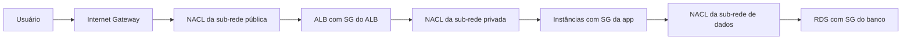

---
aliases:
  - Aula 6.6
modulo: 6
aula: 6
parte: "II Identidade, rede e dados"
dominios:
  - 1
  - 3
lida: false
tags:
  - aula
  - saa-c03
  - modulo-06
---

# Aula 6.6: Network ACLs e Defesa em Camadas

[[06 - VPC a Fundo|Voltar ao módulo]]

> [!question] Pergunta que esta aula responde
> Se o [[Security Group]] já protege cada recurso, para que existe a [[Network ACL]]? Por que ela é [[Stateless|stateless]], por que as [[Porta Efemera|portas efêmeras]] a tornam traiçoeira, e quando a prova quer uma NACL em vez de um security group?

## Por que uma segunda camada

O [[Security Group|security group]] protege a interface de cada recurso, mas só sabe **permitir**. Há duas situações em que isso não basta:

1. **Bloquear um alvo conhecido.** Um IP ou uma faixa está atacando a aplicação e você quer negar o tráfego dele **agora**, para toda a [[Sub-rede|sub-rede]]. Não existe "negar" no [[Security Group|security group]].
2. **Uma barreira que não dependa de quem configura cada instância.** Se alguém abrir uma porta por engano num [[Security Group|security group]], a [[Network ACL|NACL]] da [[Sub-rede|sub-rede]] ainda segura. Isso é [[Defesa em Profundidade|defesa em profundidade]]: duas camadas independentes, de modo que o erro de uma não expõe tudo.

A **[[Network ACL|network ACL]]** é um firewall no **limite da [[Sub-rede|sub-rede]]**. Ela avalia o tráfego que **entra** na sub-rede e o que **sai** dela. Tráfego entre duas instâncias **dentro da mesma sub-rede** não passa por ela.

## As propriedades que definem a NACL

1. **É [[Stateless|stateless]].** Ela **não guarda estado**. Cada pacote é avaliado sozinho, nos dois sentidos. A resposta de um tráfego permitido **precisa de uma regra própria** na direção oposta.
2. **Tem regras de permitir e de negar.** É a única das duas camadas que nega.
3. **As regras têm número e são avaliadas em ordem**, da menor para a maior. Na primeira que casa com o pacote, a decisão é tomada e a avaliação **para**. A regra final `*` (asterisco) nega tudo o que nenhuma regra casou e não pode ser removida.
4. **Opera por [[Sub-rede|sub-rede]].** Cada sub-rede está associada a **exatamente uma** [[Network ACL|NACL]]; uma NACL pode servir a várias sub-redes. Sub-rede nova sem NACL explícita recebe a **NACL padrão** da [[VPC]].

> [!info] Ligando os pontos
> Na [[06.05 - Security Groups|aula 6.5]] o [[Security Group|security group]] era stateful, só allow, avaliado em conjunto e por interface. Aqui os quatro atributos são o espelho: [[Stateless|stateless]], allow e deny, em ordem, por [[Sub-rede|sub-rede]]. A prova adora esse contraste.

## NACL padrão versus NACL personalizada

Pela documentação (verificado em novembro de 2026):

| | [[Network ACL\|NACL]] padrão (default) | NACL personalizada |
|---|---|---|
| Vem com a [[VPC]] | Sim, uma por VPC | Não, você cria |
| Entrada | Permite todo o tráfego [[IPv4]] (e [[IPv6]], se houver) | **Nega tudo** até você criar regras |
| Saída | Permite todo o tráfego | **Nega tudo** até você criar regras |
| [[Sub-rede]] nova | Associada a ela automaticamente | Você associa |

Consequência prática: a [[VPC]] funciona "de primeira" porque a [[Network ACL|NACL]] padrão é aberta, e quem protege no dia a dia é o [[Security Group|security group]]. Quando você cria uma NACL personalizada e associa a uma [[Sub-rede|sub-rede]], **tudo para de funcionar** até criar as regras, nos dois sentidos. É a causa número um de "criei uma NACL e a aplicação caiu".

## Numeração e ordem das regras

- Os números vão de **1 a 32766**. A recomendação é **pular de 100 em 100** (100, 200, 300), para poder inserir uma regra no meio depois.
- A regra de **menor número que casa vence**, e as seguintes são ignoradas.
- Para negar um IP e permitir o resto, a regra de negar precisa ter número **menor** que a de permitir.

> [!example] A ordem decide o resultado
> Regras de entrada na [[Network ACL|NACL]] da [[Sub-rede Publica|sub-rede pública]]:
> - `100`: permitir [[TCP]] 443 de `0.0.0.0/0`
> - `110`: negar todo o tráfego de `198.51.100.7/32`
> - `*`: negar tudo
> O IP `198.51.100.7` **continua entrando** na porta 443, porque a regra 100 casa primeiro e encerra a avaliação. Para bloquear de fato, o `deny` deveria ser a regra `90`, antes do `permit`.

## O ponto que derruba candidatos: portas efêmeras

Como a [[Network ACL|NACL]] não guarda estado, a resposta de um servidor volta para o cliente numa **[[Porta Efemera|porta efêmera]]** (temporária, alta), escolhida pelo sistema operacional do cliente. Uma NACL que permite a entrada na porta 443 e **não** permite a saída nas portas efêmeras corta todas as respostas.

Faixas de referência (valores da documentação de [[Porta Efemera|portas efêmeras]]; a página oficial não pôde ser aberta na checagem de novembro de 2026, por isso o valor do Linux é aproximado):

| Cliente | Faixa efêmera típica |
|---|---|
| Linux | cerca de 32768 a 61000 (o limite superior varia conforme o kernel) |
| Windows (Server 2008 em diante) | 49152 a 65535 |
| Load balancers ([[Elastic Load Balancing\|ELB]]) | 1024 a 65535 |
| [[NAT Gateway\|NAT gateway]] | 1024 a 65535 |

A regra de bolso da AWS: **libere 1024 a 65535** para a direção de resposta e controle o acesso de verdade no [[Security Group|security group]], que é stateful.

O raciocínio vale nos dois sentidos. Para um servidor web na [[Sub-rede Publica|sub-rede pública]]:

| Direção | Regra | Por quê |
|---|---|---|
| Entrada | [[TCP]] 443 de `0.0.0.0/0` | Requisição do cliente |
| Saída | [[TCP]] 1024-65535 para `0.0.0.0/0` | Resposta do servidor ao cliente ([[Porta Efemera\|porta efêmera]] do cliente) |

E se o servidor também fizer chamadas para fora (atualizar pacotes, por exemplo), a **resposta** dessas chamadas chega por **entrada** em [[Porta Efemera|portas efêmeras]]: precisa de `TCP 1024-65535` na entrada também.

## O que a NACL não filtra

Segundo a documentação, a [[Network ACL|NACL]] **não** avalia o tráfego de e para:

- o **[[DNS]]** do [[Route 53 Resolver]] (endereço `.2` da [[VPC]]);
- **DHCP**;
- o **serviço de metadados da instância** ([[Instance Metadata Service|IMDS]]);
- o endpoint de metadados de [[Tarefa ECS|tarefas do ECS]];
- ativação de licença do Windows;
- o Amazon Time Sync Service;
- os endereços reservados do roteador da [[VPC]].

Por isso uma [[Network ACL|NACL]] "fechada" ainda deixa a instância resolver nomes e ler o [[Instance Metadata Service|IMDS]]. Para filtrar [[DNS]], o instrumento é o [[Route 53 Resolver DNS Firewall]].

## Security group versus NACL: a tabela da prova

| Critério | [[Security Group\|Security group]] | [[Network ACL]] |
|---|---|---|
| Onde atua | [[ENI\|Interface de rede]] (ENI) | [[Sub-rede]] (limite) |
| Estado | **Stateful** | **[[Stateless]]** |
| Tipo de regra | Só **allow** | **Allow e deny** |
| Avaliação | Todas as regras juntas | **Em ordem numérica**, para na primeira |
| Resposta | Automática | Precisa de regra explícita |
| Padrão | Nada entra, tudo sai | Padrão: tudo; personalizada: nada |
| Aplicação | Só ao recurso associado | A **todos** os recursos da [[Sub-rede\|sub-rede]] |
| Quota padrão de regras | 60 por direção | 20 por direção (ajustável até 40) |

## Defesa em camadas: o desenho completo

Juntando tudo o que o módulo viu, o tráfego de um usuário até o banco atravessa camadas independentes:

Cada seta atravessa pelo menos duas verificações. A configuração madura é **[[Security Group|security groups]] bem feitos como regra principal** ([[Menor Privilegio|menor privilégio]], referenciando uns aos outros) e **[[Network ACL|NACLs]] como rede de segurança**: abertas o suficiente para não atrapalhar, com `deny` para bloqueios pontuais e para fronteiras entre camadas em ambientes regulados.

> [!warning] Evite complicar sem necessidade
> [[Network ACL|NACLs]] personalizadas pesadas multiplicam os pontos de falha: cada serviço novo exige lembrar das [[Porta Efemera|portas efêmeras]] e do número da regra. A recomendação comum é manter a NACL padrão e usar a personalizada **quando houver um motivo**: negar IPs, atender uma exigência de conformidade de duas camadas, ou isolar a [[Sub-rede|sub-rede]] de dados.

## Como isso cai na prova

Cobre **Task 1.2** ([[Defesa em Profundidade|camadas de segurança]] de rede: [[Security Group|security groups]], [[Network ACL|NACLs]]) e **Task 3.4**.

**Padrões de cenário**
- "Bloquear um IP ou faixa específica": [[Network ACL|NACL]] com `deny`.
- "A aplicação parou depois de criar uma [[Network ACL|NACL]]": faltam regras de entrada e saída, ou faltam [[Porta Efemera|portas efêmeras]].
- "Mudança de regra precisa valer na hora, inclusive para conexões abertas": [[Network ACL|NACL]].
- "Duas camadas de controle de tráfego" ou "[[Defesa em Profundidade|defesa em profundidade]]": SG mais [[Network ACL|NACL]].
- "Regra de negar com número maior que a de permitir não funciona": ordem.

**Palavras-chave em inglês**: "[[Stateless|stateless]]", "[[Network ACL|network ACL]]", "deny rule", "block IP address", "[[Sub-rede|subnet]] level", "[[Porta Efemera|ephemeral ports]]", "rule number".

**Pegadinhas clássicas**
- [[Network ACL|NACL]] **[[Stateless|stateless]]**: libere a resposta.
- Regra de **menor número** que casa vence.
- [[Network ACL|NACL]] personalizada **nega tudo** por padrão; a padrão **permite tudo**.
- [[Network ACL|NACL]] não filtra [[DNS]] do Resolver nem [[Instance Metadata Service|IMDS]].

| Requisito no enunciado | Resposta provável | Por quê |
|---|---|---|
| Bloquear IP malicioso na [[Sub-rede\|sub-rede]] | [[Network ACL\|NACL]] com deny | SG não nega |
| Resposta não volta ao cliente | Liberar [[Porta Efemera\|portas efêmeras]] | [[Network ACL\|NACL]] [[Stateless\|stateless]] |
| Regra de negar ignorada | Número menor que o do allow | Ordem de avaliação |
| Proteção por recurso individual | [[Security Group\|Security group]] | Nível da [[ENI]] |
| Duas camadas independentes | SG mais [[Network ACL\|NACL]] | [[Defesa em Profundidade\|Defesa em profundidade]] |

## Resumo

> [!abstract] A aula em uma frase
> A [[Network ACL|network ACL]] é um [[Stateful e Stateless (Firewall)|firewall stateless]] no limite da [[Sub-rede|sub-rede]], com regras de permitir e negar avaliadas por número, útil para bloquear alvos conhecidos e como segunda camada atrás dos [[Security Group|security groups]].

**A lógica, em 5 passos**
1. O [[Security Group|security group]] só permite; para negar, é preciso a [[Network ACL|NACL]].
2. A [[Network ACL|NACL]] atua no limite da [[Sub-rede|sub-rede]] e vale para todos os recursos dela.
3. Sendo [[Stateless|stateless]], a resposta precisa de regra própria, em [[Porta Efemera|portas efêmeras]] (1024 a 65535).
4. As regras são avaliadas por número, e a primeira que casa decide.
5. [[Network ACL|NACL]] personalizada nega tudo até receber regras; a padrão permite tudo.

**Números para lembrar**

| O quê | Valor | Por que importa |
|---|---|---|
| Número de regra | 1 a 32766 | Intervalo válido |
| Passo recomendado | 100 em 100 | Espaço para inserções |
| [[Porta Efemera\|Portas efêmeras]] (regra de bolso) | 1024 a 65535 | Resposta [[Stateless\|stateless]] |
| Regras por [[Network ACL\|NACL]] | 20 por direção (até 40) | Quota padrão |

**Tabela-síntese**

| Pergunta | [[Security Group\|Security group]] | [[Network ACL\|NACL]] |
|---|---|---|
| Nega? | Não | Sim |
| Guarda estado? | Sim | Não |
| Ordem? | Não | Sim |

**Na prática, isso significa**
- Controle principal no [[Security Group|security group]]; [[Network ACL|NACL]] como rede de segurança.
- `deny` com número menor que os `allow`.
- Sempre regras de entrada e de saída, com [[Porta Efemera|portas efêmeras]].
- Antes de criar [[Network ACL|NACL]] personalizada, liste as portas de cada fluxo.

> [!tip] Liga com
> Vem da [[06.05 - Security Groups|aula 6.5]]. Segue para a [[06.07 - Acesso Administrativo sem Expor Portas|aula 6.7]], onde a administração das instâncias dispensa abrir a porta 22.

## Erros comuns

- **"A [[Network ACL|NACL]] é stateful como o SG."** Não: precisa de regra de resposta.
- **"Esqueci as [[Porta Efemera|portas efêmeras]] e só liberei a 443."** As respostas são cortadas.
- **"Meu deny não funcionou."** Provavelmente há um allow de número menor.
- **"Associei uma [[Network ACL|NACL]] nova e tudo continua igual."** A personalizada nega tudo; se nada mudou, a associação não foi aplicada.
- **"A [[Network ACL|NACL]] protege o [[DNS]] da [[VPC]]."** Ela não avalia esse tráfego.

## Pratique

**1.** Um IP malicioso conhecido está enviando tráfego a instâncias numa [[Sub-rede|sub-rede]], e a equipe quer negar esse IP para todas elas. Qual é a solução?

- [ ] a) Regra de negar na NACL da sub-rede, antes dos allow
- [ ] b) Regra de negar no security group de cada instância
- [ ] c) Remover a rota para o Internet Gateway, derrubando o acesso de todos os usuários
- [ ] d) Criar uma política de endpoint que bloqueie o IP

**2.** Quais DUAS afirmações sobre [[Network ACL|NACLs]] estão corretas? (Escolha DUAS.)

- [ ] a) Elas são stateless e exigem regras para o tráfego de resposta
- [ ] b) Cada sub-rede pode ter várias NACLs associadas ao mesmo tempo
- [ ] c) Elas permitem regras de negar e de permitir
- [ ] d) Elas operam na interface de rede de cada instância
- [ ] e) Elas guardam o estado de cada conexão em andamento

**3.** Uma [[Network ACL|NACL]] permite entrada [[TCP]] 443 e saída apenas TCP 443. Os clientes não recebem respostas. Qual correção resolve?

- [ ] a) Associar à sub-rede uma segunda NACL com saída TCP 1024 a 65535
- [ ] b) Permitir entrada TCP 443 também para as portas efêmeras dos clientes remotos
- [ ] c) Permitir saída em TCP 1024 a 65535
- [ ] d) Reiniciar as instâncias para renovar o estado

**4.** Uma equipe numerou as regras de uma [[Network ACL|NACL]] personalizada e quer prever o que acontece quando duas regras casam com o mesmo pacote. Como a NACL decide?

- [ ] a) Todas as regras são somadas, e vence a mais permissiva
- [ ] b) As regras são avaliadas ao acaso, e a mais específica decide
- [ ] c) Cada recurso escolhe qual regra aplicar de acordo com o seu SG
- [ ] d) Em ordem numérica crescente, parando na primeira que casa

**5.** Depois que uma [[Network ACL|NACL]] personalizada foi associada a uma [[Sub-rede|sub-rede]], a aplicação deixou de responder. A NACL não tem nenhuma regra além das iniciais. Qual é a causa?

- [ ] a) A NACL personalizada permite tudo e conflita com o security group
- [ ] b) A NACL personalizada nega todo o tráfego até receber regras
- [ ] c) O security group foi apagado ao associar a NACL
- [ ] d) A rota local da sub-rede foi removida pela associação

**6.** A regra 100 permite [[TCP]] 443 de `0.0.0.0/0` e a regra 110 nega todo o tráfego de `198.51.100.7/32`. O que ocorre com esse IP na porta 443?

- [ ] a) É bloqueado, porque o deny é mais específico do que o allow e por isso prevalece
- [ ] b) É bloqueado, pois qualquer deny anula todos os allow
- [ ] c) Passa, porque a regra 100 casa antes
- [ ] d) Passa somente se o security group também permitir

**7.** Uma empresa quer duas camadas independentes de controle de tráfego para a [[Sub-rede|sub-rede]] de dados, atendendo a uma auditoria. Qual combinação é adequada?

- [ ] a) Somente um security group, com muitas regras detalhadas
- [ ] b) Somente uma NACL, no lugar de todos os security groups
- [ ] c) Apenas rotas, sem security groups nem NACLs
- [ ] d) Security groups por recurso e uma NACL na sub-rede

**8.** Uma equipe criou uma [[VPC]] nova e não mexeu na [[Network ACL|network ACL]]. A aplicação na [[Sub-rede|sub-rede]] recebe e envia tráfego normalmente. Qual é o comportamento da NACL padrão?

- [ ] a) Permite todo o tráfego de entrada e de saída
- [ ] b) Nega todo o tráfego de entrada e permite a saída
- [ ] c) Permite apenas tráfego interno entre as sub-redes da VPC
- [ ] d) Nega todo o tráfego de entrada e de saída

**9.** Quais DUAS práticas ajudam a operar [[Network ACL|NACLs]] personalizadas? (Escolha DUAS.)

- [ ] a) Numerar as regras de 100 em 100 para poder inserir outras depois
- [ ] b) Usar o número 32767 para a primeira regra de permitir
- [ ] c) Liberar a faixa de portas efêmeras na direção de resposta
- [ ] d) Remover a regra `*` para que o tráfego seja liberado
- [ ] e) Usar uma NACL por instância em vez de uma por sub-rede

**10.** Uma [[Sub-rede|sub-rede]] tem [[Network ACL|NACL]] personalizada fechada para quase tudo, mas as instâncias ainda resolvem nomes pelo [[DNS]] da [[VPC]]. Por quê?

- [ ] a) A NACL não filtra o tráfego do DNS do Route 53 Resolver, como também ignora DHCP e IMDS
- [ ] b) O security group substitui a NACL para o tráfego de DNS
- [ ] c) O DNS usa portas efêmeras, sempre liberadas por padrão
- [ ] d) A regra `*` da NACL permite o DNS de forma implícita

**11.** Uma equipe quer uma mudança de regra que valha imediatamente, até para conexões já abertas, bloqueando um endereço. Qual recurso atende?

- [ ] a) O security group, porque ele guarda o estado das conexões
- [ ] b) A NACL, porque é stateless e cada pacote é reavaliado (inclusive para conexões abertas)
- [ ] c) A tabela de rotas, removendo a rota local da sub-rede
- [ ] d) O NAT gateway, bloqueando o endereço na tradução

**12.** Um servidor web na [[Sub-rede Publica|sub-rede pública]] também baixa atualizações de pacotes pela internet. Qual regra de [[Network ACL|NACL]] é necessária para a resposta dessas chamadas?

- [ ] a) Saída TCP 443 para qualquer destino, sem nenhuma outra regra adicional
- [ ] b) Entrada TCP 1024 a 65535
- [ ] c) Entrada TCP 22 de `0.0.0.0/0` para receber os pacotes baixados
- [ ] d) Nenhuma, pois as respostas passam sem regra na NACL

> [!success]- Gabarito
> **1. a)** só a [[Network ACL|NACL]] nega, e o deny precisa de número menor que os allow; b) o SG não tem deny; c) remover a rota para o [[Internet Gateway|IGW]] derruba também os usuários legítimos; d) [[Endpoint Policy|política de endpoint]] não filtra entrada de internet.
> **2. a) e c)** [[Stateless|stateless]] e com allow e deny; b) cada [[Sub-rede|sub-rede]] tem exatamente uma [[Network ACL|NACL]]; d) isso é o SG; e) guardar estado é do SG.
> **3. c)** como é [[Stateless|stateless]], a resposta precisa de saída nas [[Porta Efemera|portas efêmeras]] (1024 a 65535); a) cada [[Sub-rede|sub-rede]] tem exatamente uma [[Network ACL|NACL]], então a segunda não se soma; b) a entrada em 443 já existe e o problema é a saída; d) reiniciar não cria regra.
> **4. d)** ordem numérica crescente, parando na primeira que casa; a) não há soma de regras na [[Network ACL|NACL]] (isso é o SG); b) a avaliação é ordenada, não aleatória; c) a NACL vale para a [[Sub-rede|sub-rede]], não por recurso.
> **5. b)** a [[Network ACL|NACL]] personalizada começa negando tudo; a) ela não permite tudo, esse é o comportamento da padrão; c) associar NACL não apaga SG; d) a rota local não é afetada.
> **6. c)** a regra 100 casa primeiro e encerra a avaliação, então o deny 110 nunca é lido; a) especificidade não importa, só a ordem; b) o deny não anula allow anteriores; d) o SG é outra camada, mas o IP já foi aceito na [[Network ACL|NACL]].
> **7. d)** SG por recurso mais [[Network ACL|NACL]] na [[Sub-rede|sub-rede]] dão duas camadas independentes; a) e b) usam uma só camada; c) rotas não filtram portas.
> **8. a)** a [[Network ACL|NACL]] padrão permite tudo nas duas direções; b) a saída e a entrada são ambas liberadas; c) não se limita à rede interna; d) isso descreve a personalizada.
> **9. a) e c)** numeração de 100 em 100 e [[Porta Efemera|portas efêmeras]] liberadas; b) o limite é 32766; d) a regra `*` não pode ser removida; e) a [[Network ACL|NACL]] é por [[Sub-rede|sub-rede]].
> **10. a)** a [[Network ACL|NACL]] não filtra [[DNS]] do Resolver, DHCP nem [[Instance Metadata Service|IMDS]]; b) o SG também não é o motivo; c) não há liberação automática de [[Porta Efemera|portas efêmeras]]; d) a regra `*` nega.
> **11. b)** a [[Network ACL|NACL]] é [[Stateless|stateless]] e reavalia cada pacote, inclusive em conexões abertas; a) o SG preserva conexões rastreadas; c) a rota local não pode ser removida; d) o [[NAT Gateway|NAT gateway]] não bloqueia endereços.
> **12. b)** a resposta das chamadas de saída chega por entrada em [[Porta Efemera|portas efêmeras]]; a) só a saída não basta; c) a porta 22 é de SSH, nada a ver; d) a [[Network ACL|NACL]] exige regra de resposta.

### Laboratório (opcional): negar um IP com NACL

> [!warning] Use uma conta AWS pessoal
> Faça isto apenas em uma **[[Conta AWS|conta AWS]] pessoal separada**, com [[Budgets|AWS Budgets]] configurado. **Nunca na conta de produção da empresa.** [[Network ACL|NACLs]] não têm custo. Use uma [[VPC]] de teste e uma [[Sub-rede|sub-rede]] de teste.

Custo estimado: zero.

1. Crie a [[Network ACL|NACL]]: `aws ec2 create-network-acl --vpc-id <VpcId>`.
2. Libere HTTPS na entrada: `aws ec2 create-network-acl-entry --network-acl-id <acl> --ingress --rule-number 100 --protocol tcp --port-range From=443,To=443 --cidr-block 0.0.0.0/0 --rule-action allow`.
3. Libere a resposta na saída: `aws ec2 create-network-acl-entry --network-acl-id <acl> --egress --rule-number 100 --protocol tcp --port-range From=1024,To=65535 --cidr-block 0.0.0.0/0 --rule-action allow`.
4. Insira um bloqueio com número **menor**: `aws ec2 create-network-acl-entry --network-acl-id <acl> --ingress --rule-number 90 --protocol -1 --cidr-block 198.51.100.7/32 --rule-action deny`.
5. Associe à [[Sub-rede|sub-rede]] de teste: `aws ec2 replace-network-acl-association --association-id <assoc> --network-acl-id <acl>`.
6. Confira: `aws ec2 describe-network-acls --network-acl-ids <acl>`.

**Limpeza:** reassocie a [[Sub-rede|sub-rede]] à [[Network ACL|NACL]] padrão (`replace-network-acl-association` com o ID da padrão) e então `aws ec2 delete-network-acl --network-acl-id <acl>`. Uma NACL associada a sub-rede não pode ser apagada.

## Para aprofundar

- [ ] [Control subnet traffic with network access control lists](https://docs.aws.amazon.com/vpc/latest/userguide/vpc-network-acls.html) (AWS Docs): padrão, personalizada, ordem de regras e tráfego não filtrado.
- [ ] [Custom network ACLs and ephemeral ports](https://docs.aws.amazon.com/vpc/latest/userguide/nacl-ephemeral-ports.html) (AWS Docs): faixas efêmeras por sistema operacional.
- [ ] [Compare security groups and network ACLs](https://docs.aws.amazon.com/vpc/latest/userguide/infrastructure-security.html) (AWS Docs): tabela oficial de diferenças.

Próxima aula: [[06.07 - Acesso Administrativo sem Expor Portas]]
