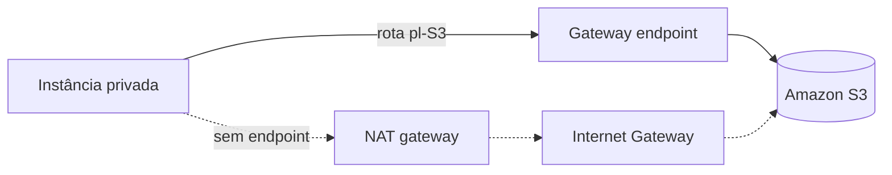

---
aliases:
  - Aula 6.8
modulo: 6
aula: 8
parte: "II Identidade, rede e dados"
dominios:
  - 1
  - 3
  - 4
lida: false
tags:
  - aula
  - saa-c03
  - modulo-06
---

# Aula 6.8: Gateway Endpoints para S3 e DynamoDB

[[06 - VPC a Fundo|Voltar ao módulo]]

> [!question] Pergunta que esta aula responde
> Por que o tráfego de uma instância privada para o [[S3]] e o [[DynamoDB]] passa, por padrão, pela [[NAT]] e pelo [[Internet Gateway]], e como o [[Gateway Endpoint]] o leva ao serviço de graça e sem depender deles, só com uma rota?

## Por que precisamos de endpoints

O [[S3]] e o [[DynamoDB]] não vivem dentro da sua [[VPC]]: são **serviços regionais** com endereços **públicos**. Quando uma instância em [[Sub-rede Privada|sub-rede privada]] faz `aws s3 cp`, o pacote vai ao endereço público do S3. Sem endpoint, o caminho é:

instância, depois [[NAT Gateway]], depois [[Internet Gateway]], depois o [[S3]].

Isso tem três problemas:

1. **Custo.** Toda a transferência passa pela [[NAT]] e paga o processamento por GB (aula 6.4). Um pipeline que lê terabytes do [[S3]] gera uma conta de NAT enorme por tráfego que nem precisava sair da AWS.
2. **Segurança.** A documentação do [[Gateway Endpoint|gateway endpoint]] informa que o tráfego da [[VPC]] para o [[S3]] ou o [[DynamoDB]] via [[Internet Gateway|IGW]] ou [[NAT]] **não deixa a rede da AWS**, então o problema não é "passar pela internet". O problema é que a [[Sub-rede|sub-rede]] precisa de **IGW ou NAT** (e de saída para a internet) só para falar com o serviço, e que você **não consegue restringir o caminho** por [[Endpoint Policy|política de endpoint]] nem por `aws:SourceVpce`, porque sem endpoint não existe `vpce` na conversa.
3. **Dependência.** A [[NAT]] vira ponto de falha e gargalo para o acesso a dados.

Um **[[VPC Endpoint|VPC endpoint]]** conecta a [[VPC]] a um serviço da AWS **por caminho privado**, sem [[Internet Gateway]], sem [[NAT]], sem VPN. Existem dois tipos: o **[[Gateway Endpoint|gateway endpoint]]** (esta aula) e o **[[Interface Endpoint|interface endpoint]]** (aula 6.9).

## O que é um gateway endpoint

Um **[[Gateway Endpoint|gateway endpoint]]** é um alvo de rota na **[[Route Table|tabela de rotas]]**. Pela documentação (verificado em novembro de 2026):

- Suporta **somente dois serviços: [[S3|Amazon S3]] e [[DynamoDB|Amazon DynamoDB]]**.
- **Não tem custo adicional**: nem hora, nem GB.
- Funciona por **roteamento**: ao criar o endpoint, você escolhe as [[Route Table|tabelas de rotas]], e a AWS adiciona uma rota que aponta o **[[Managed Prefix List|prefix list]]** do serviço (`pl-xxxx`, o conjunto de CIDRs do [[S3]] ou do [[DynamoDB]] na Região) para o endpoint (`vpce-xxxx`).
- Só funciona na **mesma Região** da [[VPC]]: um endpoint de [[S3]] em `us-east-1` não alcança buckets de outra Região por esse caminho.
- [[DynamoDB]]: o [[Gateway Endpoint|gateway endpoint]] suporta apenas **[[IPv4]]**.
- Quotas: **20 [[Gateway Endpoint|gateway endpoints]] por Região** (ajustável) e **255 por [[VPC]]**.

A instância **continua usando o mesmo nome [[DNS]]** (`s3.us-east-1.amazonaws.com`, por exemplo) e o mesmo endereço público; a diferença está no **roteamento**: a [[Longest Prefix Match|rota mais específica]] (o [[Managed Prefix List|prefix list]]) leva o pacote ao endpoint em vez de ao [[Internet Gateway|IGW]] ou à [[NAT]]. Por isso, com os servidores DNS da Amazon, **DNS hostnames e DNS resolution** precisam estar habilitados na [[VPC]].

> [!info] Ligando os pontos
> Na [[06.03 - Route Tables Internet Gateway e IPs Publicos|aula 6.3]] a regra de prioridade era: [[Longest Prefix Match|prefixo mais longo]] vence; entre iguais, estática, depois [[Managed Prefix List|prefix list]]. O [[Gateway Endpoint|gateway endpoint]] é uma rota para um **prefix list**, mais específica que `0.0.0.0/0`, e por isso ganha da rota que aponta para a [[NAT]].

## O que o gateway endpoint não faz

| Limitação | Consequência |
|---|---|
| Só a mesma Região | Para [[S3]] de outra Região, o caminho segue pela [[NAT]] ou por uma conexão entre [[Regiao AWS\|Regiões]] |
| Não alcança a partir de on-premises | Servidor local via [[Direct Connect]] ou VPN não usa o [[Gateway Endpoint\|gateway endpoint]]. Para [[S3]] a partir do data center, use o [[Interface Endpoint\|interface endpoint]] ([[RFC 1918\|IP privado]]) ou, via Direct Connect, uma **public [[Virtual Interface\|VIF]]** (o tráfego não passa pela internet pública; ver [[07 - Conectividade Hibrida e entre VPCs|Módulo 7]]) |
| Não passa por peering entre [[Regiao AWS\|Regiões]] nem [[Transit Gateway]] | Idem; use [[Interface Endpoint\|interface endpoint]] |
| Só [[S3]] e [[DynamoDB]] | Os demais serviços ([[SQS]], [[SNS]], [[KMS]] etc.) usam [[Interface Endpoint\|interface endpoint]] |
| Associado a **[[Route Table\|tabelas de rotas]]**, não a [[Sub-rede\|sub-redes]] | Cada tabela de rotas que deve usar o endpoint precisa ser selecionada |

> [!warning] Criar ou editar o endpoint derruba conexões abertas
> A documentação avisa: criar ou modificar um [[Gateway Endpoint|gateway endpoint]] troca as rotas e **desconecta as conexões [[TCP]] abertas**, e o IP de origem visto pelo [[S3]] muda de **público** para **privado** da [[VPC]]. Evite fazer isso no meio de uma tarefa crítica e confirme que o software reconecta sozinho.

## Segurança em três camadas

### 1. Security group e NACL

O tráfego da instância ao [[S3]] ainda passa pelo [[Security Group]] e pela [[Network ACL]]. O security group pode referenciar o **[[Managed Prefix List|prefix list]] do S3** na regra de saída ([[TCP]] 443). Na NACL **não** se pode referenciar prefix list: é preciso usar os CIDRs do prefix list (a documentação recomenda obter a faixa pelo próprio prefix list).

### 2. Política do endpoint

Cada endpoint tem uma **[[Endpoint Policy|política de endpoint]]** (um JSON de recurso) que limita **o que pode ser feito através dele**. O padrão é **acesso total**. Você pode restringir, por exemplo, a buckets específicos da organização.

> [!example] Endpoint só para os buckets da empresa
> Política do endpoint que permite apenas `s3:GetObject` e `s3:PutObject` em `arn:aws:s3:::meu-bucket-app/*`. Qualquer tentativa de usar o endpoint para copiar dados a um [[Bucket|bucket]] pessoal fora da lista é negada, reduzindo o risco de **exfiltração**. Atenção: se a instância precisa baixar agentes ou drivers de buckets da própria AWS, a política também precisa permitir esses buckets.

### 3. Política do bucket

O lado inverso: o **[[Bucket|bucket]]** só aceita requisições que venham de um endpoint ou [[VPC]] específicos. Três [[Condition Key|chaves de condição]] aparecem na prova:

- `aws:sourceVpce`: aceitar apenas de um endpoint específico (`vpce-...`).
- `aws:sourceVpc`: aceitar apenas de uma [[VPC]] (útil quando há vários endpoints nela).
- `aws:VpcSourceIp`: filtrar pelo IP **privado** de origem na [[VPC]].

Pegadinha: **não se usa `aws:SourceIp`** para requisições que passam por um [[VPC Endpoint|VPC endpoint]], pois o IP público deixa de ser visto; usa-se `aws:VpcSourceIp`. Outra: uma [[Bucket Policy|política de bucket]] que nega tudo menos o endpoint **também bloqueia o console** (que vem de fora da [[VPC]]).

## Endpoint de gateway e interface para o S3: otimização de custo

O [[S3]] admite os **dois tipos**. O [[Interface Endpoint|interface endpoint]] serve a quem vem **de fora da [[VPC]]** (on-premises, peering entre [[Regiao AWS|Regiões]], [[Transit Gateway]]) e custa por hora e por GB. Se você cria os dois com [[DNS]] privado no padrão, **inclusive o tráfego da VPC passa a usar o interface endpoint** e você passa a pagar por ele. A documentação descreve como evitar: configurar o DNS privado **apenas para o inbound [[Resolver Endpoint|Resolver endpoint]]**. Assim:

- requisições de **on-premises** resolvem para o [[RFC 1918|IP privado]] do [[Interface Endpoint|interface endpoint]];
- requisições **de dentro da [[VPC]]** continuam usando o [[Gateway Endpoint|gateway endpoint]], **de graça**.

Para a prova, basta a ideia: gateway para o tráfego dentro da [[VPC]] (gratuito), interface só onde o gateway não alcança.

## Como isso cai na prova

Cobre **Task 1.2** ([[VPC Endpoint|VPC endpoints]]), **Task 3.4** e **Task 4.4** (reduzir o [[Data Transfer|custo de transferência]], evitando a [[NAT]]).

**Padrões de cenário**
- "Instâncias privadas acessam o [[S3]] e a conta de [[NAT]] está alta": [[Gateway Endpoint|gateway endpoint]] para S3.
- "Acesso ao [[S3]] sem sair para a internet" ou "sem [[NAT]] nem [[Internet Gateway|IGW]]": [[Gateway Endpoint|gateway endpoint]].
- "Garantir que o [[Bucket|bucket]] só seja acessado pela [[VPC]]": [[Bucket Policy|política de bucket]] com `aws:sourceVpce` ou `aws:sourceVpc`.
- "Impedir que instâncias copiem dados para buckets de fora": [[Endpoint Policy|política de endpoint]] restritiva.
- "On-premises precisa acessar o [[S3]] de forma privada": [[Interface Endpoint|interface endpoint]], não gateway.

**Palavras-chave em inglês**: "[[Gateway Endpoint|gateway endpoint]]", "[[S3]] and [[DynamoDB]]", "no additional charge", "without [[Internet Gateway|internet gateway]] or [[NAT]]", "aws:SourceVpce", "[[Endpoint Policy|endpoint policy]]", "[[Managed Prefix List|prefix list]]".

**Pegadinhas clássicas**
- [[Gateway Endpoint|Gateway endpoint]]: **somente** [[S3]] e [[DynamoDB]].
- **Gratuito**, ao contrário do [[Interface Endpoint|interface endpoint]].
- Não alcança **on-premises**, peering entre [[Regiao AWS|Regiões]] ou [[Transit Gateway]].
- É **rota na tabela**, não [[ENI]]: não tem [[Security Group|security group]] próprio.

| Requisito no enunciado | Resposta provável | Por quê |
|---|---|---|
| Reduzir custo de [[NAT]] para o [[S3]] | [[Gateway Endpoint\|Gateway endpoint]] | Sem custo, sem NAT |
| Acesso privado ao [[DynamoDB]] | [[Gateway Endpoint\|Gateway endpoint]] | Suportado, gratuito |
| On-premises acessando o [[S3]] em privado | [[Interface Endpoint\|Interface endpoint]] | Gateway não alcança |
| [[Bucket]] só aceita a [[VPC]] | Condição `aws:sourceVpce` | [[Bucket Policy\|Política de bucket]] |
| Limitar o que passa pelo endpoint | [[Endpoint Policy\|Política de endpoint]] | Evita exfiltração |

## Resumo

> [!abstract] A aula em uma frase
> O [[Gateway Endpoint|gateway endpoint]] é uma rota gratuita, na [[Route Table|tabela de rotas]], que leva o tráfego do [[S3]] e do [[DynamoDB]] pela rede da AWS, dispensando a [[NAT]] e o [[Internet Gateway]], mas valendo só dentro da [[VPC]] e da Região.

**A lógica, em 5 passos**
1. [[S3]] e [[DynamoDB]] têm endereços públicos; sem endpoint, o tráfego sai pela [[NAT]].
2. O [[Gateway Endpoint|gateway endpoint]] cria uma rota do [[Managed Prefix List|prefix list]] do serviço para o endpoint.
3. O nome [[DNS]] e o endereço não mudam; muda o caminho.
4. Segurança: SG e [[Network ACL|NACL]], política do endpoint e política do [[Bucket|bucket]].
5. Para on-premises, peering entre [[Regiao AWS|Regiões]] ou [[Transit Gateway]], usa-se [[Interface Endpoint|interface endpoint]].

**Números para lembrar**

| O quê | Valor | Por que importa |
|---|---|---|
| Serviços suportados | 2 ([[S3]] e [[DynamoDB]]) | Pegadinha frequente |
| Custo | Zero | Corta a conta da [[NAT]] |
| Quota por Região | 20 (ajustável) | Quota padrão |
| Quota por [[VPC]] | 255 | Limite alto |

**Tabela-síntese**

| Aspecto | [[Gateway Endpoint\|Gateway endpoint]] | [[Interface Endpoint\|Interface endpoint]] |
|---|---|---|
| Serviços | [[S3]], [[DynamoDB]] | Muitos ([[PrivateLink]]) |
| Custo | Gratuito | Por hora e por GB |
| Implementação | Rota na tabela | [[ENI]] na [[Sub-rede\|sub-rede]] |
| On-premises | Não | Sim |

**Na prática, isso significa**
- Todo ambiente com [[Sub-rede Privada|sub-redes privadas]] ganha endpoints de [[S3]] e [[DynamoDB]] logo de início.
- [[Bucket]] sensível leva política com `aws:sourceVpce`.
- Combine com a [[NAT]] por [[Zona de Disponibilidade|AZ]] da aula 6.4 para tráfego que realmente precisa de internet.

> [!tip] Liga com
> Vem da [[06.07 - Acesso Administrativo sem Expor Portas|aula 6.7]] e da [[NAT]] da [[06.04 - NAT Gateway NAT Instance e Egress-Only|aula 6.4]]. Segue para a [[06.09 - Interface Endpoints PrivateLink e Endpoint Policies|aula 6.9]], que cobre os demais serviços. O [[S3]] em si é tema de um módulo posterior do curso.

## Erros comuns

- **"O [[Gateway Endpoint|gateway endpoint]] funciona para qualquer serviço AWS."** Só [[S3]] e [[DynamoDB]].
- **"O endpoint cobra por hora como o interface."** O gateway não cobra nada.
- **"O servidor on-premises usa o [[Gateway Endpoint|gateway endpoint]] pela [[Direct Connect]]."** Não alcança.
- **"Usei `aws:SourceIp` no [[Bucket|bucket]] e parou de funcionar."** Para endpoints é `aws:VpcSourceIp`.
- **"Criei o endpoint mas nada mudou."** A [[Route Table|tabela de rotas]] da [[Sub-rede|sub-rede]] não foi associada ao endpoint.

## Pratique

**1.** Instâncias em [[Sub-rede Privada|sub-redes privadas]] leem grandes volumes do [[S3]] pela [[NAT Gateway|NAT gateway]], e o custo de processamento está alto. Qual é a solução mais econômica?

- [ ] a) Trocar a NAT por uma NAT instance maior e com mais banda
- [ ] b) Criar um gateway endpoint para o S3 nas tabelas de rotas
- [ ] c) Criar um interface endpoint do S3 em cada AZ da VPC
- [ ] d) Atribuir IPs públicos às instâncias para sair pelo IGW

**2.** Uma equipe quer usar [[Gateway Endpoint|gateway endpoints]], que não têm custo, para o acesso privado de [[Sub-rede|sub-redes]] a vários serviços. Quais serviços a AWS atende por esse tipo de endpoint?

- [ ] a) Apenas o Amazon S3 e o Amazon DynamoDB
- [ ] b) S3, DynamoDB, SQS e SNS
- [ ] c) S3, DynamoDB e KMS, nas Regiões em que o KMS oferecer o recurso
- [ ] d) Todos os serviços da AWS em qualquer Região

**3.** Quais DUAS afirmações sobre [[Gateway Endpoint|gateway endpoints]] estão corretas? (Escolha DUAS.)

- [ ] a) Não têm custo adicional pelo uso
- [ ] b) Alcançam o S3 de outra Região por qualquer VPC
- [ ] c) Funcionam apenas na mesma Região da VPC
- [ ] d) Criam interfaces de rede com IP privado em cada AZ
- [ ] e) Podem ser acessados por Transit Gateway e Direct Connect

**4.** Um arquiteto precisa explicar à equipe de rede por que um [[Gateway Endpoint|gateway endpoint]] não consome IPs de nenhuma [[Sub-rede|sub-rede]]. Como o tráfego chega ao serviço?

- [ ] a) Por uma ENI com IP privado criada em cada sub-rede
- [ ] b) Por uma conexão VPN gerenciada entre a VPC e o S3
- [ ] c) Por um security group específico associado ao endpoint
- [ ] d) Por uma rota na tabela de rotas para o prefix list do serviço

**5.** Um servidor on-premises, conectado por [[Direct Connect]], precisa acessar o [[S3]] sem usar a internet pública. O que a equipe deve usar?

- [ ] a) Gateway endpoint na VPC, que alcança a rede local
- [ ] b) Um NAT gateway ligado ao Direct Connect
- [ ] c) Interface endpoint do S3, via Direct Connect
- [ ] d) Uma regra de NACL permitindo o prefix list do S3

**6.** Quais DUAS condições são necessárias para um [[Gateway Endpoint|gateway endpoint]] funcionar com os servidores [[DNS]] da Amazon? (Escolha DUAS.)

- [ ] a) Habilitar DNS resolution na VPC
- [ ] b) Habilitar DNS hostnames na VPC
- [ ] c) Criar uma zona hospedada privada para o S3
- [ ] d) Usar um servidor DNS próprio obrigatoriamente
- [ ] e) Ter uma NAT gateway na mesma sub-rede

**7.** Depois de criar um [[Gateway Endpoint|gateway endpoint]], a equipe deseja impedir que as instâncias copiem dados para buckets fora da conta da empresa. Qual recurso resolve?

- [ ] a) Uma política de endpoint com os buckets da empresa
- [ ] b) Uma regra de saída no security group negando o S3
- [ ] c) Uma NACL com regra de negar para o prefix list do S3
- [ ] d) Remover a rota local da tabela de rotas da sub-rede

**8.** Qual é o efeito de criar ou modificar um [[Gateway Endpoint|gateway endpoint]] sobre as conexões [[TCP]] abertas com o [[S3]]?

- [ ] a) Elas continuam sem interrupção, usando os IPs públicos antigos
- [ ] b) Elas migram sem perda para o novo caminho do endpoint
- [ ] c) Elas são desconectadas, e o IP de origem passa a ser privado
- [ ] d) Elas são mantidas apenas até que o endpoint termine de ser criado

**9.** Uma regra de saída do [[Security Group|security group]] deve permitir o acesso ao [[S3]] por um [[Gateway Endpoint|gateway endpoint]]. Qual é a abordagem recomendada?

- [ ] a) TCP 443 para o prefix list gerenciado do S3
- [ ] b) TCP 443 para o IP privado do endpoint
- [ ] c) Todo o tráfego para o CIDR da sub-rede
- [ ] d) Nenhuma regra, pois o endpoint ignora o security group

**10.** Uma empresa quer que um [[Bucket|bucket]] aceite requisições somente de um endpoint específico da [[VPC]]. Qual condição usar na política do bucket?

- [ ] a) `aws:SourceIp`, com o IP público da NAT
- [ ] b) `aws:SourceVpce`, com o ID do endpoint
- [ ] c) `aws:PrincipalOrgID`, com o ID da organização
- [ ] d) `aws:SecureTransport`, exigindo HTTPS

**11.** Uma [[VPC]] tem um [[Gateway Endpoint|gateway endpoint]] para o [[S3]], e a equipe também criou um [[Interface Endpoint|interface endpoint]] para o S3 com [[DNS]] privado ativo. A conta de endpoints subiu, e o tráfego interno da VPC deveria usar o caminho gratuito. Qual é a causa e a correção?

- [ ] a) O DNS privado faz a VPC resolver o S3 para o interface endpoint; desative-o (ou restrinja-o a acesso externo) para devolver o tráfego ao gateway
- [ ] b) O gateway endpoint passou a cobrar por hora e por GB; remova-o da VPC
- [ ] c) A rota `0.0.0.0/0` da NAT é mais específica que a do prefix list do S3; apague a rota da NAT
- [ ] d) O interface endpoint exige uma NAT para falar com o S3; aumente a quota da NAT

**12.** Uma [[Route Table|tabela de rotas]] privada não tem o [[Gateway Endpoint|gateway endpoint]] selecionado. O que acontece com o tráfego da [[Sub-rede|sub-rede]] para o [[S3]]?

- [ ] a) Usa o endpoint mesmo assim, pois ele vale para a VPC toda
- [ ] b) Segue pela NAT e pelo IGW, e paga o processamento por GB
- [ ] c) É descartado, pois o S3 exige o endpoint nessa Região
- [ ] d) Passa a usar um interface endpoint criado automaticamente

> [!success]- Gabarito
> **1. b)** o [[Gateway Endpoint|gateway endpoint]] é gratuito e tira o tráfego da [[NAT]]; a) [[NAT Instance|NAT instance]] não resolve o custo por GB e adiciona operação; c) o [[Interface Endpoint|interface endpoint]] cobra por hora e por GB; d) IPs públicos aumentam a exposição.
> **2. a)** só [[S3]] e [[DynamoDB]]; b) [[SQS]] e [[SNS]] usam [[Interface Endpoint|interface endpoint]]; c) o [[KMS]] também usa interface endpoint; d) não é universal.
> **3. a) e c)** sem custo e só na mesma Região; b) não alcança outra Região; d) isso é do [[Interface Endpoint|interface endpoint]]; e) não passa por [[Transit Gateway|TGW]] nem [[Direct Connect]].
> **4. d)** rota para o [[Managed Prefix List|prefix list]] apontando ao endpoint; a) isso descreve o [[Interface Endpoint|interface endpoint]]; b) não é VPN; c) o [[Gateway Endpoint|gateway endpoint]] não tem [[Security Group|security group]].
> **5. c)** o [[Gateway Endpoint|gateway endpoint]] não alcança on-premises, então é preciso o [[Interface Endpoint|interface endpoint]]; a) o gateway não se estende à rede local; b) a [[NAT]] não liga ao [[Direct Connect]] para isso; d) [[Network ACL|NACL]] não cria caminho.
> **6. a) e b)** [[DNS]] resolution e DNS hostnames; c) não é necessária [[Private Hosted Zone|zona privada]]; d) o DNS próprio é uma alternativa, não requisito; e) a [[NAT]] é justamente o que se evita.
> **7. a)** a [[Endpoint Policy|política de endpoint]] limita os buckets alcançáveis; b) o SG não nega; c) [[Network ACL|NACL]] não referencia [[Managed Prefix List|prefix list]] e negaria o [[S3]] inteiro; d) a rota local não pode ser removida.
> **8. c)** a mudança desconecta as conexões abertas e o IP de origem passa a privado; a) não continuam; b) não migram; d) as conexões caem na troca de rotas.
> **9. a)** o [[Managed Prefix List|prefix list]] gerenciado do [[S3]] na saída; b) o [[Gateway Endpoint|gateway endpoint]] não tem [[RFC 1918|IP privado]]; c) o destino é o S3, não a [[Sub-rede|sub-rede]]; d) o SG continua valendo.
> **10. b)** `aws:SourceVpce` restringe a um endpoint; a) `aws:SourceIp` não vale para endpoints; c) condiciona por organização; d) exige HTTPS, não o endpoint.
> **11. a)** com [[DNS]] privado ativo, a [[VPC]] passa a resolver o [[S3]] para o [[Interface Endpoint|interface endpoint]] (pago); desativar ou restringir isso devolve o tráfego ao gateway gratuito; b) o [[Gateway Endpoint|gateway endpoint]] não cobra; c) `0.0.0.0/0` é menos específica que o [[Managed Prefix List|prefix list]], e a rota mais longa vence; d) o interface endpoint não usa [[NAT]].
> **12. b)** sem a associação não há rota do [[Managed Prefix List|prefix list]], e o tráfego segue pela [[NAT]] e pelo [[Internet Gateway|IGW]]; a) o endpoint vale só nas tabelas selecionadas; c) o [[S3]] não exige endpoint; d) nada é criado automaticamente.

### Laboratório (opcional): endpoint de S3 na prática

> [!warning] Use uma conta AWS pessoal
> Faça isto apenas em uma **[[Conta AWS|conta AWS]] pessoal separada**, com [[Budgets|AWS Budgets]] configurado. **Nunca na conta de produção da empresa.** O [[Gateway Endpoint|gateway endpoint]] não tem custo; a instância e o [[Bucket|bucket]] podem ter (centavos).

Custo estimado: centavos, se você encerrar a instância.

1. Crie um [[Bucket|bucket]] de teste: `aws s3 mb s3://<nome-unico> --region us-east-1`.
2. Crie o endpoint: `aws ec2 create-vpc-endpoint --vpc-id <VpcId> --service-name com.amazonaws.us-east-1.s3 --route-table-ids <rtb-privada>`.
3. Confira a rota: `aws ec2 describe-route-tables --route-table-ids <rtb-privada>`. Há uma rota com destino `pl-...` e alvo `vpce-...`.
4. Entre na instância privada **sem [[NAT]]** (sem IP público e sem porta 22) pelo **[[EC2 Instance Connect Endpoint]]** ([[06.07 - Acesso Administrativo sem Expor Portas|aula 6.7]]) ou pelo [[Session Manager]] com os 3 [[Interface Endpoint|interface endpoints]] ([[06.09 - Interface Endpoints PrivateLink e Endpoint Policies|aula 6.9]]); esses endpoints têm custo, então apague-os no mesmo dia. Rode `aws s3 ls s3://<nome-unico>` (precisa de [[Instance Profile|perfil de instância]] com permissão no [[S3]]). A chamada funciona sem internet.
5. Aplique uma [[Bucket Policy|política de bucket]] com `aws:sourceVpce` negando qualquer outro caminho e teste do seu computador: o acesso é negado.

**Limpeza:** apague o endpoint (`delete-vpc-endpoints`), o [[Bucket|bucket]] e a instância.

## Para aprofundar

- [ ] [Gateway endpoints for Amazon S3](https://docs.aws.amazon.com/vpc/latest/privatelink/vpc-endpoints-s3.html) (AWS Docs): considerações, [[DNS]] privado, políticas de [[Bucket|bucket]].
- [ ] [Gateway endpoints for Amazon DynamoDB](https://docs.aws.amazon.com/vpc/latest/privatelink/vpc-endpoints-ddb.html) (AWS Docs): considerações e limitações.
- [ ] [Gateway endpoints](https://docs.aws.amazon.com/vpc/latest/privatelink/gateway-endpoints.html) (AWS Docs): visão geral dos dois serviços suportados.

Próxima aula: [[06.09 - Interface Endpoints PrivateLink e Endpoint Policies]]
