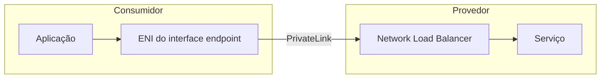

---
aliases:
  - Aula 6.9
modulo: 6
aula: 9
parte: "II Identidade, rede e dados"
dominios:
  - 1
  - 3
lida: false
tags:
  - aula
  - saa-c03
  - modulo-06
---

# Aula 6.9: Interface Endpoints, PrivateLink e Endpoint Policies

[[06 - VPC a Fundo|Voltar ao módulo]]

> [!question] Pergunta que esta aula responde
> Se o [[Gateway Endpoint|gateway endpoint]] só cobre [[S3]] e [[DynamoDB]], como uma instância sem internet chama o [[SQS]], o [[KMS]] ou um serviço de outra empresa por caminho privado? E como o [[PrivateLink]] expõe um serviço seu a outras [[VPC|VPCs]] sem unir as redes?

## Por que o PrivateLink existe

Dois problemas diferentes, a mesma tecnologia:

1. **Consumir serviços da AWS em privado.** A maioria dos serviços ([[SQS]], [[SNS]], [[KMS]], [[Secrets Manager]], [[ECR]], [[CloudWatch]], [[Systems Manager]] e dezenas de outros) tem endpoints **públicos**. Sem solução, uma instância em [[Sub-rede Privada|sub-rede privada]] precisa de [[NAT]] para chamá-los, com custo e dependência.
2. **Expor um serviço seu a outras [[VPC|VPCs]] ou contas.** Com [[VPC Peering]] você junta as redes inteiras: CIDRs não podem se sobrepor e todos os recursos ficam alcançáveis entre si. Para "dar acesso a **uma** aplicação, e só ela", é uma ligação larga demais.

O **[[PrivateLink|AWS PrivateLink]]** resolve os dois: cria um ponto de entrada **privado** (uma [[ENI|interface de rede]] com IP da sua [[Sub-rede|sub-rede]]) para um serviço, sem [[Internet Gateway]], sem [[NAT]] e sem juntar as redes.

## O interface endpoint por dentro

Um **[[Interface Endpoint]]** é um conjunto de **interfaces de rede ([[ENI]])**, **uma por [[Sub-rede|sub-rede]]** que você escolher, cada uma com um **[[RFC 1918|IP privado]]** do [[CIDR]] daquela sub-rede, que serve de porta de entrada para o serviço. Pela documentação (verificado em novembro de 2026):

- Entrega tráfego **[[TCP]] ou [[UDP]]**, resolvido por **[[DNS]]**.
- Cada [[ENI]] do endpoint é **gerenciada pelo solicitante**: você não a edita, mas ela ocupa IPs da [[Sub-rede|sub-rede]] e **aceita [[Security Group]]** (o endpoint tem seu próprio grupo).
- Escolher [[Sub-rede|sub-redes]] em **mais de uma [[Zona de Disponibilidade|AZ]]** dá [[Alta Disponibilidade|alta disponibilidade]].
- É **cobrado**: por hora, por [[Zona de Disponibilidade|AZ]] onde há [[ENI]], mais o volume de dados processado. Exemplo de preço de tabela, em `us-east-1` (confirme na página oficial antes de calcular): cerca de **US$ 0,01 por hora por AZ** e **US$ 0,01 por GB** nos primeiros volumes. Três endpoints em duas AZs ficam em torno de **US$ 43 por mês** só de horas, **antes** do tráfego.
- Acessível a partir de **on-premises** (por [[Direct Connect]] ou VPN) e de **[[VPC|VPCs]] ligadas** por peering ou [[Transit Gateway]], o que o [[Gateway Endpoint|gateway endpoint]] não faz.

> [!info] Ligando os pontos
> A aula 6.8 mostrou o [[Gateway Endpoint|gateway endpoint]] (rota, de graça, só [[S3]] e [[DynamoDB]]). O [[Interface Endpoint|interface endpoint]] é a versão geral: uma **[[ENI]] com [[RFC 1918|IP privado]]**, que cobra, e que por isso **precisa do seu [[Security Group|security group]]** e de [[Sub-rede|sub-redes]] com IPs livres, como o [[Application Load Balancer|ALB]] da [[06.02 - Sub-redes e Arquitetura em Camadas|aula 6.2]].

### DNS privado: como a instância chega ao endpoint

O endpoint recebe nomes [[DNS]] próprios, mas o que torna a coisa transparente é o **DNS privado** (opção **Enable private DNS names**). Quando ele está ligado:

- A AWS cria, de forma oculta, uma **[[Private Hosted Zone|zona hospedada privada]]** na sua [[VPC]] que faz o nome **padrão do serviço** (por exemplo `sqs.us-east-1.amazonaws.com`) resolver para os **IPs privados** do endpoint.
- Seu código e o SDK **não mudam**: continuam chamando o mesmo nome; a resolução, agora, cai no [[RFC 1918|IP privado]].
- Exige **`enableDnsSupport`** e **`enableDnsHostnames`** ativos na [[VPC]] (aula 6.10).

Sem [[DNS]] privado, o nome padrão ainda resolve para o IP **público** e o tráfego sai pela [[NAT]]: é o erro clássico de "criei o endpoint mas continua pagando NAT".

## Security group e política do endpoint

Dois controles diferentes, que a prova mistura:

| Controle | O que limita | Onde |
|---|---|---|
| **[[Security Group\|Security group]] do endpoint** | **Quem pode alcançar** a [[ENI]] (origem e porta, em geral [[TCP]] 443) | Na interface de rede do endpoint |
| **Política do endpoint** | **O que se pode fazer** através dele (ações, recursos, [[Principal\|principals]]) | No recurso do endpoint (JSON) |

Sobre a [[Endpoint Policy|política de endpoint]] (documentação, verificado em novembro de 2026):

- É um documento JSON no formato [[IAM]] com elemento `Principal`; tamanho máximo de **20.480 caracteres**.
- O padrão é **acesso total** (`Allow *` em tudo).
- **Não substitui nem sobrepõe** as políticas de identidade ou de recurso: as três precisam permitir (o acesso é a interseção).
- Nem todos os serviços aceitam [[Endpoint Policy|política de endpoint]]; se não aceita, o acesso fica total.
- Em **[[Gateway Endpoint|gateway endpoints]]**, o `Principal` precisa ser `*`, e o principal real se informa pela condição `aws:PrincipalArn`.

> [!example] Endpoint do Secrets Manager restrito à conta
> Uma política que permite `secretsmanager:GetSecretValue` só em segredos da própria conta, através do endpoint. Se alguém tentar usar essa [[VPC]] para ler um segredo de outra conta, o endpoint nega, mesmo que o [[IAM]] do usuário permitisse. É o controle de **perímetro de dados**: o que a VPC pode ou não tocar.

## Expor o seu serviço: endpoint services

O lado do **provedor**: você hospeda uma aplicação atrás de um **[[Network Load Balancer]]** (ou de um [[Gateway Load Balancer]]) e cria um **[[Endpoint Service|endpoint service]]**. Pela documentação:

- O provedor **precisa** de um [[Elastic Load Balancing|load balancer]]: o [[Network Load Balancer|NLB]] recebe as requisições dos consumidores e as encaminha ao serviço.
- Por padrão o serviço **não está disponível**: o provedor **autoriza [[Principal|principals]] específicos** (contas, usuários, roles) a conectar, e pode exigir **aceitação manual** de cada conexão.
- O consumidor cria um **[[Interface Endpoint|interface endpoint]]** informando o **nome do serviço**; a [[ENI]] aparece na [[VPC]] dele.
- A conexão é **unidirecional**: o consumidor inicia, o provedor responde. O provedor **não consegue** iniciar tráfego para a [[VPC]] do consumidor.
- Como não há roteamento entre as redes, **CIDRs sobrepostos não são problema**. Esse é o grande argumento sobre o peering.
- O provedor **não vê o IP do consumidor**: a aplicação enxerga os IPs privados dos nós do [[Elastic Load Balancing|load balancer]] (verificado em novembro de 2026, [documentação do endpoint service](https://docs.aws.amazon.com/vpc/latest/privatelink/create-endpoint-service.html)). Para obter o IP original, habilite o **[[Proxy Protocol|proxy protocol v2]]** no [[Network Load Balancer|NLB]] (detalhes no [[07 - Conectividade Hibrida e entre VPCs|Módulo 7]]).
- A AWS também suporta [[PrivateLink]] **entre [[Regiao AWS|Regiões]]** (consumidor e provedor em Regiões diferentes); confirme a [[Disponibilidade|disponibilidade]] na documentação de [[Endpoint Service|endpoint services]] antes de depender disso.

Outros tipos de endpoint do [[PrivateLink]] (listados na documentação, verificado em novembro de 2026): o endpoint de **[[Gateway Load Balancer]]** (envia tráfego a appliances de segurança por rota), o endpoint de **recurso** (acessa um recurso como um banco de dados em outra [[VPC]], sem [[Elastic Load Balancing|load balancer]]), o endpoint de **rede de serviços** (um endpoint para vários serviços e recursos) e o de **túnel** (segmentos de rede com encapsulamento [[GENEVE]]). Para a prova SAA, os essenciais são **interface**, **gateway** e **GWLB**; os demais ajudam a reconhecer o vocabulário.

### Padrão clássico: Fargate em sub-rede privada sem NAT

> [!example] Fargate privado sem NAT
> Uma [[Tarefa ECS|tarefa ECS]] [[Fargate]] (plataforma 1.4.0 ou posterior) em [[Sub-rede|sub-rede]] sem [[NAT]] e sem [[Internet Gateway|IGW]] precisa puxar a imagem do [[ECR]] e gravar logs. Segundo a documentação do ECR (verificado em novembro de 2026), são necessários:
> 1. [[Interface Endpoint|interface endpoint]] `com.amazonaws.<região>.ecr.api` (chamadas da API do [[ECR]]);
> 2. [[Interface Endpoint|interface endpoint]] `com.amazonaws.<região>.ecr.dkr` ([[Docker]] Registry, com **[[DNS]] privado** habilitado);
> 3. **[[Gateway Endpoint|gateway endpoint]] do [[S3]]** (`com.amazonaws.<região>.s3`), porque as **camadas (layers) da imagem ficam no S3**; se você usa [[Endpoint Policy|política de endpoint]], ela precisa permitir o [[Bucket|bucket]] de camadas do [[ECR]];
> 4. [[Interface Endpoint|interface endpoint]] `logs` do [[CloudWatch Logs]] se a tarefa usar o driver `awslogs`;
> 5. o [[Security Group|security group]] dos [[Interface Endpoint|interface endpoints]] deve aceitar [[TCP]] 443 da [[Sub-rede|sub-rede]].
>
> O mesmo vale para [[EKS]] e para [[ECS]] no launch type [[EC2]]. Sem o gateway do [[S3]], o `docker pull` falha mesmo com `ecr.api` e `ecr.dkr`. Fonte: [Amazon ECR VPC endpoints](https://docs.aws.amazon.com/AmazonECR/latest/userguide/vpc-endpoints.html).

## PrivateLink, peering ou Transit Gateway?

| Necessidade | Escolha | Por quê |
|---|---|---|
| Acesso a **um serviço**, vindo de muitas [[VPC\|VPCs]] ou contas | [[PrivateLink]] | Expõe só o serviço, aceita [[CIDR]] sobreposto |
| Rede inteira falando com rede inteira (poucas [[VPC\|VPCs]]) | Peering | Simples, barato, sem sobreposição |
| Muitas [[VPC\|VPCs]] e on-premises em hub | [[Transit Gateway]] | Escala a topologia (Módulo 7) |
| Chamar serviços da AWS sem internet | [[Interface Endpoint\|Interface endpoint]] | Caminho privado |
| [[S3]] ou [[DynamoDB]] dentro da [[VPC]] | [[Gateway Endpoint\|Gateway endpoint]] | Gratuito |

> [!warning] Interface endpoint não é de graça
> Em questões de custo, o [[Interface Endpoint|interface endpoint]] pesa: por hora, por [[Zona de Disponibilidade|AZ]], por GB. Para [[S3]] e [[DynamoDB]] **dentro da [[VPC]]**, o [[Gateway Endpoint|gateway endpoint]] é a resposta mais barata; para o resto, o interface endpoint costuma ser mais barato que a [[NAT]] apenas quando o volume de dados é alto ou quando a exigência é **não usar internet**.

## Como isso cai na prova

Cobre **Task 1.2** ([[PrivateLink]], endpoints), **Task 3.4** e reforça **Task 4.4** (custo de endpoints).

**Padrões de cenário**
- "Instâncias privadas acessam um serviço da AWS (que não é [[S3]] ou [[DynamoDB]]) sem internet": [[Interface Endpoint|interface endpoint]].
- "Expor uma aplicação a centenas de contas clientes sem peering": [[PrivateLink]] com [[Endpoint Service|endpoint service]] e [[Network Load Balancer|NLB]].
- "CIDRs sobrepostos entre a [[VPC]] do cliente e a do provedor": [[PrivateLink]].
- "O acesso privado deve vir de on-premises": [[Interface Endpoint|interface endpoint]].
- "Garantir que a [[VPC]] só chame recursos da própria conta": [[Endpoint Policy|política de endpoint]].
- "[[Fargate]]/ECS/EKS em [[Sub-rede Privada|sub-rede privada]], sem [[NAT]], puxando imagem do [[ECR]]": `ecr.api` + `ecr.dkr` (interface) **mais** [[Gateway Endpoint|gateway endpoint]] do [[S3]] (e `logs` se usar awslogs).

**Palavras-chave em inglês**: "[[PrivateLink|AWS PrivateLink]]", "[[Interface Endpoint|interface endpoint]]", "[[Endpoint Service|endpoint service]]", "private [[DNS]]", "overlapping [[CIDR]]", "expose a service to other [[VPC|VPCs]]", "[[Network Load Balancer]]".

**Pegadinhas clássicas**
- [[Interface Endpoint|Interface endpoint]] é **[[ENI]] com [[RFC 1918|IP privado]]** e **tem custo**; [[Gateway Endpoint|gateway endpoint]] é rota e é grátis.
- [[PrivateLink]] exige **[[Network Load Balancer|NLB]]** (ou [[Gateway Load Balancer|GWLB]]) no lado do provedor.
- É **unidirecional**: consumidor para provedor.
- Sem **[[DNS]] privado**, o nome do serviço continua resolvendo para IP público.

| Requisito no enunciado | Resposta provável | Por quê |
|---|---|---|
| Serviço AWS privado sem [[NAT]] | [[Interface Endpoint\|Interface endpoint]] | [[ENI]] na [[Sub-rede\|sub-rede]] |
| Serviço próprio para muitas [[VPC\|VPCs]] | [[PrivateLink]] + [[Network Load Balancer\|NLB]] | Sem juntar redes |
| CIDRs sobrepostos | [[PrivateLink]] | Sem roteamento entre redes |
| Limitar ações pelo endpoint | Política do endpoint | Perímetro de dados |
| Origem on-premises | [[Interface Endpoint\|Interface endpoint]] | Gateway não alcança |
| [[Fargate]] privado sem [[NAT]] puxando do [[ECR]] | `ecr.api` + `ecr.dkr` + gateway do [[S3]] (+ `logs`) | As camadas da imagem vêm do S3 |

## Resumo

> [!abstract] A aula em uma frase
> O [[Interface Endpoint|interface endpoint]] coloca uma [[ENI]] com [[RFC 1918|IP privado]] na sua [[Sub-rede|sub-rede]] como porta de entrada para um serviço (da AWS ou de terceiros) via [[PrivateLink]], com [[DNS]] privado, [[Security Group|security group]] e [[Endpoint Policy|política de endpoint]], ao custo de hora, [[Zona de Disponibilidade|AZ]] e GB.

**A lógica, em 5 passos**
1. A maioria dos serviços tem endpoint público; sem endpoint, [[Sub-rede Privada|sub-rede privada]] precisa de [[NAT]].
2. O [[Interface Endpoint|interface endpoint]] cria uma [[ENI]] por [[Sub-rede|sub-rede]], com [[RFC 1918|IP privado]].
3. O [[DNS]] privado faz o nome padrão do serviço resolver para esses IPs.
4. [[Security Group|Security group]] controla quem chega; política do endpoint controla o que faz.
5. Para expor um serviço seu: [[Endpoint Service|endpoint service]] atrás de um [[Network Load Balancer|NLB]], com [[Principal|principals]] autorizados.

**Números para lembrar**

| O quê | Valor | Por que importa |
|---|---|---|
| [[ENI\|ENIs]] do endpoint | 1 por [[Sub-rede\|sub-rede]] escolhida | [[Alta Disponibilidade\|Alta disponibilidade]] por [[Zona de Disponibilidade\|AZ]] |
| Preço de tabela (exemplo) | ~US$ 0,01 por hora por [[Zona de Disponibilidade\|AZ]] e por GB | Custo recorrente |
| Política do endpoint | até 20.480 caracteres | Limite de tamanho |
| Endpoints do SSM em rede privada | 3 | Aula 6.7 |

**Tabela-síntese**

| Aspecto | [[Gateway Endpoint\|Gateway endpoint]] | [[Interface Endpoint\|Interface endpoint]] |
|---|---|---|
| Mecanismo | Rota ([[Managed Prefix List\|prefix list]]) | [[ENI]] com [[RFC 1918\|IP privado]] |
| Custo | Zero | Hora, [[Zona de Disponibilidade\|AZ]], GB |
| [[Security Group\|Security group]] | Não | Sim |
| On-premises | Não | Sim |

**Na prática, isso significa**
- [[Interface Endpoint|Interface endpoints]] só para o que a arquitetura precisa; gateway para [[S3]] e [[DynamoDB]].
- Sempre [[DNS]] privado ligado, e [[Security Group|security group]] permitindo [[TCP]] 443 da [[Sub-rede|sub-rede]].
- Para vender um serviço a muitas contas, [[PrivateLink]] antes do peering.

> [!tip] Liga com
> Vem da [[06.08 - Gateway Endpoints para S3 e DynamoDB|aula 6.8]]. Segue para a [[06.10 - Flow Logs DNS DHCP IPv6 e Reachability Analyzer|aula 6.10]] ([[DNS]] da [[VPC]] e diagnóstico). Peering e [[Transit Gateway]] ficam no [[07 - Conectividade Hibrida e entre VPCs|Módulo 7]].

## Erros comuns

- **"[[Interface Endpoint|Interface endpoint]] é gratuito como o gateway."** Cobra por hora, [[Zona de Disponibilidade|AZ]] e GB.
- **"Criei o endpoint, mas o tráfego ainda sai pela [[NAT]]."** Faltou o [[DNS]] privado.
- **"[[PrivateLink]] conecta duas redes inteiras."** Expõe só o serviço, em uma direção.
- **"A política do endpoint substitui o [[IAM]]."** Ela soma com as demais; todas precisam permitir.
- **"O provedor pode iniciar conexões para o consumidor."** A conexão é do consumidor para o provedor.

## Pratique

**1.** Instâncias numa [[Sub-rede Privada|sub-rede privada]], sem [[NAT]], precisam chamar o [[SQS|Amazon SQS]] de forma privada. Qual solução atende?

- [ ] a) Um gateway endpoint para o SQS na tabela de rotas
- [ ] b) Um interface endpoint para o SQS com DNS privado
- [ ] c) Um Internet Gateway associado a essa sub-rede privada
- [ ] d) Um bastion host para encaminhar as chamadas ao serviço

**2.** Quais DUAS afirmações sobre o [[PrivateLink]] estão corretas? (Escolha DUAS.)

- [ ] a) O provedor precisa de um load balancer na frente do serviço
- [ ] b) A conexão é bidirecional e o provedor inicia o tráfego
- [ ] c) O consumidor acessa o serviço sem precisar de IGW ou NAT
- [ ] d) CIDRs sobrepostos entre as VPCs impedem o uso do PrivateLink
- [ ] e) O consumidor enxerga todas as sub-redes da VPC do provedor

**3.** Uma arquiteta precisa explicar à equipe o que será criado na [[VPC]] ao adicionar um [[Interface Endpoint|interface endpoint]] para o [[SQS]]. O que ele é?

- [ ] a) Uma rota na tabela, sem custo e sem interface de rede
- [ ] b) Um conjunto de ENIs com IP privado, uma por sub-rede escolhida
- [ ] c) Um túnel VPN gerenciado entre a VPC e o serviço
- [ ] d) Uma regra de NACL que libera o tráfego ao serviço

**4.** Um [[Interface Endpoint|interface endpoint]] foi criado, mas as chamadas ao serviço continuam saindo pela [[NAT]]. Qual é a causa mais provável?

- [ ] a) O security group do endpoint bloqueia toda a entrada
- [ ] b) O DNS privado do endpoint não foi habilitado
- [ ] c) A política do endpoint está com o acesso total padrão
- [ ] d) O endpoint foi criado em duas AZs, e não em uma só

**5.** Um provedor de SaaS quer disponibilizar sua aplicação a centenas de contas clientes, algumas com CIDRs sobrepostos, sem juntar as redes. Qual arquitetura é a mais adequada?

- [ ] a) VPC peering entre a VPC do provedor e cada cliente
- [ ] b) Uma VPN site-to-site para cada um dos clientes
- [ ] c) Um endpoint service do PrivateLink atrás de um NLB
- [ ] d) Um Internet Gateway com IPs públicos na aplicação

**6.** Uma empresa quer que instâncias usem um endpoint de [[Secrets Manager]] apenas para segredos da própria conta. Qual recurso aplica essa restrição?

- [ ] a) O security group do endpoint, limitando as portas e as origens de acesso
- [ ] b) A tabela de rotas, removendo a rota do serviço
- [ ] c) A NACL da sub-rede, negando as outras contas
- [ ] d) A política do endpoint, restringindo ações e recursos

**7.** Uma equipe quer o acesso mais barato ao [[S3]] a partir de [[Sub-rede Privada|sub-redes privadas]] da mesma Região e compara os dois tipos de endpoint. Qual é a diferença de custo?

- [ ] a) O gateway é gratuito; o interface cobra por hora e por GB
- [ ] b) Ambos cobram por hora, com o mesmo preço por GB
- [ ] c) O interface endpoint é gratuito; o gateway cobra por GB
- [ ] d) Ambos são gratuitos, e só a NAT cobra pelo tráfego

**8.** Quais DUAS opções controlam o acesso a um [[Interface Endpoint|interface endpoint]]? (Escolha DUAS.)

- [ ] a) O security group associado às ENIs do endpoint
- [ ] b) A política do endpoint, com ações e recursos permitidos
- [ ] c) O prefix list gerenciado do serviço, na route table da sub-rede
- [ ] d) Uma rota na route table apontando o serviço para o endpoint
- [ ] e) O tamanho do CIDR da VPC do consumidor

**9.** Um equipamento de segurança (firewall virtual) deve inspecionar todo o tráfego de uma [[VPC]], balanceado entre appliances. Qual tipo de endpoint do [[PrivateLink]] é indicado?

- [ ] a) Interface endpoint para um serviço de aplicação atrás de um Network Load Balancer do provedor, com ENIs em cada AZ
- [ ] b) Gateway endpoint para o S3
- [ ] c) Gateway Load Balancer endpoint, com roteamento por tabela
- [ ] d) Interface endpoint para o serviço de logs, com política de acesso total

**10.** Um servidor on-premises, ligado por [[Direct Connect]], deve chamar o [[SQS]] sem usar a internet pública. Qual solução serve?

- [ ] a) Gateway endpoint para o SQS na tabela de rotas da VPC
- [ ] b) NAT gateway com um IP elástico ligado ao Direct Connect
- [ ] c) Peering entre a VPC e os servidores locais da empresa
- [ ] d) Interface endpoint para o SQS, acessado pelo Direct Connect

**11.** A política de um endpoint permite `s3:GetObject`, mas o [[IAM]] do usuário não permite essa ação. O que acontece com a requisição?

- [ ] a) É permitida, pois a política do endpoint prevalece sobre o IAM
- [ ] b) É negada somente se a política do endpoint tiver um Deny explícito
- [ ] c) É permitida, pois a política do endpoint vale só para ações de leitura
- [ ] d) É negada, pois o IAM também precisa permitir a ação

**12.** Uma empresa vai disponibilizar sua aplicação como [[Endpoint Service|endpoint service]] do [[PrivateLink]]. Qual é o requisito do lado do provedor?

- [ ] a) Um Network Load Balancer ou Gateway Load Balancer
- [ ] b) Um VPC peering aprovado com cada conta consumidora
- [ ] c) Um Internet Gateway na VPC do provedor, com IPs públicos para os consumidores
- [ ] d) Um Application Load Balancer, e nunca um NLB

**13.** Tarefas [[ECS]] [[Fargate]] (plataforma 1.4.0) rodam em [[Sub-rede Privada|sub-redes privadas]] sem [[NAT]] e sem [[Internet Gateway|IGW]]. A equipe criou os [[Interface Endpoint|interface endpoints]] `ecr.api` e `ecr.dkr`, mas o pull da imagem continua falhando. Qual item falta?

- [ ] a) Um gateway endpoint para o S3, pois as camadas da imagem ficam no S3
- [ ] b) Um interface endpoint para o EC2, que serve as camadas da imagem
- [ ] c) Um gateway endpoint para o DynamoDB, que guarda os metadados da imagem
- [ ] d) Um Internet Gateway na sub-rede privada, exigido pelo Fargate para qualquer pull

> [!success]- Gabarito
> **1. b)** o [[SQS]] usa [[Interface Endpoint|interface endpoint]] com [[DNS]] privado; a) o [[Gateway Endpoint|gateway endpoint]] só cobre [[S3]] e [[DynamoDB]]; c) um [[Internet Gateway|IGW]] exporia a [[Sub-rede|sub-rede]]; d) um [[Bastion Host|bastion]] não encaminha chamadas de API.
> **2. a) e c)** [[Network Load Balancer|NLB]] do lado do provedor e acesso sem [[Internet Gateway|IGW]] nem [[NAT]]; b) é unidirecional; d) [[CIDR]] sobreposto não é problema; e) o consumidor só vê o serviço.
> **3. b)** [[ENI|ENIs]] com [[RFC 1918|IP privado]], uma por [[Sub-rede|sub-rede]]; a) isso descreve o [[Gateway Endpoint|gateway endpoint]]; c) não é VPN; d) não é regra de [[Network ACL|NACL]].
> **4. b)** sem [[DNS]] privado, o nome padrão ainda resolve para IP público; a) o SG bloqueado causaria [[Timeout|timeout]], não saída pela [[NAT]]; c) acesso total não altera o caminho; d) o número de [[Zona de Disponibilidade|AZs]] não muda a resolução.
> **5. c)** o [[PrivateLink]] expõe só a aplicação e tolera CIDRs sobrepostos; a) o peering não aceita sobreposição e abre a rede inteira; b) uma VPN por cliente não escala; d) IPs públicos aumentam a exposição.
> **6. d)** a política do endpoint limita ações e recursos; a) o SG limita só portas e origens; b) remover a rota derruba tudo; c) a [[Network ACL|NACL]] não distingue contas de destino.
> **7. a)** gateway é gratuito e interface cobra por hora e GB; b) o gateway não cobra; c) está invertido; d) o [[Interface Endpoint|interface endpoint]] cobra.
> **8. a) e b)** o SG controla quem chega e a política controla o que faz; c) e d) [[Managed Prefix List|prefix list]] e rota são o mecanismo do [[Gateway Endpoint|gateway endpoint]], não do [[Interface Endpoint|interface endpoint]]; e) o tamanho do [[CIDR]] não controla acesso.
> **9. c)** o [[Gateway Load Balancer|GWLB]] endpoint encaminha tráfego a appliances por rota; a) um endpoint de aplicação atrás de [[Network Load Balancer|NLB]] expõe um serviço, não insere appliances no caminho do tráfego; b) o [[Gateway Endpoint|gateway endpoint]] é só [[S3]] e [[DynamoDB]]; d) o endpoint de logs não insere appliances no caminho.
> **10. d)** só o [[Interface Endpoint|interface endpoint]] alcança on-premises; a) o gateway não existe para o [[SQS]]; b) a [[NAT]] não serve ao [[Direct Connect]] para isso; c) peering não liga a rede local.
> **11. d)** a política do endpoint só limita o máximo; sem Allow no [[IAM]] (ou em outra política aplicável) o acesso continua negado; a) o endpoint não sobrepõe o IAM; b) a ausência de Allow já basta para negar; c) a política do endpoint vale para todas as ações que o endpoint carrega, não só leitura.
> **12. a)** o provedor precisa de [[Network Load Balancer|NLB]] ou [[Gateway Load Balancer|GWLB]]; b) peering não é requisito; c) o [[Internet Gateway|IGW]] não é necessário; d) o [[Endpoint Service|endpoint service]] usa NLB ou GWLB, não [[Application Load Balancer|ALB]].
> **13. a)** o [[Fargate]] (1.4.0 ou posterior) precisa de `ecr.api`, `ecr.dkr` **e** do [[Gateway Endpoint|gateway endpoint]] do [[S3]], onde ficam as camadas; b) o [[EC2]] não serve camadas; c) o [[DynamoDB]] não participa do pull; d) um [[Internet Gateway|IGW]] tornaria a [[Sub-rede Publica|sub-rede pública]] e não é exigido com os endpoints.

### Laboratório (opcional): endpoint do Systems Manager sem NAT

> [!warning] Use uma conta AWS pessoal
> Faça isto apenas em uma **[[Conta AWS|conta AWS]] pessoal separada**, com [[Budgets|AWS Budgets]] configurado. **Nunca na conta de produção da empresa.** [[Interface Endpoint|Interface endpoints]] cobram por hora e por GB (cerca de US$ 0,01 por hora e por [[Zona de Disponibilidade|AZ]] por endpoint, conforme a tabela de preço). Apague tudo logo ao terminar.

Custo estimado: poucos centavos por hora com três endpoints em uma [[Zona de Disponibilidade|AZ]].

1. Crie um [[Security Group|security group]] `sg-vpce` permitindo [[TCP]] 443 de entrada a partir do [[CIDR]] da [[Sub-rede Privada|sub-rede privada]].
2. Crie os endpoints: `aws ec2 create-vpc-endpoint --vpc-id <VpcId> --vpc-endpoint-type Interface --service-name com.amazonaws.us-east-1.ssm --subnet-ids <subnet-privada> --security-group-ids <sg-vpce> --private-dns-enabled`. Repita para `ssmmessages` e `ec2messages`.
3. Confira a resolução numa instância privada: `nslookup ssm.us-east-1.amazonaws.com`. O resultado deve ser um **[[RFC 1918|IP privado]]** da [[Sub-rede|sub-rede]].
4. Abra uma sessão pelo [[Session Manager]] (aula 6.7) numa instância **sem rota para a internet**.

**Limpeza:** `aws ec2 delete-vpc-endpoints --vpc-endpoint-ids <ids>` e encerre a instância.

## Para aprofundar

- [ ] [AWS PrivateLink concepts](https://docs.aws.amazon.com/vpc/latest/privatelink/concepts.html) (AWS Docs): provedores, consumidores, tipos de endpoint e [[ENI|ENIs]].
- [ ] [Control access to VPC endpoints using endpoint policies](https://docs.aws.amazon.com/vpc/latest/privatelink/vpc-endpoints-access.html) (AWS Docs): política padrão, limites e [[Principal|principals]].
- [ ] [Access AWS services through AWS PrivateLink](https://docs.aws.amazon.com/vpc/latest/privatelink/privatelink-access-aws-services.html) (AWS Docs): [[Interface Endpoint|interface endpoints]] e [[DNS]] privado para serviços da AWS.

Próxima aula: [[06.10 - Flow Logs DNS DHCP IPv6 e Reachability Analyzer]]
