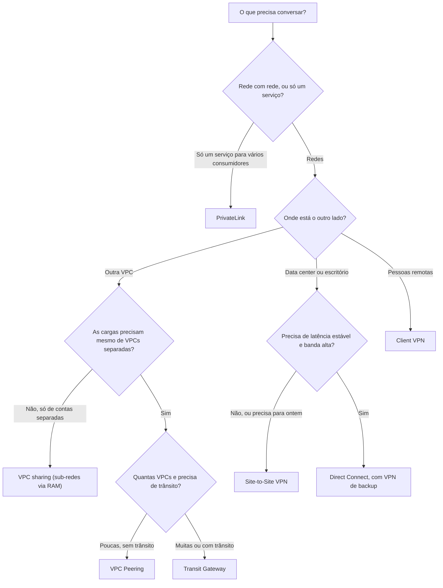

---
aliases:
  - Aula 7.1
modulo: 7
aula: 1
parte: "II Identidade, rede e dados"
dominios:
  - 1
  - 3
  - 4
lida: false
tags:
  - aula
  - saa-c03
  - modulo-07
---

# Aula 7.1: O problema de ligar redes e o mapa de decisão

[[07 - Conectividade Hibrida e entre VPCs|Voltar ao módulo]]

> [!question] Por que existem tantas formas de ligar duas redes na AWS, e qual pergunta separa uma da outra?

## Por que este módulo existe

No [[06 - VPC a Fundo|Módulo 6]] você construiu uma [[VPC]]: uma rede privada e isolada, com [[CIDR]] próprio, [[Sub-rede|sub-redes]], [[Route Table|route tables]] e firewalls. O isolamento é o ponto forte e, ao mesmo tempo, o problema. Uma empresa real nunca tem uma VPC só. Tem uma VPC por ambiente (produção, homologação), uma por time, uma por [[Conta AWS|conta]] (o [[05 - Multiconta Governanca e Federacao|Módulo 5]] mostrou por que separar contas), às vezes uma por [[Regiao AWS|Região]], e ainda tem o data center ou o escritório com servidores que não migraram. Tudo isso precisa conversar, e a conversa precisa ser privada (sem passar pela internet pública), previsível e barata.

O módulo inteiro responde a uma pergunta: **dado um par de redes, qual é o mecanismo mais simples e barato que atende aos requisitos de topologia, banda, [[Latencia|latência]], segurança e prazo?** Esta aula dá o mapa. As seguintes aprofundam cada peça.

## Três fatos que limitam todas as opções

### Fato 1: roteamento exige endereços únicos

Quando um pacote sai de uma [[VPC]] para outra rede, a [[Route Table]] decide o próximo salto pelo destino ([[Longest Prefix Match|longest prefix match]], visto no [[03 - Fundamentos de Redes para a Nuvem|Módulo 3]]). Se as duas redes usam o mesmo bloco, a tabela não tem como saber se `10.0.5.20` é um servidor local ou remoto. Por isso **CIDRs sobrepostos impedem peering, [[Transit Gateway]] e VPN/DX para as redes envolvidas**: a rota local sempre vence. Você só planeja o endereçamento certo uma vez (o Módulo 6 insistiu nisso); depois, remendar é caro, porque trocar o [[CIDR]] de uma VPC com workload rodando significa recriar recursos.

Existe uma exceção estrutural: o [[PrivateLink]] não roteia redes. O consumidor enxerga apenas uma [[ENI|interface de rede]] dentro da própria [[Sub-rede|sub-rede]], então a sobreposição de [[CIDR]] deixa de importar. Isso é central na prova e você verá o mecanismo na [[07.04 - PrivateLink e Endpoint Services|aula 7.4]].

### Fato 2: roteamento transitivo não existe por padrão

Se A conversa com B e B conversa com C, A não conversa com C só por causa disso. Cada ligação é um par de portas: o tráfego entra por uma e sai pela outra somente se uma rota mandar. No [[VPC Peering]], a AWS proíbe explicitamente o uso de uma [[VPC]] como ponto de trânsito. Quando você precisa de "todo mundo com todo mundo" ou "todo mundo passando por um ponto central", precisa de um dispositivo feito para rotear entre muitos: o [[Transit Gateway]].

### Fato 3: onde o tráfego anda decide o custo

A AWS cobra [[Data Transfer|transferência de dados]] conforme o caminho: entrada é grátis, dentro da mesma [[Zona de Disponibilidade|AZ]] é grátis **só quando o tráfego usa [[RFC 1918|IP privado]]** (IP público ou [[Elastic IP]] é cobrado mesmo na mesma AZ), entre AZs e entre [[Regiao AWS|Regiões]] é cobrado, e a saída para a internet é cobrada por faixas (os detalhes e a pegadinha do IP público estão na aula 7.8). Além disso, cada componente tem preço próprio por hora e, em alguns, por GB processado. A [[07.08 - Custo de Transferencia e Escolha da Conexao|aula 7.8]] fecha o módulo com as contas. Por enquanto, guarde que **a escolha de conectividade é uma escolha de custo fixo (por hora) contra custo variável (por GB)**.

## As peças, em uma frase cada

| Peça | O que liga | Ideia central |
|---|---|---|
| [[VPC Peering]] | 2 [[VPC\|VPCs]] (mesma conta ou contas diferentes, mesma Região ou [[Regiao AWS\|Regiões]] diferentes) | Ligação direta, 1 para 1, sem custo por hora, não transitiva |
| [[Transit Gateway]] | Muitas [[VPC\|VPCs]], VPNs, [[Direct Connect]] e outros TGWs | Roteador regional central (hub and spoke) |
| [[PrivateLink]] | Um serviço (atrás de [[Network Load Balancer]]) a muitos consumidores | Expõe um serviço, não uma rede; tolera [[CIDR]] sobreposto |
| [[Site-to-Site VPN]] | Rede on-premises e AWS | Túneis [[IPsec]] pela internet, rápido de criar |
| [[Client VPN]] | Pessoas (notebooks) e AWS | Acesso remoto de usuários, baseado em OpenVPN |
| [[Direct Connect]] | Rede on-premises e AWS | Fibra dedicada, [[Latencia\|latência]] estável, demora semanas |
| [[Route 53 Resolver]] (endpoints) | Resolução de [[DNS]] entre AWS e on-premises | Encaminha consultas nos dois sentidos |
| [[VPC Sharing\|VPC sharing]] (via [[RAM]]) | Várias contas da mesma organização em uma única [[VPC]] | O dono da VPC compartilha [[Sub-rede\|sub-redes]]; os participantes lançam recursos nelas, e o roteamento é o implícito da VPC, sem peering nem [[Transit Gateway]] |

Os nomes de serviço ficam em inglês porque a prova usa esses nomes. Note a divisão em duas famílias: **[[VPC]] com VPC** (peering, [[Transit Gateway]], [[PrivateLink]]) e **VPC com o mundo de fora** (VPN, [[Direct Connect]], [[Client VPN]]). O Transit Gateway pertence às duas, porque também é o ponto de chegada de VPN e Direct Connect.

> [!info] Ligando os pontos
> No Módulo 6 você viu o [[Gateway Endpoint]] e o [[Interface Endpoint]]. O Interface Endpoint é a ponta consumidora do [[PrivateLink]]: a mesma tecnologia que dá acesso privado a serviços da AWS ([[S3]], [[SQS]], [[KMS]]) serve para consumir um serviço de outra empresa ou de outra conta.

## Como escolher: as perguntas, na ordem

Uma árvore de decisão simples resolve a maioria dos cenários. Faça as perguntas nesta ordem.

1. **É um serviço ou uma rede?** Se o consumidor só precisa de uma API ou de um endpoint [[TCP]] do seu serviço, e você não quer abrir sua rede inteira, [[PrivateLink]]. Se os dois lados precisam iniciar conversas livremente, é rede.
2. **As cargas precisam mesmo de [[VPC|VPCs]] separadas?** Muitas vezes a motivação é só separar contas (cobrança, permissões). Nesse caso, em vez de uma VPC por conta, o dono de uma VPC compartilha [[Sub-rede|sub-redes]] com as outras contas da mesma [[Organizations|organização]] pelo [[RAM|AWS RAM]] ([[VPC Sharing|VPC sharing]]). Cada conta lança seus recursos nas sub-redes compartilhadas, vê só os próprios, e a comunicação usa o roteamento local da VPC: não há peering, nem [[Transit Gateway]], nem custo de processamento por GB (verificado em novembro de 2026 em docs.aws.amazon.com/vpc/latest/userguide/vpc-sharing.html). Serve quando as cargas ficam dentro da mesma fronteira de confiança; se precisam de isolamento forte de rede ou de CIDRs próprios, volte às outras opções.
3. **Os CIDRs se sobrepõem?** Se sim, peering e [[Transit Gateway]] estão fora para esse par, a menos que você renumere; [[PrivateLink]] continua valendo.
4. **Quantas redes e que formato?** Duas ou três [[VPC|VPCs]] que falam em pares: peering. Muitas, ou necessidade de roteamento central e inspeção: [[Transit Gateway]].
5. **O outro lado é on-premises?** Precisa de [[Latencia]] estável e [[Throughput]] alto e previsível: [[Direct Connect]]. Precisa de conectividade rápida, barata e criptografada, ou tem banda baixa: VPN. Precisa de [[Alta Disponibilidade]] real: as duas juntas ou duas conexões Direct Connect em locais diferentes.
6. **Há restrição de prazo?** VPN fica pronta em minutos a horas (o cliente ainda configura o roteador dele). [[Direct Connect]] leva semanas a meses, porque envolve um **cross-connect** (o cabo físico que liga seu equipamento à porta da AWS dentro de um prédio de **colocation**, um data center de terceiros onde você aluga espaço) e, muitas vezes, um circuito de operadora (não há prazo contratual; verificado em novembro de 2026 na documentação de preços do Direct Connect). A [[07.06 - Direct Connect|aula 7.6]] detalha isso.
7. **Há restrição de custo?** Peering não cobra por hora nem por GB processado (só a transferência entre [[Zona de Disponibilidade|AZs]] e [[Regiao AWS|Regiões]]). [[Transit Gateway]] cobra por attachment e por GB. VPN cobra por conexão-hora. [[Direct Connect]] cobra por porta-hora e por GB que sai.

> [!example] Três cenários, três respostas
> **Cenário A.** A equipe de dados tem uma [[VPC]] (`10.10.0.0/16`) que precisa ler de um banco na VPC de produção (`10.20.0.0/16`), em outra conta. Só esses dois. Resposta: **[[VPC Peering]]**. Sem custo fixo, sem componente novo.
> **Cenário B.** Uma startup vende um serviço de antifraude e quer que 200 clientes (cada um com a própria [[VPC]], vários com `10.0.0.0/16`) o consumam sem expor rede nenhuma. Resposta: **[[PrivateLink]]**; ninguém precisa renumerar nada.
> **Cenário C.** Uma empresa tem 30 [[VPC|VPCs]] e um data center, e quer que todas as VPCs falem com o data center por uma conexão só. Resposta: **[[Transit Gateway]]** com um attachment de VPN ou [[Direct Connect]].

## Onde cada recurso vive: escopo e resiliência

Entender o escopo evita erros de projeto e responde pegadinhas de "[[Alta Disponibilidade|alta disponibilidade]]":

- **[[VPC Peering]]** é uma ligação entre duas [[VPC|VPCs]]; a conexão em si não é um equipamento que falha. Ela é um objeto de roteamento da AWS, sem [[Ponto Unico de Falha|ponto único de falha]] que você administre. Pode cruzar [[Regiao AWS|Regiões]].
- **[[Transit Gateway]]** é **regional**. Para ligar duas [[Regiao AWS|Regiões]], você cria um TGW em cada e faz peering entre eles. Dentro da Região é [[Alta Disponibilidade|altamente disponível]]; você habilita as [[Zona de Disponibilidade|AZs]] desejadas por attachment.
- **[[Virtual Private Gateway]]** é o lado AWS da VPN preso a **uma** [[VPC]]. A VPN tem dois túneis, em [[Zona de Disponibilidade|AZs]] diferentes, para tolerar falha de lado AWS. A falha do seu roteador local (o [[Customer Gateway]]) é problema seu.
- **[[Direct Connect]]** é físico: a porta fica em um **Direct Connect location** (um prédio de colocation). Uma conexão só é um [[Ponto Unico de Falha]], por mais cara que seja.
- **[[PrivateLink]]** cria [[ENI|interfaces de rede]] nas [[Sub-rede|sub-redes]] do consumidor, uma por [[Zona de Disponibilidade|AZ]] escolhida, e exige que o serviço do provedor esteja em pelo menos duas AZs para boa [[Disponibilidade|disponibilidade]].

## Tabela de comparação rápida

| Critério | Peering | [[Transit Gateway]] | [[PrivateLink]] | VPN | [[Direct Connect]] |
|---|---|---|---|---|---|
| Transitivo | Não | Sim (por [[Route Table\|route table]]) | Não se aplica | Depende do gateway | Depende do gateway |
| [[CIDR]] sobreposto | Proibido | Proibido (entre attachments roteados) | Tolera | Proibido | Proibido |
| Custo fixo | Nenhum | Por attachment-hora | Por endpoint-hora | Por conexão-hora | Por porta-hora |
| Custo por GB | Só cross-AZ e cross-Região | GB processado | GB processado | Saída para a internet | Saída pelo [[Direct Connect\|DX]] (e [[Transit Gateway\|TGW]], se usado) |
| Prazo | Minutos | Minutos | Minutos | Minutos a horas | Semanas a meses |
| Criptografia nativa | Entre [[Regiao AWS\|Regiões]]: criptografado pela AWS. Mesma Região: não é um controle que você configura (use [[TLS]] na aplicação se exigido) | Igual ao peering: entre Regiões (peering de [[Transit Gateway\|TGW]]) sim; mesma Região, use TLS | TLS é com a aplicação | [[IPsec]] | Não por padrão |

(Verificado em novembro de 2026 nas páginas de documentação citadas nas aulas seguintes; os valores de preço estão na aula 7.8.)

## Como isso cai na prova

**Task statements cobertos:** Task 1.2 (proteger conexões externas: VPN e [[Direct Connect]]), Task 3.4 (topologia para redes globais, híbridas e multicamadas; opções de conexão VPN, Direct Connect, [[PrivateLink]]) e Task 4.4 (custo de rede: peering vs [[Transit Gateway]], DX vs VPN).

**Palavras-chave em inglês e o que apontam:**

- "connect hundreds of [[VPC|VPCs]]", "centralized routing", "hub and spoke": [[Transit Gateway]].
- "two [[VPC|VPCs]]", "lowest cost", "no transitive routing needed": [[VPC Peering|VPC peering]].
- "overlapping [[CIDR]] blocks" combinado com "expose a service": [[PrivateLink]].
- "consistent network performance", "dedicated connection", "private connection to on-premises": [[Direct Connect]].
- "within days", "encrypted over the internet", "quickly": [[Site-to-Site VPN]].
- "remote employees", "OpenVPN": [[Client VPN]].

**Pegadinhas clássicas:**

- Peering entre três [[VPC|VPCs]] em linha (A-B, B-C) não dá comunicação A-C.
- "[[Transit Gateway]] resolve [[CIDR]] sobreposto": não resolve.
- "[[Direct Connect]] é criptografado": não é por padrão; [[IPsec]] ou [[MACsec]] são adições.
- "VPN é a opção de mais [[Alta Disponibilidade|alta disponibilidade]]": uma VPN sozinha depende do seu roteador e da internet; [[Direct Connect]] com VPN de backup é o padrão de resiliência.

| Requisito no enunciado | Resposta provável | Por quê |
|---|---|---|
| Ligar 2 [[VPC\|VPCs]] de contas diferentes ao menor custo | [[VPC Peering\|VPC peering]] | Sem custo por hora nem por GB processado |
| Dezenas de [[VPC\|VPCs]] e on-premises com gestão central de rotas | [[Transit Gateway]] | Hub regional com [[Route Table\|route tables]] próprias |
| Consumidores com CIDRs sobrepostos acessam um serviço | [[PrivateLink]] | Não há roteamento entre redes |
| [[Latencia\|Latência]] previsível e banda dedicada até o data center | [[Direct Connect]] | Circuito físico privado |
| Conectividade criptografada em poucas horas | [[Site-to-Site VPN]] | [[IPsec]] sobre a internet, sem prazo de operadora |
| Várias contas na mesma organização, sem precisar de [[VPC\|VPCs]] separadas, menor overhead | [[VPC Sharing\|VPC sharing]] ([[Sub-rede\|sub-redes]] via [[RAM]]) | Sem peering, sem [[Transit Gateway]] e sem cobrança por GB processado |
| Funcionários em casa acessam recursos privados | [[Client VPN]] | Acesso baseado em cliente OpenVPN |

## Resumo

> [!abstract] A aula em uma frase
> Ligar redes na AWS é escolher, por pares de requisitos (serviço ou rede, [[CIDR]] único ou não, poucas ou muitas [[VPC|VPCs]], nuvem ou on-premises, prazo e custo), entre peering, [[Transit Gateway]], [[PrivateLink]], VPN e [[Direct Connect]].

**A lógica, em 5 passos**

1. A [[VPC]] é isolada de propósito; para sair dela é preciso uma ligação explícita mais uma rota.
2. Roteamento só funciona com endereços únicos; [[CIDR]] sobreposto bloqueia peering, [[Transit Gateway|TGW]], VPN e [[Direct Connect|DX]] para o par envolvido.
3. Ligações não são transitivas; "muitos para muitos" pede um roteador central, o [[Transit Gateway]].
4. Quando o consumidor só precisa de um serviço, [[PrivateLink]] evita rotear redes e ignora a sobreposição.
5. Para fora da AWS, VPN vence em prazo e custo inicial; [[Direct Connect]] vence em [[Latencia|latência]] estável e banda; juntos formam a resiliência.

**Números para lembrar**

| O quê | Valor | Por que importa |
|---|---|---|
| Conexões de peering em malha completa de N [[VPC\|VPCs]] | N x (N-1) / 2 (10 VPCs = 45) | Mostra quando a malha vira inviável |
| Túneis por conexão VPN | 2 | Redundância do lado AWS |
| Prazo típico de [[Direct Connect]] | Semanas a meses | Elimina DX em cenário "em poucos dias" |

**Na prática, isso significa**

- Primeiro pergunte se é serviço ou rede; só depois escolha a peça.
- Confira CIDRs antes de qualquer projeto de conexão; sobreposição é o motivo mais comum de um desenho não funcionar.
- Em cenário híbrido com requisito de [[Disponibilidade|disponibilidade]], pense em duas conexões independentes.
- Em cenário de custo, compare custo fixo por hora com custo por GB do volume informado.

> [!tip] Liga com
> Vem do [[06 - VPC a Fundo|Módulo 6]] ([[VPC]], [[Route Table|route tables]], endpoints) e do [[03 - Fundamentos de Redes para a Nuvem|Módulo 3]] ([[CIDR]], roteamento). Segue para [[07.02 - VPC Peering|a aula 7.2]], a opção mais simples.

## Erros comuns

- **Achar que "conectar [[VPC|VPCs]]" sempre pede [[Transit Gateway]].** Para duas ou três VPCs em par, peering é mais barato e mais simples.
- **Esquecer a rota.** Criar a ligação e não atualizar as [[Route Table|route tables]] dos dois lados é o erro de configuração mais frequente; a ligação fica "ativa" e nada passa.
- **Confundir [[PrivateLink]] com peering.** Peering liga redes (bidirecional); PrivateLink liga um consumidor a um serviço (unidirecional).
- **Tratar VPN como substituta definitiva do [[Direct Connect]].** VPN é ótima como começo e como backup; banda e [[Latencia|latência]] variam com a internet.
- **Ignorar o custo por GB do [[Transit Gateway]]** em volumes altos entre [[VPC|VPCs]].
- **Criar uma [[VPC]] por conta sem perguntar se precisa.** Se o único motivo é separar contas, o [[VPC Sharing|compartilhamento de sub-redes]] por [[RAM]] (VPC sharing) evita peering, [[Transit Gateway]] e processamento por GB.

## Pratique

**1.** Uma empresa tem três [[VPC|VPCs]] na mesma Região: `10.0.0.0/16`, `10.1.0.0/16` e `10.2.0.0/16`. As três aplicações precisam se comunicar entre si. Não há conexão com on-premises e o time quer o MENOR custo. Qual solução atende?

- [ ] a) Criar uma conexão de peering entre a primeira e a segunda VPC e outra entre a primeira e a terceira, usando a primeira como ponto de trânsito
- [ ] b) Criar um Transit Gateway e três attachments de VPC
- [ ] c) Criar três conexões de VPC peering (uma para cada par) e adicionar as rotas nas route tables
- [ ] d) Expor cada aplicação por um endpoint service do PrivateLink atrás de um Network Load Balancer

**2.** Uma empresa de software oferece uma API de validação de documentos. Os 150 clientes consomem a API a partir de [[VPC|VPCs]] próprias, em contas diferentes, e muitos usam `10.0.0.0/16`. A empresa não quer expor nenhuma outra parte da rede. O que usar?

- [ ] a) PrivateLink, com a API atrás de um Network Load Balancer e um endpoint service
- [ ] b) VPC peering com cada um dos 150 clientes, aceitando cada pedido de peering manualmente
- [ ] c) Um Transit Gateway compartilhado com as contas dos clientes, anexando cada VPC de cliente
- [ ] d) Uma Site-to-Site VPN para cada cliente, com um par de túneis dedicado a cada um deles

**3.** Uma organização tem 40 [[VPC|VPCs]] em 12 contas e um data center ligado por VPN. Todas as VPCs precisam alcançar o data center com gerenciamento central de rotas e o mínimo de conexões a manter. Qual é a melhor arquitetura?

- [ ] a) Peering em malha completa entre as 40 VPCs e uma VPN separada para cada VPC, terminando no data center
- [ ] b) Uma VPN para cada VPC, todas terminando no mesmo roteador on-premises, com rotas estáticas manuais
- [ ] c) Uma VPC central com peering para as outras 39, atuando como ponto de trânsito e concentrando a VPN
- [ ] d) Um Transit Gateway com um attachment por VPC e um attachment de VPN para o data center

**4.** Ao tentar criar um peering entre a [[VPC]] A (`172.16.0.0/16`) e a VPC B (`172.16.128.0/17`), o pedido falha. Qual é a causa e a correção correta?

- [ ] a) O peering exige que as VPCs estejam na mesma conta; mover a VPC B para a conta de A e tentar de novo
- [ ] b) Os CIDRs se sobrepõem; renumerar uma VPC, ou usar PrivateLink se só precisar acessar um serviço
- [ ] c) Falta um Internet Gateway em uma das VPCs, necessário para estabelecer a conexão; anexar um IGW
- [ ] d) O peering só funciona com IPv6; habilitar IPv6 nas duas VPCs e refazer o pedido de peering

**5.** Uma indústria precisa mover grandes volumes de dados de telemetria do data center para a AWS todos os dias, com [[Latencia|latência]] estável e sem depender da internet pública. Há prazo de três meses. Qual conexão atende?

- [ ] a) Site-to-Site VPN com dois túneis IPsec pela internet, aceitando a variação de latência da internet pública
- [ ] b) Client VPN configurado nos servidores do data center, com um endpoint e regras de autorização
- [ ] c) Direct Connect, com uma VPN de backup para resiliência, sem usar a internet pública no caminho principal
- [ ] d) VPC peering entre a VPC e a rede do data center, com rotas nos dois lados

**6.** Uma empresa abriu uma filial e precisa de conexão criptografada com a [[VPC]] já na próxima semana. A banda necessária é de 200 Mbps. Qual é a opção mais adequada?

- [ ] a) Site-to-Site VPN com dois túneis IPsec
- [ ] b) Direct Connect dedicated de 10 Gbps, via colocation
- [ ] c) PrivateLink, expondo um serviço da VPC à filial
- [ ] d) Transit Gateway peering entre Regiões

**7.** Por que o [[VPC Peering|VPC peering]] não oferece [[Roteamento Transitivo|roteamento transitivo]]?

- [ ] a) Porque o peering funciona como um roteador gerenciado que a AWS configura para bloquear o repasse entre vínculos por segurança
- [ ] b) Porque cada peering é um vínculo direto entre duas VPCs, sem roteador central repassando tráfego de um vínculo para outro
- [ ] c) Porque o peering aplica NAT entre as duas VPCs, e o endereço traduzido só vale para o destino que está do outro lado do vínculo
- [ ] d) Porque a route table de uma VPC só aceita rotas locais, e o repasse exigiria ativar a propagação de rotas no peering

**8.** (Escolha DUAS.) Uma empresa vai ligar a [[VPC]] A (conta 1, us-east-1) à VPC B (conta 2, eu-west-1) por [[VPC Peering|VPC peering]], para que instâncias de A acessem um banco em B. Quais condições o time precisa garantir?

- [ ] a) Um Internet Gateway na VPC B, porque o tráfego do peering entre Regiões sai por ele
- [ ] b) Que os CIDRs das duas VPCs não se sobreponham
- [ ] c) Que as duas VPCs estejam na mesma Região, porque o peering não atravessa Regiões
- [ ] d) Um Transit Gateway entre as duas, porque peering entre contas só funciona por ele
- [ ] e) Rotas para o CIDR do outro lado nas route tables das duas VPCs

**9.** (Escolha DUAS.) Uma empresa tem 25 [[VPC|VPCs]] (produção e desenvolvimento) e um data center ligado por VPN. As VPCs de produção devem falar com o data center; as de desenvolvimento não podem alcançar as de produção. A empresa quer manter poucas conexões. Quais ações atendem?

- [ ] a) Criar peering em malha completa entre as 25 VPCs e uma VPN para cada VPC
- [ ] b) Compartilhar o Virtual Private Gateway de uma VPC com as demais por peering
- [ ] c) Criar um Transit Gateway com um attachment por VPC e um attachment de VPN para o data center
- [ ] d) Usar duas route tables no Transit Gateway, uma para produção e outra para desenvolvimento, com associações e propagações diferentes
- [ ] e) Expor cada VPC de produção ao data center por um endpoint service do PrivateLink

**10.** Funcionários que trabalham de casa precisam acessar sistemas internos em [[Sub-rede Privada|sub-redes privadas]] de uma [[VPC]], autenticando com [[Active Directory]]. Qual serviço atende com o MENOR [[Overhead Operacional|overhead operacional]]?

- [ ] a) Site-to-Site VPN, com um Customer Gateway configurado para cada funcionário
- [ ] b) Um servidor OpenVPN em EC2 mantido pela equipe
- [ ] c) Bastion hosts em sub-rede pública, com SSH aberto e as chaves distribuídas aos funcionários
- [ ] d) AWS Client VPN, integrado ao Active Directory

> [!success]- Gabarito
> **1. c)** três peerings (um por par) dão comunicação total ao menor custo; a) erra porque peering não é transitivo, b) funciona mas adiciona custo por attachment e por GB sem necessidade, d) expõe serviços, não conecta redes inteiras.
> **2. a)** [[PrivateLink]] expõe só o serviço e tolera [[CIDR]] sobreposto; b) peering proíbe CIDR sobreposto, c) [[Transit Gateway]] também exige endereços únicos e exporia a rede, d) VPN por cliente é inviável em escala e não resolve a sobreposição.
> **3. d)** o [[Transit Gateway|TGW]] é o hub regional com um attachment por [[VPC]] e um de VPN, com [[Route Table|route tables]] centrais; a) malha de 780 peerings e 40 VPNs é inviável, b) 40 VPNs é muito mais caro e trabalhoso, c) peering não faz trânsito.
> **4. b)** 172.16.128.0/17 está dentro de 172.16.0.0/16, então há sobreposição, que bloqueia o peering; a) peering funciona entre contas, c) [[Internet Gateway|IGW]] não é requisito, d) peering funciona com [[IPv4]].
> **5. c)** [[Direct Connect]] oferece [[Latencia|latência]] estável e banda dedicada, e três meses cobrem o prazo de provisionamento; a) VPN depende da internet, b) [[Client VPN]] é para usuários, d) peering liga [[VPC|VPCs]] e não redes externas.
> **6. a)** a VPN sobe em horas e 200 Mbps cabe em um túnel; b) [[Direct Connect|DX]] leva semanas, c) [[PrivateLink]] não liga redes, d) peering de [[Transit Gateway|TGW]] liga Transit Gateways, não filiais.
> **7. b)** peering é um par 1 para 1 sem roteador intermediário; a) erra porque o peering não é um roteador, é um vínculo, c) erra porque não há [[NAT]] no peering (o endereço original é preservado), d) erra porque o problema não é propagação: a AWS proíbe o uso da [[VPC]] do meio como trânsito.
> **8. b) e e)** CIDRs distintos são requisito e as rotas são manuais nos dois lados; a) erra porque [[Internet Gateway|IGW]] não faz parte do peering (a [[VPC]] B nem poderia ser usada como saída), c) erra porque peering entre [[Regiao AWS|Regiões]] e entre contas existe, d) erra porque peering entre contas não precisa de [[Transit Gateway]].
> **9. c) e d)** o [[Transit Gateway|TGW]] concentra os attachments ([[VPC|VPCs]] e VPN) e as [[Route Table|route tables]] separadas isolam produção de desenvolvimento; a) é uma malha de 300 peerings e 25 VPNs, b) erra porque a VPN de uma VPC não é compartilhável pelo peering, e) erra porque [[PrivateLink]] expõe serviços, não conecta redes ao data center.
> **10. d)** [[Client VPN]] é gerenciado, escala sozinho e integra com [[Active Directory]]; a) [[Site-to-Site VPN|VPN site-to-site]] liga redes, não pessoas, b) funciona mas deixa a manutenção do servidor com a equipe, c) abre SSH para a internet e multiplica chaves para gerir, sem integração com o diretório.

## Para aprofundar

- [Documentação do VPC peering: como funciona](https://docs.aws.amazon.com/vpc/latest/peering/vpc-peering-basics.html) (AWS): lista as limitações oficiais ([[Roteamento Transitivo|não transitivo]], [[CIDR]], borda).
- [Visão geral do Transit Gateway](https://docs.aws.amazon.com/vpc/latest/tgw/how-transit-gateways-work.html) (AWS): attachments, [[Route Table|route tables]] e exemplos de cenário.

Próxima aula: [[07.02 - VPC Peering]].
