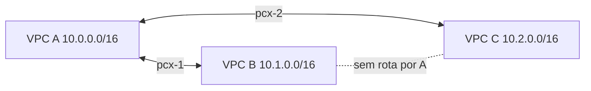

---
aliases:
  - Aula 7.2
modulo: 7
aula: 2
parte: "II Identidade, rede e dados"
dominios:
  - 1
  - 3
  - 4
lida: false
tags:
  - aula
  - saa-c03
  - modulo-07
---

# Aula 7.2: VPC Peering

[[07 - Conectividade Hibrida e entre VPCs|Voltar ao módulo]]

> [!question] Como duas VPCs conversam por IP privado sem equipamento no meio, e onde exatamente esse modelo deixa de servir?

## O problema que o peering resolve

Duas [[VPC|VPCs]] são redes separadas: cada uma tem a própria [[Route Table]] com apenas a rota local e, por isso, um pacote destinado ao [[CIDR]] da outra não encontra caminho. A solução mais direta seria um cabo virtual entre as duas, [[Serverless|sem servidor]] nem appliance. É exatamente isso que o **[[VPC Peering]]** (conexão de peering) oferece: um vínculo direto, privado, entre exatamente duas VPCs, no qual o tráfego trafega pela infraestrutura da AWS e nunca pela internet pública.

Duas consequências do desenho explicam quase tudo que cai na prova. Primeiro, não existe um equipamento no meio: nada para escalar, nada para pagar por hora, nenhum [[Ponto Unico de Falha|ponto único de falha]] que você administre, e a banda não é limitada por um gateway. Segundo, como não existe um roteador central, **não existe [[Roteamento Transitivo|transitividade]]**: a ligação A-B serve só a A e B.

> [!info] Ligando os pontos
> No [[03 - Fundamentos de Redes para a Nuvem|Módulo 3]] você viu que roteamento é "para este destino, mande por aquele próximo salto". O peering é só um novo tipo de próximo salto (`pcx-...`) que você escolhe na [[Route Table|route table]]. Se você não escrever a rota, nada acontece.

## Como funciona, passo a passo

O processo oficial tem cinco etapas (verificado em novembro de 2026 na documentação de [[VPC Peering|VPC peering]]):

1. **O dono da [[VPC]] requisitante envia o pedido** para o dono da VPC aceitante. A aceitante pode estar na mesma conta ou em outra, na mesma [[Regiao AWS|Região]] ou em outra.
2. **O dono da aceitante aprova.** Se ninguém agir, o pedido expira em 7 dias. Na mesma conta, o fluxo é o mesmo, só que você mesmo aceita.
3. **Cada lado adiciona a rota** nas [[Route Table|route tables]] das [[Sub-rede|sub-redes]] que vão conversar, apontando o [[CIDR]] da outra [[VPC]] para o peering. É manual e dos dois lados. Esta é a falha mais comum: o peering aparece como "ativo" e o ping não passa porque falta uma rota.
4. **Ajuste dos [[Security Group|security groups]]** (e, se houver, das [[Network ACL|network ACLs]]) para permitir o tráfego do [[CIDR]] peerado. Se as duas [[VPC|VPCs]] estão na mesma Região, o security group da outra VPC pode ser usado como origem ou destino de uma regra (referência por ID de security group), o que é mais robusto que repetir CIDR. Entre [[Regiao AWS|Regiões]], só dá com CIDR.
5. **[[DNS]] (opcional):** por padrão, se uma instância usa o nome DNS público da instância da [[VPC]] peerada, o nome resolve para o IP público. Habilitando a resolução de DNS na [[VPC Peering|conexão de peering]], passa a resolver para o [[RFC 1918|IP privado]].

## As regras que você precisa decorar (e entender)

### Não transitivo

Se A tem peering com B e com C, **B e C não se alcançam passando por A**. Para B falar com C, é preciso um terceiro peering B-C. A razão é a mesma do início da aula: o peering não é um roteador. A documentação diz literalmente que A não pode ser usado como ponto de trânsito.

### Sem CIDR sobreposto

Não se cria peering entre [[VPC|VPCs]] com blocos [[IPv4]] ou [[IPv6]] iguais ou sobrepostos. Se uma VPC tem vários CIDRs (primário e secundários), **qualquer** sobreposição entre quaisquer blocos barra o peering, mesmo que você só planeje usar os blocos que não se sobrepõem. É por isso que o planejamento de endereços do [[06 - VPC a Fundo|Módulo 6]] é um investimento: trocar [[CIDR]] depois é refazer ambiente.

### Sem "roteamento de borda" através do par

Esta regra derruba muitos desenhos "inteligentes". Se a [[VPC]] A tem [[Internet Gateway]], [[NAT Gateway]], [[Site-to-Site VPN]], [[Direct Connect]] ou [[Gateway Endpoint]] ([[S3]]), a VPC B **não consegue usar nenhum deles** pelo peering. Exemplos:

| Você tem em A | B consegue usar via peering? |
|---|---|
| [[Internet Gateway]] | Não |
| [[NAT Gateway]] (saída para a internet) | Não |
| VPN com o escritório | Não |
| [[Direct Connect]] com o data center | Não |
| [[Gateway Endpoint\|Gateway endpoint]] do [[S3]] | Não |

Resultado: se muitas [[VPC|VPCs]] precisam do mesmo caminho para o data center, não dá para centralizar a VPN em uma VPC de "rede" e peerar as outras. Para isso existe o [[Transit Gateway]] ([[07.03 - Transit Gateway|aula 7.3]]).

### Apenas um peering entre o mesmo par

Não se pode ter duas conexões de peering simultâneas entre as mesmas duas [[VPC|VPCs]].

### Cotas

A cota padrão é de **50 conexões de peering ativas por [[VPC]]**, ajustável até **125**; e 25 pedidos pendentes. Um pedido não aceito expira em uma semana (verificado em novembro de 2026 na página de cotas de peering). O limite de 125 já mostra que peering não escala para centenas de VPCs, e o número de conexões cresce rápido: uma malha completa de N VPCs precisa de `N x (N - 1) / 2` conexões.

> [!example] A conta da malha
> 5 [[VPC|VPCs]] em malha completa: 5 x 4 / 2 = **10** peerings. 10 VPCs: **45**. 20 VPCs: **190**. 50 VPCs: **1.225**, cada uma com rotas nas [[Route Table|route tables]] de duas VPCs. Além do trabalho, cada VPC precisa de uma rota por vizinho, e route tables têm limite de entradas. A partir de uns 8 a 10 VPCs que precisam falar entre si, a malha já é um problema operacional, mesmo antes de bater em cota.

## Entre contas e entre Regiões

**Entre contas:** é o caso típico de [[Organizations|organização]] com várias contas. O requisitante informa o ID da conta e da [[VPC]] do aceitante; o aceitante aceita. Cada lado cuida das próprias rotas. Em **VPCs compartilhadas** ([[VPC Sharing|VPC sharing]]), só o dono da VPC pode criar, aceitar, modificar ou apagar peerings; participantes não podem.

**Entre [[Regiao AWS|Regiões]] (inter-Region peering):** funciona com o mesmo modelo. O tráfego trafega pela [[Backbone|rede global da AWS]], não pela internet, e é criptografado (a documentação do [[Transit Gateway]] afirma que o peering entre Regiões usa a mesma infraestrutura do [[VPC Peering|VPC peering]], com criptografia AES-256 na camada de rede virtual). Dois detalhes: referência cruzada de [[Security Group|security group]] não é suportada entre Regiões (use [[CIDR]]) e a [[Latencia]] é a da distância física entre as Regiões. O **MTU** (maximum transmission unit, o maior pacote que a rede aceita sem fragmentar) entre [[VPC|VPCs]] peeradas na mesma Região é 9001 bytes e, entre Regiões, 8500 bytes. Pacotes acima de 1500 bytes são os **jumbo frames**; eles reduzem o número de pacotes em transferências grandes, mas qualquer ponto do caminho que aceite menos obriga a fragmentar. MTU é tamanho de pacote, não limite de banda.

## Custo

- **Criar e manter** a [[VPC Peering|conexão de peering]] **não tem cobrança**.
- Dados que **ficam dentro da mesma [[Zona de Disponibilidade|AZ]]** pelo peering são **grátis**, mesmo entre contas diferentes, desde que a comunicação seja por **[[RFC 1918|IP privado]]** (por IP público ou [[Elastic IP]] a AWS cobra mesmo na mesma AZ; a aula 7.8 mostra os valores). "Mesma AZ" vale pelo **[[AZ ID]]** (por exemplo `use1-az1`), não pelo nome (`us-east-1a`): o nome é mapeado para um AZ ID diferente em cada conta, então no peering entre contas confira os AZ IDs antes de assumir que duas instâncias estão na mesma AZ física.
- Dados que **cruzam [[Zona de Disponibilidade|AZs]]** ou **[[Regiao AWS|Regiões]]** têm [[Data Transfer|cobrança de transferência]] (verificado em novembro de 2026 na documentação de peering; o valor por GB está na [[07.08 - Custo de Transferencia e Escolha da Conexao|aula 7.8]]).
- Não há "taxa de processamento por GB" no peering, ao contrário do [[Transit Gateway]].

Isso torna o peering a opção **mais barata** para pares de [[VPC|VPCs]] com muito tráfego. Se o tráfego é pesado, vale posicionar a camada que mais conversa na mesma [[Zona de Disponibilidade|AZ]] nos dois lados; é uma troca consciente entre custo e resiliência (uma AZ só é um ponto de falha zonal).

> [!example] Peering barato vs Transit Gateway
> 20 TB por mês entre duas [[VPC|VPCs]]. Com peering na mesma [[Zona de Disponibilidade|AZ]]: [[Data Transfer|custo de transferência]] zero; com tráfego entre AZs, aplica-se a tarifa por GB de cross-AZ. Com [[Transit Gateway]]: duas attachments por hora mais US$ 0,02 por GB processado (aproximadamente US$ 410 só de processamento, mais as horas; preços de exemplo, verificado em novembro de 2026). Para um par isolado, o peering ganha.

## Quando peering é a resposta certa

- **Poucas [[VPC|VPCs]]** que falam em pares específicos (um serviço compartilhado e dois consumidores, onde os consumidores não precisam falar entre si).
- **Máxima [[Largura de Banda|largura de banda]] e menor [[Latencia|latência]]** entre duas [[VPC|VPCs]], sem salto intermediário.
- **Menor custo** para pares de tráfego intenso.
- Compartilhar um banco ou um cluster de dados entre contas de uma mesma organização sem expor à internet.

Quando **deixa de servir**:

- Muitas [[VPC|VPCs]], ou a topologia precisa de [[Roteamento Transitivo|transitividade]] (hub and spoke): [[Transit Gateway]].
- Precisa compartilhar VPN ou [[Direct Connect]] com várias [[VPC|VPCs]]: [[Transit Gateway]] ou [[Direct Connect Gateway]].
- CIDRs sobrepostos: [[PrivateLink]] se a necessidade é acessar um serviço.
- Precisa de inspeção central de tráfego (firewall): [[Transit Gateway]] com um appliance.

## Depurar um peering que "não funciona"

Percorra a lista, na ordem de probabilidade:

1. O status do peering é `active`? (pendente significa que ninguém aceitou).
2. **Existe rota nas duas [[Route Table|route tables]]**, nas [[Sub-rede|sub-redes]] onde estão os recursos? Lembre-se que a route table da sub-rede é a que vale, não a da [[VPC]] "main" se a sub-rede tem associação explícita.
3. O [[Security Group|security group]] de destino permite a origem ([[CIDR]] ou ID de security group)?
4. A [[Network ACL|network ACL]] permite ida e volta (é [[Stateless|stateless]]; as portas efêmeras do [[Porta Efemera]] precisam estar liberadas na volta)?
5. O [[DNS]] usado resolve para [[RFC 1918|IP privado]]? Se o nome público resolve para IP público, o tráfego não vai pelo peering.
6. Os CIDRs realmente não se sobrepõem, incluindo CIDRs secundários?

## Como isso cai na prova

**Task statements:** Task 3.4 (topologia de rede escalável, escolha entre opções de conexão), Task 4.4 (peering vs [[Transit Gateway]] para custo) e Task 1.2 (segmentação de rede).

**Palavras-chave em inglês:**

- "private connectivity between two [[VPC|VPCs]]", "different accounts", "lowest cost", "highest [[Largura de Banda|bandwidth]]": [[VPC Peering|VPC peering]].
- "transitive routing", "hub and spoke", "hundreds of [[VPC|VPCs]]": não é peering, é [[Transit Gateway]].
- "overlapping [[CIDR]]": peering impossível.
- "access the internet through the peered [[VPC]]'s [[NAT Gateway|NAT gateway]]": não funciona (borda).

**Pegadinhas clássicas:**

- A-B e A-C não implica B-C.
- Peering ativo não implica tráfego; falta de rota é a causa mais cobrada.
- "Compartilhar a VPN do escritório entre [[VPC|VPCs]] peeradas" não funciona.
- Peering **entre [[Regiao AWS|Regiões]]** é suportado; muita gente acha que só funciona na mesma Região.
- Referência de [[Security Group|security group]] só entre [[VPC|VPCs]] da mesma Região.

| Requisito no enunciado | Resposta provável | Por quê |
|---|---|---|
| Duas [[VPC\|VPCs]] de contas diferentes, menor custo | [[VPC Peering\|VPC peering]] | Sem custo por hora nem por GB processado |
| [[VPC]] B precisa usar o [[NAT Gateway\|NAT gateway]] da VPC A | Criar [[NAT]] na VPC B | Peering não repassa saída de internet |
| Peering ativo mas sem comunicação | Adicionar rotas nas duas [[Route Table\|route tables]] | O peering não cria rotas |
| Mesmo [[CIDR]] nas duas [[VPC\|VPCs]] | Renumerar ou [[PrivateLink]] | Peering proíbe sobreposição |
| Cinco [[VPC\|VPCs]] que precisam falar entre si, crescendo | [[Transit Gateway]] | Malha de peering escala mal |

## Resumo

> [!abstract] A aula em uma frase
> O [[VPC Peering|VPC peering]] é um vínculo direto e privado entre duas [[VPC|VPCs]], sem custo fixo, mas sem [[Roteamento Transitivo|transitividade]], sem [[CIDR]] sobreposto e sem compartilhar gateways, o que o torna ideal para poucos pares e inadequado para malhas grandes.

**A lógica, em 5 passos**

1. A [[VPC]] é isolada; sem rota para o [[CIDR]] vizinho, nada passa.
2. O peering cria o vínculo (pedido e aceitação), mas **você** escreve as rotas nos dois lados.
3. Sem equipamento intermediário, não há [[Roteamento Transitivo|transitividade]] nem compartilhamento de [[Internet Gateway|IGW]], [[NAT]], VPN ou [[Direct Connect|DX]].
4. Sem roteamento, os endereços precisam ser únicos.
5. Como o número de pares cresce quadraticamente, a partir de umas dezenas de [[VPC|VPCs]] o modelo precisa de um hub.

**Números para lembrar**

| O quê | Valor | Por que importa |
|---|---|---|
| Peerings ativos por [[VPC]] (padrão) | 50 (até 125) | Limita a malha |
| Expiração do pedido não aceito | 7 dias | Pedido "pendente" some |
| Malha completa de N [[VPC\|VPCs]] | N x (N-1) / 2 | Explode a complexidade |
| MTU na mesma Região / entre [[Regiao AWS\|Regiões]] | 9001 / 8500 bytes | Detalhe de jumbo frames |
| Custo de criação | Zero | Peering é barato |

**Tabela-síntese**

| Característica | Peering |
|---|---|
| Transitivo | Não |
| [[CIDR]] sobreposto | Proibido |
| Entre contas e [[Regiao AWS\|Regiões]] | Sim |
| Ref. de [[Security Group\|security group]] | Só na mesma Região |
| Cobrança | Sem taxa fixa; transfer entre [[Zona de Disponibilidade\|AZs]] e [[Regiao AWS\|Regiões]] |

**Na prática, isso significa**

- Para duas ou três [[VPC|VPCs]] que falam em pares, escolha peering e escreva as rotas dos dois lados.
- Para "muitas [[VPC|VPCs]]" ou "compartilhar VPN/DX", troque por [[Transit Gateway]].
- Antes de apontar peering, olhe os CIDRs, incluindo secundários.
- Se o tráfego entre [[Zona de Disponibilidade|AZs]] pesa na conta, posicione as camadas que mais conversam na mesma AZ.

> [!tip] Liga com
> Vem de [[07.01 - O Problema de Ligar Redes e o Mapa de Decisao|7.1]] (o mapa de decisão) e do [[06 - VPC a Fundo|Módulo 6]] ([[Route Table|route tables]]). Segue para [[07.03 - Transit Gateway|7.3]], que remove os limites de [[Roteamento Transitivo|transitividade]].

## Erros comuns

- **Achar que o peering é transitivo** e desenhar uma [[VPC]] "central" que roteia entre as outras.
- **Esquecer as rotas** (ou colocar só em um dos lados).
- **Peerar [[VPC|VPCs]] com [[CIDR]] sobreposto**, inclusive por um CIDR secundário esquecido.
- **Querer usar [[NAT]], [[Internet Gateway|IGW]], VPN ou [[Direct Connect]] da outra [[VPC]].**
- **Referenciar [[Security Group|security group]] entre [[Regiao AWS|Regiões]]**, que não é suportado.
- **Ignorar o custo de tráfego entre [[Zona de Disponibilidade|AZs]]** em cargas pesadas.

## Pratique

**1.** A conta X solicitou um peering com a [[VPC]] da conta Y na mesma Região, e o status ficou `pending-acceptance`. O que é necessário para o tráfego fluir?

- [ ] a) Nada: o peering já está ativo e as rotas são criadas automaticamente pela AWS nas duas VPCs
- [ ] b) A conta Y aceitar o pedido e as duas contas adicionarem rotas ao CIDR da outra VPC
- [ ] c) A conta X criar um Internet Gateway na sua VPC e a conta Y fazer o mesmo na dela
- [ ] d) As duas contas criarem um Transit Gateway e migrarem o peering para ele antes de usá-lo

**2.** O peering entre duas [[VPC|VPCs]] aparece como `active`, mas as instâncias da VPC A não conseguem alcançar as da VPC B. O [[Security Group|security group]] de B permite a origem. Qual é a causa mais provável e a correção?

- [ ] a) O peering ativo exige habilitar a propagação de rotas, como no Transit Gateway; ativá-la nas duas VPCs
- [ ] b) A conexão precisa de um Internet Gateway em cada VPC para entregar o tráfego do peering; anexar os dois
- [ ] c) O MTU de 9001 bytes limita a banda do peering a valores baixos; reduzir o MTU para 1500 nas instâncias
- [ ] d) Falta rota para o CIDR de B na route table de A (ou o inverso); adicionar a rota nos dois lados

**3.** A [[VPC]] B está peerada com a VPC A, que tem um [[NAT Gateway]]. As instâncias da VPC B, em [[Sub-rede Privada|sub-redes privadas]], precisam de saída para a internet. O time propõe usar o [[NAT]] Gateway da VPC A pelo peering. O que acontece?

- [ ] a) Não funciona; o peering não repassa o NAT Gateway de A, então é preciso criar um em B
- [ ] b) Funciona, desde que a route table de B aponte 0.0.0.0/0 para o peering e o NAT esteja em A
- [ ] c) Funciona apenas se as duas VPCs estiverem na mesma conta e na mesma Região
- [ ] d) Funciona se o NAT Gateway for substituído por um Internet Gateway na VPC A, usado por B

**4.** Uma empresa tem uma [[VPC]] de serviços compartilhados peerada com quatro VPCs de aplicação. Agora as quatro VPCs de aplicação precisam se comunicar entre si, e a equipe prevê crescer para 20 VPCs. Qual mudança é mais adequada?

- [ ] a) Criar um peering entre cada par de VPCs de aplicação, mantendo o modelo atual
- [ ] b) Rotear o tráfego entre as aplicações pela VPC de serviços compartilhados, usando-a como trânsito
- [ ] c) Migrar para um Transit Gateway com attachments de todas as VPCs e route tables por ambiente
- [ ] d) Colocar todas as aplicações na mesma sub-rede de uma única VPC

**5.** Uma aplicação em us-east-1 precisa acessar de forma privada um banco de dados em uma [[VPC]] em eu-west-1. Os CIDRs não se sobrepõem. Qual solução tem o MENOR [[Overhead Operacional|overhead operacional]]?

- [ ] a) Uma Site-to-Site VPN entre as duas Regiões pela internet pública
- [ ] b) Peering entre Regiões entre as duas VPCs, com rotas nos dois lados
- [ ] c) Um Direct Connect com um circuito para cada Região
- [ ] d) Replicar o banco por snapshots para a Região de us-east-1 a cada hora

**6.** Uma aplicação em uma [[Zona de Disponibilidade|AZ]] envia 30 TB por mês para um banco em outra AZ, em uma [[VPC]] peerada. O [[Data Transfer|custo de transferência]] está alto. Qual medida reduz o custo sem trocar de serviço?

- [ ] a) Trocar o peering por um Transit Gateway, que não cobra transferência entre AZs
- [ ] b) Fazer as instâncias se falarem pelos Elastic IPs, cuja transferência dentro da Região não é cobrada
- [ ] c) Trocar o peering por PrivateLink, que não cobra por GB nem por tráfego entre AZs
- [ ] d) Pôr aplicação e banco na mesma AZ, falando por IP privado, onde o tráfego no peering é grátis (menos resiliência)

**7.** Por que as rotas do peering precisam ser criadas manualmente nas [[Route Table|route tables]]?

- [ ] a) Porque o peering funciona como um Transit Gateway com a propagação de rotas desativada por padrão
- [ ] b) Porque as rotas do peering dependem do security group, que precisa listar o CIDR de destino para criá-las
- [ ] c) Porque cada VPC tem route tables independentes e só a rota local é automática
- [ ] d) Porque o peering substitui a rota local da VPC, e é preciso recriá-la apontando para o par

**8.** A [[VPC]] A, em us-east-1, tem peering ativo com a VPC B (mesma Região). Um [[Security Group|security group]] em B deve permitir tráfego de instâncias de um security group específico em A. O que fazer?

- [ ] a) Referenciar o ID do security group de A na regra de entrada do security group de B
- [ ] b) Isso é impossível no peering; só dá para liberar o CIDR inteiro da VPC de origem
- [ ] c) Criar em B um security group com o mesmo nome do de A, para que a AWS os relacione
- [ ] d) Associar o security group de A diretamente às instâncias de B, pela rota do peering

**9.** (Escolha DUAS.) Uma equipe tenta criar vários peerings e alguns pedidos falham. Quais DUAS tentativas vão falhar?

- [ ] a) A VPC A (`10.0.0.0/16`) com a VPC B, cujo CIDR primário é `192.168.0.0/16` e que tem um CIDR secundário `10.0.5.0/24`
- [ ] b) A VPC C, na conta 1, com a VPC D, na conta 2, ambas na mesma Região e com CIDRs distintos
- [ ] c) A VPC E, em us-east-1, com a VPC F, em eu-west-1, com CIDRs distintos
- [ ] d) A VPC G com a VPC H, que já têm um peering ativo entre si, para "dividir a carga"
- [ ] e) A VPC I (`/16`) com a VPC J (`/24`), com CIDRs distintos e de tamanhos diferentes

**10.** (Escolha DUAS.) Uma empresa quer peerar uma [[VPC]] de serviços com 60 VPCs de aplicação, todas na mesma Região, e estima o custo. Quais afirmações são verdadeiras?

- [ ] a) O peering é cobrado por hora de conexão, como o attachment do Transit Gateway
- [ ] b) A cobrança é de US$ 0,02 por GB processado em todo tráfego pelo peering
- [ ] c) Por padrão são 50 peerings ativos por VPC, ajustável até 125; 60 exige aumento de cota
- [ ] d) Um pedido de peering que ninguém aceita expira em 24 horas
- [ ] e) O tráfego que fica dentro da mesma AZ, por IP privado, é gratuito; o que cruza AZs é cobrado

> [!success]- Gabarito
> **1. b)** a aceitação ativa o vínculo e as rotas continuam manuais nos dois lados; a) rotas não são criadas automaticamente, c) [[Internet Gateway|IGW]] não é requisito, d) [[Transit Gateway|TGW]] é desnecessário para um par.
> **2. d)** a causa mais comum é a rota ausente em uma das [[Route Table|route tables]]; a) erra porque o peering não tem propagação de rotas (isso é do [[Transit Gateway]]), b) erra porque peering não usa [[Internet Gateway]], c) erra porque MTU é tamanho de pacote e não limita a banda.
> **3. a)** peering não repassa [[NAT]], [[Internet Gateway|IGW]], VPN ou [[Direct Connect|DX]] da outra [[VPC]]; b) a rota 0.0.0.0/0 para o peering não leva à internet, c) a conta é irrelevante, d) IGW também não é utilizável pelo par.
> **4. c)** o [[Transit Gateway|TGW]] dá [[Roteamento Transitivo|roteamento transitivo]] e escala a 20 [[VPC|VPCs]] com [[Route Table|route tables]] por ambiente; a) vira malha de 190 peerings, b) peering não faz trânsito, d) elimina o isolamento que justifica VPCs separadas.
> **5. b)** o peering entre [[Regiao AWS|Regiões]] é gerenciado, privado e sem equipamentos; a) VPN pela internet adiciona configuração e [[Latencia|latência]] variável, c) [[Direct Connect|DX]] por Região é caro e demorado, d) [[Snapshot|snapshots]] não dão acesso em tempo real.
> **6. d)** na mesma [[Zona de Disponibilidade|AZ]], por [[RFC 1918|IP privado]], o tráfego pelo peering é grátis; a) erra porque o [[Transit Gateway]] cobra por GB processado, b) erra porque IP público ou [[Elastic IP]] é cobrado mesmo na mesma Região, c) erra porque [[PrivateLink]] cobra por GB processado e não elimina a cobrança cross-AZ.
> **7. c)** cada [[Route Table|route table]] é independente e o peering não escreve rotas; a) erra porque o peering não tem propagação, b) erra porque [[Security Group|security group]] libera tráfego e não cria rotas, d) erra porque a rota local continua existindo, só falta a rota para o [[CIDR]] do par.
> **8. a)** em mesma Região a referência por ID de [[Security Group|security group]] é suportada; b) é falso, c) nomes iguais não se relacionam, d) não se associa security group de outra [[VPC]].
> **9. a) e d)** qualquer sobreposição, inclusive com [[CIDR]] secundário, barra o peering, e não se cria um segundo peering entre o mesmo par; b), c) e e) são permitidos (contas, [[Regiao AWS|Regiões]] e tamanhos diferentes funcionam).
> **10. c) e e)** a cota é 50 (até 125) e a mesma [[Zona de Disponibilidade|AZ]] por [[RFC 1918|IP privado]] é grátis; a) erra porque o peering não tem cobrança por hora, b) erra porque US$ 0,02 por GB é o processamento do [[Transit Gateway]], d) erra porque o pedido expira em 7 dias.

### Laboratório (opcional)

> [!warning] Use uma conta AWS pessoal separada, com AWS Budgets configurado, nunca a conta de produção da empresa. O peering em si não custa; as duas instâncias EC2 pequenas sim, por hora. Apague tudo no mesmo dia.

Objetivo: peerar duas [[VPC|VPCs]] na mesma conta e Região e testar a conectividade. Custo estimado: centavos de dólar por hora (duas instâncias `t3.micro`, se não estiverem no free tier, mais três [[Interface Endpoint|interface endpoints]] do [[Systems Manager]] na VPC A, cobrados por hora e por [[Zona de Disponibilidade|AZ]]; confira a página de preços do [[PrivateLink]]). As VPCs do laboratório não têm [[Internet Gateway]] nem [[NAT]], por isso o acesso à instância da VPC A usa [[Session Manager]] por interface endpoints.

1. Crie duas [[VPC|VPCs]] com CIDRs distintos, por exemplo `10.10.0.0/16` e `10.20.0.0/16`, cada uma com uma [[Sub-rede|sub-rede]].
2. Crie o peering: `aws ec2 create-vpc-peering-connection --vpc-id <vpcA> --peer-vpc-id <vpcB>`.
3. Aceite: `aws ec2 accept-vpc-peering-connection --vpc-peering-connection-id <pcx>`.
4. Em cada [[Route Table|route table]] de [[Sub-rede|sub-rede]], crie a rota para o [[CIDR]] da outra [[VPC]]: `aws ec2 create-route --route-table-id <rtb> --destination-cidr-block 10.20.0.0/16 --vpc-peering-connection-id <pcx>` (e a inversa na outra VPC).
5. Prepare o acesso à instância da [[VPC]] A: habilite `enableDnsSupport` e `enableDnsHostnames` na VPC A; crie um [[Security Group|security group]] que permita HTTPS (443) vindo do [[CIDR]] da VPC A; crie, na VPC A, os três [[Interface Endpoint|interface endpoints]] do [[Systems Manager]] (`com.amazonaws.<região>.ssm`, `ssmmessages` e `ec2messages`) com private [[DNS]] habilitado; crie um [[Instance Profile|instance profile]] com a política gerenciada `AmazonSSMManagedInstanceCore`.
6. Lance uma instância em cada [[VPC]] (Amazon Linux 2023, que já traz o [[SSM Agent]]). A da VPC A usa o [[Instance Profile|instance profile]] do passo 5. O [[Security Group|security group]] da instância da VPC B permite ICMP vindo do [[CIDR]] da VPC A.
7. Abra uma sessão na instância A pelo [[Session Manager]] (`aws ssm start-session --target <instance-id>`) e rode `ping` no [[RFC 1918|IP privado]] da instância B. Depois remova a rota de um dos lados e veja o ping falhar.
8. **Limpeza:** encerre as instâncias, apague os três endpoints (eles cobram por hora), as rotas, `aws ec2 delete-vpc-peering-connection --vpc-peering-connection-id <pcx>`, as [[Sub-rede|sub-redes]], os [[Security Group|security groups]] e as [[VPC|VPCs]].

## Para aprofundar

- [Como funcionam as conexões de VPC peering](https://docs.aws.amazon.com/vpc/latest/peering/vpc-peering-basics.html) (AWS): ciclo de vida, limitações, [[CIDR]], borda e MTU.
- [Cotas de VPC peering](https://docs.aws.amazon.com/vpc/latest/peering/vpc-peering-connection-quotas.html) (AWS): valores padrão e ajustáveis.

Próxima aula: [[07.03 - Transit Gateway]].
