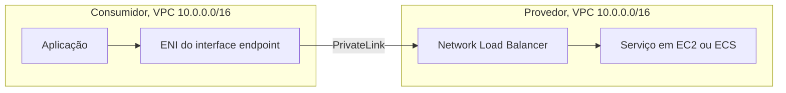

---
aliases:
  - Aula 7.4
modulo: 7
aula: 4
parte: "II Identidade, rede e dados"
dominios:
  - 1
  - 3
  - 4
lida: false
tags:
  - aula
  - saa-c03
  - modulo-07
---

# Aula 7.4: PrivateLink e endpoint services

[[07 - Conectividade Hibrida e entre VPCs|Voltar ao módulo]]

> [!question] Como dar a alguém acesso privado a um serviço seu sem abrir sua rede, e por que isso funciona mesmo com CIDRs iguais?

## O problema: expor um serviço não é o mesmo que ligar redes

Peering e [[Transit Gateway]] ligam **redes**: depois de ligados, qualquer recurso de um lado pode (em tese) alcançar qualquer recurso do outro, e os endereços precisam ser únicos. Muitas vezes isso é demais. Considere:

- Uma empresa vende uma API a 300 clientes. Ligar a rede de cada cliente à sua seria um risco de segurança e um pesadelo de [[CIDR]] (vários clientes usam `10.0.0.0/16`).
- Uma equipe de plataforma mantém um serviço interno (um autenticador, um serviço de licenças) e quer que 50 contas o consumam, sem expor as demais [[Sub-rede|sub-redes]].
- Duas empresas que se fundiram têm CIDRs idênticos e precisam que um sistema chame uma única API do outro lado, sem renumerar ninguém.

O que se quer é **conectividade unidirecional a um serviço específico**, e não roteamento entre redes. É o **[[PrivateLink]]**: uma tecnologia [[Alta Disponibilidade|altamente disponível]] e escalável que conecta sua [[VPC]] a serviços e recursos "como se estivessem na sua VPC", sem [[Internet Gateway]], [[NAT]], IP público, [[Direct Connect]] ou VPN para a comunicação a partir das [[Sub-rede Privada|sub-redes privadas]] (verificado em novembro de 2026).

## Como funciona: a ideia central

O consumidor **não recebe uma rota para a rede do provedor**. Ele recebe uma **[[ENI|interface de rede]] dentro da própria [[Sub-rede|sub-rede]]**, com um IP do próprio [[CIDR]]. Quando a aplicação conecta nesse IP, a AWS leva o tráfego até o serviço do provedor por baixo, sem expor endereços do outro lado. A consequência é dupla:

1. O **[[CIDR]] do provedor é invisível** para o consumidor, então **sobreposição não importa**: o consumidor só vê IPs da própria [[Sub-rede|sub-rede]].
2. A conexão é **unidirecional**: só o consumidor inicia. O provedor não consegue iniciar conexões para dentro da rede do consumidor.

> [!info] Ligando os pontos
> Você já usou isso sem saber: o [[Interface Endpoint]] do Módulo 6 para [[SQS]], [[KMS]] ou [[Secrets Manager]] é [[PrivateLink]], em que o "provedor" é a própria AWS. Aqui, o provedor é você ou uma empresa parceira.

## Os dois papéis

### Provedor do serviço (service provider)

1. Hospeda o serviço atrás de um **[[Network Load Balancer]]** (NLB), que é o front-end. Para appliances de rede, o front-end é um **[[Gateway Load Balancer]]**.
2. Cria um **[[Endpoint Service|endpoint service]]** (também chamado [[VPC Endpoint|VPC endpoint]] service), escolhendo esse balanceador.
3. **Concede permissão** a principais específicos (contas, usuários ou roles da AWS) que poderão se conectar. Pode exigir **aceitação manual** de cada pedido de conexão.
4. Opcionalmente associa um **private [[DNS]] name** (um nome seu, como `api.empresa.com`) para que os consumidores usem o nome de sempre. Antes de usá-lo, o provedor precisa **provar que é dono do domínio**: a AWS fornece um nome e um valor, o provedor cria um registro **TXT** com eles no DNS público do domínio, e o nome só fica disponível aos consumidores quando o status da verificação é `verified` (verificado em novembro de 2026 em docs.aws.amazon.com/vpc/latest/privatelink/manage-dns-names.html). Um [[Endpoint Service|endpoint service]] tem no máximo um private DNS name, e [[Gateway Load Balancer|GWLB]] endpoints não o suportam.

A AWS gera um nome [[DNS]] do serviço no formato `endpoint_service_id.region.vpce.amazonaws.com`. Para boa [[Disponibilidade|disponibilidade]], o serviço deve estar em **pelo menos duas [[Zona de Disponibilidade|AZs]]**: o [[Endpoint Service|endpoint service]] só existe nas AZs em que o [[Network Load Balancer|NLB]] está habilitado, e o consumidor só cria endpoints nessas AZs. Habilitar o [[Cross-Zone Load Balancing|balanceamento entre zonas]] (cross-zone) é uma alternativa, mas, se a única AZ com o serviço cair, os consumidores perdem o acesso, e há cobrança de [[Data Transfer|transferência de dados]] entre AZs.

### Consumidor (service consumer)

1. Cria um **interface [[VPC Endpoint|VPC endpoint]]** apontando para o [[Endpoint Service|endpoint service]], escolhendo as [[Sub-rede|sub-redes]] (uma por [[Zona de Disponibilidade|AZ]]).
2. A AWS cria uma [[ENI]] em cada [[Sub-rede|sub-rede]] escolhida, com IP do [[CIDR]] do consumidor.
3. Controla o acesso com **[[Security Group|security groups]]** na [[ENI]] (quem na [[VPC]] pode usar o endpoint).
4. Usa o nome [[DNS]] regional (`endpoint_id.endpoint_service_id.service_region.vpce.amazonaws.com`), os nomes zonais (para manter o tráfego na mesma [[Zona de Disponibilidade|AZ]]) ou o **private DNS** do provedor, se habilitado.

O pedido, quando o provedor exige aceitação, fica pendente até aprovação. O nome [[DNS]] regional faz *round robin* entre as [[ENI|ENIs]] saudáveis de [[Zona de Disponibilidade|AZs]] diferentes; o nome zonal fixa a AZ, o que ajuda a evitar custo de [[Data Transfer|tráfego entre AZs]].

## Tipos de endpoint baseados em PrivateLink

| Destino | Tipo | Observação |
|---|---|---|
| Serviço da AWS ([[S3]], [[SQS]], [[KMS]], etc.) | [[Interface Endpoint\|Interface endpoint]] | Visto no Módulo 6; [[ENI]] mais private [[DNS]] |
| Seu próprio serviço, ou de parceiro | [[Interface Endpoint\|Interface endpoint]] para [[Endpoint Service\|endpoint service]] | O assunto desta aula |
| Parceiro no Marketplace | [[Interface Endpoint\|Interface endpoint]] | O parceiro publica um [[Endpoint Service\|endpoint service]] |
| Appliances de rede (firewall) | [[Gateway Load Balancer]] endpoint | Para inspeção transparente |
| Um recurso da [[VPC]] do provedor (um banco, por exemplo) | Resource endpoint | Recurso novo que expõe um recurso individual |
| Uma rede de serviços do [[VPC]] Lattice | Service network endpoint | Fora do foco da prova |

Os dois últimos são mais recentes; a prova gira em torno dos três primeiros. (Verificado em novembro de 2026 na página "What is [[PrivateLink|AWS PrivateLink]]".)

## Acesso entre Regiões

O [[PrivateLink]] suporta **acesso entre [[Regiao AWS|Regiões]]**: o provedor hospeda o serviço em uma Região e o disponibiliza em outras Regiões suportadas; o consumidor escolhe a Região do serviço ao criar o endpoint. Pontos verificados na documentação:

- Por padrão, as entidades [[IAM]] **não têm** permissão para isso; é preciso liberar a ação `vpce:AllowMultiRegion` por política. Há também [[Condition Key|chaves de condição]] (`ec2:VpceSupportedRegion` e `ec2:VpceServiceRegion`) para limitar [[Regiao AWS|Regiões]].
- A AWS gerencia o [[Failover|failover]] **entre [[Zona de Disponibilidade|AZs]]**, **não entre [[Regiao AWS|Regiões]]**: para redundância regional, o provedor implanta o serviço em várias Regiões.
- O acesso na mesma Região tem menor [[Latencia|latência]] e custo; a AWS recomenda preferir o acesso intra-Região.
- Há [[Zona de Disponibilidade|AZs]] específicas em que o recurso não é suportado, e o recurso só vale para serviços compartilhados por [[PrivateLink]].

## Gateway endpoint vs interface endpoint (revisão com um detalhe novo)

| Característica | [[Gateway Endpoint\|Gateway endpoint]] | [[Interface Endpoint\|Interface endpoint]] ([[PrivateLink]]) |
|---|---|---|
| Serviços | [[S3]] e [[DynamoDB]] | Dezenas de serviços AWS, seus serviços e de parceiros |
| Mecanismo | Entrada na [[Route Table\|route table]] | [[ENI]] com [[RFC 1918\|IP privado]] na [[Sub-rede\|sub-rede]] |
| Custo | Grátis | Por hora por [[Zona de Disponibilidade\|AZ]] e por GB processado |
| Acesso vindo de on-premises (VPN, [[Direct Connect\|DX]]) ou de outra [[VPC]] via [[Transit Gateway\|TGW]] | **Não** | **Sim** |
| Controle | [[Endpoint Policy\|Endpoint policy]] | Endpoint policy e [[Security Group\|security group]] |

O detalhe: um **[[Gateway Endpoint|gateway endpoint]] do [[S3]] não atende tráfego que chega por VPN, [[Direct Connect]] ou [[Transit Gateway]]**; o **[[Interface Endpoint|interface endpoint]] do S3** atende. Por isso, quando o enunciado pede "acessar o S3 de forma privada a partir do data center pelo Direct Connect", a resposta é **interface endpoint do S3** (verificado em novembro de 2026 na documentação do S3).

## Custo

[[Interface Endpoint|Interface endpoints]] são cobrados por **hora em cada [[Zona de Disponibilidade|AZ]]** em que estão provisionados e por **GB processado** (a página de preços informa US$ 0,01 por GB para o primeiro 1 PB por mês em uma Região; o valor por hora varia e não foi fixado nesta pesquisa; verificado em novembro de 2026). Para muitos serviços, a conta fica menor que a de um [[NAT Gateway]], que cobra por hora e por GB processado (valores no [[06 - VPC a Fundo|Módulo 6]]), e o tráfego não passa pela internet.

## Quando PrivateLink é a resposta

| Situação | Por que [[PrivateLink]] |
|---|---|
| Expor um serviço a muitos consumidores, sem expor a rede | Acesso por serviço, não por rede |
| CIDRs sobrepostos entre provedor e consumidor | O consumidor só vê [[ENI\|ENIs]] do próprio [[CIDR]] |
| Provedor SaaS que quer entregar a API de forma privada | Padrão de mercado |
| Acesso privado a serviços AWS a partir de [[Sub-rede\|sub-redes]] sem internet | [[Interface Endpoint\|Interface endpoint]] |
| Acesso privado ao [[S3]] vindo de on-premises | [[Interface Endpoint\|Interface endpoint]] do S3 |
| Compartilhar um serviço interno com 50 contas, sem peering com cada uma | Um [[Endpoint Service\|endpoint service]] atende todos autorizados |

**Quando não:** quando os dois lados precisam iniciar conexões livremente, trocar muitas portas ou tráfego não [[TCP]]/UDP genérico de uma rede inteira (é caso de peering ou [[Transit Gateway|TGW]]); e quando o serviço não pode ficar atrás de um [[Network Load Balancer|NLB]] ou [[Gateway Load Balancer|GWLB]], a arquitetura precisa mudar.

## Segurança: camadas de controle

1. **Allowlist de principais** no [[Endpoint Service|endpoint service]], mais aceitação manual: o provedor decide quem entra.
2. **[[Security Group|Security group]]** na [[ENI]] do endpoint: o consumidor decide quem dentro da [[VPC]] usa.
3. **[[Endpoint Policy|Endpoint policy]]** (em endpoints de serviços AWS): limita quais ações e recursos são acessíveis pelo endpoint, uma camada que se soma às [[IAM Policy|policies IAM]] do [[04 - IAM Identidade e Acesso|Módulo 4]].
4. **Condições na [[Resource-Based Policy|resource policy]]:** `aws:SourceVpce` em uma [[Bucket Policy|bucket policy]] do [[S3]] restringe o acesso a um endpoint específico.

> [!example] Provedor SaaS em ação
> A empresa *Antifraude Ltda.* roda o motor em [[ECS]] [[Fargate]] atrás de um [[Network Load Balancer|NLB]] interno em duas [[Zona de Disponibilidade|AZs]]. Cria o [[Endpoint Service|endpoint service]], ativa "aceitação necessária" e autoriza a conta da *Loja X*. A Loja X cria um [[Interface Endpoint|interface endpoint]] em duas [[Sub-rede Privada|sub-redes privadas]] e usa `antifraude.loja.internal` (private [[DNS]]). A Loja X usa `10.0.0.0/16`, a Antifraude também; nada quebra, porque ninguém roteia nada. A Antifraude não consegue originar tráfego para a rede da Loja X.

## Como isso cai na prova

**Task statements:** Task 3.4 (opções de conexão: [[PrivateLink]]), Task 1.2 (acesso seguro a serviços via endpoints) e Task 4.4 (reduzir tráfego por [[NAT]] com endpoints).

**Palavras-chave em inglês:**

- "expose a service to other accounts/VPCs without exposing the entire network", "overlapping [[CIDR]]": [[PrivateLink]].
- "SaaS provider", "private connectivity to a vendor's API": [[PrivateLink]].
- "access [[S3|Amazon S3]] privately from on-premises over [[Direct Connect]]": S3 [[Interface Endpoint|interface endpoint]].
- "traffic must not traverse the public internet" com serviço AWS: [[Interface Endpoint|interface endpoint]].
- "reduce [[NAT Gateway|NAT gateway]] data processing charges" para [[S3]] e [[DynamoDB]]: [[Gateway Endpoint|gateway endpoint]] (grátis).

**Pegadinhas clássicas:**

- [[Gateway Endpoint|Gateway endpoint]] do [[S3]] não funciona para tráfego vindo de VPN ou [[Direct Connect|DX]].
- [[PrivateLink]] exige [[Network Load Balancer|NLB]] (ou [[Gateway Load Balancer|GWLB]]) na frente do serviço; um [[Application Load Balancer|ALB]] sozinho não serve como front-end direto do [[Endpoint Service|endpoint service]].
- Conexão unidirecional: o provedor não inicia para o consumidor.
- [[Interface Endpoint|Interface endpoint]] **tem custo**; [[Gateway Endpoint|gateway endpoint]] não.
- [[PrivateLink]] não substitui peering quando o requisito é comunicação bidirecional geral entre redes.

| Requisito no enunciado | Resposta provável | Por quê |
|---|---|---|
| Clientes com [[CIDR]] sobreposto consomem uma API | [[PrivateLink]] ([[Endpoint Service\|endpoint service]] atrás de [[Network Load Balancer\|NLB]]) | Sem roteamento de rede |
| Acesso privado do data center ao [[S3]] pelo [[Direct Connect\|DX]] | [[Interface Endpoint\|Interface endpoint]] do S3 | [[Gateway Endpoint\|Gateway endpoint]] não atende on-premises |
| [[Sub-rede Privada\|Sub-redes privadas]] leem [[S3]] e [[DynamoDB]] com custo mínimo | [[Gateway Endpoint\|Gateway endpoints]] | Grátis e por [[Route Table\|route table]] |
| Provedor quer aprovar cada consumidor | Aceitação manual e allowlist de principais | Controle do lado do provedor |
| Consumidor em outra Região acessa o serviço | Acesso entre [[Regiao AWS\|Regiões]] do [[Endpoint Service\|endpoint service]] | Suportado com `vpce:AllowMultiRegion` |
| Inspeção transparente com firewall de terceiros | [[Gateway Load Balancer]] endpoint | [[PrivateLink]] para appliances |

## Resumo

> [!abstract] A aula em uma frase
> O [[PrivateLink]] entrega um serviço por uma [[ENI]] na [[Sub-rede|sub-rede]] do consumidor, de forma unidirecional e sem roteamento entre redes, por isso resolve exposição controlada e tolera CIDRs iguais.

**A lógica, em 5 passos**

1. O problema: expor um serviço sem ligar redes inteiras nem brigar com [[CIDR]].
2. O provedor coloca o serviço atrás de um [[Network Load Balancer|NLB]] e cria o [[Endpoint Service|endpoint service]], autorizando principais.
3. O consumidor cria um [[Interface Endpoint|interface endpoint]]: a AWS põe uma [[ENI]] com IP do próprio [[CIDR]] em cada [[Sub-rede|sub-rede]].
4. O tráfego é levado ao serviço por baixo; só o consumidor inicia a conexão.
5. Como não há roteamento de redes, a sobreposição de [[CIDR]] é irrelevante.

**Tabela-síntese**

| Critério | Peering/TGW | [[PrivateLink]] |
|---|---|---|
| O que liga | Redes | Consumidor a um serviço |
| Direção | Bidirecional | Unidirecional |
| [[CIDR]] sobreposto | Proibido | Tolerado |
| Custo | Peering: sem taxa fixa; [[Transit Gateway\|TGW]]: attachment e GB | Por hora por [[Zona de Disponibilidade\|AZ]] e por GB |
| Front-end do provedor | Nenhum | [[Network Load Balancer\|NLB]] (ou [[Gateway Load Balancer\|GWLB]]) |

**Na prática, isso significa**

- "Expor serviço" ou "[[CIDR]] sobreposto" aponta para [[PrivateLink]].
- Do data center ao [[S3]] pelo [[Direct Connect|DX]], use o [[Interface Endpoint|interface endpoint]], não o [[Gateway Endpoint|gateway endpoint]].
- O provedor pensa em [[Network Load Balancer|NLB]], em pelo menos duas [[Zona de Disponibilidade|AZs]] e em quem autorizar.
- Custo: [[Interface Endpoint|interface endpoint]] cobra; [[Gateway Endpoint|gateway endpoint]] não.

> [!tip] Liga com
> Vem de [[07.03 - Transit Gateway|7.3]] (o que o [[Transit Gateway|TGW]] não resolve) e do [[06 - VPC a Fundo|Módulo 6]] (endpoints). Segue para [[07.05 - Site-to-Site VPN e Client VPN|7.5]], a conexão com o mundo fora da AWS.

## Erros comuns

- **Usar [[Gateway Endpoint|gateway endpoint]] do [[S3]] esperando atender o data center** por VPN ou [[Direct Connect|DX]].
- **Esquecer o [[Network Load Balancer|NLB]]** na frente do serviço do provedor.
- **Esperar que o provedor consiga iniciar conexões** para dentro da rede do consumidor.
- **Publicar o serviço em uma [[Zona de Disponibilidade|AZ]] só** e esperar [[Alta Disponibilidade|alta disponibilidade]].
- **Escolher peering por reflexo** quando o requisito é só expor uma API a muitos clientes.
- **Esquecer a permissão `vpce:AllowMultiRegion`** no acesso entre [[Regiao AWS|Regiões]].

## Pratique

**1.** Uma empresa de logística quer disponibilizar uma API de rastreamento a mais de 100 clientes, cada um com sua [[VPC]] (alguns com CIDRs iguais), sem expor nenhuma outra parte da rede. Quais passos o provedor e os clientes devem seguir?

- [ ] a) O provedor cria um Transit Gateway e compartilha com as contas dos clientes, que anexam suas VPCs e propagam as rotas
- [ ] b) Cada cliente cria um VPC peering com a VPC do provedor, e o provedor adiciona rotas para cada CIDR de cliente
- [ ] c) O provedor cria uma Site-to-Site VPN com cada cliente e usa BGP para anunciar o endereço de cada serviço
- [ ] d) O provedor põe a API atrás de um NLB e cria um endpoint service; cada cliente cria um interface endpoint na própria VPC

**2.** Após uma fusão, duas empresas têm [[VPC|VPCs]] com o mesmo [[CIDR]] `10.0.0.0/16`. Uma aplicação da empresa A precisa chamar uma única API interna da empresa B, sem renumerar nada. Qual solução atende com o MENOR esforço?

- [ ] a) VPC peering entre as duas VPCs, com tabelas de rotas para o CIDR comum e regras de security group
- [ ] b) PrivateLink, com a API atrás de um NLB e um interface endpoint na VPC da empresa A
- [ ] c) Um Transit Gateway com as duas VPCs anexadas e um bloco de NAT 1:1 para cada lado
- [ ] d) Uma Direct Connect entre as duas VPCs, usando uma virtual interface privada para a API

**3.** Um data center está conectado à AWS por [[Direct Connect]]. Os servidores locais precisam acessar buckets do [[S3]] de forma privada, sem passar pela internet pública. Qual é a solução correta?

- [ ] a) Criar um interface endpoint do S3 e resolver o nome do S3 para os IPs dele no on-premises
- [ ] b) Criar um gateway endpoint do S3 na VPC e adicionar a rota do prefix list na rede on-premises do cliente
- [ ] c) Criar um NAT Gateway na VPC e rotear o tráfego do data center por ele até o S3 pela internet
- [ ] d) Criar um peering entre o data center e a VPC e usar o gateway endpoint existente nela

**4.** Um provedor tem um [[Endpoint Service|endpoint service]] em us-east-1. Clientes com [[VPC|VPCs]] apenas em eu-west-1 querem consumi-lo de forma privada, com o menor número de componentes. Qual abordagem é mais adequada?

- [ ] a) Criar um Transit Gateway em cada Região, fazer o peering entre eles e anexar as VPCs dos clientes
- [ ] b) Replicar o serviço manualmente em eu-west-1, mantendo duas bases de código e dois NLBs separados
- [ ] c) Habilitar o acesso entre Regiões no endpoint service e criar o interface endpoint na própria Região do cliente
- [ ] d) Expor o serviço por um NLB público e exigir IPs fixos dos clientes em uma allowlist de origem

**5.** Um provedor SaaS quer garantir que só clientes previamente aprovados consigam se conectar ao seu [[Endpoint Service|endpoint service]], mesmo que alguém descubra o nome do serviço. O que configurar?

- [ ] a) Apenas um security group no NLB, com o CIDR dos clientes aprovados e as portas mínimas necessárias
- [ ] b) Uma network ACL na sub-rede do NLB, bloqueando os IPs de todos os clientes não aprovados
- [ ] c) Uma resource policy no S3 com a condição `aws:SourceVpce` apontando para cada cliente
- [ ] d) A lista de principais permitidos no endpoint service e a aceitação manual das conexões

**6.** [[Sub-rede Privada|Sub-redes privadas]] de uma [[VPC]] leem muito do [[S3]] e do [[DynamoDB]] por meio de um [[NAT Gateway]], e a fatura de processamento de dados está alta. Qual alteração reduz o custo com menor esforço?

- [ ] a) Criar interface endpoints para S3 e DynamoDB em todas as AZs, pagando por hora e por GB processado
- [ ] b) Criar gateway endpoints para S3 e DynamoDB, sem custo por hora nem por GB, e adicionar as rotas nas sub-redes privadas
- [ ] c) Substituir o NAT Gateway por uma NAT instance menor, mantendo o mesmo caminho pela internet pública
- [ ] d) Mover o S3 e o DynamoDB para outra Região, de modo a reduzir o tráfego que passa pelo NAT Gateway

**7.** Por que o [[PrivateLink]] funciona mesmo quando provedor e consumidor usam o mesmo [[CIDR]]?

- [ ] a) Porque a AWS faz NAT 1:1 automático entre os CIDRs sobrepostos, convertendo os endereços de um lado para o outro
- [ ] b) Porque o PrivateLink usa um VPC peering gerenciado em que a rota mais específica prevalece sobre o CIDR local
- [ ] c) Porque o consumidor só enxerga ENIs com IPs do próprio CIDR e não existe nenhuma rota para a rede do provedor
- [ ] d) Porque o provedor também recebe uma ENI na VPC do consumidor, e a AWS ajusta as rotas pelo prefixo mais longo

**8.** Uma empresa quer inspecionar todo o tráfego de saída com firewalls virtuais de um parceiro, sem alterar o endereçamento das aplicações. Qual recurso baseado em [[PrivateLink]] é adequado?

- [ ] a) Gateway Load Balancer com Gateway Load Balancer endpoints nas VPCs das aplicações
- [ ] b) Gateway endpoint do S3 apontando para o appliance do parceiro
- [ ] c) Um endpoint service atrás de um ALB com regras de path para o firewall
- [ ] d) Um Client VPN para os servidores das aplicações, com regras de autorização por grupo

**9.** (Escolha DUAS.) Uma empresa SaaS quer entregar uma API a clientes de várias contas, alguns com o mesmo [[CIDR]], sem peering e sem expor a rede. Quais ações atendem ao requisito?

- [ ] a) Criar um VPC peering com cada cliente e adicionar as rotas dos CIDRs deles
- [ ] b) Colocar a API atrás de um Network Load Balancer e criar um endpoint service
- [ ] c) Fazer cada cliente criar um interface endpoint nas próprias sub-redes, apontando para o endpoint service
- [ ] d) Exigir um Internet Gateway na VPC de cada cliente para entregar o tráfego do PrivateLink
- [ ] e) Pedir que os clientes com CIDR repetido renumerem as VPCs antes de se conectarem

**10.** (Escolha DUAS.) [[Sub-rede Privada|Sub-redes privadas]] de uma [[VPC]] acessam [[S3]] e [[DynamoDB]] por um [[NAT Gateway]], e a conta de processamento de dados está alta. O data center, ligado por [[Direct Connect]], também precisa acessar o S3 de forma privada. Quais ações atendem aos dois requisitos?

- [ ] a) Criar gateway endpoints de S3 e DynamoDB na VPC e adicionar as rotas nas sub-redes privadas
- [ ] b) Usar o mesmo gateway endpoint do S3 para atender o tráfego vindo do Direct Connect
- [ ] c) Criar interface endpoints de S3 e DynamoDB, que não têm cobrança por hora nem por GB
- [ ] d) Criar interface endpoints e apontar as route tables das sub-redes para eles, como se fossem gateways
- [ ] e) Criar um interface endpoint do S3 para o tráfego que chega do data center

> [!success]- Gabarito
> **1. d)** [[Network Load Balancer|NLB]], [[Endpoint Service|endpoint service]] com allowlist e [[Interface Endpoint|interface endpoints]] dos clientes expõem só a API e toleram [[CIDR]] igual; a) [[Transit Gateway|TGW]] exige CIDRs únicos e expõe a rede, b) peering proíbe CIDR sobreposto, c) VPN por cliente não escala e não resolve sobreposição.
> **2. b)** [[PrivateLink]] não roteia redes, então o [[CIDR]] igual não atrapalha; a) peering proíbe sobreposição, c) [[Transit Gateway|TGW]] também e [[NAT]] 1:1 é complexo, d) [[Direct Connect]] não liga [[VPC|VPCs]] entre si.
> **3. a)** o [[Interface Endpoint|interface endpoint]] do [[S3]] atende tráfego de on-premises; b) o [[Gateway Endpoint|gateway endpoint]] não atende tráfego vindo de VPN, [[Direct Connect|DX]] ou [[Transit Gateway|TGW]], c) [[NAT Gateway]] leva pela internet, d) peering não liga ao data center.
> **4. c)** o acesso entre [[Regiao AWS|Regiões]] do [[Endpoint Service|endpoint service]] (com `vpce:AllowMultiRegion`) é o caminho mais curto; a) [[Transit Gateway|TGW]] em duas Regiões exige [[CIDR]] único e muitos componentes, b) replicar é trabalho desnecessário, d) [[Network Load Balancer|NLB]] público contraria o requisito de privado.
> **5. d)** allowlist de principais e aceitação manual são os controles do provedor; a) e b) não impedem o pedido de conexão ao [[Endpoint Service|endpoint service]], c) a condição aws:SourceVpce é do consumidor, em [[Resource-Based Policy|resource policies]] do [[S3]].
> **6. b)** [[Gateway Endpoint|gateway endpoints]] de [[S3]] e [[DynamoDB]] são grátis e baratos de implantar; a) [[Interface Endpoint|interface endpoints]] cobram por hora e por GB, c) [[NAT Instance|NAT instance]] não resolve o custo de caminho, d) mover os dados é desproporcional.
> **7. c)** o consumidor só vê as [[ENI|ENIs]] da própria [[Sub-rede|sub-rede]], sem rota para o provedor; a) erra porque não há [[NAT]] entre os CIDRs (não existe tradução, existe ausência de roteamento), b) erra porque não há peering por baixo e peering proíbe [[CIDR]] sobreposto, d) erra porque o provedor não recebe ENI nem rota na [[VPC]] do consumidor (a conexão é unidirecional). O motivo nunca é [[IPv6]]: o [[PrivateLink]] funciona com [[IPv4]] e IPv6 nos [[Interface Endpoint|interface endpoints]]; o que importa é não haver roteamento entre as redes.
> **8. a)** o [[Gateway Load Balancer|GWLB]] com GWLB endpoints ([[PrivateLink]]) insere appliances de forma transparente; b) [[Gateway Endpoint|gateway endpoint]] do [[S3]] é só para S3, c) [[Application Load Balancer|ALB]] não é front-end de [[Endpoint Service|endpoint service]], d) [[Client VPN]] é para usuários.
> **9. b) e c)** o provedor expõe o serviço atrás de um [[Network Load Balancer|NLB]] com [[Endpoint Service|endpoint service]] e cada cliente cria o [[Interface Endpoint|interface endpoint]] na própria [[Sub-rede|sub-rede]]; a) erra porque peering proíbe [[CIDR]] sobreposto e expõe a rede, d) erra porque o [[PrivateLink]] não precisa de [[Internet Gateway]], e) erra porque a sobreposição é tolerada e renumerar seria trabalho desnecessário.
> **10. a) e e)** [[Gateway Endpoint|gateway endpoints]] grátis cortam o custo do [[NAT]] para [[S3]] e [[DynamoDB]], e só o [[Interface Endpoint|interface endpoint]] do S3 atende tráfego do [[Direct Connect]]; b) erra porque gateway endpoint não atende VPN, DX ou [[Transit Gateway|TGW]], c) erra porque interface endpoints cobram por hora e por GB, d) erra porque interface endpoints não usam [[Route Table|route table]] (usam [[ENI]] e [[DNS]]).

### Laboratório (opcional)

> [!warning] Use uma conta AWS pessoal separada, com AWS Budgets configurado, nunca a conta de produção da empresa. NLB e interface endpoints cobram por hora. Apague tudo no mesmo dia.

Objetivo: criar um [[Endpoint Service|endpoint service]] e consumi-lo em outra [[VPC]] da mesma conta. Custo estimado: centavos por hora ([[Network Load Balancer|NLB]], instância e endpoint).

1. Crie duas [[VPC|VPCs]] com [[Sub-rede Privada|sub-redes privadas]] (podem usar CIDRs iguais, para comprovar a ideia).
2. Na [[VPC]] do provedor, lance uma instância Amazon Linux 2023 com um servidor [[HTTP]] simples na porta 80 (por exemplo, via [[User Data|user data]] com `python3 -m http.server 80`; o [[Security Group|security group]] libera a porta 80 do [[CIDR]] da VPC). Crie um [[Target Group|target group]] [[TCP]]:80, **registre a instância nele**, e crie um [[Network Load Balancer|NLB]] interno nas [[Sub-rede|sub-redes]] do provedor com um [[Listener|listener]] TCP:80 para esse target group. As sub-redes sem internet não baixam pacotes, por isso use só o que já vem na [[AMI]].
3. Crie o [[Endpoint Service|endpoint service]]: `aws ec2 create-vpc-endpoint-service-configuration --network-load-balancer-arns <arn-do-nlb> --acceptance-required`.
4. Adicione a permissão ao principal consumidor: `aws ec2 modify-vpc-endpoint-service-permissions --service-id <vpce-svc> --add-allowed-principals <arn-da-conta-ou-role>`.
5. Na [[VPC]] consumidora, crie o endpoint: `aws ec2 create-vpc-endpoint --vpc-id <vpc> --vpc-endpoint-type Interface --service-name <service-name> --subnet-ids <subnet> --security-group-ids <sg>`.
6. Aceite a conexão: `aws ec2 accept-vpc-endpoint-connections --service-id <vpce-svc> --vpc-endpoint-ids <vpce>`.
7. Prepare o acesso à [[VPC]] consumidora: habilite `enableDnsSupport` e `enableDnsHostnames`, crie os [[Interface Endpoint|interface endpoints]] do [[Systems Manager]] (`ssm`, `ssmmessages` e `ec2messages`, com private [[DNS]] e [[Security Group|security group]] que aceite HTTPS do [[CIDR]] da VPC) e um [[Instance Profile|instance profile]] com `AmazonSSMManagedInstanceCore`. Lance uma instância Amazon Linux 2023 com esse profile, abra `aws ssm start-session --target <instance-id>` e rode `curl http://<nome-DNS-do-endpoint>`; confirme a resposta do servidor do provedor. O security group do endpoint precisa aceitar a porta 80 da instância.
8. **Limpeza:** apague os endpoints (inclusive os do [[Systems Manager]], que cobram por hora), o [[Endpoint Service|endpoint service]], o [[Network Load Balancer|NLB]], os [[Target Group|target groups]], as instâncias, [[Security Group|security groups]], [[Sub-rede|sub-redes]] e [[VPC|VPCs]].

## Para aprofundar

- [O que é o AWS PrivateLink](https://docs.aws.amazon.com/vpc/latest/privatelink/what-is-privatelink.html) (AWS): visão geral e tipos de endpoint.
- [Compartilhar seus serviços pelo PrivateLink](https://docs.aws.amazon.com/vpc/latest/privatelink/privatelink-share-your-services.html) (AWS): [[Endpoint Service|endpoint service]], [[DNS]], [[Zona de Disponibilidade|AZs]] e acesso entre [[Regiao AWS|Regiões]].

Próxima aula: [[07.05 - Site-to-Site VPN e Client VPN]].
