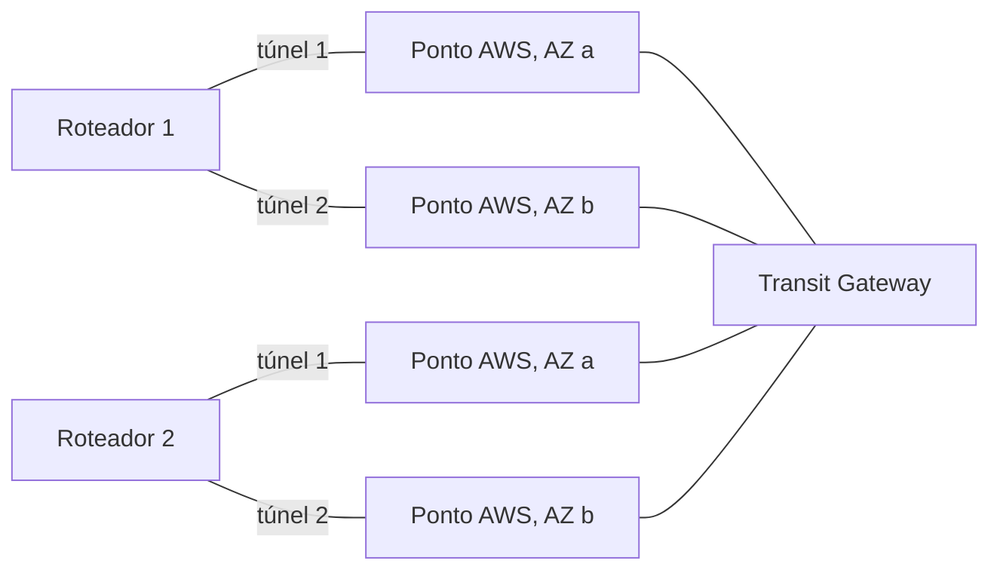

---
aliases:
  - Aula 7.5
modulo: 7
aula: 5
parte: "II Identidade, rede e dados"
dominios:
  - 1
  - 3
  - 4
lida: false
tags:
  - aula
  - saa-c03
  - modulo-07
---

# Aula 7.5: Site-to-Site VPN e Client VPN

[[07 - Conectividade Hibrida e entre VPCs|Voltar ao módulo]]

> [!question] Como ligar um escritório ou data center à VPC em horas, com criptografia, usando só a internet, e o que falta para ser resiliente?

## O problema: conectividade já, e protegida

Um data center ou escritório precisa falar com a [[VPC]] por [[RFC 1918|IP privado]]. Um circuito físico dedicado ([[Direct Connect]], [[07.06 - Direct Connect|aula 7.6]]) leva semanas. Já a internet existe nos dois lados, mas é pública: pacotes passam por redes de terceiros. A resposta clássica é construir um **túnel criptografado** por cima da internet: o tráfego privado é embrulhado e cifrado na saída, atravessa a internet como dados ilegíveis e é aberto na chegada. Esse padrão é o **[[IPsec]]**, e o serviço gerenciado da AWS que o implementa é o **[[Site-to-Site VPN]]**.

Complementarmente, **pessoas** (não redes) também precisam entrar: um funcionário em casa abre um cliente no notebook e acessa recursos privados. Isso é o **[[Client VPN]]**.

## Site-to-Site VPN: os componentes

Uma conexão VPN tem três partes (verificado em novembro de 2026 na documentação "How AWS [[Site-to-Site VPN]] works"):

| Componente | Onde fica | O que é |
|---|---|---|
| **[[Virtual Private Gateway]]** (VGW) **ou [[Transit Gateway]]** | Lado AWS | O ponto de término do túnel na AWS |
| **[[Customer Gateway\|Customer gateway]] device** | Seu lado | O roteador/firewall (físico ou software) que termina o [[IPsec]] |
| **[[Customer Gateway]]** | Recurso na AWS | Objeto que representa o seu dispositivo (IP público, [[Sistema Autonomo\|ASN]] de [[BGP]]) |

A conexão oferece **dois túneis VPN** entre o lado AWS e o seu dispositivo. Os dois pontos de término da AWS ficam em **[[Zona de Disponibilidade|AZs]] diferentes**, para que a manutenção ou falha de um não derrube a conexão (esta é a redundância do lado AWS; a do **seu** lado é problema seu).

Antes de cifrar, os dois lados precisam combinar chaves e algoritmos. Essa negociação é o **IKE** (Internet Key Exchange, o protocolo que estabelece o túnel [[IPsec]]), e a identidade de cada ponta é provada por uma **pre-shared key** (uma senha secreta combinada entre os dois lados) ou por certificado. Por padrão, **o seu dispositivo precisa iniciar** a negociação IKE (gerando tráfego); há uma opção para a AWS iniciar.

### VGW ou Transit Gateway

| Critério | [[Virtual Private Gateway]] | [[Transit Gateway]] |
|---|---|---|
| Quantas [[VPC\|VPCs]] atende | **Uma** (o [[Virtual Private Gateway\|VGW]] anexa a uma VPC por vez) | Muitas (um attachment por VPC) |
| [[ECMP]] (somar banda de túneis) | Não | Sim, com roteamento dinâmico |
| [[IPv6]] dentro e fora do túnel | Não suporta IPv6 | Suporta |
| [[Accelerated VPN]] | Não | Sim |
| Túnel de [[Largura de Banda\|largura de banda]] grande (até 5 Gbps) | **Não** | **Sim** (também em Cloud WAN) |
| Custo adicional | Nenhum além da conexão VPN | Attachment-hora e GB processado ([[07.03 - Transit Gateway|aula 7.3]]) |
| Quando usar | Uma [[VPC]], caso simples | Várias VPCs, banda agregada, hub |

A própria documentação recomenda explorar o [[Transit Gateway]] quando a mesma VPN precisa atender várias [[VPC|VPCs]].

## Roteamento: estático ou dinâmico (BGP)

Ao criar a conexão você escolhe um modo:

- **Estático:** você informa à AWS os prefixos on-premises e configura rotas no seu dispositivo. Simples, mas manual; **sem [[ECMP]]**; sem [[Failover|failover automático]] entre rotas.
- **Dinâmico (BGP):** seu dispositivo e a AWS trocam rotas pelo [[BGP]] sobre o túnel. Prefixos novos e quedas são aprendidos sozinhos; habilita [[ECMP]] no [[Transit Gateway|TGW]]; é o recomendado. **Não se mistura**: escolhendo BGP, você não especifica rotas estáticas.
- Em empate entre rota estática e [[BGP]] para o mesmo prefixo no [[Virtual Private Gateway|VGW]], a estática ganha.
- No [[Virtual Private Gateway|VGW]], **a propagação de rotas** pode ser habilitada na [[Route Table|route table]] da [[VPC]]: as rotas da VPN (estáticas e dinâmicas) são inseridas automaticamente, até o limite da tabela.

Limites relevantes (verificado em novembro de 2026): no [[Virtual Private Gateway|VGW]], 100 rotas estáticas e 100 rotas dinâmicas anunciadas pelo seu dispositivo; no [[Transit Gateway|TGW]], 1.000 rotas dinâmicas aceitas do seu dispositivo.

## Banda, latência e qualidade

| Item | Valor |
|---|---|
| Banda máxima por túnel padrão | até 1,25 Gbps (140.000 pacotes por segundo) |
| Banda máxima por túnel de "[[Largura de Banda\|largura de banda]] grande" (Large Bandwidth Tunnel) | até 5 Gbps (400.000 pacotes por segundo); só em conexões anexadas a [[Transit Gateway]] ou Cloud WAN, não em [[Virtual Private Gateway\|VGW]], e incompatível com [[Accelerated VPN\|accelerated VPN]] (verificado em novembro de 2026 em docs.aws.amazon.com/vpn/latest/s2svpn/VPNTunnels.html) |
| MTU | 1.446 bytes (MSS 1.406) |
| Túneis por conexão | 2 |
| Conexões por [[Virtual Private Gateway\|VGW]] (padrão) | 10 (ajustável) |
| Conexões por Região (padrão) | 50 (ajustável) |

Os valores são máximos, não garantias: o desempenho real depende do tamanho de pacote, do tráfego misto, da política de bandas nas redes intermediárias e da própria internet. **Esta é a diferença estrutural para o [[Direct Connect]]**: a VPN percorre a internet pública, então [[Latencia]] e [[Throughput]] variam; o DX é um circuito dedicado.

> [!example] Conta de banda
> O escritório precisa de 3 Gbps para a [[VPC]], e um túnel padrão entrega no máximo 1,25 Gbps. Opções: (1) quatro túneis em [[ECMP]] por conexões VPN no [[Transit Gateway|TGW]] com [[BGP]] (até 5 Gbps agregados, em tese); (2) túnel de largura grande (até 5 Gbps), que exige a conexão anexada a um **Transit Gateway** (não funciona no [[Virtual Private Gateway|VGW]]) e não combina com [[Accelerated VPN|accelerated VPN]]. Se a banda tem que ser garantida e estável, a resposta migra para [[Direct Connect]].

## Resiliência de uma VPN

Um erro comum é achar que "dois túneis" já é [[Alta Disponibilidade|alta disponibilidade]]. Os dois túneis protegem contra problemas no **lado AWS**. Se o seu roteador de borda (o [[Customer Gateway|customer gateway]] device) falha, **os dois túneis caem juntos**. Para proteger também o seu lado:

1. Crie **uma segunda conexão VPN** apontando para um **segundo [[Customer Gateway|customer gateway]]** (um segundo dispositivo, de preferência em outro local).
2. Use **[[BGP]]** para a troca automática de rotas, de modo que, ao cair um dispositivo, o tráfego passe para o outro.
3. Para uma sede com [[Direct Connect]], mantenha a **VPN como backup** do DX (padrão cobrado na prova; detalhes na aula 7.6).

## Accelerated VPN

Para reduzir a variabilidade da internet pública, a **[[Accelerated VPN|accelerated VPN]]** usa o **[[Global Accelerator]]**: o tráfego entra na [[Backbone|rede global da AWS]] no **ponto de borda mais próximo** do seu dispositivo e trafega pela rede da AWS até a Região. Fatos verificados em novembro de 2026:

- Só funciona com conexão **anexada a um [[Transit Gateway]]** (não com [[Virtual Private Gateway|VGW]]).
- A AWS cria e gerencia **dois aceleradores** (um por túnel), que você não vê no console do [[Global Accelerator]].
- **Não se liga nem desliga** em uma conexão existente: cria-se uma nova.
- Exige **NAT-T** ([[NAT]] traversal, a técnica que encapsula o [[IPsec]] em [[UDP]] para atravessar equipamentos que fazem NAT no caminho) e a negociação IKE tem que ser iniciada pelo seu dispositivo.
- Não pode ser usada com uma public [[Virtual Interface|virtual interface]] do [[Direct Connect]].
- Custo adicional: além da conexão (US$ 0,05 por hora nos exemplos da página de preços), há uma taxa horária por acelerador e um prêmio por GB (preços de exemplo; não estimados em detalhe aqui).

## VPN CloudHub

O **[[CloudHub|VPN CloudHub]]** usa o [[Virtual Private Gateway|VGW]] como hub entre **vários sites** que têm VPN com a AWS. Cada site se conecta, e o VGW **reanuncia** as rotas, de modo que os sites falem **entre si** e com a [[VPC]]. Requisitos da documentação: **um único VGW**, **um [[Customer Gateway|customer gateway]] por site, cada um com [[Sistema Autonomo|ASN]] [[BGP]] único**, uma conexão **dinâmica** (BGP) por site, **prefixos distintos** (sem sobreposição) e rotas nas [[Route Table|route tables]] da VPC. Cobra-se o preço normal de cada VPN; enviar dados de um site ao VGW é grátis, e você paga a transferência padrão apenas pelo que o VGW entrega ao destino. É uma forma barata de ter hub-and-spoke entre filiais sobre a internet.

## VPN sobre Direct Connect (antecipando a aula 7.6)

Por padrão, o [[Direct Connect]] **não é criptografado**. Para cifrar, uma opção é construir uma [[Site-to-Site VPN]] **por cima** dele: sobre uma **public [[Virtual Interface|virtual interface]]** (IPs públicos) ou, de forma mais nova, uma **private IP VPN** sobre uma **transit virtual interface**, sem IPs públicos. Detalhes na próxima aula.

## Custo

- **Conexão VPN:** US$ 0,05 por conexão-hora nos exemplos da página de preços (verificado em novembro de 2026; valor de região dos EUA). Cerca de US$ 36,50 por mês de 730 horas.
- **Dados:** a entrada é grátis; a saída para a internet segue a tabela de [[Data Transfer|transferência de dados]] (os primeiros 100 GB por mês são grátis, agregados entre serviços; a primeira faixa de 10 TB custa US$ 0,09 por GB no exemplo da página).
- Com [[Transit Gateway|TGW]], soma-se o attachment-hora e o GB processado.

## Client VPN

O **[[Client VPN]]** é um serviço gerenciado de VPN **baseado em cliente**, que usa o protocolo **OpenVPN** (conexões [[TLS]]), [[Serverless|sem servidor]] para você manter. Elementos:

| Elemento | O que é |
|---|---|
| **[[Client VPN]] endpoint** | O recurso que termina as sessões dos usuários |
| **Target network** | A rede associada: [[Sub-rede\|sub-redes]] da [[VPC]] ou um attachment direto de [[Transit Gateway]] |
| **Client [[CIDR]] range** | Faixa de IPs que cada conexão recebe |
| **[[Route Table\|Route table]] do endpoint** | Rotas de destino acessíveis ([[VPC]], on-premises, internet) |
| **Authorization rules** | Quem (grupo do [[Active Directory]] ou do [[Identity Provider\|IdP]]) acessa qual rede; por padrão, nenhuma regra, então nada é acessível |
| **Autenticação** | [[Active Directory]] ([[Directory Service]]), autenticação federada ([[SAML]]) ou certificado mútuo |

Ele escala e tem [[Alta Disponibilidade|alta disponibilidade]] sem intervenção, registra logs de conexão e permite acesso unificado a recursos AWS e on-premises por um único túnel. A cobrança é por hora **por endpoint association** (cada [[Sub-rede|sub-rede]] associada ao endpoint conta como uma association) e por hora **por conexão VPN ativa**; os valores por hora estão na página de preços do [[Client VPN]]. Além disso, se a sub-rede associada pertence a uma [[VPC]] com [[Internet Gateway]], a AWS associa [[Elastic IP|Elastic IPs]] às [[ENI|ENIs]] do endpoint, e esses IPs são cobrados como [[IPv4]] público em uso; não é um IP por conexão de usuário. A saída para a internet segue a tabela de transferência do [[EC2]] (verificado em novembro de 2026 em docs.aws.amazon.com/vpn/latest/clientvpn-admin/what-is.html).

| Pergunta | [[Site-to-Site VPN]] | [[Client VPN]] |
|---|---|---|
| Quem conecta? | Uma rede (um roteador) | Uma pessoa (um cliente) |
| Protocolo | [[IPsec]] | OpenVPN ([[TLS]]) |
| Autenticação | Pre-shared key ou certificado do dispositivo | [[Active Directory\|AD]], [[SAML]] ou certificado do usuário |
| Caso | Filial, data center | Teletrabalho, administradores |

## Quando VPN é a resposta (e quando não)

**Escolha VPN quando:** o prazo é curto (horas); a banda necessária é baixa a moderada; o custo precisa ser baixo; precisa de criptografia nativa; ou como **backup** de um [[Direct Connect]].

**Não escolha VPN quando:** o requisito é [[Latencia|latência]] estável e previsível ou banda de muitos Gbps sustentados ([[Direct Connect|DX]]); ou quando o requisito é "sem passar pela internet" no sentido estrito de circuito privado.

## Como isso cai na prova

**Task statements:** Task 1.2 (proteger conexões externas com VPN e [[Direct Connect]]), Task 3.4 (opções de conexão), Task 4.4 (VPN vs Direct Connect vs internet; banda com várias VPNs).

**Palavras-chave em inglês:**

- "quickly establish", "within hours", "encrypted connection over the internet": [[Site-to-Site VPN]].
- "[[IPsec]]", "[[Customer Gateway|customer gateway]]", "[[Virtual Private Gateway|virtual private gateway]]": VPN.
- "increase [[Largura de Banda|bandwidth]]", "[[ECMP]]": várias VPNs no [[Transit Gateway]] com [[BGP]].
- "remote users", "OpenVPN", "authenticate with [[Active Directory]]": [[Client VPN]].
- "branch offices communicate with each other through AWS": [[CloudHub|VPN CloudHub]].
- "redundant VPN", "[[Customer Gateway|customer gateway]] failure": segunda conexão com segundo customer gateway.
- "improve VPN performance without [[Direct Connect]]": [[Accelerated VPN|accelerated VPN]].

**Pegadinhas clássicas:**

- Dois túneis não protegem contra falha do seu roteador.
- [[ECMP]] exige [[Transit Gateway]] e roteamento dinâmico (não funciona com [[Virtual Private Gateway|VGW]] nem com estático).
- O [[Virtual Private Gateway|VGW]] atende uma [[VPC]] por vez.
- O [[Client VPN]] é para usuários, não para ligar um escritório.
- [[Direct Connect]] não é criptografado por padrão; VPN é.

| Requisito no enunciado | Resposta provável | Por quê |
|---|---|---|
| Ligar filial à [[VPC]] em poucas horas, criptografado | [[Site-to-Site VPN]] | [[IPsec]] sobre a internet, sem prazo de operadora |
| Uma VPN servindo 30 [[VPC\|VPCs]] | VPN anexada ao [[Transit Gateway]] | O [[Virtual Private Gateway\|VGW]] atende uma VPC |
| Mais de 1,25 Gbps pela VPN | Várias conexões no [[Transit Gateway\|TGW]] com [[BGP]] e [[ECMP]] | Somar túneis |
| Falha do roteador local não pode derrubar a conexão | Segunda VPN com segundo [[Customer Gateway\|customer gateway]] e [[BGP]] | Os dois túneis terminam no mesmo dispositivo |
| Funcionários remotos autenticados por [[Active Directory\|AD]] | [[Client VPN]] | Acesso gerenciado baseado em cliente |
| Filiais falando entre si via AWS, baixo custo | [[CloudHub\|VPN CloudHub]] | Hub no [[Virtual Private Gateway\|VGW]] com [[BGP]] e ASNs únicos |

## Resumo

> [!abstract] A aula em uma frase
> O [[Site-to-Site VPN]] cria dois túneis [[IPsec]] pela internet entre o lado AWS ([[Virtual Private Gateway|VGW]] ou [[Transit Gateway]]) e o seu dispositivo, é rápido e barato mas varia com a internet, e o [[Client VPN]] faz o mesmo papel para usuários individuais.

**A lógica, em 5 passos**

1. A internet é pública; o túnel [[IPsec]] cifra o tráfego privado por cima dela.
2. A AWS termina dois túneis em [[Zona de Disponibilidade|AZs]] diferentes; o seu dispositivo termina o outro lado.
3. O roteamento é estático ou [[BGP]]; BGP permite [[ECMP]] (no [[Transit Gateway|TGW]]) e [[Failover|failover]].
4. Resiliência de ponta a ponta exige um segundo dispositivo e uma segunda conexão, ou um [[Direct Connect|DX]] principal com VPN de backup.
5. Para pessoas, o [[Client VPN]] autentica por [[Active Directory|AD]], [[SAML]] ou certificado e entrega acesso gerenciado.

**Números para lembrar**

| O quê | Valor | Por que importa |
|---|---|---|
| Túneis por conexão | 2 | Redundância do lado AWS |
| Banda por túnel padrão | até 1,25 Gbps | Motiva [[ECMP]] |
| Banda por túnel de largura grande | até 5 Gbps | Alternativa ao [[ECMP]] |
| Rotas estáticas no [[Virtual Private Gateway\|VGW]] | 100 | Limite do modo estático |
| Conexões por [[Virtual Private Gateway\|VGW]] (padrão) | 10 | Cota ajustável |

**Tabela-síntese**

| Critério | [[Virtual Private Gateway\|VGW]] | [[Transit Gateway]] |
|---|---|---|
| [[VPC\|VPCs]] | Uma | Muitas |
| [[ECMP]] | Não | Sim ([[BGP]]) |
| [[Accelerated VPN]] | Não | Sim |
| [[IPv6]] | Não | Sim |

**Na prática, isso significa**

- Para "rápido, barato e criptografado", VPN; para [[Latencia|latência]] estável, [[Direct Connect]].
- Mais de uma [[VPC]] ou mais banda, anexe a VPN ao [[Transit Gateway]] com [[BGP]].
- Resiliência real tem dois dispositivos on-premises.
- Usuários remotos, [[Client VPN]].

> [!tip] Liga com
> Vem de [[07.04 - PrivateLink e Endpoint Services|7.4]] e do [[05 - Multiconta Governanca e Federacao|Módulo 5]] ([[Federacao|federação]] e [[Active Directory]]). Segue para [[07.06 - Direct Connect|7.6]], o circuito dedicado.

## Erros comuns

- **Achar que dois túneis são [[Alta Disponibilidade|alta disponibilidade]] total.**
- **Usar [[Virtual Private Gateway|VGW]] para atender várias [[VPC|VPCs]]** em vez de [[Transit Gateway]].
- **Esperar [[ECMP]] com roteamento estático** ou com [[Virtual Private Gateway|VGW]].
- **Esperar desempenho fixo** de uma VPN pela internet.
- **Esquecer a rota** na [[Route Table|route table]] da [[VPC]] (ou a propagação no [[Virtual Private Gateway|VGW]]).
- **Confundir [[Client VPN]] com [[Site-to-Site VPN]].**

## Pratique

**1.** Uma filial precisa acessar uma única [[VPC]] com criptografia, já na próxima semana, e o tráfego estimado é de 300 Mbps. O custo precisa ser baixo. Qual solução atende?

- [ ] a) Direct Connect dedicated de 10 Gbps com uma virtual interface privada para a VPC
- [ ] b) Site-to-Site VPN com um Virtual Private Gateway anexado à VPC
- [ ] c) Client VPN instalado em um servidor da filial, autenticando com certificado
- [ ] d) VPC peering entre a VPC e a rede da filial, com rotas nas duas pontas

**2.** Uma empresa precisa que uma única conexão VPN com o data center atenda 20 [[VPC|VPCs]] de diferentes contas, com roteamento dinâmico. Qual arquitetura é adequada?

- [ ] a) Vinte conexões VPN, cada uma com seu Virtual Private Gateway, e rotas estáticas em cada VPC
- [ ] b) Um Virtual Private Gateway anexado a todas as VPCs ao mesmo tempo, com BGP
- [ ] c) Uma VPN anexada a uma VPC e VPC peering entre ela e as outras 19
- [ ] d) Uma conexão VPN anexada a um Transit Gateway, com as 20 VPCs anexadas ao TGW

**3.** Uma VPN com dois túneis liga o data center à AWS, mas o único roteador de borda on-premises falhou e a conectividade caiu totalmente. Como evitar isso?

- [ ] a) Habilitar mais túneis na mesma conexão, para dividir o tráfego entre mais pontos da AWS
- [ ] b) Trocar o roteamento dinâmico por rotas estáticas, mais confiáveis em falhas
- [ ] c) Criar uma segunda conexão VPN com um segundo customer gateway device e usar BGP
- [ ] d) Anexar a conexão a um segundo Virtual Private Gateway na mesma VPC

**4.** O tráfego da VPN pela internet sofre variação de [[Latencia|latência]], e a empresa não pode contratar [[Direct Connect]] agora. A VPN já está anexada a um [[Transit Gateway]]. O que pode melhorar a consistência com pouca mudança?

- [ ] a) Criar uma nova VPN com accelerated VPN (Global Accelerator gerenciado)
- [ ] b) Habilitar a aceleração na conexão existente pelo console, sem recriar a VPN
- [ ] c) Mover a conexão para um Virtual Private Gateway, que usa uma rota mais curta
- [ ] d) Aumentar o MTU da VPN para 9001 bytes e reduzir a quantidade de pacotes

**5.** O roteador do data center suporta [[BGP]], a empresa adiciona [[Sub-rede|sub-redes]] com frequência e quer [[Failover|failover automático]] entre dois túneis. Qual modo de roteamento escolher?

- [ ] a) Estático, informando manualmente os prefixos on-premises à AWS
- [ ] b) Dinâmico (BGP), anunciando prefixos e reagindo a quedas
- [ ] c) Estático em um túnel e dinâmico no outro, na mesma conexão
- [ ] d) Nenhum, pois o failover entre túneis é sempre manual

**6.** Cem funcionários trabalham remotamente e precisam acessar aplicações em [[Sub-rede Privada|sub-redes privadas]], autenticando com credenciais do [[Active Directory]], com o mínimo de infraestrutura para gerenciar. Qual solução usar?

- [ ] a) Site-to-Site VPN individual para cada funcionário, usando o roteador doméstico
- [ ] b) Um servidor OpenVPN em EC2, com Auto Scaling para escalar os usuários
- [ ] c) Direct Connect hosted connection para cada funcionário, com VLAN própria
- [ ] d) AWS Client VPN com autenticação por Active Directory e regras por grupo

**7.** Por que cada conexão [[Site-to-Site VPN]] tem dois túneis?

- [ ] a) Para que os pontos da AWS, em AZs diferentes, tolerem manutenção ou falha de um deles
- [ ] b) Para somar sempre o dobro da banda, pois os dois túneis trabalham em ECMP por padrão na conexão
- [ ] c) Para separar tráfego de dados e de controle em túneis distintos, por segurança
- [ ] d) Para que um túnel use IPv4 e o outro IPv6 na mesma conexão

**8.** Uma empresa tem 6 filiais, cada uma com uma conexão VPN para a AWS. As filiais precisam se comunicar entre si e com a [[VPC]], com o menor custo e sem circuito dedicado. O que usar?

- [ ] a) Direct Connect em cada filial, ligadas entre si por um Direct Connect Gateway
- [ ] b) Peering entre as filiais, anexando cada uma como uma VPC virtual
- [ ] c) VPN CloudHub: um VGW, customer gateway de ASN único por filial e BGP
- [ ] d) Um Client VPN em cada filial, com regras de autorização entre as filiais

**9.** (Escolha DUAS.) Um data center precisa de uma VPN com mais banda do que os 1,25 Gbps de um túnel padrão e vai atender várias [[VPC|VPCs]]. Quais afirmações sobre as opções estão corretas?

- [ ] a) Um Virtual Private Gateway pode ser anexado a várias VPCs ao mesmo tempo para dividir a banda
- [ ] b) O túnel de largura de banda grande (até 5 Gbps) só existe em conexões anexadas a Transit Gateway ou Cloud WAN, não em VGW
- [ ] c) O roteamento estático suporta ECMP no Transit Gateway
- [ ] d) A accelerated VPN exige conexão anexada a um Transit Gateway e não é compatível com o túnel de banda grande
- [ ] e) Cada conexão VPN tem um só túnel, e a banda se soma pelo ECMP

**10.** (Escolha DUAS.) Cem funcionários remotos precisam acessar [[Sub-rede Privada|sub-redes privadas]] e servidores do data center, com o mínimo de infraestrutura para gerenciar. A empresa avalia o [[Client VPN|AWS Client VPN]]. Quais afirmações estão corretas?

- [ ] a) Cada funcionário precisa de um customer gateway device em casa
- [ ] b) O serviço só funciona quando já existe uma conexão Direct Connect
- [ ] c) Suporta autenticação por Active Directory, federada (SAML) e por certificado
- [ ] d) Usa IPsec, e o notebook precisa negociar IKE com um Virtual Private Gateway
- [ ] e) Dá acesso a recursos da VPC e do data center por um único túnel, conforme as regras de autorização

> [!success]- Gabarito
> **1. b)** a VPN com [[Virtual Private Gateway|VGW]] sobe em horas, cifra e custa pouco, e 300 Mbps cabe em um túnel; a) [[Direct Connect|DX]] leva semanas e é caro, c) [[Client VPN]] é para usuários, d) peering liga [[VPC|VPCs]].
> **2. d)** a VPN no [[Transit Gateway|TGW]] atende todas as [[VPC|VPCs]] anexadas e aceita [[BGP]]; a) 20 VPNs são caras e trabalhosas, b) o [[Virtual Private Gateway|VGW]] anexa a uma VPC por vez, c) peering não repassa a VPN.
> **3. c)** os dois túneis terminam no mesmo dispositivo, então é preciso um segundo dispositivo e uma segunda conexão com [[BGP]]; a) são sempre dois túneis, b) estático piora o [[Failover|failover]], d) o [[Virtual Private Gateway|VGW]] não é o ponto de falha.
> **4. a)** a [[Accelerated VPN|accelerated VPN]] usa o [[Global Accelerator]] e precisa de uma nova conexão no [[Transit Gateway|TGW]]; b) não se altera em conexão existente, c) o [[Virtual Private Gateway|VGW]] não suporta aceleração, d) a VPN suporta MTU de 1.446 bytes, não 9001.
> **5. b)** [[BGP]] anuncia prefixos novos e reage a quedas; a) estático exige manutenção manual, c) não se mistura os dois modos, d) com BGP o [[Failover|failover]] é automático.
> **6. d)** o [[Client VPN]] é gerenciado, escala e integra com [[Active Directory|AD]]; a) VPN por funcionário não é prático, b) funciona mas tem overhead de operação, c) hosted connection não é para usuários.
> **7. a)** os dois pontos de término da AWS ficam em [[Zona de Disponibilidade|AZs]] diferentes para dar redundância; b) a soma de banda exige [[ECMP]] no [[Transit Gateway|TGW]] e não é automática, c) os túneis não separam dados e controle, d) os dois túneis são redundantes, não separados por família de IP.
> **8. c)** o [[CloudHub]] usa um [[Virtual Private Gateway|VGW]], ASNs únicos e [[BGP]] para interligar as filiais pela internet; a) [[Direct Connect|DX]] é caro, b) peering não liga filiais, d) o [[Client VPN]] é para usuários.
> **9. b) e d)** o túnel de 5 Gbps e a [[Accelerated VPN|accelerated VPN]] dependem do [[Transit Gateway]], e os dois não se combinam; a) erra porque o [[Virtual Private Gateway|VGW]] anexa a uma [[VPC]] por vez, c) erra porque [[ECMP]] exige roteamento dinâmico ([[BGP]]), e) erra porque cada conexão tem dois túneis.
> **10. c) e e)** o [[Client VPN]] aceita [[Active Directory|AD]], [[SAML]] e certificado e entrega acesso unificado por um túnel; a) erra porque [[Customer Gateway|customer gateway]] é da [[Site-to-Site VPN|VPN site-to-site]], b) erra porque funciona pela internet, sem [[Direct Connect]], d) erra porque usa OpenVPN ([[TLS]]), não [[IPsec]] com IKE.

### Laboratório (opcional)

> [!warning] Use uma conta AWS pessoal separada, com AWS Budgets configurado, nunca a conta de produção da empresa. A conexão VPN cobra por hora (valor de exemplo: US$ 0,05 por hora). Apague tudo no mesmo dia. Sem um roteador real, os túneis ficam `DOWN`; o exercício serve para ver a configuração gerada.

Objetivo: criar os recursos de uma VPN com roteamento estático e inspecionar o arquivo de configuração do dispositivo. Custo estimado: centavos por hora.

1. Crie uma [[VPC]] (`10.10.0.0/16`) com uma [[Sub-rede|sub-rede]].
2. Crie o [[Virtual Private Gateway|VGW]] e anexe: `aws ec2 create-vpn-gateway --type ipsec.1` e `aws ec2 attach-vpn-gateway --vpn-gateway-id <vgw> --vpc-id <vpc>`.
3. Crie o [[Customer Gateway|customer gateway]] com um IP público fictício de documentação (por exemplo `203.0.113.10`) e [[Sistema Autonomo|ASN]] `65000`: `aws ec2 create-customer-gateway --type ipsec.1 --public-ip 203.0.113.10 --bgp-asn 65000`.
4. Crie a conexão estática: `aws ec2 create-vpn-connection --type ipsec.1 --customer-gateway-id <cgw> --vpn-gateway-id <vgw> --options StaticRoutesOnly=true`.
5. Adicione a rota on-premises: `aws ec2 create-vpn-connection-route --vpn-connection-id <vpn> --destination-cidr-block 192.168.0.0/16`.
6. Habilite a propagação de rotas na [[Route Table|route table]]: `aws ec2 enable-vgw-route-propagation --route-table-id <rtb> --gateway-id <vgw>`.
7. Observe os dois túneis (`aws ec2 describe-vpn-connections`) e baixe a configuração de exemplo pelo console.
8. **Limpeza:** `aws ec2 delete-vpn-connection`, `detach-vpn-gateway`, `delete-vpn-gateway`, `delete-customer-gateway`, depois [[Sub-rede|sub-rede]] e [[VPC]].

## Para aprofundar

- [Como funciona o AWS Site-to-Site VPN](https://docs.aws.amazon.com/vpn/latest/s2svpn/how_it_works.html) (AWS): [[Virtual Private Gateway|VGW]], [[Transit Gateway]], [[Customer Gateway|customer gateway]] e [[IPv6]].
- [Cotas do Site-to-Site VPN](https://docs.aws.amazon.com/vpn/latest/s2svpn/vpn-limits.html) (AWS): banda por túnel, rotas e MTU.
- [VPN CloudHub](https://docs.aws.amazon.com/vpn/latest/s2svpn/VPN_CloudHub.html) (AWS): hub entre vários sites.
- [O que é o AWS Client VPN](https://docs.aws.amazon.com/vpn/latest/clientvpn-admin/what-is.html) (AWS): componentes e autenticação.

Próxima aula: [[07.06 - Direct Connect]].
