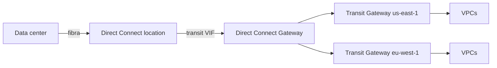

---
aliases:
  - Aula 7.6
modulo: 7
aula: 6
parte: "II Identidade, rede e dados"
dominios:
  - 1
  - 2
  - 3
  - 4
lida: false
tags:
  - aula
  - saa-c03
  - modulo-07
---

# Aula 7.6: Direct Connect

[[07 - Conectividade Hibrida e entre VPCs|Voltar ao módulo]]

> [!question] Quando vale a pena trocar a internet por um circuito físico até a AWS, como ele é montado, e como torná-lo resiliente?

## O problema: a internet é variável, cara na saída e pública

A [[07.05 - Site-to-Site VPN e Client VPN|VPN da aula anterior]] resolve prazo e criptografia, mas continua dependente da internet pública: [[Latencia]] e [[Throughput]] oscilam, a banda é limitada por túnel (1,25 Gbps no padrão) e toda a saída de dados da AWS é cobrada na tarifa de internet. Para cargas que movem terabytes por dia, precisam de [[Jitter|jitter]] baixo (replicação de banco, voz, análise) ou têm exigência regulatória de "não trafegar pela internet pública", a alternativa é um **circuito dedicado**.

O **[[Direct Connect]]** (DX) liga a sua rede a um **Direct Connect location** (um prédio de colocation) por um cabo de fibra Ethernet: uma ponta no seu roteador, a outra em um roteador da AWS. Dali, a AWS leva o tráfego até a [[Regiao AWS|Região]] pela própria rede. Você pode criar **virtual interfaces** (VIFs) para chegar a serviços públicos ([[S3]]) ou à [[VPC]], "ignorando provedores de internet no caminho" (verificado em novembro de 2026 na documentação).

## Anatomia: do prédio à VPC

1. **[[Direct Connect]] location:** o prédio onde a AWS tem equipamento. Ele dá acesso a uma Região específica.
2. **Connection (porta):** a porta física que você pede à AWS naquele location.
3. **Cross-connect:** o cabo dentro do prédio entre a sua porta e a da AWS, feito pela operadora do prédio (ou pelo parceiro).
4. **Last mile:** o circuito entre o seu data center e o location, contratado de uma operadora (se você não tem equipamento no prédio).
5. **[[Virtual Interface|Virtual interface]] (VIF):** a "linha lógica" sobre a conexão, com VLAN 802.1Q e sessão **[[BGP]]** (obrigatório; seu dispositivo precisa suportar BGP e autenticação MD5).
6. **Gateway na AWS:** a [[Virtual Interface|VIF]] termina em um [[Virtual Private Gateway]], em um **[[Direct Connect Gateway]]** ou diretamente em uma [[VPC]] (private VIF).

A rede é **física e privada** desde a sua porta até a Região. O IP **não é criptografado por padrão** (a seção de segurança abaixo explica como cifrar).

## Dois tipos de conexão

| Característica | Dedicated | Hosted |
|---|---|---|
| Quem provisiona | Você pede à AWS (console, CLI ou API) | Um parceiro do [[Direct Connect]] cria para você |
| Porta | Física, só sua | Capacidade fatiada de uma porta do parceiro |
| Velocidades | 1, 10, 100 e 400 Gbps | 50, 100, 200, 300, 400 e 500 Mbps; 1, 2, 5, 10 e 25 Gbps (as maiores só com parceiros qualificados) |
| VIFs por conexão | Até 51 VIFs no total: no máximo 50 private ou public e no máximo 4 transit (os 4 transit contam dentro dos 51, não somam a eles) | **1** por hosted connection |
| Mudar a velocidade | Não: é preciso criar outra conexão | Pelo parceiro, se ele suportar |
| Traffic policing | Não | Sim: tráfego acima da taxa configurada é descartado |
| Quando usar | Alto volume, 1 Gbps ou mais, controle total | Pouca banda (menos de 1 Gbps), sem equipamento no location |

(Verificado em novembro de 2026 nas páginas "Dedicated connections", "Hosted connections" e "[[Direct Connect]] quotas".)

> [!info] Ligando os pontos
> "Hosted" é a opção de prova quando o enunciado fala em pouca banda (por exemplo 200 Mbps) e "o parceiro configura". "Dedicated" vem com 1 Gbps ou mais e "a empresa já tem presença no location".

## Prazo de provisionamento

Depois que você pede a conexão, a AWS disponibiliza a **LOA-CFA** (Letter of Authorization and Connecting Facility Assignment), que a operadora do prédio exige para o cross-connect. Se a AWS pedir mais informações, você tem **7 dias** para responder, ou a solicitação é apagada. A análise da AWS pode levar até **72 horas úteis**. O prazo total, somando operadora, cross-connect e last mile, costuma ser de **semanas a meses**; não existe um prazo contratual (resumo da documentação de preços do [[Direct Connect]]; o número exato não está em uma tabela oficial). Esse fato elimina o Direct Connect em qualquer cenário da prova que fale em "dias" ou "imediatamente".

## Os três tipos de VIF

| [[Virtual Interface\|VIF]] | Chega a | IPs | Exemplo |
|---|---|---|---|
| **Private** | Uma [[VPC]] (via [[Virtual Private Gateway\|VGW]]) ou várias VPCs (via [[Direct Connect Gateway]]) | Privados | App on-premises chama um [[RDS]] na VPC |
| **Public** | Serviços públicos da AWS ([[S3]], [[DynamoDB]], etc.), globalmente | Públicos da AWS | Enviar backups ao S3 sem passar pela internet |
| **Transit** | Um ou mais [[Transit Gateway\|Transit Gateways]] (via [[Direct Connect Gateway]]) | Privados | Data center acessa 30 [[VPC\|VPCs]] por um TGW |

Limites: uma conexão dedicated aceita até **51 VIFs** no total, dos quais no máximo 50 são private ou public e no máximo **4 são transit** (os 4 contam dentro dos 51; 50 + 4 não é o teto); uma hosted connection aceita **uma** [[Virtual Interface|VIF]] de qualquer tipo. Um [[Direct Connect Gateway|Direct Connect gateway]] aceita até 30 VIFs (private ou transit) (verificado em novembro de 2026 em docs.aws.amazon.com/directconnect/latest/UserGuide/limits.html).

> [!warning] Pegadinha: S3 e DynamoDB pelo Direct Connect
> Há dois caminhos, e o [[Qualificador|qualificador]] do enunciado decide. **Public [[Virtual Interface|VIF]]**: o data center alcança os IPs públicos da AWS ([[S3]], [[DynamoDB]]) sem passar pela internet, mas o tráfego usa endereços públicos. **Private VIF (ou transit VIF) mais [[Interface Endpoint|interface endpoint]] do S3** na [[VPC]]: o data center fala com um [[RFC 1918|IP privado]] do endpoint, pelo caminho da VPC, sem endereços públicos (o [[Gateway Endpoint|gateway endpoint]] não atende tráfego do on-premises, como a [[07.04 - PrivateLink e Endpoint Services|aula 7.4]] mostrou). Se o enunciado exige "sem IPs públicos", "tráfego privado" ou "dentro da VPC", a public VIF é o [[Distrator|distrator]] e a resposta é VIF privada com interface endpoint. Se só diz "sem passar pela internet" e "menor esforço", a public VIF basta.

**[[Hosted VIF]] não é hosted connection.** Uma *hosted connection* é uma conexão criada por um parceiro para você (item da tabela acima, com uma [[Virtual Interface|VIF]] só). Uma *hosted VIF* é uma VIF que o dono de uma conexão cria **para outra [[Conta AWS|conta AWS]]**, que precisa aceitá-la; ela funciona como uma VIF comum, em uma conexão que não é dela (por exemplo, uma conta de rede compartilha o circuito com as contas de workload).

**[[Allowed Prefixes|Allowed prefixes]] ao associar um [[Transit Gateway]].** No [[Direct Connect Gateway|DX gateway]], a associação com um TGW leva uma lista de **allowed prefixes**: são os prefixos que a AWS anuncia ao data center pela transit [[Virtual Interface|VIF]] (o limite é de 200 prefixos, [[IPv4]] e [[IPv6]] somados, por TGW). Se o enunciado diz que o data center "não enxerga" as [[VPC|VPCs]] do TGW, confira essa lista (verificado em novembro de 2026 em docs.aws.amazon.com/directconnect/latest/UserGuide/direct-connect-transit-gateways.html).

## Direct Connect Gateway

Uma private [[Virtual Interface|VIF]] liga a **uma** [[VPC]] (da mesma Região) se terminar direto em um [[Virtual Private Gateway|VGW]]. Para alcançar **várias VPCs, em [[Regiao AWS|Regiões]] e contas diferentes**, usa-se o **[[Direct Connect Gateway]]**:

- É um recurso **global** (qualquer Região, inclusive GovCloud, exceto China): você anexa uma private [[Virtual Interface|VIF]] ou transit VIF a ele e associa VGWs ou TGWs.
- Atua como um conjunto distribuído de **route reflectors [[BGP]]** e fica **fora do caminho dos dados**, então não é [[Ponto Unico de Falha|ponto único de falha]] nem depende de uma Região.
- Associa-se a **até 20 VGWs** ou a **até 6 TGWs**; um [[Transit Gateway|TGW]] aceita até 20 [[Direct Connect|DX]] Gateways.
- **Não** permite que duas associações do mesmo [[Direct Connect Gateway|DX Gateway]] troquem tráfego entre si ([[VPC]] A para VPC B por ele). Para isso use o [[Transit Gateway]].
- [[Data Transfer|Custo de transferência]] de saída em private e transit VIFs é alocado à conta responsável pelo tráfego; não há taxa adicional pelo [[Direct Connect Gateway|DX Gateway]] multiconta.

## BGP e rotas

- A sessão [[BGP]] é obrigatória. Em private e transit VIFs, a AWS aceita por padrão **100 prefixos [[IPv4]] e 100 [[IPv6]]** anunciados do on-premises; se você anunciar mais, **a sessão BGP cai** (estado idle). Controles de prefixo permitem subir até 1.000 de cada. Public [[Virtual Interface|VIF]]: 1.000 rotas.
- **[[BFD]]** (detecção rápida de falha) já vem habilitado do lado AWS; vale a pena configurá-lo também no seu roteador para o [[Failover|failover]] ser rápido.
- Para decidir qual caminho é preferido (ativo/ativo ou ativo/passivo entre dois [[Direct Connect|DX]], ou DX contra VPN), usam-se atributos [[BGP]] como o **[[Sistema Autonomo|AS path]]** (caminho mais curto ganha). Quando há DX e VPN anunciando o mesmo prefixo para o [[Transit Gateway|TGW]], o DX é o preferido e a VPN só aparece se o DX deixar de anunciar.
- **MTU:** os quadros suportam 1.522 ou 9.023 bytes; em private e transit VIFs você pode configurar jumbo frames.

## LAG: várias conexões como uma

Um **[[LAG]]** (Link Aggregation Group) agrupa conexões dedicated de **mesma velocidade e mesmo location** para tratá-las como uma: até **4 conexões** se a velocidade é menor que 100 Gbps, ou **2** se for 100 ou 400 Gbps; até 10 LAGs por Região. Serve para somar banda e para tolerar a falha de uma porta, **mas continua no mesmo location e dispositivo AWS-side do grupo**: não protege contra a queda do location inteiro.

## Criptografia

O [[Direct Connect|DX]] é privado, mas o conteúdo **não vem criptografado por padrão**. As opções:

| Opção | Camada | Como é | Observação |
|---|---|---|---|
| **[[MACsec]]** | 2 (Ethernet) | Cifra o enlace ponto a ponto entre o seu roteador e o roteador AWS no location | Conexões dedicated de 10, 100 e 400 Gbps em locais selecionados; chaves **CKN/CAK** estáticas de 64 hex (AES-256) que você gera e guarda (a API aceita o [[ARN]] de um segredo do [[Secrets Manager]] para associar a chave); não é fim a fim |
| **[[Site-to-Site VPN]] sobre public [[Virtual Interface\|VIF]]** | 3 ([[IPsec]]) | A VPN usa IPs públicos pelo [[Direct Connect\|DX]] | Cifra fim a fim entre seu dispositivo e o gateway AWS |
| **Private IP VPN sobre transit [[Virtual Interface\|VIF]]** | 3 ([[IPsec]]) | A VPN usa IPs privados pelo [[Direct Connect\|DX]], sem IPs públicos | Para quem precisa de IPsec sem exposição pública |

A AWS adicionalmente cifra os dados no nível físico enquanto atravessam a rede entre locations e [[Regiao AWS|Regiões]]. O ponto de prova: **"[[Direct Connect|DX]] com criptografia"** significa VPN sobre DX (fim a fim) ou [[MACsec]] (enlace), nunca "o DX já é criptografado".

## Resiliência: os modelos oficiais

Uma conexão [[Direct Connect|DX]] única é um **[[Ponto Unico de Falha]]**: um cabo, uma porta, um roteador, um prédio. O **Direct Connect Resiliency Toolkit** oferece três modelos (verificado em novembro de 2026):

| Modelo | Topologia | [[SLA]] alvo | Protege contra |
|---|---|---|---|
| **Maximum resiliency** | Conexões separadas em dispositivos separados, em **mais de um location** | 99,99% | Falha de dispositivo, de conectividade e de location inteiro |
| **High resiliency** | **Duas conexões únicas** em locations diferentes | 99,9% | Corte de fibra, falha de dispositivo e de location |
| **Development and test** | Conexões separadas em dispositivos separados, **um location** | Sem [[SLA]] de crítica | Falha de dispositivo (não de location) |

O ponto aqui é de custo: a resiliência máxima exige quatro conexões. Uma alternativa **mais barata** muito cobrada na prova é **[[Direct Connect|DX]] principal + [[Site-to-Site VPN]] como backup**: a VPN assume em caso de queda (por [[BGP]], o DX é preferido), a banda cai e a [[Latencia|latência]] piora, mas o negócio continua, a um custo muito menor que um segundo DX.

> [!example] Escolhendo o modelo
> Uma fintech exige 99,99% de [[Disponibilidade|disponibilidade]] da conexão com o data center: **maximum resiliency**, com quatro conexões em dois locations. Uma empresa de varejo aceita degradação por algumas horas por ano, com orçamento apertado: **um [[Direct Connect|DX]] e uma VPN de backup**. Um time de dados em desenvolvimento só precisa de redundância de dispositivo: **development and test**.

## Custo

O [[Direct Connect|DX]] tem dois elementos de cobrança: **porta-hora** e **[[Data Transfer|transferência de dados]] de saída** (a entrada é grátis). Valores da página de preços em novembro de 2026:

| Item | Valor |
|---|---|
| Porta dedicated 1 Gbps | US$ 0,30 por hora (cerca de US$ 219 por mês de 730 horas) |
| Porta dedicated 10 Gbps | US$ 2,25 por hora (cerca de US$ 1.642 por mês) |
| Porta dedicated 100 Gbps | US$ 22,50 por hora |
| Saída (de uma Região dos EUA continental para o location nos EUA) | US$ 0,02 por GB |
| Entrada | US$ 0,00 por GB |
| Hosted | Varia por velocidade e por parceiro; consulte a página de preços do [[Direct Connect]] (valor não fixado aqui) |

**Não incluídos:** o cross-connect e colocation (cobrados pelo prédio ou parceiro) e o last mile (operadora). Há também o **flat-rate pricing** para conexões dedicated: uma tarifa horária fixa por banda e por *tier* geográfico, que **inclui a transferência de saída** das [[Regiao AWS|Regiões]] do tier e um segundo porto de redundância (port-pair), eliminando o custo por GB; é interessante para volumes altos e previsíveis.

Comparação com a internet: a saída pela internet custa US$ 0,09 por GB na primeira faixa (exemplo), o [[Direct Connect|DX]] custa US$ 0,02 por GB. A [[07.08 - Custo de Transferencia e Escolha da Conexao|aula 7.8]] faz a conta completa e o ponto de equilíbrio.

## Quando DX é a resposta (e quando não)

**Escolha [[Direct Connect|DX]] quando:** grande volume sustentado de dados; [[Latencia|latência]] baixa e estável; [[Throughput|throughput]] previsível; conformidade que pede conexão privada; redução do custo de saída de dados em alto volume; migração de muitos terabytes (como complemento).

**Não escolha [[Direct Connect|DX]] quando:** o prazo é de dias ou poucas semanas; a banda é baixa e esporádica (VPN basta); o orçamento é muito apertado para uma porta mais circuito mais cross-connect; ou é um único usuário remoto ([[Client VPN]]).

## Como isso cai na prova

**Task statements:** Task 1.2 (proteger conexões externas), Task 3.4 (opções de conexão), Task 4.4 ([[Direct Connect|DX]] vs VPN vs internet; [[Largura de Banda|largura de banda]]), Task 2.2 (resiliência).

**Palavras-chave em inglês:**

- "consistent network performance", "dedicated private connection", "avoid the public internet", "predictable [[Latencia|latency]]": [[Direct Connect]].
- "multiple [[VPC|VPCs]] in multiple [[Regiao AWS|Regions]] over one connection": [[Direct Connect Gateway|Direct Connect gateway]].
- "many [[VPC|VPCs]] through a [[Transit Gateway|transit gateway]] over [[Direct Connect]]": transit [[Virtual Interface|VIF]].
- "access [[S3|Amazon S3]] over [[Direct Connect]] without the internet": public [[Virtual Interface|VIF]].
- "encrypted traffic over [[Direct Connect]]": VPN sobre DX (ou [[MACsec]]).
- "[[Alta Disponibilidade|highly available]] [[Direct Connect]]", "99.99%": maximum resiliency.
- "backup for [[Direct Connect]] at lowest cost": [[Site-to-Site VPN]].
- "less than 1 Gbps", "partner provisions": hosted connection.

**Pegadinhas clássicas:**

- [[Direct Connect|DX]] não é criptografado por padrão.
- [[Direct Connect|DX]] leva semanas; não serve para "amanhã".
- Uma conexão única é um [[Ponto Unico de Falha|ponto único de falha]], mesmo sendo cara.
- Um [[LAG]] não protege contra a falha do location.
- Hosted connection suporta uma [[Virtual Interface|VIF]] só.
- O [[Direct Connect Gateway|DX Gateway]] não permite tráfego entre as [[VPC|VPCs]] associadas a ele (use [[Transit Gateway|TGW]]).

| Requisito no enunciado | Resposta provável | Por quê |
|---|---|---|
| [[Latencia\|Latência]] estável e banda dedicada ao data center | [[Direct Connect]] | Circuito físico privado |
| [[Disponibilidade]] da conexão de 99,99% | Maximum resiliency (4 conexões, 2 locations) | Protege até contra falha de location |
| Backup barato para o [[Direct Connect\|DX]] | [[Site-to-Site VPN]] | Sobe rápido, custo baixo |
| 200 Mbps com parceiro | Hosted connection | Granularidade menor que 1 Gbps |
| Várias [[VPC\|VPCs]] de várias [[Regiao AWS\|Regiões]] | [[Direct Connect Gateway]] | Recurso global |
| Criptografia [[IPsec]] fim a fim sobre [[Direct Connect\|DX]] | VPN sobre public [[Virtual Interface\|VIF]] ou private IP VPN sobre transit VIF | O DX não cifra por padrão |
| Data center fala com 30 [[VPC\|VPCs]] por um [[Transit Gateway\|TGW]] | Transit [[Virtual Interface\|VIF]] para o [[Direct Connect Gateway\|DX Gateway]] associado ao TGW | Transit VIF alcança TGWs |

## Resumo

> [!abstract] A aula em uma frase
> O [[Direct Connect]] é um circuito físico privado até a AWS, com [[Latencia|latência]] estável e saída barata por GB, mas demorado de provisionar, não criptografado por padrão e um [[Ponto Unico de Falha|ponto único de falha]] se não houver redundância.

**A lógica, em 5 passos**

1. A internet varia e cobra caro na saída; um circuito dedicado dá previsibilidade.
2. Você pede uma porta (dedicated ou hosted), a operadora faz o cross-connect e você configura VIFs com [[BGP]].
3. A [[Virtual Interface|VIF]] decide o destino: private ([[VPC]]), public (serviços públicos), transit ([[Transit Gateway]]).
4. O [[Direct Connect Gateway]] global liga várias [[VPC|VPCs]] ou TGWs, em [[Regiao AWS|Regiões]] e contas diferentes.
5. Resiliência exige conexões separadas em locations diferentes ou uma VPN de backup; cifrar exige VPN sobre [[Direct Connect|DX]] ou [[MACsec]].

**Números para lembrar**

| O quê | Valor | Por que importa |
|---|---|---|
| Velocidades dedicated | 1, 10, 100, 400 Gbps | Define o porte |
| Hosted | 50 Mbps a 25 Gbps | Banda baixa via parceiro |
| VIFs por dedicated | 51 no total (até 50 private/public e até 4 transit, contados dentro dos 51) | Planejar VIFs |
| Prefixos [[BGP]] padrão | 100 [[IPv4]] e 100 [[IPv6]] | Mais que isso derruba a sessão |
| [[SLA]] max / high resiliency | 99,99% / 99,9% | Escolha do modelo |
| Saída pelo [[Direct Connect\|DX]] (exemplo EUA) | US$ 0,02 por GB | Comparar com a internet |

**Tabela-síntese**

| Critério | VPN | [[Direct Connect]] |
|---|---|---|
| Prazo | Horas | Semanas a meses |
| [[Latencia\|Latência]] | Variável | Estável |
| Criptografia | [[IPsec]] nativo | Não por padrão |
| Banda | Até 1,25 Gbps por túnel | Até 400 Gbps por porta |
| Custo | Baixo | Porta mais circuito |

**Na prática, isso significa**

- [[Latencia|Latência]] estável, banda alta ou volume grande: [[Direct Connect]]. Prazo curto: VPN primeiro.
- [[Disponibilidade]] de verdade: duas conexões independentes ou VPN de backup.
- Várias [[VPC|VPCs]]: [[Direct Connect Gateway|DX Gateway]] com transit [[Virtual Interface|VIF]] e [[Transit Gateway|TGW]].
- Se exigir criptografia, some VPN ou [[MACsec]].

> [!tip] Liga com
> Vem de [[07.05 - Site-to-Site VPN e Client VPN|7.5]] e antecipa o custo da [[07.08 - Custo de Transferencia e Escolha da Conexao|7.8]]. No [[20 - Alta Disponibilidade e Recuperacao de Desastres|Módulo 20]] os modelos de resiliência voltam como parte do desenho de DR. Segue para [[07.07 - DNS Hibrido com Route 53 Resolver|7.7]].

## Erros comuns

- **Achar que o [[Direct Connect|DX]] é criptografado.**
- **Propor [[Direct Connect|DX]] para um prazo de dias.**
- **Usar uma única conexão** para uma carga crítica.
- **Esperar que o [[LAG]] proteja contra a queda do prédio.**
- **Anunciar mais prefixos que o limite** da sessão [[BGP]] (a sessão cai).
- **Esperar que o [[Direct Connect Gateway|DX Gateway]] roteie entre as [[VPC|VPCs]] associadas.**

## Pratique

**1.** Uma fintech precisa de conectividade privada com a AWS com [[Disponibilidade|disponibilidade]] de 99,99% e exige proteção contra falha de dispositivo, de cabo e de um location inteiro. Qual topologia atende?

- [ ] a) Uma conexão dedicated de 10 Gbps com uma VPN de backup em outro roteador do mesmo prédio
- [ ] b) Um LAG de quatro conexões de 10 Gbps no mesmo location, em dispositivos distintos
- [ ] c) O modelo de maximum resiliency: dispositivos separados e mais de um location
- [ ] d) Duas conexões hosted de 1 Gbps ligadas ao mesmo parceiro e ao mesmo roteador

**2.** Uma empresa tem um [[Direct Connect]] e precisa acessar [[VPC|VPCs]] em três [[Regiao AWS|Regiões]], de contas diferentes, por uma única conexão. Qual solução usar?

- [ ] a) Uma private VIF para um DX gateway com os VGWs das VPCs associados
- [ ] b) Uma public VIF para cada Região, associando as VPCs por peering
- [ ] c) Três conexões dedicated, uma em cada Região, com uma private VIF cada uma
- [ ] d) Uma VPN de cada Região para o data center, no lugar do Direct Connect

**3.** Uma organização tem 30 [[VPC|VPCs]] anexadas a um [[Transit Gateway]] e quer que o data center as alcance por um [[Direct Connect]]. Qual configuração é a correta?

- [ ] a) Uma public VIF anunciando os CIDRs das VPCs, com rotas estáticas no data center
- [ ] b) Uma private VIF direta para cada VPC, associando 30 VGWs ao roteador
- [ ] c) Um VPC peering entre o data center e o Transit Gateway pelo Direct Connect
- [ ] d) Uma transit VIF para um Direct Connect gateway associado ao Transit Gateway

**4.** Uma instituição financeira usa [[Direct Connect]] e precisa de criptografia fim a fim no nível IP entre o data center e a [[VPC]]. Qual abordagem atende?

- [ ] a) Contar com o Direct Connect, que já cifra todo o tráfego por padrão
- [ ] b) Uma Site-to-Site VPN sobre o Direct Connect (public VIF ou private IP VPN)
- [ ] c) Habilitar o AWS Shield no Direct Connect para cifrar o tráfego dos dados em trânsito
- [ ] d) Habilitar a criptografia de dados em repouso do S3 nos buckets que são acessados

**5.** Uma filial precisa de apenas 200 Mbps de conexão dedicada à AWS e não tem equipamento no [[Direct Connect]] location. Qual é a opção mais adequada?

- [ ] a) Solicitar uma conexão dedicated de 1 Gbps e limitar a banda no roteador
- [ ] b) Usar um LAG com duas conexões dedicated de 1 Gbps para dividir a banda
- [ ] c) Pedir a um parceiro uma hosted connection de 200 Mbps
- [ ] d) Usar Client VPN com 200 Mbps de banda reservada para a filial inteira

**6.** Uma empresa tem um [[Direct Connect]] principal e quer um mecanismo de backup de baixo custo para o caso de queda, aceitando banda e [[Latencia|latência]] piores. Qual solução é a melhor?

- [ ] a) Uma Site-to-Site VPN, com BGP preferindo o DX e usando a VPN como backup
- [ ] b) Uma segunda conexão dedicated de 10 Gbps em outro location, ativa o tempo todo
- [ ] c) Um segundo Direct Connect gateway apontando para as mesmas VPCs
- [ ] d) Uma hosted connection no mesmo location e no mesmo dispositivo do principal

**7.** Por que uma única conexão [[Direct Connect]], mesmo de 100 Gbps, não é considerada [[Alta Disponibilidade|altamente disponível]]?

- [ ] a) Porque o Direct Connect só funciona em horários comerciais, sem nenhuma garantia de disponibilidade
- [ ] b) Porque a velocidade de 100 Gbps limita a conexão a uma única VIF privada
- [ ] c) Porque o tráfego do Direct Connect sempre passa pela internet em algum ponto da rota
- [ ] d) Porque porta, cabo, dispositivo e location são físicos e únicos: qualquer falha derruba a conexão

**8.** O prazo para o go-live é de duas semanas, e a aplicação precisa de conectividade privada com o data center. A empresa pretende, no longo prazo, migrar para um circuito dedicado. Qual é a melhor estratégia?

- [ ] a) Aguardar o Direct Connect e adiar o go-live, pois ele fica pronto em dois a três dias
- [ ] b) Subir uma VPN agora e adicionar o Direct Connect depois, mantendo a VPN como backup
- [ ] c) Usar um Client VPN para toda a comunicação entre servidores
- [ ] d) Usar um VPC peering com a rede do data center, que fica pronto em minutos

**9.** (Escolha DUAS.) Uma empresa quer usar um [[Direct Connect]] para alcançar [[VPC|VPCs]] de várias [[Regiao AWS|Regiões]] e, depois, ceder o uso do circuito a uma conta de workload da organização. Quais afirmações estão corretas?

- [ ] a) O Direct Connect gateway é um recurso global, que permite alcançar VPCs de várias Regiões pela mesma VIF
- [ ] b) O Direct Connect cifra o tráfego por padrão com IPsec, então nada mais é necessário
- [ ] c) O dono da conexão pode criar uma hosted VIF para a outra conta, que precisa aceitá-la; isso é diferente de uma hosted connection criada por um parceiro, que suporta uma só VIF
- [ ] d) As conexões dedicated têm velocidades de 50 Mbps a 25 Gbps
- [ ] e) Uma public VIF dá acesso aos IPs privados das VPCs

**10.** (Escolha DUAS.) Uma empresa liga o data center a 30 [[VPC|VPCs]] por [[Direct Connect]], usando um [[Direct Connect Gateway|Direct Connect gateway]] e um [[Transit Gateway]]. Depois de adicionar [[Sub-rede|sub-redes]] no data center, a sessão [[BGP]] caiu. Além disso, o data center não alcança uma VPC recém-anexada. Quais afirmações explicam e resolvem o cenário?

- [ ] a) Uma private VIF conecta direto ao Transit Gateway, então bastaria trocar o tipo da VIF
- [ ] b) A entrada de dados pelo Direct Connect é cobrada por GB, o que derruba a sessão BGP
- [ ] c) O MACsec é obrigatório em conexões hosted para que o BGP permaneça ativo
- [ ] d) A transit VIF liga ao DX gateway associado ao TGW, e a lista de allowed prefixes da associação controla o que a AWS anuncia ao data center
- [ ] e) A sessão cai quando o data center anuncia mais prefixos que o limite (padrão de 100 IPv4 e 100 IPv6); é preciso reduzir os anúncios ou usar controles de prefixo (até 1.000)

**11.** Uma empresa tem [[Direct Connect]] e os servidores do data center precisam acessar o [[S3]]. A política de segurança exige que o tráfego use apenas IPs privados, sem endereços públicos da AWS. Qual solução atende?

- [ ] a) Uma public VIF anunciando os prefixos públicos do S3 e rotas para o bucket
- [ ] b) Um gateway endpoint do S3 na VPC, com a rota anunciada ao data center pela VIF
- [ ] c) Uma private VIF (ou transit VIF) com um interface endpoint do S3 na VPC
- [ ] d) Um NAT Gateway na VPC, com o data center roteando o tráfego do S3 por ele

> [!success]- Gabarito
> **1. c)** o modelo de maximum resiliency usa conexões em dispositivos separados em mais de um location, e mira 99,99%; a) o mesmo prédio é um [[Ponto Unico de Falha|ponto único de falha]], b) o [[LAG]] não protege contra a queda do location, d) mesmo parceiro e roteador é um ponto único de falha.
> **2. a)** uma private [[Virtual Interface|VIF]] para um [[Direct Connect Gateway|DX gateway]] com VGWs associados alcança [[VPC|VPCs]] de várias [[Regiao AWS|Regiões]] e contas; b) public VIF não alcança VPCs privadas e peering não é usado assim, c) três conexões são desnecessárias, d) VPN troca o circuito dedicado pelo que se queria evitar.
> **3. d)** a transit [[Virtual Interface|VIF]] liga ao [[Direct Connect Gateway|DX gateway]], associado ao [[Transit Gateway|TGW]]; a) public VIF é para serviços públicos, b) 30 VGWs não escalam e perdem o hub, c) [[VPC Peering|VPC peering]] não liga ao data center.
> **4. b)** a VPN sobre o [[Direct Connect|DX]] cifra fim a fim; a) o DX não cifra por padrão, c) o Shield protege contra [[DDoS]], d) a criptografia do [[S3]] em repouso não protege o trânsito do DX.
> **5. c)** a hosted connection oferece granularidade abaixo de 1 Gbps via parceiro; a) a dedicated começa em 1 Gbps e exige presença no location, b) um [[LAG]] soma banda de dedicated, d) o [[Client VPN]] é para usuários.
> **6. a)** uma VPN é o backup barato, com [[BGP]] preferindo o [[Direct Connect|DX]]; b) outro DX ativo é caro, c) um gateway adicional não é um caminho físico, d) mesmo location e dispositivo mantêm o [[Ponto Unico de Falha|ponto único de falha]].
> **7. d)** cada elemento físico é um [[Ponto Unico de Falha|ponto único de falha]]; a) não há horário comercial, b) a velocidade não limita as VIFs, c) o tráfego do [[Direct Connect|DX]] não passa pela internet.
> **8. b)** a VPN fica pronta rapidamente e depois vira backup do [[Direct Connect|DX]]; a) o DX leva semanas a meses, c) o [[Client VPN]] é para usuários, d) peering não liga ao data center.
> **9. a) e c)** o [[Direct Connect Gateway|DX gateway]] é global e a [[Hosted VIF|hosted VIF]] cede uma [[Virtual Interface|VIF]] a outra conta (a hosted connection, de parceiro, tem uma VIF só); b) erra porque o [[Direct Connect|DX]] não cifra por padrão, d) erra porque 50 Mbps a 25 Gbps é o intervalo das hosted (dedicated é 1, 10, 100 e 400 Gbps), e) erra porque a public VIF acessa serviços públicos, não IPs privados.
> **10. d) e e)** a transit [[Virtual Interface|VIF]] vai ao [[Direct Connect Gateway|DX gateway]] associado ao [[Transit Gateway|TGW]] (e os [[Allowed Prefixes|allowed prefixes]] controlam o anúncio de volta), e passar do limite de prefixos derruba a sessão [[BGP]]; a) erra porque a private VIF não liga a TGW, b) erra porque a entrada é grátis e não afeta o BGP, c) erra porque [[MACsec]] não é obrigatório nem tem relação com a sessão BGP.
> **11. c)** o [[Interface Endpoint|interface endpoint]] dá um [[RFC 1918|IP privado]] na [[VPC]], alcançável por private ou transit [[Virtual Interface|VIF]]; a) erra porque a public VIF usa IPs públicos da AWS, b) erra porque o [[Gateway Endpoint|gateway endpoint]] não atende tráfego de on-premises, d) erra porque [[NAT Gateway]] leva a saída pela internet e não atende o tráfego do data center.

### Laboratório (opcional)

> [!warning] Use uma conta AWS pessoal separada, com AWS Budgets configurado, nunca a conta de produção da empresa. **Não peça uma conexão Direct Connect real só para testar:** a porta cobra por hora e a conexão exige operadora e cross-connect. O laboratório abaixo cria só recursos sem cobrança de porta e termina em consultas.

Objetivo: entender o fluxo e os recursos associados sem provisionar circuito. Custo estimado: zero (apenas recursos lógicos), exceto a [[VPC]] vazia (grátis).

1. Crie um [[Direct Connect Gateway|Direct Connect gateway]]: `aws directconnect create-direct-connect-gateway --direct-connect-gateway-name lab-dxgw --amazon-side-asn 64512`.
2. Crie uma [[VPC]] e um [[Virtual Private Gateway|VGW]], anexe-o à VPC: `aws ec2 create-vpn-gateway --type ipsec.1` e `aws ec2 attach-vpn-gateway ...`.
3. Associe o [[Virtual Private Gateway|VGW]] ao [[Direct Connect Gateway|DX gateway]]: `aws directconnect create-direct-connect-gateway-association --direct-connect-gateway-id <dxgw> --gateway-id <vgw>`.
4. Liste as localidades: `aws directconnect describe-locations` e veja as velocidades disponíveis em cada uma.
5. Consulte `aws directconnect describe-direct-connect-gateway-associations` para ver o estado da associação.
6. **Limpeza:** `aws directconnect delete-direct-connect-gateway-association`, depois `delete-direct-connect-gateway`, `detach-vpn-gateway`, `delete-vpn-gateway` e a [[VPC]].

## Para aprofundar

- [O que é o Direct Connect](https://docs.aws.amazon.com/directconnect/latest/UserGuide/Welcome.html) (AWS): componentes, tipos de [[Virtual Interface|VIF]] e requisitos.
- [Direct Connect Resiliency Toolkit](https://docs.aws.amazon.com/directconnect/latest/UserGuide/resiliency_toolkit.html) (AWS): modelos de resiliência e [[SLA]].
- [Cotas do Direct Connect](https://docs.aws.amazon.com/directconnect/latest/UserGuide/limits.html) (AWS): VIFs, [[LAG]], [[Direct Connect Gateway|DX gateway]] e prefixos [[BGP]].
- [MACsec no Direct Connect](https://docs.aws.amazon.com/directconnect/latest/UserGuide/MACsec.html) (AWS): requisitos e chaves CKN/CAK.

Próxima aula: [[07.07 - DNS Hibrido com Route 53 Resolver]].
