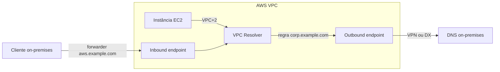

---
aliases:
  - Aula 7.7
modulo: 7
aula: 7
parte: "II Identidade, rede e dados"
dominios:
  - 1
  - 3
lida: false
tags:
  - aula
  - saa-c03
  - modulo-07
---

# Aula 7.7: DNS híbrido com Route 53 Resolver

[[07 - Conectividade Hibrida e entre VPCs|Voltar ao módulo]]

> [!question] Se a rede está ligada por VPN ou Direct Connect, por que os nomes ainda não resolvem, e o que faz os dois lados se enxergarem pelo nome?

## O problema: rede conectada não é nome resolvido

As aulas anteriores ligaram redes: depois da [[Site-to-Site VPN]] ou do [[Direct Connect]], um pacote para `10.50.0.20` chega. Mas aplicações raramente usam IPs; usam nomes: `db.corp.example.com` no data center, `api.interno.empresa.com` em uma [[Hosted Zone]] privada na AWS. A conectividade IP não leva o **[[DNS]]** junto, por três razões:

1. **Cada lado tem o seu servidor [[DNS]].** O data center resolve a zona corporativa (`corp.example.com`) com um servidor próprio, por exemplo um [[Active Directory]] ou BIND. A [[VPC]] resolve zonas privadas do [[Route 53]] e nomes de instâncias com o resolvedor da AWS. Um não conhece os registros do outro.
2. **O resolvedor da [[VPC]] só atende de dentro da VPC.** Dentro de cada VPC existe um [[Resolvedor Recursivo|resolvedor recursivo]] no endereço **VPC+2** (o segundo endereço do [[CIDR]] da VPC, visto no [[06 - VPC a Fundo|Módulo 6]]). Ele responde a consultas por nomes de instâncias, zonas privadas e nomes públicos. A documentação avisa que **encaminhar consultas de on-premises (ou de outro servidor [[DNS]]) para o endereço VPC+2 não é suportado e pode causar resultados instáveis**.
3. **A conectividade entre [[VPC|VPCs]] também não resolve nomes por si só.** Um peering ou um [[Transit Gateway]] leva pacotes IP; para um lado resolver as zonas privadas do outro, é preciso associar a zona às duas VPCs ou usar regras e [[Resolver Endpoint|endpoints do Resolver]]. A documentação do peering é explícita: não é possível conectar-se ao servidor [[DNS]] da Amazon (o VPC+2) de uma VPC peerada nem consultá-lo (verificado em novembro de 2026 em docs.aws.amazon.com/vpc/latest/peering/vpc-peering-basics.html). Use uma [[Private Hosted Zone|private hosted zone]] associada às duas VPCs, ou endpoints e [[Resolver Rule|regras do Resolver]].

A solução é dar ao resolvedor **portas de entrada e saída** com endereços reais na sua rede, e **regras** que dizem qual domínio vai para onde. É o **[[Route 53 Resolver]]** com seus *endpoints*.

> [!info] Nome atual
> Em 2026 a AWS renomeou o [[Route 53 Resolver]] para **[[Route 53]] [[VPC]] Resolver** (quando introduziu o Route 53 Global Resolver). Questões de simulado e a prova podem usar qualquer um dos nomes; o comportamento descrito aqui é o mesmo (verificado em novembro de 2026 na página "What is Route 53 VPC Resolver").

## O resolvedor da VPC, em uma olhada

O [[VPC]] Resolver existe **por padrão em toda VPC** e responde automaticamente a:

- nomes locais de [[EC2|instâncias EC2]] (`ec2-192-0-2-44.compute-1.amazonaws.com`);
- registros em **[[Private Hosted Zone|zonas hospedadas privadas]]** (private [[Hosted Zone|hosted zones]]) associadas à [[VPC]] (por exemplo `acme.example.com`);
- nomes públicos, com resolução recursiva na internet.

Para as zonas privadas e nomes funcionarem, a [[VPC]] precisa de `enableDnsSupport` e `enableDnsHostnames`, também do Módulo 6. Zonas privadas podem ser associadas a **várias VPCs**, inclusive de outras contas (com autorização); isso resolve nomes **entre VPCs** sem endpoints. Os endpoints entram quando o outro lado **não é uma VPC** (ou quando você precisa de regras de encaminhamento).

## Os dois tipos de endpoint

Um **[[Resolver Endpoint|Resolver endpoint]]** é um conjunto de interfaces de rede ([[ENI]]) criadas na sua [[VPC]], uma por endereço IP que você define. Cada IP é uma ENI com [[RFC 1918|IP privado]], e é por ela que o [[DNS]] entra ou sai.

### Inbound endpoint (de fora para a VPC)

**Permite que consultas [[DNS]] cheguem ao resolvedor da [[VPC]] vindas de on-premises ou de outra VPC.** Sua rede configura um *conditional forwarder*: "para `aws.example.com`, pergunte aos IPs do [[Resolver Endpoint|inbound endpoint]]". A consulta entra pela VPN ou pelo [[Direct Connect]], o endpoint a entrega ao VPC Resolver, que responde com o registro da [[Private Hosted Zone|zona privada]].

Caso típico: servidores no data center precisam resolver `app.aws.example.com`, uma [[Private Hosted Zone|zona privada]] do [[Route 53]] apontando para um [[Application Load Balancer|ALB]] interno.

### Outbound endpoint (da VPC para fora)

**Permite que a [[VPC]] encaminhe consultas para um [[DNS]] externo** (seu data center ou outra VPC). Para isso você cria **regras** (*[[Resolver Rule|Resolver rules]]*): "para o domínio `corp.example.com`, encaminhe para os servidores `10.50.0.2` e `10.50.0.3`". Quando uma instância consulta `db.corp.example.com`, o VPC Resolver aplica a regra, manda a consulta pelo [[Resolver Endpoint|outbound endpoint]] (que sai com IPs da sua VPC) e a resposta volta pelo mesmo caminho.

| Pergunta | Inbound | Outbound |
|---|---|---|
| Quem consulta? | O [[DNS]] do data center | Instâncias na [[VPC]] |
| Quem responde? | O resolvedor da [[VPC]] (zonas privadas) | O [[DNS]] on-premises |
| O que precisa configurar? | Um forwarder no [[DNS]] local apontando para os IPs do endpoint | Uma regra por domínio na AWS |
| Exemplo | Resolver nome de [[Application Load Balancer\|ALB]] interno do data center | Resolver `db.corp.example.com` da AWS |

Os dois funcionam **sobre uma conexão privada** ([[Direct Connect]] ou VPN) entre as redes.

## Regras (Resolver rules)

Uma regra mapeia **um domínio** para **os IPs dos resolvedores de destino**. Pontos importantes:

- Tipos de regra: **forward** (encaminha ao [[DNS]] de destino), **system** (usa o comportamento padrão da AWS para um subdomínio, abrindo exceção a uma regra mais ampla) e **delegation** (delega a autoridade de um subdomínio).
- Quando a consulta casa com várias regras (`example.com` e `acme.example.com`), vale a **mais específica** (`acme.example.com`). É o mesmo princípio do [[Longest Prefix Match|longest prefix match]] das rotas.
- Regras são **aplicadas diretamente à [[VPC]]** (você as associa) e podem ser **compartilhadas entre contas** pelo **[[RAM]]** (AWS Resource Access Manager, [[05 - Multiconta Governanca e Federacao|Módulo 5]]).
- Um endpoint **só pode ser criado pelo dono da [[VPC]]**; quem recebe a regra compartilhada a associa às suas VPCs e usa o endpoint do dono.

## Alta disponibilidade e limites

- Em um [[Resolver Endpoint|inbound endpoint]], a AWS exige **pelo menos dois endereços IP**, e recomenda que estejam em **pelo menos duas [[Zona de Disponibilidade|AZs]]**, para redundância. Se você precisa de N interfaces sempre disponíveis, crie **uma a mais** que o necessário, para absorver picos e manutenções (verificado em novembro de 2026).
- Cotas padrão: **4 endpoints por Região por conta**; **6 endereços IP por endpoint**; **10.000 consultas [[UDP]] por segundo por endereço IP** de um endpoint (valores ajustáveis conforme a página de cotas).
- O resolvedor é **regional**: em cada Região onde há [[VPC|VPCs]], você decide se encaminha consultas de saída, de entrada ou ambas.

> [!example] Hub de DNS compartilhado
> Uma empresa tem 40 [[VPC|VPCs]] em 10 contas e um data center. Em vez de criar endpoints em cada VPC, cria uma VPC "de rede" com **um [[Resolver Endpoint|outbound endpoint]] e um inbound endpoint** (cada um com IPs em duas [[Zona de Disponibilidade|AZs]]). Define uma regra `corp.example.com -> DNS on-premises` e a **compartilha pelo [[RAM]]** com a organização; cada conta a associa às suas VPCs. No data center, o forwarder para `aws.example.com` aponta para os IPs do inbound endpoint. Resultado: dois endpoints no lugar de oitenta, uma regra gerenciada em um lugar. A rota IP entre as VPCs e a rede de [[DNS]] vem do [[Transit Gateway]] ([[07.03 - Transit Gateway|aula 7.3]]).

## Custo

Pelos preços publicados em novembro de 2026 (a página não amarra os valores a uma Região):

- **US$ 0,125 por [[ENI]] por hora** de endpoint. Um endpoint com 2 IPs custa 2 x 0,125 x 730 = **US$ 182,50 por mês**.
- **US$ 0,40 por milhão de consultas** (primeiro bilhão por mês) que passam pelos endpoints, nos dois sentidos; acima disso, US$ 0,20 por milhão.
- Só as consultas que **passam por um endpoint** são cobradas; o [[VPC]] Resolver padrão não é cobrado à parte.

Por isso o desenho do hub compartilhado importa: cada [[ENI]] desnecessária é custo fixo mensal.

## PrivateLink e DNS

O [[Interface Endpoint]] do [[PrivateLink]] cria uma [[Private Hosted Zone|zona privada]] gerenciada com o **private [[DNS]] name** do serviço (por exemplo, `sqs.us-east-1.amazonaws.com` passa a resolver para o IP da [[ENI]]). A [[VPC]] resolve isso sozinha. Para **on-premises** alcançar o interface endpoint pelo nome, as consultas do data center a esse domínio precisam chegar ao VPC Resolver: ou usando os **nomes DNS específicos do endpoint** (que resolvem para os IPs privados) ou, mais comum, encaminhando a zona para um **[[Resolver Endpoint|inbound endpoint]]**. É o tipo de integração que cai na prova como "on-premises acessa [[SQS]]/S3 por endpoint privado".

## DNS entre VPCs: o que usar

| Necessidade | Solução |
|---|---|
| Várias [[VPC\|VPCs]] resolvem a mesma [[Private Hosted Zone\|zona privada]] | Associar a private [[Hosted Zone\|hosted zone]] a todas as VPCs |
| [[VPC]] peerada resolve nome público da instância como [[RFC 1918\|IP privado]] | Habilitar a resolução de [[DNS]] na [[VPC Peering\|conexão de peering]] |
| [[VPC]] consulta [[DNS]] on-premises | [[Resolver Endpoint\|Outbound endpoint]] e regra de encaminhamento |
| On-premises consulta [[Private Hosted Zone\|zona privada]] da AWS | [[Resolver Endpoint\|Inbound endpoint]] e forwarder local |
| Muitas contas compartilham as mesmas regras | Regras compartilhadas via [[RAM]] |
| Consulta de on-premises ao [[VPC]]+2 | **Não suportado**; use [[Resolver Endpoint\|inbound endpoint]] |

## Como isso cai na prova

**Task statements:** Task 3.4 (redes híbridas: [[DNS]] como parte do desenho), Task 1.2 (conexões externas) e, indiretamente, Task 2.2 (resiliência de DNS).

**Palavras-chave em inglês:**

- "on-premises servers must resolve [[DNS]] names of AWS resources / [[Private Hosted Zone|private hosted zone]]": [[Resolver Endpoint|inbound endpoint]].
- "[[EC2]] instances must resolve on-premises domain names": [[Resolver Endpoint|outbound endpoint]] e forwarding rule.
- "share [[DNS]] rules across accounts": [[Resolver Rule|Resolver rules]] via [[RAM]].
- "hybrid [[DNS]]", "conditional forwarding": [[Route 53 Resolver]] endpoints.
- "with the LEAST [[Overhead Operacional|operational overhead]]" no cenário: endpoints gerenciados no lugar de servidores [[DNS]] em [[EC2]] como forwarders.

**Pegadinhas clássicas:**

- Instalar um servidor BIND/Windows [[DNS]] em [[EC2]] como forwarder: funciona, mas é mais trabalhoso que os endpoints gerenciados.
- Confundir os sentidos: **inbound** = entra na [[VPC]] (consulta vinda de fora); **outbound** = sai da VPC (consulta indo para fora).
- Apontar o [[DNS]] on-premises para o [[VPC]]+2: não é suportado.
- Esquecer que o endpoint precisa de conectividade IP (VPN ou [[Direct Connect|DX]]) entre as redes.
- Achar que as regras precisam de um endpoint em cada [[VPC]]: elas são compartilháveis.

| Requisito no enunciado | Resposta provável | Por quê |
|---|---|---|
| Data center resolve nomes de [[Private Hosted Zone\|zona privada]] do [[Route 53]] | [[Resolver Endpoint\|Inbound endpoint]] | Recebe consultas de fora |
| Instâncias resolvem `corp.example.com` do data center | [[Resolver Endpoint\|Outbound endpoint]] mais [[Resolver Rule\|regra de forward]] | Encaminha consultas para fora |
| Mesma regra para 40 contas | Compartilhar a regra via [[RAM]] | Sem duplicar configuração |
| Menor [[Overhead Operacional\|overhead operacional]] | Endpoints gerenciados do Resolver | Dispensa servidores [[DNS]] em [[EC2]] |
| [[Alta Disponibilidade\|Alta disponibilidade]] do endpoint | IPs em pelo menos duas [[Zona de Disponibilidade\|AZs]] | Redundância |
| Resolver nomes privados entre [[VPC\|VPCs]] | Associar a [[Private Hosted Zone\|private hosted zone]] às VPCs | Sem endpoints |

## Resumo

> [!abstract] A aula em uma frase
> Conectividade IP não resolve nomes: o [[Route 53 Resolver]] usa inbound endpoints (de fora para a [[VPC]]) e outbound endpoints com regras (da VPC para fora), sobre VPN ou [[Direct Connect]], para unir o [[DNS]] da nuvem e o do data center.

**A lógica, em 5 passos**

1. Cada lado tem o próprio [[DNS]], e o resolvedor [[VPC]]+2 só atende de dentro da VPC.
2. O [[Resolver Endpoint|inbound endpoint]] dá ao [[DNS]] local um IP para o qual encaminhar consultas sobre zonas da AWS.
3. O [[Resolver Endpoint|outbound endpoint]] e as regras enviam consultas por domínio da [[VPC]] ao [[DNS]] local.
4. Regras mais específicas vencem e podem ser compartilhadas por [[RAM]].
5. IPs em duas [[Zona de Disponibilidade|AZs]] dão resiliência; cada [[ENI]] custa por hora e cada consulta custa por milhão.

**Números para lembrar**

| O quê | Valor | Por que importa |
|---|---|---|
| IPs mínimos no [[Resolver Endpoint\|inbound endpoint]] | 2, em pelo menos 2 [[Zona de Disponibilidade\|AZs]] | [[Alta Disponibilidade\|Alta disponibilidade]] |
| Endpoints por Região (padrão) | 4 | Cota |
| IPs por endpoint | 6 | Cota |
| Consultas por segundo por IP | 10.000 ([[UDP]]) | Dimensionamento |
| Custo | US$ 0,125 por ENI-hora e US$ 0,40 por milhão de consultas | Custo fixo e variável |

**Tabela-síntese**

| Sentido | Endpoint | Configuração |
|---|---|---|
| On-premises para AWS | Inbound | Forwarder local aponta para os IPs do endpoint |
| AWS para on-premises | Outbound | Regra por domínio com IPs do [[DNS]] local |

**Na prática, isso significa**

- Ligar redes não basta: planeje também o [[DNS]].
- Centralize endpoints em uma [[VPC]] e compartilhe regras por [[RAM]].
- Use endpoints gerenciados em vez de servidores [[DNS]] em [[EC2]].
- Dimensione as [[ENI|ENIs]] e coloque IPs em duas [[Zona de Disponibilidade|AZs]].

> [!tip] Liga com
> Vem de [[07.05 - Site-to-Site VPN e Client VPN|7.5]] e [[07.06 - Direct Connect|7.6]] (os caminhos privados) e do [[06 - VPC a Fundo|Módulo 6]] ([[DNS]] dentro da [[VPC]]). O [[18 - Borda e DNS CloudFront Global Accelerator e Route 53|Módulo 18]] detalha zonas hospedadas e [[Routing Policy|políticas de roteamento]] do [[Route 53]]. Segue para [[07.08 - Custo de Transferencia e Escolha da Conexao|7.8]].

## Erros comuns

- **Apontar o [[DNS]] on-premises para o endereço [[VPC]]+2.**
- **Confundir inbound e outbound.**
- **Criar um endpoint por [[VPC]]** em vez de centralizar e compartilhar regras.
- **Colocar todos os IPs do endpoint em uma só [[Zona de Disponibilidade|AZ]].**
- **Esquecer a conectividade** (VPN ou [[Direct Connect|DX]]) entre o endpoint e o [[DNS]] local.
- **Usar servidores [[DNS]] em [[EC2]]** onde um endpoint gerenciado bastaria.

## Pratique

**1.** Servidores no data center precisam resolver `app.aws.example.com`, um registro em uma [[Private Hosted Zone|private hosted zone]] do [[Route 53]], por meio de uma conexão [[Direct Connect]] já existente. O que configurar?

- [ ] a) Um inbound endpoint do Route 53 Resolver na VPC e, no DNS local, um conditional forwarder para os IPs dele
- [ ] b) Um outbound endpoint do Route 53 Resolver com uma regra que encaminha `aws.example.com` ao DNS do data center
- [ ] c) Um servidor BIND em EC2 que replica a hosted zone privada e serve os servidores locais
- [ ] d) Uma hosted zone pública com o mesmo nome e os registros com IPs privados

**2.** Instâncias [[EC2]] em uma [[VPC]] precisam resolver `db.corp.example.com`, cujo [[DNS]] autoritativo está no data center ligado por VPN. Qual solução tem o menor [[Overhead Operacional|overhead operacional]]?

- [ ] a) Instalar um servidor DNS em EC2 que replica a zona do data center e apontar a VPC para ele
- [ ] b) Criar um inbound endpoint e configurar as instâncias para consultarem o IP dele
- [ ] c) Criar um outbound endpoint e uma regra de forward para `corp.example.com` apontando ao DNS local
- [ ] d) Editar o arquivo hosts de cada instância com os IPs dos servidores do data center

**3.** Uma organização tem 40 [[VPC|VPCs]] em 10 contas e um [[Resolver Endpoint|outbound endpoint]] em uma VPC de rede. Todas as VPCs precisam da mesma regra de encaminhamento para `corp.example.com`. Qual é a abordagem de menor esforço?

- [ ] a) Criar um outbound endpoint e uma regra em cada uma das 40 VPCs
- [ ] b) Compartilhar a regra pelo AWS RAM e associá-la às VPCs de cada conta
- [ ] c) Criar um peering de cada VPC com a VPC de rede para herdar o DNS dela
- [ ] d) Replicar a regra manualmente por script em cada conta, mantida por cada equipe

**4.** O time de redes aponta o servidor [[DNS]] do data center para o endereço [[VPC]]+2 de uma VPC, por VPN, para resolver zonas privadas. Os resultados são instáveis. Qual é a solução correta?

- [ ] a) Trocar a VPN por Direct Connect, que é mais estável para consultas DNS nas consultas externas
- [ ] b) Apontar para o VPC+2 de outra VPC peerada, com latência menor
- [ ] c) Habilitar enableDnsHostnames e reiniciar as instâncias da VPC
- [ ] d) Criar um inbound endpoint e apontar o forwarder do DNS local para os IPs dele

**5.** Para garantir [[Alta Disponibilidade|alta disponibilidade]], como devem ser configurados os IPs de um [[Resolver Endpoint|inbound endpoint]]?

- [ ] a) Pelo menos dois IPs, em pelo menos duas AZs, e uma ENI extra se a capacidade for crítica
- [ ] b) Um único IP, porque o resolvedor da VPC (VPC+2) faz failover automático para IPs de outras AZs
- [ ] c) Dois IPs na mesma AZ, porque a AWS replica o endpoint entre AZs por conta própria
- [ ] d) Seis IPs em uma só AZ, que é o máximo por endpoint e garante a capacidade necessária

**6.** Há duas regras de encaminhamento: `corp.example.com` apontando ao [[DNS]] A e `eng.corp.example.com` apontando ao DNS B. Para onde vai a consulta de `build.eng.corp.example.com`?

- [ ] a) Para o DNS A, pois a regra mais curta tem prioridade
- [ ] b) Para o DNS A e, se ele não responder, para o DNS B, como fallback entre as regras
- [ ] c) Para o DNS B, pois a regra mais específica vence
- [ ] d) Para o DNS padrão da AWS, pois consultas que casam com mais de uma regra ignoram as regras de encaminhamento

**7.** Por que não basta ligar as redes por VPN ou [[Direct Connect]] para que o on-premises resolva nomes de zonas privadas da AWS?

- [ ] a) Porque o DNS usa UDP, e a VPN e o Direct Connect só transportam tráfego TCP
- [ ] b) Porque o resolvedor da VPC (VPC+2) só atende consultas de dentro dela; consultas de fora precisam de um inbound endpoint
- [ ] c) Porque as zonas privadas só existem em uma única VPC e não podem ser consultadas por redes externas, mesmo com VPN ou DX ativos e roteados
- [ ] d) Porque o resolvedor da VPC só é alcançável pelo seu IP público, que o tráfego privado da VPN não usa

**8.** Uma empresa criou um [[Resolver Endpoint|outbound endpoint]] em cada uma de 10 [[VPC|VPCs]], cada um com 6 IPs, para [[DNS]] híbrido, e a conta de DNS está alta. Qual redesenho reduz mais o custo mantendo a resiliência?

- [ ] a) Reduzir cada endpoint a um único IP, em uma AZ só
- [ ] b) Substituir os endpoints por um servidor DNS em uma instância EC2 grande, que replica as zonas e atende as 10 VPCs
- [ ] c) Substituir os endpoints por associações da private hosted zone às 10 VPCs, que também encaminham as consultas ao data center
- [ ] d) Centralizar em uma VPC de rede um par de endpoints com IPs em duas AZs e compartilhar as regras por RAM

**9.** (Escolha DUAS.) Um data center ligado por [[Direct Connect]] precisa resolver os nomes de uma [[Private Hosted Zone|private hosted zone]] da AWS, e as instâncias da [[VPC]] precisam resolver os nomes da zona corporativa `corp.example.com`. Quais configurações atendem?

- [ ] a) Um outbound endpoint na VPC e um forwarder no DNS local apontando para ele
- [ ] b) Um inbound endpoint na VPC e um conditional forwarder no DNS local apontando para os IPs dele
- [ ] c) Apontar o DNS local para o endereço VPC+2 da VPC
- [ ] d) Associar a private hosted zone ao data center pelo console do Route 53
- [ ] e) Um outbound endpoint e uma regra de forward para `corp.example.com` apontando ao DNS local

**10.** (Escolha DUAS.) Uma organização com 40 [[VPC|VPCs]] em 10 contas quer centralizar o [[DNS]] híbrido e pergunta como as regras se comportam. Quais afirmações estão corretas?

- [ ] a) Os endpoints ficam em uma VPC de rede, e as regras de forward são compartilhadas pelo RAM e associadas às VPCs de cada conta
- [ ] b) Cada VPC precisa do próprio outbound endpoint, porque as regras não podem ser compartilhadas
- [ ] c) Os endpoints exigem um Internet Gateway na VPC de rede
- [ ] d) Se uma consulta casa com duas regras, vale a mais específica
- [ ] e) O Resolver é um serviço global, com um único endpoint para todas as Regiões

> [!success]- Gabarito
> **1. a)** o [[Resolver Endpoint|inbound endpoint]] recebe consultas de fora e o forwarder local aponta para ele; b) o outbound é para consultas que saem da [[VPC]], c) BIND em [[EC2]] funciona mas tem mais overhead, d) uma zona pública com IPs privados expõe nomes e não é o uso correto.
> **2. c)** o [[Resolver Endpoint|outbound endpoint]] com [[Resolver Rule|regra de forward]] leva as consultas ao [[DNS]] local, gerenciado; a) servidor em [[EC2]] exige operação, b) o inbound serve o sentido contrário, d) hosts files não escalam.
> **3. b)** compartilhar a regra pelo [[RAM]] e associá-la às [[VPC|VPCs]] evita duplicar endpoints; a) duplica custo e trabalho, c) peering não repassa [[DNS]], d) scripts manuais por conta são mais trabalho.
> **4. d)** o [[VPC]]+2 não é suportado para consultas externas, e o [[Resolver Endpoint|inbound endpoint]] é o caminho; a) erra porque o problema não é a estabilidade do link (trocar por [[Direct Connect]] mantém o VPC+2 não suportado), b) erra porque o VPC+2 de uma VPC peerada também não pode ser consultado, c) erra porque `enableDnsHostnames` só afeta nomes dentro da VPC.
> **5. a)** dois IPs em duas [[Zona de Disponibilidade|AZs]], e uma [[ENI]] extra para picos; b) erra porque o [[VPC]]+2 não faz [[Failover|failover]] de endpoint e um IP é [[Ponto Unico de Falha|ponto único de falha]], c) erra porque a AWS não replica o endpoint entre AZs: as AZs são as dos IPs que você escolhe, d) erra porque seis IPs em uma AZ perdem a redundância contra falha da AZ.
> **6. c)** vale a regra mais específica, `eng.corp.example.com`, que aponta ao [[DNS]] B; a) erra porque a regra mais curta (mais genérica) não tem prioridade, b) erra porque a consulta vai ao destino da regra vencedora e não há fallback entre regras, d) erra porque a regra de encaminhamento é aplicada, só que a mais específica.
> **7. b)** o resolvedor da [[VPC]] só atende de dentro; consultas de fora entram por um [[Resolver Endpoint|inbound endpoint]]; a) erra porque VPN e [[Direct Connect|DX]] transportam [[UDP]] e [[TCP]] sem problema, c) erra porque zonas privadas podem ser associadas a várias VPCs (a limitação é de quem consulta, não da zona), d) erra porque o VPC+2 é um endereço privado e o ponto é que ele não atende consultas vindas de fora.
> **8. d)** um par de endpoints centralizados com IPs em duas [[Zona de Disponibilidade|AZs]] e regras compartilhadas corta a maior parte do custo e mantém a resiliência; a) erra porque um IP em uma AZ perde redundância, b) erra porque servidor em [[EC2]] aumenta o [[Overhead Operacional|overhead operacional]], c) erra porque a [[Private Hosted Zone|private hosted zone]] resolve nomes entre [[VPC|VPCs]], mas não encaminha consultas ao [[DNS]] do data center.
> **9. b) e e)** o [[Resolver Endpoint|inbound endpoint]] com conditional forwarder resolve a zona da AWS a partir do data center, e o outbound endpoint com regra resolve `corp.example.com` a partir da [[VPC]]; a) erra porque o outbound serve o sentido VPC para fora, c) erra porque o VPC+2 não é suportado para consultas de fora, d) erra porque a [[Hosted Zone|hosted zone]] privada se associa a VPCs, não a redes on-premises.
> **10. a) e d)** o hub compartilhado por [[RAM]] e a regra mais específica vencendo são o comportamento descrito; b) erra porque as regras são compartilháveis, c) erra porque endpoints não exigem [[Internet Gateway]], e) erra porque o Resolver é regional.

### Laboratório (opcional)

> [!warning] Use uma conta AWS pessoal separada, com AWS Budgets configurado, nunca a conta de produção da empresa. Cada ENI de endpoint cobra por hora (valor de exemplo: US$ 0,125). Apague os endpoints no mesmo dia.

Objetivo: criar um [[Resolver Endpoint|outbound endpoint]] e uma regra, vendo o fluxo. Sem [[DNS]] on-premises real, use um IP de teste dentro de outra [[VPC]]. Custo estimado: cerca de US$ 0,25 por hora por endpoint com dois IPs.

1. Crie uma [[VPC]] com duas [[Sub-rede|sub-redes]] em [[Zona de Disponibilidade|AZs]] diferentes e um [[Security Group|security group]] que permita [[DNS]] (porta 53, [[TCP]] e [[UDP]]) de saída.
2. Crie o [[Resolver Endpoint|outbound endpoint]]: `aws route53resolver create-resolver-endpoint --creator-request-id lab1 --direction OUTBOUND --security-group-ids <sg> --ip-addresses SubnetId=<sub1> SubnetId=<sub2>`.
3. Crie a regra: `aws route53resolver create-resolver-rule --creator-request-id lab2 --rule-type FORWARD --domain-name corp.example.com --resolver-endpoint-id <rslvr-out> --target-ips Ip=10.0.0.10`.
4. Associe a regra à [[VPC]]: `aws route53resolver associate-resolver-rule --resolver-rule-id <rslvr-rr> --vpc-id <vpc>`.
5. Consulte `aws route53resolver list-resolver-rules` e confira as [[ENI|ENIs]] criadas no endpoint.
6. **Limpeza:** `disassociate-resolver-rule`, `delete-resolver-rule`, `delete-resolver-endpoint`, depois a [[VPC]].

## Para aprofundar

- [O que é o Route 53 VPC Resolver](https://docs.aws.amazon.com/Route53/latest/DeveloperGuide/resolver.html) (AWS): inbound, outbound e regras, com o diagrama de fluxo.
- [Resolvendo consultas DNS entre VPCs e a sua rede](https://docs.aws.amazon.com/Route53/latest/DeveloperGuide/resolver-overview-DSN-queries-to-vpc.html) (AWS): tipos de endpoint e de regra.
- [Alta disponibilidade para Resolver endpoints](https://docs.aws.amazon.com/Route53/latest/DeveloperGuide/best-practices-resolver-endpoint-high-availability.html) (AWS): IPs em duas [[Zona de Disponibilidade|AZs]] e [[ENI]] extra.

Próxima aula: [[07.08 - Custo de Transferencia e Escolha da Conexao]].
