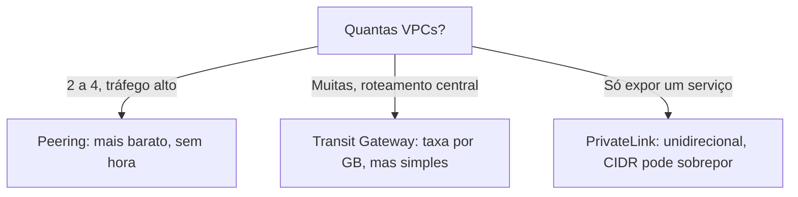

---
aliases:
  - Aula 7.8
modulo: 7
aula: 8
parte: "II Identidade, rede e dados"
dominios:
  - 1
  - 4
lida: false
tags:
  - aula
  - saa-c03
  - modulo-07
---

# Aula 7.8: Custo de transferência e escolha da conexão

[[07 - Conectividade Hibrida e entre VPCs|Voltar ao módulo]]

> [!question] Quanto custa mover um byte entre duas AZs, duas Regiões ou até o seu data center, e como esse custo muda a escolha entre peering, Transit Gateway, VPN e Direct Connect?

## Por que esta aula existe

Nas aulas anteriores cada peça trouxe o seu preço: [[Transit Gateway]] cobra por attachment e por GB, VPN cobra por hora de conexão, [[Direct Connect]] cobra por porta e por dados, [[Interface Endpoint|interface endpoint]] cobra por hora e por GB. Na prova (Domínio 4, Task 4.4) a pergunta raramente é "qual o preço?", e quase sempre é "qual desenho **custa menos** sem quebrar o requisito?". Para responder, você precisa de um mapa mental do **[[Data Transfer|custo de transferência]] de dados** e de um roteiro de decisão que junte tudo do módulo.

> [!warning] Sobre os números
> Preços mudam e variam por Região. Os valores desta aula são **exemplos de ordem de grandeza**, conferidos nas páginas oficiais de preço em novembro de 2026 quando indicado. Na prova, o que se cobra é a **regra** (entrada grátis, mesma [[Zona de Disponibilidade|AZ]] grátis, cruzar AZ ou Região custa, saída para a internet custa mais), não o centavo.

## O mapa de custo de transferência

A regra geral cabe em seis linhas:

| Caminho do tráfego | Custo (ordem de grandeza) | Observação |
|---|---|---|
| Da internet para a AWS (entrada) | **Grátis** | Vale para a maioria dos serviços |
| Dentro da mesma [[Zona de Disponibilidade\|AZ]], **somente por [[RFC 1918\|IP privado]]** | **Grátis** | Mesmo se forem [[VPC\|VPCs]] diferentes com peering. Por **IP público ou [[Elastic IP]]** a AWS cobra transferência (US$ 0,01 por GB em cada direção) mesmo na mesma AZ ou Região |
| Entre [[Zona de Disponibilidade\|AZs]] da mesma Região | **Cobrado** | US$ 0,01 por GB em cada direção, ou seja, paga-se na saída de um lado e na entrada do outro (valor da página de preços do [[EC2]], seção [[Data Transfer]] within the same [[Regiao AWS\|Region]]; a documentação do [[Cost and Usage Report\|CUR]] confirma a cobrança nos dois sentidos; verificado em novembro de 2026) |
| Entre [[Regiao AWS\|Regiões]] | **Cobrado** | Em geral na faixa de US$ 0,02 por GB (varia por Região) |
| Da AWS para a internet (saída) | **Cobrado, o mais caro** | Há uma franquia mensal gratuita e faixas decrescentes |
| Da AWS para o data center por [[Direct Connect]] | **Cobrado, menor que a internet** | A taxa de saída pelo DX é menor que a da internet pública |

Duas ideias seguram a maior parte das questões:

1. **Entrar é grátis, sair é pago.** A AWS cobra para os dados saírem, não para chegarem.
2. **Quanto mais longe, mais caro:** mesma [[Zona de Disponibilidade|AZ]], depois outra AZ, depois outra Região, depois a internet.

> [!warning] Duas pegadinhas da "mesma AZ grátis"
> 1. **Só vale por [[RFC 1918|IP privado]].** Se duas instâncias da mesma [[Zona de Disponibilidade|AZ]] se falam pelo [[Elastic IP]] ou pelo nome [[DNS]] público (que resolve para o IP público), a AWS cobra a transferência. A correção é usar o IP privado ou o nome DNS privado.
> 2. **"Mesma [[Zona de Disponibilidade|AZ]]" é pelo [[AZ ID]], não pelo nome.** O nome (`us-east-1a`) é mapeado para uma AZ física diferente em cada conta; o AZ ID (`use1-az1`) é fixo. Em peering entre contas, confira os AZ IDs antes de contar com tráfego grátis.

> [!example] Um erro caro e comum
> Uma aplicação com instâncias em duas [[Zona de Disponibilidade|AZs]] conversa o tempo todo com um banco na outra AZ. Cada GB que cruza paga nos dois sentidos. Para tráfego pesado, manter a **conversa dentro da mesma AZ** (por exemplo, com roteamento de preferência zonal) reduz a conta, ao custo de menor [[Disponibilidade|disponibilidade]] se a AZ cair. Resiliência e custo puxam em direções opostas, e a prova gosta de testar qual requisito manda.

## O custo de cada peça do módulo

Revisão rápida, sem decorar valores:

| Peça | O que gera custo | Quando fica caro |
|---|---|---|
| **[[VPC Peering]]** ([[07.02 - VPC Peering|7.2]]) | Sem taxa de hora; só a transferência entre [[Zona de Disponibilidade\|AZs]] ou [[Regiao AWS\|Regiões]] | Peering entre Regiões com muito tráfego |
| **[[Transit Gateway]]** ([[07.03 - Transit Gateway|7.3]]) | Por attachment-hora (exemplo US$ 0,05) e por GB processado (exemplo US$ 0,02) | Muito tráfego passando pelo hub, que paga por GB mesmo entre [[VPC\|VPCs]] vizinhas |
| **[[PrivateLink]]** ([[07.04 - PrivateLink e Endpoint Services|7.4]]) | Por hora e por [[Zona de Disponibilidade\|AZ]] do endpoint, mais por GB processado | Muitos endpoints em muitas AZs |
| **[[Site-to-Site VPN]]** ([[07.05 - Site-to-Site VPN e Client VPN|7.5]]) | Por conexão-hora, mais a saída de dados | Tráfego grande, porque a saída é pela internet |
| **[[Direct Connect]]** ([[07.06 - Direct Connect|7.6]]) | Por porta-hora, mais a saída de dados pelo DX | Porta ociosa em volume baixo |
| **Resolver endpoints** ([[07.07 - DNS Hibrido com Route 53 Resolver|7.7]]) | Por ENI-hora e por milhão de consultas | Endpoints duplicados em muitas [[VPC\|VPCs]] |

### Peering contra Transit Gateway, pela conta

Peering não tem taxa horária nem taxa por GB própria; o [[Transit Gateway]] tem as duas. Por isso, para **poucas [[VPC|VPCs]] com muito tráfego**, peering costuma ser mais barato. O Transit Gateway compensa quando o número de VPCs cresce: com N VPCs, peering exige até N(N-1)/2 conexões e [[Route Table|tabelas de rotas]] para manter (10 VPCs são 45 peerings; 50 VPCs são 1.225), enquanto o hub exige N attachments. A decisão é **custo contra complexidade operacional**.



### VPN contra Direct Connect, pelo ponto de equilíbrio

A VPN é barata de começar (sem porta física, sem prazo de instalação) mas **sai pela internet**, com banda de 1,25 Gbps por túnel e [[Latencia|latência]] variável. O [[Direct Connect]] tem custo fixo da porta, mas a **taxa por GB de saída é menor** que a da internet e a latência é estável. A conta tem a forma:

```
custo VPN  = conexão-hora x horas + GB x taxa de saída pela internet
custo DX   = porta-hora x horas + GB x taxa de saída pelo DX
```

Como a taxa por GB do [[Direct Connect|DX]] é menor, existe um **volume mensal** a partir do qual o DX fica mais barato mesmo com a porta cara. Abaixo desse volume a VPN ganha. Exemplo ilustrativo (valores arredondados, não são preços reais de nenhuma Região): se a porta custa US$ 220 por mês a mais que a VPN e cada GB sai US$ 0,05 mais barato pelo DX, o equilíbrio fica em 220 / 0,05 = **4.400 GB por mês**. Acima disso, DX; abaixo, VPN. A prova não pede o número; pede o raciocínio **"muito volume e previsível, então DX; pouco volume ou urgência, então VPN"**.

> [!info] Ligando os pontos
> O volume não é o único critério. O [[Direct Connect]] também ganha por **[[Latencia|latência]] consistente**, **banda dedicada** e **requisitos regulatórios** que proíbem a internet. A VPN ganha por **rapidez de provisionamento** (minutos contra semanas), **custo inicial baixo** e por servir de **backup** do DX (VPN sobre a internet quando o link físico cai).

## Roteiro de decisão do módulo

Junta o módulo inteiro em perguntas, na ordem em que um arquiteto as faria:

1. **O destino é outra [[VPC]] ou o data center?**
2. **Outra [[VPC]]:** é só para expor **um serviço** ([[PrivateLink]]) ou precisa de **rede completa**? Rede completa com poucas VPCs: peering. Muitas VPCs ou roteamento central: [[Transit Gateway]]. CIDRs se sobrepõem: PrivateLink, porque peering e Transit Gateway exigem [[CIDR]] sem sobreposição.
3. **Data center:** quanto tempo temos? Precisamos hoje (VPN) ou em semanas ([[Direct Connect|DX]])? O tráfego é alto e estável? Há exigência de [[Latencia|latência]] previsível ou de não usar a internet (DX)?
4. **Precisa de criptografia no [[Direct Connect|DX]]?** O DX **não é criptografado por padrão**: use **[[MACsec]]** (camada 2, portas dedicadas) ou **VPN sobre o DX**.
5. **Precisa de [[Alta Disponibilidade|alta disponibilidade]]?** Duas conexões em locais diferentes (modelo máximo de resiliência), ou [[Direct Connect|DX]] mais VPN de backup para custo menor.
6. **E o [[DNS]]?** Os nomes precisam resolver nos dois lados: Resolver endpoints inbound e outbound.
7. **E o custo?** Centralize endpoints, compartilhe regras, mantenha tráfego pesado na mesma [[Zona de Disponibilidade|AZ]] quando o requisito de [[Disponibilidade|disponibilidade]] permitir.

| Cenário | Escolha | Por quê |
|---|---|---|
| Ligação rápida e barata a um escritório pequeno | [[Site-to-Site VPN]] | Minutos, sem porta física |
| 10 Gbps constantes e [[Latencia\|latência]] estável ao data center | [[Direct Connect]] dedicado | Banda e latência previsíveis |
| Backup barato de um [[Direct Connect\|DX]] | VPN | Sobe em minutos sobre a internet |
| 200 [[VPC\|VPCs]] em 40 contas, tudo com tudo | [[Transit Gateway]] | N attachments, rotas centrais |
| Expor um serviço a 300 clientes com CIDRs sobrepostos | [[PrivateLink]] | Unidirecional, tolera sobreposição |
| Duas [[VPC\|VPCs]] com muito tráfego entre si | Peering | Sem hora e sem taxa por GB própria |
| Dados sensíveis no [[Direct Connect\|DX]] | [[MACsec]] ou VPN sobre DX | O DX não criptografa por padrão |

## Formas de reduzir custo, na prática

- **Mantenha o tráfego na mesma [[Zona de Disponibilidade|AZ]]** quando o requisito permitir; cruzar AZ paga nos dois sentidos.
- **Use [[Gateway Endpoint|gateway endpoints]]** para [[S3]] e [[DynamoDB]]: não têm custo por hora nem por GB (verificado nos preços do [[PrivateLink]]), ao contrário dos [[Interface Endpoint|interface endpoints]].
- **Evite o [[NAT]] para tráfego da AWS:** com [[Gateway Endpoint|gateway endpoint]], o tráfego de [[S3]] nem passa pelo [[NAT Gateway]], que cobra por GB.
- **Use [[CloudFront]] na frente:** a saída da AWS para o CloudFront é isenta; a saída do CloudFront para a internet costuma ser mais barata que a direta (detalhes no [[18 - Borda e DNS CloudFront Global Accelerator e Route 53|Módulo 18]]).
- **Substitua várias VPNs por [[Direct Connect]]** quando o volume justificar.
- **Centralize** endpoints de Resolver e inspeção em uma [[VPC]] de rede.

## Como isso cai na prova

**Task statements:** Task 4.4 (otimizar custos de rede), Task 3.4 (redes híbridas de alto desempenho) e Task 1.2 (conexão segura com ambientes externos).

**Palavras-chave em inglês:**

- "most cost-effective way to connect [[VPC|VPCs]]": peering (poucas) ou [[Transit Gateway]] (muitas).
- "connect on-premises quickly / within minutes": [[Site-to-Site VPN]].
- "consistent network performance / dedicated": [[Direct Connect]].
- "reduce [[Data Transfer|data transfer]] costs": mesma [[Zona de Disponibilidade|AZ]], [[Gateway Endpoint|gateway endpoints]], [[CloudFront]], [[Direct Connect]] no lugar da internet.
- "overlapping [[CIDR]]": [[PrivateLink]].
- "encrypted over [[Direct Connect]]": VPN sobre DX ou [[MACsec]].

**Pegadinhas clássicas:**

- Escolher [[Direct Connect]] para uma necessidade urgente: o prazo é de semanas.
- Escolher VPN para tráfego de terabytes por mês e [[Latencia|latência]] crítica.
- Esquecer que **entrada de dados é grátis**: nenhum desenho barateia o que já é grátis.
- Achar que o [[Transit Gateway]] é sempre mais barato: ele cobra por GB; peering não.
- Usar [[Interface Endpoint|interface endpoint]] para [[S3]] quando um [[Gateway Endpoint|gateway endpoint]] grátis resolve (e vice-versa, para tráfego vindo de on-premises).

| Requisito no enunciado | Resposta provável | Por quê |
|---|---|---|
| Menor custo entre 3 [[VPC\|VPCs]] com tráfego pesado | Peering | Sem hora, sem taxa por GB própria |
| Conectar em minutos | VPN | Sem provisionamento físico |
| 5 TB por mês, [[Latencia\|latência]] previsível | [[Direct Connect]] | Taxa de saída menor, banda estável |
| Reduzir custo de acesso privado ao [[S3]] na [[VPC]] | [[Gateway Endpoint\|Gateway endpoint]] | Sem custo adicional |
| Dados criptografados sobre o [[Direct Connect\|DX]] | VPN sobre DX ou [[MACsec]] | DX não criptografa |
| Backup de baixo custo de um [[Direct Connect\|DX]] | VPN | Barata e rápida |

## Resumo

> [!abstract] A aula em uma frase
> Entrar dados é grátis, sair custa, e quanto mais longe (outra [[Zona de Disponibilidade|AZ]], outra Região, internet) mais caro; a escolha entre peering, [[Transit Gateway]], VPN e [[Direct Connect]] pesa volume, prazo, [[Latencia|latência]] e complexidade, não só o preço de tabela.

**A lógica, em 5 passos**

1. Entrada grátis, mesma [[Zona de Disponibilidade|AZ]] grátis, cruzar AZ e Região cobra, internet é a saída mais cara.
2. Peering tem o menor custo para poucas [[VPC|VPCs]]; [[Transit Gateway]] paga por attachment e por GB para ganhar simplicidade com muitas.
3. VPN é rápida e barata para começar; [[Direct Connect]] vence quando o volume é alto e estável.
4. Criptografia no [[Direct Connect|DX]] exige [[MACsec]] ou VPN sobre DX.
5. Resiliência e custo puxam em sentidos opostos, e o requisito do enunciado decide.

**Números para lembrar**

| O quê | Valor | Por que importa |
|---|---|---|
| Entrada de dados | Grátis | Nunca é o foco de otimização |
| Peerings para N [[VPC\|VPCs]] completas | N(N-1)/2 | Explica quando migrar para [[Transit Gateway]] |
| Banda por túnel de VPN | 1,25 Gbps | Limite que empurra para [[Direct Connect\|DX]] ou [[ECMP]] |
| Prazo típico do [[Direct Connect\|DX]] | Semanas | Não serve para necessidade urgente |

**Tabela-síntese**

| Situação | Escolha |
|---|---|
| Poucas [[VPC\|VPCs]], muito tráfego | Peering |
| Muitas [[VPC\|VPCs]] | [[Transit Gateway]] |
| Expor um serviço, [[CIDR]] sobreposto | [[PrivateLink]] |
| Data center, urgência | VPN |
| Data center, volume e [[Latencia\|latência]] | [[Direct Connect]] |

**Na hora H**

- Leia os adjetivos: "mais barato", "mais rápido", "mais seguro", "menor esforço".
- Descarte o que quebra um requisito antes de comparar custo.
- Lembre que o [[Direct Connect|DX]] não criptografa.
- Lembre que peering e [[Transit Gateway]] não toleram [[CIDR]] sobreposto.

> [!tip] Liga com
> Fecha o módulo juntando [[07.02 - VPC Peering|7.2]] a [[07.07 - DNS Hibrido com Route 53 Resolver|7.7]]. O raciocínio de custo continua no [[25 - Otimizacao de Custos|Módulo 25]]. Segue para o [[08 - Criptografia e Protecao de Dados|Módulo 8]].

## Erros comuns

- **Achar que [[Direct Connect]] é sempre a melhor conexão.**
- **Achar que VPN serve para qualquer volume.**
- **Esquecer a cobrança de tráfego entre [[Zona de Disponibilidade|AZs]].**
- **Escolher [[Transit Gateway]] só por ser "o moderno".**
- **Assumir que o [[Direct Connect|DX]] é criptografado.**
- **Ignorar que peering e [[Transit Gateway]] exigem CIDRs sem sobreposição.**

## Pratique

**1.** Uma empresa precisa conectar a [[VPC]] ao data center em até uma hora, com o menor custo inicial, para uma migração temporária. O que escolher?

- [ ] a) Uma conexão Site-to-Site VPN
- [ ] b) Uma conexão Direct Connect dedicada de 10 Gbps com um parceiro de colocation
- [ ] c) Uma conexão Direct Connect hospedada, pedida a um parceiro do programa APN
- [ ] d) Dois peerings entre a VPC e uma VPC temporária do data center

**2.** Três [[VPC|VPCs]] trocam terabytes por dia e não há previsão de crescer. Qual desenho tem o menor custo de rede?

- [ ] a) Um Transit Gateway com três attachments e propagação de rotas
- [ ] b) Peering entre cada par, sem taxa por hora e sem taxa por GB própria
- [ ] c) Um PrivateLink para cada VPC, expondo os serviços atrás de um NLB
- [ ] d) Uma VPN Site-to-Site entre cada par, em túneis redundantes

**3.** Uma empresa transfere 20 TB por mês ao data center, com [[Latencia|latência]] estável e dados sensíveis. O que atende melhor ao requisito, com o menor custo recorrente?

- [ ] a) Uma VPN Site-to-Site com dois túneis, que usa a internet pública
- [ ] b) Um Direct Connect com MACsec ou VPN sobre ele, para criptografar o tráfego
- [ ] c) Um peering entre a VPC e a rede do data center
- [ ] d) Um Direct Connect sem criptografia, pois ele é privado por padrão, logo atende ao requisito

**4.** Dois provedores de SaaS precisam consumir um serviço da sua [[VPC]], e os CIDRs dos clientes se sobrepõem entre si. O que usar?

- [ ] a) Peering entre a VPC e cada cliente
- [ ] b) Um Transit Gateway compartilhado com todos
- [ ] c) PrivateLink, com um endpoint service atrás de um NLB
- [ ] d) Uma VPN Site-to-Site por cliente, com NAT em cada ponta

**5.** Qual tráfego de dados é tipicamente grátis na AWS?

- [ ] a) Dados saindo da AWS para a internet em grande volume
- [ ] b) Dados entre duas Regiões
- [ ] c) Dados entre duas AZs da mesma Região
- [ ] d) Dados entrando na AWS vindos da internet

**6.** Como reduzir o custo de acesso ao [[S3]] vindo de instâncias numa [[VPC]], sem passar pela internet?

- [ ] a) Criar um gateway endpoint para o S3 e rotear o prefixo para ele
- [ ] b) Colocar um NAT Gateway em cada AZ para o tráfego do S3
- [ ] c) Criar um interface endpoint para o S3 em cada sub-rede privada da VPC
- [ ] d) Criar um Direct Connect para a Região do bucket

**7.** Uma aplicação [[Multi-AZ|multi-AZ]] paga muito por tráfego entre [[Zona de Disponibilidade|AZs]] e o requisito de [[Disponibilidade|disponibilidade]] permite alguma flexibilidade. Qual ação mais reduz esse custo?

- [ ] a) Manter a comunicação entre componentes na mesma AZ sempre que possível
- [ ] b) Mover todas as instâncias para outra Região
- [ ] c) Trocar o tráfego interno para a internet pública
- [ ] d) Substituir o Elastic Load Balancer por um Transit Gateway entre as camadas da aplicação

**8.** Uma empresa tem 50 [[VPC|VPCs]] que precisam falar entre si. Por que o [[Transit Gateway]] tende a ser preferido ao peering, apesar da taxa por GB?

- [ ] a) Porque o peering só é transitivo até três VPCs, e o Transit Gateway amplia esse limite
- [ ] b) Porque o peering completo exigiria 1.225 conexões e rotas para manter
- [ ] c) Porque o Transit Gateway não cobra nada por GB
- [ ] d) Porque o Transit Gateway tolera CIDRs sobrepostos entre as 50 VPCs

**9.** (Escolha DUAS.) Uma aplicação com instâncias em duas [[Zona de Disponibilidade|AZs]] lê [[S3]] e [[DynamoDB]] por um [[NAT Gateway]] e conversa o tempo todo com um banco na outra AZ. O requisito de [[Disponibilidade|disponibilidade]] permite alguma flexibilidade. Quais ações reduzem o [[Data Transfer|custo de transferência]]?

- [ ] a) Trocar os gateway endpoints por interface endpoints para S3, que não cobram por hora nem por GB
- [ ] b) Criar gateway endpoints de S3 e DynamoDB e rotear o tráfego para eles, tirando-o do NAT Gateway
- [ ] c) Manter as camadas que mais conversam na mesma AZ, falando por IP privado, aceitando menor resiliência
- [ ] d) Trocar o Direct Connect pela internet pública para a saída de dados
- [ ] e) Replicar os dados entre Regiões continuamente, para que cada AZ leia uma cópia local

**10.** (Escolha DUAS.) Uma empresa revisa a fatura de rede e quer entender as regras de cobrança e de conectividade. Quais afirmações estão corretas?

- [ ] a) A VPN Site-to-Site leva semanas para ser provisionada
- [ ] b) A entrada de dados na AWS é cobrada por GB
- [ ] c) O tráfego entre instâncias da mesma AZ só é gratuito por IP privado; por IP público ou Elastic IP há cobrança por GB
- [ ] d) Peering e Transit Gateway não aceitam CIDRs sobrepostos
- [ ] e) O Transit Gateway não cobra nada pelo tráfego que processa

**11.** Duas [[EC2|instâncias EC2]] estão na mesma [[Sub-rede|sub-rede]], na mesma [[Zona de Disponibilidade|AZ]], e a fatura mostra cobrança de [[Data Transfer|transferência de dados]] entre elas. Qual é a causa mais provável?

- [ ] a) A comunicação entre instâncias da mesma AZ sempre é cobrada, e a gratuidade só existe entre VPCs peeradas
- [ ] b) O security group registra cada pacote entre as instâncias e a AWS cobra pelo volume registrado
- [ ] c) As instâncias se falam pelos Elastic IPs ou pelos nomes DNS públicos, e não pelos IPs privados
- [ ] d) Cada instância tem uma ENI secundária, e o tráfego entre ENIs de uma mesma AZ é cobrado por GB

> [!success]- Gabarito
> **1. a)** a VPN sobe em minutos e não exige porta física; b) erra porque o [[Direct Connect]] dedicado exige semanas de provisionamento e cross-connect, c) erra porque a conexão hospedada também depende de parceiro e prazo, d) erra porque peering liga [[VPC|VPCs]] e não alcança um data center.
> **2. b)** peering não tem taxa por hora nem por GB própria, só a transferência entre [[Zona de Disponibilidade|AZs]] ou [[Regiao AWS|Regiões]]; a) o hub cobra por attachment e por GB, c) [[PrivateLink]] é para expor serviços e cobra por GB, d) VPN sai pela internet e é mais cara em volume.
> **3. b)** [[Direct Connect|DX]] dá [[Latencia|latência]] estável e taxa de saída menor, e [[MACsec]] ou VPN sobre DX criptografam; a) a internet não dá latência estável, c) peering não liga a data center, d) o DX não é criptografado por padrão.
> **4. c)** o [[PrivateLink]] tolera [[CIDR]] sobreposto e é unidirecional; a) e b) exigem CIDRs sem sobreposição, d) VPN com [[NAT]] é complexa e cara por cliente.
> **5. d)** a entrada de dados é grátis; a) a saída para a internet é cobrada, b) entre [[Regiao AWS|Regiões]] é cobrado, c) entre [[Zona de Disponibilidade|AZs]] é cobrado.
> **6. a)** o [[Gateway Endpoint|gateway endpoint]] do [[S3]] não tem custo adicional; b) o [[NAT]] cobra por hora e por GB, c) o [[Interface Endpoint|interface endpoint]] cobra por hora e por GB, d) o [[Direct Connect|DX]] não é necessário para tráfego dentro da AWS.
> **7. a)** manter o tráfego na mesma [[Zona de Disponibilidade|AZ]] elimina a cobrança entre AZs, com o custo de menor redundância; b) o tráfego entre [[Regiao AWS|Regiões]] é mais caro, c) a saída pela internet é a mais cara, d) [[Transit Gateway]] não substitui balanceador.
> **8. b)** 50 [[VPC|VPCs]] exigiriam 1.225 peerings; o hub usa 50 attachments; a) erra porque peering não é transitivo em nenhum número de VPCs, c) erra porque o hub cobra por GB, d) erra porque o [[Transit Gateway]] também exige CIDRs sem sobreposição.
> **9. b) e c)** [[Gateway Endpoint|gateway endpoints]] grátis tiram o tráfego do [[NAT]] e a mesma [[Zona de Disponibilidade|AZ]] por [[RFC 1918|IP privado]] elimina a cobrança entre AZs; a) erra porque o [[Interface Endpoint|interface endpoint]] cobra por hora e por GB, d) erra porque a internet é a saída mais cara, e) erra porque replicar entre [[Regiao AWS|Regiões]] gera custo extra.
> **10. c) e d)** a mesma [[Zona de Disponibilidade|AZ]] só é grátis por [[RFC 1918|IP privado]], e peering e [[Transit Gateway]] exigem CIDRs distintos; a) erra porque a VPN sobe em minutos, b) erra porque a entrada é grátis, e) erra porque o hub cobra por GB processado.
> **11. c)** por IP público ou [[Elastic IP]] a AWS cobra a transferência mesmo na mesma [[Zona de Disponibilidade|AZ]]; a) erra porque a mesma AZ por [[RFC 1918|IP privado]] é grátis, b) erra porque [[Security Group|security groups]] não geram cobrança por volume, d) erra porque [[ENI|ENIs]] secundárias não mudam a regra (o que importa é IP privado ou público).

### Laboratório (opcional)

> [!warning] Use uma conta AWS pessoal separada, com AWS Budgets configurado, nunca a conta de produção. Este laboratório só lê preços e consulta recursos; não cria nada com custo.

Objetivo: praticar a conta de ponto de equilíbrio com dados reais.

1. Abra a página de preços de [Direct Connect](https://aws.amazon.com/directconnect/pricing/) e anote a taxa por porta-hora e a taxa de saída de dados da sua Região.
2. Abra a página de preços de [Site-to-Site VPN](https://aws.amazon.com/vpn/pricing/) e anote a taxa por conexão-hora.
3. Na página de preços de [EC2, seção Data Transfer](https://aws.amazon.com/ec2/pricing/on-demand/), anote a taxa de saída para a internet.
4. Monte uma planilha: custo mensal da VPN contra o do [[Direct Connect|DX]] para 500 GB, 5 TB e 50 TB por mês. Marque o volume em que as curvas se cruzam.
5. Escreva em uma frase qual critério além do preço mudaria a sua escolha ([[Latencia|latência]], prazo, criptografia).

## Para aprofundar

- [Preços do AWS Direct Connect](https://aws.amazon.com/directconnect/pricing/) (AWS): porta, taxa de saída e exemplos.
- [Preços do AWS Transit Gateway](https://aws.amazon.com/transit-gateway/pricing/) (AWS): attachment-hora e GB processado.
- [Preços do AWS Site-to-Site VPN](https://aws.amazon.com/vpn/pricing/) (AWS): conexão-hora e [[Accelerated VPN|VPN acelerada]].
- [Preços do AWS PrivateLink](https://aws.amazon.com/privatelink/pricing/) (AWS): endpoints, hora e GB.

Próximo módulo: [[08 - Criptografia e Protecao de Dados]].
