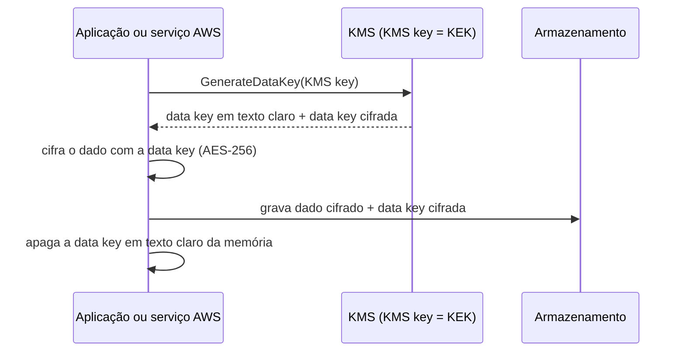

---
aliases:
  - Aula 8.1
modulo: 8
aula: 1
parte: "II Identidade, rede e dados"
dominios:
  - 1
lida: false
tags:
  - aula
  - saa-c03
  - modulo-08
---

# Aula 8.1: Por que criptografar e os fundamentos

[[08 - Criptografia e Protecao de Dados|Voltar ao módulo]]

> [!question] Pergunta que esta aula responde
> Que problema a criptografia resolve que o [[IAM]] e o firewall não resolvem, qual a diferença entre cifrar em repouso e em trânsito, como funcionam [[Chave Simetrica|chaves simétricas]], [[Chave Assimetrica|assimétricas]] e [[Hash|hash]], e por que quase todo serviço da AWS usa [[Envelope Encryption|envelope encryption]] em vez de cifrar os dados direto com uma chave mestra?

## Por que criptografar: o problema que o controle de acesso não resolve

Nos módulos anteriores você aprendeu a controlar **quem pode chamar a API** ([[04 - IAM Identidade e Acesso|Módulo 4]]) e **quem consegue chegar na rede** ([[06 - VPC a Fundo|Módulo 6]]). Esses controles protegem o caminho até o dado. A criptografia protege o **dado em si**, para o caso de o caminho falhar.

Cenários reais em que o controle de acesso sozinho não basta:

- **Mídia ou snapshot indevido.** Um [[Snapshot]] de volume é compartilhado com a conta errada, ou um disco descartado é recuperado. Sem criptografia, quem pega os bytes lê tudo.
- **Permissão frouxa demais.** Um [[Bucket|bucket]] ganha uma policy ampla por engano. Se os objetos estão cifrados com uma chave cuja policy não inclui o intruso, ele baixa bytes ilegíveis.
- **Separação de funções.** O time que administra o storage não precisa ler o conteúdo. Com chave e dado em lugares diferentes, quem opera o [[Bucket|bucket]] não é, automaticamente, quem decifra.
- **Interceptação na rede.** Pacotes que cruzam a internet, o Wi-Fi do escritório ou até a rede interna da empresa podem ser capturados.
- **Exigência regulatória.** Padrões como PCI DSS e HIPAA, e leis de proteção de dados como a LGPD, tratam criptografia como controle esperado para [[PII|dados pessoais]] e de pagamento. O texto exato de cada norma varia e não faz parte da prova; o que cai é saber **qual serviço da AWS entrega o controle exigido**.

A ideia central: criptografar **transforma o problema de proteger muito dado em proteger uma chave pequena**. Guardar bem uma chave de 256 bits é mais fácil do que garantir que nenhum de milhões de objetos vaze.

> [!example] Duas camadas, dois atacantes
> A sua API em [[ECS]] lê um [[Bucket|bucket]] de contratos. Um desenvolvedor, sem querer, anexa `s3:GetObject` com `Principal: *` a uma policy de bucket. Sem criptografia gerenciada por você, qualquer pessoa na internet baixa os contratos. Com [[SSE-KMS]] (o [[S3]] cifra cada objeto com uma chave guardada no KMS; aula 8.6) e uma [[Key Policy|key policy]] (a política que diz quem pode usar a chave; aula 8.3) que só admite a role da API, a requisição de download falha no passo de decifrar, porque o S3 precisa pedir ao [[KMS]] uma chave que o intruso não pode usar. Uma camada errada não derruba a outra: isso é [[Defesa em Profundidade]].

## Em repouso, em trânsito e em uso

| Estado do dado | O que protege | Ameaça principal | Ferramentas da AWS (nas próximas aulas) |
|---|---|---|---|
| **[[Criptografia em Repouso|Em repouso]]** (at rest) | Dado gravado em disco, banco, backup, [[Snapshot\|snapshot]] | Acesso à mídia, ao backup ou a uma permissão frouxa | [[KMS]], [[CloudHSM]], criptografia nativa de [[S3]], [[EBS]], [[RDS]], [[DynamoDB]], [[EFS]] |
| **[[Criptografia em Transito|Em trânsito]]** (in transit) | Dado viajando entre dois pontos | Captura de pacotes, homem no meio | [[TLS]], [[ACM]], VPN [[IPsec]], endpoints HTTPS |
| **Em uso** (in use) | Dado na memória durante o processamento | Acesso ao host, dump de memória | Fora do foco da prova (existem ambientes isolados de computação para isso, mas não são centrais) |

Atenção ao vocabulário da prova: "encrypt data **at rest**" aponta para [[KMS]] e criptografia nativa do serviço; "encrypt data **in transit**" aponta para [[TLS]], e na AWS o certificado público costuma vir do [[ACM]].

### Como isso se liga ao modelo de responsabilidade compartilhada

No [[Modelo de Responsabilidade Compartilhada]] (Módulo 1), a AWS é responsável pela segurança **da** nuvem e você pela segurança **na** nuvem. Em criptografia isso vira uma régua de quanto você assume:

- A AWS entrega [[HSM|HSMs]] certificados, serviços integrados e o canal [[TLS]] dos endpoints.
- Você decide **se** cifra, **com qual tipo de chave**, **quem pode usar a chave** e **se o tráfego da sua aplicação usa [[TLS]]**. Um [[Bucket|bucket]] que aceita [[HTTP]] ou um volume sem criptografia é decisão de configuração sua.
- Criptografia **do lado do cliente** (você cifra antes de enviar) leva a responsabilidade ainda mais para o seu lado: a AWS só armazena bytes.

## Os blocos de construção: simétrica, assimétrica e hash

Toda arquitetura de criptografia na AWS é montada com três primitivas. Entender o que cada uma faz e **o que não faz** evita metade das pegadinhas.

### Criptografia simétrica

Uma **única chave** cifra e decifra. O algoritmo padrão do mundo e da AWS é o **AES** com chave de 256 bits (AES-256). É **rápida**, boa para volumes grandes de dados, e é o que cifra o conteúdo do seu disco ou objeto.

O problema: quem precisa decifrar precisa da **mesma chave**. Como entregar a chave ao outro lado sem que ela seja interceptada? Esse é o **problema de distribuição de chaves**.

### Criptografia assimétrica

Um **par de chaves** matematicamente ligadas: a **pública**, que pode ser divulgada, e a **privada**, que nunca sai do dono. O que uma chave cifra, só a outra decifra. Algoritmos comuns: **RSA** e **curvas elípticas (ECC)**.

Dois usos clássicos:

1. **Confidencialidade e troca de chaves:** cifro com a pública do destinatário; só a privada dele abre. Resolve a distribuição de chaves do caso simétrico.
2. **Assinatura digital:** assino com a minha privada; qualquer um verifica com a minha pública. Prova **origem e integridade**, não sigilo.

A desvantagem é a velocidade: assimétrica é muito mais lenta e só cifra mensagens pequenas. Por isso **nunca** se cifram arquivos grandes direto com RSA.

> [!info] Ligando os pontos
> O handshake de [[TLS]] (Módulo 3) usa exatamente a combinação: assimetria para autenticar o servidor (o certificado) e combinar uma chave de sessão, e criptografia **simétrica** rápida para o tráfego depois. O certificado do [[ACM]] (aula 8.7) guarda a chave pública; a privada fica com quem termina o TLS.

### Hash

Uma função de **[[Hash|hash]]** (ex.: SHA-256) transforma qualquer entrada em uma saída de tamanho fixo, de forma **unidirecional**: não existe "decifrar um hash". Pequena mudança na entrada muda a saída inteira. Serve para **verificar integridade** ("esse arquivo é o mesmo?") e para guardar senhas de forma que o sistema nunca precise do texto original.

[[Hash]] **não é criptografia**: não há chave nem volta. Uma variante com chave, o **HMAC**, mistura um segredo ao hash para provar que a mensagem veio de quem conhece o segredo; o [[KMS]] oferece chaves HMAC para isso.

| Primitiva | Chaves | Reversível? | Velocidade | Uso típico na AWS |
|---|---|---|---|---|
| Simétrica (AES-256) | 1, compartilhada | Sim | Alta | Cifrar discos, objetos, bancos |
| Assimétrica (RSA, ECC) | Par público e privado | Sim | Baixa | [[Certificado Digital\|Certificados TLS]], assinatura, troca de chaves |
| [[Hash]] (SHA-256) | Nenhuma | Não | Alta | Integridade, checksums, senhas |
| HMAC | 1 segredo | Não (só verifica) | Alta | Autenticar mensagens |

## O problema da chave e o envelope encryption

Suponha que você cifre 10 TB de objetos com uma [[Chave Simetrica|chave simétrica]] e a guarde em um arquivo de configuração. Você apenas deslocou o problema: **quem lê o arquivo lê tudo**. E se a chave vaza, é preciso recifrar 10 TB.

A solução usada pela AWS inteira é o **[[Envelope Encryption|envelope encryption]]**, com duas camadas de chave:

- **Data key (DEK, chave de dados):** uma [[Chave Simetrica|chave simétrica]] gerada para cifrar o dado. Cada objeto, volume ou arquivo pode ter a sua.
- **Chave mestra (KEK, key-encryption key):** a chave de nível superior que **cifra as data keys**. No [[KMS]], é a **KMS key**. Ela nunca sai do serviço em texto claro.

O fluxo de escrita:

E a leitura: o app lê o dado cifrado e a data key cifrada, pede ao [[KMS]] `Decrypt` da data key cifrada (o KMS só atende se a policy permitir), recebe a data key em claro, decifra o dado e descarta a chave.

> [!example] Envelope com números
> Um volume de 1 TB é cifrado com **uma** data key AES-256 (32 bytes). Essa data key é cifrada pela [[KMS]] key e a versão cifrada fica guardada junto ao volume. Revogar o acesso significa negar `kms:Decrypt` na KMS key: sem decifrar a data key, o terabyte inteiro vira ruído, sem tocar em um único byte do volume. Um detalhe de realismo: um [[EBS|volume EBS]] **já anexado** a uma instância em execução continua funcionando por um tempo, porque o EBS mantém a data key em uso; o efeito aparece quando o volume é desanexado, a instância é parada ou o volume é anexado de novo.

### Por que não cifrar o dado direto com a KMS key?

Três razões, todas cobradas na prova:

1. **Limite de tamanho:** a operação `Encrypt` do [[KMS]] aceita no máximo **4.096 bytes (4 KB)** de texto claro (verificado em novembro de 2026 na API Reference). Um arquivo de 1 GB não cabe.
2. **Rede e [[Latencia|latência]]:** mandar o dado inteiro ao [[KMS]] a cada leitura e escrita saturaria a rede e a cota de requisições. Com envelope, o dado grande **nunca sai** do serviço de storage; só a pequena data key viaja.
3. **Isolamento da chave mestra:** a [[KMS]] key fica protegida dentro de [[HSM|HSMs]] e **nunca é exportada**. Só as data keys circulam, e por pouco tempo, em memória.

O que **cabe** direto no `Encrypt`: segredos pequenos, como uma senha ou um identificador de até 4 KB. É o caso de uso original da API.

> [!info] Ligando os pontos
> Essa é a mesma lógica do [[Key Policy|key policy]] da aula 8.3: como só o [[KMS]] decifra a data key, **a policy da KMS key é o interruptor** que controla acesso a todos os dados cifrados sob ela.

### Rotação e troca de chave no modelo de envelope

Como a [[KMS]] key só cifra data keys, trocar o material dela **não exige recifrar os dados**: o KMS guarda as versões antigas para decifrar o que foi cifrado antes (detalhe na aula 8.4). Já trocar a **data key** exige recifrar o dado, e é por isso que boas práticas usam uma data key por objeto.

## O espectro de controle: de AWS owned a CloudHSM e client-side

Um modo de organizar o módulo inteiro é pelo **quanto você controla a chave** e **quanto trabalho assume**:

| Nível | Quem controla a chave | Esforço seu | Quando escolher |
|---|---|---|---|
| Criptografia padrão do serviço ([[AWS Owned Key]]) | A AWS | Nenhum | Requisito só de "cifrado em repouso", sem auditoria da chave |
| [[AWS Managed Key]] (`aws/s3`, `aws/ebs`...) | A AWS, com você vendo o uso | Quase nenhum | Quer rastrear uso no [[CloudTrail]], sem gerir política |
| [[Customer Managed Key]] no [[KMS]] | Você (policy, rotação, exclusão) | Médio | Controle de acesso fino, compartilhamento entre contas, auditoria |
| Chave importada ou [[Custom Key Store]] com [[CloudHSM]] | Você, com material seu ou [[HSM]] dedicado | Alto | Exigência explícita de HSM dedicado ou de material de chave próprio |
| Client-side encryption | Você, fora da AWS | Muito alto | A AWS **não pode** ver o texto claro em momento algum |

Regra de decisão para a prova: **escolha o menor nível que satisfaz o requisito**. A AWS recompensa a opção gerenciada que atende; sobe de nível só quando o enunciado cita [[HSM]] dedicado, controle do material, auditoria de uso da chave ou compartilhamento entre contas.

## Como isso cai na prova

Cobre **Task 1.3** (determinar controles de segurança de dados apropriados): "encriptar [[Criptografia em Repouso|dados em repouso]] ([[KMS]])" e "encriptar [[Criptografia em Transito|dados em trânsito]] ([[ACM]] com [[TLS]])".

**Padrões de cenário**
- "Dados sensíveis em repouso devem ser criptografados" sem mais nada: a resposta é a criptografia **nativa do serviço com [[KMS]]**, não um software próprio.
- "A empresa precisa controlar as chaves, rotacioná-las e auditar quem as usa": **[[Customer Managed Key|customer managed key]]** no [[KMS]].
- "Os dados devem ser cifrados antes de sair do cliente" ou "a AWS não pode ter acesso ao texto claro": **client-side encryption**.
- "Dados trafegando entre cliente e aplicação devem estar protegidos": **HTTPS/TLS**, com certificado no [[ACM]].

**Palavras-chave em inglês**: "[[Criptografia em Repouso|encryption at rest]]", "[[Criptografia em Transito|encryption in transit]]", "[[Envelope Encryption|envelope encryption]]", "data key", "[[Customer Managed Key|customer managed key]]", "client-side encryption", "compliance requirement".

**[[Qualificador|Qualificadores]] de enunciado e o que eliminam**
- "**LEAST [[Overhead Operacional|operational overhead]]**": puxa a criptografia padrão do serviço (AWS owned ou [[AWS Managed Key|AWS managed key]]); elimina [[CloudHSM]], chave importada e client-side.
- "**MOST secure**" ou "full control of the keys": puxa [[Customer Managed Key|customer managed key]] (e, só se o enunciado pedir [[HSM]] dedicado, [[CloudHSM]]); elimina a criptografia padrão sem auditoria.
- "**with minimal changes to the application**": puxa criptografia server-side nativa; elimina client-side encryption, que exige mudar o código.

**Pegadinhas clássicas**
- Achar que **[[Hash|hash]]** é uma forma de criptografia reversível (não é).
- Cifrar arquivos grandes direto com a [[KMS]] key (limite de 4 KB; a resposta é data key via envelope).
- Achar que **[[Criptografia em Repouso|criptografia em repouso]] protege o dado em trânsito** (são controles independentes).
- Achar que **assinatura digital** dá sigilo (dá origem e integridade).

| Requisito no enunciado | Resposta provável | Por quê |
|---|---|---|
| Cifrar volume de dados grande com chave gerenciada | [[Envelope Encryption\|Envelope encryption]] via [[KMS]] | `Encrypt` limita a 4 KB; usa-se data key |
| Provar que um arquivo não foi alterado | [[Hash]] ou assinatura | Integridade, não sigilo |
| Proteger tráfego entre navegador e [[Application Load Balancer\|ALB]] | [[TLS]] com certificado do [[ACM]] | [[Criptografia em Transito\|Criptografia em trânsito]] |
| Revogar acesso a todos os dados de uma vez | Negar `kms:Decrypt` na [[KMS]] key | A KMS key protege as data keys |
| Nenhum serviço da AWS pode ver o texto claro | Client-side encryption | A chave e a cifragem ficam no cliente |

## Resumo

> [!abstract] A aula em uma frase
> Criptografia transforma "proteger muito dado" em "proteger uma chave pequena", e o [[Envelope Encryption|envelope encryption]] (data key cifrada por uma chave mestra que nunca sai do [[KMS]]) é o desenho que torna isso rápido, auditável e revogável em escala.

**A lógica, em 5 passos**
1. Controle de acesso protege o caminho até o dado; criptografia protege o dado se o caminho falhar.
2. Há dois estados que você controla: **em repouso** ([[KMS]], criptografia do serviço) e **em trânsito** ([[TLS]], [[ACM]], VPN).
3. Simétrica (AES-256) é rápida e cifra dados; assimétrica (RSA, ECC) resolve troca de chaves e assinatura; [[Hash|hash]] só verifica integridade.
4. Cifrar direto com a [[KMS]] key é inviável (limite de 4 KB), então se gera uma **data key**, cifra o dado com ela e guarda a data key cifrada junto.
5. Revogar a [[KMS]] key (negar decifrar a data key) torna todos os dados sob ela ilegíveis sem tocar neles.

**Números para lembrar**

| O quê | Valor | Por que importa |
|---|---|---|
| Limite do `Encrypt` do [[KMS]] | 4.096 bytes | Por isso existe [[Envelope Encryption\|envelope encryption]] |
| [[Chave Simetrica\|Chave simétrica]] padrão | AES, 256 bits | É o que cifra discos e objetos |
| SHA-256 | Saída fixa de 256 bits | Verificação de integridade, não criptografia |

**Na prática, isso significa**
- Para "cifrar em repouso" sem requisito extra, use a opção nativa do serviço.
- Chave controlada por você é custo e trabalho; só pague quando o enunciado pedir controle.
- [[Criptografia em Repouso|Criptografia em repouso]] e em trânsito são dois itens separados na checklist.
- O ponto único de controle do acesso aos dados cifrados é a política da chave.

> [!tip] Liga com
> Vem do [[04 - IAM Identidade e Acesso|Módulo 4]] (controle de acesso) e do [[03 - Fundamentos de Redes para a Nuvem|Módulo 3]] ([[TLS]]). Segue para a [[08.02 - AWS KMS Chaves e Envelope Encryption|aula 8.2]], onde o envelope vira operação concreta no [[KMS]].

## Erros comuns

- **"[[Hash]] é criptografia que não tem chave."** Não: hash é unidirecional; não existe decifrar. Serve para integridade.
- **"Dá para cifrar o arquivo todo com a [[KMS]] key."** O `Encrypt` aceita até 4 KB; arquivos usam data key (envelope).
- **"Se o disco está cifrado, o tráfego também está."** São camadas independentes: repouso não protege a rede, e [[TLS]] não protege o disco.
- **"Assinar com a chave privada esconde o conteúdo."** A assinatura prova quem enviou e que não foi alterado; o conteúdo continua legível.
- **"Quanto mais controle da chave, melhor."** Mais controle é mais responsabilidade e custo; a prova premia o menor nível que atende ao requisito.

## Pratique

**1.** Uma empresa precisa cifrar um arquivo de 2 GB com uma chave gerenciada pelo [[KMS]]. Qual abordagem é a recomendada e escalável, sem enviar o arquivo ao KMS?

- [ ] a) Chamar `Encrypt` do KMS passando o arquivo inteiro
- [ ] b) Gerar uma data key, cifrar o arquivo localmente com ela e guardar a data key cifrada junto
- [ ] c) Enviar o arquivo ao KMS em partes, por uma chamada em lote, e concatenar os resultados cifrados
- [ ] d) Exportar a KMS key em texto claro e usá-la no cliente

**2.** Um auditor pergunta como a empresa revoga rapidamente o acesso a todos os volumes cifrados com uma chave específica. Qual é a ação mais direta?

- [ ] a) Apagar cada volume e recriá-lo sem criptografia, para que nenhum dado antigo possa ser lido por ninguém
- [ ] b) Alterar o security group de cada instância
- [ ] c) Negar `kms:Decrypt` na KMS key (por exemplo, desabilitando a chave)
- [ ] d) Remover a role da instância do grupo de Auto Scaling

**3.** Uma equipe armazena senhas de usuários e precisa verificar o login sem nunca recuperar o texto original, nem mesmo internamente. Qual primitiva atende?

- [ ] a) AES-256 com a chave guardada no KMS, decifrando a senha para comparar no login
- [ ] b) Um hash da senha, comparando o hash calculado no login com o hash guardado
- [ ] c) RSA com a chave pública da empresa, guardando a senha cifrada para consulta futura
- [ ] d) Uma assinatura digital da senha, verificada com a chave pública a cada login

**4.** Uma aplicação envia dados de clientes ao [[S3]] e a política da empresa diz que a AWS não pode, em momento algum, ter acesso ao texto claro. Qual solução atende?

- [ ] a) SSE-S3 com a chave padrão do bucket
- [ ] b) SSE-KMS com customer managed key, em que a AWS cifra o objeto no S3 usando uma chave da conta guardada no KMS
- [ ] c) Uma bucket policy que bloqueia acesso público
- [ ] d) Client-side encryption, cifrando antes do upload com chaves que ficam com a empresa

**5.** Uma equipe cifrou todos os [[EBS|volumes EBS]] e acredita que a conexão do navegador ao [[Application Load Balancer|ALB]] também está protegida. Qual é o erro?

- [ ] a) Criptografia em repouso não cobre o trânsito; o ALB precisa de listener HTTPS com certificado
- [ ] b) O EBS não suporta criptografia em repouso, então o volume precisa ser protegido apenas por security group
- [ ] c) O ALB só funciona sem TLS
- [ ] d) A criptografia do EBS só vale para instâncias na mesma AZ

**6.** Uma empresa grava 500 GB de backup por noite e um arquiteto propõe cifrar tudo com RSA, usando a chave pública do destino, para não compartilhar [[Chave Simetrica|chave simétrica]]. Qual é o problema desse desenho?

- [ ] a) O RSA só aceita chaves de tamanho fixo de 128 bits, curtas demais para esse volume de dados
- [ ] b) O RSA só pode ser decifrado por quem possui a chave pública, que é de conhecimento geral
- [ ] c) O RSA é muito mais lento que o AES e só cifra mensagens pequenas; o padrão é cifrar com AES e proteger a chave AES
- [ ] d) O RSA não é aceito por serviços de armazenamento da AWS, que exigem algoritmos simétricos

**7.** Uma empresa quer provar a um parceiro que um relatório foi emitido por ela e não foi alterado, sem esconder o conteúdo. Qual primitiva atende?

- [ ] a) Assinatura digital com a chave privada da empresa
- [ ] b) Cifrar com AES-256 usando uma chave compartilhada
- [ ] c) Apenas armazenar o relatório em um bucket privado
- [ ] d) Aplicar um hash sem nenhuma chave e enviar só o hash

**8.** Uma startup de saúde precisa cumprir uma exigência de "[[Criptografia em Repouso|criptografia em repouso]]" para os dados de pacientes no [[S3]] e não tem requisito de auditar a chave. Qual é a opção de menor [[Overhead Operacional|esforço operacional]]?

- [ ] a) Importar material de chave próprio e gerenciar a rotação manualmente
- [ ] b) Criptografia padrão do S3 (SSE-S3)
- [ ] c) Montar um cluster de CloudHSM dedicado
- [ ] d) Implementar criptografia no cliente com biblioteca própria

**9.** Em um fluxo de [[Envelope Encryption|envelope encryption]], o que é armazenado junto ao dado cifrado? (Escolha DUAS.)

- [ ] a) A data key cifrada pela KMS key
- [ ] b) A KMS key em texto claro
- [ ] c) A data key em texto claro, para decifrar mais rápido
- [ ] d) Os dados cifrados com a data key
- [ ] e) A chave privada do certificado TLS

**10.** Quais dos itens abaixo são exemplos de proteção de dados **em trânsito**? (Escolha DUAS.)

- [ ] a) Volume EBS cifrado com uma KMS key
- [ ] b) Listener HTTPS no ALB com certificado do ACM
- [ ] c) Objeto cifrado com SSE-KMS em um bucket
- [ ] d) Túnel Site-to-Site VPN com IPsec
- [ ] e) Backup do RDS cifrado

**11.** Uma equipe de segurança diz que, como o [[Bucket|bucket]] de contratos usa uma [[KMS]] key cuja policy admite só uma role, uma policy de bucket permissiva demais não expõe os dados. Qual princípio isso ilustra?

- [ ] a) Defesa em profundidade: a falha de uma camada não derruba a outra
- [ ] b) Menor privilégio aplicado à rede
- [ ] c) Alta disponibilidade entre AZs
- [ ] d) Escalabilidade horizontal do storage

**12.** Um arquiteto propõe que a aplicação envie cada relatório de 200 MB ao [[KMS]] com `Encrypt`, para que o dado nunca fique cifrado fora do serviço. Qual é o problema e a correção?

- [ ] a) O `Encrypt` aceita só alguns relatórios por dia por conta; a correção é pedir aumento de cota ao suporte
- [ ] b) O `Encrypt` só funciona dentro da mesma AZ do bucket; a correção é replicar o relatório em cada AZ
- [ ] c) O `Encrypt` exige que o corpo caiba num registro TLS; a correção é habilitar TLS 1.3 no endpoint do KMS
- [ ] d) O `Encrypt` aceita até 4 KB; a correção é gerar uma data key e cifrar o relatório localmente com ela

> [!success]- Gabarito
> **1. b)** o [[Envelope Encryption|envelope encryption]] cifra o arquivo localmente com uma data key e guarda a data key cifrada; a) excede o limite de 4 KB; c) o [[KMS]] não tem chamada em [[Processamento em Lote|lote]] para dados, e o desenho mandaria o arquivo todo ao serviço, contrariando o envelope; d) a KMS key nunca é exportada em texto claro.
> **2. c)** negar decifrar (desabilitar a chave) deixa as data keys indecifráveis; para volumes já anexados o efeito aparece quando são desanexados, a instância para ou eles são anexados de novo; a) destrói dados e é lento; b) [[Security Group|security group]] controla rede, não chave; d) a role da instância não revoga o acesso aos volumes já cifrados.
> **3. b)** o [[Hash|hash]] é unidirecional, então o sistema compara hashes e nunca precisa do texto original; a) a cifra simétrica é reversível, e quem tem a chave recupera a senha; c) a cifra assimétrica também é reversível pela chave privada; d) assinatura prova origem e não serve para guardar senha.
> **4. d)** só client-side deixa a AWS sem ver o texto claro, pois a cifragem ocorre antes do envio; a) e b) são server-side, e a AWS cifra e decifra o dado; c) controla acesso público, não texto claro.
> **5. a)** repouso e trânsito são controles independentes e o [[Application Load Balancer|ALB]] precisa de HTTPS; b) o [[EBS]] suporta; c) o ALB suporta [[TLS]]; d) criptografia do EBS não depende de [[Zona de Disponibilidade|AZ]].
> **6. c)** assimétrica é muito mais lenta e limitada a mensagens pequenas, por isso se cifra o dado com AES e só a chave AES com RSA (envelope); a) o RSA usa chaves grandes (2.048 bits ou mais); b) é a privada que decifra o que a pública cifrou; d) não há tal exigência, o problema é desempenho e tamanho.
> **7. a)** a assinatura prova origem e integridade sem esconder o conteúdo; b) esconde o conteúdo e não prova origem; c) controla acesso, não prova nada; d) um [[Hash|hash]] sem chave pode ser recalculado por qualquer um, então não prova origem.
> **8. b)** [[SSE-S3]] é a opção padrão sem esforço e atende "cifrado em repouso"; a) e c) trazem custo e operação que o enunciado não exige; d) dá mais trabalho que o necessário.
> **9. a) e d)** o armazenado é o dado cifrado e a data key cifrada; b) a [[KMS]] key nunca sai do KMS; c) a data key em claro é descartada da memória; e) é assunto de [[TLS]], não de envelope.
> **10. b) e d)** HTTPS no [[Application Load Balancer|ALB]] e [[IPsec]] na VPN protegem o dado em trânsito; a), c) e e) protegem dado em repouso.
> **11. a)** é [[Defesa em Profundidade|defesa em profundidade]]: a policy da chave age como segunda barreira; b) trata de permissões mínimas, não de camadas; c) e d) são conceitos de resiliência e escala.
> **12. d)** o `Encrypt` aceita até 4 KB; dados grandes usam data keys cifradas localmente (envelope); a) o limite é de tamanho, e não de quantidade por dia; b) o [[KMS]] é regional e não depende de [[Zona de Disponibilidade|AZ]] do [[Bucket|bucket]]; c) o limite é da API do KMS, não do [[TLS]].

## Para aprofundar

- [ ] [AWS KMS keys: conceitos](https://docs.aws.amazon.com/kms/latest/developerguide/concepts.html) (AWS Docs): tipos de chave, hierarquia de chaves e data keys, base desta aula e da próxima.
- [ ] [Generate data keys](https://docs.aws.amazon.com/kms/latest/developerguide/data-keys.html) (AWS Docs): como `GenerateDataKey` devolve a chave em claro e cifrada, o coração do [[Envelope Encryption|envelope encryption]].
- [ ] [Protecting data with encryption (S3)](https://docs.aws.amazon.com/AmazonS3/latest/userguide/UsingEncryption.html) (AWS Docs): visão geral de server-side e client-side no [[S3]], que aparece em várias aulas deste módulo.

Próxima aula: [[08.02 - AWS KMS Chaves e Envelope Encryption]]
