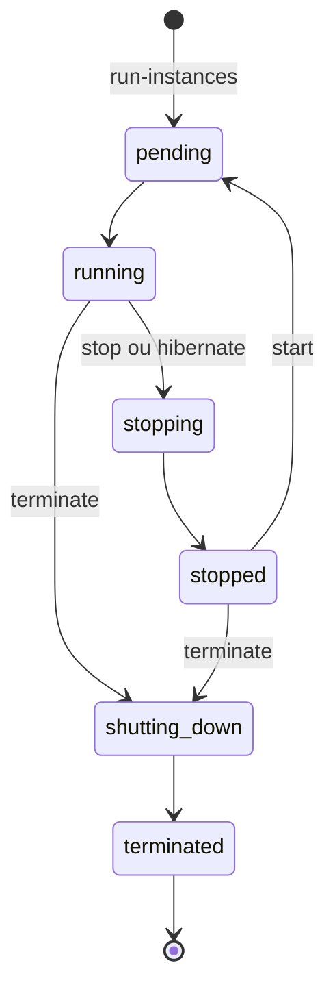

---
aliases:
  - Aula 9.4
modulo: 9
aula: 4
parte: "III Computação e armazenamento"
dominios:
  - 1
  - 3
  - 4
lida: false
tags:
  - aula
  - saa-c03
  - modulo-09
---

# Aula 9.4: Ciclo de vida, user data e metadados

[[09 - EC2 a Fundo|Voltar ao módulo]]

> [!question] Pergunta que esta aula responde
> O que acontece com a máquina, os endereços, o disco e a conta em cada estado (reboot, stop, [[Hibernacao de EC2|hibernate]], terminate), como uma instância se configura sozinha ao nascer (*[[User Data|user data]]*), como ela descobre quem é e pega credenciais (o [[Instance Metadata Service|serviço de metadados]], IMDSv2) e como o launch template guarda tudo isso para repetir?

## Por que o ciclo de vida importa

Uma instância não é um servidor sagrado: ela nasce, trabalha e morre, e a arquitetura boa trata isso como normal. A mesma lógica explica três assuntos desta aula. O **estado** decide o que você paga e o que sobrevive. O **[[User Data|user data]]** e o **[[Instance Metadata Service|serviço de metadados]]** são o que permite a uma instância genérica, saída de uma [[AMI]], virar o servidor certo sozinha, sem ninguém entrar nela. O **launch template** guarda a receita para repetir o nascimento em escala. Sem entender isso, [[Auto Scaling Group|Auto Scaling]] e [[Infraestrutura Imutavel]] viram palavras soltas.

## Os estados e o que cada um cobra

A documentação (verificado em novembro de 2026) define estes estados:

| Estado | Significado | Cobra a instância? |
|---|---|---|
| `pending` | Preparando-se para rodar (lançamento ou início depois de parada) | Não |
| `running` | Rodando e pronta | **Sim** |
| `stopping` | Preparando-se para parar | Não (**exceto** ao hibernar, quando cobra) |
| `stopped` | Desligada; pode ser iniciada de novo | Não |
| `shutting-down` | Preparando-se para ser terminada | Não |
| `terminated` | Apagada para sempre | Não |

E dois fatos de cobrança que a prova usa:

- A cobrança começa quando a instância chega a `running`, **por segundo, com mínimo de um minuto** cada vez que ela inicia. Parar e iniciar 20 vezes em um dia gera 20 cobranças mínimas de 60 segundos.
- **Recursos que continuam cobrando mesmo com a instância parada**: volumes [[EBS]] e [[Elastic IP]]. Parar corta computação, não armazenamento. [[Reserved Instance|Reserved Instances]] aplicadas a instâncias terminadas continuam cobrando até o fim do prazo.

### Reboot, stop, hibernate e terminate lado a lado

A tabela do ciclo de vida é uma das mais cobradas desta aula:

| Característica | Reboot | Stop/start | [[Hibernacao de EC2\|Hibernate]] | Terminate |
|---|---|---|---|---|
| Host físico | Mesmo | Normalmente outro | Normalmente outro | Nenhum |
| [[IPv4]] privado | Mantém | Mantém | Mantém | Perde |
| [[IPv4]] público automático | Mantém | **Novo** | **Novo** | Perde |
| [[Elastic IP]] | Permanece | Permanece | Permanece | Desassocia |
| [[Instance Store]] | **Preservado** | Apagado | Apagado | Apagado |
| Volume raiz | Preservado | Preservado | Preservado | **Apagado por padrão** |
| [[RAM]] | Apagada | Apagada | **Salva no volume raiz** | Apagada |
| Cobrança | Não muda | Para ao chegar em `stopping` | Cobra em `stopping`, para em `stopped` | Para em `shutting-down` |

Três detalhes finos:

- **Reboot** é equivalente a reiniciar o sistema operacional; a AWS recomenda reiniciar pelo [[EC2]], não pelo comando do sistema. Ele **não** inicia um novo período de cobrança.
- **Stop** só existe para instâncias com raiz [[EBS]]. Com a instância parada, você pode **alterar atributos** como o tipo (por isso o [[Rightsizing|rightsizing]] da [[09.02 - Familias Graviton e Burstable|aula 9.2]] exige parar).
- **Terminate**: com a *[[Termination Protection|termination protection]]* ligada, você não consegue terminar por console, CLI ou API. O atributo `InstanceInitiatedShutdownBehavior` define o que acontece quando alguém desliga a máquina por dentro (por exemplo o comando `shutdown`); o padrão é **parar** a instância. E o `DeleteOnTermination` de cada volume define se o disco é apagado: o padrão apaga o raiz e preserva os outros.

> [!example] Parar não é gratuito
> Uma equipe "economiza" parando 10 instâncias `m5.xlarge` à noite, cada uma com um volume de 500 GB. A conta de computação cai, mas os 5 TB de [[EBS]] continuam cobrando as 24 horas, e se cada instância tinha um [[Elastic IP]], esses também continuam. Para ambientes de desenvolvimento, a economia real vem de parar a computação **e** de dimensionar o disco ao necessário (ou usar [[Snapshot|snapshots]] e apagar o volume, no Módulo 10).

O diagrama resume as transições (a [[Hibernacao de EC2|hibernação]] é um `stop` que grava a [[RAM]]):

## Status checks e recuperação automática

Uma instância única pode falhar por dois motivos diferentes, e o [[EC2]] testa cada um (verificado em novembro de 2026, [documentação de recuperação](https://docs.aws.amazon.com/AWSEC2/latest/UserGuide/ec2-instance-recover.html)):

| Verificação | O que testa | Quem resolve |
|---|---|---|
| **System status check** | O host: energia, rede e hardware ou software do [[Hypervisor\|hipervisor]] | A AWS, ou você com a recuperação automática |
| **Instance status check** | O sistema operacional da instância (kernel, rede interna, disco cheio) | Você: reiniciar ou corrigir o SO |

Quando o **[[Status Check|system status check]]** falha, a **recuperação automática** tenta mover a instância para outro host. Para o software dentro da instância é como um reboot inesperado, mas a instância **mantém o ID, o [[RFC 1918|IP privado]], o [[Elastic IP]] e os metadados**; a [[RAM]] é perdida. Existem dois mecanismos: a **[[Simplified Automatic Recovery|simplified automatic recovery]]**, ligada por padrão em instâncias suportadas, e a **ação de recuperação de um [[CloudWatch Alarm|alarme do CloudWatch]]** (`StatusCheckFailed_System`), configurada por você. Falha só do instance status check **não** dispara recuperação: aí é reiniciar. Parar e iniciar também costuma mudar de host, mas o IP público (sem Elastic IP) muda; a recuperação mantém o IP público.

> [!tip] Macete de prova
> "Instância única que deve se recuperar de falha de hardware do host mantendo ID, IP e dados do [[EBS]], sem intervenção": recuperação automática ([[CloudWatch Alarm|alarme do CloudWatch]] com ação recover). Para [[Disponibilidade|disponibilidade]] de **sistema**, a resposta continua sendo [[Auto Scaling Group|Auto Scaling]] e [[Multi-AZ]] (Módulos 12 e 20); a recuperação serve para uma instância avulsa.

## Hibernação: parar sem perder a memória

### O problema

Parar uma instância apaga a [[RAM]]. Uma aplicação que gasta 20 minutos para carregar dados na memória (um cache, um modelo, um ambiente de análise aberto) precisa refazer tudo ao reiniciar. A **[[Hibernacao de EC2|hibernação]]** (*suspend-to-disk*) resolve isso: o sistema operacional congela os processos, **grava o conteúdo da RAM no volume raiz [[EBS]]** e faz um desligamento normal. Ao iniciar de novo, a RAM é recarregada, os processos retomam de onde estavam e os volumes de dados são reanexados, mantendo o mesmo ID de instância.

### Requisitos e limites

Segundo a documentação (verificado em novembro de 2026), a [[Hibernacao de EC2|hibernação]] exige:

- **ser habilitada no lançamento**: não dá para habilitar em instância existente, rodando ou parada;
- **[[AMI]] HVM** compatível (Amazon Linux 2023 e 2, Ubuntu, RHEL e outros em versões listadas; algumas exigem configuração adicional) e uma **família que suporte** o recurso (`M`, `C`, `R`, `T` e outras; instâncias **bare metal não**);
- **[[RAM]] menor que 150 GiB** em Linux (e até 16 GiB em Windows);
- **volume raiz [[EBS]]** (não [[Instance Store|instance store]]), **grande o bastante** para guardar a [[RAM]] mais o sistema, e **criptografado** (o [[EC2]] valida a criptografia ao lançar; para proteger o conteúdo da memória em disco);
- volumes dos tipos **[[gp2]], [[gp3]], io1 ou [[io2]]**;
- para [[Spot Instance|Spot]], requisição **persistente**, sem *launch group*.

Limitações que viram questão:

| Limitação | Consequência |
|---|---|
| [[Instance Store\|Instance store]] é **perdido** na [[Hibernacao de EC2\|hibernação]] | Não guarde nada importante lá |
| **Não** é possível hibernar instância em **[[Auto Scaling Group\|Auto Scaling]] group** nem usada pelo [[ECS]] | O Auto Scaling marca a parada como instância não saudável e pode substituí-la |
| Máximo de **60 dias** hibernada | Depois disso é preciso iniciar, parar e iniciar de novo |
| Instância hibernada **não pode ser modificada** | Diferente de uma parada normal |
| IP público é liberado; **[[Elastic IP]] e IPs privados permanecem** | Elastic IP segue cobrando |
| Cobra o [[EBS]], **inclusive o espaço que guarda a [[RAM]]** | Custo de armazenamento continua |

> [!example] Pré-aquecer uma instância lenta
> A documentação descreve um uso explícito: se uma aplicação demora a "subir" e construir seu estado em memória, lance a instância com [[Hibernacao de EC2|hibernação]] habilitada, deixe-a chegar ao estado desejado e **hiberne**. Quando for preciso, ela retoma pronta, em segundos, em vez de repetir 20 minutos de inicialização. Uma equipe de análise que abre um notebook com 60 GiB carregados na [[RAM]] faz o mesmo à noite: hiberna às 19h, retoma às 8h no mesmo ponto, pagando só o [[EBS]] à noite.

> [!tip] Macete de prova
> "Retomar a aplicação no mesmo estado de memória, sem pagar pela instância enquanto parada" ou "reduzir o tempo de inicialização de uma aplicação com aquecimento longo": **[[EC2]] hibernation** ([[Hibernacao de EC2]]). A pegadinha é o enunciado dizer "[[Auto Scaling Group|Auto Scaling]] group": nesse caso a hibernação não serve, e o caminho é uma [[12 - Balanceamento de Carga e Auto Scaling|configuração diferente]], como [[Warm Pool|warm pools]] (Módulo 12).

## User data: configurar a instância ao nascer

O **[[User Data|user data]]** é um bloco de texto que você passa no lançamento e que a instância executa. Segundo a documentação (verificado em novembro de 2026):

- em Linux são aceitos **scripts de shell** (começam com `#!`) e **diretivas cloud-init**; em Windows, os agentes de inicialização tratam os scripts;
- ele deve ser **codificado em base64** (o console faz isso por você), com limite de **16 KB** em forma bruta;
- **por padrão, roda apenas no primeiro boot**, quando você lança a instância; é possível configurar para rodar a cada reinicialização (no Windows, com `<persist>true</persist>`);
- em Linux, o script roda como **root**, então não use `sudo`; e não pode ser interativo;
- só pode ser alterado com a instância **parada** (e, para o script novo rodar, é preciso configurá-lo para executar a cada início, porque o padrão é só o primeiro boot);
- é um atributo da instância: **não vai para a [[AMI]]** criada a partir dela ([[09.01 - Instancia Nitro e AMI|aula 9.1]]);
- **não é seguro para segredos.** A documentação adverte: o [[User Data|user data]] não é protegido por autenticação nem por criptografia; qualquer software com acesso à instância pode lê-lo. Senhas e chaves de longa duração não entram aí.

A função do [[User Data|user data]] na arquitetura é o complemento da [[AMI]] pronta: a AMI traz o software; o user data traz **o que varia por ambiente ou por instância**: apontar para o [[Bucket|bucket]] certo, registrar a máquina em um serviço, baixar uma configuração. Para segredos, a instância usa o [[Secrets Manager]] ou o [[Parameter Store]] ([[08 - Criptografia e Protecao de Dados|Módulo 8]]), autenticando-se por uma role (próxima seção).

> [!example] Bootstrap curto
> Um [[User Data|user data]] de poucas linhas instala um agente, baixa de um [[Bucket|bucket]] o arquivo de configuração do ambiente atual e inicia o serviço. A [[AMI]] já tinha a aplicação; o script só decide para onde ela aponta. Se o script ultrapassa dezenas de comandos, o sinal é que parte dele deveria estar assada na AMI.

## Instance Metadata Service: a instância descobre quem é

Dentro da instância, um endereço especial responde sobre ela mesma: o **[[Instance Metadata Service]]** (IMDS), em `169.254.169.254` ([[IPv4]]) e `[fd00:ec2::254]` ([[IPv6]], em instâncias [[Nitro]] e [[Sub-rede|sub-redes]] com IPv6). Ele expõe **categorias de metadados** (ID da instância, ID da [[AMI]], tipo, zona, IPs, [[Security Group|security groups]], entre outras), o **[[User Data|user data]]**, **dados dinâmicos** (como o documento de identidade da instância) e os avisos de interrupção de [[Spot Instance|Spot]] (aula 9.6). Também é por onde a instância obtém as **[[Credencial Temporaria|credenciais temporárias]]** da role associada a ela (a *[[Instance Profile|instance profile]]*, [[04 - IAM Identidade e Acesso|Módulo 4]]), renovadas automaticamente: é por isso que seu código na instância chama o [[S3]] sem nenhuma chave gravada.

> [!info] Ligando os pontos
> No Módulo 4 você viu que uma [[IAM Role]] entrega [[Credencial Temporaria|credenciais temporárias]] por [[STS]]. Para o [[EC2]], o veículo é a *[[Instance Profile|instance profile]]* (um [[Container|contêiner]] que liga a role à instância) e o [[Instance Metadata Service|IMDS]] é o canal. O [[Fargate]] e o Lambda têm mecanismos equivalentes ([[Task Role|task role]], execution role).

### IMDSv1 contra IMDSv2

- **[[Instance Metadata Service|IMDSv1]]** é *request/response*: qualquer requisição GET ao endereço recebe a resposta. Simples e vulnerável a ataques de **[[SSRF]]** (*server-side request forgery*), em que uma aplicação com falha é induzida a fazer uma requisição interna e vazar as credenciais.
- **[[Instance Metadata Service|IMDSv2]]** é orientado a **sessão**: primeiro um `PUT` cria um **token** com validade de 1 segundo a **6 horas**, e as consultas seguintes mandam esse token no cabeçalho. O token é **específico da instância** e é rejeitado fora dela. Um proxy ou uma falha de [[SSRF]] comum, que só consegue disparar um GET simples, não obtém o token.

O comportamento efetivo é decidido **no lançamento**, nesta ordem de precedência (verificado em novembro de 2026): primeiro o que a instância (ou o launch template) especifica, depois o **padrão da conta na Região**, depois a **[[AMI]]**. Se nenhum dos três diz nada, a instância aceita **v1 ou v2**. AMIs recentes, como a Amazon Linux 2023, já vêm configuradas para exigir [[Instance Metadata Service|IMDSv2]]. Você pode configurar para **só IMDSv2** (token obrigatório): requisições v1 passam a falhar com `401`. Atenção: SDKs e agentes antigos que só falam IMDSv1 quebram quando o token passa a ser obrigatório. Opções que aparecem na prova e na prática:

| Opção | O que faz |
|---|---|
| **HttpTokens = required** | Só aceita [[Instance Metadata Service\|IMDSv2]] (token obrigatório) |
| **Hop limit** (1 a 64) | Quantos saltos de rede a **resposta ao PUT** pode dar; em **[[Container\|contêineres]]**, limite 1 pode causar problemas, e então se aumenta |
| Configuração por **conta e Região**, por **[[AMI]]** (`imds-support v2.0` define [[Instance Metadata Service\|IMDSv2]] e hop limit 2) ou por **instância** | Ordem de precedência: instância no lançamento, depois conta, depois AMI |
| **Enforcement** na conta | Instâncias com [[Instance Metadata Service\|IMDSv1]] habilitado falham no lançamento |
| Restrição por **[[IAM]] ou [[SCP]]** | Pode impedir que alguém altere as opções |

> [!example] Fechando a porta do SSRF
> Uma aplicação web em [[EC2]] tem uma falha que permite a um atacante pedir que o servidor busque uma URL arbitrária. Com [[Instance Metadata Service|IMDSv1]], o atacante pede `http://169.254.169.254/...` e recebe as credenciais da role. Com **IMDSv2 obrigatório**, o GET simples não tem o token e recebe `401`: o vazamento é bloqueado. A correção é **uma configuração**, aplicável por launch template ou por política de conta, sem mudar o código.

## Launch template: a receita que se repete

Um **launch template** guarda os parâmetros de lançamento: [[AMI]], tipo, par de chaves, [[Sub-rede|sub-rede]], [[Security Group|security groups]], volumes, role, *[[User Data|user data]]*, opções de metadados e tags, para que você não os digite a cada vez. Pontos da documentação (verificado em novembro de 2026):

- cada template tem **versões numeradas**; ao lançar, você escolhe uma versão ou usa a **versão padrão** (por padrão, a primeira);
- uma versão pode ser baseada em outra;
- ele é a unidade que o [[Auto Scaling Group]], o [[EC2 Fleet]] e o [[Spot Instance|Spot]] usam para criar instâncias.

A consequência: para atualizar a frota, você **cria uma nova versão** do template (por exemplo, com uma [[AMI]] nova) e a torna a versão padrão ou a aponta no [[Auto Scaling Group|Auto Scaling]] group; as instâncias novas já nascem na versão nova. A mecânica de substituir as antigas (*[[Instance Refresh|instance refresh]]*) é do [[12 - Balanceamento de Carga e Auto Scaling|Módulo 12]]. O template legado, a *[[Launch Configuration|launch configuration]]*, está descontinuado: novos [[Instance Type|tipos de instância]] não são suportados nela e contas criadas depois de 1º de outubro de 2024 não conseguem criá-la (verificado em novembro de 2026, [documentação do Auto Scaling](https://docs.aws.amazon.com/autoscaling/ec2/userguide/launch-configurations.html)). Questões antigas de simulado ainda citam launch configuration; a resposta atual é sempre launch template.

> [!example] Atualizando a frota com a nova AMI
> A equipe gera uma [[AMI]] nova com o patch de segurança. No launch template, cria a versão 4, trocando só o ID da AMI, e a define como padrão. Na próxima vez que o [[Auto Scaling Group|Auto Scaling]] group escalar, as instâncias novas nascem com a AMI corrigida; um *[[Instance Refresh|instance refresh]]* substitui as antigas. Nada foi corrigido "dentro" de instância viva: o princípio de [[Infraestrutura Imutavel|infraestrutura imutável]].

## Como isso cai na prova

Cobre o **Task 3.2** (computação elástica), o **Task 4.2** ([[Hibernacao de EC2|hibernação]] como estratégia de escala e custo), o **Task 1.2** (credenciais da aplicação, [[Instance Metadata Service|IMDSv2]]) e sustenta o **Task 2.2** ([[Infraestrutura Imutavel|infraestrutura imutável]]).

**Padrões de cenário:**

- Reter o estado de memória sem pagar pela instância parada: [[Hibernacao de EC2|hibernação]].
- Configuração inicial automática por ambiente: [[User Data|user data]].
- Proteger credenciais contra [[SSRF]]: [[Instance Metadata Service|IMDSv2]] obrigatório.
- Atualizar a frota com nova [[AMI]] de forma repetível: nova versão do launch template.
- Aplicação sem chaves fixas chamando outro serviço: role com [[Instance Profile|instance profile]].

**Palavras-chave em inglês:**

| No enunciado | Aponta para |
|---|---|
| "resume with the same in-memory state", "pre-warm" | hibernation |
| "run a script at launch", "bootstrap" | [[User Data\|user data]] |
| "[[SSRF]]", "metadata service", "require session tokens" | [[Instance Metadata Service\|IMDSv2]] (`HttpTokens=required`) |
| "version", "repeatable launch parameters" | launch template |
| "no long-term credentials on the instance" | [[IAM Role\|IAM role]] via [[Instance Profile\|instance profile]] |
| "stopped instances still incurring charges" | [[EBS]] e [[Elastic IP]] |
| "[[Status Check\|system status check]] failed", "recover the instance", "retain instance ID and IP" | [[CloudWatch]] alarm com ação recover |

**Pegadinhas clássicas:**

- **[[Hibernacao de EC2|Hibernação]] não pode ser ligada depois** do lançamento e **não vale para instância em [[Auto Scaling Group|Auto Scaling]] group**.
- **[[User Data|User data]] só roda no primeiro boot** por padrão.
- **[[User Data|User data]] não é segredo.**
- **[[Instance Store|Instance store]] não sobrevive** a stop ou [[Hibernacao de EC2|hibernação]].
- **Parar ainda cobra** [[EBS]] e [[Elastic IP]].

| Requisito no enunciado | Resposta provável | Por quê |
|---|---|---|
| Aplicação retoma com a [[RAM]] intacta, sem custo de instância parada | [[Hibernacao de EC2\|Hibernação]] (habilitada no lançamento, raiz criptografada) | A RAM vai para o [[EBS]] |
| Evitar roubo de credenciais via [[SSRF]] | [[Instance Metadata Service\|IMDSv2]] obrigatório | O token de sessão bloqueia GET simples |
| Passar uma variável de ambiente no lançamento | [[User Data\|User data]] | Roda no primeiro boot |
| Padronizar o lançamento e versionar mudanças | Launch template | Versões numeradas e padrão |
| Instância única deve se recuperar de falha de hardware mantendo ID e IP | Alarme do [[CloudWatch]] com ação recover (ou [[Simplified Automatic Recovery\|simplified automatic recovery]]) | Falha de [[Status Check\|system status check]] migra para outro host |

## Resumo

> [!abstract] A aula em uma frase
> A instância percorre estados em que o [[EC2]] só cobra em `running` (e na [[Hibernacao de EC2|hibernação]]), o [[EBS]] e o [[Elastic IP]] cobram sempre, e ela se configura sozinha com [[User Data|user data]], descobre quem é e pega credenciais pelo [[Instance Metadata Service|IMDSv2]], tudo guardado em um launch template versionado.

**A lógica, em passos**

1. O [[EC2]] cobra por segundo (mínimo de 60 s) em `running`; [[EBS]] e [[Elastic IP]] cobram em qualquer estado.
2. Stop troca de host e apaga [[RAM]] e [[Instance Store|instance store]]; reboot não; terminate apaga o raiz por padrão.
3. [[Hibernacao de EC2|Hibernação]] grava a [[RAM]] no raiz criptografado; precisa ser habilitada no lançamento e não vale em [[Auto Scaling Group|Auto Scaling]].
4. O [[User Data|user data]] roda no primeiro boot, como root, até 16 KB, e não vai na [[AMI]] nem guarda segredos.
5. O [[Instance Metadata Service|IMDS]] informa a instância e entrega [[Credencial Temporaria|credenciais temporárias]]; IMDSv2 exige token e bloqueia [[SSRF]] simples.
6. O launch template versiona a receita; trocar a versão atualiza a frota.

**Números para lembrar**

| O quê | Valor | Por que importa |
|---|---|---|
| Cobrança mínima por início | 60 segundos | Conta de instâncias de vida curta |
| [[Hibernacao de EC2\|Hibernação]], [[RAM]] máxima (Linux) | Menos de 150 GiB | Requisito |
| [[Hibernacao de EC2\|Hibernação]], duração máxima | 60 dias | Limite |
| [[User Data\|User data]] | 16 KB brutos | Limite de script |
| Token do [[Instance Metadata Service\|IMDSv2]] | 1 s a 6 horas | Duração da sessão |

**Tabela-síntese**

| Operação | [[RAM]] | [[Instance Store\|Instance store]] | IP público automático |
|---|---|---|---|
| Reboot | Perde | Mantém | Mantém |
| Stop/start | Perde | Perde | Novo |
| [[Hibernacao de EC2\|Hibernate]] | Salva | Perde | Novo |
| Terminate | Perde | Perde | Perde |

**Na prática, isso significa**

- Habilite [[Hibernacao de EC2|hibernação]] ao lançar, com raiz criptografada, se for precisar dela.
- Use [[User Data|user data]] só para o que varia; assa o resto na [[AMI]].
- Exija [[Instance Metadata Service|IMDSv2]] nos [[Launch Template|launch templates]] e na conta.
- Atualize a frota criando nova versão do template.

> [!tip] Liga com
> Vem da [[09.03 - Rede e Disco da Instancia|aula 9.3]] (IPs e discos em cada estado). Segue para a [[09.05 - Compra Savings Plans e Reserved Instances|aula 9.5]], sobre como pagar pela instância, e para o [[12 - Balanceamento de Carga e Auto Scaling|Módulo 12]], onde o template alimenta o [[Auto Scaling Group|Auto Scaling]].

## Erros comuns

- **Achar que parar elimina todo o custo.** [[EBS]] e [[Elastic IP]] seguem cobrando.
- **Tentar hibernar uma instância já lançada sem [[Hibernacao de EC2|hibernação]] habilitada.** Só dá no lançamento.
- **Esperar que o [[User Data|user data]] rode a cada reboot.** Por padrão, só no primeiro boot.
- **Guardar senha no [[User Data|user data]].** Ele não é protegido por criptografia.
- **Deixar [[Instance Metadata Service|IMDSv1]] ativo em produção.** A falha de [[SSRF]] vira vazamento de credenciais.
- **Esquecer o hop limit em [[Container|contêineres]].** Com limite 1, a resposta do PUT não chega.

## Pratique

**1.** Uma equipe de análise mantém instâncias com 64 GiB de dados carregados na [[RAM]] por sessão de trabalho e quer parar à noite e retomar de manhã exatamente do mesmo ponto, sem pagar pela instância parada. Qual solução atende?

- [ ] a) Parar a instância e, de manhã, reiniciar e recarregar os dados na memória
- [ ] b) Reiniciar a instância (reboot) ao fim do dia para liberar recursos
- [ ] c) Criar uma AMI à noite e lançar uma nova instância de manhã
- [ ] d) Lançar com hibernação e raiz criptografada, e hibernar a instância

**2.** Qual das instâncias abaixo NÃO pode ser hibernada?

- [ ] a) Linux, 64 GiB de RAM, raiz gp3 criptografada, hibernação habilitada no lançamento
- [ ] b) Linux, 200 GiB de RAM, raiz gp3 criptografada, hibernação habilitada no lançamento
- [ ] c) Linux, 16 GiB de RAM, raiz io2 criptografada, hibernação habilitada no lançamento
- [ ] d) Linux, 32 GiB de RAM, raiz gp2 criptografada, hibernação habilitada no lançamento

**3.** Um engenheiro parou a instância, editou o script de [[User Data|user data]], iniciou-a de novo (start) e percebe que o script novo não rodou. O script tem 2 KB e a instância está em uma [[Sub-rede Publica|sub-rede pública]]. Qual é a explicação?

- [ ] a) Por padrão, o user data roda apenas no primeiro boot da instância
- [ ] b) O user data só roda se a instância estiver em uma sub-rede privada
- [ ] c) O stop apaga o user data da instância, que precisa ser recriado
- [ ] d) O script excedeu o limite de 16 KB e foi descartado em silêncio

**4.** Uma aplicação web em [[EC2]] tem risco de [[SSRF]] e a empresa quer impedir o roubo de credenciais da role pelo [[Instance Metadata Service|serviço de metadados]], sem alterar o código. O que fazer?

- [ ] a) Mover a aplicação para uma sub-rede pública com security group restrito
- [ ] b) Remover a role da instância e gravar as chaves de acesso no user data
- [ ] c) Exigir IMDSv2 (token obrigatório) em todas as instâncias da frota
- [ ] d) Desativar o DNS da VPC para impedir consultas ao endereço de metadados

**5.** Sobre a [[Hibernacao de EC2|hibernação]] de [[EC2|instâncias EC2]], quais DUAS afirmações são verdadeiras? (Escolha DUAS.)

- [ ] a) O conteúdo da RAM é salvo no volume raiz EBS
- [ ] b) A hibernação pode ser habilitada depois, em instâncias já em execução
- [ ] c) Os dados do instance store são preservados durante a hibernação
- [ ] d) O volume raiz precisa ser criptografado
- [ ] e) A hibernação é suportada para instâncias dentro de um Auto Scaling group

**6.** Uma aplicação em [[Container|contêineres]], rodando em [[EC2|instâncias EC2]] com [[Instance Metadata Service|IMDSv2]] obrigatório, não consegue obter credenciais do serviço de metadados dentro do contêiner, embora funcione no host. Qual ajuste resolve?

- [ ] a) Trocar o tipo de instância por um com mais vCPUs disponíveis na conta
- [ ] b) Aumentar o hop limit da resposta do serviço de metadados
- [ ] c) Desabilitar a verificação de origem e destino da ENI
- [ ] d) Habilitar o monitoramento detalhado da instância

**7.** Uma empresa para 20 instâncias de desenvolvimento todas as noites para economizar. Mesmo assim a fatura de [[EC2]] continua alta. Qual recurso ainda gera custo com as instâncias paradas?

- [ ] a) Os vCPUs, que são reservados em nome da conta
- [ ] b) O endereço IPv4 privado de cada instância
- [ ] c) O tráfego de entrada da internet
- [ ] d) Os volumes EBS e os Elastic IPs associados

**8.** Uma equipe gera uma nova [[AMI]] com um patch de segurança e quer que as instâncias novas do [[Auto Scaling Group|Auto Scaling]] group nasçam com ela, de forma versionada e repetível. O que fazer?

- [ ] a) Criar nova versão do launch template com a AMI nova, como padrão
- [ ] b) Entrar em cada instância existente e aplicar o patch manualmente
- [ ] c) Alterar o user data para baixar o patch a cada boot, sem tocar na AMI
- [ ] d) Criar um novo Auto Scaling group para cada patch e apagar o anterior

**9.** Uma instância é iniciada, roda por 20 segundos e é parada. Qual cobrança de computação ocorre?

- [ ] a) Nenhuma, pois menos de um minuto não é cobrado
- [ ] b) Uma hora cheia de instância
- [ ] c) Sessenta segundos, o mínimo por início
- [ ] d) Vinte segundos, sem mínimo algum

**10.** Sobre [[User Data|user data]], quais DUAS afirmações são verdadeiras? (Escolha DUAS.)

- [ ] a) O user data é incluído automaticamente na AMI criada a partir da instância
- [ ] b) Em Linux, os scripts de user data rodam como root
- [ ] c) O user data é um lugar seguro para guardar senhas, pois é criptografado
- [ ] d) O user data pode ser editado enquanto a instância está em execução
- [ ] e) O limite é de 16 KB em forma bruta, antes da codificação em base64

**11.** Um usuário executa o comando `shutdown` dentro do sistema operacional de uma instância com raiz [[EBS]], sem alterar nenhuma configuração. O que acontece por padrão?

- [ ] a) A instância é parada e passa ao estado stopped
- [ ] b) A instância é terminada e o volume raiz é apagado
- [ ] c) A instância é hibernada automaticamente
- [ ] d) A instância é reiniciada em outro host

**12.** Uma aplicação em [[EC2]] precisa ler objetos de um [[Bucket|bucket]] do [[S3]] sem ter [[Access Key|chaves de acesso]] gravadas na instância. Qual é a abordagem correta?

- [ ] a) Gravar as chaves de um usuário IAM no user data, em base64
- [ ] b) Colocar as chaves em variáveis de ambiente dentro da AMI base
- [ ] c) Associar uma IAM role à instância (instance profile)
- [ ] d) Tornar o bucket público para dispensar autenticação

**13.** Um servidor legado roda em uma única [[EC2|instância EC2]], sem [[Auto Scaling Group|Auto Scaling]], e precisa se recuperar automaticamente de uma falha de hardware do host mantendo o ID da instância, o [[RFC 1918|IP privado]] e o [[Elastic IP]], com o menor [[Overhead Operacional|esforço operacional]]. O que configurar?

- [ ] a) Um alarme do CloudWatch na métrica de system status check com a ação recover
- [ ] b) Um alarme de CPU que dispara uma função Lambda para lançar uma nova instância
- [ ] c) Um Auto Scaling group com mínimo e máximo de 1 instância e uma AMI nova a cada falha
- [ ] d) Um snapshot diário do EBS e restauração manual em outra instância quando houver falha

> [!success]- Gabarito
> **1. d)** A [[Hibernacao de EC2|hibernação]] grava a [[RAM]] no raiz criptografado e retoma no mesmo ponto, sem pagar a instância parada; a) perde a memória, b) reboot não para a cobrança nem preserva o estado de forma útil, c) uma nova instância começa sem a memória.
> **2. b)** Linux com 150 GiB ou mais de [[RAM]] não pode hibernar (200 GiB excede); a) 64 GiB está abaixo do limite, com raiz [[gp3]] criptografada; c) 16 GiB com [[io2]] criptografado também atende (io2 é tipo aceito); d) [[gp2]] é tipo aceito e 32 GiB está abaixo do limite.
> **3. a)** O [[User Data|user data]] roda só no primeiro boot por padrão (start não é primeiro boot); b) não há dependência de [[Sub-rede Privada|sub-rede privada]], c) o stop não apaga o user data, que fica como atributo da instância, d) 2 KB está abaixo do limite de 16 KB.
> **4. c)** [[Instance Metadata Service|IMDSv2]] exige token de sessão e bloqueia o GET simples de uma falha de [[SSRF]]; a) [[Sub-rede Publica|sub-rede pública]] não protege o metadados, b) chaves no [[User Data|user data]] são pior prática, d) o endereço de metadados não depende do [[DNS]] da [[VPC]].
> **5. a) e d)** A [[RAM]] vai para o raiz [[EBS]], que deve ser criptografado; b) é falso (só no lançamento), c) é falso ([[Instance Store|instance store]] é perdido), e) é falso (não é suportado em [[Auto Scaling Group|Auto Scaling]] group).
> **6. b)** Em [[Container|contêineres]], o hop limit 1 impede a resposta do PUT de chegar ao contêiner; aumentá-lo resolve; a) [[vCPU|vCPUs]] não têm relação, c) a verificação de origem e destino é de roteamento, d) o [[Detailed Monitoring|monitoramento detalhado]] não afeta o metadados.
> **7. d)** [[EBS]] e [[Elastic IP]] cobram com a instância parada; a) [[vCPU|vCPUs]] não são cobrados parados, b) o [[RFC 1918|IP privado]] não tem cobrança, c) não é um custo de instância parada.
> **8. a)** Nova versão do launch template com a [[AMI]] nova, definida como padrão, é versionada e repetível; b) manual e frágil, c) baixar patches a cada boot atrasa o lançamento e foge da imutabilidade, d) criar um grupo por patch é desnecessário.
> **9. c)** Há cobrança por segundo com mínimo de 60 segundos por início; a) existe cobrança mínima, b) não é por hora cheia, d) o mínimo de 60 s se aplica.
> **10. b) e e)** O script roda como root e o limite bruto é de 16 KB; a) é falso (não vai na [[AMI]]), c) é falso (não é protegido), d) é falso (só editável com a instância parada).
> **11. a)** O padrão do `InstanceInitiatedShutdownBehavior` é parar a instância; b) só ocorre se configurado para terminar, c) hibernar exige comando próprio e habilitação, d) shutdown não reinicia.
> **12. c)** A role com [[Instance Profile|instance profile]] entrega [[Credencial Temporaria|credenciais temporárias]] renovadas automaticamente; a) grava credenciais de longo prazo em um atributo que não é protegido, b) variáveis na [[AMI]] são credenciais de longo prazo copiadas para toda instância, d) tornar o [[Bucket|bucket]] público expõe os dados a qualquer um.
> **13. a)** A ação recover move a instância para outro host mantendo ID, [[RFC 1918|IP privado]] e [[Elastic IP]], sem código; b) lança uma instância nova com outro ID e IP privado e dá mais trabalho, c) um [[Auto Scaling Group|Auto Scaling]] group substitui a instância (novo ID) e muda o desenho, d) restauração manual é lenta e também gera nova instância.

### Laboratório (opcional): user data e IMDSv2

> [!warning] Use uma conta AWS pessoal
> Faça isto apenas em uma **[[Conta AWS|conta AWS]] pessoal separada**, com [[Budgets|AWS Budgets]] configurado. **Nunca na conta de produção da empresa.** Apague a instância no mesmo dia.

Custo estimado: centavos (uma instância `t3.micro` por poucos minutos).

1. Lance uma instância Amazon Linux com **[[User Data|user data]]** que grave uma linha em um arquivo (`#!/bin/bash` e `echo ola > /tmp/ola.txt`) e com **[[Instance Metadata Service|IMDSv2]] obrigatório** (opção de metadados `HttpTokens=required`, no console ou com `--metadata-options HttpTokens=required` na CLI).
2. Conecte e confirme ([[Session Manager]] exige uma role com a política `AmazonSSMManagedInstanceCore` na instância; SSH exige uma regra de entrada na porta 22 no [[Security Group|security group]]) que `/tmp/ola.txt` existe: o [[User Data|user data]] rodou no primeiro boot.
3. Peça o metadados com token: `TOKEN=$(curl -X PUT "http://169.254.169.254/latest/api/token" -H "X-aws-ec2-metadata-token-ttl-seconds: 21600")` e depois `curl -H "X-aws-ec2-metadata-token: $TOKEN" http://169.254.169.254/latest/meta-data/instance-id`.
4. Tente sem o token e observe o erro `401`. (Em ambientes reais, exigir só [[Instance Metadata Service|IMDSv2]] quebra SDKs e agentes antigos que usam IMDSv1.)
5. **Limpeza:** termine a instância.

## Para aprofundar

- [ ] [Amazon EC2 instance state changes](https://docs.aws.amazon.com/AWSEC2/latest/UserGuide/ec2-instance-lifecycle.html) (AWS Documentation): estados, cobrança por estado e tabela reboot, stop, [[Hibernacao de EC2|hibernate]] e terminate.
- [ ] [Hibernate your Amazon EC2 instance](https://docs.aws.amazon.com/AWSEC2/latest/UserGuide/Hibernate.html) (AWS Documentation): funcionamento, pré-requisitos e limitações da [[Hibernacao de EC2|hibernação]].
- [ ] [Run commands when you launch an EC2 instance with user data input](https://docs.aws.amazon.com/AWSEC2/latest/UserGuide/user-data.html) (AWS Documentation): regras e limites do [[User Data|user data]].
- [ ] [Configure the Instance Metadata Service options](https://docs.aws.amazon.com/AWSEC2/latest/UserGuide/configuring-instance-metadata-options.html) (AWS Documentation): [[Instance Metadata Service|IMDSv2]], hop limit, precedência e enforcement.

Próxima aula: [[09.05 - Compra Savings Plans e Reserved Instances|Aula 9.5: opções de compra I, Savings Plans e Reserved Instances]].
