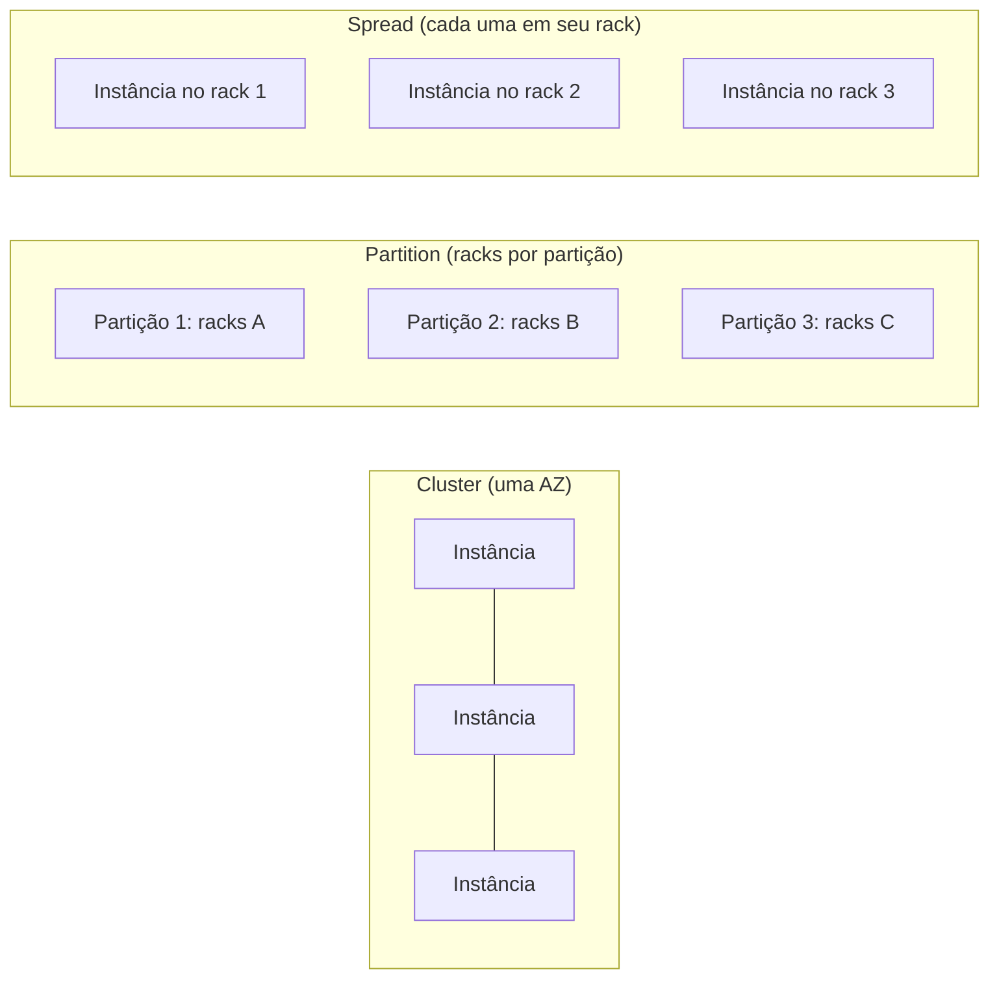

---
aliases:
  - Aula 9.7
modulo: 9
aula: 7
parte: "III Computação e armazenamento"
dominios:
  - 2
  - 3
lida: false
tags:
  - aula
  - saa-c03
  - modulo-09
---

# Aula 9.7: Placement Groups

[[09 - EC2 a Fundo|Voltar ao módulo]]

> [!question] Pergunta que esta aula responde
> Por padrão a AWS decide em qual hardware cada instância cai. Quando vale a pena tomar essa decisão em vez dela, para ter [[Latencia|latência]] mínima entre as instâncias (cluster), isolar falhas por grupo de racks (partition) ou impedir que duas instâncias críticas dividam o mesmo hardware (spread)?

## Por que isso importa: a posição física afeta velocidade e falha

Uma instância roda em um servidor físico, dentro de um rack, dentro de um datacenter de uma [[Zona de Disponibilidade]]. Dois efeitos dependem dessa posição:

- **[[Latencia|Latência]] e [[Throughput|vazão]] entre instâncias.** Quanto mais perto (mesmo rack, mesma rede interna), menor a latência e maior a banda. Cargas que trocam muitos dados entre nós, como simulações, querem **proximidade**.
- **Falha correlacionada.** Se um servidor ou rack falha (energia, rede do rack), todas as instâncias ali caem juntas. Cargas críticas querem **distância**.

São desejos **opostos**, e o *[[Placement Group|placement group]]* é o controle que escolhe um lado: você diz à AWS qual estratégia de posicionamento usar. Não custa nada adicional, mas tem regras e limites. Por padrão, sem grupo, a AWS tenta espalhar as instâncias para reduzir falhas correlacionadas.

## As três estratégias

| Estratégia | Posicionamento | Objetivo | Risco |
|---|---|---|---|
| **Cluster** | Instâncias **próximas**, em uma só [[Zona de Disponibilidade\|AZ]], na mesma rede de alta velocidade | [[Latencia\|Latência]] mínima e [[Throughput\|vazão]] máxima | Falha correlacionada (tudo junto) |
| **Partition** | Instâncias divididas em **partições**, cada uma em racks diferentes | Isolar falhas por partição em cargas distribuídas grandes | Falha derruba uma partição inteira |
| **Spread** | Cada instância em **hardware distinto** (racks separados) | Reduzir o risco de falha simultânea de poucas instâncias críticas | Limite pequeno de instâncias |

### Cluster: tudo perto

Um **[[Placement Group|cluster placement group]]** empacota as instâncias **em uma única [[Zona de Disponibilidade|AZ]]**, com baixa [[Latencia|latência]] de rede e alta [[Throughput|vazão]] entre elas (segundo a documentação, o tráfego de um único fluxo pode chegar a 10 Gbps dentro do grupo, contra 5 Gbps fora; confirme os números atuais por tipo). É a base da **computação de alto desempenho**, de simulações e de treinamento distribuído, combinado com instâncias de rede rápida e o **[[EFA]]** ([[09.03 - Rede e Disco da Instancia|aula 9.3]]).

Cuidados:

- **Uma [[Zona de Disponibilidade|AZ]] só**: todos os nós compartilham o destino do rack e da zona. Não serve para [[Alta Disponibilidade|alta disponibilidade]].
- **Lance todas as instâncias de uma vez, do mesmo tipo**, e de preferência em uma só requisição. Acrescentar depois pode falhar por **falta de capacidade** (*insufficient capacity*) naquele ponto; nesse caso, pare e reinicie as instâncias, ou tente de novo.
- Use tipos que suportem rede avançada.

> [!example] Simulação de dinâmica de fluidos
> Um laboratório roda uma simulação em que 64 nós trocam dados a cada passo de cálculo. Em instâncias espalhadas, a [[Latencia|latência]] entre nós atrasa cada passo. Em um [[Placement Group|cluster placement group]] com instâncias `c5n` e [[EFA]], os nós conversam com latência mínima e a simulação termina em uma fração do tempo. O preço é que, se o rack falhar, ele recomeça de um checkpoint.

### Partition: grupos de racks isolados

Um **[[Placement Group|partition placement group]]** divide as instâncias em **partições** (até **7 por [[Zona de Disponibilidade|AZ]]**). Cada partição fica em **racks próprios**, que não são compartilhados com outras partições. Uma falha de rack afeta, no máximo, **uma partição**. Pode ter centenas de instâncias e pode **abranger várias AZs** da mesma Região.

As instâncias podem consultar em qual partição estão (pelos metadados). Isso permite que **aplicações que replicam dados por conta própria**, como **[[HDFS]], HBase, Cassandra e [[Apache Kafka|Kafka]]**, coloquem cada réplica em uma partição diferente: uma falha de rack não elimina todas as cópias.

> [!example] Réplicas do Cassandra
> Um cluster de 90 nós Cassandra usa 3 partições de 30 nós. A aplicação sabe a partição de cada nó e posiciona as réplicas do mesmo dado em partições diferentes. Se um rack cair, só uma partição é afetada e as outras duas réplicas continuam servindo.

### Spread: cada uma em seu canto

Um **[[Placement Group|spread placement group]]** coloca cada instância em **hardware distinto** (cada uma em seu próprio rack, com rede e energia separadas). É para **poucas instâncias críticas** que não podem falhar juntas.

- Limite de **7 instâncias em execução por [[Zona de Disponibilidade|AZ]] por grupo**.
- **Pode abranger várias [[Zona de Disponibilidade|AZs]]** da mesma Região, o que o torna o único modo que combina com [[Alta Disponibilidade|alta disponibilidade]] entre zonas.
- Existe o nível *rack* (padrão) e o nível *host* (disponível só em Outposts).

> [!example] Três nós de um cluster crítico
> Uma empresa roda três nós de um sistema de coordenação (como um quórum) que precisa de maioria para continuar. Colocar os três no mesmo servidor tornaria uma falha de hardware fatal. Em um spread group, cada nó fica em hardware distinto, e a perda de um rack derruba no máximo um nó.

> [!example] A conta do spread: quantas instâncias cabem
> Em uma Região com três [[Zona de Disponibilidade|AZs]], um [[Placement Group|spread placement group]] comporta 3 x 7 = **21 instâncias** em execução. Uma empresa precisa de 9 nós críticos **em uma única AZ**: a oitava instância não lança. A saída é usar **dois spread groups** (7 + 2) na mesma AZ, ou trocar para **partition** se os nós replicam dados por conta própria. Com partition, 9 nós cabem em 3 partições de 3, e cada partição fica em racks próprios.

### Como a AWS decide por dentro

Um rack tem energia e rede de topo próprias. O que o [[Placement Group|placement group]] faz é dar uma regra ao agendador de capacidade da AWS: no **cluster**, ele procura um conjunto de servidores no mesmo segmento de rede de alta banda e, se não houver espaço contíguo para todas as instâncias, a requisição falha com *insufficient capacity*, por isso se lança tudo de uma vez e com o mesmo tipo. No **spread** e no **partition**, o agendador procura hardware que **não compartilhe rack** com os já usados; se não existir hardware distinto livre, falha. Em ambos os casos a AWS libera mais hardware com o tempo, então repetir depois costuma funcionar. A **falha é a assinatura da restrição**: o grupo prometeu proximidade ou distância e prefere recusar a quebrar a promessa.

## Regras e limites que a prova cobra

| Regra | Detalhe |
|---|---|
| Nome do grupo | Único por conta e por Região |
| Escopo | O grupo pertence a **uma Região**; cluster fica em **uma [[Zona de Disponibilidade\|AZ]]**; partition e spread podem usar várias AZs |
| Limite do spread | **7 instâncias em execução por [[Zona de Disponibilidade\|AZ]] por grupo** |
| Limite do partition | **7 partições por [[Zona de Disponibilidade\|AZ]]** |
| **Mesclar grupos** | **Não é possível** |
| Mover uma instância existente | Possível: **pare**, altere o grupo (por CLI ou SDK) e **inicie** de novo |
| Custo do recurso | **Sem custo extra** |
| Tipos que **não** entram no cluster | [[Credito de CPU\|Burstable]] (T), Mac1 e M7i-flex (verificado em novembro de 2026, [documentação de placement groups](https://docs.aws.amazon.com/AWSEC2/latest/UserGuide/placement-strategies.html)) |
| Cluster entre [[VPC\|VPCs]] | Pode abranger **VPCs em peering da mesma Região** |
| Garantir capacidade no **cluster** | Use uma **[[Capacity Reservation\|On-Demand Capacity Reservation]] dentro do [[Placement Group\|cluster placement group]]**; [[Reserved Instance\|RI]] zonal **não** reserva capacidade em placement group |
| [[Capacity Reservation]] em **spread** e **partition** | **Não** reserva capacidade nesses dois |
| [[Dedicated Instance\|Dedicated Instances]] | Spread **não** é suportado; partition aceita no máximo **2 partições** |
| Falta de hardware distinto (spread e partition) | O lançamento ou início **falha**; tente de novo mais tarde |

Para comparar, três perguntas resolvem a maioria dos casos:

| Pergunta | Resposta |
|---|---|
| A carga precisa de **[[Latencia\|latência]] e [[Throughput\|vazão]] máximas** entre nós? | Cluster |
| A carga é **grande e distribuída**, com réplicas próprias, e quer isolar falhas por rack? | Partition |
| São **poucas instâncias críticas** que devem ficar em hardware separado? | Spread |

> [!tip] Macete de prova
> **Baixa [[Latencia|latência]] e alta [[Throughput|vazão]] entre instâncias (HPC)**: cluster. **Big data distribuído com réplicas (Hadoop, Cassandra, [[Apache Kafka|Kafka]])**: partition. **Poucas instâncias críticas isoladas, máximo de 7 por [[Zona de Disponibilidade|AZ]]**: spread. Ao ver "[[Alta Disponibilidade|alta disponibilidade]] entre AZs", cluster está fora (é uma AZ só).

> [!info] Ligando os pontos
> [[Placement Group|Placement group]] é o controle de **posição**; o [[Auto Scaling Group|Auto Scaling]] group ([[12 - Balanceamento de Carga e Auto Scaling|Módulo 12]]) é o controle de **quantidade**, e os dois podem ser usados juntos (o ASG lança instâncias dentro de um placement group). A resiliência [[Multi-AZ|multi-AZ]] do [[20 - Alta Disponibilidade e Recuperacao de Desastres|Módulo 20]] continua sendo a defesa contra a perda de uma zona inteira; spread e partition protegem contra falhas **dentro** de uma zona.

## Como isso cai na prova

Cobre o **Task 2.2** (arquiteturas tolerantes a falha) e o **Task 3.2** (computação de alto desempenho).

**Padrões de cenário:**

- HPC com troca intensa entre nós: cluster, com [[EFA]].
- Aplicação distribuída e replicada que quer isolar falhas por rack: partition.
- Poucas instâncias críticas que não podem dividir hardware: spread.
- "Falha de um rack não pode derrubar todas as réplicas": partition ou spread.

**Palavras-chave em inglês:**

| No enunciado | Aponta para |
|---|---|
| "low-latency", "high network [[Throughput\|throughput]]", "tightly coupled" | [[Placement Group\|cluster placement group]] |
| "Hadoop", "Cassandra", "[[Apache Kafka\|Kafka]]", "rack awareness" | [[Placement Group\|partition placement group]] |
| "small number of critical instances", "separate hardware" | [[Placement Group\|spread placement group]] |
| "single [[Zona de Disponibilidade\|AZ]]" com "HPC" | cluster |

**Pegadinhas clássicas:**

- **Cluster fica em uma [[Zona de Disponibilidade|AZ]] só**: não dá [[Alta Disponibilidade|alta disponibilidade]].
- **Spread aceita no máximo 7 instâncias por [[Zona de Disponibilidade|AZ]]** por grupo.
- **Não dá para mesclar grupos**; para mudar, pare e mova a instância.
- **Falta de capacidade** ao acrescentar instâncias a um cluster: lance todas juntas.
- [[Placement Group|Placement group]] **não custa** nada extra.

| Requisito no enunciado | Resposta provável | Por quê |
|---|---|---|
| Simulação com 100 nós, [[Latencia\|latência]] mínima | Cluster | Mesma rede e rack |
| Cluster [[Apache Kafka\|Kafka]] de 60 nós, falha de rack isolada | Partition | Racks separados por partição |
| 4 nós de banco crítico em hardware separado | Spread | Cada um em seu rack |
| [[Alta Disponibilidade\|Alta disponibilidade]] entre [[Zona de Disponibilidade\|AZs]] com poucas instâncias | Spread ([[Multi-AZ\|multi-AZ]]) | Cluster não abrange AZs |

## Resumo

> [!abstract] A aula em uma frase
> [[Placement Group|Placement group]] escolhe a posição física das instâncias: cluster junta tudo em uma [[Zona de Disponibilidade|AZ]] para [[Latencia|latência]] mínima, partition separa grupos de racks para isolar falhas em cargas distribuídas e spread põe cada instância em hardware distinto (até 7 por AZ) para proteger poucas instâncias críticas.

**A lógica, em passos**

1. A posição física afeta [[Latencia|latência]] (proximidade ajuda) e falha (proximidade prejudica).
2. Cluster: uma [[Zona de Disponibilidade|AZ]], [[Latencia|latência]] e [[Throughput|vazão]] máximas, risco correlacionado, base do HPC.
3. Partition: até 7 partições por [[Zona de Disponibilidade|AZ]], racks separados, para [[HDFS]], Cassandra, [[Apache Kafka|Kafka]].
4. Spread: hardware distinto, 7 instâncias por [[Zona de Disponibilidade|AZ]] por grupo, pode usar várias AZs.
5. Lance o cluster de uma vez e com o mesmo tipo para evitar falta de capacidade.
6. Grupos não se mesclam; instância existente muda de grupo parando-a.

**Números para lembrar**

| O quê | Valor | Por que importa |
|---|---|---|
| Spread, instâncias por [[Zona de Disponibilidade\|AZ]] por grupo | 7 | Limite clássico |
| Partition, partições por [[Zona de Disponibilidade\|AZ]] | 7 | Limite clássico |
| Custo de um [[Placement Group\|placement group]] | Zero | Sem custo extra |

**Tabela-síntese**

| | Cluster | Partition | Spread |
|---|---|---|---|
| [[Zona de Disponibilidade\|AZs]] | Uma | Várias | Várias |
| Objetivo | [[Latencia\|Latência]] | Isolar falha por rack | Isolar cada instância |
| Escala | Centenas | Centenas | Até 7 por [[Zona de Disponibilidade\|AZ]] |
| Caso típico | HPC | Big data replicado | Quórum crítico |

**Na prática, isso significa**

- Para HPC, junte cluster, [[EFA]] e tipos de rede rápida, com checkpoints.
- Para big data replicado, use partition e deixe a aplicação distribuir as réplicas.
- Para poucos nós críticos, use spread, de preferência em várias [[Zona de Disponibilidade|AZs]].

> [!tip] Liga com
> Vem da [[09.06 - Spot Dedicated e Capacity Reservations|aula 9.6]]. Segue para a [[09.08 - AWS Batch e Computacao de Alto Desempenho|aula 9.8]], onde cluster e [[EFA]] aparecem em HPC, e para o [[20 - Alta Disponibilidade e Recuperacao de Desastres|Módulo 20]].

## Erros comuns

- **Usar cluster para [[Alta Disponibilidade|alta disponibilidade]].** Ele concentra tudo em uma [[Zona de Disponibilidade|AZ]].
- **Exceder 7 instâncias por [[Zona de Disponibilidade|AZ]] em um spread group.** O lançamento falha.
- **Acrescentar instâncias ao cluster com tipos diferentes e aos poucos.** Aumenta o risco de falta de capacidade.
- **Esperar mesclar dois grupos.** Não é possível.
- **Achar que [[Placement Group|placement group]] tem custo.** Não tem.

## Pratique

**1.** Uma equipe científica roda uma simulação em que 80 nós trocam dados a cada passo e precisa da menor [[Latencia|latência]] possível entre eles. Qual configuração atende?

- [ ] a) Cluster placement group, com instâncias de rede rápida e EFA na mesma AZ
- [ ] b) Partition placement group com 7 partições distribuídas em 3 AZs
- [ ] c) Spread placement group abrangendo 3 AZs, com 21 instâncias no total
- [ ] d) Instâncias comuns em várias AZs, atrás de um Network Load Balancer

**2.** Uma empresa roda um cluster [[Apache Kafka|Kafka]] de 60 nós, em que a própria aplicação replica os dados, e quer que a falha de um rack nunca elimine todas as réplicas de um mesmo dado. Qual estratégia de posicionamento atende?

- [ ] a) Cluster placement group, para manter os nós próximos e acelerar a replicação
- [ ] b) Partition placement group, com cada réplica em uma partição diferente
- [ ] c) Spread placement group com os 60 nós em uma única AZ
- [ ] d) Auto Scaling group em várias AZs, sem placement group

**3.** Uma empresa roda quatro nós de um banco crítico que não podem falhar juntos por problema de hardware, e quer que cada nó fique em um rack diferente. Qual opção atende?

- [ ] a) Cluster placement group, para os nós ficarem na mesma rede de alta velocidade
- [ ] b) Partition placement group com uma única partição para os quatro nós
- [ ] c) Spread placement group, com cada nó em hardware distinto
- [ ] d) Os quatro nós em um mesmo Dedicated Host, para ter hardware exclusivo

**4.** Os 9 nós de um banco replicado precisam rodar em uma única [[Zona de Disponibilidade|AZ]], e a aplicação usa a informação de partição para posicionar as réplicas e isolar falhas de rack. Qual opção atende sem falhar o lançamento?

- [ ] a) Um spread placement group com os 9 nós na AZ
- [ ] b) Um cluster placement group com os 9 nós, lançados de uma só vez
- [ ] c) Três spread placement groups com 3 nós cada, sem informação de partição
- [ ] d) Um partition placement group com 3 partições de 3 nós cada

**5.** Sobre as regras de [[Placement Group|placement groups]], quais DUAS afirmações são verdadeiras? (Escolha DUAS.)

- [ ] a) Um cluster placement group pode abranger várias AZs da mesma Região
- [ ] b) Um spread placement group suporta no máximo 7 instâncias em execução por AZ
- [ ] c) É possível mesclar dois placement groups em um só
- [ ] d) Uma instância existente muda de grupo se for parada, tiver o grupo alterado e for iniciada de novo
- [ ] e) Placement groups têm cobrança adicional por hora

**6.** Uma equipe de HPC precisa garantir a capacidade de 40 nós em um [[Placement Group|cluster placement group]] antes de um pico de uso, sem depender de haver espaço no dia. Qual recurso atende?

- [ ] a) Reservas de Reserved Instances zonais para os 40 nós, que reservam a vaga dentro do grupo
- [ ] b) Uma On-Demand Capacity Reservation criada dentro do cluster placement group
- [ ] c) Um Compute Savings Plan cobrindo o gasto dos 40 nós
- [ ] d) Uma Capacity Reservation comum, sem relação com o grupo, em outra AZ

**7.** Uma equipe tem 50 nós rodando em um [[Placement Group|cluster placement group]] e, ao lançar mais 10, recebe erro de capacidade insuficiente. Qual ação costuma resolver?

- [ ] a) Trocar o grupo para spread, que aceita lançamentos ao longo do tempo
- [ ] b) Aumentar a quota de vCPU do grupo Standard na Região
- [ ] c) Parar e iniciar todas as instâncias do grupo e tentar o lançamento de novo
- [ ] d) Lançar os 10 nós em um tipo diferente do usado nos 50 já existentes

**8.** Uma equipe tenta criar um [[Placement Group|cluster placement group]] com instâncias `t3.medium` e o lançamento é recusado. Qual é a causa?

- [ ] a) Instâncias burstable T não são suportadas em cluster placement groups
- [ ] b) O cluster exige que a otimização de EBS esteja desabilitada nas instâncias
- [ ] c) O cluster placement group exige tenancy dedicada em todas as instâncias
- [ ] d) A quota de vCPUs do grupo Standard impede lançamentos em placement groups

**9.** Uma empresa em uma Região com 3 [[Zona de Disponibilidade|AZs]] roda quatro nós de um sistema de coordenação e quer sobreviver à falha de um rack e também à falha de uma AZ inteira. Qual opção atende?

- [ ] a) Um cluster placement group com os nós distribuídos nas 3 AZs
- [ ] b) Um cluster placement group em uma AZ, com Capacity Reservation para cada nó
- [ ] c) Os quatro nós fora de qualquer placement group, em uma só AZ
- [ ] d) Um spread placement group abrangendo as 3 AZs

**10.** Sobre partition [[Placement Group|placement groups]], quais DUAS afirmações são verdadeiras? (Escolha DUAS.)

- [ ] a) Há no máximo 7 partições por AZ
- [ ] b) Partições diferentes compartilham os mesmos racks
- [ ] c) Capacity Reservations reservam capacidade dentro do grupo
- [ ] d) O grupo só pode existir em uma única AZ
- [ ] e) A instância pode consultar em qual partição está pelos metadados

**11.** Uma empresa roda 6 [[Dedicated Instance|Dedicated Instances]] por exigência de conformidade e quer isolar falhas de rack. Qual [[Placement Group|placement group]] funciona?

- [ ] a) Spread placement group, com cada instância em um rack
- [ ] b) Partition placement group, com no máximo 2 partições
- [ ] c) Partition placement group com 7 partições
- [ ] d) Nenhum placement group aceita Dedicated Instances

**12.** Uma carga de HPC roda em duas [[VPC|VPCs]] em peering na mesma Região e na mesma [[Zona de Disponibilidade|AZ]], e a equipe quer manter os nós em um único [[Placement Group|cluster placement group]]. Isso é possível?

- [ ] a) Não, o cluster placement group só existe dentro de uma única VPC
- [ ] b) Sim, mas só se as VPCs estiverem em AZs diferentes
- [ ] c) Sim, um cluster placement group pode abranger VPCs em peering da mesma Região
- [ ] d) Não, é preciso um Transit Gateway ligando as duas VPCs

> [!success]- Gabarito
> **1. a)** Cluster com [[EFA]] na mesma [[Zona de Disponibilidade|AZ]] dá a menor [[Latencia|latência]] para HPC acoplado; b) partition e c) spread afastam os nós e atravessam AZs, aumentando a latência, d) um balanceador distribui requisições e não reduz a latência entre nós de MPI.
> **2. b)** Partition coloca cada partição em racks próprios, e a aplicação topology-aware ([[Apache Kafka|Kafka]]) posiciona as réplicas em partições diferentes; a) o cluster concentra os nós e eleva o risco correlacionado, c) o spread aceita no máximo 7 instâncias por [[Zona de Disponibilidade|AZ]], e 60 nós não cabem, d) várias AZs protegem de falha de zona, mas não garantem racks distintos dentro de cada AZ.
> **3. c)** Spread coloca cada instância em hardware distinto, ideal para poucas instâncias críticas; a) o cluster junta os nós no mesmo segmento de rede, b) uma partição só concentra os quatro nós em racks compartilhados, d) um único host é um [[Ponto Unico de Falha|ponto único de falha]].
> **4. d)** Partition comporta 9 nós em 3 partições de racks próprios e expõe a partição à aplicação; a) o spread aceita 7 por [[Zona de Disponibilidade|AZ]] e o oitavo nó não lança, b) o cluster maximiza proximidade e não isola racks, c) três spread groups lançariam, mas não dão à aplicação a informação de partição que o requisito exige.
> **5. b) e d)** O spread tem limite de 7 por [[Zona de Disponibilidade|AZ]], e instância existente muda de grupo parando e iniciando; a) o cluster fica em uma AZ, c) grupos não se mesclam, e) [[Placement Group|placement groups]] não têm custo extra.
> **6. b)** A documentação recomenda criar uma [[Capacity Reservation|On-Demand Capacity Reservation]] dentro do [[Placement Group|cluster placement group]]; a) [[Reserved Instance|RI]] zonal não reserva capacidade dentro do grupo, c) [[Savings Plans|Savings Plan]] dá desconto e não reserva vaga, d) uma reserva fora do grupo não garante vaga dentro dele.
> **7. c)** Parar e iniciar pode migrar as instâncias para hardware com capacidade para todas, e então o lançamento funciona; a) o spread não atende a requisito de proximidade, b) a quota de [[vCPU]] gera outro erro, d) misturar tipos reduz a chance de capacidade no cluster.
> **8. a)** A documentação exclui [[Credito de CPU|burstable]] (T), Mac1 e M7i-flex de cluster [[Placement Group|placement groups]]; b) EBS-optimized não influencia, c) o cluster não exige tenancy dedicada, d) a quota de [[vCPU]] não depende de placement group.
> **9. d)** Spread pode abranger várias [[Zona de Disponibilidade|AZs]] e coloca cada nó em rack distinto; a) o cluster não abrange AZs, b) o cluster continua em uma AZ e a reserva não resolve a falha de zona, c) sem [[Placement Group|placement group]] não há garantia de racks distintos nem de AZs diferentes.
> **10. a) e e)** Há até 7 partições por [[Zona de Disponibilidade|AZ]] e a partição é visível pelos metadados; b) cada partição tem racks próprios, c) Capacity Reservations não reservam capacidade em partition, d) o partition pode ter partições em várias AZs.
> **11. b)** A partition aceita [[Dedicated Instance|Dedicated Instances]] com no máximo 2 partições; a) spread não é suportado para Dedicated Instances, c) 7 partições excede o limite de 2 com Dedicated Instances, d) o partition aceita Dedicated Instances, com limite de partições.
> **12. c)** A documentação diz que um [[Placement Group|cluster placement group]] pode abranger [[VPC|VPCs]] em peering da mesma Região; a) abrange VPCs em peering, b) o cluster é de uma única [[Zona de Disponibilidade|AZ]], d) o peering já basta, sem [[Transit Gateway]].

## Para aprofundar

- [ ] [Placement strategies for your Amazon EC2 instances](https://docs.aws.amazon.com/AWSEC2/latest/UserGuide/placement-strategies.html) (AWS Documentation): as três estratégias e regras de uso.
- [ ] [Placement groups rules and limitations](https://docs.aws.amazon.com/AWSEC2/latest/UserGuide/placement-groups-limitations.html) (AWS Documentation): limites por estratégia, mover instâncias e capacidade.

Próxima aula: [[09.08 - AWS Batch e Computacao de Alto Desempenho|Aula 9.8: AWS Batch e computação de alto desempenho]].
