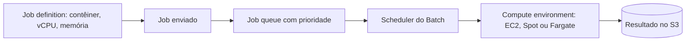
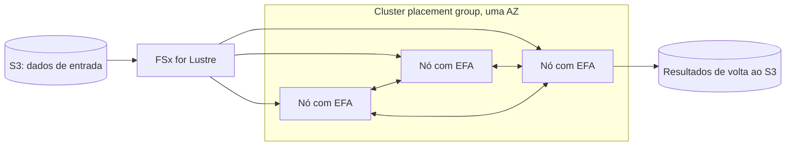

---
aliases:
  - Aula 9.8
modulo: 9
aula: 8
parte: "III Computação e armazenamento"
dominios:
  - 3
  - 4
lida: false
tags:
  - aula
  - saa-c03
  - modulo-09
---

# Aula 9.8: AWS Batch e computação de alto desempenho

[[09 - EC2 a Fundo|Voltar ao módulo]]

> [!question] Pergunta que esta aula responde
> Quando há milhares de tarefas pesadas para rodar (e não um servidor ligado o tempo todo), quem cuida de fila, de ligar as instâncias certas e de desligá-las ao fim? E quando as tarefas precisam conversar entre si em altíssima velocidade (HPC), o que muda na infraestrutura?

## O problema: trabalho em lotes não é um servidor

Há cargas que não são "um site no ar": são **lotes** de tarefas que começam, consomem muita CPU por minutos ou horas e terminam, como renderizar quadros, analisar genomas, simular riscos financeiros, transcodificar vídeo, processar dados científicos. Fazer isso "na mão" com [[EC2]] exige resolver sozinho: onde ficam as tarefas esperando, quantas instâncias ligar, qual tipo, como reexecutar o que falhou e como desligar tudo no fim para não pagar à toa.

O **[[Batch|AWS Batch]]** resolve exatamente isso: é um serviço **gerenciado de computação em [[Processamento em Lote|lote]]**. Você entrega **jobs** (tarefas em [[Container|contêiner]]); ele os **enfileira, provisiona a computação necessária ([[EC2]] ou [[Fargate]], inclusive [[Spot Instance|Spot]]), executa e reduz a capacidade a zero quando a fila esvazia (com `minvCpus` igual a 0)**. Não existe custo adicional pelo Batch: você paga pelos recursos de computação que ele usa.

## Os quatro conceitos do Batch

| Conceito | O que é | Analogia |
|---|---|---|
| **Job** | Uma unidade de trabalho (um [[Container\|contêiner]] que roda e termina) | A tarefa |
| **Job definition** | A receita do job: imagem do [[Container\|contêiner]], [[vCPU]], memória, comando, [[IAM Role\|role IAM]], variáveis | A ficha da tarefa |
| **Job queue** | Fila onde os jobs esperam; tem **prioridade** e aponta para ambientes de computação | A fila do balcão |
| **Compute environment** | A computação que roda os jobs: **gerenciada** (o Batch cria e escala as instâncias ou o [[Fargate]]) ou **não gerenciada** (você mesmo gerencia) | Os funcionários disponíveis |

O fluxo: você **submete** um job a uma fila; o **scheduler** do Batch o encaixa em um ambiente de computação com recursos suficientes, que o executa e devolve o resultado. Se não há recurso, o ambiente gerenciado **sobe instâncias** (dentro dos limites de [[vCPU]] mínimo e máximo que você definiu) e, quando acaba o trabalho, as desliga.

### Ambientes de computação

- **[[EC2]] (gerenciado)**: você escolhe famílias de instância, e o Batch decide o tipo e a quantidade. Pode usar **On-Demand** ou **[[Spot Instance|Spot]]** (até 90% de desconto, [[09.06 - Spot Dedicated e Capacity Reservations|aula 9.6]]), e uma estratégia de alocação. Dá acesso a GPUs e a imagens customizadas.
- **[[Fargate]] e [[Fargate Spot]] (gerenciado)**: sem instâncias para administrar; o Batch roda cada job em um [[Container|contêiner]] [[Serverless|serverless]] ([[17 - Containers ECS EKS e Fargate|Módulo 17]]). Boa para jobs menores, sem GPU.
- **[[EKS|Amazon EKS]]**: o Batch também roda jobs em um cluster EKS que você já tem (verificado em novembro de 2026, [documentação de ambientes de computação](https://docs.aws.amazon.com/batch/latest/userguide/compute_environments.html)), útil para quem padronizou em [[Kubernetes]].
- **Não gerenciado**: você traz o cluster; o Batch só agenda.

A fila pode apontar para **vários ambientes em ordem**: o scheduler tenta o primeiro e, se ele não tiver recurso, passa ao seguinte (por exemplo, primeiro [[Spot Instance|Spot]] e depois On-Demand). A frase "escala a zero" tem uma condição: o ambiente gerenciado só desliga tudo quando o **mínimo de [[vCPU|vCPUs]] (`minvCpus`) é 0**; se você definir um mínimo maior, essa quantidade de vCPUs fica ligada e cobrando mesmo sem jobs.

### Como o Batch escolhe a instância

Em ambiente [[EC2]] gerenciado, a **estratégia de alocação** decide quais tipos o Batch lança: `BEST_FIT` escolhe o tipo de menor custo que cabe nos jobs e espera por ele (pode atrasar se faltar capacidade), `BEST_FIT_PROGRESSIVE` passa a tipos adicionais quando o melhor não está disponível, e `SPOT_CAPACITY_OPTIMIZED` e `SPOT_PRICE_CAPACITY_OPTIMIZED` escolhem pools [[Spot Instance|Spot]] menos propensos a interrupção (a mesma lógica da [[09.06 - Spot Dedicated e Capacity Reservations|aula 9.6]]). Quando há muitos jobs na fila, o Batch também aplica **políticas de agendamento** (*scheduling policies*) como o *fair share*, que divide a capacidade entre grupos de usuários para que um time não monopolize a fila.

> [!tip] Macete de prova
> **"Milhares de jobs em [[Processamento em Lote|lote]], sem gerenciar servidores, escalando até zero"**: [[Batch|AWS Batch]]. Ao ver **"custo mínimo para jobs tolerantes a falha"**, a resposta é Batch com ambiente **[[Spot Instance|Spot]]**.

### Recursos úteis do Batch

| Recurso | Para quê |
|---|---|
| **Array jobs** | Um job "pai" que dispara muitos jobs "filhos" idênticos (até 10.000), cada um com um índice (parametrizados por dados diferentes) |
| **Job dependencies** | Um job só começa quando outros terminarem (pipelines) |
| **Multi-node parallel jobs** | Um job que usa **várias instâncias ao mesmo tempo**, para cargas fortemente acopladas |
| **Retry** | Reexecutar automaticamente jobs que falharam (útil com [[Spot Instance\|Spot]]) |
| **Prioridade de fila** | Jobs importantes passam à frente |

> [!example] Genômica em escala
> Um laboratório precisa analisar 20.000 amostras, cada uma exigindo 30 minutos de CPU e 8 GB de memória. Ele cria uma job definition com o [[Container|contêiner]] de análise, um **array job** de 20.000 filhos (um por amostra), uma fila e um ambiente de computação [[Spot Instance|Spot]]. O Batch sobe centenas de instâncias, processa tudo em poucas horas, refaz as que forem interrompidas e desliga a frota. O custo é só o das horas de computação usadas, e os resultados vão para o [[S3]].

> [!example] A conta do array job
> Cada um dos 20.000 filhos usa 1 [[vCPU]] por 30 minutos, e o ambiente tem `maxvCpus` de 2.000. Cabem 2.000 filhos ao mesmo tempo, então são 20.000 / 2.000 = 10 rodadas de 0,5 hora: cerca de **5 horas** no total. O trabalho soma 20.000 x 0,5 = 10.000 vCPU-horas; com uma tarifa [[Spot Instance|Spot]] ilustrativa de 0,01 USD por vCPU-hora, são cerca de 100 USD. Dobrar o `maxvCpus` para 4.000 corta o tempo para cerca de 2,5 horas pelo mesmo custo total, porque o trabalho é o mesmo.

## Batch contra Lambda contra EC2 na mão

| | **Lambda** | **[[Batch\|AWS Batch]]** | **[[EC2]] + [[Auto Scaling Group\|Auto Scaling]]** |
|---|---|---|---|
| Duração máxima de uma execução | **30 minutos** | **Sem limite fixo** | Sem limite |
| Modelo | Evento, função | Fila de jobs em [[Container\|contêiner]] | Servidor sempre ligado |
| Quem gerencia as instâncias | AWS | **Batch (gerenciado)** | Você |
| Quando usar | Tarefas curtas e orientadas a evento | Lotes longos, pesados, em escala | Serviços contínuos |
| Escala a zero | Sim | **Sim** | Só com configuração |
| GPU / hardware específico | Limitado | **Sim ([[EC2]])** | Sim |

A regra de decisão para a prova: **tarefa curta (até 30 minutos) e orientada a evento é Lambda ([[16 - Serverless Lambda e API Gateway|Módulo 16]]); tarefa longa ou pesada em [[Processamento em Lote|lote]] é Batch; serviço contínuo é [[EC2]] ou [[Container|contêineres]] com [[Auto Scaling Group|Auto Scaling]].** Batch também pode ser orquestrado por [[Step Functions]] e disparado pelo [[EventBridge]] ([[21 - Observabilidade Automacao e Operacoes|Módulo 21]]), e jobs lêem e gravam no [[S3]].

Falta distinguir o Batch de **[[Step Functions]]** e de **[[ECS]]** para jobs de horas. O Step Functions **orquestra** um fluxo de etapas (decisões, paralelismo, esperas) chamando outros serviços, e não fornece a fila de computação nem escala as instâncias; o Batch fornece fila, escala e execução, e os dois combinam (o Step Functions dispara o Batch e espera o fim). O **ECS** executa [[Container|contêineres]] e serviços, mas fila, prioridade e dimensionamento da frota para um [[Processamento em Lote|lote]] seriam trabalho seu; o Batch é a camada de lote por cima de ECS, [[Fargate]] ou [[EKS]].

## HPC: quando as tarefas conversam entre si

**Computação de alto desempenho (HPC)** resolve problemas grandes demais para uma máquina, dividindo-os em muitos nós. Há dois tipos:

| | **Fracamente acoplado** (*loosely coupled*) | **Fortemente acoplado** (*tightly coupled*) |
|---|---|---|
| Os nós conversam? | Quase nunca; cada tarefa é independente | **Constantemente**, a cada passo |
| Exemplo | Renderizar quadros, analisar amostras, Monte Carlo | Simulação de fluidos, previsão do tempo, dinâmica molecular |
| Sensível a [[Latencia\|latência]] de rede | Pouco | **Muito** |
| Solução típica | Batch, [[Spot Instance\|Spot]], array jobs | Cluster, [[EFA]], MPI |

Para HPC fortemente acoplado, a infraestrutura se monta com peças que você já viu neste módulo:

1. **Instâncias com rede e CPU adequadas** (família de computação, ou as famílias `Hpc` feitas para isso, [[09.02 - Familias Graviton e Burstable|aula 9.2]]).
2. **[[Placement Group|Cluster placement group]]** ([[09.07 - Placement Groups|aula 9.7]]): nós vizinhos na rede, [[Latencia|latência]] mínima.
3. **[[EFA]]** ([[09.03 - Rede e Disco da Instancia|aula 9.3]]): contorna a pilha de rede do sistema operacional para comunicação com [[Latencia|latência]] muito baixa, usada por bibliotecas MPI.
4. **Armazenamento de alto desempenho**: sistema de arquivos paralelo como o **[[FSx for Lustre]]** ([[10 - Armazenamento em Bloco e Arquivos EBS EFS FSx|Módulo 10]]), integrado ao [[S3]].
5. **[[Orquestracao|Orquestração]]**: para montar e gerir clusters HPC completos com agendadores como o Slurm, existe o **AWS ParallelCluster** (ferramenta de código aberto de gestão de clusters); para cargas em [[Processamento em Lote|lote]], o próprio **Batch** (inclusive com jobs multi-node).

> [!example] Previsão do tempo
> Um instituto roda um modelo atmosférico em que milhares de células trocam dados a cada passo. Ele usa 100 instâncias de rede rápida em um [[Placement Group|cluster placement group]], com [[EFA]] para o tráfego MPI e um sistema de arquivos [[FSx for Lustre]] que lê os dados de entrada do [[S3]] e grava os resultados de volta. Os nós conversam a [[Latencia|latências]] de microssegundos.

> [!info] Ligando os pontos
> HPC é a soma do módulo: [[Instance Type|tipo de instância]] certo (aulas 9.1 e 9.2), rede avançada com [[EFA]] (9.3), posição física em cluster (9.7) e, quando o orçamento pesa, [[Spot Instance|Spot]] (9.6). O armazenamento rápido vem do Módulo 10.

## Como isso cai na prova

Cobre o **Task 3.2** (computação de alto desempenho, elástica e escalável) e o **Task 4.2** (custo otimizado).

**Padrões de cenário:**

- Muitos jobs em [[Processamento em Lote|lote]], sem servidores, escalando a zero: [[Batch|AWS Batch]].
- Lote tolerante a falha, menor custo: Batch com [[Spot Instance|Spot]].
- Tarefa de mais de 30 minutos que não cabe no Lambda: Batch ou [[Container|contêiner]].
- HPC fortemente acoplado: [[Placement Group|cluster placement group]], [[EFA]], instâncias de rede rápida, [[FSx for Lustre]].

**Palavras-chave em inglês:**

| No enunciado | Aponta para |
|---|---|
| "batch processing", "thousands of jobs", "scale to zero" | [[Batch\|AWS Batch]] |
| "job queue", "compute environment", "job definition" | [[Batch\|AWS Batch]] |
| "tightly coupled", "MPI", "low [[Latencia\|latency]] between nodes" | [[Placement Group\|cluster placement group]] + [[EFA]] |
| "parallel file system", "fast storage for HPC" | [[FSx for Lustre]] |
| "exceeds Lambda's 15-minute limit" (regra antiga; hoje o limite é 30 minutos) | Batch ou [[Container\|contêiner]] |

**Pegadinhas clássicas:**

- **Lambda tem limite de 30 minutos**; [[Processamento em Lote|lote]] longo não cabe.
- **Batch não tem custo próprio**; paga-se a computação.
- **[[EFA]] e [[Placement Group|cluster placement group]]** formam o par do HPC acoplado; sem o grupo, o EFA perde sentido.
- **[[Spot Instance|Spot]]** em Batch exige jobs reiniciáveis.
- HPC **fracamente acoplado** não precisa de [[EFA]].

| Requisito no enunciado | Resposta provável | Por quê |
|---|---|---|
| 50.000 renderizações independentes, custo mínimo | Batch com [[Spot Instance\|Spot]] e array jobs | Escala a zero, reinicia o que falha |
| Simulação MPI em 200 nós | Cluster, [[EFA]], [[FSx for Lustre]] | [[Latencia\|Latência]] e [[Throughput\|vazão]] máximas |
| Função que processa um arquivo em 2 minutos, ao chegar no [[S3]] | Lambda | Curta e orientada a evento |
| Transcodificação de 3 horas por vídeo | Batch (ou [[Container\|contêiner]]) | Passa dos 30 minutos do Lambda |
| Fluxo com decisões e esperas que chama jobs de [[Processamento em Lote\|lote]] | [[Step Functions]] disparando o Batch | Orquestra, e o Batch executa |

## Resumo

> [!abstract] A aula em uma frase
> O [[Batch|AWS Batch]] enfileira jobs em [[Container|contêiner]], provisiona [[EC2]] ou [[Fargate]] (com [[Spot Instance|Spot]], se quiser) e escala a zero ao terminar, enquanto o HPC fortemente acoplado combina [[Placement Group|cluster placement group]], [[EFA]] e armazenamento paralelo como o [[FSx for Lustre]].

**A lógica, em passos**

1. Lotes de tarefas não são servidores: precisam de fila, escala e desligamento.
2. Batch tem job, job definition, job queue e compute environment.
3. O ambiente gerenciado sobe e desce as instâncias sozinho ([[EC2]], [[Spot Instance|Spot]] ou [[Fargate]]).
4. Array jobs e dependências cobrem paralelismo e pipelines.
5. Lambda para tarefa curta (até 30 minutos); Batch para [[Processamento em Lote|lote]] longo ou pesado.
6. HPC acoplado exige cluster, [[EFA]] e armazenamento rápido; o fracamente acoplado dispensa.

**Números para lembrar**

| O quê | Valor | Por que importa |
|---|---|---|
| Limite do Lambda | 30 minutos | Fronteira com o Batch |
| Array job | Até 10.000 filhos | Escala de paralelismo |
| Custo do Batch | Zero próprio | Paga a computação |

**Tabela-síntese**

| Necessidade | Solução |
|---|---|
| Lote em [[Container\|contêiner]], escala a zero | [[Batch\|AWS Batch]] |
| Menor custo, tolerante a falha | Batch + [[Spot Instance\|Spot]] |
| HPC acoplado | Cluster + [[EFA]] + [[FSx for Lustre]] |
| Tarefa curta por evento | Lambda |

**Na prática, isso significa**

- Empacote o trabalho em [[Container|contêiner]], grave resultados no [[S3]] e deixe o Batch cuidar da frota.
- Use [[Spot Instance|Spot]] com retries e checkpoints.
- Para HPC acoplado, junte as peças do módulo e do Módulo 10.

> [!tip] Liga com
> Vem da [[09.07 - Placement Groups|aula 9.7]]. Fecha o módulo; o próximo é o [[10 - Armazenamento em Bloco e Arquivos EBS EFS FSx|Módulo 10]], com o [[FSx for Lustre]], e o [[16 - Serverless Lambda e API Gateway|Módulo 16]] trata do Lambda.

## Erros comuns

- **Usar Lambda para jobs de horas.** O limite é de 30 minutos.
- **Montar a frota na mão para um [[Processamento em Lote|lote]].** O Batch já faz fila, escala e desligamento.
- **Usar [[Spot Instance|Spot]] sem tornar o job reiniciável.** A interrupção perde trabalho.
- **Usar [[EFA]] fora de um [[Placement Group|cluster placement group]].** A [[Latencia|latência]] mínima se perde.
- **Pagar por servidor ocioso entre lotes.** Escale a zero.

## Pratique

**1.** Uma empresa precisa processar 30.000 arquivos de vídeo por noite, cada transcodificação levando cerca de uma hora, sem administrar servidores e com custo mínimo. Qual solução é mais adequada?

- [ ] a) Uma função Lambda acionada por evento para cada arquivo
- [ ] b) Uma frota fixa de instâncias On-Demand ligada o mês inteiro
- [ ] c) AWS Batch com ambiente de computação Spot e array jobs
- [ ] d) Step Functions orquestrando uma função Lambda por arquivo

**2.** Um pipeline do [[Batch|AWS Batch]] precisa que todos os jobs usem a mesma imagem de [[Container|contêiner]], 2 [[vCPU|vCPUs]], 4 GiB de memória e a mesma [[IAM Role|role IAM]]. Qual componente do Batch define isso?

- [ ] a) A job definition
- [ ] b) A job queue
- [ ] c) O compute environment
- [ ] d) A scheduling policy

**3.** Um instituto roda uma simulação MPI em 200 nós que trocam dados a cada passo e precisa de baixa [[Latencia|latência]] entre eles e de um sistema de arquivos paralelo integrado ao [[S3]]. Qual arquitetura atende?

- [ ] a) AWS Batch em Fargate Spot, com um array job de 200 filhos independentes
- [ ] b) Cluster placement group com EFA e FSx for Lustre ligado ao S3
- [ ] c) Auto Scaling group em 3 AZs com ENA Express e volumes EBS gp3
- [ ] d) 200 funções Lambda concorrentes trocando mensagens por filas SQS

**4.** Uma função precisa processar um arquivo em cerca de 2 minutos sempre que ele chegar a um [[Bucket|bucket]] do [[S3]], com o MENOR [[Overhead Operacional|overhead operacional]]. Qual solução atende?

- [ ] a) AWS Batch com ambiente EC2 gerenciado e uma job queue dedicada
- [ ] b) Um Auto Scaling group que consulta o bucket a cada minuto
- [ ] c) Um serviço ECS em EC2 ligado o dia inteiro, lendo o bucket continuamente
- [ ] d) Uma função Lambda acionada pela notificação de evento do S3

**5.** Quais DUAS afirmações sobre o [[Batch|AWS Batch]] são verdadeiras? (Escolha DUAS.)

- [ ] a) O Batch não tem custo próprio: você paga pelos recursos de computação que ele usa
- [ ] b) O Batch só funciona com instâncias EC2 On-Demand
- [ ] c) Um array job pode disparar até 10.000 jobs filhos
- [ ] d) O Batch não suporta instâncias Spot
- [ ] e) Uma job queue só pode apontar para um único compute environment

**6.** Um ambiente de computação gerenciado do Batch continua com 8 [[EC2|instâncias EC2]] ligadas e cobrando mesmo quando a fila está vazia. O que ajustar para que a frota escale a zero?

- [ ] a) Reduzir o maxvCpus do ambiente para zero
- [ ] b) Aumentar a prioridade da job queue
- [ ] c) Definir o minvCpus do ambiente como 0
- [ ] d) Excluir a job definition que não está em uso

**7.** Qual das cargas abaixo é a PIOR candidata a um ambiente [[Spot Instance|Spot]] no [[Batch|AWS Batch]]?

- [ ] a) Uma simulação multi-node fortemente acoplada de 12 horas, sem checkpoints
- [ ] b) Um array job de 5.000 jobs filhos idempotentes que gravam o resultado no S3
- [ ] c) Jobs de análise com retry automático configurado e saída no S3
- [ ] d) Jobs curtos de transcodificação que gravam checkpoints periódicos

**8.** Uma equipe precisa rodar 100.000 simulações de Monte Carlo independentes, sem comunicação entre elas, com o MENOR custo e esforço. Qual solução atende?

- [ ] a) Cluster placement group com EFA e instâncias de HPC On-Demand
- [ ] b) AWS Batch com Spot e array jobs, escalando a zero ao fim
- [ ] c) Um cluster fixo de instâncias com FSx for Lustre ligado o mês inteiro
- [ ] d) Reserved Instances para o número máximo de simulações simultâneas

**9.** Um job de agregação só pode começar depois que 500 jobs de processamento terminarem. Qual é a forma de MENOR esforço no [[Batch|AWS Batch]]?

- [ ] a) Uma função Lambda agendada que consulta a fila e submete o job de agregação
- [ ] b) Colocar o processamento e a agregação no mesmo job, com uma espera fixa no meio
- [ ] c) Dois compute environments, e o segundo só liga depois do primeiro
- [ ] d) Declarar uma dependência (job dependency) do job de agregação nos 500 jobs

**10.** Sobre HPC, quais DUAS afirmações são verdadeiras? (Escolha DUAS.)

- [ ] a) O tráfego EFA pode atravessar várias AZs normalmente
- [ ] b) HPC fortemente acoplado costuma combinar cluster placement group, EFA e MPI
- [ ] c) HPC fracamente acoplado exige EFA para funcionar
- [ ] d) Um cluster placement group abrange várias AZs da Região
- [ ] e) O FSx for Lustre se integra ao S3 para alimentar cargas de HPC

**11.** Uma empresa já opera um cluster [[EKS|Amazon EKS]] e quer usar o [[Batch|AWS Batch]] para filas de jobs sem criar uma frota [[EC2]] separada. Isso é possível?

- [ ] a) Não, o Batch só roda em EC2 ou Fargate
- [ ] b) Sim, o Batch tem compute environment para EKS
- [ ] c) Sim, mas só se os nós do EKS forem substituídos por instâncias bare metal
- [ ] d) Não, é preciso migrar os jobs para o Step Functions

**12.** Uma job queue com ambiente [[Spot Instance|Spot]] sofre interrupções frequentes em jobs de 3 horas. Qual combinação reduz o impacto?

- [ ] a) Estratégia BEST_FIT com um único tipo de instância Spot
- [ ] b) Um único tipo em uma única AZ, com o menor preço possível
- [ ] c) SPOT_PRICE_CAPACITY_OPTIMIZED com vários tipos, retries e checkpoints nos jobs
- [ ] d) Trocar para um ambiente com mínimo de vCPUs alto, para manter instâncias ligadas

> [!success]- Gabarito
> **1. c)** Lote longo, independente e sensível a custo é o caso de Batch com [[Spot Instance|Spot]] e array jobs; a) uma hora passa do limite de 30 minutos do Lambda, b) frota fixa paga ociosidade o mês inteiro, d) o [[Step Functions]] orquestra, mas a [[Lambda|função Lambda]] do passo continua limitada a 30 minutos.
> **2. a)** A job definition guarda imagem, [[vCPU]], memória, comando e role; b) a job queue guarda os jobs esperando e a prioridade, c) o compute environment é a computação que executa, d) a scheduling policy divide capacidade entre grupos, não define a receita do job.
> **3. b)** HPC acoplado pede [[Placement Group|cluster placement group]], [[EFA]] e armazenamento paralelo como o [[FSx for Lustre]]; a) array jobs independentes não trocam mensagens de MPI, c) [[ENA Express]] e [[Zona de Disponibilidade|AZs]] diferentes aumentam [[Latencia|latência]] para esse perfil, d) [[Lambda|funções Lambda]] não oferecem rede de baixa latência entre elas.
> **4. d)** Lambda acionada por evento do [[S3]] é o menor overhead para tarefa curta; a) o Batch exige fila, job definition e ambiente, b) um [[Auto Scaling Group|Auto Scaling]] group consultando o [[Bucket|bucket]] é mais trabalho, c) um serviço [[ECS]] ligado o dia inteiro paga ociosidade.
> **5. a) e c)** O Batch não cobra por si e o array job vai até 10.000 filhos; b) suporta [[Spot Instance|Spot]] e [[Fargate]], d) suporta Spot, e) a job queue pode apontar para vários ambientes em ordem.
> **6. c)** A frota só escala a zero com minvCpus igual a 0; a) maxvCpus zero impediria os jobs de rodar, b) prioridade ordena a fila e não desliga instâncias, d) apagar a job definition não afeta a frota.
> **7. a)** Uma simulação acoplada longa e sem checkpoint perde tudo na interrupção e não tolera nós sumindo; b), c) e d) são jobs reiniciáveis ou com checkpoint.
> **8. b)** Simulações independentes são HPC fracamente acoplado, e Batch com [[Spot Instance|Spot]] e array jobs escala a zero e reinicia o que falhar; a) [[EFA]] e cluster servem a acoplamento forte e custam mais, c) um cluster fixo paga ociosidade, d) comprometer capacidade máxima paga o que só se usa em picos.
> **9. d)** Job dependencies fazem o job de agregação esperar os 500 jobs; a) a função agendada é código extra, b) uma espera fixa é frágil, c) vários ambientes não criam ordem entre jobs.
> **10. b) e e)** Cluster, [[EFA]] e MPI são o padrão do HPC acoplado, e o [[FSx for Lustre]] se integra ao [[S3]]; a) o tráfego EFA não cruza [[Zona de Disponibilidade|AZs]], c) o fracamente acoplado dispensa EFA, d) o cluster fica em uma AZ.
> **11. b)** O Batch oferece ambiente de computação para [[EKS]]; a) isso era a limitação antiga, c) bare metal não é requisito, d) o [[Step Functions]] orquestra e não substitui a fila do Batch.
> **12. c)** Diversificar tipos com SPOT_PRICE_CAPACITY_OPTIMIZED e proteger o trabalho com retries e checkpoints reduz o impacto; a) BEST_FIT com um tipo não diversifica, b) um único pool concentra o risco, d) manter instâncias ligadas gasta dinheiro e não reduz interrupções.

### Laboratório (opcional): jobs no Batch com Fargate

> [!warning] Use uma conta AWS pessoal
> Faça isto apenas em uma **[[Conta AWS|conta AWS]] pessoal separada**, com [[Budgets|AWS Budgets]] configurado. **Nunca na conta de produção da empresa.** O custo estimado é de centavos de dólar (um job de poucos segundos em [[Fargate]]). Apague os recursos no mesmo dia.

1. Crie um compute environment gerenciado do tipo [[Fargate]] (ou [[Fargate Spot]]) com `maxvCpus` pequeno, por exemplo 4 (`aws batch create-compute-environment`).
2. Crie uma job queue apontando para esse ambiente (`aws batch create-job-queue`).
3. Registre uma job definition para [[Fargate]] com uma imagem pública simples e o comando `echo ola` (`aws batch register-job-definition`).
4. Submeta o job (`aws batch submit-job`) e acompanhe o estado até `SUCCEEDED` (`aws batch describe-jobs`); confirme a saída nos [[CloudWatch Logs|logs do CloudWatch]].
5. **Limpeza:** desabilite e apague a job queue, depois desabilite e apague o compute environment, e desregistre a job definition (`aws batch update-job-queue --state DISABLED` e `delete-job-queue`, `update-compute-environment --state DISABLED` e `delete-compute-environment`, `deregister-job-definition`). Os parâmetros completos de cada comando estão na documentação da CLI do Batch; confira antes de executar.

## Para aprofundar

- [ ] [What is AWS Batch?](https://docs.aws.amazon.com/batch/latest/userguide/what-is-batch.html) (AWS Documentation): componentes, ambientes de computação e casos de uso.
- [ ] [Compute environments](https://docs.aws.amazon.com/batch/latest/userguide/compute_environments.html) (AWS Documentation): [[EC2]], [[Spot Instance|Spot]], [[Fargate]] e escala.
- [ ] [Elastic Fabric Adapter](https://docs.aws.amazon.com/AWSEC2/latest/UserGuide/efa.html) (AWS Documentation): [[EFA]] em HPC e aprendizado de máquina distribuído.

Próximo módulo: [[10 - Armazenamento em Bloco e Arquivos EBS EFS FSx|Módulo 10: Armazenamento em bloco e arquivos (EBS, EFS, FSx)]].
