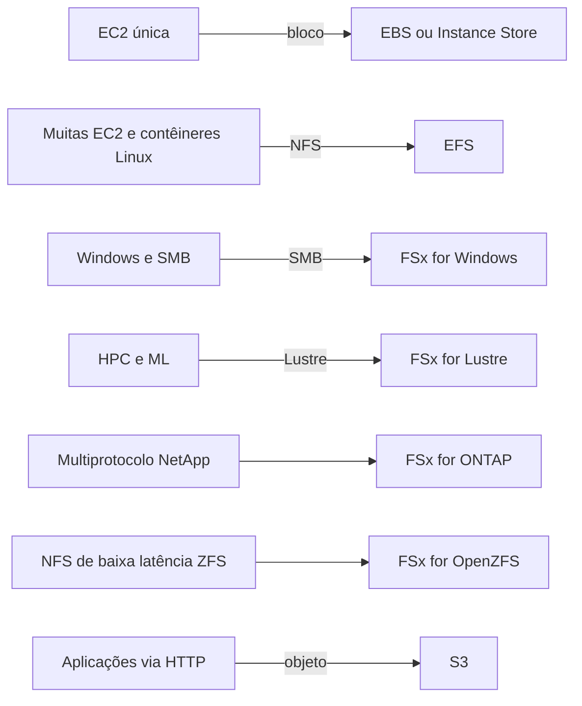

---
aliases:
  - Aula 10.1
modulo: 10
aula: 1
parte: "III Computação e armazenamento"
dominios:
  - 2
  - 3
  - 4
lida: false
tags:
  - aula
  - saa-c03
  - modulo-10
---

# Aula 10.1: Bloco, arquivo e objeto, por que existem três tipos

[[10 - Armazenamento em Bloco e Arquivos EBS EFS FSx|Voltar ao módulo]]

> [!question] Pergunta que esta aula responde
> Por que a AWS vende três tipos de armazenamento (bloco, arquivo e objeto), o que realmente diferencia um do outro, e como as palavras do enunciado ("compartilhado", "[[SMB]]", "banco de dados", "milhões de arquivos") apontam para cada um?

## O problema: "guardar dados" não é uma coisa só

Todo programa precisa guardar bytes em algum lugar. O que muda é **como o programa conversa com o armazenamento**. Essa conversa define três coisas ao mesmo tempo: o protocolo usado, quantos clientes podem usar o mesmo dado simultaneamente e que tipo de operação é barata. Nenhum desenho atende bem aos três ao mesmo tempo, e por isso existem três famílias.

Você já usa as três no dia a dia: o disco do seu [[EC2]] é de bloco, o [[Bucket|bucket]] do [[S3]] é de objeto, e uma pasta compartilhada de rede (como a de um servidor de arquivos do escritório) é de arquivo. Esta aula explica a diferença pela fonte, porque é ela que decide qual serviço atende cada cenário da prova.

## Armazenamento de bloco

No [[Armazenamento de Bloco|armazenamento de bloco]], o dispositivo é uma sequência de **blocos de tamanho fixo**, endereçados por posição (como as gavetas numeradas de um arquivo). O dispositivo não sabe o que é uma "pasta" ou um "arquivo". Quem organiza isso é o **sistema operacional da instância**, que formata o volume com um sistema de arquivos (ext4, XFS, NTFS) e decide quais blocos pertencem a qual arquivo.

Consequências diretas:

- **[[Latencia|Latência]] baixa e previsível**: o sistema operacional lê e escreve blocos pontuais, sem camada intermediária de servidor de arquivos.
- **Alteração parcial é barata**: mudar 4 KiB no meio de um arquivo de 10 GiB reescreve só um ou poucos blocos.
- **Em regra, um dono por vez**: o sistema de arquivos vive dentro de um único sistema operacional. Dois servidores escrevendo no mesmo bloco, cada um achando que é dono dele, corrompem o volume. As exceções existem e custam complexidade (o [[Multi-Attach]] do [[EBS]], na aula 10.4).
- **É o que bancos de dados e sistemas operacionais esperam**: um banco como o PostgreSQL do seu dia a dia grava páginas de 8 KiB direto em blocos.

Na AWS, o [[Armazenamento de Bloco|armazenamento de bloco]] é o [[EBS]] (volume de rede, durável) e o [[Instance Store]] (disco local do host, efêmero). Ambos são anexados a uma [[EC2|instância EC2]].

## Armazenamento de arquivos

No [[Armazenamento de Arquivos|armazenamento de arquivos]], quem organiza a hierarquia de pastas e arquivos é um **servidor de arquivos** (gerenciado, no caso da AWS). Os clientes acessam por rede com um protocolo de arquivo e enxergam uma árvore de diretórios, com permissões e travas de arquivo (locks).

Os dois protocolos que importam:

| Protocolo | Mundo | Porta | Observação |
|---|---|---|---|
| [[NFS]] (Network File System) | Linux e Unix | 2049 | Permissões POSIX (dono, grupo, rwx) |
| [[SMB]] (Server Message Block) | Windows | 445 | ACLs do Windows e autenticação por [[Directory Service|Active Directory]] |

(As portas vieram do [[03 - Fundamentos de Redes para a Nuvem|Módulo 3]].)

Consequências:

- **Compartilhamento é o ponto central**: centenas de clientes montam a mesma árvore e veem o mesmo dado, com locks para evitar que dois escrevam o mesmo arquivo ao mesmo tempo.
- **Há um servidor entre o cliente e os blocos**, então a [[Latencia|latência]] por operação é maior que a de um disco local, e cada operação de metadado (listar pasta, abrir arquivo) custa uma viagem pela rede.
- **O cliente enxerga um sistema de arquivos pronto**: não formata nada, apenas monta.

Na AWS: [[EFS]] ([[NFS]], Linux) e a família [[FSx]] (Windows File Server em [[SMB]], [[FSx for Lustre|Lustre]], [[FSx for NetApp ONTAP|NetApp ONTAP]], [[FSx for OpenZFS|OpenZFS]]). O restante deste módulo explica cada uma.

## Armazenamento de objetos

No [[Armazenamento de Objetos|armazenamento de objetos]], não há hierarquia nem blocos expostos. Há um espaço plano de **objetos**, cada um com uma **chave** (nome), o conteúdo e metadados, acessado por uma **API [[HTTP]]** (GET, PUT, DELETE). Os "diretórios" do [[S3]] são só prefixos na chave.

Consequências:

- **Escala quase ilimitada e [[Durabilidade|durabilidade]] muito alta**, porque o serviço não precisa manter semântica de sistema de arquivos.
- **Não há edição parcial**: para mudar um byte, você grava o objeto inteiro de novo.
- **[[Latencia|Latência]] maior por operação** e nada de montar como disco (sem locks, sem POSIX).
- **Acesso por qualquer cliente [[HTTP]]**, inclusive a internet, com permissões por [[IAM]] e policies.

Na AWS é o [[S3]], dono do [[11 - Amazon S3 a Fundo|Módulo 11]]. Aqui ele aparece só como comparação.

> [!example] Um mesmo arquivo de 2 GiB nos três mundos
> Imagine um arquivo de vídeo de 2 GiB e uma correção de 1 MiB no meio dele.
> - **Bloco**: o sistema de arquivos reescreve só os blocos afetados, aproximadamente 1 MiB de I/O.
> - **Arquivo**: o cliente [[NFS]] envia a escrita de 1 MiB ao servidor; o servidor atualiza o arquivo, e outros clientes veem a mudança depois.
> - **Objeto**: você sobe o objeto de 2 GiB inteiro (ou usa versões/multipart), porque o [[S3]] não altera partes de um objeto existente.

## Tabela comparativa

| Critério | Bloco ([[EBS]]) | Arquivo ([[EFS]], [[FSx]]) | Objeto ([[S3]]) |
|---|---|---|---|
| Como o cliente enxerga | Disco cru, formatado pelo SO | Pasta de rede montada | Chave em um [[Bucket\|bucket]], via API |
| Protocolo | Barramento do host (NVMe) | [[NFS]], [[SMB]] (e [[iSCSI]] no [[FSx for NetApp ONTAP\|ONTAP]]) | [[HTTP]](S) |
| Acesso simultâneo | Um host (exceção: [[Multi-Attach]]) | Muitos clientes | Milhões de clientes |
| [[Latencia\|Latência]] | Menor | Média (rede + servidor) | Maior |
| Edição parcial | Sim | Sim | Não (regrava o objeto) |
| Escala | Até 64 TiB por volume ([[gp3]] e [[io2]]; os demais tipos, 16 TiB) | Petabytes ([[EFS]] cresce sozinho) | Praticamente ilimitada |
| Escopo na AWS | Uma [[Zona de Disponibilidade\|AZ]] | Regional ([[EFS]]) ou conforme a implantação ([[FSx]]) | Regional |

## Três métricas de desempenho: IOPS, throughput e latência

Para escolher dentro de bloco e arquivo, você precisa de três números:

- **[[IOPS]]**: operações de entrada e saída por segundo. Importa para muitas operações pequenas e aleatórias (banco transacional).
- **[[Throughput]]**: bytes por segundo (MiB/s). Importa para leituras e escritas grandes e sequenciais (análise de logs, vídeo).
- **[[Latencia]]**: tempo de uma única operação. Importa quando cada operação bloqueia a aplicação.

Elas se ligam por uma conta simples:

`throughput = IOPS x tamanho do I/O`

> [!example] A mesma conta, dois perfis
> - Banco transacional: 16.000 [[IOPS]] x 16 KiB = 256.000 KiB/s, ou 250 MiB/s. O gargalo é o número de operações.
> - Processamento de log: 200 [[IOPS]] x 1 MiB = 200 MiB/s. Poucas operações, mas grandes; o gargalo é o [[Throughput|throughput]].
> Um volume pode ter [[IOPS]] de sobra e ainda assim ficar limitado pelo [[Throughput|throughput]] quando o I/O é grande, e o inverso também.

Detalhe que a prova adora: o [[EBS]] **conta** o tamanho máximo de um I/O como 256 KiB em SSD e 1.024 KiB em HDD (verificado em novembro de 2026). Operações sequenciais menores são fundidas, e operações maiores são partidas, o que muda a contagem de [[IOPS]]. A aula 10.3 usa isso.

## Durabilidade e disponibilidade: duas perguntas diferentes

A [[Durabilidade]] responde "meus dados continuam existindo?" (probabilidade de perder o dado em um ano). A [[Disponibilidade|disponibilidade]] responde "consigo acessá-los agora?". Um serviço pode ser muito durável e estar temporariamente inacessível. Essa distinção aparece em cada serviço do módulo: o [[EBS]] replica dentro de uma [[Zona de Disponibilidade|AZ]], o [[EFS]] Regional replica entre várias AZs, o [[S3]] replica entre várias AZs por padrão. Os números exatos vêm nas aulas seguintes.

## O mapa do módulo

> [!info] Ligando os pontos
> A [[09 - EC2 a Fundo|aula de EC2]] mostrou que a instância tem disco [[EBS]] ou [[Instance Store]]; este módulo abre essa caixa. O [[11 - Amazon S3 a Fundo|S3]] é o terceiro tipo. Quando o armazenamento precisa ficar entre o data center e a nuvem, entra o [[Storage Gateway]] (veja o [[23 - Migracao e Transferencia de Dados|Módulo 23]]).

## Como isso cai na prova

Cobre **Task 3.1** (soluções de armazenamento de alto desempenho e escaláveis, incluindo "tipos de armazenamento: objeto, arquivo, bloco"), **Task 2.1** (tipos de armazenamento ao recomendar tecnologias) e **Task 4.1** (serviço de armazenamento mais econômico).

**Padrões de cenário**
- "Várias instâncias precisam ler e escrever os mesmos arquivos": arquivo ([[EFS]] para Linux, [[FSx for Windows File Server|FSx para Windows]]).
- "Banco de dados em [[EC2]] que precisa de baixa [[Latencia|latência]]": bloco ([[EBS]]).
- "Milhões de imagens acessadas pela web, sem montar": objeto ([[S3]]).
- "Compartilhar com clientes Windows e controle por [[Active Directory]]": arquivo [[SMB]] ([[FSx for Windows File Server|FSx for Windows]]).

**Palavras-chave em inglês**: "shared file system", "[[NFS]]", "[[SMB]]", "[[Armazenamento de Bloco|block storage]]", "boot volume", "low-latency database", "POSIX-compliant", "[[Armazenamento de Objetos|object storage]]".

**Pegadinhas clássicas**
- [[EBS]] **não** é compartilhado entre instâncias (salvo [[Multi-Attach]] em io1/io2, na mesma [[Zona de Disponibilidade|AZ]]).
- [[S3]] **não** monta como disco nativamente, e não serve para banco de dados transacional.
- [[EFS]] **não** funciona com Windows (a AWS informa que o uso com instâncias Windows não é suportado).

| Requisito no enunciado | Resposta provável | Por quê |
|---|---|---|
| Disco para banco de dados em [[EC2]] | [[EBS]] | Bloco, baixa [[Latencia\|latência]] |
| Arquivos compartilhados, Linux, várias [[Zona de Disponibilidade\|AZs]] | [[EFS]] | [[NFS]], Regional |
| Compartilhamento Windows com [[Active Directory\|AD]] | [[FSx for Windows File Server]] | [[SMB]] nativo |
| Dados acessados por [[HTTP]] em escala | [[S3]] | Objeto |
| [[Cache]] temporário de altíssimo desempenho | [[Instance Store]] | Disco local do host |

## Resumo

> [!abstract] A aula em uma frase
> Bloco, arquivo e objeto diferem pela interface (disco cru, pasta de rede ou API [[HTTP]]), e essa interface decide protocolo, compartilhamento e tipo de operação barata.

**A lógica, em 5 passos**
1. O programa fala com o armazenamento por uma interface; a interface define o que é barato.
2. Bloco: disco cru, um dono, [[Latencia|latência]] mínima, o que banco de dados quer.
3. Arquivo: pasta de rede ([[NFS]] ou [[SMB]]), muitos clientes, locks, servidor no meio.
4. Objeto: chave mais API [[HTTP]], escala enorme, sem edição parcial.
5. Dentro de bloco e arquivo, escolha pelas três métricas: [[IOPS]], [[Throughput|throughput]] e [[Latencia|latência]].

**Números para lembrar**

| O quê | Valor | Por que importa |
|---|---|---|
| Porta [[NFS]] | 2049 | Regra de [[Security Group\|security group]] para [[EFS]] |
| Porta [[SMB]] | 445 | Regra de [[Security Group\|security group]] para [[FSx for Windows File Server\|FSx Windows]] |
| Tamanho de I/O em SSD | 256 KiB | Define a contagem de [[IOPS]] no [[EBS]] |
| Tamanho de I/O em HDD | 1.024 KiB | Idem, para [[st1]] e [[sc1]] |
| [[Throughput]] | [[IOPS]] x tamanho do I/O | Conta que explica os limites |

**Tabela-síntese**

| Tipo | Serviços | Pergunta que o escolhe |
|---|---|---|
| Bloco | [[EBS]], [[Instance Store]] | "É disco de uma instância?" |
| Arquivo | [[EFS]], [[FSx]] | "Vários clientes montam o mesmo dado?" |
| Objeto | [[S3]] | "É acessado por API [[HTTP]] em escala?" |

**Na prática, isso significa**
- Comece sempre pela pergunta "quem acessa, com qual protocolo e quantos ao mesmo tempo?".
- Banco de dados autogerenciado pede bloco; pasta compartilhada pede arquivo; dado servido em escala pede objeto.
- Métrica de desempenho certa: [[IOPS]] para muitas operações pequenas, [[Throughput|throughput]] para operações grandes.

> [!tip] Liga com
> Vem da [[09 - EC2 a Fundo|aula de EC2]] (instâncias e discos) e abre o [[10.02 - EBS e Instance Store Armazenamento Anexado a Instancia|EBS e Instance Store]].

## Erros comuns

- **Achar que [[EFS]] e [[S3]] são intercambiáveis porque os dois "guardam arquivos".** O EFS é um sistema de arquivos POSIX montável; o S3 é um serviço de objetos por API.
- **Usar [[S3]] como disco de banco de dados.** Sem edição parcial nem [[Latencia|latência]] de disco, o desempenho e a consistência não servem para um banco transacional.
- **Esperar que o [[EBS]] seja compartilhado.** Um volume comum pertence a uma instância por vez.
- **Confundir [[Durabilidade|durabilidade]] com [[Disponibilidade|disponibilidade]].** Perder acesso por uma hora não é perder o dado.
- **Esquecer que o [[Throughput|throughput]] depende do tamanho do I/O.** [[IOPS]] altas com I/O pequeno podem render pouquíssimo throughput.

## Pratique

**1.** Uma empresa executa um banco de dados PostgreSQL autogerenciado em uma [[EC2|instância EC2]] e precisa de armazenamento com baixa [[Latencia|latência]], anexado diretamente à instância. Qual tipo de armazenamento atende?

- [ ] a) Armazenamento de objetos, acessado por API HTTP
- [ ] b) Armazenamento de arquivos com NFS
- [ ] c) Armazenamento de bloco
- [ ] d) Armazenamento de arquivos com SMB

**2.** Dezenas de servidores Linux em três [[Zona de Disponibilidade|AZs]] precisam ler e escrever a mesma árvore de arquivos, com semântica POSIX, sem gerenciar servidor de arquivos. Qual é a escolha?

- [ ] a) Amazon EFS
- [ ] b) Volume EBS compartilhado entre todos os servidores
- [ ] c) Bucket S3 montado como disco local
- [ ] d) Instance Store replicado manualmente

**3.** Uma empresa precisa guardar milhões de imagens e entregá-las por URL, e não precisa montá-las como disco nem editá-las parcialmente. Qual tipo de armazenamento se encaixa?

- [ ] a) Bloco, com um volume por servidor
- [ ] b) Arquivos com NFS, para montar a pasta nos servidores
- [ ] c) Arquivos com SMB, com permissões do Active Directory
- [ ] d) Objetos, em que cada item tem uma chave e é acessado por uma API HTTP

**4.** Uma aplicação grava 8.000 operações por segundo de 32 KiB cada. Qual é o [[Throughput|throughput]] aproximado necessário?

- [ ] a) 125 MiB/s
- [ ] b) 250 MiB/s
- [ ] c) 1.000 MiB/s
- [ ] d) 64 MiB/s

**5.** Um serviço corporativo em servidores Windows exige compartilhamento de pastas por [[SMB]] e autenticação com [[Active Directory]]. Qual solução tem o menor [[Overhead Operacional|esforço operacional]]?

- [ ] a) EFS montado nas instâncias Windows
- [ ] b) FSx for Windows File Server
- [ ] c) Volume EBS io2 com Multi-Attach
- [ ] d) Servidor de arquivos Windows próprio em EC2 com discos EBS

**6.** Quais DUAS características são típicas do [[Armazenamento de Arquivos|armazenamento de arquivos]] acessado por rede? (Escolha DUAS.)

- [ ] a) Vários clientes montam e enxergam a mesma hierarquia de pastas
- [ ] b) O cliente formata o dispositivo com seu próprio sistema de arquivos
- [ ] c) Existe um servidor de arquivos entre o cliente e os blocos
- [ ] d) Cada operação é uma requisição HTTP com chave
- [ ] e) Não há latência de rede nas operações de metadado

**7.** Um engenheiro diz que o [[EBS|volume EBS]] "tem 99,999% de [[Durabilidade|durabilidade]], então nunca ficará indisponível". Qual é o problema da frase?

- [ ] a) O EBS não tem nenhuma garantia de durabilidade, apenas de disponibilidade dentro de uma AZ, e por isso exige RAID
- [ ] b) Durabilidade mede perda de dados, não disponibilidade de acesso, e o EBS é restrito a uma AZ
- [ ] c) A durabilidade do EBS é medida em dias, não em anos
- [ ] d) Só o S3 mede durabilidade

**8.** Uma equipe de processamento de logs lê arquivos grandes e sequenciais de 1 MiB e precisa de 400 MiB/s. Qual [[Metrica|métrica]] é o fator dominante?

- [ ] a) Throughput
- [ ] b) Número de IOPS aleatórias de 4 KiB
- [ ] c) Latência de operação única
- [ ] d) Quantidade de AZs

**9.** Qual cenário aponta mais claramente para [[Armazenamento de Objetos|armazenamento de objetos]] em vez de bloco ou arquivo?

- [ ] a) Disco de boot de uma instância
- [ ] b) Pasta de rede para 200 desenvolvedores Linux, com permissões POSIX e acesso concorrente de muitos clientes
- [ ] c) Banco de dados OLTP em EC2
- [ ] d) Milhões de imagens servidas pela web, acessadas por URL

**10.** Quais DUAS portas e protocolos estão corretamente associados? (Escolha DUAS.)

- [ ] a) NFS usa a porta 2049
- [ ] b) SMB usa a porta 3389
- [ ] c) SMB usa a porta 445
- [ ] d) NFS usa a porta 22
- [ ] e) iSCSI usa a porta 443

**11.** Uma aplicação precisa alterar pequenos trechos de arquivos de 50 GiB com frequência, com mínimo de I/O. Qual característica favorece bloco ou arquivo sobre objeto?

- [ ] a) Escala quase ilimitada
- [ ] b) Acesso pela internet
- [ ] c) Objetos versionados automaticamente a cada gravação, com histórico completo de alterações parciais
- [ ] d) Alteração parcial sem regravar o arquivo inteiro

**12.** Dois servidores web precisam gravar ao mesmo tempo na mesma árvore de arquivos, sem software de cluster instalado. Por que um volume de bloco comum anexado aos dois não serve?

- [ ] a) Blocos não podem ser lidos por mais de um servidor em nenhuma circunstância, nem em modo somente leitura
- [ ] b) O sistema de arquivos vive dentro de um único sistema operacional, e escritas concorrentes corrompem o volume
- [ ] c) Volumes de bloco só funcionam com Windows e exigem um servidor de licenças da Microsoft para formatar
- [ ] d) A AWS proíbe mais de um volume por conta

> [!success]- Gabarito
> **1. c)** o banco grava páginas direto em blocos e quer [[Latencia|latência]] mínima; a) objeto não tem edição parcial nem latência de disco; b) e d) arquivo adiciona um servidor e rede no meio, com mais latência.
> **2. a)** [[EFS]] é [[NFS]] regional, POSIX, [[Serverless|sem servidor]] para gerenciar; b) [[EBS]] comum não é compartilhado entre instâncias e é zonal; c) [[S3]] não monta nativamente como disco POSIX; d) [[Instance Store]] é local e efêmero.
> **3. d)** objeto é chave mais conteúdo via API [[HTTP]], sem hierarquia real de pastas e sem montagem; a) bloco exige formatar e montar um disco por servidor; b) e c) arquivo traz servidor de arquivos, locks e permissões que o requisito não pede, com custo e esforço maiores.
> **4. b)** 8.000 x 32 KiB = 256.000 KiB/s, cerca de 250 MiB/s; a) seria 4.000 [[IOPS]] de 32 KiB; c) exigiria 32.000 IOPS; d) seria 2.000 IOPS.
> **5. b)** [[FSx for Windows File Server|FSx for Windows]] entrega [[SMB]] nativo com integração ao [[Active Directory|AD]], gerenciado; a) a AWS informa que [[EFS]] não é suportado em Windows; c) bloco com [[Multi-Attach]] não é um servidor de arquivos SMB; d) funciona, mas traz o trabalho de patch, backup e [[Alta Disponibilidade|HA]] que o [[FSx]] elimina.
> **6. a) e c)** compartilhamento e servidor intermediário definem arquivo; b) formatar é do bloco; d) é objeto; e) a rede e o servidor adicionam [[Latencia|latência]] de metadado.
> **7. b)** [[Durabilidade|durabilidade]] não é [[Disponibilidade|disponibilidade]], e o volume vive em uma só [[Zona de Disponibilidade|AZ]]; a) o [[EBS]] tem durabilidade documentada; c) a medida é anual; d) todos os serviços de dados publicam durabilidade.
> **8. a)** operações grandes e sequenciais são limitadas por [[Throughput|throughput]] (400 [[IOPS]] x 1 MiB); b) IOPS pequenas são outro perfil; c) a [[Latencia|latência]] de uma operação importa pouco aqui; d) [[Zona de Disponibilidade|AZs]] não definem o gargalo.
> **9. d)** muitos objetos servidos por URL é o caso clássico do [[S3]]; a) boot é bloco; b) pasta de rede é arquivo; c) [[OLTP]] é bloco.
> **10. a) e c)** [[NFS]] é 2049 e [[SMB]] é 445; b) 3389 é RDP; d) 22 é SSH; e) [[iSCSI]] usa a 3260, e 443 é HTTPS.
> **11. d)** só bloco e arquivo alteram partes sem regravar tudo; a) e b) são pontos fortes do objeto; c) [[Versionamento|versionamento]] é recurso do [[S3]].
> **12. b)** o sistema de arquivos assume dono único e escritas concorrentes sem coordenação corrompem o volume; a) a leitura por vários é tecnicamente possível, o problema é a escrita; c) bloco funciona com vários sistemas operacionais; d) não existe tal proibição.

## Para aprofundar

- [ ] [What is Amazon Elastic Block Store?](https://docs.aws.amazon.com/ebs/latest/userguide/what-is-ebs.html) (AWS Docs): visão do [[EBS]], recursos e serviços relacionados.
- [ ] [What is Amazon Elastic File System?](https://docs.aws.amazon.com/efs/latest/ug/whatisefs.html) (AWS Docs): o que o [[EFS]] entrega e o que ele não suporta (Windows).
- [ ] [Amazon EBS I/O characteristics and monitoring](https://docs.aws.amazon.com/ebs/latest/userguide/ebs-io-characteristics.html) (AWS Docs): [[IOPS]], tamanho de I/O, fila e [[Latencia|latência]].

Próxima aula: [[10.02 - EBS e Instance Store Armazenamento Anexado a Instancia]]
