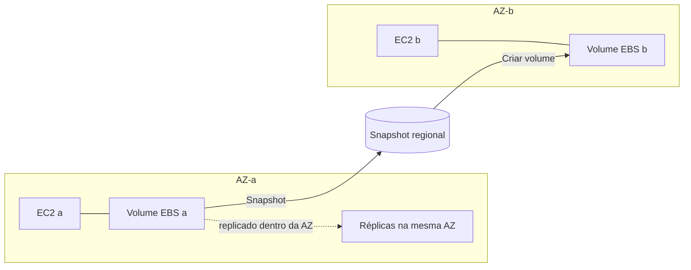

---
aliases:
  - Aula 10.2
modulo: 10
aula: 2
parte: "III Computação e armazenamento"
dominios:
  - 2
  - 3
lida: false
tags:
  - aula
  - saa-c03
  - modulo-10
---

# Aula 10.2: EBS e Instance Store, armazenamento anexado à instância

[[10 - Armazenamento em Bloco e Arquivos EBS EFS FSx|Voltar ao módulo]]

> [!question] Pergunta que esta aula responde
> Por que o disco de uma [[EC2|instância EC2]] pode ser um volume de rede ([[EBS]]) ou um disco local do host ([[Instance Store]]), o que sobrevive a stop, reboot e terminate em cada caso, e por que um volume EBS fica preso a uma [[Zona de Disponibilidade|AZ]]?

## O problema: computação e disco com ciclos de vida diferentes

Um servidor físico antigo tem os discos dentro da caixa. Se a placa-mãe queima, o disco vai junto, ou pelo menos fica preso naquela máquina. Na nuvem, você quer o oposto: a instância é **descartável** (você a troca por outra maior, por uma nova [[AMI]], ou ela morre com o host), mas o **dado precisa continuar existindo**.

A solução da AWS foi separar os dois:

- **[[EBS]] (Elastic Block Store)**: o disco é um **volume de rede**, replicado, que vive fora do host da instância. A instância some, o volume permanece.
- **[[Instance Store]]**: o disco é **físico, dentro do host**, sem rede no meio. É mais rápido e já vem no preço, mas morre com a instância.

Quase tudo o que você já rodou (discos raiz de instâncias do [[ECS]] em [[EC2]], volumes de banco em EC2) usa [[EBS]]. O [[Instance Store]] é a exceção, e a prova adora perguntar quando ele é a escolha certa.

## Como o EBS funciona por dentro

O [[EBS]] fornece **volumes**: dispositivos de bloco que você anexa a uma [[EC2|instância EC2]] e usa como um disco local (formata, monta, instala coisas). Pontos que definem o comportamento:

1. **O volume é um recurso zonal.** Ele existe em **uma [[Zona de Disponibilidade|AZ]]** e só pode ser anexado a instâncias **da mesma AZ**. Por isso você já viu [[ECS]] em [[EC2]] ou bancos em EC2 presos à AZ do disco.
2. **Replicação dentro da [[Zona de Disponibilidade|AZ]].** A documentação diz que os dados do volume são replicados automaticamente em vários servidores dentro da AZ, para que a falha de um componente não perca dado. Não há replicação entre AZs: se a AZ inteira cair, o volume cai junto.
3. **O volume vive à parte da instância.** Você pode desanexar de uma instância e anexar a outra (na mesma [[Zona de Disponibilidade|AZ]]), e o volume continua com os dados depois que a instância é parada.
4. **A conexão é por rede (o barramento [[Nitro]]), então precisa de banda.** Para usar toda a [[IOPS]] provisionada, use uma instância **EBS-optimized**; o [[Throughput|throughput]] efetivo é sempre o **menor** entre o limite do volume e o limite da instância.
5. **Você paga pelo que provisiona**, não pelo que usa: tamanho em GiB, mais [[IOPS]] e [[Throughput|throughput]] provisionados quando o tipo permite.
6. **[[Durabilidade]]:** [[io2]] Block Express é projetado para 99,999% (taxa de falha anual de 0,001%, ou 1 volume em 100.000 por ano); os demais tipos, 99,8% a 99,9% (taxa de falha anual de 0,1% a 0,2%, até 2 volumes em 1.000 por ano). (Verificado em novembro de 2026.)

> [!example] Por que "99,8% a 99,9%" importa na prática
> Uma frota de 1.000 volumes [[gp3]] pode esperar até 2 falhas de volume por ano. Se perder um volume custa horas de trabalho, o **[[Snapshot|snapshot]]** (aula 10.5) não é opcional. Já o [[io2|io2 Block Express]] reduziria isso para cerca de 1 falha a cada 100.000 volumes por ano.

> [!warning] A AWS não faz backup do seu EBS
> A documentação afirma que a AWS **não** faz [[Automated Backup|backup automático]] dos dados dos seus volumes. Resiliência e [[Recuperacao de Desastres|recuperação de desastres]] são responsabilidade sua: crie [[Snapshot|snapshots]] regularmente ou automatize com o [[Data Lifecycle Manager]] ou o [[Backup|AWS Backup]] (aula 10.5).

## Volume raiz, volumes de dados e DeleteOnTermination

Toda instância tem um **volume raiz** (com o sistema operacional) e pode ter **volumes de dados**. O que acontece com cada um no **terminate** depende do atributo `DeleteOnTermination`, e os padrões **não são uniformes** (verificado em novembro de 2026):

| Volume | Anexado | Método | Padrão no terminate |
|---|---|---|---|
| Raiz | No launch | Console ou CLI | **Apagado** |
| Raiz | Depois do launch (caso raro: substituição do volume raiz) | Console ou CLI | Preservado |
| Dados | No launch | Console | Preservado |
| Dados | No launch | CLI | **Apagado** |
| Dados | Depois do launch | Console e CLI | Preservado |

O valor de launch vem do atributo definido na [[AMI]], e você pode sobrescrevê-lo ao lançar a instância. Duas implicações:

- **Para reaproveitar o dado da instância que será terminada**, marque o volume para ser preservado, ou crie um [[Snapshot|snapshot]] antes.
- **Volume preservado continua cobrando.** Um volume `available` (sem instância) é cobrado integralmente. Volumes órfãos são uma fonte clássica de custo desnecessário (aula 10.10 e [[25 - Otimizacao de Custos|Módulo 25]]).

Stop e start **preservam** o [[EBS]]. Reboot também.

## Mover dados entre AZs e Regiões

Como o volume é zonal, para "mudar" de [[Zona de Disponibilidade|AZ]] você:

1. Cria um **[[Snapshot|snapshot]]** do volume (o snapshot é regional: seus dados são replicados entre as [[Zona de Disponibilidade|AZs]] da Região).
2. Cria um **novo volume** a partir do [[Snapshot|snapshot]] **na [[Zona de Disponibilidade|AZ]] de destino** e o anexa à instância de lá.

Para outra **Região**, você copia o [[Snapshot|snapshot]] para a Região de destino e cria o volume lá. A aula 10.5 detalha snapshots, cópia e criptografia.

## Instance Store: o disco que vem com o host

O [[Instance Store]] é [[Armazenamento de Bloco|armazenamento de bloco]] **fisicamente anexado ao host** onde sua instância roda. Sem rede no caminho, tende a oferecer [[Latencia|latência]] e [[IOPS]] muito altas (os valores variam por [[Instance Type|tipo de instância]]; não há número único, então consulte a página do tipo). Regras que a documentação dá:

- **Está incluído no preço da instância.** Não há cobrança separada.
- **Só é anexado no launch.** Você não adiciona nem move um volume de [[Instance Store]] depois, nem o passa de uma instância para outra.
- **Quantidade e tamanho dependem do tipo e do tamanho da instância**, e nem todo tipo tem [[Instance Store]] (por exemplo, famílias com sufixo "d" ou otimizadas para armazenamento, como as da família I, tratadas no [[09 - EC2 a Fundo|Módulo 9]]).
- **Ele existe só durante a vida da instância:** os dados **persistem em reboot**, mas **não persistem** em **stop**, **[[Hibernacao de EC2|hibernate]]** ou **terminate**. Nesses eventos, cada bloco é apagado criptograficamente.
- **NVMe SSD de [[Instance Store]] vem criptografado** com XTS-AES-256 por hardware, com chaves únicas por dispositivo que são destruídas quando a instância é parada ou terminada. Você não pode desativar essa criptografia nem usar sua chave.

Há outras situações em que o dado se perde (por exemplo, falha do disco subjacente ou do host, ou mudança do [[Instance Type|tipo de instância]]). A regra prática: **trate o [[Instance Store]] como cache**.

> [!example] Instance Store bem aplicado
> Uma frota de servidores web atrás de um [[Elastic Load Balancing|load balancer]] usa o [[Instance Store]] para **cache de imagens redimensionadas**. Se uma instância é substituída, o cache é recriado a partir do [[S3]]. Nada de valioso existe só ali.
>
> [[Instance Store]] mal aplicado: um banco de dados de produção em Instance Store, sem réplica. Um stop acidental apaga tudo.

A documentação resume o uso ideal: **dados temporários que mudam com frequência** (buffers, caches, dados de rascunho/scratch) ou **dados replicados em uma frota** (por exemplo, um pool de servidores web atrás de um [[Elastic Load Balancing|load balancer]], cada um com o mesmo cache). Se o dado precisa sobreviver à instância, copie-o para [[EBS]], [[S3]] ou [[EFS]].

## EBS versus Instance Store

| Critério | [[EBS]] | [[Instance Store]] |
|---|---|---|
| Onde está | Rede (replicado na [[Zona de Disponibilidade\|AZ]]) | Disco no host |
| Sobrevive a stop e terminate | Sim (terminate depende de `DeleteOnTermination`) | **Não** |
| Sobrevive a reboot | Sim | Sim |
| Troca de instância | Desanexa e anexa a outra | Não se aplica |
| [[Snapshot]] | Sim | Não existe snapshot de [[Instance Store]] |
| Cobrança | Por GiB, [[IOPS]] e [[Throughput\|throughput]] provisionados | Inclusa no preço da instância |
| Tamanho e quantidade | Você escolhe (até 64 TiB em [[gp3]] e [[io2]]; [[gp2]], io1, [[st1]] e [[sc1]] até 16 TiB) | Fixos pelo [[Instance Type\|tipo de instância]] |
| Criptografia | Opcional ([[KMS]]) | Automática para NVMe (hardware) |
| Caso típico | Boot, bancos, dados duráveis | [[Cache]], buffer, scratch, dados replicados |

> [!info] Ligando os pontos
> [[KMS]] e [[Customer Managed Key|chaves gerenciadas pelo cliente]] aparecem na criptografia de [[EBS]] (aula 10.5, retomando o [[08 - Criptografia e Protecao de Dados|Módulo 8]]). A [[Hibernacao de EC2|hibernação]] grava a memória no volume raiz do EBS, e por isso exige EBS (e [[Instance Store]] não persiste em hibernate).

## Quando o EBS não basta

Se várias instâncias precisam do mesmo dado ao mesmo tempo, o [[EBS]] comum não serve (um volume vai para uma instância): use [[EFS]] ou [[FSx]] (aulas 10.6 em diante). Se o dado é de objetos acessados por API, use [[S3]]. A única exceção para EBS compartilhado é o [[Multi-Attach]] (aula 10.4).

## Como isso cai na prova

Cobre **Task 3.1** (armazenamento de alto desempenho) e **Task 2.2** ([[Durabilidade|durabilidade]] e características de armazenamento, mitigar [[Ponto Unico de Falha|pontos únicos de falha]]).

**Padrões de cenário**
- "Dados temporários de altíssima velocidade, que podem ser perdidos": [[Instance Store]].
- "Dados precisam sobreviver ao desligamento da instância": [[EBS]].
- "Instância em outra [[Zona de Disponibilidade|AZ]] precisa dos dados do volume": [[Snapshot|snapshot]] e novo volume na AZ de destino.
- "Instância terminada e o volume sumiu": `DeleteOnTermination` (raiz é apagado por padrão).

**Palavras-chave em inglês**: "temporary storage", "ephemeral", "buffer, cache, scratch data", "persist after the instance is stopped", "EBS-backed", "[[Zona de Disponibilidade|Availability Zone]]", "[[Instance Store|instance store volume]]".

**Pegadinhas clássicas**
- [[EBS]] é **zonal** (uma [[Zona de Disponibilidade|AZ]]); [[S3]], [[EFS]] Regional e [[Snapshot|snapshots]] são regionais.
- [[Instance Store]] **persiste em reboot**, mas **não** em stop, [[Hibernacao de EC2|hibernate]] ou terminate.
- [[Instance Store]] **não pode ser adicionado depois** do launch.
- O volume raiz some no terminate por padrão; volume de dados criado no console, não.

| Requisito no enunciado | Resposta provável | Por quê |
|---|---|---|
| [[Cache]] temporário de menor [[Latencia\|latência]] | [[Instance Store]] | Disco local, incluso no preço |
| Dados que sobrevivem a stop e terminate | [[EBS]] com DeleteOnTermination = false | Volume independente da instância |
| Mover dados para outra [[Zona de Disponibilidade\|AZ]] | [[Snapshot]] e novo volume | Volume é zonal |
| Dados replicados em toda a frota, descartáveis | [[Instance Store]] | Perder um nó não perde o dado |
| Backup de volume | [[Snapshot]] (ou [[Backup\|AWS Backup]]) | A AWS não faz [[Automated Backup\|backup automático]] |

## Resumo

> [!abstract] A aula em uma frase
> O [[EBS]] separa o disco da instância (volume de rede, zonal, persistente), enquanto o [[Instance Store]] é o disco do host (rápido, incluso, efêmero), e o ciclo de vida da instância decide o que sobrevive.

**A lógica, em 5 passos**
1. Computação é descartável; o dado precisa de ciclo de vida próprio: nasce o [[EBS]].
2. O [[EBS|volume EBS]] fica em uma [[Zona de Disponibilidade|AZ]], replicado dentro dela, e é anexado por rede a instâncias da mesma AZ.
3. Stop e reboot preservam o [[EBS]]; no terminate depende do `DeleteOnTermination` (raiz apagado por padrão).
4. [[Instance Store]] é grátis, rápido e efêmero: persiste em reboot, some em stop, [[Hibernacao de EC2|hibernate]] e terminate.
5. Para mover dados de [[Zona de Disponibilidade|AZ]] ou Região, use [[Snapshot|snapshot]], que é regional.

**Números para lembrar**

| O quê | Valor | Por que importa |
|---|---|---|
| [[Durabilidade]] do [[io2\|io2 Block Express]] | 99,999% (AFR 0,001%) | Alta durabilidade para dados críticos |
| [[Durabilidade]] dos demais tipos | 99,8% a 99,9% (AFR 0,1% a 0,2%) | Planeje [[Snapshot\|snapshots]] |
| [[Instance Store]] em reboot | Persiste | Diferente de stop |
| [[Instance Store]] em stop, [[Hibernacao de EC2\|hibernate]], terminate | Apagado | Nunca para dado único |

**Tabela-síntese**

| Evento | [[EBS]] | [[Instance Store]] |
|---|---|---|
| Reboot | Mantém | Mantém |
| Stop | Mantém | Perde |
| [[Hibernacao de EC2\|Hibernate]] | Mantém ([[RAM]] é gravada no [[EBS]] raiz) | Perde |
| Terminate | Depende de `DeleteOnTermination` | Perde |

**Na prática, isso significa**
- Dado durável vai em [[EBS]] (com [[Snapshot|snapshots]]) ou em serviço de arquivos/objetos, não em [[Instance Store]].
- Volume que sobrou depois de terminate continua cobrando: limpe.
- Para [[Multi-AZ|multi-AZ]], replique no nível da aplicação ou use serviço regional ([[EFS]], [[S3]]), porque o volume é zonal.

> [!tip] Liga com
> Vem da [[10.01 - Bloco Arquivo e Objeto Por Que Existem Tres Tipos|visão de bloco, arquivo e objeto]] e do [[09 - EC2 a Fundo|Módulo 9]]. Segue para os [[10.03 - EBS SSD gp3 gp2 e Provisioned IOPS|volumes SSD]].

## Erros comuns

- **Achar que o [[EBS]] é replicado entre [[Zona de Disponibilidade|AZs]].** Ele é replicado **dentro** da AZ; para sobreviver à perda da AZ, use [[Snapshot|snapshot]] ou replicação na aplicação.
- **Guardar dado único em [[Instance Store]].** Stop ou falha do host apaga tudo.
- **Esquecer o padrão do volume raiz.** Terminar a instância apaga o raiz, a não ser que você mude `DeleteOnTermination`.
- **Dar por certo que a AWS faz backup do [[EBS]].** Não faz; [[Snapshot|snapshot]] é seu.
- **Pagar por volumes soltos.** Volume `available` cobra o tamanho provisionado inteiro.

## Pratique

**1.** Uma empresa processa vídeos em [[EC2|instâncias EC2]] e precisa de um disco temporário muito rápido para arquivos intermediários que são recriados a cada job. O dado final vai para o [[S3]]. Qual armazenamento atende com menor custo?

- [ ] a) Volume EBS io2 com 256.000 IOPS provisionadas
- [ ] b) Instance Store da própria instância
- [ ] c) Volume EBS gp3 com snapshot diário
- [ ] d) Sistema de arquivos EFS com throughput Provisioned

**2.** Um engenheiro para e inicia uma instância e descobre que os dados de um disco "efêmero" sumiram, mas os de um [[EBS|volume EBS]] não. Qual é a explicação?

- [ ] a) O EBS foi movido para outra AZ automaticamente durante o stop e voltou quando a instância reiniciou
- [ ] b) O reboot apaga o EBS, mas o stop não
- [ ] c) O snapshot restaurou o EBS durante o start
- [ ] d) O Instance Store não persiste em stop, e o EBS persiste

**3.** Uma instância de produção foi terminada e o volume de dados, criado no launch via console, continuou existindo e cobrando. Por quê?

- [ ] a) O padrão do `DeleteOnTermination` no console é preservar
- [ ] b) O volume de dados foi movido para o EBS Recycle Bin no terminate
- [ ] c) O volume raiz sempre é preservado pela AWS por padrão
- [ ] d) O volume foi convertido em snapshot automaticamente

**4.** Uma aplicação em AZ-a precisa dos dados de um [[EBS|volume EBS]] que está na AZ-b, que ficou indisponível. A empresa mantém [[Snapshot|snapshots]] diários desse volume. Qual abordagem recupera os dados com menor esforço?

- [ ] a) Anexar o volume direto à instância da AZ-a pelo console, pois o EBS é acessível em qualquer AZ da Região
- [ ] b) Usar o Elastic Volumes para mudar a AZ do volume
- [ ] c) Criar um volume na AZ-a a partir de um snapshot do volume original
- [ ] d) Montar o volume por NFS na instância da AZ-a

**5.** Quais DUAS afirmações sobre o [[Instance Store]] estão corretas? (Escolha DUAS.)

- [ ] a) Os dados persistem em reboot
- [ ] b) Pode ser anexado a uma instância já em execução
- [ ] c) Tem snapshots incrementais para backup
- [ ] d) Está incluído no preço da instância, sem cobrança separada
- [ ] e) Os dados persistem em stop e hibernate

**6.** Uma empresa precisa que os dados do volume raiz sobrevivam ao terminate da instância. Qual configuração garante que o volume raiz não seja apagado quando a instância for terminada?

- [ ] a) Nenhuma, pois o volume raiz é sempre preservado
- [ ] b) Definir `DeleteOnTermination` como falso para o volume raiz
- [ ] c) Usar um tipo de instância com Instance Store
- [ ] d) Habilitar criptografia por padrão

**7.** Qual afirmação sobre a [[Durabilidade|durabilidade]] do [[EBS]] está correta?

- [ ] a) Todos os tipos de volume têm 99,999% de durabilidade
- [ ] b) O EBS replica os dados entre AZs, por isso todos os tipos de volume têm 99,999%
- [ ] c) Só o io2 chega a 99,999%; os demais ficam em 99,8% a 99,9%
- [ ] d) Volumes gp3 e io2 têm a mesma durabilidade, de 99,999%

**8.** Um [[io2|volume io2]] provisionado entrega muito menos [[Throughput|throughput]] do que o esperado quando anexado a uma instância pequena. Qual é a causa mais provável?

- [ ] a) O io2 só entrega o throughput total com Multi-Attach ligado
- [ ] b) Snapshots em andamento sempre limitam o volume ao baseline
- [ ] c) Volumes io2 exigem criptografia ativa para atingir o throughput provisionado
- [ ] d) O throughput efetivo é o menor entre volume e instância

**9.** Quais DUAS situações indicam que o [[Instance Store]] é uma boa escolha? (Escolha DUAS.)

- [ ] a) Banco de dados de produção sem réplicas
- [ ] b) Cache local recriado a partir do S3
- [ ] c) Dados fiscais que precisam ser retidos por 5 anos
- [ ] d) Volume raiz que precisa ser reaproveitado em outra instância
- [ ] e) Dados de rascunho (scratch) de um job de processamento

**10.** Um time quer reduzir o risco de perder dados de um [[gp3|volume gp3]] de produção, que tem [[Durabilidade|durabilidade]] de 99,8% a 99,9%. Qual ação é a mais adequada?

- [ ] a) Criar snapshots regularmente, de preferência automatizados
- [ ] b) Aumentar o tamanho do volume, o que cria automaticamente uma cópia de segurança dos dados em outra AZ
- [ ] c) Habilitar o Multi-Attach
- [ ] d) Migrar o volume para Instance Store

**11.** Qual das alternativas descreve corretamente o escopo do [[EBS]] e dos [[Snapshot|snapshots]]?

- [ ] a) Volume e snapshot são ambos zonais
- [ ] b) Volume e snapshot são ambos globais
- [ ] c) O volume é zonal e o snapshot é regional
- [ ] d) O volume é regional e o snapshot é zonal

**12.** Uma equipe encontra 40 volumes `available` em uma conta de testes e quer entender o custo. O que é verdadeiro sobre esses volumes?

- [ ] a) Volumes sem instância são gratuitos por 30 dias
- [ ] b) Continuam cobrando o tamanho provisionado
- [ ] c) São cobrados só pelo espaço realmente escrito no volume
- [ ] d) Passam a cobrar apenas as requisições de I/O

> [!success]- Gabarito
> **1. b)** dado intermediário recriável cabe no [[Instance Store]], que já está no preço da instância; a) e c) cobram por volume provisionado; d) [[EFS]] cobra por uso e é mais lento para scratch.
> **2. d)** [[Instance Store]] não persiste em stop e o [[EBS]] persiste; a) volume não muda de [[Zona de Disponibilidade|AZ]] sozinho; b) reboot não apaga nenhum dos dois; c) o start não restaura [[Snapshot|snapshot]].
> **3. a)** volume de dados criado pelo console é preservado por padrão (criado pela CLI no launch seria apagado); b) o [[Recycle Bin]] guarda [[Snapshot|snapshots]] e [[AMI|AMIs]] excluídos conforme regras configuradas, não volumes de uma instância terminada; c) o raiz criado no launch é apagado por padrão; d) a AWS não cria snapshot sozinha.
> **4. c)** [[Snapshot|snapshot]] regional e volume novo na [[Zona de Disponibilidade|AZ]] de destino; a) volume só anexa na própria AZ; b) o [[Elastic Volumes]] muda tipo, tamanho e desempenho, mas não a AZ; d) [[EBS]] não é [[NFS]].
> **5. a) e d)** persiste em reboot e já está no preço; b) só no launch; c) [[Instance Store]] não tem [[Snapshot|snapshot]]; e) perde em stop e [[Hibernacao de EC2|hibernate]].
> **6. b)** `DeleteOnTermination` falso preserva o raiz; a) o raiz criado no launch é apagado por padrão; c) [[Instance Store]] é efêmero; d) criptografia não altera o comportamento de exclusão.
> **7. c)** só o [[io2|io2 Block Express]] chega a 99,999%; a) os demais ficam em 99,8% a 99,9%; b) o [[EBS]] replica dentro de uma [[Zona de Disponibilidade|AZ]], não entre AZs; d) o [[gp3]] fica em 99,8% a 99,9%, só o io2 chega a 99,999%.
> **8. d)** o [[Throughput|throughput]] é limitado pelo menor valor entre volume e instância, e a instância deve ser EBS-optimized; a) [[Multi-Attach]] não aumenta o throughput; b) [[Snapshot|snapshot]] não limita o [[io2]] ao baseline; c) criptografia não é pré-requisito de desempenho.
> **9. b) e e)** cache recriável e scratch são o uso certo; a) e c) dado único ou retido não pode ficar em armazenamento efêmero; d) volume raiz de [[Instance Store]] não é reaproveitável.
> **10. a)** [[Snapshot|snapshots]] protegem contra perda de volume; b) tamanho não muda a [[Durabilidade|durabilidade]]; c) [[Multi-Attach]] é para acesso compartilhado, não backup; d) [[Instance Store]] piora a durabilidade.
> **11. c)** volume zonal, [[Snapshot|snapshot]] regional; a) e b) misturam os escopos; d) está invertida.
> **12. b)** volume sem instância continua cobrando o tamanho provisionado; a) não há gratuidade de 30 dias; c) a cobrança é pelo provisionado; d) a cobrança não é por requisição de I/O.

## Para aprofundar

- [ ] [Amazon EBS volume types](https://docs.aws.amazon.com/ebs/latest/userguide/ebs-volume-types.html) (AWS Docs): tabela de tipos com [[Durabilidade|durabilidade]], tamanho, [[IOPS]] e [[Throughput|throughput]].
- [ ] [Instance store temporary block storage for EC2 instances](https://docs.aws.amazon.com/AWSEC2/latest/UserGuide/InstanceStorage.html) (AWS Docs): visão geral do [[Instance Store]].
- [ ] [Data persistence for Amazon EC2 instance store volumes](https://docs.aws.amazon.com/AWSEC2/latest/UserGuide/instance-store-lifetime.html) (AWS Docs): o que persiste em cada evento do ciclo de vida.
- [ ] [Preserve data when an instance is terminated](https://docs.aws.amazon.com/AWSEC2/latest/UserGuide/preserving-volumes-on-termination.html) (AWS Docs): padrões de `DeleteOnTermination`.

Próxima aula: [[10.03 - EBS SSD gp3 gp2 e Provisioned IOPS]]
