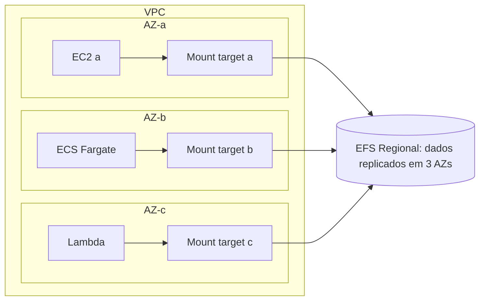

---
aliases:
  - Aula 10.6
modulo: 10
aula: 6
parte: "III Computação e armazenamento"
dominios:
  - 2
  - 3
  - 4
lida: false
tags:
  - aula
  - saa-c03
  - modulo-10
---

# Aula 10.6: EFS, arquivos NFS compartilhados

[[10 - Armazenamento em Bloco e Arquivos EBS EFS FSx|Voltar ao módulo]]

> [!question] Pergunta que esta aula responde
> Por que o [[EFS]] existe se já temos [[EBS]], como instâncias de várias [[Zona de Disponibilidade|AZs]] montam o mesmo sistema de arquivos por [[NFS]], qual a diferença entre um EFS Regional e um One Zone, e como [[Lambda]], [[ECS]] e [[Fargate]] o usam?

## O problema: o EBS não é compartilhado e montar um servidor NFS é trabalho

Imagine uma frota de servidores web Linux atrás de um balanceador, em três [[Zona de Disponibilidade|AZs]], que recebem uploads de usuários. O arquivo enviado a um servidor precisa estar visível a todos os outros. O [[EBS]] não resolve: um volume pertence a uma instância (exceto o [[Multi-Attach]], que é bloco, de uma AZ e sem sistema de arquivos compartilhado). Você poderia subir um servidor [[NFS]] em uma [[EC2|instância EC2]], mas aí você assume capacidade, patch, backup e um [[Ponto Unico de Falha|ponto único de falha]].

O **[[EFS|Amazon EFS]] (Elastic File System)** é a resposta gerenciada: um sistema de arquivos **[[NFS]] elástico e [[Serverless|serverless]]**, que cresce e encolhe automaticamente conforme você adiciona e remove arquivos, até petabytes, sem você provisionar capacidade (verificado em novembro de 2026).

## O que o EFS é, em fatos

- **Protocolo**: [[NFS]] versões 4.1 e 4.0 (não suporta NFSv2 nem NFSv3).
- **Sistema operacional**: **Linux** (a AWS informa que o uso com instâncias Windows não é suportado). Para Windows, use [[FSx for Windows File Server]] (aula 10.8).
- **Quem monta**: [[EC2]], [[ECS]], [[EKS]], Lambda e [[Fargate]]. Servidores **on-premises** (Linux) também montam, via [[Direct Connect]] ou [[Site-to-Site VPN]], sem custo adicional de [[EFS]] (você paga a conexão).
- **Compartilhamento**: acesso concorrente de milhares de clientes, de várias [[Zona de Disponibilidade|AZs]] da mesma Região.
- **Permissões**: modelo **POSIX** (usuário, grupo, rwx).
- **Quotas relevantes** (verificado em novembro de 2026): arquivo individual de até **47,9 TiB**; nome de arquivo de até 255 bytes; 1.000 sistemas de arquivos por conta e Região (ajustável).
- **[[Durabilidade]]** projetada: 99,999999999% (11 noves) nos dois tipos de sistema de arquivos.

## Como o acesso funciona: mount targets

Para acessar o [[EFS]] dentro de uma [[VPC]], você cria **[[Mount Target|mount targets]]**. Cada mount target é um **endpoint [[NFS]] com um endereço IP** dentro de uma [[Sub-rede|sub-rede]].

Regras (documentação, verificado em novembro de 2026):

- **Um [[Mount Target|mount target]] por [[Zona de Disponibilidade|AZ]]** para cada sistema de arquivos. Se há várias [[Sub-rede|sub-redes]] na mesma AZ, o mount target fica em uma delas, e todas as instâncias daquela AZ o compartilham.
- Você monta pelo **nome [[DNS]] do sistema de arquivos**, que **resolve para o [[Mount Target|mount target]] da mesma [[Zona de Disponibilidade|AZ]]** da instância que consulta. Isso evita tráfego entre AZs, melhora o desempenho e reduz custo.
- O sistema de arquivos tem [[Mount Target|mount targets]] em **uma [[VPC]] por vez**. Outras VPCs e contas conseguem montar via [[VPC Peering|VPC peering]] ou [[Transit Gateway]].
- O [[Security Group]] do [[Mount Target|mount target]] precisa liberar **entrada na porta [[TCP]] 2049** ([[NFS]]) a partir dos clientes. Máximo de 5 security groups por mount target.
- Os IPs e o [[DNS]] dos [[Mount Target|mount targets]] são estáveis, e os mount targets são projetados para [[Alta Disponibilidade|alta disponibilidade]].

O comando de montagem recomendado usa o **[[EFS]] mount helper** (pacote `amazon-efs-utils`), que também liga a [[Criptografia em Transito|criptografia em trânsito]]:

`sudo mount -t efs -o tls fs-0123456789abcdef0:/ /mnt/efs`

(Exemplo adaptado da forma documentada `mount -t efs -o tls,accesspoint=...`; o ID do sistema de arquivos é fictício.)

## Regional versus One Zone

| Aspecto | Regional (recomendado) | One Zone |
|---|---|---|
| Onde guarda os dados | Várias [[Zona de Disponibilidade\|AZs]] (3 ou mais) da Região | Uma única AZ |
| [[Durabilidade]] projetada | 11 noves | 11 noves (mas não resiste à perda da [[Zona de Disponibilidade\|AZ]]) |
| [[Mount Target\|Mount targets]] | Um por [[Zona de Disponibilidade\|AZ]] | **Apenas um** |
| Perda da [[Zona de Disponibilidade\|AZ]] | Continua disponível | Dados na AZ podem ser perdidos ou ficar indisponíveis |
| Backup | Opcional ([[Backup\|AWS Backup]]) | AWS Backup automático, restaurável em qualquer [[Zona de Disponibilidade\|AZ]] ou outra Região |
| [[Disponibilidade]] | Todas as [[Zona de Disponibilidade\|AZs]] da Região | Só em algumas AZs (confira a tabela da documentação) |
| Custo | Maior | Menor |

A documentação alerta: em um evento como incêndio ou dano de água que afete a [[Zona de Disponibilidade|AZ]], **dados de um sistema One Zone podem ser perdidos**. Um cliente em outra AZ pode acessar o [[Mount Target|mount target]] do One Zone, mas **paga cobrança de acesso a dados entre AZs** ([[EC2]] data access charges).

Quando escolher One Zone: dados que **não exigem a maior [[Durabilidade|durabilidade]] e [[Disponibilidade|disponibilidade]]** (desenvolvimento e teste, cópias secundárias de dados que existem em outro lugar), em que o custo menor importa. Para produção [[Multi-AZ|multi-AZ]], **Regional**.

## Consistência e travas

O [[EFS]] dá a semântica **close-to-open** que aplicações [[NFS]] esperam. Em sistemas Regionais, as escritas ficam gravadas de forma durável entre [[Zona de Disponibilidade|AZs]] quando a aplicação faz uma escrita síncrona (por exemplo, `fsync`) ou fecha o arquivo. O **file locking** do NFSv4 (incluindo byte-range) é suportado, mas é **advisory** (consultivo): leituras e escritas não checam travas conflitantes. Um arquivo aceita até 512 travas.

## Segurança em camadas

1. **Rede**: [[Security Group|security groups]] nos [[Mount Target|mount targets]] (porta 2049) e as [[Sub-rede|sub-redes]] da [[VPC]].
2. **Identidade ([[IAM]])**: políticas IAM para a API do [[EFS]] e uma **file system policy** (política de recurso) com condições (por exemplo, exigir [[TLS]], restringir a contas); com **IAM authorization for [[NFS]] clients**, as ações `elasticfilesystem:ClientMount` e `ClientWrite` controlam quem monta e escreve.
3. **POSIX**: dono, grupo e permissões de cada arquivo e pasta.
4. **[[Criptografia em Repouso]]**: ligada **na criação** do sistema de arquivos, com o [[KMS]]; cifra dados e metadados.
5. **[[Criptografia em Transito]]**: ligada **na montagem** (`-o tls` com o mount helper).

### Access points: uma porta de entrada por aplicação

Um **[[Access Point|access point]]** do [[EFS]] é um ponto de entrada específico de uma aplicação em um sistema de arquivos compartilhado. Ele pode **impor uma identidade POSIX** (usuário e grupo) a todas as requisições que passam por ele e **impor um diretório raiz diferente** (a aplicação enxerga só `/app1`). Até 10.000 access points por sistema de arquivos (ajustável).

> [!example] Access point no mundo real
> Dois [[Microsservicos|microsserviços]] compartilham um [[EFS]]. O [[Access Point|access point]] do serviço A fixa o diretório `/a`, o usuário `1001` e as permissões `755`. O serviço B só vê `/b`. Mesmo que o código do serviço A tente ler `../b`, o EFS entrega só o que o access point permite. A documentação do Lambda usa exatamente esse padrão (caminho `/my-function`, UID e GID 1001, permissões 755).

## Usando o EFS com Lambda, ECS e Fargate

**Lambda** (verificado em novembro de 2026):

- A função precisa estar **conectada à [[VPC]]** onde há um [[Mount Target|mount target]] do [[EFS]]; crie mount targets em todas as [[Zona de Disponibilidade|AZs]] a que a função se conecta (recomenda-se ao menos duas).
- Use um **[[Access Point|access point]]** para ligar a função ao sistema de arquivos, com caminho não raiz para melhor desempenho.
- O [[Security Group|security group]] da função e o do [[Mount Target|mount target]] devem permitir a **porta 2049**.
- A **execution role** precisa de `elasticfilesystem:ClientMount` (e `ClientWrite` para escrita), por exemplo pela política gerenciada `AmazonElasticFileSystemClientReadWriteAccess`, além das permissões de [[VPC]]. Se o sistema de arquivos não tem file system policy, o padrão concede acesso total a qualquer cliente que consiga conectar.
- O modo de desempenho é escolhido na criação e **não muda** depois.

**[[ECS]] e [[Fargate]]**:

- A **[[Task Definition|task definition]]** referencia o volume [[EFS]] (`EFSVolumeConfiguration`); as tarefas, onde quer que rodem, enxergam o mesmo armazenamento persistente.
- No **[[Fargate]]**, o [[EFS]] é suportado na **plataforma 1.4.0 ou superior (Linux)**; o Fargate cria um [[Container|contêiner]] *supervisor* que usa um pouco de memória e CPU da tarefa.
- Não é suportado em **instâncias externas** ([[ECS Anywhere]]). É suportado em [[ECS Managed Instances]].

**Por que isso importa**: [[Container|contêineres]] são efêmeros (veja o [[17 - Containers ECS EKS e Fargate|Módulo 17]]). O [[EFS]] dá a eles um armazenamento persistente e compartilhado; o [[16 - Serverless Lambda e API Gateway|Módulo 16]] explica por que o Lambda, com seu `/tmp` limitado, usa o EFS para arquivos grandes ou compartilhados (modelos, bibliotecas).

## Replicação e backup

- **Replicação do [[EFS]]**: cria uma réplica do sistema de arquivos na Região de sua escolha (ou na mesma), mantida **continuamente sincronizada**, projetada para [[RPO]] e [[RTO]] de minutos.
- **[[Backup|AWS Backup]]**: protege o [[EFS]] com planos e cópias entre [[Regiao AWS|Regiões]] e contas; no One Zone, o [[Automated Backup|backup automático]] existe por padrão. Não há cobrança de acesso a dados quando o Backup protege sistemas com lifecycle management ligado.

> [!info] Ligando os pontos
> Os modos de desempenho, os modos de [[Throughput|throughput]] e as classes de armazenamento do [[EFS]] ficam para a [[10.07 - EFS Performance Throughput e Classes de Armazenamento|aula 10.7]]. A [[Recuperacao de Desastres|recuperação de desastres]] como disciplina vem no [[20 - Alta Disponibilidade e Recuperacao de Desastres|Módulo 20]].

## Laboratório (opcional): criar um EFS e um mount target

> [!warning] Use uma conta AWS pessoal
> Faça isto somente em uma **[[Conta AWS|conta AWS]] pessoal separada**, com [[Budgets|AWS Budgets]] configurado. **Nunca na conta de produção da empresa.** O [[EFS]] cobra por GB-mês armazenado (sistema vazio custa pouco), mas apague tudo no mesmo dia.

Custo estimado: centavos de dólar, se apagado no mesmo dia.

1. Crie o sistema de arquivos: `aws efs create-file-system --encrypted --tags Key=Name,Value=lab-efs`.
2. Crie um [[Security Group|security group]] para o [[Mount Target|mount target]] (`aws ec2 create-security-group --group-name lab-efs-mt --description lab --vpc-id <vpc-id>`) e libere a porta 2049 a partir de um security group de cliente (`aws ec2 authorize-security-group-ingress --group-id <sg-mount> --protocol tcp --port 2049 --source-group <sg-cliente>`).
3. Crie o [[Mount Target|mount target]]: `aws efs create-mount-target --file-system-id <fs-id> --subnet-id <subnet-id> --security-groups <sg-mount>`.
4. Veja o estado: `aws efs describe-file-systems --file-system-id <fs-id>` e `aws efs describe-mount-targets --file-system-id <fs-id>`.
5. Observe que o sistema de arquivos tem `Encrypted` verdadeiro e que há um [[Mount Target|mount target]] por [[Zona de Disponibilidade|AZ]] usada; a montagem em uma instância (opcional) usa o mount helper com `-o tls`.

**Limpeza:** `aws efs delete-mount-target --mount-target-id <mt-id>` (aguarde terminar) e depois `aws efs delete-file-system --file-system-id <fs-id>`; apague também o [[Security Group|security group]].

## Como isso cai na prova

Cobre **Task 3.1** ([[EFS]] como [[Armazenamento de Arquivos|armazenamento de arquivos]] escalável), **Task 2.1** (storage types, [[Container|containers]] e [[Serverless|serverless]]), **Task 2.2** ([[Durabilidade|durabilidade]], Regional versus One Zone) e **Task 4.1** (EFS como opção de custo).

**Padrões de cenário**
- "Vários servidores Linux em várias [[Zona de Disponibilidade|AZs]] compartilham arquivos, sem gerenciar servidor": [[EFS]] Regional.
- "[[Container|Contêineres]] [[Fargate]] precisam de armazenamento persistente compartilhado": [[EFS]].
- "Função Lambda precisa de arquivos grandes ou compartilhados": [[EFS]] com [[Access Point|access point]].
- "Cada aplicação deve ver só o seu diretório com uma identidade fixa": [[Access Point|access point]].
- "Menor custo, dados de dev e teste, sem exigência de [[Multi-AZ|multi-AZ]]": [[EFS]] One Zone.

**Palavras-chave em inglês**: "shared file system", "[[NFS]]", "POSIX-compliant", "scalable [[Armazenamento de Arquivos|file storage]]", "multiple [[Zona de Disponibilidade|Availability Zones]]", "[[Mount Target|mount target]]", "[[Access Point|access point]]", "Linux-based".

**Pegadinhas clássicas**
- [[EFS]] **não** suporta Windows; para [[SMB]], **[[FSx for Windows File Server|FSx for Windows]]**.
- [[EFS]] **não** é bloco: não serve como disco de boot nem de banco de dados transacional.
- **One Zone** perde a resiliência a falha de [[Zona de Disponibilidade|AZ]]; Regional replica entre AZs.
- A [[Criptografia em Repouso|criptografia em repouso]] é **definida na criação**; a em trânsito, **na montagem**.
- [[Mount Target|Mount target]] exige a **porta 2049** liberada no [[Security Group|security group]].

| Requisito no enunciado | Resposta provável | Por quê |
|---|---|---|
| Arquivos compartilhados Linux, [[Multi-AZ\|multi-AZ]] | [[EFS]] Regional | [[NFS]] elástico e replicado entre [[Zona de Disponibilidade\|AZs]] |
| Armazenamento persistente para [[Container\|contêineres]] | [[EFS]] | Volume compartilhado na [[Task Definition\|task definition]] |
| Isolar cada app em um diretório com UID fixo | [[Access Point\|Access point]] | Impõe raiz e identidade |
| Dev e teste, menor custo | [[EFS]] One Zone | Uma [[Zona de Disponibilidade\|AZ]], preço menor |
| Windows e [[SMB]] | [[FSx for Windows File Server]] | [[EFS]] não suporta Windows |

## Resumo

> [!abstract] A aula em uma frase
> O [[EFS]] é um [[NFS]] elástico e [[Serverless|serverless]] para Linux, acessado por [[Mount Target|mount targets]] (um por [[Zona de Disponibilidade|AZ]], porta 2049), que responde à necessidade de arquivos compartilhados entre muitos clientes sem gerenciar servidor, com versão Regional ([[Multi-AZ|multi-AZ]]) e One Zone (mais barata, uma AZ).

**A lógica, em 5 passos**
1. [[EBS]] não compartilha entre instâncias, e um [[NFS]] próprio traz trabalho e [[Ponto Unico de Falha|ponto único de falha]]: nasce o [[EFS]].
2. Cada [[Zona de Disponibilidade|AZ]] tem um [[Mount Target|mount target]]; o [[DNS]] do sistema de arquivos resolve para o da mesma AZ.
3. Regional guarda em 3 ou mais [[Zona de Disponibilidade|AZs]]; One Zone guarda em uma (mais barato, sem resiliência à perda da AZ).
4. [[Defesa em Profundidade|Segurança em camadas]]: [[Security Group|security group]] (2049), [[IAM]] e file system policy, POSIX, [[Access Point|access points]], [[KMS]] e [[TLS]].
5. Lambda, [[ECS]] e [[Fargate]] montam o [[EFS]] para ter armazenamento persistente e compartilhado.

**Números para lembrar**

| O quê | Valor | Por que importa |
|---|---|---|
| Porta [[NFS]] | 2049 | Regra do [[Security Group\|security group]] |
| [[Mount Target\|Mount targets]] | 1 por [[Zona de Disponibilidade\|AZ]] por sistema de arquivos | Desenho [[Multi-AZ\|multi-AZ]] |
| [[Durabilidade]] | 11 noves (Regional e One Zone) | Mas One Zone não resiste à perda da [[Zona de Disponibilidade\|AZ]] |
| Arquivo máximo | 47,9 TiB | Limite de arquivo |
| [[Fargate]] | Plataforma 1.4.0 ou superior | Requisito para [[EFS]] |

**Tabela-síntese**

| Preciso de... | Use |
|---|---|
| [[Multi-AZ]], produção | [[EFS]] Regional |
| Custo menor, dev e teste | [[EFS]] One Zone |
| Isolar aplicações | [[Access Point\|Access point]] |
| Cifrar em repouso | Ligar na criação ([[KMS]]) |
| Cifrar em trânsito | Montar com [[TLS]] (mount helper) |

**Na prática, isso significa**
- Para arquivos compartilhados em Linux, [[EFS]] antes de qualquer [[NFS]] próprio.
- Crie um [[Mount Target|mount target]] em cada [[Zona de Disponibilidade|AZ]] usada e acesse a partir da mesma AZ.
- Use [[Access Point|access points]] para dar a cada aplicação sua raiz e identidade.
- Windows pede [[FSx]]; bloco pede [[EBS]].

> [!tip] Liga com
> Vem do [[10.05 - EBS Snapshots Criptografia e Operacao|EBS]]. Segue para o [[10.07 - EFS Performance Throughput e Classes de Armazenamento|desempenho e as classes do EFS]].

## Erros comuns

- **Tentar montar [[EFS]] em Windows.** Não é suportado; use [[FSx for Windows File Server]].
- **Esquecer a porta 2049 no [[Security Group|security group]] do [[Mount Target|mount target]].** O sintoma é a montagem expirar.
- **Escolher One Zone para produção que exige [[Multi-AZ|multi-AZ]].** Perda da [[Zona de Disponibilidade|AZ]] pode significar perda de dados.
- **Achar que a [[Criptografia em Transito|criptografia em trânsito]] é automática.** Ela é ligada na montagem (`-o tls`).
- **Tratar o [[EFS]] como bloco.** Ele é um [[Armazenamento de Arquivos|sistema de arquivos de rede]]; [[Latencia|latência]] e semântica diferem do [[EBS]].

## Pratique

**1.** Uma frota de servidores web Linux em três [[Zona de Disponibilidade|AZs]] precisa compartilhar uploads de usuários, sem gerenciar servidor de arquivos e sem provisionar capacidade. Qual solução atende?

- [ ] a) Volume EBS io2 com Multi-Attach, anexado a todas as instâncias da frota
- [ ] b) Servidor NFS em uma instância EC2 com discos EBS, para centralizar os arquivos
- [ ] c) Bucket S3 montado como disco local em cada servidor Linux via NFS
- [ ] d) Amazon EFS Regional

**2.** Uma aplicação em [[ECS]] com [[Fargate]] precisa de armazenamento persistente compartilhado entre as tarefas, em várias [[Zona de Disponibilidade|AZs]]. Qual configuração atende?

- [ ] a) Volume EBS anexado a cada tarefa, replicado pela aplicação entre as AZs
- [ ] b) Sistema de arquivos EFS referenciado na task definition
- [ ] c) Armazenamento efêmero do Fargate, que persiste entre execuções de tarefas
- [ ] d) Instance Store das instâncias que hospedam o Fargate, compartilhado em rede

**3.** Uma [[Lambda|função Lambda]] precisa ler um conjunto de arquivos grandes e compartilhados que não cabem no `/tmp`. Quais itens são necessários para montar o [[EFS]]?

- [ ] a) Apenas o ARN do EFS na configuração, sem VPC nem access point
- [ ] b) Instância EC2 intermediária que monte o EFS e sirva os arquivos por HTTP, com um Application Load Balancer na frente
- [ ] c) Função na VPC, access point, mount targets e permissões `ClientMount` na execution role
- [ ] d) Um bucket S3 sincronizado com o EFS por tarefa agendada

**4.** Um engenheiro cria o [[EFS]] e os [[Mount Target|mount targets]], mas as [[EC2|instâncias EC2]] não conseguem montar o sistema de arquivos: a montagem expira. Qual é a causa mais provável?

- [ ] a) O security group do mount target não permite entrada na porta TCP 2049
- [ ] b) O EFS só suporta instâncias baseadas no Nitro e as instâncias são antigas
- [ ] c) O sistema de arquivos precisa de snapshot antes da primeira montagem
- [ ] d) O volume precisa de um bucket S3 associado para guardar metadados

**5.** Quais DUAS afirmações sobre o [[EFS]] estão corretas? (Escolha DUAS.)

- [ ] a) Suporta instâncias Windows nativamente por SMB
- [ ] b) Cresce e encolhe automaticamente sem provisionamento de capacidade
- [ ] c) Usa NFS versões 4.1 e 4.0
- [ ] d) Pode ser usado como volume de boot de uma instância EC2 Linux
- [ ] e) Exige que a capacidade seja definida na criação do sistema de arquivos

**6.** Uma empresa quer um [[EFS]] para ambiente de desenvolvimento, com o menor custo, e aceita que os dados vivam em uma única [[Zona de Disponibilidade|AZ]]. Qual tipo de sistema de arquivos escolher?

- [ ] a) Regional com AWS Backup
- [ ] b) One Zone
- [ ] c) Regional com réplica em outra Região
- [ ] d) EBS gp3 compartilhado por Multi-Attach

**7.** Dois [[Microsservicos|microsserviços]] compartilham um [[EFS]]. Cada um deve enxergar apenas o seu diretório e escrever com uma identidade POSIX fixa. Qual recurso usar?

- [ ] a) Um security group diferente para cada serviço, no mesmo mount target
- [ ] b) Um access point por serviço, com diretório raiz e identidade definidos
- [ ] c) Dois sistemas de arquivos EFS, um por serviço, sem outros controles
- [ ] d) Uma bucket policy do S3 com prefixos por serviço

**8.** Uma empresa precisa de [[Criptografia em Repouso|criptografia em repouso]] e em trânsito para um [[EFS]]. Qual combinação atende?

- [ ] a) Ligar a criptografia em trânsito na criação e a em repouso na montagem
- [ ] b) Nenhuma ação: o EFS cifra tudo sempre, sem opção
- [ ] c) Habilitar a criptografia em repouso na criação e montar com TLS
- [ ] d) Cifrar os arquivos manualmente na aplicação, pois o EFS não suporta criptografia

**9.** Quais DUAS opções descrevem corretamente o [[EFS]] One Zone? (Escolha DUAS.)

- [ ] a) Armazena dados em uma única AZ e não resiste à perda dela
- [ ] b) Tem um mount target por AZ da Região
- [ ] c) Tem apenas um mount target
- [ ] d) Oferece mais durabilidade que o Regional
- [ ] e) É suportado em todas as AZs de todas as Regiões

**10.** Servidores on-premises Linux precisam montar um [[EFS]] pela conexão [[Direct Connect]] existente. Que regra o [[Security Group|security group]] do [[Mount Target|mount target]] deve ter?

- [ ] a) Entrada TCP 2049 a partir do CIDR dos servidores on-premises
- [ ] b) Entrada TCP 445 a partir do CIDR dos servidores on-premises
- [ ] c) Entrada TCP 22 a partir do CIDR dos servidores on-premises
- [ ] d) Nenhuma regra, pois o Direct Connect ignora security groups

**11.** Uma aplicação Windows em [[EC2]] precisa de uma pasta compartilhada por [[SMB]] com autenticação do [[Active Directory]]. A equipe sugere [[EFS]]. Qual é a resposta adequada?

- [ ] a) EFS suporta SMB quando criado com criptografia habilitada
- [ ] b) EFS suporta Windows se o mount target estiver na mesma AZ
- [ ] c) EFS suporta Windows apenas no modo One Zone
- [ ] d) EFS não suporta Windows; usar FSx for Windows File Server

**12.** O time quer garantir que, se a Região principal falhar, uma cópia do [[EFS]] já exista em outra Região, sincronizada continuamente, com [[RPO]] de minutos. Qual recurso atende?

- [ ] a) Copiar manualmente os arquivos com rsync uma vez por semana
- [ ] b) Replicação do EFS para outra Região
- [ ] c) Habilitar One Zone, que replica automaticamente entre Regiões
- [ ] d) Montar o mesmo EFS na outra Região, que o replica sozinho

> [!success]- Gabarito
> **1. d)** [[EFS]] Regional é [[NFS]] gerenciado, elástico e [[Multi-AZ|multi-AZ]]; a) [[Multi-Attach]] é bloco de uma [[Zona de Disponibilidade|AZ]], sem sistema de arquivos compartilhado; b) funciona, mas traz servidor, capacidade e [[Ponto Unico de Falha|ponto único de falha]]; c) o [[S3]] não monta como NFS nativamente.
> **2. b)** o [[EFS]] referenciado na [[Task Definition|task definition]] dá armazenamento persistente e compartilhado; a) [[EBS]] por tarefa não compartilha entre tarefas e a replicação seria manual; c) o armazenamento efêmero do [[Fargate]] não persiste entre execuções; d) o Fargate não expõe [[Instance Store]].
> **3. c)** o Lambda precisa estar na [[VPC]] com [[Mount Target|mount targets]], [[Access Point|access point]] e permissões de montagem; a) falta VPC e access point; b) o intermediário [[EC2]] acrescenta custo e complexidade; d) sincronizar com o [[S3]] não monta o [[EFS]] na função.
> **4. a)** sem a porta [[TCP]] 2049 liberada, a montagem [[NFS]] expira; b) o [[EFS]] monta em instâncias de qualquer geração com cliente NFS; c) não há exigência de [[Snapshot|snapshot]]; d) o EFS não usa [[Bucket|bucket]] [[S3]].
> **5. b) e c)** [[Elasticidade|elasticidade]] automática e [[NFS]] 4.1 e 4.0; a) Windows e [[SMB]] não são suportados; d) [[EFS]] não é bloco e não bota instância; e) a capacidade não é definida na criação.
> **6. b)** One Zone guarda em uma [[Zona de Disponibilidade|AZ]] por preço menor; a) Regional com Backup acrescenta proteção e custo, não economia; c) a réplica adiciona um segundo sistema de arquivos e custo; d) [[Multi-Attach]] é bloco, funciona só em io1 e [[io2]], e não é um sistema de arquivos compartilhado.
> **7. b)** o [[Access Point|access point]] impõe diretório raiz e identidade POSIX; a) [[Security Group|security group]] controla rede, não diretórios; c) dois sistemas de arquivos seriam mais caros que o necessário; d) [[Bucket Policy|bucket policy]] é do [[S3]].
> **8. c)** em repouso se liga na criação e em trânsito, na montagem com [[TLS]]; a) inverte os momentos; b) a [[Criptografia em Transito|criptografia em trânsito]] é opcional na montagem; d) o [[EFS]] suporta criptografia.
> **9. a) e c)** uma [[Zona de Disponibilidade|AZ]] e um único [[Mount Target|mount target]]; b) o um por AZ é do Regional; d) a [[Durabilidade|durabilidade]] projetada é a mesma de 11 noves, sem resistir à perda da AZ; e) só algumas AZs suportam.
> **10. a)** o [[NFS]] usa a porta 2049, aberta para o [[CIDR]] on-premises; b) 445 é [[SMB]]; c) 22 é SSH; d) [[Security Group|security groups]] continuam valendo.
> **11. d)** [[EFS]] não suporta Windows; [[FSx for Windows File Server|FSx for Windows]] é o serviço de [[SMB]] com [[Active Directory|AD]]; a) criptografia não adiciona o protocolo SMB; b) a [[Zona de Disponibilidade|AZ]] do [[Mount Target|mount target]] não muda o protocolo; c) One Zone também só fala [[NFS]].
> **12. b)** a replicação do [[EFS]] mantém uma réplica sincronizada na outra Região com [[RPO]] e [[RTO]] de minutos; a) rsync semanal gera RPO de dias; c) One Zone não replica entre [[Regiao AWS|Regiões]]; d) montar não replica dados.

## Para aprofundar

- [ ] [How Amazon EFS works](https://docs.aws.amazon.com/efs/latest/ug/how-it-works.html) (AWS Docs): [[Mount Target|mount targets]], Regional e One Zone, acesso on-premises.
- [ ] [Features of Amazon EFS](https://docs.aws.amazon.com/efs/latest/ug/features.html) (AWS Docs): consistência, tipos de sistema de arquivos, classes e replicação.
- [ ] [Configuring Amazon EFS file system access (Lambda)](https://docs.aws.amazon.com/lambda/latest/dg/configuration-filesystem-efs.html) (AWS Docs): [[VPC]], [[Access Point|access point]] e permissões da função.
- [ ] [Amazon EFS quotas](https://docs.aws.amazon.com/efs/latest/ug/limits.html) (AWS Docs): limites de arquivo, conexões e [[NFS]].

Próxima aula: [[10.07 - EFS Performance Throughput e Classes de Armazenamento]]
