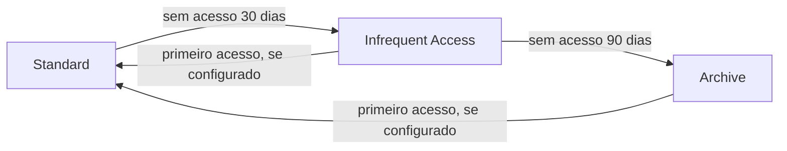

---
aliases:
  - Aula 10.7
modulo: 10
aula: 7
parte: "III Computação e armazenamento"
dominios:
  - 3
  - 4
lida: false
tags:
  - aula
  - saa-c03
  - modulo-10
---

# Aula 10.7: EFS, performance, throughput e classes de armazenamento

[[10 - Armazenamento em Bloco e Arquivos EBS EFS FSx|Voltar ao módulo]]

> [!question] Pergunta que esta aula responde
> O [[EFS]] tem três botões de desempenho (modo de performance, modo de [[Throughput|throughput]] e classe de armazenamento): o que cada um muda, qual escolher por padrão e como a classe certa derruba o custo de arquivos que quase ninguém lê?

## Três decisões independentes

Ao criar um [[EFS]] você escolhe, além de Regional ou One Zone (aula 10.6):

1. **Modo de performance**: General Purpose ou Max I/O.
2. **Modo de [[Throughput|throughput]]**: Elastic, Provisioned ou Bursting.
3. **Classes de armazenamento** (via lifecycle): Standard, Infrequent Access (IA) e Archive.

Misturar essas três ideias é a causa mais comum de erro em prova. Cada uma responde a uma pergunta diferente: **quão rápida é cada operação** (performance), **quantos bytes por segundo posso mover** ([[Throughput|throughput]]) e **quanto custa guardar** (classe).

## Modo de performance

| Modo | Para quê | Observação |
|---|---|---|
| **General Purpose** | Padrão. Menor [[Latencia\|latência]] por operação | A AWS recomenda para todos os sistemas de arquivos. One Zone usa sempre este |
| **Max I/O** | Geração anterior, cargas muito paralelas que toleram [[Latencia\|latência]] maior | Não suportado em One Zone nem com [[Elastic Throughput\|throughput Elastic]] |

Verificado em novembro de 2026 na documentação de performance do [[EFS]]: a AWS recomenda General Purpose para tudo, e o Max I/O tem [[Latencia|latência]] maior por operação. Na prova, se aparecer "milhares de instâncias com acesso paralelo, altíssimo [[Throughput|throughput]] agregado", o Max I/O aparece como [[Distrator|distrator]] ou resposta antiga; a orientação atual é General Purpose. O modo de performance é definido **na criação** e não muda depois. A [[Metrica|métrica]] `PercentIOLimit` do [[CloudWatch]] mostra o quanto você está perto do limite de [[IOPS]] do modo General Purpose.

## Modos de throughput

O [[Throughput]] do [[EFS]] é medido em bytes por segundo, e **[[IOPS]] não são cobrados separadamente**: cada requisição [[NFS]] conta como 4 KB ou o tamanho real, o que for maior. Leituras têm desconto (contam menos que escritas), por isso o sistema lê mais rápido do que escreve.

| Modo | Como funciona | Quando usar |
|---|---|---|
| **Elastic** (recomendado) | Escala sozinho para cima e para baixo; você paga só pelos dados lidos e escritos | Cargas com picos ou imprevisíveis, ou razão média/pico de 5% ou menos |
| **Provisioned** | Você define o [[Throughput\|throughput]], independente do tamanho; paga pelo que provisiona acima da base incluída | Requisito conhecido, razão média/pico de 5% ou mais |
| **Bursting** | [[Throughput]] proporcional ao tamanho em Standard, com [[Burst Credits\|créditos de burst]] | Quando o throughput deve crescer com o volume de dados |

### Bursting em números

- **Base**: 50 KiB/s por GiB em Standard (50 MiB/s por TiB).
- **Com créditos**: até 100 MiB/s por TiB (mínimo de 100 MiB/s), até o limite da Região.
- **Sem créditos**: 50 MiB/s por TiB (mínimo de 1 MiB/s).
- Créditos acumulam quando o uso está abaixo da base e são gastos acima dela.

> [!example] Sistema pequeno, pico grande
> Um [[EFS]] com 100 GiB em Standard tem base de cerca de 5 MiB/s (100 x 50 KiB/s). Com créditos, pode estourar até 100 MiB/s (o mínimo). Se uma carga de CI/CD empurra 80 MiB/s por horas, os créditos acabam e o [[Throughput|throughput]] desaba para o patamar sem créditos, perto de 5 MiB/s. A cura é trocar para **Elastic** (ou Provisioned, se o consumo for estável e alto), não aumentar o disco só para ganhar base.

Analogia com o [[EBS]]: Bursting lembra o crédito do [[gp2]] ([[10.03 - EBS SSD gp3 gp2 e Provisioned IOPS|aula 10.3]]), e Provisioned lembra pagar [[IOPS]] à parte. Mas no [[EFS]] a recomendação moderna é Elastic.

### Números de referência (General Purpose, Regional, verificado em novembro de 2026)

| [[Throughput]] | Leitura por sistema | Escrita por sistema | Por cliente |
|---|---|---|---|
| Elastic | 20 a 60 GiB/s | 1 a 5 GiB/s | 1.500 MiB/s (cliente recente) |
| Provisioned | 3 a 10 GiB/s | 1 a 3,33 GiB/s | 500 MiB/s |
| Bursting | 3 a 5 GiB/s | 1 a 3 GiB/s | 500 MiB/s |

[[Latencia|Latência]] típica: cerca de 1 ms em leitura e 2,7 ms em escrita no Regional (One Zone: 1,6 ms em escrita). Valores variam por Região e são melhor caso.

## Classes de armazenamento

| Classe | Dados | [[Latencia\|Latência]] de primeiro byte | Custo de armazenar |
|---|---|---|---|
| **Standard** | Acessados com frequência (SSD) | Cerca de 1 ms leitura, 2,7 ms escrita | Mais alto |
| **Infrequent Access (IA)** | Poucas vezes por trimestre | Dezenas de ms | Bem menor, com cobrança por leitura |
| **Archive** | Poucas vezes por ano ou menos | Dezenas de ms | O menor, com cobrança por leitura |

Cada classe existe nas versões Regional e One Zone, com preços próprios. A classe Archive é suportada em sistemas de arquivos com [[Throughput|throughput]] **Elastic** (verificado em novembro de 2026 na documentação de recursos do [[EFS]]); em Bursting e Provisioned, conte com Standard e IA.

Dois detalhes de custo que a prova usa: arquivos menores que 128 KiB são medidos como 128 KiB nas classes IA e Archive (e só entram no lifecycle em políticas atualizadas desde 26/11/2023), e IA e Archive **cobram por leitura**, por isso só compensam para dados realmente frios ([metered sizes](https://docs.aws.amazon.com/efs/latest/ug/metered-sizes.html)).

> [!example] Conta de custo: Standard versus IA
> Um sistema com 10 TiB, dos quais 8 TiB não são lidos há mais de 30 dias. Sem lifecycle, os 10 TiB ficam em Standard, a classe mais cara por GB. Com a política de IA, os 8 TiB passam para a classe bem mais barata e só o 1,5 a 2 TiB quente continua em Standard. A economia vem de **mover o grosso para uma classe mais barata**; se esses 8 TiB passassem a ser lidos todos os dias, a cobrança por leitura da IA poderia anular o ganho. Preços mudam: consulte a [página de preços do EFS](https://aws.amazon.com/efs/pricing/) para os valores atuais.

> [!example] Conta de custo: Provisioned versus Elastic
> Um sistema precisa de 100 MiB/s de pico, mas em média usa 2 MiB/s (razão média/pico de 2%). Em Provisioned você paga pelos 100 MiB/s o mês todo; em Elastic paga só pelos bytes que realmente trafegam, e a média é baixa. Com razão média/pico acima de 5%, a conta se inverte e Provisioned tende a ser mais barato.

### Lifecycle management: as três políticas

O lifecycle do [[EFS]] tem três políticas, aplicadas ao sistema inteiro e baseadas no **último acesso em Standard** (um timer interno, não o atime POSIX):

- **Transition into IA**: padrão de 30 dias sem acesso.
- **Transition into Archive**: padrão de 90 dias sem acesso.
- **Transition into Standard**: por padrão os arquivos **não voltam**. Escolhendo **On first access**, o arquivo lido em IA ou Archive volta para Standard (é o chamado [[S3 Intelligent-Tiering|Intelligent-Tiering]] do [[EFS]]).

Detalhes que caem em prova (documentação de gerenciamento de lifecycle):

- **Metadados ficam sempre em Standard** (nomes, donos, estrutura de diretórios), então listar pastas é rápido e não conta como acesso.
- Escritas em arquivos de IA ou Archive vão primeiro para Standard e só podem ser transferidas após 24 horas.
- O tempo de transição depende do tamanho dos arquivos e da carga; é operação de baixa prioridade.

> [!info] Ligando os pontos
> A mesma lógica de camadas existe no [[S3]]: [[11 - Amazon S3 a Fundo|Módulo 11]] mostra [[S3 Intelligent-Tiering|Intelligent-Tiering]] e lifecycle para objetos. No [[EFS]] o lifecycle é por arquivo e o acesso continua pelo mesmo caminho [[NFS]], sem mudar a aplicação.

## Boas práticas de desempenho

- Prefira **General Purpose + Elastic** como ponto de partida.
- Use o **mount helper** (`amazon-efs-utils`) atualizado, que ajuda a chegar ao teto de 1.500 MiB/s por cliente.
- Paralelize: o [[EFS]] escala por **muitos clientes e muitas threads**, não por uma única thread sequencial.
- Para muitos arquivos pequenos, o custo é de operações de metadados e [[Latencia|latência]] por arquivo: mais threads ajudam; mover arquivos pequenos para IA quase não compensa.
- Monitore com [[CloudWatch]]: `PercentIOLimit`, `BurstCreditBalance` (Bursting), `MeteredIOBytes` (Elastic).

## Como isso cai na prova

Cobre **Task 3.1** (performance de armazenamento), **Task 4.1** (custo de armazenamento) e **Task 2.2** (desempenho com escalabilidade).

**Padrões de cenário**
- "Carga imprevisível, picos curtos, não quero provisionar nada": [[Elastic Throughput|throughput Elastic]].
- "[[EFS]] pequeno com picos longos esgota o burst": mudar para Elastic ou Provisioned.
- "Muitos arquivos antigos, raramente lidos, reduzir custo": lifecycle para IA (e Archive).
- "Mover automaticamente de volta se alguém ler": política Transition into Standard on first access.

**Palavras-chave em inglês**: "unpredictable workload", "spiky", "[[Burst Credits|burst credits]] exhausted", "infrequently accessed files", "lifecycle management", "cost-optimize".

**Pegadinhas clássicas**
- [[IOPS]] não são cobrados à parte no [[EFS]]; o que se cobra é [[Throughput|throughput]] (Elastic e Provisioned) e GB armazenado.
- Bursting escala com o tamanho em Standard: disco pequeno, base pequena.
- Max I/O é geração anterior: a AWS recomenda General Purpose.
- Metadados nunca saem de Standard.
- O lifecycle não muda o caminho de acesso: o arquivo continua aparecendo no mesmo lugar.

| Requisito no enunciado | Resposta provável | Por quê |
|---|---|---|
| Carga imprevisível | Elastic | Escala sem provisionar |
| Requisito constante e alto | Provisioned | Paga o que reserva |
| [[Throughput]] cresce com os dados | Bursting | Base por GiB em Standard |
| Dados frios, menor custo | Lifecycle para IA e Archive | Classe mais barata por GB |

## Resumo

> [!abstract] A aula em uma frase
> No [[EFS]], o modo de performance define a [[Latencia|latência]] por operação (use General Purpose), o modo de [[Throughput|throughput]] define quantos bytes por segundo (Elastic como padrão, Provisioned para carga constante, Bursting quando escala com o tamanho) e as classes IA e Archive, acionadas por lifecycle, baixam o custo dos dados frios.

**A lógica, em 5 passos**
1. Performance, [[Throughput|throughput]] e classe são decisões independentes.
2. General Purpose é o padrão recomendado; Max I/O é legado.
3. Elastic escala sozinho e cobra por uso; Provisioned cobra por reserva; Bursting depende de créditos.
4. Standard, IA e Archive trocam custo de armazenamento por [[Latencia|latência]] e cobrança de leitura.
5. Lifecycle move por último acesso; metadados ficam em Standard.

**Números para lembrar**

| O quê | Valor |
|---|---|
| Base do Bursting | 50 KiB/s por GiB (50 MiB/s por TiB) |
| Burst máximo | 100 MiB/s por TiB (mínimo 100 MiB/s) |
| Por cliente (Elastic, cliente recente) | 1.500 MiB/s |
| IA padrão | 30 dias sem acesso |
| Archive padrão | 90 dias sem acesso |
| Escrita em IA ou Archive | Passa por Standard, elegível após 24 h |

**Na prática, isso significa**
- Comece com General Purpose e Elastic.
- Se o [[Throughput|throughput]] é constante e conhecido, considere Provisioned.
- Ligue lifecycle em sistemas de arquivos grandes com dados frios.
- Use "on first access" quando dados frios podem voltar a ficar quentes.

> [!tip] Liga com
> Vem de [[10.06 - EFS Arquivos NFS Compartilhados|EFS e NFS compartilhados]]. Segue para o [[10.08 - FSx for Windows File Server e FSx for Lustre|FSx for Windows e Lustre]].

## Erros comuns

- **Aumentar o disco para ganhar [[Throughput|throughput]] no Bursting** quando Elastic resolveria sem custo fixo.
- **Escolher Max I/O por achar que é mais rápido.** Ele tem [[Latencia|latência]] maior.
- **Esperar que o lifecycle mova metadados.** Eles ficam em Standard.
- **Achar que ler um arquivo em IA o traz de volta sozinho.** Só com a política on first access.
- **Esquecer o custo de leitura em IA e Archive** em dados que na verdade são lidos com frequência.

## Pratique

**1.** Um [[EFS|sistema de arquivos EFS]] tem uso muito variável: horas ociosas e picos curtos e imprevisíveis. A equipe não quer provisionar nada. Qual modo de [[Throughput|throughput]] usar?

- [ ] a) Provisioned com o pico máximo esperado
- [ ] b) Bursting com um disco maior
- [ ] c) Elastic
- [ ] d) Max I/O

**2.** Um [[EFS]] com 200 GiB em Standard consome [[Burst Credits|créditos de burst]] e vê o [[Throughput|throughput]] cair. A carga é de picos longos. Qual é a melhor mudança?

- [ ] a) Migrar para Elastic ou Provisioned, conforme o padrão de uso
- [ ] b) Trocar para o modo Max I/O, que remove a dependência de créditos de burst em cargas paralelas
- [ ] c) Mudar para One Zone
- [ ] d) Habilitar criptografia em trânsito

**3.** Qual afirmação sobre o modo de performance Max I/O está correta?

- [ ] a) É o modo recomendado para todos os sistemas de arquivos, pela menor latência
- [ ] b) É suportado em sistemas One Zone e com throughput Elastic
- [ ] c) É de geração anterior, com latência maior por operação que o General Purpose
- [ ] d) Pode ser alterado a qualquer momento sem recriar o sistema

**4.** Uma empresa guarda terabytes de arquivos que quase ninguém lê após 60 dias e quer reduzir o custo sem mudar a aplicação. Qual abordagem?

- [ ] a) Copiar os arquivos antigos para volumes EBS sc1
- [ ] b) Apagar os arquivos após 60 dias e restaurar de backup quando necessário
- [ ] c) Migrar o sistema para EFS One Zone, que é sempre mais barato
- [ ] d) Habilitar as políticas de lifecycle para IA e Archive

**5.** Quais DUAS afirmações sobre o lifecycle do [[EFS]] estão corretas? (Escolha DUAS.)

- [ ] a) As transições se baseiam no último acesso em Standard
- [ ] b) Os metadados dos arquivos também são movidos para IA
- [ ] c) Por padrão, arquivos acessados em IA voltam sempre para Standard
- [ ] d) Metadados permanecem em Standard
- [ ] e) A transição para Archive exige primeiro mover o arquivo para o S3

**6.** Uma aplicação trabalha com milhões de arquivos pequenos e exige o menor tempo de resposta quando um arquivo antigo volta a ser lido. Que configuração de lifecycle ajuda?

- [ ] a) Transition into Standard com On first access
- [ ] b) Transition into IA após 7 dias, sem retorno
- [ ] c) Desativar todas as políticas
- [ ] d) Mover todos os arquivos para Archive

**7.** No modo Bursting, qual é a base de [[Throughput|throughput]]?

- [ ] a) 125 MiB/s fixos, independente do tamanho
- [ ] b) 3 IOPS por GiB armazenado
- [ ] c) 50 KiB/s por GiB em Standard
- [ ] d) 1.000 IOPS por GiB armazenado

**8.** Como o [[EFS]] cobra [[IOPS]]?

- [ ] a) Por IOPS provisionado, como no io2
- [ ] b) Não há cobrança separada, pois IOPS entram na contagem de throughput
- [ ] c) Por requisição NFS, com preço fixo por mil requisições, além do armazenamento mensal
- [ ] d) Cobra IOPS apenas no modo General Purpose

**9.** Quais DUAS situações favorecem Provisioned em vez de Elastic? (Escolha DUAS.)

- [ ] a) Requisito de throughput conhecido e constante
- [ ] b) Picos imprevisíveis e raros
- [ ] c) Razão média/pico acima de 5%
- [ ] d) Carga totalmente ociosa na maior parte do tempo
- [ ] e) Necessidade de Max I/O

**10.** Um arquivo em [[EFS Infrequent Access|EFS IA]] é modificado. O que acontece com a escrita?

- [ ] a) A escrita vai primeiro para Standard e o arquivo pode ser transferido de novo após 24 horas
- [ ] b) A escrita fica em IA, sem passar por Standard, e o arquivo continua elegível ao Archive imediatamente
- [ ] c) O arquivo é copiado para o S3 automaticamente
- [ ] d) A escrita é bloqueada até o arquivo voltar manualmente

**11.** Qual [[Metrica|métrica]] do [[CloudWatch]] indica a aproximação do limite de [[IOPS]] do modo General Purpose?

- [ ] a) BurstCreditBalance
- [ ] b) PercentIOLimit
- [ ] c) ClientConnections
- [ ] d) VolumeQueueLength

**12.** Uma equipe tem arquivos lidos poucas vezes por ano, quer o MENOR custo de armazenamento e aceita [[Latencia|latência]] de dezenas de milissegundos. Qual classe do [[EFS]]?

- [ ] a) Standard
- [ ] b) Infrequent Access
- [ ] c) Max I/O
- [ ] d) Archive

> [!success]- Gabarito
> **1. c)** Elastic escala sozinho e cobra por uso; a) provisionar o pico paga por capacidade ociosa; b) Bursting com disco maior é a cura errada para imprevisibilidade; d) Max I/O é modo de performance, não de [[Throughput|throughput]].
> **2. a)** Elastic ou Provisioned eliminam a dependência de créditos; b) Max I/O não resolve [[Throughput|throughput]]; c) One Zone é tipo de sistema, não throughput; d) criptografia não altera o throughput.
> **3. c)** Max I/O é legado e tem [[Latencia|latência]] maior; a) quem é recomendado é o General Purpose; b) não é suportado nesses casos; d) o modo é definido na criação.
> **4. d)** o lifecycle move dados frios para IA e Archive sem mudar a aplicação; a) [[EBS]] não é compartilhado como arquivo; b) apagar perde dados; c) One Zone reduz custo mas perde resiliência e não trata dados frios.
> **5. a) e d)** transição por último acesso em Standard e metadados sempre em Standard; b) metadados não saem de Standard; c) por padrão os arquivos não voltam; e) não há passagem pelo [[S3]].
> **6. a)** On first access devolve o arquivo lido a Standard; b) e d) empurram mais dados para classes lentas; c) sem políticas não há economia.
> **7. c)** 50 KiB/s por GiB em Standard; a) 125 MiB/s é a base do [[gp3]]; b) 3 [[IOPS]] por GiB é o [[gp2]]; d) 1.000 IOPS por GiB é o [[io2]].
> **8. b)** [[IOPS]] não são cobrados à parte e entram na contagem de [[Throughput|throughput]]; a), c) e d) descrevem cobranças que o [[EFS]] não faz.
> **9. a) e c)** requisito conhecido e razão média/pico acima de 5% favorecem Provisioned; b) e d) favorecem Elastic; e) Max I/O não é [[Throughput|throughput]].
> **10. a)** escritas passam por Standard e podem ser transferidas após 24 horas; b) não ficam direto em IA; c) não vão ao [[S3]]; d) não há bloqueio.
> **11. b)** PercentIOLimit mede o uso do limite de [[IOPS]]; a) é do Bursting; c) conexões de clientes; d) é [[Metrica|métrica]] de [[EBS]].
> **12. d)** Archive é a mais barata para dados lidos poucas vezes por ano; a) Standard é a mais cara; b) IA serve acessos mais frequentes (poucas vezes por trimestre) e custa mais que Archive; c) Max I/O é modo de performance, não classe.

## Para aprofundar

- [ ] [Amazon EFS performance specifications](https://docs.aws.amazon.com/efs/latest/ug/performance.html) (AWS Docs): modos, tabela de números e [[Burst Credits|burst credits]].
- [ ] [Managing storage lifecycle](https://docs.aws.amazon.com/efs/latest/ug/lifecycle-management-efs.html) (AWS Docs): as três políticas e as regras de metadados.
- [ ] [Amazon EFS quotas](https://docs.aws.amazon.com/efs/latest/ug/limits.html) (AWS Docs): limites ajustáveis de [[Throughput|throughput]] por Região.

Próxima aula: [[10.08 - FSx for Windows File Server e FSx for Lustre]]
