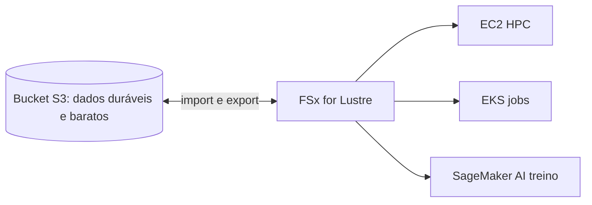

---
aliases:
  - Aula 10.8
modulo: 10
aula: 8
parte: "III Computação e armazenamento"
dominios:
  - 2
  - 3
  - 4
lida: false
tags:
  - aula
  - saa-c03
  - modulo-10
---

# Aula 10.8: FSx for Windows File Server e FSx for Lustre

[[10 - Armazenamento em Bloco e Arquivos EBS EFS FSx|Voltar ao módulo]]

> [!question] Pergunta que esta aula responde
> O que o [[FSx]] resolve que o [[EFS]] não resolve, quando uma pasta de rede Windows com [[SMB]] e [[Active Directory]] exige o [[FSx for Windows File Server|FSx for Windows]], e quando um cluster de HPC ou treino de ML pede o [[FSx for Lustre]] ligado ao [[S3]]?

## Por que existe uma família FSx

O [[EFS]] atende Linux por [[NFS]]. Mas empresas têm aplicações Windows que esperam pastas de rede com [[SMB]], permissões NTFS e login do [[Active Directory]], e cargas de HPC que querem um sistema de arquivos paralelo de altíssimo [[Throughput|throughput]]. Montar e operar esses servidores sozinho (patch, hardware, backup, [[Failover|failover]]) é pesado.

O **[[FSx|Amazon FSx]]** é uma família de serviços gerenciados que entrega sistemas de arquivos de terceiros populares: **Windows File Server**, **[[FSx for Lustre|Lustre]]**, **[[FSx for NetApp ONTAP|NetApp ONTAP]]** e **[[FSx for OpenZFS|OpenZFS]]**. Esta aula cobre os dois primeiros; a [[10.09 - FSx for NetApp ONTAP e FSx for OpenZFS|aula 10.9]] cobre os outros dois.

## FSx for Windows File Server

Fatos (documentação, verificado em novembro de 2026):

- **Servidores Windows de verdade**, gerenciados, sobre um sistema de arquivos **nativo do Windows**. Aplicações e ferramentas Windows funcionam sem mudança ([[Lift and Shift|lift and shift]]).
- **Protocolo [[SMB]]** (versões 2.0 a 3.1.1). Acesso por Windows Server 2008 e Windows 7 em diante, e também por Linux recente.
- **Quem acessa**: [[EC2]], [[WorkSpaces]], AppStream 2.0 e [[VMware Cloud on AWS]]; on-premises via [[Direct Connect]] ou [[Site-to-Site VPN]]; outras [[VPC|VPCs]], contas e [[Regiao AWS|Regiões]] via [[VPC Peering|VPC peering]] ou [[Transit Gateway]].
- **Autenticação**: **[[Active Directory|Microsoft Active Directory]]** ([[Directory Service|AWS Managed Microsoft AD]] ou AD próprio). O controle de acesso é por **ACLs do Windows** nos arquivos e pastas.
- **Segurança**: [[Criptografia em Repouso|criptografia em repouso]] com [[KMS]] (também nos backups) e em trânsito automática com chaves de sessão [[Kerberos]] [[SMB]]; [[Security Group|security groups]] da [[VPC]] controlam a rede; [[IAM]] controla a API.
- **Compartilhamentos (shares)**: já existe um `\share` padrão e você cria quantos quiser; acessa-se pelo nome [[DNS]] ou por **DNS aliases**.
- **Armazenamento**: **SSD** ([[Latencia|latência]] baixa: bancos, mídia, analytics) ou **HDD** (home directories, shares departamentais, CMS). Capacidade, [[IOPS]] de SSD e [[Throughput|throughput]] são provisionados **de forma independente** e podem ser alterados depois.
- **Backups**: **diários automáticos por padrão**, incrementais, consistentes via **VSS** (Volume Shadow Copy Service), mais backups manuais.

### Single-AZ e Multi-AZ

| Aspecto | Single-AZ | [[Multi-AZ]] |
|---|---|---|
| Servidores | Um servidor de arquivos | Servidor principal e **standby em outra [[Zona de Disponibilidade\|AZ]]** |
| Falha de componente | Detectada e corrigida na [[Zona de Disponibilidade\|AZ]] | [[Failover\|Failover automático]] para o standby |
| Falha da [[Zona de Disponibilidade\|AZ]] inteira | Sem proteção de AZ | Continua disponível |
| Uso típico | Dev e teste, custo menor | Produção que exige [[Alta Disponibilidade\|alta disponibilidade]] |

> [!example] Pasta de rede da empresa migrada para a nuvem
> Uma empresa tem 500 usuários com unidade de rede `\\fileserver\departamentos` autenticada por [[Active Directory]]. Migrar para [[EFS]] é impossível (EFS não é [[SMB]] nem Windows). Migrar para um Windows em [[EC2]] é possível, mas exige patch, backup e cluster de [[Failover|failover]]. O **[[FSx for Windows File Server|FSx for Windows]] [[Multi-AZ]]** mantém a mesma experiência (SMB, ACLs, AD) com failover e backup geridos. É o padrão clássico de prova.

### Recursos de gestão

- **Shadow copies** (versões anteriores dos arquivos, o "restaurar versão anterior" do Windows).
- **Quotas de usuário** e **deduplicação de dados**.
- **DFS [[Namespaces e Cgroups|Namespaces]]**, agrupa vários sistemas de arquivos [[FSx]] sob um único caminho lógico (por exemplo, `\empresa\dados`), para que os usuários não precisem saber em qual file system cada pasta mora e a capacidade possa crescer adicionando sistemas ([visão geral do FSx for Windows](https://docs.aws.amazon.com/fsx/latest/WindowsGuide/what-is.html)).

## FSx for Lustre

[[FSx for Lustre|Lustre]] é um sistema de arquivos **paralelo e de alto desempenho**, usado em HPC, machine learning, processamento de vídeo e modelagem financeira. Segundo a documentação (verificado em novembro de 2026): [[Latencia|latência]] submilissegundo, até múltiplos TB/s de [[Throughput|throughput]] e milhões de [[IOPS]].

- **POSIX**, para Linux, com consistência read-after-write e file locking.
- **Acesso**: [[EC2]] (cliente [[FSx for Lustre|Lustre]] open source), [[Container|contêineres]] no [[ECS]] (em EC2) e no [[EKS]] (via CSI driver). O cliente vem incluído no Amazon Linux 2 e 2023; para RHEL, CentOS e Ubuntu há repositório AWS.
- **Não é para Windows**. Não é [[NFS]] nem [[SMB]]: usa o cliente [[FSx for Lustre|Lustre]].

### Scratch e Persistent

| Tipo | Dados | Quando usar |
|---|---|---|
| **Scratch** | **Não replicados**; não sobrevivem à falha do servidor | Armazenamento temporário e processamento de curta duração |
| **Persistent** | **Replicados dentro da mesma [[Zona de Disponibilidade\|AZ]]**; servidores com falha são substituídos | Armazenamento de longo prazo e cargas orientadas a [[Throughput\|throughput]] |

> [!warning] O Lustre vive em uma única AZ
> Um file system [[FSx for Lustre]] é implantado em **uma [[Zona de Disponibilidade|AZ]]**. O persistent protege contra falha de **servidor** (a réplica fica dentro da AZ), não contra falha de **AZ**; "persistent" não equivale a "[[Multi-AZ]]". Para sobreviver à perda de uma AZ, os dados duráveis devem estar no [[S3]] (data repository) ou em backups ([documentação do FSx for Lustre](https://docs.aws.amazon.com/fsx/latest/LustreGuide/using-fsx-lustre.html)).

> [!example] Lustre scratch para um pipeline de poucos dias
> Uma equipe de renderização processa 50 TB guardados no [[S3]] durante 3 dias por mês. Em vez de manter um sistema rápido e caro o mês inteiro, cria um [[Lustre Scratch e Persistent|Lustre scratch]] ligado ao [[Bucket|bucket]], roda as tarefas em paralelo, exporta os resultados ao S3 e apaga o file system. Paga o armazenamento rápido por 3 dias e perde só dados que já estão (ou voltam) duráveis no S3.

### Classes de armazenamento do Lustre

- **SSD**: operações pequenas e aleatórias, [[Latencia|latência]] submilissegundo consistente sobre todo o conjunto de dados.
- **[[S3 Intelligent-Tiering|Intelligent-Tiering]]**: elástica e econômica, recomendada para a maioria das cargas que não exigem [[Latencia|latência]] baixa consistente em todo o conjunto; cache SSD de leitura opcional.
- **HDD**: [[Latencia|latência]] de um dígito de milissegundos consistente e até dezenas de GB/s; cache SSD de leitura opcional de 20% da capacidade HDD.

### Integração com S3: o recurso mais cobrado

Um [[FSx for Lustre]] pode ser **ligado a um [[Bucket|bucket]] [[S3]]** (data repository). Os objetos aparecem **como arquivos**; a lista é importada na criação (e pode importar novidades depois), e os resultados podem ser **gravados de volta** no S3 (data repository tasks). O mesmo pode ser feito com dados on-premises via [[Direct Connect]] ou VPN.

Por que isso importa: o [[S3]] é barato e durável, mas não é um sistema de arquivos POSIX rápido. O padrão é **guardar no S3, processar no [[FSx for Lustre|Lustre]] e devolver o resultado ao S3**. Com o **[[SageMaker AI]]**, o Lustre elimina o download inicial do S3 em cada treino.

## Como as peças se encaixam no desenho de uma arquitetura

### FSx for Windows em uma arquitetura corporativa

Retomando o exemplo da empresa de 500 usuários, o desenho típico na AWS, com uma aplicação financeira em [[EC2]] Windows lendo relatórios da pasta de rede, é:

1. Um **[[Directory Service|AWS Managed Microsoft AD]]** (ou conexão com o [[Active Directory|AD]] local por VPN ou [[Direct Connect]]) fornece as identidades.
2. O **[[FSx for Windows File Server|FSx for Windows]] [[Multi-AZ]]** é criado em duas [[Sub-rede Privada|sub-redes privadas]] de [[Zona de Disponibilidade|AZs]] diferentes, ligado ao diretório. O servidor principal fica em uma AZ e o standby na outra.
3. Os servidores de aplicação e os usuários (por exemplo, [[WorkSpaces]]) mapeiam o compartilhamento pelo nome [[DNS]] ou por um **DNS alias** que preserva o nome antigo `\\fileserver`, o que evita reconfigurar clientes na migração.
4. O [[Security Group|security group]] do sistema de arquivos libera as portas de [[SMB]] (445) a partir das [[Sub-rede|sub-redes]] de cliente. [[Criptografia em Repouso|Dados em repouso]] usam [[KMS]]; em trânsito, SMB com [[Kerberos]].
5. Backups automáticos diários e shadow copies dão duas camadas de recuperação: restaurar o sistema inteiro ou apenas um arquivo apagado.

Por que [[Multi-AZ]] importa aqui: em um desenho Single-AZ, uma falha da [[Zona de Disponibilidade|AZ]] derruba a pasta de rede, e a aplicação financeira para. No Multi-AZ, o [[Failover|failover]] para o standby é automático, e o nome [[DNS]] continua o mesmo. Para a prova, a pergunta típica é "como aumentar a [[Disponibilidade|disponibilidade]] do servidor de arquivos Windows", e a resposta é Multi-AZ.

> [!tip] Provisionar capacidade e desempenho de forma independente
> No [[FSx for Windows File Server|FSx for Windows]] você escolhe separadamente capacidade, [[IOPS]] de SSD e [[Throughput|throughput]]. Isso permite ajustar só o que falta: se a pasta cresce mas o uso é leve, aumente a capacidade; se muitos usuários abrem arquivos grandes ao mesmo tempo, aumente o throughput. A documentação confirma que esses parâmetros podem ser alterados depois da criação.

### FSx for Lustre em um pipeline de dados

Um pipeline típico de machine learning ou de simulação funciona em quatro passos:

1. Os dados brutos ficam no **[[S3]]**, barato e durável, onde podem ser compartilhados com outras ferramentas.
2. Cria-se o **[[FSx for Lustre]]** ligado ao [[Bucket|bucket]]. Os objetos aparecem como arquivos, e o conteúdo de cada objeto é carregado do [[S3]] quando é lido pela primeira vez.
3. Centenas de instâncias de computação ([[EC2]], [[EKS]] ou [[SageMaker AI]]) leem e escrevem em paralelo, com [[Latencia|latência]] submilissegundo, sem baixar os dados do [[S3]] a cada tarefa.
4. Ao terminar, os resultados são exportados de volta ao [[S3]] (data repository task) e, se o sistema era **scratch**, ele é apagado, parando a cobrança.

O raciocínio de custo é o centro do desenho: o [[S3]] é o lugar barato e durável para guardar dados por muito tempo, e o [[FSx for Lustre|Lustre]] é o lugar caro e rápido que só existe enquanto o processamento roda. Scratch é a escolha natural para esse padrão de dados efêmeros; persistent serve quando o sistema precisa viver por mais tempo, como em uma plataforma de pesquisa compartilhada, e por isso replica os dados e substitui servidores com falha.

> [!info] Sem laboratório nesta aula
> O [[FSx]] cobra por hora e por capacidade mínima, então não há laboratório. Se testar, use uma conta pessoal com Budgets e apague o file system no mesmo dia.

## Comparação rápida

| Característica | [[EFS]] | [[FSx for Windows File Server\|FSx for Windows]] | [[FSx for Lustre]] |
|---|---|---|---|
| Protocolo | [[NFS]] | [[SMB]] | [[FSx for Lustre\|Lustre]] (POSIX) |
| Sistema operacional | Linux | Windows (e Linux recente) | Linux |
| Identidade | POSIX, [[IAM]] | [[Active Directory]] | POSIX |
| Ponto forte | Elástico, [[Serverless\|serverless]], [[Multi-AZ\|multi-AZ]] | [[Lift and Shift\|Lift and shift]] de apps Windows | HPC e ML, integração com [[S3]] |
| Integra com [[S3]] | Não nativamente | Não | Sim, nativo |

## Como isso cai na prova

Cobre **Task 3.1** (armazenamento de alto desempenho), **Task 2.2** ([[Alta Disponibilidade|alta disponibilidade]], [[Multi-AZ]]) e **Task 4.1** (custo, HDD versus SSD).

**Padrões de cenário**
- "Aplicação Windows, pastas compartilhadas por [[SMB]], integra com [[Active Directory]]": [[FSx for Windows File Server|FSx for Windows]].
- "[[Alta Disponibilidade|Alta disponibilidade]] entre [[Zona de Disponibilidade|AZs]] para o servidor de arquivos Windows": [[FSx for Windows File Server|FSx for Windows]] [[Multi-AZ]].
- "HPC, ML, renderização, processar dados do [[S3]] com [[Latencia|latência]] submilissegundo": [[FSx for Lustre]].
- "Processamento temporário, mais barato, não precisa de replicação": [[Lustre Scratch e Persistent|Lustre scratch]].
- "Resultado do processamento deve voltar ao [[S3]]": [[FSx for Lustre|Lustre]] com data repository.

**Palavras-chave em inglês**: "[[SMB]]", "[[Active Directory]]", "Windows file shares", "NTFS", "[[Lift and Shift|lift and shift]]", "high-performance computing", "machine learning training", "sub-millisecond", "[[S3]] data repository", "[[Lustre Scratch e Persistent|scratch file system]]".

**Pegadinhas clássicas**
- [[EFS]] **não** serve para [[SMB]], Windows ou [[Active Directory|AD]].
- [[FSx for Lustre|Lustre]] **scratch** não replica: servidor com falha perde dados.
- [[FSx for Windows File Server|FSx for Windows]] Single-AZ não protege contra falha de [[Zona de Disponibilidade|AZ]].
- [[FSx for Lustre|Lustre]] vive em **uma [[Zona de Disponibilidade|AZ]]**: persistent não é [[Multi-AZ]]; para "[[Alta Disponibilidade|alta disponibilidade]] entre AZs para HPC", os dados duráveis ficam no [[S3]] ou em backups.
- [[FSx for Lustre|Lustre]] não é Windows; para Windows use [[FSx for Windows File Server|FSx for Windows]].
- [[FSx for Lustre|Lustre]] acelera o acesso ao [[S3]], mas não substitui o S3 como camada durável.

| Requisito no enunciado | Resposta provável | Por quê |
|---|---|---|
| [[SMB]] com [[Active Directory\|AD]] | [[FSx for Windows File Server\|FSx for Windows]] | SMB nativo e ACLs |
| Servidor de arquivos Windows sem downtime de [[Zona de Disponibilidade\|AZ]] | [[FSx for Windows File Server\|FSx for Windows]] [[Multi-AZ]] | Standby em outra AZ |
| HPC com dados no [[S3]] | [[FSx for Lustre]] | Integração nativa com S3 |
| Processamento temporário barato | [[Lustre Scratch e Persistent\|Lustre scratch]] | Sem replicação |

## Resumo

> [!abstract] A aula em uma frase
> [[FSx for Windows File Server|FSx for Windows]] entrega [[SMB]] nativo com [[Active Directory]] e ACLs, com opção [[Multi-AZ]], para [[Lift and Shift|lift and shift]] de apps Windows; [[FSx for Lustre]] entrega um sistema de arquivos paralelo de [[Latencia|latência]] submilissegundo, ligado ao [[S3]], para HPC e ML.

**A lógica, em 5 passos**
1. O [[EFS]] cobre [[NFS]] Linux; Windows e HPC exigem outros protocolos e desempenhos.
2. [[FSx for Windows File Server|FSx for Windows]]: [[SMB]], [[Active Directory|AD]], ACLs, VSS, SSD ou HDD, Single ou [[Multi-AZ]].
3. [[Multi-AZ]] mantém um standby em outra [[Zona de Disponibilidade|AZ]] com [[Failover|failover automático]].
4. [[FSx for Lustre]]: POSIX, paralelo, scratch (sem replicação) ou persistent (replicado).
5. [[FSx for Lustre|Lustre]] se liga ao [[S3]]: objetos viram arquivos e resultados voltam ao [[Bucket|bucket]].

**Números e fatos para lembrar**

| O quê | Valor |
|---|---|
| [[SMB]] suportado | 2.0 a 3.1.1 |
| Backup do Windows | Diário e automático por padrão (VSS) |
| [[FSx for Lustre\|Lustre]] | Submilissegundo, multi TB/s, milhões de [[IOPS]] |
| Scratch | Sem replicação |

**Na prática, isso significa**
- Pergunta com "Windows", "[[SMB]]" ou "[[Active Directory]]": [[FSx for Windows File Server|FSx for Windows]].
- Pergunta com "HPC", "ML" ou "dados do [[S3]] em alto desempenho": [[FSx for Lustre]].
- Produção Windows: [[Multi-AZ]].

> [!tip] Liga com
> Vem do [[10.07 - EFS Performance Throughput e Classes de Armazenamento|desempenho do EFS]]. Segue para o [[10.09 - FSx for NetApp ONTAP e FSx for OpenZFS|ONTAP e OpenZFS]].

## Erros comuns

- **Propor [[EFS]] para uma aplicação Windows com [[Active Directory|AD]].**
- **Usar [[Lustre Scratch e Persistent|Lustre scratch]] para dados que precisam sobreviver à falha do servidor.**
- **Escolher Single-AZ em produção que exige [[Alta Disponibilidade|alta disponibilidade]].**
- **Achar que o [[FSx for Lustre|Lustre]] substitui o [[S3]].** Ele é a camada rápida; o S3 segue como repositório durável.
- **Confundir [[FSx for Lustre|Lustre]] com [[NFS]].** Ele usa seu próprio cliente.

## Pratique

**1.** Uma empresa migra para a AWS uma aplicação Windows que usa pastas de rede [[SMB]] com permissões NTFS e autenticação do [[Active Directory]]. Qual serviço de armazenamento atende com menos mudanças?

- [ ] a) Amazon EFS com NFS
- [ ] b) Amazon S3 montado como unidade de rede por um cliente de terceiros
- [ ] c) Volume EBS compartilhado com Multi-Attach entre as instâncias
- [ ] d) Amazon FSx for Windows File Server

**2.** Uma aplicação Windows usa pastas [[SMB]] com [[Active Directory]] e exige que o servidor de arquivos continue disponível se uma [[Zona de Disponibilidade|AZ]] inteira falhar. O que configurar no [[FSx for Windows File Server|FSx for Windows]]?

- [ ] a) FSx for Windows com implantação Multi-AZ
- [ ] b) FSx for Windows Single-AZ com backup diário
- [ ] c) Um EFS One Zone
- [ ] d) Um volume EBS com snapshot a cada hora

**3.** Uma equipe de pesquisa roda simulações de HPC em Linux que leem centenas de GB de dados guardados no [[S3]] e precisam de [[Latencia|latência]] submilissegundo. Qual solução?

- [ ] a) EFS Elastic com os dados copiados do S3 por DataSync
- [ ] b) FSx for Lustre ligado ao bucket S3
- [ ] c) FSx for Windows com SMB
- [ ] d) Instance Store, copiando os dados do S3 a cada execução

**4.** Um sistema [[FSx for Lustre|Lustre]] será usado por poucas horas para um processamento e o resultado será salvo no [[S3]]. Qual tipo reduz o custo?

- [ ] a) Persistent com cache SSD de leitura
- [ ] b) Persistent replicado em outra AZ
- [ ] c) Scratch
- [ ] d) Um EFS Regional com Elastic

**5.** Quais DUAS afirmações sobre o [[FSx for Windows File Server]] estão corretas? (Escolha DUAS.)

- [ ] a) Usa SMB e integra com o Active Directory
- [ ] b) É NFS, voltado a Linux
- [ ] c) Faz backups diários automáticos por padrão
- [ ] d) Só funciona com HDD
- [ ] e) Não pode ser acessado por on-premises

**6.** Quais DUAS afirmações sobre [[FSx for Lustre]] estão corretas? (Escolha DUAS.)

- [ ] a) É compatível com POSIX e acessado por Linux
- [ ] b) Suporta acesso nativo por Windows via SMB
- [ ] c) Pode apresentar objetos de um bucket S3 como arquivos
- [ ] d) Tem durabilidade de 11 noves por definição
- [ ] e) Exige que os dados sejam copiados do S3 manualmente a cada job

**7.** Um treinamento de ML no [[SageMaker AI]] repete o download de um grande dataset do [[S3]] a cada execução. Como reduzir esse tempo e o custo de requisições?

- [ ] a) Aumentar o tamanho da instância, para baixar o tempo de download do S3 a cada execução
- [ ] b) Usar FSx for Lustre como fonte de dados do treino
- [ ] c) Trocar o dataset por arquivos menores
- [ ] d) Mover os dados para um EBS gp2

**8.** Qual sistema de arquivos usa [[NFS]] e é totalmente [[Serverless|serverless]], sem precisar provisionar capacidade?

- [ ] a) FSx for Windows File Server
- [ ] b) FSx for Lustre
- [ ] c) Amazon EFS
- [ ] d) Volume EBS

**9.** Uma empresa quer home directories e shares departamentais Windows com o menor custo, sem exigência de [[Latencia|latência]] baixa. Qual escolha de armazenamento no [[FSx for Windows File Server|FSx for Windows]]?

- [ ] a) HDD
- [ ] b) SSD com IOPS provisionados altos
- [ ] c) Lustre scratch
- [ ] d) EFS Standard

**10.** Qual é a função do VSS no [[FSx for Windows File Server|FSx for Windows]]?

- [ ] a) Cifrar dados em trânsito
- [ ] b) Autenticar usuários no Active Directory e aplicar as ACLs do NTFS em cada acesso
- [ ] c) Replicar dados entre Regiões
- [ ] d) Garantir backups consistentes do sistema de arquivos

**11.** Uma aplicação Linux em [[EC2]] precisa de um [[Armazenamento de Arquivos|sistema de arquivos de rede]] genérico para arquivos de usuários, sem requisitos de HPC. Qual é a opção mais simples?

- [ ] a) FSx for Lustre persistent
- [ ] b) EFS
- [ ] c) FSx for Windows via SMB para Linux
- [ ] d) Volume EBS io2 Multi-Attach

**12.** Por que o [[Lustre Scratch e Persistent|Lustre persistent]] é preferido ao scratch para dados que devem sobreviver a falhas de servidor?

- [ ] a) Porque os dados são replicados e servidores com falha são substituídos
- [ ] b) Porque usa NFS em vez do cliente Lustre, o que simplifica a montagem nas instâncias Linux
- [ ] c) Porque é gratuito durante os primeiros 12 meses e depois cobra apenas pelo armazenamento
- [ ] d) Porque só funciona com HDD

> [!success]- Gabarito
> **1. d)** [[FSx for Windows File Server|FSx for Windows]] entrega [[SMB]] nativo, NTFS ACLs e [[Active Directory|AD]]; a) [[EFS]] é [[NFS]] e não suporta Windows; b) o [[S3]] não é unidade SMB nativa; c) [[Multi-Attach]] é bloco, sem sistema de arquivos compartilhado.
> **2. a)** o [[Multi-AZ]] mantém standby em outra [[Zona de Disponibilidade|AZ]] com [[Failover|failover]]; b) Single-AZ com backup não é [[Alta Disponibilidade|alta disponibilidade]]; c) [[EFS]] não serve para Windows e One Zone é uma AZ; d) [[Snapshot|snapshot]] é recuperação, não [[Disponibilidade|disponibilidade]].
> **3. b)** [[FSx for Lustre|Lustre]] apresenta o [[S3]] como sistema de arquivos rápido; a) o [[EFS]] exige copiar os dados do S3 e não tem a integração nativa nem o desempenho agregado do Lustre; c) Windows e [[SMB]] não atendem HPC Linux; d) copiar a cada execução é lento.
> **4. c)** Scratch é o mais barato para dados temporários; a) e b) pagam por [[Durabilidade|durabilidade]] desnecessária; d) o [[EFS]] não é a solução de HPC.
> **5. a) e c)** [[SMB]] com [[Active Directory|AD]] e backups diários automáticos; b) é [[NFS]] no [[EFS]]; d) há SSD e HDD; e) o acesso on-premises é suportado via [[Direct Connect]] ou VPN.
> **6. a) e c)** POSIX no Linux e integração com [[S3]]; b) o acesso é pelo cliente [[FSx for Lustre|Lustre]]; d) a [[Durabilidade|durabilidade]] de 11 noves é do S3; o Lustre depende de scratch ou persistent dentro de uma [[Zona de Disponibilidade|AZ]] e de backups; e) a integração evita a cópia manual.
> **7. b)** o [[FSx for Lustre|Lustre]] elimina o download inicial do [[S3]]; a) uma instância maior baixa mais rápido, mas repete o download e as requisições ao S3; c) arquivos menores aumentam o número de requisições; d) o [[gp2|EBS gp2]] exigiria copiar o dataset do S3 para cada volume.
> **8. c)** o [[EFS]] é [[NFS]] [[Serverless|serverless]]; a) usa [[SMB]]; b) usa o cliente [[FSx for Lustre|Lustre]] e tem capacidade definida; d) [[EBS]] é bloco.
> **9. a)** HDD é o desenhado para home directories e shares; b) SSD é para as cargas mais sensíveis a [[Latencia|latência]]; c) e d) não são opções do [[FSx for Windows File Server|FSx for Windows]].
> **10. d)** o VSS garante backups consistentes; a) a [[Criptografia em Transito|criptografia em trânsito]] usa chaves [[Kerberos]] [[SMB]]; b) quem autentica é o [[Active Directory|AD]]; c) não replica entre [[Regiao AWS|Regiões]].
> **11. b)** o [[EFS]] é o [[NFS]] gerenciado simples; a) é para HPC; c) [[SMB]] é para Windows e [[Active Directory|AD]]; d) [[Multi-Attach]] não é sistema de arquivos compartilhado.
> **12. a)** persistent replica e substitui servidores; b) o cliente é o [[FSx for Lustre|Lustre]]; c) tem custo; d) HDD é só uma classe.

## Para aprofundar

- [ ] [What is FSx for Windows File Server?](https://docs.aws.amazon.com/fsx/latest/WindowsGuide/what-is.html) (AWS Docs): [[SMB]], [[Active Directory|AD]], [[Multi-AZ]], backups e segurança.
- [ ] [What is Amazon FSx for Lustre?](https://docs.aws.amazon.com/fsx/latest/LustreGuide/what-is.html) (AWS Docs): scratch, persistent, classes e [[S3]].
- [ ] [Availability and durability: Single-AZ and Multi-AZ](https://docs.aws.amazon.com/fsx/latest/WindowsGuide/high-availability-multiAZ.html) (AWS Docs): [[Failover|failover]] do [[FSx for Windows File Server|FSx for Windows]].

Próxima aula: [[10.09 - FSx for NetApp ONTAP e FSx for OpenZFS]]
