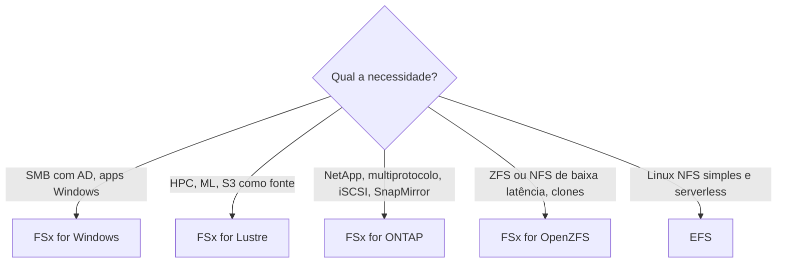

---
aliases:
  - Aula 10.9
modulo: 10
aula: 9
parte: "III Computação e armazenamento"
dominios:
  - 2
  - 3
  - 4
lida: false
tags:
  - aula
  - saa-c03
  - modulo-10
---

# Aula 10.9: FSx for NetApp ONTAP e FSx for OpenZFS

[[10 - Armazenamento em Bloco e Arquivos EBS EFS FSx|Voltar ao módulo]]

> [!question] Pergunta que esta aula responde
> Quando um cenário diz "migrar um NetApp ou um servidor [[FSx for OpenZFS|ZFS]] on-premises sem mudar a aplicação", quais serviços [[FSx]] entram, o que cada um entrega (multiprotocolo, clones, tiering, baixa [[Latencia|latência]]) e como distinguir os dois na prova?

## Por que mais dois sabores

Empresas que já rodam **[[FSx for NetApp ONTAP|NetApp ONTAP]]** ou **[[FSx for OpenZFS|ZFS]]** on-premises dependem de recursos específicos ([[Snapshot|snapshots]] instantâneos, clones, replicação SnapMirror, acesso por vários protocolos). Reescrever tudo para [[EFS]] ou [[FSx for Windows File Server|FSx for Windows]] seria caro e arriscado. O [[FSx]] oferece esses dois sistemas como serviços gerenciados para migrar **sem mudar a aplicação nem a forma de gerenciar os dados**.

## FSx for NetApp ONTAP

Fatos (documentação, verificado em novembro de 2026):

- Armazenamento compartilhado **multiprotocolo**: **[[NFS]], [[SMB]], iSCSI e NVMe**, acessível por **Linux, Windows e macOS**, na AWS ou on-premises. Ser o único da família que fala [[iSCSI]] (bloco por rede) é o diferencial mais cobrado.
- **SSD** com [[Latencia|latência]] submilissegundo e **tiering automático** de dados pouco acessados para uma camada elástica de menor custo (a **[[Capacity Pool|capacity pool]]**), reduzindo a necessidade de provisionar capacidade.
- **Escala**: datasets de petabytes em um único namespace e até dezenas de GB/s de [[Throughput|throughput]] por sistema de arquivos.
- **Gestão de dados NetApp**: [[Snapshot|snapshot]], **clone** e **replicação** com um clique; **[[FSx for NetApp ONTAP|SnapMirror]]** (replicação, inclusive entre [[Regiao AWS|Regiões]] para [[Recuperacao de Desastres|recuperação de desastres]]); **FlexCache** (cache para on-premises); compressão, deduplicação e compaction.
- **Implantação**: [[Multi-AZ]] e Single-AZ.
- **Segurança**: [[Criptografia em Repouso|criptografia em repouso]] com [[KMS]] (dados e backups); em trânsito com [[SMB]] [[Kerberos]], [[IPsec]] ou [[Nitro]]; autenticação com **[[Active Directory]]**; auditoria de acesso a arquivos; antivírus sob demanda; **SnapLock** ([[WORM]], modos Compliance e Enterprise).
- **Backups** diários automáticos e manuais.
- **Cobrança**: capacidade SSD, [[IOPS]] de SSD acima de 3 IOPS/GB, [[Throughput|throughput]] (MBps), consumo e requisições da [[Capacity Pool|capacity pool]], e backups.

> [!example] Migração de um NetApp on-premises
> Uma empresa usa NetApp com volumes [[NFS]] para Linux, [[SMB]] para Windows e LUNs [[iSCSI]] para um banco legado. Quer migrar para a AWS mantendo os scripts, o [[FSx for NetApp ONTAP|SnapMirror]] e as ferramentas NetApp. Nenhum outro serviço de arquivos da AWS cobre os três protocolos juntos: **FSx for ONTAP**.

## FSx for OpenZFS

Fatos (documentação, verificado em novembro de 2026):

- Feito para **mover dados de servidores [[FSx for OpenZFS|ZFS]] ou outros servidores de arquivos Linux** para a AWS sem alterar código.
- Acesso por **[[NFS]] (v3, v4.0, v4.1 e v4.2)** de Linux, Windows e macOS (não é [[SMB]] nem [[iSCSI]]).
- **Desempenho**: milhões de [[IOPS]] com [[Latencia|latência]] de centenas de microssegundos para dados em cache de memória ou NVMe, até 21 GB/s para dados frequentes, e até 400.000 IOPS e 10 GB/s para dados lidos do disco.
- **Recursos [[FSx for OpenZFS|OpenZFS]]**: compressão, **[[Snapshot|snapshots]] quase instantâneos** e **clonagem de dados**.
- **Classes**: **[[S3 Intelligent-Tiering|Intelligent-Tiering]]** (elástica, paga o que armazena, cache SSD de leitura opcional) e **SSD** (você define o tamanho).
- **Vários volumes**, thin provisioning e **quotas** de usuário e grupo.
- **Implantações**: [[Multi-AZ]] ([[Alta Disponibilidade|HA]]), Single-AZ (HA) e Single-AZ (non-HA), com [[Failover|failover]] típico de 60 segundos nas versões HA.
- **Segurança**: [[Criptografia em Repouso|criptografia em repouso]] ([[KMS]]), em trânsito automática em [[EC2]] suportadas, permissões **Unix**, [[Security Group|security groups]] e [[IAM]].
- **Backups** gerenciados no [[S3]], com cópia entre [[Regiao AWS|Regiões]].

## Entendendo os conceitos por trás dos nomes

### Snapshot, clone e replicação: o que são e por que importam

Um **[[Snapshot|snapshot]]** é uma fotografia instantânea do estado dos dados em um ponto no tempo. Nos sistemas [[FSx for OpenZFS|ZFS]] e [[FSx for NetApp ONTAP|ONTAP]] isso é quase instantâneo e quase não consome espaço no momento, porque apenas registra quais blocos existem; só os blocos que mudam depois passam a ocupar espaço extra. Serve para voltar atrás depois de um erro (apagou um diretório, um deploy corrompeu dados) sem restaurar um backup inteiro.

Um **clone** é uma cópia gravável criada a partir de um [[Snapshot|snapshot]], também quase instantânea e que compartilha os blocos com o original até alguém alterá-los. É o recurso que times de desenvolvimento amam: clonar um banco de dados de 5 TB em segundos para testar uma migração, sem duplicar 5 TB de armazenamento.

A **replicação** ([[FSx for NetApp ONTAP|SnapMirror]], no ONTAP) copia os dados de forma incremental para outro sistema de arquivos, em outra [[Zona de Disponibilidade|AZ]] ou Região, para [[Recuperacao de Desastres|recuperação de desastres]]. Combina com o raciocínio do [[20 - Alta Disponibilidade e Recuperacao de Desastres|Módulo 20]]: um sistema replicado em outra Região reduz o [[RPO]] e o [[RTO]] se a Região principal falhar.

### Tiering no ONTAP: pagar SSD só pelo que é quente

Em um sistema de arquivos típico, a maior parte dos dados é fria: raramente é lida depois de algumas semanas. Guardar tudo em SSD é desperdício. O [[FSx for NetApp ONTAP|ONTAP]] resolve isso com **dois níveis**: a camada de **SSD** (rápida, com capacidade provisionada) e a **[[Capacity Pool|capacity pool]]** (elástica, mais barata, paga pelo que armazena). O sistema move automaticamente os blocos frios para a capacity pool segundo a política de tiering do volume e os traz de volta quando são lidos. O aplicativo não percebe: o arquivo continua no mesmo caminho.

Compare com o [[EFS]] (aula 10.7): o EFS faz o mesmo raciocínio no nível do arquivo com IA e Archive. A diferença é de onde vem a tecnologia (NetApp) e de quais protocolos o sistema fala. A prova pergunta o efeito ("reduzir custo de dados frios automaticamente"), e várias respostas atendem; leia as outras exigências do enunciado (protocolo, sistema operacional, ferramenta de origem) para decidir.

### Multiprotocolo: um conjunto de dados, vários caminhos de acesso

O [[FSx for NetApp ONTAP|ONTAP]] permite que o mesmo conjunto de dados seja acessado por **[[NFS]]** (Linux), **[[SMB]]** (Windows) e, como volumes em bloco, por **[[iSCSI]]** ou **NVMe**. Para o aluno de AWS, o ponto-chave é este: iSCSI entrega **bloco por rede**, ou seja, um LUN que o servidor formata como um disco. Isso conecta com a aula 10.1 (bloco versus arquivo) e explica por que bancos e aplicações legadas que esperam um disco SAN migram bem para o ONTAP.

## Exemplos de arquitetura

> [!example] Consolidação de silos de arquivos
> Uma empresa tem três silos: um NetApp para Linux, um servidor Windows e um SAN [[iSCSI]]. Cada um tem equipe, backup e licença próprios. Consolidar tudo no [[FSx for NetApp ONTAP|FSx for ONTAP]] dá um único serviço gerenciado, com [[NFS]], [[SMB]] e iSCSI, tiering para reduzir o custo do armazenamento frio e [[Replicacao do S3|replicação entre Regiões]] para DR. A migração mantém os scripts e as rotinas NetApp, sem reescrever aplicações.

> [!example] Ambiente de desenvolvimento com clones
> Um time precisa de dez cópias de um dataset de 3 TB para testes. Com [[FSx for OpenZFS]], cria-se um [[Snapshot|snapshot]] do dataset e dez clones, quase instantaneamente, e o armazenamento extra é só o que cada equipe modificar. Sem clones, seriam 30 TB de cópias e horas de transferência.

> [!example] Conta do tiering do ONTAP
> Um volume de 100 TiB em que só 15 TiB são lidos com frequência. Provisionando tudo em SSD, você paga 100 TiB de SSD. Com tiering, provisiona-se SSD para os 15 TiB quentes (mais margem) e os 85 TiB frios vão para a [[Capacity Pool|capacity pool]], cobrada só pelo que armazena e, por GB, bem mais barata. A economia vem de **não provisionar SSD para dado frio**; a leitura de blocos frios custa um pouco mais de [[Latencia|latência]] e requisições na capacity pool.

### Comparação final: ONTAP, OpenZFS, FSx for Windows e EFS

| Critério | [[FSx for NetApp ONTAP\|FSx for ONTAP]] | [[FSx for OpenZFS]] | [[FSx for Windows File Server\|FSx for Windows]] | [[EFS]] |
|---|---|---|---|---|
| Protocolos | [[NFS]], [[SMB]], [[iSCSI]], NVMe | NFS | SMB | NFS |
| Sistema operacional | Linux, Windows, macOS | Linux, Windows, macOS (via [[NFS]]) | Windows (e Linux recente) | Linux |
| [[Multi-AZ]] | Sim | Sim (Multi-AZ [[Alta Disponibilidade\|HA]]) | Sim | Sim (Regional) |
| Sinal no enunciado | NetApp, [[iSCSI]], [[FSx for NetApp ONTAP\|SnapMirror]], [[WORM]] | [[FSx for OpenZFS\|ZFS]], clones, microssegundos | Windows, [[Active Directory\|AD]], ACLs NTFS | Linux compartilhado, [[Serverless\|serverless]] |
| Diferencial | Multiprotocolo e tiering | Clones e baixa [[Latencia\|latência]] | [[Lift and Shift\|Lift and shift]] Windows | [[Elasticidade]] sem gestão |

Sem laboratório: o [[FSx]] cobra por hora e por capacidade mínima. Se testar, use uma conta pessoal com Budgets e apague o file system no mesmo dia.

### Quando não escolher ONTAP ou OpenZFS

- Para uma [[SMB|pasta de rede Windows]] simples, integrada ao [[Active Directory|AD]] e sem requisito NetApp, o **[[FSx for Windows File Server|FSx for Windows]]** é mais direto e mais barato de entender.
- Para arquivos [[NFS]] compartilhados de uso geral em Linux, sem necessidade de [[FSx for OpenZFS|ZFS]] ou clones, o **[[EFS]]** é mais simples e [[Serverless|serverless]].
- Para HPC com dados no [[S3]], o **[[FSx for Lustre|Lustre]]** é a resposta.

Regra de prova: se o enunciado **não** cita NetApp, [[FSx for OpenZFS|ZFS]], [[iSCSI]], clones ou [[FSx for NetApp ONTAP|SnapMirror]], o ONTAP e o OpenZFS provavelmente não são a resposta.

## Qual escolher na família

| Serviço | Protocolos | Sinal no enunciado |
|---|---|---|
| [[EFS]] | [[NFS]] | Linux, compartilhado, [[Serverless\|serverless]], [[Multi-AZ\|multi-AZ]] |
| [[FSx for Windows File Server\|FSx for Windows]] | [[SMB]] | Windows, [[Active Directory\|AD]], ACLs NTFS |
| [[FSx for Lustre]] | Lustre (POSIX) | HPC, ML, [[S3]] |
| [[FSx for NetApp ONTAP\|FSx for ONTAP]] | [[NFS]], [[SMB]], [[iSCSI]], NVMe | NetApp, multiprotocolo, SnapMirror |
| [[FSx for OpenZFS]] | [[NFS]] | ZFS, [[Latencia\|latência]] de microssegundos, clones |

## Como isso cai na prova

Cobre **Task 3.1** (armazenamento de alto desempenho), **Task 2.2** (resiliência e DR com [[FSx for NetApp ONTAP|SnapMirror]] e [[Multi-AZ]]) e **Task 4.1** (tiering para reduzir custo).

**Padrões de cenário**
- "Migrar NetApp ou [[FSx for NetApp ONTAP|ONTAP]] on-premises, vários protocolos, [[iSCSI]]": FSx for ONTAP.
- "Migrar servidor [[FSx for OpenZFS|ZFS]] Linux, [[NFS]], clones e [[Snapshot|snapshots]]": FSx for OpenZFS.
- "Dados quentes em SSD e frios mais baratos, automático, no mesmo sistema": [[FSx for NetApp ONTAP|ONTAP]] com [[Capacity Pool|capacity pool]].
- "Replicar para outra Região para DR com a tecnologia NetApp": [[FSx for NetApp ONTAP|SnapMirror]].

**Palavras-chave em inglês**: "NetApp", "[[FSx for NetApp ONTAP|ONTAP]]", "multi-protocol", "[[iSCSI]]", "SnapMirror", "[[Capacity Pool|capacity pool]]", "[[FSx for OpenZFS|OpenZFS]]", "ZFS", "data cloning", "sub-millisecond", "hundreds of microseconds".

**Pegadinhas clássicas**
- Só o [[FSx for NetApp ONTAP|ONTAP]] fala **[[iSCSI]]** nesta família.
- [[FSx for OpenZFS|OpenZFS]] é **[[NFS]]**: [[SMB]] não está nos protocolos dele.
- [[FSx for NetApp ONTAP|ONTAP]] e [[FSx for OpenZFS|OpenZFS]] **não** são os "serviços padrão" para Windows com [[Active Directory|AD]] simples; para isso, [[FSx for Windows File Server|FSx for Windows]] costuma ser a resposta mais direta.
- Quem precisa de HPC com [[S3]] quer **[[FSx for Lustre|Lustre]]**, não [[FSx for NetApp ONTAP|ONTAP]].

## Resumo

> [!abstract] A aula em uma frase
> [[FSx for NetApp ONTAP|FSx for ONTAP]] traz o NetApp gerenciado ([[NFS]], [[SMB]], [[iSCSI]] e NVMe, tiering automático, clones e SnapMirror) e [[FSx for OpenZFS]] traz o ZFS gerenciado (NFS, baixíssima [[Latencia|latência]], [[Snapshot|snapshots]] e clones instantâneos), ambos para migrar sem mudar a aplicação.

**A lógica, em 5 passos**
1. Quem usa NetApp ou [[FSx for OpenZFS|ZFS]] depende de recursos próprios; o [[FSx]] os entrega gerenciados.
2. [[FSx for NetApp ONTAP|ONTAP]]: multiprotocolo ([[NFS]], [[SMB]], [[iSCSI]], NVMe), tiering para [[Capacity Pool|capacity pool]], SnapMirror, FlexCache, SnapLock.
3. [[FSx for OpenZFS|OpenZFS]]: [[NFS]], centenas de microssegundos, [[Snapshot|snapshots]] e clones, classes SSD e [[S3 Intelligent-Tiering|Intelligent-Tiering]].
4. Ambos têm opções [[Multi-AZ]], backups e criptografia com [[KMS]].
5. Na prova, o nome da tecnologia no enunciado (NetApp, [[FSx for OpenZFS|ZFS]]) aponta a resposta.

**Na prática, isso significa**
- "NetApp" ou "[[iSCSI]] e [[SMB]] e [[NFS]] juntos": [[FSx for NetApp ONTAP|ONTAP]].
- "[[FSx for OpenZFS|ZFS]]" ou "[[NFS]] de [[Latencia|latência]] de microssegundos": OpenZFS.
- Reduzir custo de dados frios dentro do mesmo sistema: [[FSx for NetApp ONTAP|ONTAP]].

> [!tip] Liga com
> Vem de [[10.08 - FSx for Windows File Server e FSx for Lustre|Windows e Lustre]]. Segue para a [[10.10 - Escolhendo o Armazenamento|escolha final do armazenamento]].

## Erros comuns

- **Propor [[FSx for NetApp ONTAP|ONTAP]] para qualquer necessidade de [[SMB]].** Para Windows com [[Active Directory|AD]] simples, o [[FSx for Windows File Server|FSx for Windows]] é mais direto.
- **Esperar [[SMB]] no [[FSx for OpenZFS|OpenZFS]].** Ele usa [[NFS]].
- **Esquecer que só o [[FSx for NetApp ONTAP|ONTAP]] oferece [[iSCSI]] na família.**
- **Ignorar o [[Capacity Pool|tiering do ONTAP]]** quando o enunciado pede reduzir custo de dados frios.

## Pratique

**1.** Uma empresa usa NetApp on-premises com volumes [[NFS]], [[SMB]] e LUNs [[iSCSI]] e quer migrar para a AWS mantendo ferramentas e [[FSx for NetApp ONTAP|SnapMirror]]. Qual serviço?

- [ ] a) Amazon EFS
- [ ] b) FSx for Windows File Server
- [ ] c) FSx for Lustre
- [ ] d) FSx for NetApp ONTAP

**2.** Uma empresa tem um banco legado que espera LUNs [[iSCSI]] de uma SAN e quer migrar para armazenamento gerenciado na AWS mantendo o acesso por iSCSI. Qual serviço da [[FSx|família FSx]] atende?

- [ ] a) FSx for OpenZFS
- [ ] b) FSx for Windows File Server
- [ ] c) FSx for ONTAP
- [ ] d) FSx for Lustre

**3.** Uma empresa quer migrar servidores [[FSx for OpenZFS|ZFS]] Linux, mantendo [[Snapshot|snapshots]] e clones, com acesso [[NFS]] de baixíssima [[Latencia|latência]]. Qual serviço?

- [ ] a) FSx for OpenZFS
- [ ] b) FSx for Windows File Server
- [ ] c) Amazon EFS One Zone
- [ ] d) Volume EBS st1

**4.** Um sistema de arquivos NetApp precisa manter dados quentes em SSD e mover automaticamente os frios para armazenamento elástico mais barato, sem mudar o caminho dos arquivos. O que usar?

- [ ] a) Elastic Volumes, que move os dados menos usados para uma camada mais barata
- [ ] b) FSx for ONTAP com tiering para a capacity pool
- [ ] c) Multi-Attach entre dois volumes
- [ ] d) Instance Store como camada fria

**5.** Quais DUAS afirmações sobre [[FSx for OpenZFS]] estão corretas? (Escolha DUAS.)

- [ ] a) Acessado por NFS
- [ ] b) Exige SMB e Active Directory
- [ ] c) Oferece snapshots quase instantâneos e clonagem de dados
- [ ] d) Só funciona em uma única AZ
- [ ] e) É a única opção da família com iSCSI

**6.** Quais DUAS afirmações sobre [[FSx for NetApp ONTAP|FSx for ONTAP]] estão corretas? (Escolha DUAS.)

- [ ] a) Suporta NFS, SMB, iSCSI e NVMe
- [ ] b) Só é acessível por Linux
- [ ] c) Suporta SnapMirror para replicação
- [ ] d) Não oferece criptografia em repouso
- [ ] e) Exige que os dados fiquem sempre em HDD

**7.** Uma empresa usa [[FSx for NetApp ONTAP|FSx for ONTAP]] e precisa replicar os dados para outra Região, para DR, mantendo a tecnologia de replicação NetApp que já usa on-premises. Qual recurso?

- [ ] a) EFS Replication
- [ ] b) SnapMirror
- [ ] c) Cross-Region Replication do S3
- [ ] d) Snapshots do EBS copiados para outra Região

**8.** Uma aplicação Windows simples precisa de [[SMB]] com [[Active Directory]], sem nenhum requisito de NetApp ou [[FSx for OpenZFS|ZFS]]. Qual é a opção mais direta?

- [ ] a) FSx for OpenZFS
- [ ] b) FSx for Lustre
- [ ] c) FSx for Windows File Server
- [ ] d) Amazon EFS

**9.** Um pipeline de ML processa dados do [[S3]] com [[Latencia|latência]] submilissegundo em Linux. Qual serviço?

- [ ] a) FSx for ONTAP
- [ ] b) FSx for Lustre
- [ ] c) FSx for OpenZFS
- [ ] d) EFS Archive

**10.** Uma empresa precisa reter arquivos por 7 anos em armazenamento corporativo acessado por [[NFS]] e [[SMB]], sem que ninguém, nem administradores, possa alterá-los ([[WORM]]). Qual serviço oferece isso nativamente com SnapLock?

- [ ] a) FSx for OpenZFS
- [ ] b) FSx for Lustre
- [ ] c) Amazon EFS
- [ ] d) FSx for ONTAP

**11.** Um time precisa de dez cópias graváveis de um dataset de 3 TB para testes, em segundos e sem duplicar o armazenamento. Qual solução atende?

- [ ] a) FSx for OpenZFS com um snapshot e dez clones
- [ ] b) Dez volumes EBS gp3, populados com rsync
- [ ] c) EFS Replication para dez sistemas de arquivos
- [ ] d) FSx for Lustre scratch com dez cópias completas

**12.** Uma carga em [[FSx for OpenZFS]] exige [[Failover|failover automático]] para outra [[Zona de Disponibilidade|AZ]], em cerca de 60 segundos. Qual implantação escolher?

- [ ] a) Single-AZ non-HA
- [ ] b) Single-AZ HA
- [ ] c) Lustre persistent
- [ ] d) Multi-AZ HA

> [!success]- Gabarito
> **1. d)** [[FSx for NetApp ONTAP|ONTAP]] cobre [[NFS]], [[SMB]] e [[iSCSI]] com SnapMirror; a) [[EFS]] é só NFS; b) Windows é só SMB; c) [[FSx for Lustre|Lustre]] é HPC.
> **2. c)** só o [[FSx for NetApp ONTAP|ONTAP]] oferece [[iSCSI]] na família; a) o [[FSx for OpenZFS|OpenZFS]] fala [[NFS]]; b) o [[FSx for Windows File Server|FSx for Windows]] fala [[SMB]]; d) o [[FSx for Lustre|Lustre]] usa o cliente Lustre.
> **3. a)** [[FSx for OpenZFS|OpenZFS]] é [[NFS]], com [[Snapshot|snapshots]] e clones; b) é [[SMB]]; c) [[EFS]] não é ZFS; d) [[EBS]] é bloco.
> **4. b)** a [[Capacity Pool|capacity pool do ONTAP]] faz o tiering automático, preservando o caminho; a) [[Elastic Volumes]] altera [[EBS|volumes EBS]] e não move dados entre camadas; c) [[Multi-Attach]] compartilha um volume, não faz tiering; d) [[Instance Store]] é efêmero e não serve de camada fria.
> **5. a) e c)** [[NFS]] e [[Snapshot|snapshots]] e clones; b) o [[FSx for OpenZFS|OpenZFS]] não fala [[SMB]]; d) há implantações [[Multi-AZ]]; e) [[iSCSI]] é do [[FSx for NetApp ONTAP|ONTAP]].
> **6. a) e c)** quatro protocolos e [[FSx for NetApp ONTAP|SnapMirror]]; b) acessa de Linux, Windows e macOS; d) há criptografia com [[KMS]]; e) usa SSD com tiering para a [[Capacity Pool|capacity pool]].
> **7. b)** [[FSx for NetApp ONTAP|SnapMirror]] é a replicação nativa do ONTAP, inclusive entre [[Regiao AWS|Regiões]]; a) [[EFS]] Replication replica sistemas EFS, não ONTAP; c) a [[Replicacao do S3|replicação do S3]] é de objetos; d) [[Snapshot|snapshots]] do [[EBS]] são de volumes EBS.
> **8. c)** [[FSx for Windows File Server|FSx for Windows]] é [[SMB]] nativo com [[Active Directory|AD]]; a) o [[FSx for OpenZFS|OpenZFS]] fala [[NFS]]; b) o [[FSx for Lustre|Lustre]] é HPC Linux; d) o [[EFS]] é NFS e não atende Windows.
> **9. b)** [[FSx for Lustre|Lustre]] integra com [[S3]] e atende ML; a) e c) não têm a integração nativa; d) Archive é classe fria.
> **10. d)** SnapLock ([[WORM]]) é recurso do [[FSx for NetApp ONTAP|ONTAP]]; [[FSx for OpenZFS|OpenZFS]], [[FSx for Lustre|Lustre]] e [[EFS]] não oferecem WORM nativo.
> **11. a)** [[Snapshot|snapshot]] e clones são quase instantâneos e só consomem o que for alterado; b) dez volumes cheios duplicam armazenamento e levam horas; c) [[EFS]] Replication copia o sistema inteiro para outro EFS; d) dez cópias completas também duplicam o armazenamento.
> **12. d)** [[Multi-AZ]] [[Alta Disponibilidade|HA]] mantém uma cópia em cada [[Zona de Disponibilidade|AZ]] com [[Failover|failover]] típico de 60 segundos; a) non-HA não tem failover automático; b) Single-AZ HA protege contra falha de servidor, mas fica na mesma AZ; c) [[FSx for Lustre|Lustre]] é outro serviço e vive em uma única AZ.

## Para aprofundar

- [ ] [What is Amazon FSx for NetApp ONTAP?](https://docs.aws.amazon.com/fsx/latest/ONTAPGuide/what-is-fsx-ontap.html) (AWS Docs): protocolos, tiering, [[FSx for NetApp ONTAP|SnapMirror]] e segurança.
- [ ] [What is Amazon FSx for OpenZFS?](https://docs.aws.amazon.com/fsx/latest/OpenZFSGuide/what-is-fsx.html) (AWS Docs): [[NFS]], desempenho, classes e implantações.

Próxima aula: [[10.10 - Escolhendo o Armazenamento]]
