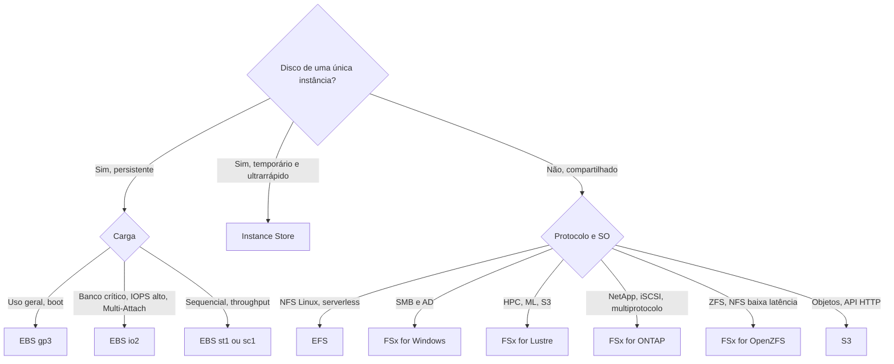

---
aliases:
  - Aula 10.10
modulo: 10
aula: 10
parte: "III Computação e armazenamento"
dominios:
  - 2
  - 3
  - 4
lida: false
tags:
  - aula
  - saa-c03
  - modulo-10
---

# Aula 10.10: Escolhendo o armazenamento

[[10 - Armazenamento em Bloco e Arquivos EBS EFS FSx|Voltar ao módulo]]

> [!question] Pergunta que esta aula responde
> Diante de um cenário de prova, como escolher entre [[EBS]], [[Instance Store]], [[EFS]], as variantes [[FSx]] e o [[S3]], lendo os sinais do enunciado, e como equilibrar desempenho, [[Disponibilidade|disponibilidade]] e custo?

## O método: quatro perguntas, nesta ordem

1. **Qual o tipo de acesso?** Disco de uma instância (bloco), pasta compartilhada (arquivo) ou API de objetos ([[S3]], [[11 - Amazon S3 a Fundo|Módulo 11]]).
2. **Quem acessa?** Uma instância, várias instâncias Linux, clientes Windows, ou um cluster de HPC.
3. **Qual o protocolo e o sistema operacional?** [[NFS]] (Linux), [[SMB]] (Windows e [[Active Directory|AD]]), [[iSCSI]] (bloco por rede), [[FSx for Lustre|Lustre]].
4. **Quais os requisitos de desempenho, [[Disponibilidade|disponibilidade]] e custo?** [[IOPS]], [[Throughput|throughput]], [[Latencia|latência]], [[Multi-AZ|multi-AZ]], orçamento.

## Árvore de decisão

## Tabela mestre

| Necessidade | Escolha | Motivo |
|---|---|---|
| Volume de boot, uso geral | [[gp3\|EBS gp3]] | 3.000 [[IOPS]] e 125 MiB/s inclusos, mais barato que [[gp2]] |
| Banco exigente: mais de 80.000 [[IOPS]] ou 2.000 MiB/s, [[Latencia\|latência]] média sub-ms, [[Durabilidade\|durabilidade]] 99,999% ou [[Multi-Attach]] | [[io2\|EBS io2]] (Block Express) | Até 256.000 IOPS e 4.000 MiB/s; o [[gp3]] vai a 80.000 IOPS e 2.000 MiB/s |
| Cluster com [[Multi-Attach]] (mesma [[Zona de Disponibilidade\|AZ]]) | [[EBS]] io1 ou [[io2]] | Só [[Provisioned IOPS]] suportam |
| Big data sequencial, logs, menor custo | [[st1\|EBS st1]] ou [[sc1]] | HDD, não bootáveis |
| [[Cache]], buffer, dados temporários, [[IOPS]] enorme | [[Instance Store]] | Local ao host, perde ao parar |
| Arquivos compartilhados Linux, [[Multi-AZ\|multi-AZ]], [[Serverless\|sem servidor]] | [[EFS]] Regional | [[NFS]] elástico |
| Dev e teste de arquivos, menor custo | [[EFS]] One Zone | Uma [[Zona de Disponibilidade\|AZ]] |
| Pasta Windows com [[Active Directory\|AD]] | [[FSx for Windows File Server\|FSx for Windows]] | [[SMB]] nativo |
| HPC e ML sobre dados do [[S3]] | [[FSx for Lustre]] | Integração com S3 |
| NetApp, [[iSCSI]], multiprotocolo | [[FSx for NetApp ONTAP\|FSx for ONTAP]] | [[NFS]], [[SMB]], iSCSI e NVMe |
| [[FSx for OpenZFS\|ZFS]], [[NFS]] de microssegundos | FSx for OpenZFS | [[Snapshot\|Snapshots]] e clones |
| Mover volume entre [[Zona de Disponibilidade\|AZs]] ou [[Regiao AWS\|Regiões]] | [[Snapshot]] e restauração | [[EBS]] é zonal |
| Criptografar um volume existente | [[Snapshot]], cópia criptografada, novo volume | Não se cifra no lugar |

## Custo relativo e como mover dados

Regra de prova, sem preços absolutos (eles mudam; consulte [EBS](https://aws.amazon.com/ebs/pricing/) e [EFS](https://aws.amazon.com/efs/pricing/)): o **[[S3]] é o mais barato por GB**; [[EFS]] Standard custa bem mais que [[EBS]] e que S3; use **[[EFS Infrequent Access|EFS IA]] ou Archive** ou o **S3** para dados frios. Dentro do EBS, [[sc1]] e [[st1]] (HDD) são mais baratos por GiB que o [[gp3]] (SSD), que por sua vez é mais barato que o [[gp2]] e o [[io2]].

| Ordem aproximada de custo por GB (do menor ao maior) | Serviço |
|---|---|
| 1 | [[S3]] (classes frias, depois Standard) |
| 2 | [[EBS]] HDD ([[sc1]], [[st1]]), [[EFS Infrequent Access\|EFS Archive]] e IA |
| 3 | [[gp3\|EBS gp3]], [[FSx for Windows File Server\|FSx for Windows]] HDD |
| 4 | [[EFS]] Standard, [[FSx]] SSD, [[io2]] |

> [!tip] Como mover dados para EFS e FSx
> Para copiar dados de servidores de arquivos on-premises ou de outros sistemas para [[EFS]] ou [[FSx]] (e para o [[S3]]), use o **[[DataSync]]** (e o [[Storage Gateway]] para acesso híbrido contínuo), detalhados no [[23 - Migracao e Transferencia de Dados|Módulo 23]].

## Desempenho, disponibilidade e custo

**Desempenho**
- Backup centralizado e retenção entre [[Regiao AWS|Regiões]] e contas: [[20 - Alta Disponibilidade e Recuperacao de Desastres|Módulo 20]].
- [[EBS]]: o teto é o menor entre o volume e a instância (EBS-optimized, [[Nitro]]).
- [[EFS]]: General Purpose com Elastic como padrão; Bursting escala com o tamanho.
- [[FSx for Lustre|Lustre]] e [[FSx for OpenZFS|OpenZFS]]: para [[Latencia|latência]] submilissegundo ou de microssegundos.

**[[Disponibilidade]] e resiliência**
- [[EBS]] é **zonal**: replicado na [[Zona de Disponibilidade|AZ]], mas não sobrevive à perda da AZ. Para isso, [[Snapshot|snapshots]] (guardados na Região) e restauração em outra AZ.
- [[EFS]] Regional e [[FSx]] [[Multi-AZ]] sobrevivem à perda de uma [[Zona de Disponibilidade|AZ]].
- [[Instance Store]]: nenhuma [[Durabilidade|durabilidade]].

**Custo**
- [[gp3]] em vez de [[gp2]]; HDD ([[st1]], [[sc1]]) para sequencial; [[EFS Infrequent Access|EFS IA]] e Archive via lifecycle; [[FSx for NetApp ONTAP|ONTAP]] e [[FSx for OpenZFS|OpenZFS]] com tiering e [[S3 Intelligent-Tiering|Intelligent-Tiering]]; One Zone para dados que aceitam uma [[Zona de Disponibilidade|AZ]].
- [[Snapshot]] de [[EBS]]: incremental e Archive para retenção longa ([[10.05 - EBS Snapshots Criptografia e Operacao|aula 10.5]]).

## Cenários resolvidos, passo a passo

> [!example] Cenário 1: loja virtual com banco, uploads e relatórios
> Uma loja virtual roda em [[EC2]] em três [[Zona de Disponibilidade|AZs]], com um banco MySQL em EC2 (sem [[RDS]], por requisito legado), imagens enviadas pelos clientes e relatórios noturnos pesados.
>
> - **Banco MySQL**: precisa de bloco com [[IOPS]] previsíveis. Use **[[gp3]]** com IOPS e [[Throughput|throughput]] provisionados até 80.000 IOPS; **[[io2]]** acima disso ou se o requisito exigir [[Latencia|latência]] sub-ms. É zonal: configure replicação do banco entre [[Zona de Disponibilidade|AZs]] e [[Snapshot|snapshots]] agendados pelo [[Data Lifecycle Manager|DLM]].
> - **Imagens dos clientes**: objetos servidos por URL, acessados de muitas instâncias. O lugar natural é o **[[S3]]** (Módulo 11), não um disco nem um sistema de arquivos.
> - **Relatórios noturnos**: leitura e escrita sequencial de volumes grandes, em uma instância só. Um **[[st1]]** atende com custo menor que SSD, desde que não seja volume de boot.
> - **Arquivos de configuração compartilhados pela frota Linux**: **[[EFS]] Regional**.
>
> A lição é que **uma arquitetura usa vários tipos ao mesmo tempo**; a prova pergunta por um componente de cada vez, então identifique qual deles o enunciado descreve.

> [!example] Cenário 2: migração de um data center com servidor de arquivos Windows
> A empresa tem um servidor de arquivos Windows com 20 TB, ACLs NTFS e [[Active Directory|AD]], acessado por 800 usuários. A meta é sair do data center sem reescrever nada e com [[Alta Disponibilidade|alta disponibilidade]].
>
> - A escolha é **[[FSx for Windows File Server|FSx for Windows]] [[Multi-AZ]]**, ligado ao [[Active Directory|AD]], com [[DNS]] alias para manter o nome antigo.
> - [[EFS]] é descartado (não é [[SMB]]). Um Windows em [[EC2]] com [[EBS]] funciona, mas exige patch, backup e cluster de [[Failover|failover]]: contraria o requisito de serviço gerenciado.
> - O custo pode cair escolhendo **HDD** se o uso for de shares departamentais sem [[Latencia|latência]] crítica.

> [!example] Cenário 3: pipeline de pesquisa genômica
> Pesquisadores guardam sequências no [[S3]] e rodam milhares de tarefas paralelas por poucos dias. As tarefas leem e escrevem arquivos pequenos e grandes, e os resultados devem voltar ao S3.
>
> - **[[FSx for Lustre]] scratch** ligado ao [[Bucket|bucket]]: [[Latencia|latência]] submilissegundo, paralelismo e custo menor porque os dados são temporários e já estão duráveis no [[S3]].
> - [[EFS]] não tem a integração nativa com o [[S3]] nem o desempenho agregado do [[FSx for Lustre|Lustre]].
> - [[Instance Store]] seria rápido, mas cada instância teria sua própria cópia e perderia os dados ao parar, sem compartilhamento.

> [!example] Cenário 4: contêineres com estado compartilhado
> Uma plataforma em [[ECS]] com [[Fargate]] precisa que várias tarefas, em [[Zona de Disponibilidade|AZs]] diferentes, vejam os mesmos arquivos de mídia enviados pelos usuários.
>
> - **[[EFS]] Regional** referenciado na [[Task Definition|task definition]], com [[Access Point|access point]] por serviço. [[Fargate]] exige plataforma 1.4.0 ou superior.
> - [[EBS]] por tarefa não compartilha entre tarefas. [[S3]] seria alternativa se a aplicação aceitasse a API de objetos em vez de um caminho de arquivo.

## Treino de variação: mude um requisito e a resposta muda

Uma forma eficaz de fixar a árvore de decisão é pegar um cenário e alterar uma única palavra. Veja o mesmo ponto de partida, "aplicação precisa de armazenamento para arquivos compartilhados":

| Se o enunciado acrescenta... | A resposta passa a ser | Motivo |
|---|---|---|
| "servidores Linux em várias [[Zona de Disponibilidade\|AZs]], sem gerenciar infraestrutura" | [[EFS]] Regional | [[NFS]] elástico e [[Multi-AZ\|multi-AZ]] |
| "e o ambiente é só de desenvolvimento, custo mínimo" | [[EFS]] One Zone | Aceita uma [[Zona de Disponibilidade\|AZ]], preço menor |
| "clientes Windows e [[Active Directory]]" | [[FSx for Windows File Server\|FSx for Windows]] | [[SMB]] e AD nativos |
| "e os dados de entrada estão no [[S3]], com milhares de tarefas paralelas" | [[FSx for Lustre]] | Integração com S3 e paralelismo |
| "migrando um NetApp, com volumes [[iSCSI]]" | [[FSx for NetApp ONTAP\|FSx for ONTAP]] | Multiprotocolo e ferramentas NetApp |
| "migrando [[FSx for OpenZFS\|ZFS]], com clones de datasets" | FSx for OpenZFS | [[Snapshot\|Snapshots]] e clones instantâneos |
| "uma instância só, banco de dados" | [[EBS]] ([[gp3]] ou [[io2]]) | É bloco, não arquivo compartilhado |
| "cache temporário, dados recriáveis, máximo de [[IOPS]]" | [[Instance Store]] | Local ao host |

Faça o mesmo com o bloco: "banco com 5.000 [[IOPS]]" é [[gp3]]; "banco com 120.000 IOPS e [[Latencia|latência]] submilissegundo" é [[io2|io2 Block Express]]; "logs sequenciais de 10 TiB lidos todo dia, com 400 MiB/s" é [[st1]], e "dados de 10 TiB lidos uma vez por trimestre, em bloco" é [[sc1]]; "cluster de [[Failover|failover]] com disco compartilhado na mesma [[Zona de Disponibilidade|AZ]]" é io1 ou io2 com [[Multi-Attach]].

## Como eliminar alternativas

Depois de ler o enunciado com as quatro perguntas do método (mais custo e [[Overhead Operacional|esforço operacional]]), elimine as alternativas que violam o item 1 ou o item 2, que são as mais fáceis de descartar. Entre as que sobram, escolha a que atende os itens 3 a 6 com o menor número de componentes. Na maioria das perguntas do SAA-C03, a resposta correta é a **mais simples e mais gerenciada** que satisfaz todos os requisitos, e as erradas ou ignoram um requisito ou acrescentam complexidade sem necessidade (uma instância intermediária, um script de sincronização, um servidor próprio).

## Erros de raciocínio que a prova explora

| Raciocínio errado | Por que erra | Correção |
|---|---|---|
| "Mais [[IOPS]] é sempre melhor" | Custa mais; o requisito pode ser coberto pelo [[gp3]] | Compare o requisito numérico com os limites do gp3 antes de ir a [[io2]] |
| "[[EFS]] resolve tudo que é compartilhado" | Não fala [[SMB]], [[iSCSI]] nem se integra ao [[S3]] como o [[FSx for Lustre\|Lustre]] | Leia o protocolo e o sistema operacional |
| "[[Snapshot]] é backup de arquivos" | Snapshot de [[EBS]] protege volumes inteiros, por [[Zona de Disponibilidade\|AZ]] e Região | Para arquivos, [[EFS]], [[FSx]] e [[Backup\|AWS Backup]] |
| "One Zone é só mais barato" | Perde a resiliência a falha de [[Zona de Disponibilidade\|AZ]] | Cheque se o dado pode ser recriado |
| "[[Instance Store]] é um disco rápido de uso geral" | Perde os dados ao parar, terminar ou falhar o host | Só para dados efêmeros |

> [!info] Ligando os pontos
> A escolha de armazenamento volta em quase todo módulo seguinte: o [[11 - Amazon S3 a Fundo|S3]] como destino de objetos e backups, [[12 - Balanceamento de Carga e Auto Scaling|Auto Scaling]] com arquivos compartilhados entre instâncias que entram e saem, e a [[Recuperacao de Desastres|recuperação de desastres]], em que [[Snapshot|snapshots]], replicação do [[EFS]] e [[FSx for NetApp ONTAP|SnapMirror]] definem [[RPO]] e [[RTO]].

## Como isso cai na prova

Esta aula consolida **Task 3.1**, **Task 4.1**, **Task 2.1**, **Task 2.2** e **Task 1.3**.

**Armadilhas de leitura**
- "Compartilhado entre instâncias": [[EBS]] comum não serve. [[EFS]] ou [[FSx]].
- "Windows": [[EFS]] está fora.
- "Dados temporários, maior desempenho": [[Instance Store]], nunca para dado que precisa persistir.
- "Banco de dados": bloco ([[EBS]]), não [[EFS]].
- **Simulados antigos** usam o teto antigo do [[gp3]] (16.000 [[IOPS]], 1.000 MiB/s): com os limites atuais (verificado em novembro de 2026), o gp3 vai a 80.000 IOPS e 2.000 MiB/s. Se o enunciado oferecer gp3 e [[io2]] para algo entre 16.000 e 80.000 IOPS sem pedir sub-ms, 99,999% ou [[Multi-Attach]], prefira gp3 nas perguntas de custo.
- "Menor custo" com requisito de [[Durabilidade|durabilidade]]: leia se há exigência [[Multi-AZ|multi-AZ]] antes de escolher One Zone.
- "Sem gerenciar servidor": [[EFS]] ou [[S3]] antes de montar [[NFS]] em [[EC2]].

**Palavras-chave em inglês**: "[[Armazenamento de Bloco|block storage]]", "shared file system", "POSIX", "[[SMB]]", "[[Active Directory]]", "HPC", "lowest [[Latencia|latency]]", "most cost-effective", "[[Alta Disponibilidade|highly available]] across [[Zona de Disponibilidade|AZs]]", "ephemeral".

## Resumo

> [!abstract] A aula em uma frase
> Escolher armazenamento é responder quatro perguntas (tipo de acesso, quem acessa, protocolo e sistema operacional, requisitos de desempenho, [[Disponibilidade|disponibilidade]] e custo) e ler no enunciado os sinais que apontam cada serviço.

**A lógica, em 5 passos**
1. Bloco para disco de instância; arquivo para pasta compartilhada; objeto para [[S3]].
2. Dentro do bloco: [[gp3]] geral, [[io2]] exigente, HDD sequencial, [[Instance Store]] temporário.
3. Dentro do arquivo: [[EFS]] para [[NFS]] Linux, [[FSx for Windows File Server|FSx for Windows]] para [[SMB]], [[FSx for Lustre|Lustre]] para HPC, [[FSx for NetApp ONTAP|ONTAP]] para NetApp e [[iSCSI]], [[FSx for OpenZFS|OpenZFS]] para ZFS.
4. [[EBS]] é zonal; resiliência entre [[Zona de Disponibilidade|AZs]] vem de [[Snapshot|snapshots]] ou de serviços [[Multi-AZ|multi-AZ]].
5. Custo: [[gp3]], HDD, lifecycle do [[EFS]], tiering e One Zone quando o requisito permite.

**Na prática, isso significa**
- Leia primeiro o protocolo e o sistema operacional citados.
- Procure "compartilhado", "Windows", "temporário" e "banco de dados" como gatilhos.
- Confirme se há exigência de [[Multi-AZ|multi-AZ]] antes de escolher a opção mais barata.

> [!tip] Liga com
> Vem do [[10.09 - FSx for NetApp ONTAP e FSx for OpenZFS|ONTAP e OpenZFS]]. Segue para o [[11 - Amazon S3 a Fundo|Módulo 11, sobre o S3]].

## Erros comuns

- **Usar [[Instance Store]] para dados que precisam persistir.**
- **Escolher [[EFS]] para um banco de dados transacional.**
- **Esquecer que [[EBS]] não atravessa [[Zona de Disponibilidade|AZs]] sozinho.**
- **Escolher [[gp2]] ou io1 por hábito, quando [[gp3]] ou [[io2]] são as respostas atuais.**
- **Responder com o serviço mais poderoso em vez do mais simples que atende.**

## Pratique

**1.** Um banco de dados relacional em [[EC2]] exige 120.000 [[IOPS]] e [[Latencia|latência]] média sub-milissegundo. Qual volume?

- [ ] a) gp3
- [ ] b) st1
- [ ] c) io2
- [ ] d) Instance Store

**2.** Uma aplicação Linux em três [[Zona de Disponibilidade|AZs]] precisa de arquivos compartilhados sem gerenciar servidor. Qual solução?

- [ ] a) EFS Regional
- [ ] b) EBS gp3 em cada instância, sincronizado pela aplicação
- [ ] c) FSx for Windows
- [ ] d) Instance Store replicado manualmente entre instâncias

**3.** Uma aplicação precisa de cache local de altíssimo desempenho, e os dados podem ser recriados. Qual armazenamento tem o menor custo adicional?

- [ ] a) io2 Block Express
- [ ] b) EFS Provisioned
- [ ] c) FSx for Lustre persistent
- [ ] d) Instance Store

**4.** Uma empresa roda PostgreSQL em [[EC2]] que precisa de 20.000 [[IOPS]], com o MENOR custo, e quer [[Snapshot|snapshots]] diários retidos por 14 dias sem escrever scripts. Qual combinação atende?

- [ ] a) io2 com 20.000 IOPS e um script cron de snapshots
- [ ] b) gp3 com 20.000 IOPS provisionadas e uma política do Data Lifecycle Manager
- [ ] c) gp2 de 6.700 GiB e snapshots manuais
- [ ] d) st1 de 16 TiB e uma política do Data Lifecycle Manager

**5.** Quais DUAS opções atendem a uma [[SMB|pasta de rede Windows]] com SMB e [[Active Directory]]? (Escolha DUAS.)

- [ ] a) FSx for Windows File Server
- [ ] b) FSx for NetApp ONTAP
- [ ] c) Amazon EFS
- [ ] d) FSx for Lustre
- [ ] e) EBS st1

**6.** Um cenário de HPC lê dados do [[S3]] e exige [[Throughput|throughput]] altíssimo e [[Latencia|latência]] submilissegundo em Linux. Qual?

- [ ] a) EFS One Zone
- [ ] b) FSx for Lustre
- [ ] c) EBS gp3 com Multi-Attach
- [ ] d) Instance Store, com cópias do S3

**7.** Qual combinação reduz o custo de um [[EFS]] com muitos arquivos antigos raramente lidos?

- [ ] a) Lifecycle para IA e Archive
- [ ] b) Provisioned com o pico máximo
- [ ] c) Trocar para Max I/O
- [ ] d) Desligar a criptografia

**8.** Uma carga sequencial de big data, acessada com frequência e com grande [[Throughput|throughput]], deve usar qual volume HDD?

- [ ] a) sc1
- [ ] b) gp3
- [ ] c) st1
- [ ] d) Instance Store

**9.** Quais DUAS afirmações estão corretas? (Escolha DUAS.)

- [ ] a) EBS é replicado dentro de uma AZ e não sobrevive à perda dela
- [ ] b) EFS Regional replica entre AZs
- [ ] c) Instance Store sobrevive ao stop da instância
- [ ] d) EFS é o melhor serviço para banco de dados transacional
- [ ] e) FSx for Lustre fala SMB

**10.** Uma empresa precisa compartilhar com outra [[Conta AWS|conta da AWS]], para DR, um [[Snapshot|snapshot]] [[EBS]] cifrado com a chave aws/ebs. O que fazer?

- [ ] a) Compartilhar o snapshot diretamente e conceder à outra conta o uso da chave aws/ebs
- [ ] b) Tornar o snapshot público por um período curto
- [ ] c) Habilitar Multi-Attach para a outra conta
- [ ] d) Copiar o snapshot cifrando com uma customer managed key, compartilhá-lo e conceder à outra conta o uso da chave

**11.** Qual é a melhor opção de volume de uso geral, incluindo boot, com custo menor que o [[gp2]]?

- [ ] a) gp3
- [ ] b) io1
- [ ] c) sc1
- [ ] d) st1

**12.** Um cluster HPC usa [[FSx for Lustre]] persistent e precisa sobreviver à falha de uma [[Zona de Disponibilidade|AZ]] inteira. Qual abordagem atende?

- [ ] a) Trocar para scratch, que replica entre AZs
- [ ] b) Habilitar Multi-AZ no Lustre persistent
- [ ] c) Manter os dados duráveis no S3 ligado ao Lustre e recriar o file system em outra AZ
- [ ] d) Migrar para EFS One Zone

> [!success]- Gabarito
> **1. c)** [[io2|io2 Block Express]] chega a 256.000 [[IOPS]] com [[Latencia|latência]] sub-ms; a) o [[gp3]] para em 80.000 IOPS; b) [[st1]] é HDD e entrega poucas centenas de IOPS; d) [[Instance Store]] não persiste.
> **2. a)** [[EFS]] Regional é [[NFS]] gerenciado e [[Multi-AZ|multi-AZ]]; b) e d) deixam a sincronização para a aplicação; c) é para Windows.
> **3. d)** [[Instance Store]] está incluído no preço da instância; a), b) e c) acrescentam custo para dados recriáveis.
> **4. b)** [[gp3]] entrega 20.000 [[IOPS]] pelo menor custo e o [[Data Lifecycle Manager|DLM]] automatiza os [[Snapshot|snapshots]] por política; a) [[io2]] custa mais que o necessário e o cron exige manutenção; c) o [[gp2]] exigiria um volume enorme só para ganhar IOPS e [[DB Snapshot|snapshots manuais]] não escalam; d) [[st1]] é HDD e não serve para IOPS aleatórias.
> **5. a) e b)** ambos entregam [[SMB]] com [[Active Directory|AD]]; c) [[EFS]] não suporta Windows; d) [[FSx for Lustre|Lustre]] usa seu cliente; e) [[EBS]] é bloco.
> **6. b)** [[FSx for Lustre|Lustre]] integra com [[S3]] e é feito para HPC; a) não é HPC; c) [[Multi-Attach]] não é sistema de arquivos; d) copiar a cada execução é lento.
> **7. a)** lifecycle move dados frios para IA e Archive; b) custa mais; c) Max I/O não reduz custo; d) criptografia não afeta custo de classe.
> **8. c)** [[st1]] é o HDD para [[Throughput|throughput]] sequencial com acesso frequente; a) [[sc1]] é para acesso raro e tem teto menor; b) [[gp3]] é SSD; d) [[Instance Store]] não persiste.
> **9. a) e b)** [[EBS]] zonal e [[EFS]] Regional [[Multi-AZ|multi-AZ]]; c) [[Instance Store]] perde ao parar; d) EFS não é ideal para banco; e) [[FSx for Lustre|Lustre]] não fala [[SMB]].
> **10. d)** [[Snapshot|snapshot]] cifrado com a chave AWS managed não pode ser compartilhado, então se copia para uma [[Customer Managed Key|customer managed key]], compartilha-se o snapshot e a chave; a) a chave aws/ebs não pode ser compartilhada; b) snapshot cifrado nunca pode ser público; c) [[Multi-Attach]] é de volumes na mesma [[Zona de Disponibilidade|AZ]].
> **11. a)** [[gp3]] é uso geral, bootável e mais barato; b) é caro; c) e d) são HDD não bootáveis.
> **12. c)** o [[FSx for Lustre|Lustre]] vive em uma [[Zona de Disponibilidade|AZ]] e o persistent protege só contra falha de servidor, então o dado durável fica no [[S3]]; a) scratch não replica; b) o Lustre não tem [[Multi-AZ]]; d) One Zone também fica em uma AZ.

## Para aprofundar

- [ ] [Amazon EBS volume types](https://docs.aws.amazon.com/ebs/latest/userguide/ebs-volume-types.html) (AWS Docs): comparação oficial dos tipos de volume.
- [ ] [How Amazon EFS works](https://docs.aws.amazon.com/efs/latest/ug/how-it-works.html) (AWS Docs): visão geral do [[EFS]].
- [ ] [What is Amazon FSx?](https://docs.aws.amazon.com/fsx/latest/WindowsGuide/what-is.html) (AWS Docs): ponto de entrada para a [[FSx|família FSx]].

Próximo módulo: [[11 - Amazon S3 a Fundo|Próximo módulo: Amazon S3 a Fundo]]
