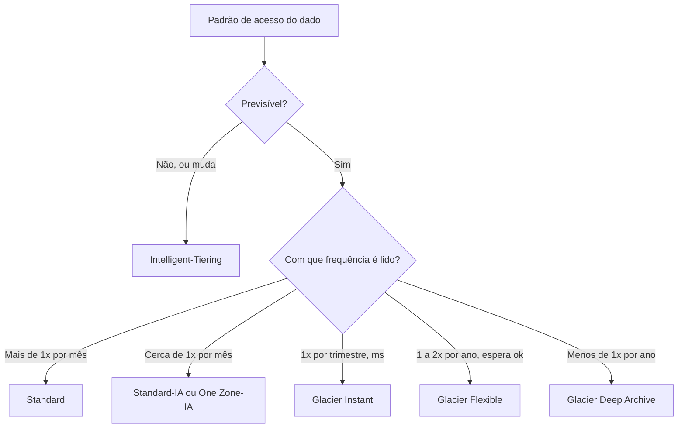

---
aliases:
  - Aula 11.2
modulo: 11
aula: 2
parte: "III Computação e armazenamento"
dominios:
  - 3
  - 4
lida: false
tags:
  - aula
  - saa-c03
  - modulo-11
---

# Aula 11.2: Classes de armazenamento do S3 e Glacier

[[11 - Amazon S3 a Fundo|Voltar ao módulo]]

> [!question] Pergunta que esta aula responde
> Por que o [[S3]] tem oito classes de armazenamento, o que você troca ao descer de uma para outra (custo de guardar, custo de acessar, tempo de acesso, duração mínima, [[Zona de Disponibilidade|AZs]]), e como o padrão de acesso do enunciado aponta para a classe certa?

## O problema: o mesmo dado muda de valor com o tempo

Um relatório gerado hoje é lido dezenas de vezes na primeira semana. Daqui a seis meses, quase ninguém abre. Daqui a sete anos, só um auditor abrirá, uma vez. Guardar tudo na mesma classe paga o preço máximo por dado que ninguém lê.

A economia das classes do [[S3]] gira em torno de uma troca única: **quanto mais barato guardar um GB, mais caro (ou mais lento) é tirá-lo de lá**. Cada classe é um ponto diferente nessa curva. Todas têm a mesma [[Durabilidade]] de projeto (11 noves); o que muda são cinco coisas, e a prova cobra exatamente essas cinco:

1. **Custo de armazenar** por GB-mês.
2. **Custo de acessar**: taxa de recuperação por GB e preço por requisição.
3. **Tempo até o primeiro byte**: milissegundos, minutos ou horas.
4. **Cobrança mínima**: duração mínima de armazenamento e tamanho mínimo cobrado por objeto.
5. **Resiliência**: três ou mais [[Zona de Disponibilidade|AZs]], ou uma só.

Um [[Storage Class|storage class]] é uma propriedade **do objeto**, não do [[Bucket|bucket]]: no mesmo bucket convivem objetos em classes diferentes, e você escolhe a classe no upload ou a muda depois por [[Lifecycle Policy|ciclo de vida]] (aula 11.3). Se você não especificar, o objeto vai para o [[S3]] Standard.

## As classes, uma a uma

### S3 Standard

A classe padrão: milissegundos de acesso, sem taxa de recuperação, sem duração mínima, sem tamanho mínimo, [[Disponibilidade|disponibilidade]] de 99,99%, no mínimo três [[Zona de Disponibilidade|AZs]]. É a escolha para dado "quente": assets de site, uploads recentes, dados de aplicação lidos com frequência (mais de uma vez por mês, segundo a documentação).

### S3 Intelligent-Tiering

Para o caso em que **você não sabe, ou o padrão muda**. O [[S3 Intelligent-Tiering]] monitora o acesso objeto por objeto e move sozinho entre camadas:

- **Frequent Access**: onde todo objeto começa.
- **Infrequent Access**: depois de 30 dias seguidos sem acesso.
- **Archive Instant Access**: depois de 90 dias seguidos sem acesso (ainda milissegundos).
- **Archive Access** e **[[S3 Glacier Deep Archive|Deep Archive]] Access**: camadas **opcionais** que você liga para dados acessados de forma assíncrona (a partir de 90 e de 180 dias sem acesso, no mínimo). Nelas é preciso **restaurar** o objeto antes de ler (operação `RestoreObject`).

Pontos que decidem questões: **não há taxa de recuperação** (acessar um objeto frio o devolve à camada frequente sem multa), não há duração mínima, e a [[Disponibilidade|disponibilidade]] é de 99,9%. O custo extra é uma **pequena taxa mensal de monitoramento e automação por objeto**. Objetos menores que **128 KB** não são monitorados e ficam sempre na camada Frequent Access, então para bilhões de objetos minúsculos o [[S3 Intelligent-Tiering|Intelligent-Tiering]] não ajuda.

### S3 Standard-IA e S3 One Zone-IA

IA significa *infrequent access* (acesso infrequente): dado de vida longa, lido cerca de uma vez por mês ou menos, mas que precisa de milissegundos quando for lido. Armazenar é mais barato que no Standard; em troca há **taxa de recuperação por GB** e duas cobranças mínimas:

- **Duração mínima de 30 dias**: apagar, sobrescrever ou mover antes disso cobra o restante dos 30 dias.
- **Tamanho mínimo cobrado de 128 KB**: um objeto de 10 KB é cobrado como 128 KB.

A diferença entre as duas é de resiliência:

| | [[S3 Standard-IA\|Standard-IA]] | One Zone-IA |
|---|---|---|
| [[Zona de Disponibilidade\|AZs]] | três ou mais | uma só |
| [[Disponibilidade]] | 99,9% | 99,5% |
| Perde o dado se a [[Zona de Disponibilidade\|AZ]] for destruída? | Não | Sim (desastre que destrua a AZ) |
| Quando usar | Cópia primária ou única que não pode ser recriada | Dado recriável, ou réplica em outro [[Bucket\|bucket]] (replicação, aula 11.6) |

### S3 Express One Zone

Uma classe de **[[Latencia|latência]]**, não de custo de armazenamento. Armazena em **uma [[Zona de Disponibilidade|AZ]] que você escolhe**, em um tipo especial de [[Bucket|bucket]] (directory bucket), para entregar acesso consistente de **um dígito de milissegundo**, o mais rápido do [[S3]], com [[Disponibilidade|disponibilidade]] de 99,95% naquela AZ. Serve para analytics e ML com muitas leituras pequenas e aleatórias, e para fluxos interativos (edição de vídeo), com a computação ([[EC2]], [[ECS]], [[EKS]]) na mesma AZ. A autorização usa credenciais de sessão curtas (`CreateSession`, 5 minutos, renovadas pelo SDK). Aceita [[SSE-S3]] e [[SSE-KMS]] (não aceita [[SSE-C]] nem [[DSSE-KMS]]). A documentação cita custo de requisição bem menor que o Standard, mas duas páginas divergem no percentual (50% e 80%), então fique só com "menor". Sem duração nem tamanho mínimo.

### S3 Glacier Instant Retrieval

Arquivo de acesso raro (cerca de **uma vez por trimestre**) que ainda assim precisa de **milissegundos**. Mesma [[Latencia|latência]] e [[Throughput|vazão]] do [[S3 Standard-IA|Standard-IA]], armazenamento mais barato, acesso mais caro. Duração mínima de **90 dias** e tamanho mínimo cobrado de **128 KB**, três ou mais [[Zona de Disponibilidade|AZs]], 99,9% de [[Disponibilidade|disponibilidade]]. Casos clássicos da documentação: hospedagem de imagens, compartilhamento de arquivos, prontuários médicos acessados em consultas.

### S3 Glacier Flexible Retrieval

Arquivo de acesso de **uma a duas vezes por ano**, sem necessidade de acesso imediato; bom para backup e [[Recuperacao de Desastres|recuperação de desastres]]. O objeto fica **arquivado**: para ler, você inicia uma restauração e espera. Tiers de recuperação:

| Tier | Tempo típico | Observação |
|---|---|---|
| Expedited | 1 a 5 minutos | Sujeito à demanda; "provisioned capacity" garante a [[Disponibilidade\|disponibilidade]] |
| Standard | 3 a 5 horas | Padrão se você não indicar o tier |
| Bulk | 5 a 12 horas | **Gratuito** |

Duração mínima de **90 dias**. Há uma sobrecarga de **40 KB por objeto arquivado** (32 KB cobrados na taxa do Glacier, para índice e metadados; 8 KB cobrados na taxa do Standard, para nome e metadados do usuário), o que pesa em objetos pequenos.

### S3 Glacier Deep Archive

O mais barato de toda a AWS: dado acessado **menos de uma vez por ano**, retenção de anos por conformidade. Duração mínima de **180 dias**. Tiers: **Standard** (até 12 horas) e **Bulk** (até 48 horas); **não existe Expedited**. Mesma sobrecarga de 40 KB por objeto.

### Outras que aparecem

- **[[S3]] Outposts** (`OUTPOSTS`): classe só para buckets em [[Outposts]], com [[SSE-S3]] sempre.
- **Reduced Redundancy Storage (RRS)**: legada; a documentação recomenda **não usar** (o Standard é mais barato). Pode aparecer em simulado antigo como [[Distrator|distrator]].

## A tabela que você deve saber de cabeça

| Classe | Disponib. | [[Zona de Disponibilidade\|AZs]] | Duração mín. | Tamanho mín. cobrado | Tempo de acesso | Taxa de recuperação |
|---|---|---|---|---|---|---|
| Standard | 99,99% | 3+ | nenhuma | nenhum | ms | não |
| [[S3 Intelligent-Tiering\|Intelligent-Tiering]] | 99,9% | 3+ | nenhuma | nenhum (<128 KB não monitora) | ms (camadas arquivadas: restaurar) | não |
| [[S3 Standard-IA\|Standard-IA]] | 99,9% | 3+ | 30 dias | 128 KB | ms | sim |
| One Zone-IA | 99,5% | 1 | 30 dias | 128 KB | ms | sim |
| [[S3 Express One Zone\|Express One Zone]] | 99,95% | 1 | nenhuma | nenhum | 1 dígito de ms | nenhuma taxa de recuperação listada |
| Glacier Instant | 99,9% | 3+ | 90 dias | 128 KB | ms | sim |
| Glacier Flexible | 99,99% (após restaurar) | 3+ | 90 dias | NA (40 KB de sobrecarga) | minutos a horas | sim (Bulk grátis) |
| [[S3 Glacier Deep Archive\|Glacier Deep Archive]] | 99,99% (após restaurar) | 3+ | 180 dias | NA (40 KB de sobrecarga) | horas | sim |

(verificado em novembro de 2026 na tabela de comparação da documentação do [[S3]].)

## Restaurar um objeto arquivado

Nas classes Glacier Flexible Retrieval e [[S3 Glacier Deep Archive|Deep Archive]] (e nas camadas Archive Access do [[S3 Intelligent-Tiering|Intelligent-Tiering]]), um `GET` direto **falha**: o objeto precisa ser restaurado com `RestoreObject`. A restauração cria uma **cópia temporária** do objeto (em Standard) pelo número de dias que você pedir; o original continua arquivado. Enquanto a cópia existe, você paga o arquivo **e** a cópia temporária. Detalhes que caem:

- Para mudar a classe do objeto em definitivo, restaure e depois **copie** o objeto por cima (`CopyObject`) escolhendo outra classe.
- Para restaurar milhões de objetos use o [[S3 Batch Operations]] (aula 11.8).
- A taxa de pedidos de restauração é de 1.000 transações por segundo por conta, e a [[Throughput|vazão]] chega a 1 a 2 PB por dia; objetos acima de 5 TB demoram mais (até 300 MB/s).
- As classes Glacier **dentro do [[S3]]** (esta aula) não são o serviço legado **Amazon Glacier** (vaults e archives, API própria). A AWS recomenda usar as classes dentro do S3; "Glacier vault" em simulado antigo costuma significar o serviço legado ou o [[Vault Lock]].

> [!warning] Nomes novos, nomes velhos
> Hoje se diz "[[S3]] Glacier Instant Retrieval / Flexible Retrieval / [[S3 Glacier Deep Archive|Deep Archive]]". Questões antigas falam apenas em "S3 Glacier" (o atual Flexible Retrieval) e "Glacier Deep Archive". Em dúvida, o enunciado resolve pelos tempos: milissegundos é Instant, minutos a horas é Flexible, horas a dias é Deep Archive.

## Como escolher: três perguntas

1. **Qual é o padrão de acesso?** Desconhecido ou variável: [[S3 Intelligent-Tiering|Intelligent-Tiering]]. Conhecido: a frequência indica a classe.
2. **Posso esperar horas?** Se não, fique em classes de milissegundos (Standard, IA, Glacier Instant).
3. **Posso recriar o dado se a [[Zona de Disponibilidade|AZ]] falhar?** Se sim e quer economizar, One Zone-IA. Se for a única cópia, três AZs.

## Contas que a prova espera que você faça

Os valores abaixo são **números redondos hipotéticos para ilustrar a lógica**, não os preços reais (preços variam por Região e mudam; confira em aws.amazon.com/s3/pricing). Suponha: Standard 0,023 USD/GB-mês; [[S3 Standard-IA|Standard-IA]] 0,0125 USD/GB-mês mais 0,01 USD por GB recuperado.

> [!example] Quando Standard-IA compensa e quando não
> 1 TB (1.000 GB) por mês. **Standard**: 1.000 x 0,023 = 23,00 USD. **[[S3 Standard-IA|Standard-IA]] sem acesso**: 1.000 x 0,0125 = 12,50 USD (economia de 45%). **Standard-IA lendo o terabyte inteiro 1 vez por mês**: 12,50 + 1.000 x 0,01 = 22,50 USD, quase igual ao Standard. **Lendo 2 vezes por mês**: 12,50 + 20,00 = 32,50 USD, pior que o Standard. A regra "uma vez por mês ou menos" da AWS vem dessa conta.

> [!example] Duração mínima mordendo
> Você grava 500 GB de logs temporários direto em [[S3 Standard-IA|Standard-IA]] e os apaga após 7 dias. Você é cobrado como se tivessem ficado 30 dias: pagou 23 dias a mais de armazenamento por nada. Se o log vive 7 dias, o Standard sai mais barato.

> [!example] Objetos pequenos em IA
> 1 milhão de objetos de 10 KB (10 GB reais) em [[S3 Standard-IA|Standard-IA]] cobram o mínimo de 128 KB por objeto: 1.000.000 x 128 KB = 128 GB cobrados, 12,8 vezes o tamanho real. A economia por GB some. Para objetos pequenos, agregue-os em arquivos maiores (por exemplo, concatene logs por hora) ou fique no Standard.

> [!info] Ligando os pontos
> Os mesmos números reaparecem no [[25 - Otimizacao de Custos|Módulo 25]] (otimização de custos) e na lógica de [[20 - Alta Disponibilidade e Recuperacao de Desastres|DR no Módulo 20]], onde backup em [[S3 Glacier Deep Archive|Glacier Deep Archive]] é o "[[Backup and Restore|backup and restore]]" mais barato. A movimentação automática entre classes é o assunto da próxima aula.

## Como isso cai na prova

**Task 4.1** (armazenamento de custo otimizado: camadas frias, ciclo de vida, "most cost-effective storage service") e **Task 3.1** (armazenamento de alto desempenho).

**Palavras-chave e para onde apontam**

- "unknown or changing access patterns", "unpredictable" aponta para **[[S3 Intelligent-Tiering]]**.
- "infrequently accessed", "millisecond access", "can be re-created" aponta para **One Zone-IA**; "cannot be re-created" ou "primary copy" aponta para **[[S3 Standard-IA|Standard-IA]]**.
- "archive", "rarely accessed", "milliseconds" aponta para **Glacier Instant Retrieval**.
- "retrieve within minutes" ou "within hours" aponta para **Glacier Flexible Retrieval** (Expedited para minutos).
- "compliance retention for 7 years", "lowest cost", "12 hours" aponta para **[[S3 Glacier Deep Archive|Glacier Deep Archive]]**.
- "single-digit millisecond", "latency-sensitive" aponta para **[[S3 Express One Zone]]**.

**Pegadinhas clássicas**

- [[S3 Intelligent-Tiering|Intelligent-Tiering]] não cobra recuperação, mas cobra monitoramento por objeto; para poucos objetos gigantes é ótimo, para bilhões de objetos pequenos não.
- One Zone-IA tem 11 noves de projeto mas **perde o dado** se a [[Zona de Disponibilidade|AZ]] for destruída; o enunciado "cannot be re-created" a elimina.
- Glacier Flexible Retrieval **não** é acessível em tempo real; Glacier Instant Retrieval é.
- [[S3 Glacier Deep Archive|Deep Archive]] não tem Expedited.
- Mover objeto antes da duração mínima cobra o restante.

| Requisito no enunciado | Resposta provável | Por quê |
|---|---|---|
| Acesso desconhecido, mínimo de [[Overhead Operacional\|overhead operacional]] | [[S3 Intelligent-Tiering\|Intelligent-Tiering]] | Move sozinho, sem taxa de recuperação |
| Backups lidos 1x por mês, três [[Zona de Disponibilidade\|AZs]] | [[S3 Standard-IA\|Standard-IA]] | Milissegundos, mais barato que Standard, resiliente |
| Cópia secundária recriável, mais barata | One Zone-IA | Uma [[Zona de Disponibilidade\|AZ]], mais barata que [[S3 Standard-IA\|Standard-IA]], dado recriável |
| Imagens médicas, acesso trimestral em milissegundos | Glacier Instant Retrieval | Arquivo barato com acesso imediato |
| Backup lido 1 a 2 vezes por ano, restauração em horas | Glacier Flexible Retrieval (Bulk grátis) | Barato; espera aceita |
| [[Legal Hold\|Retenção legal]] de 10 anos, quase nunca lido | [[S3 Glacier Deep Archive\|Glacier Deep Archive]] | Menor custo da AWS |

## Resumo

> [!abstract] A aula em uma frase
> As classes do [[S3]] são pontos da curva "guardar barato, acessar caro ou devagar": a frequência de acesso, o tempo de espera tolerado e a resiliência exigida apontam a classe, e as cobranças mínimas (30, 90 ou 180 dias; 128 KB) desfazem a economia quando ignoradas.

**A lógica, em 5 passos**
1. O mesmo dado perde valor com o tempo, então pagar o preço de Standard por tudo desperdiça.
2. Cada classe troca custo de armazenar por custo ou tempo de acessar.
3. Acesso desconhecido pede [[S3 Intelligent-Tiering|Intelligent-Tiering]]; conhecido, a frequência escolhe a classe.
4. Classes IA e Glacier cobram duração mínima e tamanho mínimo: objetos pequenos ou efêmeros ali saem caros.
5. Classes arquivadas (Flexible e Deep) exigem restauração; resiliência de uma [[Zona de Disponibilidade|AZ]] só é aceitável para dado recriável.

**Números para lembrar**

| O quê | Valor | Por que importa |
|---|---|---|
| [[Durabilidade]] | 11 noves em todas | Não diferencia classes |
| Duração mínima | IA e One Zone-IA 30 d; Glacier Instant e Flexible 90 d; [[S3 Glacier Deep Archive\|Deep Archive]] 180 d | Cobrança de mover ou apagar antes |
| Tamanho mínimo cobrado | 128 KB (IA, One Zone-IA, Glacier Instant) | Objetos pequenos perdem a economia |
| [[S3 Intelligent-Tiering\|Intelligent-Tiering]] | 30 d, 90 d (+ opcionais 90 e 180 d) | Camadas automáticas |
| Glacier Flexible | Expedited 1-5 min; Standard 3-5 h; Bulk 5-12 h (grátis) | Escolher o tier de restauração |
| [[S3 Glacier Deep Archive\|Deep Archive]] | Standard até 12 h; Bulk até 48 h | Sem Expedited |
| Sobrecarga arquivada | 40 KB por objeto | Pesa em objetos pequenos |

**Tabela-síntese**

| Se o enunciado diz | Classe |
|---|---|
| Acesso imprevisível | [[S3 Intelligent-Tiering\|Intelligent-Tiering]] |
| Mensal, ms, não recriável | [[S3 Standard-IA\|Standard-IA]] |
| Mensal, ms, recriável | One Zone-IA |
| Trimestral, ms | Glacier Instant |
| Anual, horas | Glacier Flexible |
| Menos que anual, [[Legal Hold\|retenção legal]] | [[S3 Glacier Deep Archive\|Deep Archive]] |
| Um dígito de ms | [[S3 Express One Zone\|Express One Zone]] |

**Na prática, isso significa**
- Comece em Standard (ou [[S3 Intelligent-Tiering|Intelligent-Tiering]] quando o padrão é incerto) e desça com [[Lifecycle Policy|ciclo de vida]].
- Antes de mandar milhões de objetos pequenos para IA ou Glacier, some as cobranças mínimas e a sobrecarga de 40 KB.
- Use Bulk (grátis no Flexible) quando o prazo permite.

> [!tip] Liga com
> Vem de [[11.01 - O Modelo do S3 Buckets Objetos e Durabilidade|O modelo do S3]] e abre [[11.03 - Ciclo de Vida e Custo no S3|Ciclo de vida e custo]].

## Erros comuns

- **Achar que Glacier é um serviço separado.** As classes Glacier fazem parte do [[S3]]; o serviço legado Amazon Glacier (vaults) existe à parte.
- **Usar [[S3 Standard-IA|Standard-IA]] para dado lido toda semana.** A taxa de recuperação por GB anula a economia de armazenamento.
- **Colocar logs de vida curta em IA ou Glacier.** A duração mínima cobra os dias que o objeto não ficou.
- **Esperar leitura imediata de Flexible ou [[S3 Glacier Deep Archive|Deep Archive]].** Exigem `RestoreObject` e espera.
- **Escolher One Zone-IA para a única cópia de um dado.** Se a [[Zona de Disponibilidade|AZ]] for perdida, o dado vai junto.

## Pratique

**1.** Uma empresa guarda dados de clientes cujo padrão de acesso é imprevisível: alguns ficam meses sem leitura e depois voltam a ser consultados. O time não quer pagar taxa de recuperação nem gerenciar regras. Qual classe escolher?

- [ ] a) S3 Standard-IA
- [ ] b) S3 Glacier Flexible Retrieval
- [ ] c) S3 One Zone-IA com regra de ciclo de vida
- [ ] d) S3 Intelligent-Tiering

**2.** Imagens médicas precisam ficar guardadas por três anos, são lidas cerca de uma vez por trimestre e a leitura deve ser em milissegundos. Qual classe é a mais econômica?

- [ ] a) S3 Glacier Flexible Retrieval, que fica mais barato por GB e restaura em minutos com Expedited
- [ ] b) S3 Glacier Instant Retrieval
- [ ] c) S3 Glacier Deep Archive
- [ ] d) S3 Standard

**3.** Uma aplicação gera miniaturas que podem ser recriadas a partir das imagens originais. Elas são lidas raramente, mas precisam ser servidas ao usuário em milissegundos quando pedidas, e a empresa quer o menor custo entre as classes que atendem. Qual classe escolher?

- [ ] a) S3 One Zone-IA
- [ ] b) S3 Standard-IA
- [ ] c) S3 Glacier Deep Archive
- [ ] d) S3 Express One Zone

**4.** Uma empresa precisa reter documentos fiscais por sete anos, acessa quase nunca e aceita esperar até 12 horas para recuperar. Qual é a opção de menor custo?

- [ ] a) S3 Glacier Instant Retrieval
- [ ] b) S3 Standard-IA
- [ ] c) S3 Glacier Deep Archive
- [ ] d) S3 Intelligent-Tiering com camadas de arquivo desligadas

**5.** Quais DUAS afirmações sobre o tempo mínimo de armazenamento estão corretas? (Escolha DUAS.)

- [ ] a) O S3 Standard tem mínimo de 30 dias
- [ ] b) Standard-IA e One Zone-IA têm mínimo de 30 dias
- [ ] c) Glacier Deep Archive tem mínimo de 180 dias
- [ ] d) Glacier Flexible Retrieval tem mínimo de 30 dias
- [ ] e) Intelligent-Tiering tem mínimo de 180 dias para todas as camadas

**6.** Uma empresa moveu 10 milhões de objetos de 20 KB para [[S3 Standard-IA|Standard-IA]] e a fatura subiu em vez de cair. Qual é a causa mais provável?

- [ ] a) A classe Standard-IA cobra mais caro por requisição de PUT que o Standard, mas o armazenamento não muda
- [ ] b) Objetos pequenos são cobrados como se tivessem pelo menos 128 KB nas classes IA
- [ ] c) O Standard-IA só aceita objetos acima de 1 MB e cobra multa pelos menores
- [ ] d) A transição apaga os metadados e o S3 recria cada objeto com tamanho dobrado

**7.** Uma equipe precisa restaurar 100 TB arquivados no Glacier Flexible Retrieval. Eles aceitam esperar até meio dia e querem não pagar pela recuperação. Qual camada de recuperação usar?

- [ ] a) Expedited, que leva de 1 a 5 minutos
- [ ] b) Standard, que leva de 3 a 5 horas
- [ ] c) Bulk, que leva de 5 a 12 horas e não tem custo de recuperação
- [ ] d) Não há restauração; objetos arquivados precisam ser recriados a partir da origem

**8.** Quais DUAS afirmações sobre objetos em Glacier Flexible Retrieval e [[S3 Glacier Deep Archive|Deep Archive]] estão corretas? (Escolha DUAS.)

- [ ] a) Um GET comum devolve o objeto imediatamente, só com latência maior
- [ ] b) A restauração converte o objeto de forma permanente em Standard
- [ ] c) É preciso pedir a restauração antes de ler o objeto
- [ ] d) A cópia restaurada é temporária, e o objeto permanece arquivado na classe original
- [ ] e) Esses objetos são mantidos em uma única AZ para reduzir o custo

**9.** O time quer usar [[S3 Intelligent-Tiering|Intelligent-Tiering]] para milhões de objetos de 50 KB. Qual é a consequência?

- [ ] a) Objetos menores que 128 KB não são movidos para as camadas mais baratas, então não há economia
- [ ] b) Eles vão direto para a camada Archive Instant Access, com a economia máxima de armazenamento
- [ ] c) O S3 recusa esses objetos no Intelligent-Tiering com erro de tamanho e exige que sejam agrupados em arquivos maiores
- [ ] d) Eles são cobrados duas vezes, uma pelo armazenamento e outra pela recuperação ao voltarem para a camada frequente

**10.** Um dado recriável, lido uma vez por mês e que precisa de milissegundos, será guardado pelo menor custo. A empresa aceita a menor [[Disponibilidade|disponibilidade]] de projeto entre as classes de milissegundos, desde que ela venha de usar uma única [[Zona de Disponibilidade|AZ]]. Qual classe escolher?

- [ ] a) S3 Standard-IA
- [ ] b) S3 Intelligent-Tiering
- [ ] c) S3 Glacier Instant Retrieval
- [ ] d) S3 One Zone-IA

> [!success]- Gabarito
> **1. d)** O [[S3 Intelligent-Tiering|Intelligent-Tiering]] move sozinho entre camadas e não cobra recuperação. Descartadas: a) cobra recuperação por GB e tem armazenamento mínimo de 30 dias; b) exige restauração e tem tempo de espera; c) usa uma [[Zona de Disponibilidade|AZ]] só e continua cobrando recuperação.
>
> **2. b)** GIR é arquivo com acesso em milissegundos e armazenamento mínimo de 90 dias. Descartadas: a) a recuperação leva minutos ou horas, e o requisito é milissegundos; c) a recuperação leva horas; d) funciona, mas é bem mais caro para dado de acesso trimestral.
>
> **3. a)** Dado recriável e de acesso raro aceita a classe de uma [[Zona de Disponibilidade|AZ]]. Descartadas: b) é [[Multi-AZ|multi-AZ]] e mais cara, desnecessário para dado recriável; c) a leitura leva horas, e o enunciado exige milissegundos; d) é voltada a [[Latencia|latência]] mínima, não ao menor custo de armazenamento.
>
> **4. c)** O [[S3 Glacier Deep Archive|Deep Archive]] é a classe mais barata e aceita recuperação em horas. Descartadas: a) é mais caro e entrega em milissegundos que não são necessários; b) é bem mais caro por GB que o Deep Archive; d) sem as camadas de arquivo ele nunca chega ao custo do Deep Archive.
>
> **5. b) e c)** 30 dias nas IA, 90 nos Glacier Instant e Flexible, 180 no [[S3 Glacier Deep Archive|Deep Archive]]. Descartadas: a) o Standard não tem tempo mínimo; d) o mínimo do Flexible Retrieval é de 90 dias; e) o [[S3 Intelligent-Tiering|Intelligent-Tiering]] não tem tempo mínimo de armazenamento.
>
> **6. b)** 20 KB viram 128 KB cobráveis, então o custo cresce. Descartadas: a) a cobrança maior vem do tamanho mínimo cobrável, não só das requisições; c) não há multa; há tamanho mínimo cobrável de 128 KB; d) a transição não altera o tamanho do objeto.
>
> **7. c)** A recuperação Bulk do Flexible Retrieval é gratuita. Descartadas: a) é a mais rápida e cobra taxa por GB; b) cobra taxa por GB, apesar de ser rápida o bastante; d) o Flexible Retrieval permite restauração por RestoreObject.
>
> **8. c) e d)** Arquivar significa restaurar antes de ler, e a restauração cria uma cópia temporária. Descartadas: a) o GET falha até a restauração terminar; b) a conversão permanente exige um COPY, não a restauração; e) as classes Glacier guardam dados em várias [[Zona de Disponibilidade|AZs]].
>
> **9. a)** Para objetos pequenos o [[S3 Intelligent-Tiering|Intelligent-Tiering]] não traz benefício. Descartadas: b) objetos pequenos não são movidos entre camadas; c) eles são aceitos, mas ficam na camada de acesso frequente; d) o Intelligent-Tiering não cobra recuperação.
>
> **10. d)** A One Zone-IA usa uma única [[Zona de Disponibilidade|AZ]], por isso tem 99,5% de [[Disponibilidade|disponibilidade]], a menor entre as classes de milissegundos, e o menor custo para dado recriável. Descartadas: a) o [[S3 Standard-IA|Standard-IA]] usa três ou mais AZs (99,9%) e custa mais; b) o [[S3 Intelligent-Tiering|Intelligent-Tiering]] usa três ou mais AZs (99,9%) e cobra monitoramento por objeto; c) o Glacier Instant Retrieval é [[Multi-AZ|multi-AZ]] (99,9%) e voltado a acesso trimestral, não mensal.

## Para aprofundar

- [ ] [Understanding and managing Amazon S3 storage classes](https://docs.aws.amazon.com/AmazonS3/latest/userguide/storage-class-intro.html) (documentação AWS): a tabela oficial de comparação das classes usada nesta aula.
- [ ] [Understanding S3 Glacier storage classes for long-term data storage](https://docs.aws.amazon.com/AmazonS3/latest/userguide/glacier-storage-classes.html) (documentação AWS): tiers de recuperação, duração mínima e sobrecarga de metadados.
- [ ] [Understanding archive retrieval options](https://docs.aws.amazon.com/AmazonS3/latest/userguide/restoring-objects-retrieval-options.html) (documentação AWS): Expedited, Standard e Bulk, capacidade provisionada e limites de restauração.

Próxima aula: [[11.03 - Ciclo de Vida e Custo no S3|Aula 11.3: Ciclo de vida e custo]].
