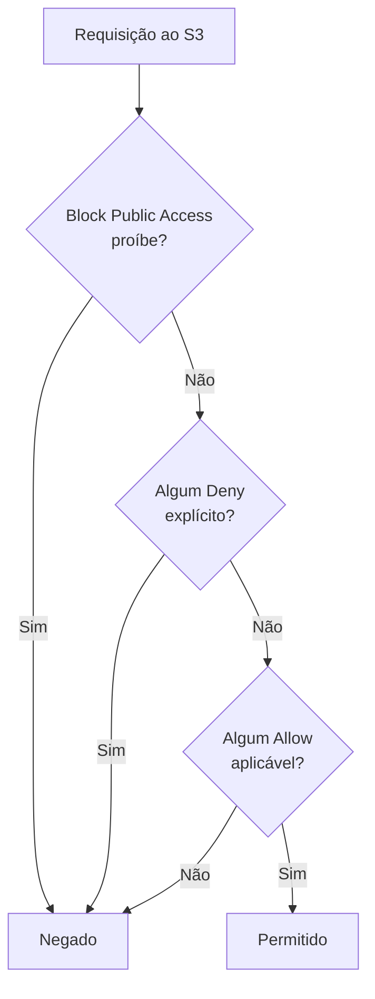

---
aliases:
  - Aula 11.4
modulo: 11
aula: 4
parte: "III Computação e armazenamento"
dominios:
  - 1
lida: false
tags:
  - aula
  - saa-c03
  - modulo-11
---

# Aula 11.4: Controle de acesso e rede no S3

[[11 - Amazon S3 a Fundo|Voltar ao módulo]]

> [!question] Pergunta que esta aula responde
> O [[S3]] nasce privado: quais mecanismos concedem acesso ([[IAM]], [[Bucket Policy|bucket policy]], ACL, [[Access Point|access point]], [[Presigned URL|presigned URL]]), como eles se combinam, o que o [[Block Public Access]] faz por cima de tudo, e como manter o tráfego dentro da rede da AWS ([[VPC Endpoint|endpoints de VPC]]) sem abrir o [[Bucket|bucket]] para a internet?

## O problema: muitos jeitos de conceder acesso, e vazamentos por configuração

Quase todo vazamento famoso de dados na nuvem foi um [[Bucket|bucket]] aberto por engano. O [[S3]] evoluiu em duas direções para reduzir esse risco: tornou **tudo privado por padrão** (só o dono da conta e quem ele autorizar acessam) e criou travas que valem **por cima** de qualquer política que alguém escreva errado.

Você já conhece as peças do [[04 - IAM Identidade e Acesso|Módulo 4]]. Aqui elas aparecem aplicadas ao [[S3]]: uma [[Identity-Based Policy|identity-based policy]] (anexada ao usuário ou à role), uma [[Resource-Based Policy|resource-based policy]] (a [[Bucket Policy|bucket policy]]), e a lógica de avaliação (deny explícito vence, deny implícito por padrão, cross-account exige os dois lados).

## Os mecanismos de acesso

| Mecanismo | Onde vive | Para quê | Situação em 2026 |
|---|---|---|---|
| [[Identity-Based Policy\|Identity-based policy]] ([[IAM Policy]]) | No usuário, grupo ou [[IAM Role|role]] | "O que esta identidade pode fazer" | Padrão para acesso interno |
| [[Bucket Policy|Bucket policy]] | No [[Bucket\|bucket]] (resource-based) | "Quem pode fazer o quê neste bucket", inclusive outras contas e acesso público | Padrão para cross-account, condições de rede e de criptografia |
| ACL (access control list) | [[Bucket]] ou objeto | Concessões por objeto a contas | Legado; **desativadas por padrão** |
| [[Access Point]] | Endpoint nomeado atrelado ao [[Bucket\|bucket]] | Política própria por aplicação ou equipe, restrição a [[VPC]] | Para datasets compartilhados em escala |
| [[Presigned URL]] | Gerada por quem tem credencial | Acesso temporário a **um objeto** sem dar credenciais | Para uploads e downloads de usuários finais |
| [[Block Public Access]] | Organização, conta, [[Bucket\|bucket]] e [[Access Point\|access point]] | Trava que **impede** acesso público | Ligada por padrão em buckets novos |

### Como as políticas se combinam

- **Mesma conta:** o acesso é concedido se **a [[Identity-Based Policy|identity policy]] OU a [[Bucket Policy|bucket policy]]** permitir, e nenhuma negar explicitamente. Basta um Allow.
- **Contas diferentes (cross-account):** é preciso um Allow **nos dois lados**: a [[Identity-Based Policy|identity policy]] da identidade (na conta dela) **e** a [[Bucket Policy|bucket policy]] (na conta dona do [[Bucket|bucket]]). Esse é o padrão do Módulo 4.
- **Deny explícito** em qualquer política vence qualquer Allow.
- **[[SCP|SCPs]]** (Módulo 5), [[Permissions Boundary|permissions boundaries]] e [[Block Public Access]] são camadas de limite por cima.



(Simplificação: em cross-account o Allow precisa existir nos dois lados.)

> [!example] Duas contas, um bucket
> A conta de dados (111111111111) tem o [[Bucket|bucket]] `relatorios-prod`. A conta de analytics (222222222222) tem uma role `AnalistaRole`. Para ela ler os relatórios, duas coisas são necessárias: na conta 222222222222, a role tem `s3:GetObject` em `arn:aws:s3:::relatorios-prod/*`; e na conta 111111111111, a [[Bucket Policy|bucket policy]] permite o principal `arn:aws:iam::222222222222:role/AnalistaRole`. Só um dos lados não basta.

## Bucket policy: o que ela resolve que a IAM não resolve

A [[Bucket Policy|bucket policy]] é uma [[Resource-Based Policy|resource-based policy]] (tem `Principal`). Os usos que mais caem:

1. **Acesso cross-account** sem a outra conta precisar [[AssumeRole|assumir role]].
2. **Condições de rede**: só aceitar tráfego que vem de um [[VPC Endpoint|endpoint de VPC]] ou de um intervalo de IPs.
3. **Condições de criptografia e de transporte**: negar upload sem criptografia, negar [[HTTP]].
4. **Acesso por organização**: permitir a qualquer conta da sua [[Organizations|organização]] com `aws:PrincipalOrgID`, sem listar cada conta.
5. **Acesso público deliberado** (por exemplo, um site estático): exige desligar parte do [[Block Public Access]].

Dois exemplos de política que valem decorar como padrão (troque `meu-bucket` e o ID do endpoint):

```json
{
  "Version": "2012-10-17",
  "Statement": [{
    "Sid": "NegarTransporteSemTLS",
    "Effect": "Deny",
    "Principal": "*",
    "Action": "s3:*",
    "Resource": ["arn:aws:s3:::meu-bucket", "arn:aws:s3:::meu-bucket/*"],
    "Condition": { "Bool": { "aws:SecureTransport": "false" } }
  }]
}
```

Esta política nega qualquer requisição que não use HTTPS ([[TLS]]), o que garante a [[Criptografia em Transito|criptografia em trânsito]].

```json
{
  "Version": "2012-10-17",
  "Statement": [{
    "Sid": "SoPeloEndpointDaVpc",
    "Effect": "Deny",
    "Principal": "*",
    "Action": "s3:*",
    "Resource": ["arn:aws:s3:::meu-bucket", "arn:aws:s3:::meu-bucket/*"],
    "Condition": { "StringNotEquals": { "aws:SourceVpce": "vpce-0123456789abcdef0" } }
  }]
}
```

Esta nega tudo que **não** chega por aquele [[VPC Endpoint|endpoint de VPC]]. Cuidado: ela também bloqueia você pelo console e pela CLI de fora da [[VPC]], e pode trancar o [[Bucket|bucket]]: nesse caso, o **[[Usuario Root|usuário root]] da conta dona do bucket** consegue editar ou excluir a [[Bucket Policy|bucket policy]] mesmo com um `Deny` que bloqueie todos (ação restrita ao root; fonte: documentação da AWS sobre recuperar bucket trancado por política, verificado em novembro de 2026). Em produção, use `aws:SourceVpce` com exceções para o papel de administração.

### A pegadinha dos dois ARNs: bucket e objetos

Em uma policy, `Resource` aponta para **dois tipos de [[ARN]]**, e cada ação vale para um deles:

- **[[ARN]] do [[Bucket|bucket]]** (`arn:aws:s3:::meu-bucket`): ações sobre o bucket, como `s3:ListBucket`, `s3:GetBucketLocation` e `s3:GetBucketPolicy`.
- **[[ARN]] dos objetos** (`arn:aws:s3:::meu-bucket/*`): ações sobre objetos, como `s3:GetObject`, `s3:PutObject` e `s3:DeleteObject`.

```json
{
  "Version": "2012-10-17",
  "Statement": [
    { "Effect": "Allow", "Action": "s3:ListBucket",
      "Resource": "arn:aws:s3:::meu-bucket" },
    { "Effect": "Allow", "Action": ["s3:GetObject", "s3:PutObject"],
      "Resource": "arn:aws:s3:::meu-bucket/*" }
  ]
}
```

Com só o [[ARN]] `meu-bucket/*`, a listagem falha com `AccessDenied`; com só o ARN do [[Bucket|bucket]], ler e gravar objetos falha. Efeito colateral cobrável: sem `s3:ListBucket`, pedir um objeto que **não existe** devolve **403 (AccessDenied)** em vez de **404 (NoSuchKey)**, porque o [[S3]] não revela a quem não pode listar se a chave existe.

> [!tip] Padrão de perímetro de dados
> Combine: [[Block Public Access]] ligado, [[Bucket Policy|bucket policy]] exigindo `aws:SecureTransport`, `aws:PrincipalOrgID` para restringir à organização e, para dados sensíveis, `aws:SourceVpce` para forçar passagem pela [[VPC]]. Cada condição fecha um caminho que as outras deixam aberto.

## ACLs desativadas: Object Ownership

As ACLs do [[S3]] vêm de antes do [[IAM]] e concedem acesso por objeto para contas ou grupos predefinidos. O jeito moderno é **não usá-las**. O recurso **S3 Object Ownership** controla isso com três modos:

| Modo | Efeito |
|---|---|
| **[[Bucket]] owner enforced** (padrão em buckets novos) | ACLs desativadas; o dono do bucket é dono de **todos** os objetos, quem quer que os envie |
| [[Bucket]] owner preferred | ACLs ativas; objetos enviados com a ACL `bucket-owner-full-control` ficam com o dono do bucket |
| Object writer | ACLs ativas; quem envia é dono do objeto |

O problema que o modo padrão resolve: em upload cross-account, no modelo antigo o objeto pertencia à conta que enviou, e o dono do [[Bucket|bucket]] podia nem conseguir lê-lo. Com "bucket owner enforced", esse problema acaba e o acesso é só por políticas. Com ACLs desativadas, uma requisição que tente definir uma ACL personalizada falha com erro 400 (`AccessControlListNotSupported`); ACLs `bucket-owner-full-control` continuam sendo aceitas.

## Block Public Access: a trava por cima de tudo

O [[Block Public Access]] tem **quatro configurações** independentes: bloquear novas ACLs públicas, ignorar ACLs públicas existentes, bloquear novas políticas de [[Bucket|bucket]] públicas e restringir acesso público de buckets com política pública (os nomes de API são `BlockPublicAcls`, `IgnorePublicAcls`, `BlockPublicPolicy` e `RestrictPublicBuckets`). Pontos que caem:

- Pode ser aplicado por **organização** (via Organizations, as quatro juntas), **conta**, **[[Bucket|bucket]]** e **[[Access Point|access point]]**.
- Vale a combinação **mais restritiva** entre os níveis: uma conta com BPA ligado protege o [[Bucket|bucket]] mesmo que o bucket tenha BPA desligado.
- Substitui o que as políticas e ACLs disserem: mesmo uma [[Bucket Policy|bucket policy]] com `Principal: "*"` fica sem efeito público enquanto o BPA estiver ligado.
- Não existe BPA por objeto.
- Recomendação oficial: ligar as quatro no nível da **conta**, e também em cada [[Bucket|bucket]].

O **[[IAM]] Access Analyzer for [[S3]]** (e o [[Security Hub]]) revela quais buckets estão públicos ou compartilhados com outras contas ([[IAM Access Analyzer]], Módulo 4).

## Access Points: acesso por aplicação em um bucket compartilhado

Em um [[Data Lake|data lake]] com 20 equipes lendo o mesmo [[Bucket|bucket]], uma [[Bucket Policy|bucket policy]] gigante vira um pesadelo (e há limite de tamanho). Um [[Access Point|access point]] é um **endpoint de rede nomeado**, atrelado a um bucket, com **política própria** e controles de rede próprios. Cada equipe recebe o seu, com permissão só para o seu prefixo; o bucket só precisa delegar o acesso aos access points. Pontos importantes:

- Cada [[Access Point|access point]] pode aceitar requisições **apenas de uma [[VPC]]**, e pode ter configurações próprias de [[Block Public Access]].
- A política do [[Access Point|access point]] **funciona em conjunto** com a [[Bucket Policy|bucket policy]].
- Só servem para operações **em objetos** (`GetObject`, `PutObject`); não para apagar [[Bucket|bucket]] nem criar replicação.
- Acessados por [[ARN]] ou por um **alias** que se comporta como nome de [[Bucket|bucket]].
- Um [[Access Point|access point]] também pode ser atrelado a outras fontes (como volumes do [[FSx for NetApp ONTAP]] e do [[FSx for OpenZFS]]), conforme a documentação.

## URLs pré-assinadas: acesso temporário a um objeto

Um usuário final sem [[Conta AWS|conta AWS]] precisa baixar ou enviar um arquivo? Em vez de dar credenciais ou abrir o [[Bucket|bucket]], o servidor gera uma [[Presigned URL|URL pré-assinada]]: uma URL com a assinatura ([[SigV4]]) de quem a gerou, para **um método [[HTTP]] e uma chave**, válida até um prazo. Quem tem a URL acessa como se fosse o criador, só para aquilo.

Regras verificadas (novembro de 2026):

- A URL carrega **as permissões de quem a gerou**; se ele não puder ler o objeto, a URL também não consegue.
- Validade: **até 7 dias** com credenciais de [[IAM User|IAM user]] e SDK ou CLI; de 1 minuto a 12 horas se gerada pelo console.
- Com [[Credencial Temporaria|credenciais temporárias]] ([[IAM Role|IAM role]], [[STS]], role de [[EC2|instância EC2]]), a URL **expira junto com a sessão**, mesmo que você tenha pedido prazo maior. Para role de instância EC2, a documentação cita tipicamente 6 horas.
- Pode ser usada várias vezes até expirar; é um **bearer token** (quem tem, usa).
- Para **upload** (`PUT`), se a chave já existe, o objeto é **substituído**.
- Dá para limitar com condições de política, como `s3:signatureAge` (negar assinaturas mais velhas que 10 minutos).

### Presigned URL do S3 x CloudFront signed URL x OAC

Três mecanismos parecidos que a prova mistura (documentação do [[CloudFront]] sobre conteúdo privado, verificado em novembro de 2026):

| Mecanismo | O que faz | Quando escolher |
|---|---|---|
| **[[Presigned URL]] do [[S3]]** | Acesso temporário a **um objeto, direto no S3**, com as permissões de quem assinou; até 7 dias com [[IAM User\|IAM user]] | Upload ou download pontual, sem [[CDN]] e sem cache |
| **[[CloudFront Signed URL\|CloudFront signed URL]] ou signed cookie** | Acesso a conteúdo **servido pelo [[CloudFront]]**, com cache nas [[Edge Location\|edge locations]]; o cookie cobre **vários arquivos** de uma vez | Restringir conteúdo a usuários pagantes com [[CDN]] |
| **[[Origin Access Control]] (OAC)** | Só o [[CloudFront]] consegue ler o [[Bucket\|bucket]]; **não identifica o usuário final** | Bucket privado atrás do CloudFront; combina com [[CloudFront Signed URL\|signed URL]] ou cookie |

Regra rápida: "upload ou download temporário direto no [[S3]]" é [[Presigned URL|presigned URL]]; "restringir conteúdo a assinantes com cache global" é [[CloudFront Signed URL|CloudFront signed URL]] ou cookie; "[[Bucket|bucket]] só legível pelo [[CloudFront]]" é [[Origin Access Control|OAC]].

> [!example] Upload direto do navegador
> Seu backend NestJS não precisa receber o arquivo de 200 MB do usuário. Ele gera uma [[Presigned URL|URL pré-assinada]] de `PUT` para `uploads/{userId}/{uuid}.pdf` válida por 5 minutos e devolve ao Angular, que envia direto ao [[S3]]. O backend deixa de ser gargalo de banda e o [[Bucket|bucket]] continua privado. Para validar o arquivo depois, um evento do S3 (aula 11.8) dispara uma função.

## Rede: manter o tráfego dentro da AWS

Uma instância em [[Sub-rede|subnet]] privada acessando o [[S3]] pela internet passa por um [[NAT Gateway]] (cobrado por hora e por GB processado). Os [[VPC Endpoint|VPC endpoints]] (Módulo 6) evitam isso:

| | [[Gateway Endpoint\|Gateway endpoint]] | [[Interface Endpoint\|Interface endpoint]] ([[PrivateLink]]) |
|---|---|---|
| Custo | **Sem cobrança adicional** | Por hora e por GB |
| Como funciona | Entrada na **[[Route Table\|route table]]** ([[Managed Prefix List\|prefix list]] do [[S3]]) | [[ENI]] com [[RFC 1918\|IP privado]] na [[Sub-rede\|subnet]] |
| Alcançável de on-premises, [[Transit Gateway]] ou peering entre [[Regiao AWS\|Regiões]]? | **Não** | **Sim** |
| Escopo | Só a Região onde foi criado | Pode atender on-premises via [[Direct Connect\|DX]] ou VPN |

O [[Gateway Endpoint]] do [[S3]] é o padrão mais barato para tráfego de dentro da [[VPC]]. Para tráfego vindo de on-premises ou de outras redes, use o [[Interface Endpoint]]. Detalhes que caem:

- **`aws:SourceIp` não funciona** para tráfego que passa por um [[VPC Endpoint|endpoint de VPC]] (o IP de origem vira privado); use `aws:VpcSourceIp` ou `aws:SourceVpce`.
- O **[[Endpoint Policy|endpoint policy]]** limita o que o endpoint permite (por exemplo, só buckets da organização): é mais um nível de [[Menor Privilegio|menor privilégio]].
- O [[Security Group|security group]] de uma instância precisa permitir saída para o [[Managed Prefix List|prefix list]] do [[S3]].
- A [[VPC]] precisa de [[DNS]] support e DNS hostnames ligados para resolver via [[Route 53 Resolver|Amazon DNS]].

> [!info] Ligando os pontos
> No [[06 - VPC a Fundo|Módulo 6]] você viu por que o [[Gateway Endpoint|gateway endpoint]] reduz custo de [[NAT]]; aqui o mesmo endpoint vira também controle de segurança (`aws:SourceVpce`). O caminho de [[Criptografia em Repouso|criptografia]] e de chaves é a [[11.05 - Criptografia Versionamento e Retencao no S3|próxima aula]].

## Laboratório (opcional): gerar uma presigned URL

> [!warning] Use uma conta AWS pessoal
> Faça isto somente em uma **[[Conta AWS|conta AWS]] pessoal separada**, com [[Budgets|AWS Budgets]] configurado. **Nunca na conta de produção da empresa.** O custo é de centavos; apague o [[Bucket|bucket]] no mesmo dia.

Custo estimado: centavos de dólar, desde que o [[Bucket|bucket]] seja apagado no mesmo dia.

1. Crie o [[Bucket|bucket]]: `aws s3api create-bucket --bucket meu-lab-presign-12345 --region us-east-1`.
2. Envie um arquivo de teste: `aws s3 cp teste.txt s3://meu-lab-presign-12345/teste.txt`.
3. Confirme que o acesso anônimo falha: abra `https://meu-lab-presign-12345.s3.amazonaws.com/teste.txt` e veja o `AccessDenied`.
4. Gere a URL assinada por 5 minutos: `aws s3 presign s3://meu-lab-presign-12345/teste.txt --expires-in 300`.
5. Abra a URL gerada no navegador, baixe o arquivo e repita depois dos 5 minutos para ver o erro de expiração.

**Limpeza:** `aws s3 rb s3://meu-lab-presign-12345 --force`.

## Como isso cai na prova

**Task 1.2** ([[VPC]], endpoints, credenciais de aplicação), **Task 1.3** (políticas de acesso a dados) e **Task 1.1** (políticas de recurso).

**Palavras-chave e para onde apontam**

- "grant temporary access to a specific object", "users without [[Conta AWS|AWS accounts]]" aponta para **[[Presigned URL|presigned URL]]**.
- "ensure the [[Bucket|bucket]] is never public", "prevent accidental public exposure" aponta para **[[Block Public Access]]** (conta ou organização).
- "access from another [[Conta AWS|AWS account]]", "cross-account" aponta para **[[Bucket Policy|bucket policy]]** (mais permissão no lado da outra conta).
- "restrict access to a [[VPC]]" aponta para **[[Gateway Endpoint|gateway endpoint]]** mais [[Bucket Policy|bucket policy]] com `aws:SourceVpce` (ou [[Access Point|access point]] restrito a VPC).
- "many teams share a [[Bucket|bucket]] with different permissions" aponta para **[[S3]] [[Access Point|Access Points]]**.
- "enforce HTTPS only" aponta para `aws:SecureTransport`.
- "from on-premises without internet" aponta para **[[Interface Endpoint|interface endpoint]]** (o gateway não alcança on-premises).

**Pegadinhas clássicas**

- Cross-account precisa de permissão **nos dois lados**.
- [[Gateway Endpoint|Gateway endpoint]] é grátis, mas **não** atende on-premises.
- ACLs estão desativadas por padrão; resolva com policy, não com ACL.
- [[Presigned URL]] gerada por role de curta duração expira com a sessão.
- **ListBucket** vai no [[ARN]] do [[Bucket|bucket]] e **GetObject/PutObject** no ARN com `/*`; sem `s3:ListBucket`, objeto inexistente devolve 403 em vez de 404.
- [[Presigned URL]] do [[S3]] não é [[CloudFront Signed URL|CloudFront signed URL]]: conteúdo restrito com [[CDN]] e cache pede o do [[CloudFront]].
- [[Block Public Access]] vence políticas públicas.
- `aws:SourceIp` não funciona com [[VPC Endpoint|endpoint de VPC]].

| Requisito no enunciado | Resposta provável | Por quê |
|---|---|---|
| Instância privada acessa [[S3]] sem [[NAT]], sem custo extra | [[Gateway Endpoint\|Gateway endpoint]] do S3 | Rota na [[Route Table\|route table]], sem cobrança |
| Servidores on-premises acessam [[S3]] por [[Direct Connect\|DX]] sem internet | [[Interface Endpoint\|Interface endpoint]] ([[PrivateLink]]) | O [[Gateway Endpoint\|gateway endpoint]] não é alcançável de fora da [[VPC]] |
| Usuário externo baixa um arquivo por 10 minutos | [[Presigned URL]] | Acesso temporário a um objeto sem credenciais |
| Toda conta da organização lê o [[Bucket\|bucket]] | [[Bucket Policy\|Bucket policy]] com `aws:PrincipalOrgID` | Evita listar cada conta |
| Garantir que nenhum [[Bucket\|bucket]] da conta fique público | [[Block Public Access]] no nível da conta | Trava que vence políticas e ACLs |
| 20 equipes, cada uma com seu prefixo | [[Access Point\|Access points]] | Política por aplicação, sem política gigante no [[Bucket\|bucket]] |

## Resumo

> [!abstract] A aula em uma frase
> O [[S3]] é privado por padrão e o acesso é a soma de [[IAM]], [[Bucket Policy|bucket policy]] e [[Access Point|access points]], limitada por cima pelo [[Block Public Access]]; [[Presigned URL|presigned URLs]] dão acesso temporário a um objeto, e [[VPC Endpoint|endpoints de VPC]] mantêm o tráfego na rede da AWS.

**A lógica, em 5 passos**
1. Nada é público por padrão: o dono acessa e quem ele autorizar.
2. Autorização vem de [[Identity-Based Policy|identity policy]] e [[Bucket Policy|bucket policy]]; mesma conta basta um Allow, cross-account exige os dois.
3. [[Block Public Access]] (organização, conta, [[Bucket|bucket]], [[Access Point|access point]]) bloqueia acesso público independentemente das políticas.
4. ACLs ficam desativadas (Object Ownership "[[Bucket|bucket]] owner enforced"); acesso por política.
5. A rede é controlada por [[VPC Endpoint|endpoints de VPC]] (gateway grátis; interface para on-premises) e por condições (`aws:SourceVpce`, `aws:SecureTransport`).

**Números para lembrar**

| O quê | Valor | Por que importa |
|---|---|---|
| [[Presigned URL]], SDK ou CLI | até 7 dias | Credencial de [[IAM User\|IAM user]] |
| [[Presigned URL]], console | 1 min a 12 h | Limite do console |
| Configurações do BPA | 4 | Combináveis |
| Modos do Object Ownership | 3 (padrão: [[Bucket\|bucket]] owner enforced) | ACLs desativadas |
| [[Gateway Endpoint\|Gateway endpoint]] | grátis | Não alcança on-premises |

**Tabela-síntese**

| Preciso de... | Use |
|---|---|
| Acesso interno por identidade | [[IAM Policy\|IAM policy]] |
| Acesso de outra conta | [[Bucket Policy\|Bucket policy]] + permissão no outro lado |
| Impedir qualquer acesso público | [[Block Public Access]] |
| Acesso por equipe em [[Bucket\|bucket]] compartilhado | [[Access Point\|Access point]] |
| Acesso temporário a um objeto | [[Presigned URL]] |
| Tráfego sem internet | Gateway ou [[Interface Endpoint\|interface endpoint]] |

**Na prática, isso significa**
- Ligue BPA na conta, desative ACLs e escreva políticas.
- Para cross-account, lembre dos dois lados da permissão.
- Para upload de usuário final, gere [[Presigned URL|URL pré-assinada]] curta no backend.
- Prefira [[Gateway Endpoint|gateway endpoint]] para tráfego de dentro da [[VPC]] e [[Interface Endpoint|interface endpoint]] para on-premises.

> [!tip] Liga com
> Vem de [[11.03 - Ciclo de Vida e Custo no S3|Ciclo de vida e custo]] e do [[04 - IAM Identidade e Acesso|Módulo 4]]; abre [[11.05 - Criptografia Versionamento e Retencao no S3|Criptografia, versionamento e retenção]].

## Erros comuns

- **Achar que um Allow só na [[Bucket Policy|bucket policy]] libera outra conta.** A identidade na outra conta também precisa de permissão.
- **Resolver acesso cross-account com ACL.** Em buckets novos as ACLs estão desativadas; use [[Bucket Policy|bucket policy]].
- **Usar `aws:SourceIp` para limitar tráfego que passa pelo [[VPC Endpoint|endpoint de VPC]].** O IP de origem muda para privado.
- **Presumir que a [[Presigned URL|URL pré-assinada]] dura 7 dias com credencial de role.** Ela expira junto com a sessão da role.
- **Trancar o próprio [[Bucket|bucket]] com um Deny de `aws:SourceVpce`.** Inclua exceções para administração.

## Pratique

**1.** Uma organização quer garantir que nenhum [[Bucket|bucket]] de nenhuma conta seja tornado público por engano. Qual controle é o mais abrangente?

- [ ] a) Block Public Access nas configurações da conta ou da organização
- [ ] b) Revisar manualmente as ACLs de cada bucket toda semana com um script de auditoria
- [ ] c) Apagar todas as bucket policies existentes
- [ ] d) Habilitar SSE-KMS em todos os buckets

**2.** Uma aplicação precisa permitir que um cliente baixe um arquivo privado por uma hora, sem que o cliente tenha credenciais AWS. Qual é a solução?

- [ ] a) Tornar o objeto público e apagá-lo depois de uma hora
- [ ] b) Criar um usuário IAM temporário para o cliente
- [ ] c) Habilitar o Transfer Acceleration no bucket
- [ ] d) Gerar uma presigned URL com validade de uma hora

**3.** Instâncias em uma [[Sub-rede Privada|sub-rede privada]], sem [[NAT Gateway]], precisam acessar o [[S3]] sem custo adicional de endpoint. Qual solução?

- [ ] a) Um interface endpoint para o S3, que é gratuito por hora e por GB processado na VPC
- [ ] b) Um gateway endpoint para o S3 na VPC, com a rota na tabela de rotas
- [ ] c) Um Internet Gateway associado às sub-redes privadas, com rota para o S3 pela internet pública
- [ ] d) Um peering da VPC com a VPC do serviço S3, com rotas apontando para o bloco do peering

**4.** Uma aplicação on-premises, conectada por [[Direct Connect]], precisa acessar o [[S3]] por um caminho privado. Qual endpoint serve?

- [ ] a) Gateway endpoint para o S3
- [ ] b) NAT Gateway na sub-rede pública
- [ ] c) Interface endpoint (PrivateLink) para o S3
- [ ] d) Um endpoint de entrada do Route 53 Resolver apontando para o S3

**5.** Quais DUAS afirmações sobre Object Ownership com a opção [[Bucket]] owner enforced estão corretas? (Escolha DUAS.)

- [ ] a) O remetente do upload continua sendo dono do objeto
- [ ] b) Toda escrita exige uma ACL com a permissão FULL_CONTROL
- [ ] c) As ACLs ficam desabilitadas
- [ ] d) A opção só funciona em buckets sem versionamento
- [ ] e) O dono do bucket passa a ser dono de todos os objetos

**6.** Uma empresa quer que o [[Bucket|bucket]] de dados sensíveis aceite somente requisições vindas de um [[Gateway Endpoint|gateway endpoint]] específico da [[VPC]], sem manter listas de IPs. Qual [[Condition Key|chave de condição]] a [[Bucket Policy|bucket policy]] deve usar?

- [ ] a) aws:SourceIp com o IP privado da instância
- [ ] b) aws:UserAgent com o nome do SDK
- [ ] c) s3:prefix com o nome do endpoint
- [ ] d) aws:SourceVpce com o ID do endpoint

**7.** A conta B tem um papel [[IAM]] que precisa ler objetos de um [[Bucket|bucket]] da conta A. O que é necessário?

- [ ] a) Apenas a política IAM do papel na conta B, pois o S3 aceita qualquer identidade da mesma organização AWS sem política no bucket
- [ ] b) Apenas uma ACL pública no bucket da conta A, liberando a leitura para qualquer identidade da internet
- [ ] c) Uma bucket policy na conta A autorizando o papel, e permissão equivalente na política IAM do papel na conta B
- [ ] d) Mover o bucket para a conta B e atualizar todos os endpoints das aplicações que o acessam

**8.** A auditoria exige que nenhuma requisição ao [[Bucket|bucket]] use [[HTTP]] sem [[TLS]], e a equipe quer impor isso no próprio bucket com o menor esforço. O que configurar?

- [ ] a) Ligar a criptografia SSE-S3 no bucket
- [ ] b) Uma bucket policy com Deny quando aws:SecureTransport é false
- [ ] c) Desligar o acesso por HTTP no console do S3, que remove a porta 80
- [ ] d) Habilitar o versionamento

**9.** Quais DUAS afirmações sobre o [[Gateway Endpoint|gateway endpoint]] do [[S3]] estão corretas? (Escolha DUAS.)

- [ ] a) Cria uma ENI com IP privado na sub-rede
- [ ] b) Não tem custo por hora nem por GB processado
- [ ] c) Suporta qualquer serviço da AWS
- [ ] d) Não é acessível a partir de redes on-premises
- [ ] e) Exige um NAT Gateway para funcionar

**10.** Um [[Bucket|bucket]] é compartilhado por vários times, e a [[Bucket Policy|bucket policy]] única ficou grande e difícil de manter. Qual recurso simplifica?

- [ ] a) S3 Access Points, cada um com sua política e nome, para cada time ou aplicação
- [ ] b) Criar um bucket por objeto e uma bucket policy específica para cada um deles
- [ ] c) Usar ACLs de objeto para cada arquivo, com um grant por time em cada objeto e revisão manual periódica
- [ ] d) Desligar o Block Public Access para simplificar as regras de acesso entre os times

**11.** Quais DUAS afirmações sobre o [[Block Public Access]] estão corretas? (Escolha DUAS.)

- [ ] a) Só pode ser configurado em nível de bucket
- [ ] b) Pode ser configurado em nível de organização, conta, bucket e access point
- [ ] c) Substitui a necessidade de IAM
- [ ] d) Aplica-se apenas às ACLs públicas, e não às bucket policies
- [ ] e) Cobre tanto ACLs públicas quanto bucket policies públicas

**12.** Uma [[Presigned URL|presigned URL]] gerada por uma função com [[Credencial Temporaria|credenciais temporárias]], com validade de 12 horas, deixa de funcionar depois de cerca de uma hora. Por quê?

- [ ] a) O S3 limita toda presigned URL a 60 minutos, independentemente da credencial que a assinou ou do prazo pedido
- [ ] b) O versionamento do bucket invalida as URLs antigas automaticamente a cada nova versão do objeto
- [ ] c) A URL precisa ser renovada a cada acesso, pois o S3 a invalida depois do primeiro download
- [ ] d) A URL vale apenas enquanto as credenciais temporárias que a assinaram forem válidas

**13.** Uma empresa de vídeo sob demanda serve conteúdo premium por uma [[CloudFront Distribution|distribuição do CloudFront]] e quer liberar os vídeos apenas a assinantes pagantes, mantendo o cache global. Qual solução atende?

- [ ] a) Gerar presigned URLs do S3 de 7 dias para cada vídeo e entregá-las ao assinante
- [ ] b) CloudFront signed URLs ou signed cookies emitidos pela aplicação após o login
- [ ] c) Apenas OAC, para que só o CloudFront leia o bucket e os assinantes sejam identificados
- [ ] d) Bucket policy com aws:PrincipalOrgID para liberar a organização do assinante

> [!success]- Gabarito
> **1. a)** O BPA tem níveis de organização e conta que sobrepõem as configurações por [[Bucket|bucket]]. Descartadas: b) é frágil e não previne; c) não impede um novo bucket público; d) criptografia não controla acesso público.
>
> **2. d)** A [[Presigned URL|presigned URL]] delega o acesso por tempo limitado. Descartadas: a) expõe o objeto a qualquer um durante a janela; b) gera gestão desnecessária de identidades; c) acelera transferência, não concede acesso.
>
> **3. b)** O [[Gateway Endpoint|gateway endpoint]] para [[S3]] não tem custo. Descartadas: a) o [[Interface Endpoint|interface endpoint]] tem custo por hora e por GB; c) tornaria a [[Sub-rede Publica|sub-rede pública]]; d) o S3 não é acessado por peering.
>
> **4. c)** Só o [[Interface Endpoint|interface endpoint]] é alcançável de fora da [[VPC]]. Descartadas: a) o [[Gateway Endpoint|gateway endpoint]] não é acessível a partir de redes on-premises; b) o [[NAT Gateway]] serve para saída de recursos da VPC; d) resolve [[DNS]], não cria caminho privado para o [[S3]].
>
> **5. c) e e)** [[Bucket]] owner enforced é o padrão para novos buckets. Descartadas: a) isso era o padrão antigo; b) as ACLs deixam de ter efeito; d) não há essa dependência.
>
> **6. d)** Aws:SourceVpce (ou aws:SourceVpc) identifica o caminho de rede. Descartadas: a) o IP de origem não é visto assim pelo [[S3]] através do endpoint; b) é trivial de forjar e não identifica o endpoint; c) prefixo é um filtro de listagem.
>
> **7. c)** Acesso entre contas exige permissão na conta do recurso e na da identidade. Descartadas: a) no acesso entre contas é preciso permitir nos dois lados; b) expõe o [[Bucket|bucket]] a todos; d) não é necessário para conceder acesso.
>
> **8. b)** A condição aws:SecureTransport detecta requisições sem [[TLS]]. Descartadas: a) [[Criptografia em Repouso|criptografia em repouso]] não obriga TLS; c) não existe essa opção no console; d) não tem relação com o transporte.
>
> **9. b) e d)** [[Gateway Endpoint|Gateway endpoint]] é uma rota na [[Route Table|tabela de rotas]], gratuita, para [[S3]] e [[DynamoDB]]. Descartadas: a) isso descreve o [[Interface Endpoint|interface endpoint]]; c) o gateway endpoint existe só para S3 e DynamoDB; e) o objetivo é dispensar [[NAT]].
>
> **10. a)** Cada [[Access Point|access point]] tem política própria e restringe o acesso por prefixo. Descartadas: b) inviável e desnecessário; c) ACLs são o método legado e mais difícil de gerenciar; d) não simplifica e reduz a segurança.
>
> **11. b) e e)** O BPA é uma trava central contra exposição pública. Descartadas: a) também existe em nível de conta, organização e [[Access Point|access point]]; c) o BPA é uma trava adicional, não substitui permissões; d) ele cobre ACLs e [[Bucket Policy|bucket policies]].
>
> **12. d)** A [[Presigned URL|presigned URL]] expira junto com a credencial que a gerou. Descartadas: a) o limite máximo é maior e depende das credenciais; b) não é assim que funciona; c) não há essa exigência.
>
> **13. b)** [[CloudFront Signed URL|Signed URLs]] ou cookies do [[CloudFront]] restringem quem acessa o conteúdo servido pela [[CDN]] e mantêm o cache nas [[Edge Location|edge locations]]. Descartadas: a) a [[Presigned URL|presigned URL]] do [[S3]] vai direto ao [[Bucket|bucket]], sem passar pelo cache do CloudFront; c) o [[Origin Access Control|OAC]] só impede acesso direto ao bucket e não identifica o usuário final; d) o PrincipalOrgID restringe [[Conta AWS|contas AWS]] de uma organização, não assinantes de um serviço.

## Para aprofundar

- [ ] [Blocking public access to your Amazon S3 storage](https://docs.aws.amazon.com/AmazonS3/latest/userguide/access-control-block-public-access.html) (documentação AWS): os níveis (organização, conta, [[Bucket|bucket]], [[Access Point|access point]]) e como o mais restritivo prevalece.
- [ ] [Download and upload objects with presigned URLs](https://docs.aws.amazon.com/AmazonS3/latest/userguide/using-presigned-url.html) (documentação AWS): validade por tipo de credencial e limites de capacidade.
- [ ] [Gateway endpoints for Amazon S3](https://docs.aws.amazon.com/vpc/latest/privatelink/vpc-endpoints-s3.html) (documentação AWS): limitações do [[Gateway Endpoint|gateway endpoint]] e quando usar [[Interface Endpoint|interface endpoint]].

Próxima aula: [[11.05 - Criptografia Versionamento e Retencao no S3|Aula 11.5: Criptografia, versionamento e retenção]].
