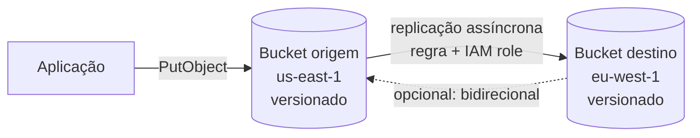

---
aliases:
  - Aula 11.6
modulo: 11
aula: 6
parte: "III Computação e armazenamento"
dominios:
  - 1
  - 2
lida: false
tags:
  - aula
  - saa-c03
  - modulo-11
---

# Aula 11.6: Replicação do S3

[[11 - Amazon S3 a Fundo|Voltar ao módulo]]

> [!question] Pergunta que esta aula responde
> Como copiar objetos automaticamente para outro [[Bucket|bucket]] (na mesma Região, em outra Região ou em outra conta), o que a [[Replicacao do S3|replicação do S3]] exige, o que ela replica e o que não replica, e como garantir um prazo (15 minutos) ou copiar o que já existia?

## O problema: o bucket é regional e o erro humano é global

Na [[11.01 - O Modelo do S3 Buckets Objetos e Durabilidade|primeira aula]] você viu que o [[S3]] sobrevive à perda de uma [[Zona de Disponibilidade|AZ]], mas o [[Bucket|bucket]] vive em uma [[Regiao AWS|Região]] só. Perdeu a Região, ou a conta foi comprometida, ou uma regra de conformidade manda guardar uma cópia a milhares de quilômetros: nada disso se resolve com a [[Durabilidade|durabilidade]] interna.

A **replicação** resolve copiando objetos, **de forma automática e assíncrona**, de um [[Bucket|bucket]] de origem para um ou mais buckets de destino. A cópia mantém metadados, tags e IDs de versão, e o destino pode estar na mesma conta ou em outra, na mesma Região ou em outra.

## Os tipos de replicação

| Tipo | O que copia | Quando usar |
|---|---|---|
| **[[Replicacao do S3\|CRR]]** (Cross-Region Replication) | Objetos novos e alterados, para [[Bucket\|bucket]] em **outra Região** | Conformidade com distância, menor [[Latencia\|latência]] para usuários em outra Região, DR |
| **[[Replicacao do S3\|SRR]]** (Same-Region Replication) | Objetos novos e alterados, para [[Bucket\|bucket]] na **mesma Região** | Agregar logs em um bucket, copiar entre contas de produção e teste, [[Residencia de Dados\|soberania de dados]] (cópia em outra conta, mesma Região) |
| **Replicação bidirecional** | Dois sentidos, com **replica modification sync** para sincronizar também metadados (ACL, tags, locks) | Dataset compartilhado entre [[Regiao AWS\|Regiões]], [[Failover\|failover]] com [[Multi-Region Access Point\|Multi-Region Access Points]] |
| **[[Batch Replication]]** (sob demanda) | Objetos que **já existiam**, que falharam antes ou que são réplicas | Sincronizar buckets, popular um destino novo, repetir falhas |

[[Replicacao do S3|CRR]] e SRR são "live replication": só cuidam do que é escrito **depois** que a regra existe. Isso é a pegadinha mais frequente: ativou a replicação num [[Bucket|bucket]] com 50 TB e esperou o bucket de destino aparecer cheio. Os 50 TB antigos só vão com [[Batch Replication]].



## O que a replicação exige

- **[[Versionamento]] ligado nos dois buckets** (origem e destino). Sem isso a regra não é criada. Depois de configurada, você não consegue desligar o versionamento da origem sem antes remover a replicação; se desligar o do destino, a replicação passa a falhar (status `FAILED` nos objetos).
- Uma **[[IAM Role|IAM role]]** que o [[S3]] assume para ler da origem e escrever no destino.
- As duas [[Regiao AWS|Regiões]] habilitadas para a conta (relevante em Regiões opt-in).
- **Cross-account**: o dono do destino concede permissão ao dono da origem por **[[Bucket Policy|bucket policy]]**; o destino não pode ser [[Requester Pays]].
- Se a origem tem **Object Lock** ([[Object Lock]]), o destino também precisa ter. A role precisa de `s3:GetObjectRetention` e `s3:GetObjectLegalHold` (ou `s3:Get*`).
- Se o dono do [[Bucket|bucket]] de origem não é dono do objeto, o dono do objeto precisa conceder `READ` e `READ_ACP` por ACL ao dono do bucket (só em buckets com ACLs ativas; com "bucket owner enforced" isso não é problema).

## O que é replicado e o que não é

**Replicado por padrão**
- Objetos criados **depois** da regra, cifrados ou não ([[SSE-S3]], [[SSE-KMS]], [[DSSE-KMS]] e [[SSE-C]] são suportados; a réplica usa o **mesmo tipo** de criptografia da origem, e a criptografia padrão do destino só vale para objetos que chegam sem cifra).
- Metadados, **tags**, atualizações de ACL e **informações de retenção do [[Object Lock]]**.
- Só objetos que o dono do [[Bucket|bucket]] tem permissão de ler.
- **[[SSE-KMS]]** exige permissões de chave na role: `kms:Decrypt` na chave da origem e `kms:Encrypt` e `kms:GenerateDataKey` na chave do destino (e a regra precisa indicar a chave de destino).
- **Regra baseada em tag**: o objeto precisa ser gravado **já com a tag** no `PutObject`; uma tag aplicada depois não dispara a replicação, a não ser que você rode o [[Batch Replication]] (verificado em novembro de 2026).

**Não replicado por padrão**
- **Objetos que já existiam** antes da regra ([[Batch Replication]]).
- **Réplicas de réplicas**: se A replica para B e B replica para C, o que chegou em B vindo de A **não** vai a C (nada de encadeamento; [[Batch Replication]] contorna).
- Objetos em **Glacier Flexible Retrieval**, **[[S3 Glacier Deep Archive|Glacier Deep Archive]]** e nas camadas Archive Access do [[S3 Intelligent-Tiering|Intelligent-Tiering]]: é preciso restaurar e copiar antes.
- **Mudanças de configuração do [[Bucket|bucket]]** (ciclo de vida, notificações): subrecursos do bucket não são replicados.
- **Exclusões permanentes**: apagar uma **versão específica** (com version ID) na origem **não** apaga no destino. Isso é proposital, para proteger contra deleções maliciosas.
- **[[Delete Marker|Delete markers]]**: na versão atual do formato de configuração, não são replicados por padrão. Você pode ligar `DeleteMarkerReplication` (não vale para regras baseadas em tag nem para delete markers criados por ciclo de vida, e não entra no [[SLA]] de 15 minutos).

> [!example] O destino como cofre
> Uma empresa de saúde replica `prontuarios` (us-east-1) para um [[Bucket|bucket]] em outra conta e outra Região (sa-east-1), **sem** [[Delete Marker|delete marker]] replication. Um ransomware que apaga tudo na origem insere delete markers na origem; o destino continua com todas as versões. Se a conta de origem for comprometida e o invasor tentar remover a replicação ou apagar versões, a conta de destino, isolada, preserva os dados. Combinado com [[Object Lock]] em compliance no destino, a cópia é imutável.

## Controle fino da regra

Uma regra de replicação pode:

- **Filtrar** por prefixo ou tags (replicar só `faturas/`).
- **Mudar a classe de armazenamento** no destino (por exemplo, a origem em Standard e a réplica direto em Glacier Flexible, ou em One Zone-IA para ser a cópia barata de [[Zona de Disponibilidade|uma AZ]], porque a réplica é recriável).
- **Mudar o dono** da réplica para a conta do destino (*owner override*), útil para restringir acesso.
- **Priorizar** regras quando há vários destinos.
- Replicar para **vários destinos** (várias [[Regiao AWS|Regiões]], para conformidade).

Detalhes: o ciclo de vida do destino respeita a **data de criação original** do objeto, não a data em que a réplica chegou; e objetos grandes podem levar horas porque o tempo de replicar é parecido com o de criar o original.

Exemplo de regra (formato da CLI), replicando só o prefixo `Tax` para um destino, com a replicação de [[Delete Marker|delete markers]] **desligada** (o desenho de DR recomendado acima):

```json
{
  "Role": "arn:aws:iam::111111111111:role/s3-replication-role",
  "Rules": [{
    "ID": "tax-para-outra-regiao",
    "Status": "Enabled",
    "Priority": 1,
    "Filter": { "Prefix": "Tax" },
    "DeleteMarkerReplication": { "Status": "Disabled" },
    "Destination": { "Bucket": "arn:aws:s3:::meu-bucket-destino" }
  }]
}
```

## Replication Time Control (RTC): prazo garantido

Replicação padrão é "best effort": costuma levar segundos a minutos, mas objetos grandes demoram. O **[[Replication Time Control|S3 Replication Time Control]]** (RTC) acrescenta um **[[SLA]] de 15 minutos** para replicar, com métricas e eventos:

- O [[Replication Time Control|RTC]] replica a maioria dos objetos em segundos e promete o prazo de **15 minutos**; para a prova, lembre "**15 minutes [[SLA]]**".
- Publica **métricas de replicação** (operações pendentes, bytes pendentes, tempo máximo de replicação, falhas), e eventos `OperationMissedThreshold` e `OperationReplicatedAfterThreshold` quando o prazo é perdido ou cumprido depois.
- Tem custo adicional por GB replicado.
- **Não se aplica ao [[Batch Replication]].**

Quando a questão diz "compliance requires replication within 15 minutes", a resposta é [[Replication Time Control|RTC]].

## Batch Replication: o que já existia

O [[Batch Replication]] é um job (rastreado pelo [[S3 Batch Operations]]) que replica objetos **existentes**, objetos que **falharam** antes e réplicas. Use ao criar uma regra num [[Bucket|bucket]] com dados, ao trocar o destino (o [[S3]] não re-replica objetos já replicados para outro destino sozinho) e ao reparar falhas. Não tem o [[SLA]] do [[Replication Time Control|RTC]].

## Multi-Region Access Points: um endpoint, vários buckets

Se você tem buckets replicados em duas ou mais [[Regiao AWS|Regiões]], um **[[Multi-Region Access Point]]** oferece **um único endpoint global** que roteia cada requisição, pela [[Backbone|rede global da AWS]], ao [[Bucket|bucket]] **mais próximo** (com roteamento ativo). Usa assinatura SigV4a. Combinado com **replicação bidirecional**, permite [[Failover|failover]] entre Regiões. O limite é de 100 Multi-Region Access Points por conta, e as requisições do [[Plano de Controle|plano de controle]] para criar e manter um ponto de acesso são sempre roteadas para a Região US West (Oregon), us-west-2 (verificado em novembro de 2026). As requisições de dados não precisam especificar Região. Detalhe para a prova: é a resposta para "usuários no mundo todo, melhor [[Latencia|latência]] e failover automático de uma só URL, sem mudar o app".

## Custo e armadilhas

Você paga o armazenamento **dos dois** lados, as requisições de replicação, a **transferência entre [[Regiao AWS|Regiões]]** ([[Replicacao do S3|CRR]]; SRR não paga transferência entre Regiões), o [[Replication Time Control|RTC]] e as chamadas de [[KMS]] se aplicável. Armadilhas:

- Replicar objeto cifrado com [[SSE-KMS]] exige que a role consiga **decifrar** na origem e **cifrar** com a chave de destino; com [[Multi-Region Key|chaves multi-Region]] (`multi-Region keys`) o [[S3]] usa a chave relacionada na Região de destino.
- Replicar objetos sem cifra para destino com criptografia padrão muda o **ETag** da réplica.
- Cuidado com "loops" em bidirecional: o [[S3]] evita replicar réplicas, mas a modificação de metadados na réplica só volta com *replica modification sync* ligado.

> [!info] Ligando os pontos
> Replicação é um bloco do [[20 - Alta Disponibilidade e Recuperacao de Desastres|Módulo 20]]: com **[[S3]] [[Replicacao do S3|CRR]]** você obtém um [[RPO]] de minutos (ou 15 min com [[Replication Time Control|RTC]]) para o dado em objetos, e junto com o [[Route 53]] e o [[Aurora]] Global Database forma a base de "[[Pilot Light|pilot light]]" e "[[Warm Standby|warm standby]]". O [[Versionamento|versionamento]] e a criptografia da [[11.05 - Criptografia Versionamento e Retencao no S3|aula anterior]] são pré-requisitos desta.

## Laboratório (opcional): replicação entre dois buckets

> [!warning] Use uma conta AWS pessoal
> Faça isto somente em uma **[[Conta AWS|conta AWS]] pessoal separada**, com [[Budgets|AWS Budgets]] configurado. **Nunca na conta de produção da empresa.** A replicação gera cobrança de armazenamento nos dois lados e de transferência; apague tudo no mesmo dia.

Custo estimado: centavos de dólar, desde que os dois buckets sejam apagados no mesmo dia.

1. Crie dois buckets com [[Versionamento|versionamento]] ligado, um em `us-east-1` e outro em `us-west-2` (`aws s3api create-bucket`, com `--create-bucket-configuration LocationConstraint=us-west-2` no segundo; depois `aws s3api put-bucket-versioning ... Status=Enabled` nos dois). Crie a [[IAM Role|IAM role]] com a relação de confiança de `s3.amazonaws.com` e uma política com as ações de replicação:

   ```bash
   aws iam create-role --role-name s3-replication-lab --assume-role-policy-document file://trust.json
   aws iam put-role-policy --role-name s3-replication-lab --policy-name repl --policy-document file://repl-policy.json
   ```

   No `trust.json`, o `Principal` é `{"Service": "s3.amazonaws.com"}` com `sts:AssumeRole`. No `repl-policy.json`: `s3:GetReplicationConfiguration` e `s3:ListBucket` no [[ARN]] da origem; `s3:GetObjectVersionForReplication`, `s3:GetObjectVersionAcl` e `s3:GetObjectVersionTagging` em `origem/*`; `s3:ReplicateObject`, `s3:ReplicateDelete` e `s3:ReplicateTags` em `destino/*` (lista conforme a documentação de configuração de replicação, verificado em novembro de 2026).
2. Grave o arquivo `replicacao.json` com uma regra que replica o prefixo `docs/` para o [[Bucket|bucket]] de destino.
3. Aplique: `aws s3api put-bucket-replication --bucket origem-lab-12345 --replication-configuration file://replicacao.json`.
4. Envie um arquivo para `docs/` na origem e, após alguns segundos, liste o destino: `aws s3 ls s3://destino-lab-12345/docs/`.
5. Consulte o status no objeto de origem: `aws s3api head-object --bucket origem-lab-12345 --key docs/teste.txt` e veja o campo `ReplicationStatus` (`PENDING`, `COMPLETED` ou `FAILED`).
6. Envie outro arquivo fora do prefixo `docs/` e confirme que ele não é replicado.

**Limpeza:** remova a replicação (`aws s3api delete-bucket-replication --bucket origem-lab-12345`), apague todas as versões e [[Delete Marker|delete markers]] dos dois buckets e então os buckets, a política da role e a role:

```bash
for B in origem-lab-12345 destino-lab-12345; do
  aws s3api delete-objects --bucket $B --delete "$(aws s3api list-object-versions --bucket $B --query '{Objects: Versions[].{Key:Key,VersionId:VersionId}}' --output json)"
  aws s3api delete-objects --bucket $B --delete "$(aws s3api list-object-versions --bucket $B --query '{Objects: DeleteMarkers[].{Key:Key,VersionId:VersionId}}' --output json)"
  aws s3 rb s3://$B
done
aws iam delete-role-policy --role-name s3-replication-lab --policy-name repl
aws iam delete-role --role-name s3-replication-lab
```

Se um dos comandos `delete-objects` reclamar de lista vazia, siga para o próximo; use `--region us-west-2` nos comandos do destino se o seu perfil estiver em outra Região.

## Como isso cai na prova

**Task 2.2** ([[Durabilidade|durabilidade]] e [[Disponibilidade|disponibilidade]] multi-Região), **Task 1.3** (replicações e backups de dados) e **Task 3.4** ([[Latencia|latência]] global).

**Palavras-chave e para onde apontam**

- "copy objects to another [[Regiao AWS|Region]] automatically", "[[Recuperacao de Desastres|disaster recovery]] for [[S3]]" aponta para **[[Replicacao do S3|CRR]]**.
- "aggregate logs from several accounts into one [[Bucket|bucket]]", "replicate between prod and test accounts", "[[Residencia de Dados|data sovereignty]] within the same [[Regiao AWS|Region]]" aponta para **[[Replicacao do S3|SRR]]**.
- "replicate within 15 minutes", "[[SLA]] on replication" aponta para **[[Replication Time Control|S3 Replication Time Control]]**.
- "existing objects were not replicated", "replicate objects that existed before the rule" aponta para **[[Batch Replication]]**.
- "single global endpoint", "route to the closest [[Bucket|bucket]]", "[[Failover|failover]] across [[Regiao AWS|Regions]]" aponta para **[[S3]] [[Multi-Region Access Point|Multi-Region Access Points]]** (com replicação bidirecional).
- "replica owned by the destination account" aponta para **owner override**.

**Pegadinhas clássicas**

- [[Versionamento]] é **obrigatório** nos dois buckets.
- Replicação ativa **não** copia objetos antigos.
- Réplicas de réplicas não são replicadas.
- Deleção de versão específica **não** replica; [[Delete Marker|delete marker]] não replica por padrão.
- Objetos em Glacier Flexible, [[S3 Glacier Deep Archive|Deep Archive]] e camadas arquivadas do [[S3 Intelligent-Tiering|Intelligent-Tiering]] **não** replicam.
- [[Replicacao do S3|SRR]] **não** é DR contra falha de Região.

| Requisito no enunciado | Resposta provável | Por quê |
|---|---|---|
| Cópia dos objetos em outra Região para DR | [[S3]] [[Replicacao do S3\|CRR]] ([[Versionamento\|versionamento]] nos dois buckets) | Assíncrona, gerenciada |
| Replicar em até 15 minutos com [[SLA]] | [[Replicacao do S3\|CRR]] com [[Replication Time Control\|RTC]] | Único recurso com SLA de tempo |
| [[Bucket]] de destino tem de receber o que já existia | [[Batch Replication]] | A live replication só cobre o novo |
| Consolidar logs de várias contas na mesma Região | [[Replicacao do S3\|SRR]] | Sem [[Data Transfer\|custo de transferência]] entre [[Regiao AWS\|Regiões]] |
| Usuários globais, uma URL, [[Failover\|failover automático]] | [[Multi-Region Access Point]] + replicação bidirecional | Roteia ao [[Bucket\|bucket]] mais próximo |
| Proteger o destino de deleções na origem | Não habilitar [[Delete Marker\|delete marker]] replication; conta e [[Object Lock]] no destino | Deleções permanentes e markers não propagam por padrão |

## Resumo

> [!abstract] A aula em uma frase
> A [[Replicacao do S3|replicação do S3]] copia automaticamente, de forma assíncrona, objetos novos para outro [[Bucket|bucket]] (CRR em outra Região, SRR na mesma), exige [[Versionamento|versionamento]] nos dois lados e [[IAM Role|IAM role]], não copia o que já existia nem deleções permanentes, e ganha prazo com o [[Replication Time Control|RTC]] e cobertura do legado com o [[Batch Replication]].

**A lógica, em 5 passos**
1. O [[Bucket|bucket]] é regional e a [[Durabilidade|durabilidade]] interna não protege de falha de Região, erro de conta ou exigência de distância.
2. A solução é replicar objetos para outro [[Bucket|bucket]]: [[Replicacao do S3|CRR]] (outra Região) ou SRR (mesma Região, até outra conta).
3. Pré-requisitos: [[Versionamento|versionamento]] nos dois buckets, role de replicação, permissão de destino se for cross-account.
4. A live replication cobre só o novo; deleções com version ID e (por padrão) [[Delete Marker|delete markers]] não se propagam.
5. [[Replication Time Control|RTC]] dá [[SLA]] de 15 minutos; [[Batch Replication]] cobre existentes e falhas; [[Multi-Region Access Point|Multi-Region Access Points]] dão endpoint único e [[Failover|failover]].

**Números para lembrar**

| O quê | Valor | Por que importa |
|---|---|---|
| [[Replication Time Control\|RTC]] | [[SLA]] de 15 minutos | Requisito de conformidade com prazo |
| [[Multi-Region Access Point\|Multi-Region Access Points]] | 100 por conta | Não decorar o número |
| [[Versionamento]] | obrigatório nos dois buckets | Sem ele não há replicação |
| Réplicas de réplicas | não replicam | Sem encadeamento A para B para C |

**Tabela-síntese**

| Preciso de... | Use |
|---|---|
| Cópia em outra Região | [[Replicacao do S3\|CRR]] |
| Cópia na mesma Região (ou outra conta) | [[Replicacao do S3\|SRR]] |
| Prazo de 15 min | [[Replication Time Control\|RTC]] |
| Copiar o que já existe | [[Batch Replication]] |
| Endpoint global e [[Failover\|failover]] | [[Multi-Region Access Point]] |

**Na prática, isso significa**
- Ligue [[Versionamento|versionamento]] nos dois lados e crie a role antes da regra.
- Para DR de objetos, escolha [[Replicacao do S3|CRR]] para conta isolada em outra Região, sem [[Delete Marker|delete marker]] replication.
- Se o enunciado fala de dados antigos, pense em [[Batch Replication]].
- Em [[Object Lock]], o destino também precisa de Object Lock.

> [!tip] Liga com
> Vem de [[11.05 - Criptografia Versionamento e Retencao no S3|Criptografia, versionamento e retenção]] e abre [[11.07 - Desempenho e Transferencia de Dados no S3|Desempenho e transferência]].

## Erros comuns

- **Achar que a replicação copia o que já está no [[Bucket|bucket]].** Só o novo; o resto é [[Batch Replication]].
- **Esperar que apagar na origem apague no destino.** [[Delete Marker|Delete marker]] não replica por padrão e delete de versão nunca replica.
- **Encadear A para B para C.** O que chegou em B por replicação não segue para C.
- **Tentar replicar objetos já arquivados em Glacier Flexible ou [[S3 Glacier Deep Archive|Deep Archive]].** É preciso restaurar e copiar antes.
- **Tratar [[Replicacao do S3|SRR]] como proteção contra falha de Região.** Ela copia dentro da mesma Região.

## Pratique

**1.** Uma empresa precisa de uma cópia automática dos objetos de um [[Bucket|bucket]] em outra Região para [[Recuperacao de Desastres|recuperação de desastres]]. O que é obrigatório?

- [ ] a) Versionamento ligado nos buckets de origem e destino, e uma regra de replicação com uma IAM role
- [ ] b) Apenas o versionamento no bucket de origem, pois o destino aceita objetos de qualquer configuração
- [ ] c) Que os dois buckets estejam na mesma conta e na mesma classe de armazenamento da origem
- [ ] d) Habilitar o Transfer Acceleration nos dois buckets para acelerar a cópia entre as Regiões

**2.** Uma regra de replicação foi criada em um [[Bucket|bucket]] que já tinha 2 TB de dados, e o bucket de destino continua vazio. Por quê, e como corrigir?

- [ ] a) A replicação leva até 30 dias para copiar o histórico existente, então basta aguardar a conclusão
- [ ] b) O bucket de destino precisa estar na classe Glacier para receber dados antigos
- [ ] c) A replicação só cobre objetos novos; para os existentes é preciso o S3 Batch Replication
- [ ] d) É preciso desligar e religar o versionamento da origem para que a regra enxergue os objetos antigos

**3.** Um requisito de conformidade exige replicação em até 15 minutos com [[SLA]], métricas e alerta quando o prazo for perdido. O que usar?

- [ ] a) Replicação padrão, que garante 15 minutos por contrato
- [ ] b) S3 Replication Time Control (RTC)
- [ ] c) S3 Batch Replication, agendado a cada 15 minutos
- [ ] d) Intelligent-Tiering com a camada de acesso frequente

**4.** Uma empresa quer agregar logs de várias contas de produção em um único [[Bucket|bucket]] de auditoria, todos na mesma Região, sem pagar transferência entre [[Regiao AWS|Regiões]]. Qual solução?

- [ ] a) Cross-Region Replication para uma Região vizinha, com um bucket de auditoria em cada Região
- [ ] b) Transfer Acceleration entre os buckets
- [ ] c) Multi-Region Access Points sobre os buckets
- [ ] d) Same-Region Replication (SRR) das contas para o bucket de auditoria

**5.** Quais DUAS condições são requisitos para configurar a replicação? (Escolha DUAS.)

- [ ] a) Versionamento habilitado em ambos os buckets
- [ ] b) O bucket de destino deve estar na classe S3 Standard
- [ ] c) Os buckets devem estar na mesma conta da AWS
- [ ] d) O Object Lock deve estar desligado na origem
- [ ] e) Uma IAM role que o S3 possa assumir para ler a origem e escrever no destino

**6.** Um usuário malicioso apaga uma versão específica de um objeto (com o version ID) no [[Bucket|bucket]] de origem. O que ocorre no bucket de destino?

- [ ] a) A versão correspondente também é apagada no destino, em poucos segundos, mantendo os dois buckets idênticos
- [ ] b) O destino recebe um delete marker na mesma versão e a cópia deixa de aparecer nas listagens
- [ ] c) Nada: a exclusão de uma versão específica não é replicada, protegendo contra deleções maliciosas
- [ ] d) O S3 pausa a replicação da regra até que o administrador da conta confirme a exclusão manualmente

**7.** O [[Bucket|bucket]] A replica para B, e o B replica para C. Os objetos que chegaram ao B vindos do A aparecem no C?

- [ ] a) Sim, a cadeia propaga por padrão, desde que as duas regras tenham o mesmo filtro de prefixo
- [ ] b) Sim, mas só os objetos menores que 5 GB, porque os maiores exigem Batch Replication
- [ ] c) Sim, se o C estiver na mesma Região do A, pois a cadeia respeita a proximidade das Regiões
- [ ] d) Não, porque réplicas de réplicas não são replicadas

**8.** Quais DUAS situações NÃO são replicadas por padrão? (Escolha DUAS.)

- [ ] a) Objetos que já existiam antes da criação da regra
- [ ] b) Objetos armazenados na classe Glacier Deep Archive
- [ ] c) Objetos novos enviados depois da regra
- [ ] d) Tags de objeto e metadados dos objetos novos
- [ ] e) Objetos cifrados com SSE-KMS, desde que a role tenha acesso à chave

**9.** Usuários no mundo todo devem acessar um mesmo conjunto de dados por uma única URL, com roteamento ao [[Bucket|bucket]] mais próximo e [[Failover|failover]] entre [[Regiao AWS|Regiões]]. Qual combinação usar?

- [ ] a) Um bucket único com Transfer Acceleration
- [ ] b) S3 Multi-Region Access Point com buckets replicados nas duas direções
- [ ] c) CRR em uma só direção e um registro de DNS manual para trocar de bucket na falha
- [ ] d) S3 Batch Replication agendado

**10.** Na replicação entre contas, a equipe quer que a conta de destino seja dona das réplicas, para restringir o acesso da conta de origem. Qual opção usar?

- [ ] a) Owner override na regra de replicação
- [ ] b) Replication Time Control
- [ ] c) Delete marker replication
- [ ] d) Requester Pays no bucket de destino, para que a conta de origem pague as requisições

> [!success]- Gabarito
> **1. a)** [[Replicacao do S3|CRR]] exige [[Versionamento|versionamento]] nos dois lados e uma role de replicação. Descartadas: b) o destino também precisa de versionamento; c) pode ser outra conta e outra classe; d) não é requisito de replicação.
>
> **2. c)** Live replication só trata o que é escrito depois da regra. Descartadas: a) o histórico nunca é copiado pela regra ativa; b) a classe não é o motivo; d) isso não replica objetos antigos.
>
> **3. b)** O [[Replication Time Control|RTC]] é o único recurso com [[SLA]] de 15 minutos. Descartadas: a) a replicação padrão é sem SLA; c) o [[Batch Replication]] não tem SLA de tempo; d) não replica objetos.
>
> **4. d)** A [[Replicacao do S3|SRR]] copia na mesma Região, inclusive entre contas. Descartadas: a) cobra transferência entre [[Regiao AWS|Regiões]], que se quer evitar; b) não replica objetos; c) serve para roteamento global, não para agregação.
>
> **5. a) e e)** [[Versionamento]] e role são os dois pilares da regra. Descartadas: b) o destino pode usar outra classe; c) a replicação entre contas é suportada; d) se a origem usa [[Object Lock]], o destino também deve usar.
>
> **6. c)** Exclusões com version ID nunca são replicadas. Descartadas: a) exclusões permanentes não são replicadas; b) [[Delete Marker|delete marker]] é outro mecanismo, não replicado por padrão; d) não existe essa pausa.
>
> **7. d)** Para cobrir o C é preciso replicar a partir da origem ou usar [[Batch Replication]]. Descartadas: a) não há encadeamento automático; b) o tamanho não é o critério; c) a Região não muda a regra.
>
> **8. a) e b)** Legado e objetos arquivados ficam de fora da regra ativa. Descartadas: c) são replicados normalmente; d) são replicados; e) são replicados quando a role tem as permissões.
>
> **9. b)** O [[Multi-Region Access Point|MRAP]] cria o endpoint global e a replicação mantém os buckets em sincronia. Descartadas: a) acelera o envio, mas não roteia entre [[Regiao AWS|Regiões]]; c) o [[Failover|failover]] seria manual; d) não oferece endpoint global.
>
> **10. a)** O owner override passa a propriedade da réplica ao dono do destino. Descartadas: b) controla prazo, não propriedade; c) controla [[Delete Marker|delete markers]]; d) o destino não pode ser [[Requester Pays]] e a opção não afeta propriedade.

## Para aprofundar

- [ ] [Replicating objects within and across Regions](https://docs.aws.amazon.com/AmazonS3/latest/userguide/replication.html) (documentação AWS): [[Replicacao do S3|CRR]], SRR, [[Batch Replication]] e casos de uso na fonte.
- [ ] [Requirements and considerations for replication](https://docs.aws.amazon.com/AmazonS3/latest/userguide/replication-requirements.html) (documentação AWS): pré-requisitos, [[Object Lock]] e cross-account.
- [ ] [What does Amazon S3 replicate?](https://docs.aws.amazon.com/AmazonS3/latest/userguide/replication-what-is-isnot-replicated.html) (documentação AWS): a lista oficial do que replica e do que não replica, incluindo deleções.
- [ ] [Meeting compliance requirements with S3 Replication Time Control](https://docs.aws.amazon.com/AmazonS3/latest/userguide/replication-time-control.html) (documentação AWS): [[SLA]], métricas e eventos do [[Replication Time Control|RTC]].

Próxima aula: [[11.07 - Desempenho e Transferencia de Dados no S3|Aula 11.7: Desempenho e transferência de dados]].
