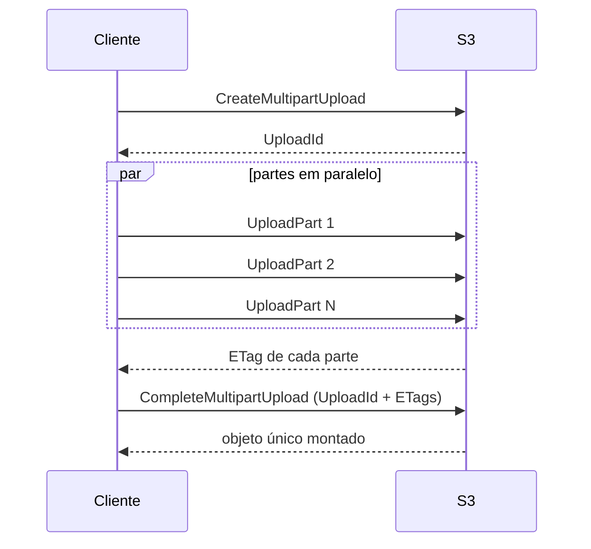

---
aliases:
  - Aula 11.7
modulo: 11
aula: 7
parte: "III Computação e armazenamento"
dominios:
  - 3
  - 4
lida: false
tags:
  - aula
  - saa-c03
  - modulo-11
---

# Aula 11.7: Desempenho e transferência de dados no S3

[[11 - Amazon S3 a Fundo|Voltar ao módulo]]

> [!question] Pergunta que esta aula responde
> Quando o [[S3]] fica lento ou os uploads falham, o que realmente limita a velocidade (a rede, o prefixo, a chave de criptografia ou o tamanho da requisição), e qual recurso resolve cada gargalo: [[Multipart Upload|multipart upload]], byte-range fetch, [[Transfer Acceleration]], [[CloudFront]] ou [[S3 Express One Zone]]?

## Primeiro: o S3 é escalável, mas não é infinito por prefixo

O [[S3]] não tem servidor para você dimensionar. Mesmo assim, ele tem **limites de taxa de requisições por prefixo** e uma realidade física: o dado viaja pela internet ou pela rede da AWS, e distância e tamanho contam. Esta aula organiza os gargalos em cinco camadas, da mais próxima do [[Bucket|bucket]] à mais distante.

| Camada | Gargalo típico | Remédio |
|---|---|---|
| Requisições | Muitas requisições por segundo no mesmo prefixo | Distribuir em prefixos, retry com backoff |
| Objeto | Arquivo grande demais para um PUT, ou leitura de um pedaço pequeno | [[Multipart Upload\|Multipart upload]], byte-range fetch |
| Distância | Cliente longe da Região do [[Bucket\|bucket]] | [[Transfer Acceleration]], [[CloudFront]] |
| [[Latencia\|Latência]] | Aplicação precisa de milissegundos de um dígito | [[S3 Express One Zone]] |
| Criptografia | Cota de requisições do [[KMS]] | [[S3 Bucket Keys\|Bucket Keys]], [[SSE-S3]] |

## Limites de requisição por prefixo

Um **prefixo** é o trecho da chave antes do nome final do objeto: em `logs/2026/11/25/app.gz`, o prefixo é `logs/2026/11/25/`. O [[S3]] escala por prefixo: cada **prefixo particionado** suporta **no mínimo 3.500 requisições de escrita** (PUT, COPY, POST, DELETE) e **11.000 requisições de leitura** (GET, HEAD) por segundo (verificado em novembro de 2026; versões antigas da documentação citavam 5.500 leituras, então desconfie de material desatualizado).

Detalhes que a prova gosta:

- **Não há limite de número de prefixos** em um [[Bucket|bucket]]. Para ir além de um prefixo, basta espalhar objetos em vários: 10 prefixos paralelos dão em torno de 35.000 escritas e 110.000 leituras por segundo.
- O [[S3]] **particiona automaticamente** conforme o tráfego sobe; durante o aumento súbito você pode receber **[[HTTP]] 503 Slow Down**. A resposta correta é **retry com [[Backoff Exponencial|exponential backoff]]** (os SDKs da AWS já fazem), não "mudar para outro serviço".
- A antiga recomendação de **prefixo aleatório ([[Hash|hash]] no início da chave)** para distribuir carga **não é mais necessária** desde 2018. Aparece em questões de material desatualizado; na prova atual, o ponto é distribuir por prefixos de verdade, não randomizar chaves por superstição.
- Prefixos funcionam bem **por data** (`2026/11/25/`) ou **por cliente** (`cliente-123/`), que casam com o modo de consulta e com o ciclo de vida.

> [!example] Cenário clássico
> Um pipeline de IoT grava 20.000 arquivos pequenos por segundo, todos em `sensores/leituras/`. Recebe 503 intermitentes. Solução: gravar em `sensores/leituras/<id-do-dispositivo>/`, de modo que a carga se distribua em vários prefixos, e manter retry com backoff. Não é preciso trocar de serviço nem criar vários buckets.

## Multipart upload: a ferramenta para objetos grandes

Um único `PutObject` aceita até **5 GB**. Acima disso, **o [[Multipart Upload|multipart upload]] é obrigatório**, e a AWS **recomenda a partir de 100 MB**. Funciona em três fases:

1. **Initiate**: `CreateMultipartUpload` devolve um `UploadId`.
2. **Upload parts**: cada parte tem de **5 MiB a 5 GiB** (a última pode ser menor que 5 MiB), com no máximo **10.000 partes**; as partes são enviadas **em paralelo** e podem ser reenviadas individualmente se falharem.
3. **Complete**: `CompleteMultipartUpload` junta as partes em um objeto; se desistir, `AbortMultipartUpload`.

Benefícios, que viram palavras-chave: **[[Throughput|throughput]] maior** (paralelismo), **retomada** (reenvia só a parte que falhou), **começar a enviar antes de saber o tamanho final** ([[Streaming de Dados|streaming]]) e **pausar e retomar**.

A **armadilha de custo**: partes enviadas e **nunca completadas ficam armazenadas e cobradas** até serem abortadas. O remédio é uma **[[Lifecycle Policy|regra de ciclo de vida]]** com `AbortIncompleteMultipartUpload` (você montou uma na [[11.03 - Ciclo de Vida e Custo no S3|aula de ciclo de vida]]). Também dá para listar uploads pendentes com `ListMultipartUploads`.

Sobre o tamanho máximo do objeto, valor da prova: **5 TB** (a ressalva sobre o limite vigente está na [[11.01 - O Modelo do S3 Buckets Objetos e Durabilidade|aula 11.1]]; 5 GiB x 10.000 partes dá cerca de 48,8 TiB, o teto teórico das partes).

## Byte-range fetch: ler só um pedaço

O inverso do multipart é a **leitura por faixa de bytes**: o `GET` com o cabeçalho `Range: bytes=0-1048575` devolve só o trecho pedido. Dois usos:

- **Paralelizar o download** de um objeto grande, pedindo várias faixas ao mesmo tempo e remontando no cliente.
- **Ler só uma parte útil**: o cabeçalho de um arquivo, o rodapé de um [[Parquet]], os primeiros bytes para identificar o tipo.

Palavra-chave de prova: "download only the first X bytes" ou "retrieve part of a large object" aponta para **byte-range fetch**. Para consultar **dentro** de um objeto (filtrar linhas de CSV ou JSON), o recurso clássico era o [[S3]] Select; ele foi descontinuado para novos clientes e hoje a abordagem é consultar com o Athena (assunto de analytics) (não confirmado o status atual no exame).

## Transfer Acceleration: encurtar a distância

O **[[Transfer Acceleration|S3 Transfer Acceleration]]** acelera transferências **de longa distância** entre o cliente e o [[Bucket|bucket]]. Em vez de enviar pela internet pública até a Região do bucket, o cliente envia ao **[[Edge Location|ponto de presença]] (edge location) do [[CloudFront]] mais próximo**, e dali o dado segue pela **[[Backbone|rede backbone]] da AWS** até o bucket.

Como funciona na prática:

- Você **habilita** o recurso no [[Bucket|bucket]] (leva até cerca de 20 minutos para valer) e passa a usar o endpoint `bucket.s3-accelerate.amazonaws.com`.
- O **nome do [[Bucket|bucket]] precisa ser compatível com [[DNS]] e não pode ter pontos**.
- Você **paga adicional por GB** transferido; se a aceleração não trouxer ganho para aquela transferência, **não cobra** (a documentação afirma isso; há uma ferramenta de comparação de velocidade para testar).
- Combina com [[Multipart Upload|multipart upload]]: o ganho é maior com **arquivos grandes e clientes distantes**.

[[Transfer Acceleration]] **versus [[CloudFront]]**: ambos usam [[Edge Location|edge locations]], mas resolvem problemas opostos. O CloudFront **entrega conteúdo** (leitura, com cache) a muitos usuários; o Transfer Acceleration **acelera upload** de um cliente distante para o [[Bucket|bucket]] (e também downloads de longa distância sem cache). Se a pergunta é "usuários no mundo todo enviam vídeos grandes para um bucket em Virgínia", a resposta é Transfer Acceleration. Se é "milhões de leitores baixam as mesmas imagens", a resposta é CloudFront.

## S3 Express One Zone: milissegundos de um dígito

A classe **[[S3 Express One Zone]]**, que você viu na [[11.02 - Classes de Armazenamento do S3 e Glacier|aula de classes]], é uma **classe de armazenamento em um tipo de [[Bucket|bucket]] próprio, o directory bucket**, otimizada para **[[Latencia|latência]] de um dígito de milissegundo** e centenas de milhares de requisições por segundo, em **uma única [[Zona de Disponibilidade|AZ]]** que você escolhe. Pontos para memorizar:

- Os dados ficam em **uma [[Zona de Disponibilidade|AZ]]** ([[Disponibilidade|disponibilidade]] menor, 99,95%), então servem a dados recriáveis ou a caches de computação.
- A autenticação usa **sessões** (`CreateSession`), para baixar o custo de cada requisição.
- O padrão de uso é **colocar o computo na mesma [[Zona de Disponibilidade|AZ]]** do [[Bucket|bucket]] para [[Latencia|latência]] mínima: treinamento de modelos de machine learning, analytics interativo, renderização.
- Guarde só "requisições mais baratas que o Standard".

## Outros fatores de desempenho

**Criptografia com KMS como gargalo.** Com [[SSE-KMS]] sem [[S3 Bucket Keys|Bucket Keys]], cada requisição ao [[S3]] vira uma chamada ao [[KMS]], que tem **cota de requisições por segundo** (e é regional). Em cargas pesadas aparecem erros de [[Throttling|throttling]] do KMS, não do S3. As saídas: ligar **S3 Bucket Keys** (reduz as chamadas em até 99%) ou usar [[SSE-S3]] quando a auditoria por chave não for exigida.

**Região do computo.** Uma instância [[EC2]] na **mesma Região** do [[Bucket|bucket]] não paga transferência e tem a melhor [[Latencia|latência]]. Via **[[Gateway Endpoint|gateway endpoint]]**, o tráfego fica na rede da AWS sem passar por [[NAT]] (e sem custo de processamento do NAT, assunto da [[11.04 - Controle de Acesso e Rede no S3|aula de acesso e rede]]).

**Muitos objetos pequenos.** Cada objeto é uma requisição. Milhões de arquivos de 1 KB custam mais em requisições e ciclo de vida do que um arquivo concatenado. Agrupe (por exemplo, em [[Parquet]] ou tar) quando fizer sentido.

**Listagem.** `ListObjectsV2` devolve até 1.000 chaves por chamada, paginado; listar buckets enormes é lento. Para inventário em escala, use o **[[S3 Inventory]]** (relatório diário ou semanal), tema da próxima aula.

## Mover grandes volumes para dentro do S3

A pergunta "como levo 80 TB do meu datacenter para o [[S3]]" aparece no domínio de armazenamento e de migração. A regra de decisão resumida (o detalhamento está no módulo de migração):

| Situação | Serviço |
|---|---|
| Link de rede bom, transferência contínua ou agendada, com verificação | **[[DataSync\|AWS DataSync]]** |
| Rede inexistente, limitada ou lenta demais para o prazo (centenas de TB ou PB) | **[[Snow Family\|Família Snow]]** ([[Snowball Edge]]); para novos clientes veja a nota abaixo |
| Aplicações locais que falam [[NFS]], [[SMB]] ou [[iSCSI]] e precisam do [[S3]] como retaguarda | **[[Storage Gateway\|AWS Storage Gateway]]** ([[S3 File Gateway\|File Gateway]]) |
| Arquivos de clientes externos por SFTP | **[[Transfer Family\|AWS Transfer Family]]** |
| Cliente isolado, distante, enviando poucos arquivos grandes | **[[Transfer Acceleration\|S3 Transfer Acceleration]]** |

A conta do prazo: 100 TB por um link de 1 Gbps dedicado levam cerca de 9 dias em condições ideais (1 Gbps equivale a cerca de 10 TB por dia); se o link for de 100 Mbps, são cerca de 90 dias, e aí a transferência offline vence.

> [!warning] Snowball Edge fechado a novos clientes (verificado em novembro de 2026)
> A documentação oficial informa que o [[Snowball Edge|AWS Snowball Edge]] **não está mais disponível para novos clientes** e que nenhum dispositivo da [[Snow Family]] pode ser pedido por contas novas; clientes atuais seguem usando. Alternativas indicadas pela AWS: **[[DataSync]]** para transferência online, **[[Data Transfer Terminal|AWS Data Transfer Terminal]]** para transferência física segura e soluções de parceiros; Outposts para computação de borda (fonte: https://docs.aws.amazon.com/snowball/latest/developer-guide/snowball-edge-availability-change.html). A prova ainda cobra a família Snow, então guarde a regra "link não cabe no prazo: transferência offline". O tema é aprofundado no [[23 - Migracao e Transferencia de Dados|Módulo 23]].

## Como isso cai na prova

**Task 3.1** (armazenamento de alto desempenho), **Task 3.4** (redes e entrega de conteúdo) e **Task 4.1** (custo de armazenamento).

**Palavras-chave e para onde apontam**

- "upload files larger than 5 GB", "improve upload [[Throughput|throughput]]", "resume a failed upload" aponta para **[[Multipart Upload|multipart upload]]**.
- "download part of a large object", "read only the header" aponta para **byte-range fetch**.
- "users around the world upload to a single [[Bucket|bucket]]", "long-distance transfer" aponta para **[[Transfer Acceleration|S3 Transfer Acceleration]]**.
- "single-digit millisecond [[Latencia|latency]] for [[S3]]", "ML training data close to compute" aponta para **[[S3 Express One Zone]]**.
- "503 Slow Down" aponta para **retry com backoff e distribuir em prefixos**.
- "[[KMS]] [[Throttling|throttling]] on [[S3]] requests" aponta para **[[S3 Bucket Keys]]**.
- "unfinished multipart uploads are costing money" aponta para **lifecycle AbortIncompleteMultipartUpload**.

**Pegadinhas clássicas**

- [[Transfer Acceleration]] não funciona com [[Bucket|bucket]] cujo nome tem **pontos**.
- [[Multipart Upload|Multipart upload]] é **obrigatório** acima de 5 GB no PUT único, não "recomendado".
- Prefixo aleatório ([[Hash|hash]]) **não é mais necessário** para desempenho.
- [[S3 Express One Zone|Express One Zone]] fica em **uma [[Zona de Disponibilidade|AZ]]**: não serve para dado que não pode ser perdido.
- [[Transfer Acceleration]] não é [[CloudFront]]: não faz **cache**.

| Requisito no enunciado | Resposta provável | Por quê |
|---|---|---|
| Upload de arquivo de 20 GB estável e rápido | [[Multipart Upload\|Multipart upload]] | PUT único limita a 5 GB e partes em paralelo ganham velocidade |
| Clientes na Ásia enviam para [[Bucket\|bucket]] em us-east-1 | [[Transfer Acceleration]] | Entra pela edge mais próxima e segue pelo [[Backbone\|backbone]] |
| Leitura de 10 MB no meio de um objeto de 50 GB | Byte-range fetch | Evita baixar o objeto inteiro |
| [[Latencia\|Latência]] de um dígito de ms para ML | [[S3 Express One Zone]] | Directory [[Bucket\|bucket]], mesma [[Zona de Disponibilidade\|AZ]] do computo |
| 503 em alta taxa no mesmo prefixo | Espalhar em prefixos e retry com backoff | O limite é por prefixo particionado |
| Custo de partes órfãs | [[Lifecycle Policy\|Regra de ciclo de vida]] de aborto de multipart | Partes incompletas são cobradas |

## Resumo

> [!abstract] A aula em uma frase
> O desempenho do [[S3]] depende de distribuir requisições em prefixos (3.500 escritas e 11.000 leituras por segundo cada), quebrar objetos grandes com [[Multipart Upload|multipart upload]] e lê-los por faixa de bytes, encurtar a distância com [[Transfer Acceleration]] e baixar a [[Latencia|latência]] com [[S3 Express One Zone]], sem esquecer a cota do [[KMS]].

**A lógica, em 5 passos**
1. O limite de requisições é por prefixo particionado, e não há limite de prefixos.
2. Objetos grandes sobem em partes paralelas (multipart) e são lidos em faixas (byte-range).
3. Distância é problema de rede: [[Transfer Acceleration]] usa a edge e o [[Backbone|backbone da AWS]].
4. [[Latencia|Latência]] de um dígito de ms exige [[S3 Express One Zone]], em uma [[Zona de Disponibilidade|AZ]].
5. Antes de culpar o [[S3]], verifique a cota do [[KMS]], a Região do computo e a quantidade de objetos pequenos.

**Números para lembrar**

| O quê | Valor | Por que importa |
|---|---|---|
| Escritas por prefixo | 3.500 por segundo | Base do dimensionamento |
| Leituras por prefixo | 11.000 por segundo | Idem (valor atualizado) |
| PUT único | até 5 GB | Acima disso, multipart |
| Multipart recomendado | a partir de 100 MB | [[Throughput]] e retomada |
| Partes | 5 MiB a 5 GiB, até 10.000 | Limites do multipart |
| [[Transfer Acceleration]] | nome sem pontos, até 20 min para ativar | Pegadinha de configuração |

**Tabela-síntese**

| Sintoma | Remédio |
|---|---|
| 503 Slow Down | Mais prefixos, backoff |
| Upload grande falha | Multipart |
| Preciso de um trecho | Byte-range |
| Cliente distante | [[Transfer Acceleration]] |
| [[Latencia\|Latência]] mínima | [[S3 Express One Zone\|Express One Zone]] |
| [[Throttling]] do [[KMS]] | [[S3 Bucket Keys\|Bucket Keys]] |

**Na prática, isso significa**
- Desenhe prefixos pelo padrão de acesso e deixe o SDK cuidar do retry.
- Sempre crie a regra de aborto de multipart incompleto.
- Em questão de distância, decida entre [[Transfer Acceleration]] (upload) e [[CloudFront]] (leitura com cache).

> [!tip] Liga com
> Vem de [[11.06 - Replicacao do S3|Replicação]] e abre [[11.08 - Eventos Site Estatico e Gestao em Escala no S3|Eventos, site estático e gestão em escala]]. O [[CloudFront]] aparece com profundidade no módulo de entrega de conteúdo.

## Erros comuns

- **Usar prefixos aleatórios por superstição.** Hoje o [[S3]] particiona sozinho; o que importa é a distribuição real da carga.
- **Culpar o [[S3]] por [[Throttling|throttling]] que vem do [[KMS]].** Verifique as métricas de KMS e ligue [[S3 Bucket Keys|Bucket Keys]].
- **Esquecer partes de multipart abandonadas.** Elas custam armazenamento até o aborto.
- **Confundir [[Transfer Acceleration]] com [[CloudFront]].** Um acelera o envio de um cliente distante; o outro entrega conteúdo com cache.
- **Colocar dado crítico em [[S3 Express One Zone]].** É uma [[Zona de Disponibilidade|AZ]] só.

## Pratique

**1.** Um pipeline grava 20.000 objetos por segundo no mesmo prefixo e recebe respostas [[HTTP]] 503 Slow Down intermitentes. Qual ação é a mais adequada?

- [ ] a) Distribuir as gravações em vários prefixos e usar retry com exponential backoff
- [ ] b) Trocar o prefixo por um hash aleatório no início da chave, que o S3 exige para escalar
- [ ] c) Migrar os dados para um volume EBS, que não tem limite de requisições por prefixo
- [ ] d) Ligar o versionamento, que aumenta o limite de requisições por prefixo do bucket

**2.** Uma equipe envia arquivos de 12 GB por conexões instáveis, e qualquer queda obriga a recomeçar. Qual recurso resolve?

- [ ] a) PutObject com a classe Standard-IA
- [ ] b) Byte-range fetch no upload
- [ ] c) Multipart upload, que envia partes em paralelo e permite reenviar apenas a parte que falhou
- [ ] d) Transfer Acceleration sem multipart, que reduz a latência mas reenvia o arquivo todo se a conexão cair

**3.** Clientes na Ásia enviam vídeos grandes para um [[Bucket|bucket]] em us-east-1 e reclamam da lentidão. Qual solução melhora o envio?

- [ ] a) Habilitar o CloudFront para acelerar os uploads, com cache nas edge locations
- [ ] b) Mudar o bucket para a classe One Zone-IA, que reduz o custo e a latência de envio
- [ ] c) Ligar o versionamento do bucket, que replica cada envio para a edge location mais próxima
- [ ] d) S3 Transfer Acceleration, que usa a edge location mais próxima e o backbone da AWS

**4.** Um app precisa ler apenas o primeiro 1 MB de objetos de 20 GB para identificar o formato. Qual abordagem economiza tempo e banda?

- [ ] a) Baixar o objeto inteiro e descartar o restante
- [ ] b) Byte-range fetch com o cabeçalho Range no GET
- [ ] c) Multipart upload dos objetos
- [ ] d) Copiar o objeto para Glacier e restaurar a parte inicial

**5.** Quais DUAS afirmações sobre o [[Transfer Acceleration|S3 Transfer Acceleration]] estão corretas? (Escolha DUAS.)

- [ ] a) Exige que o cliente crie uma distribuição CloudFront própria
- [ ] b) Funciona apenas para downloads, não para uploads
- [ ] c) Entra em vigor instantaneamente após ser habilitado
- [ ] d) O nome do bucket deve ser compatível com DNS e não pode conter pontos
- [ ] e) Usa um endpoint próprio (s3-accelerate) e cobra adicional por GB

**6.** Uma carga de treino de machine learning precisa de [[Latencia|latência]] de milissegundo de um dígito e executa na mesma [[Zona de Disponibilidade|AZ]]. Qual classe usar?

- [ ] a) S3 Standard com Transfer Acceleration, para aproximar a leitura do cliente
- [ ] b) S3 Glacier Instant Retrieval
- [ ] c) S3 Express One Zone, em um directory bucket na mesma AZ do computo
- [ ] d) S3 Intelligent-Tiering

**7.** A fatura do [[S3]] mostra gigabytes de partes de uploads multipart nunca concluídos. Qual é o remédio permanente?

- [ ] a) Uma regra de ciclo de vida com AbortIncompleteMultipartUpload
- [ ] b) Desligar o versionamento do bucket, que descarta as partes de uploads nunca concluídos
- [ ] c) Mudar para Intelligent-Tiering, que move as partes incompletas para a camada de arquivo
- [ ] d) Mover o bucket para outra Região, onde as partes pendentes são apagadas na cópia

**8.** Uma carga com [[SSE-KMS]] apresenta erros de [[Throttling|throttling]] que vêm do [[KMS]], e não do [[S3]]. O que reduz as chamadas ao KMS?

- [ ] a) Aumentar o número de prefixos do bucket
- [ ] b) Habilitar o Transfer Acceleration
- [ ] c) Aumentar o tamanho das partes do multipart para 5 GiB
- [ ] d) Habilitar S3 Bucket Keys

**9.** Uma empresa precisa mover 80 TB do datacenter para o [[S3]] em duas semanas, mas o link de internet é de 50 Mbps. Qual solução é viável?

- [ ] a) S3 Transfer Acceleration pelo link existente, que usa o backbone da AWS e a edge location mais próxima
- [ ] b) Transferência offline com dispositivo da família Snow, pois 80 TB em 50 Mbps levariam mais de 140 dias
- [ ] c) Multipart upload com mais partes em paralelo, aproveitando melhor os 50 Mbps do link existente
- [ ] d) AWS DataSync pelo link existente, agendado para rodar de dia e de noite durante as duas semanas

**10.** Quais DUAS afirmações sobre os limites de requisição do [[S3]] estão corretas? (Escolha DUAS.)

- [ ] a) É obrigatório randomizar o início da chave para distribuir carga
- [ ] b) Cada prefixo particionado suporta no mínimo 3.500 escritas e 11.000 leituras por segundo
- [ ] c) Não há limite para o número de prefixos em um bucket
- [ ] d) O limite de 3.500 escritas e 11.000 leituras por segundo vale para o bucket inteiro, e não por prefixo
- [ ] e) Um bucket só tem taxa dedicada em até 10 prefixos, e os demais compartilham o limite

**11.** Milhões de leitores baixam as mesmas imagens de um [[Bucket|bucket]] em us-east-1 e a [[Latencia|latência]] é alta para quem está longe. Qual solução é a mais adequada?

- [ ] a) S3 Transfer Acceleration, que armazena as imagens em cache nas edge locations
- [ ] b) Aumentar o número de partes do multipart
- [ ] c) S3 Express One Zone em outra AZ
- [ ] d) Amazon CloudFront na frente do bucket, com cache nas edge locations

> [!success]- Gabarito
> **1. a)** O limite é por prefixo particionado, e o retry com backoff é a prática padrão. Descartadas: b) isso não é mais necessário para o desempenho; c) muda de serviço sem resolver o problema de projeto; d) o [[Versionamento|versionamento]] não altera o limite.
>
> **2. c)** Acima de 5 GB é obrigatório o multipart, que também retoma partes. Descartadas: a) o limite do PUT único é de 5 GB; b) byte-range é recurso de leitura; d) ajuda a distância, mas não resolve o limite de 5 GB do PUT.
>
> **3. d)** [[Transfer Acceleration]] encurta a distância no envio. Descartadas: a) o [[CloudFront]] é para entrega de conteúdo, com cache de leitura; b) não afeta a distância; c) não altera a velocidade.
>
> **4. b)** O Range permite ler somente a faixa necessária. Descartadas: a) desperdiça tempo e banda; c) é para envio; d) não é possível restaurar parte e seria lento.
>
> **5. d) e e)** Nome de [[Bucket|bucket]] sem pontos e endpoint de aceleração são pegadinhas. Descartadas: a) o recurso usa [[Edge Location|edge locations]] sem você criar a distribuição; b) é voltado principalmente a uploads de longa distância; c) pode levar cerca de 20 minutos.
>
> **6. c)** O [[S3 Express One Zone|Express One Zone]] foi projetado para [[Latencia|latência]] de um dígito de milissegundo. Descartadas: a) não entrega latência de um dígito; b) é arquivo de acesso raro; d) não é otimizado para latência mínima.
>
> **7. a)** Partes abandonadas ficam cobradas até serem abortadas. Descartadas: b) não afeta partes incompletas; c) partes incompletas não são movidas; d) não resolve a causa.
>
> **8. d)** A [[S3 Bucket Keys|Bucket Key]] reduz as requisições ao [[KMS]] em até 99%. Descartadas: a) o [[Throttling|throttling]] vem do KMS; b) não reduz chamadas ao KMS; c) não elimina a chamada por requisição.
>
> **9. b)** Quando a banda não cabe no prazo, a transferência offline (família Snow, que a prova ainda cobra) vence. Descartadas: a) o gargalo é a [[Largura de Banda|largura de banda]] do link, não a distância; c) o link continua sendo o limite; d) também usaria o link de 50 Mbps.
>
> **10. b) e c)** Escala-se adicionando prefixos. Descartadas: a) isso deixou de ser necessário; d) os valores são por prefixo, não por [[Bucket|bucket]], e é por isso que adicionar prefixos escala; e) não existe esse limite de prefixos com taxa dedicada.
>
> **11. d)** Para leitura distribuída com cache, o [[CloudFront]] é a resposta. Descartadas: a) não faz cache; b) é para envio; c) uma [[Zona de Disponibilidade|AZ]] não resolve a distância global.

## Para aprofundar

- [ ] [Best practices design patterns: optimizing Amazon S3 performance](https://docs.aws.amazon.com/AmazonS3/latest/userguide/optimizing-performance.html) (documentação AWS): limites por prefixo, paralelismo e retry.
- [ ] [Uploading and copying objects using multipart upload](https://docs.aws.amazon.com/AmazonS3/latest/userguide/mpuoverview.html) (documentação AWS): fases, limites e ciclo de vida.
- [ ] [Configuring fast, secure file transfers using Amazon S3 Transfer Acceleration](https://docs.aws.amazon.com/AmazonS3/latest/userguide/transfer-acceleration.html) (documentação AWS): requisitos, nome do [[Bucket|bucket]] e custo.
- [ ] [S3 Express One Zone](https://docs.aws.amazon.com/AmazonS3/latest/userguide/directory-bucket-high-performance.html) (documentação AWS): [[Directory Bucket|directory buckets]], sessões e casos de uso.

Próxima aula: [[11.08 - Eventos Site Estatico e Gestao em Escala no S3|Aula 11.8: Eventos, site estático e gestão em escala]].
