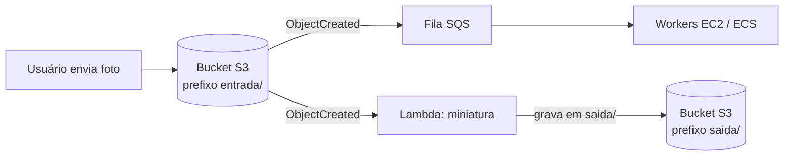

---
aliases:
  - Aula 11.8
modulo: 11
aula: 8
parte: "III Computação e armazenamento"
dominios:
  - 1
  - 2
  - 3
lida: false
tags:
  - aula
  - saa-c03
  - modulo-11
---

# Aula 11.8: Eventos, site estático e gestão em escala no S3

[[11 - Amazon S3 a Fundo|Voltar ao módulo]]

> [!question] Pergunta que esta aula responde
> Como fazer o [[S3]] acionar outros serviços quando um objeto chega, como hospedar um site estático com HTTPS e sem expor o [[Bucket|bucket]], e como enxergar e operar milhões de objetos de uma vez (inventário, métricas e operações em [[Processamento em Lote|lote]])?

## Por que o S3 também é um ponto de partida de fluxos

Até aqui o [[S3]] foi tratado como um lugar para guardar coisas. Na arquitetura real ele é também o **gatilho**: uma foto chega e precisa de miniatura, um arquivo de log chega e precisa ser processado, um relatório chega e alguém precisa ser avisado. Essa aula fecha o módulo com três assuntos que têm em comum o fato de o S3 **se integrar ao resto da AWS**: eventos, hospedagem de site e gestão em escala.

## Parte 1: S3 Event Notifications

O [[S3]] pode emitir uma **notificação** quando algo acontece em um [[Bucket|bucket]]. Os eventos mais cobrados:

- **Criação de objeto** (`s3:ObjectCreated:*`: Put, Post, Copy, CompleteMultipartUpload).
- **Remoção** (`s3:ObjectRemoved:*`, incluindo a criação de [[Delete Marker|delete marker]]).
- **Restauração** de objeto arquivado (`s3:ObjectRestore:*`).
- **Replicação** (falhou, perdeu o limite do [[Replication Time Control|RTC]]) e **transição de ciclo de vida**.

### Os destinos

| Destino | Quando escolher |
|---|---|
| **[[Lambda]]** | Processar o objeto na hora (miniatura, validação, transformação) |
| **[[SQS\|Amazon SQS]]** (fila padrão) | Desacoplar: a fila absorve picos e o consumidor processa no seu ritmo |
| **[[SNS\|Amazon SNS]]** | [[Fan-out]]: um evento, vários assinantes |
| **[[EventBridge\|Amazon EventBridge]]** | Regras com filtros avançados, **vários destinos** (mais de 20 serviços), arquivar e reenviar eventos |

Detalhes que viram questão:

- O [[S3]] entrega **no mínimo uma vez** (*at-least-once*): o consumidor precisa ser **[[Idempotencia|idempotente]]**, porque duplicatas acontecem. A entrega costuma ser em segundos, mas não há garantia de ordem entre eventos.
- **Fila [[Fila FIFO|SQS FIFO]] não é destino direto** das notificações nativas. Para FIFO, passe pelo [[EventBridge]].
- O destino precisa de **permissão**: a fila ou o tópico recebe uma **[[Resource-Based Policy|resource policy]]** que autoriza o serviço `s3.amazonaws.com` (com `aws:SourceArn` do [[Bucket|bucket]]), e a [[Lambda|função Lambda]] precisa de uma **resource-based policy** (permissão de invocação para o [[S3]]).
- **Filtros sobrepostos não são aceitos**: não se configuram duas notificações com prefixos ou sufixos que se sobrepõem para o mesmo tipo de evento (a API rejeita). Para **vários consumidores** do mesmo prefixo, mande o evento a um **[[SNS]]** ([[Fan-out|fan-out]]) ou ao **[[EventBridge]]** (verificado em novembro de 2026).
- **Loop de eventos**: se a [[Lambda|função Lambda]] grava o resultado **no mesmo [[Bucket|bucket]] e no mesmo prefixo** que a dispara, ela se aciona infinitamente (e a conta sobe). Use prefixos diferentes (`entrada/` dispara, `saida/` não) ou outro bucket.
- Com o [[EventBridge]] você não precisa configurar nada além de ligar o envio de eventos do [[Bucket|bucket]]; todos os eventos passam a ir para o barramento padrão, e as regras decidem o que fazer.

> [!example] O padrão clássico
> Um site de fotos recebe uploads em `s3://fotos-originais/`. Um evento `ObjectCreated` aciona uma Lambda que gera miniaturas e as grava em **outro [[Bucket|bucket]]** (`fotos-miniaturas`). Escolher outro bucket elimina o risco de loop e permite políticas distintas (as miniaturas podem ser públicas via [[CloudFront]], as originais não).

Para a prova: "process each file as soon as it is uploaded" aponta para **[[S3 Event Notifications|S3 Event Notification]] com Lambda**. "Decouple and buffer" aponta para **[[SQS]]**. "Several systems must react" aponta para **[[SNS]]** ou **[[EventBridge]]**.

## Parte 2: Site estático no S3

O [[S3]] pode hospedar um **site estático** (HTML, CSS, JavaScript, imagens), [[Serverless|sem servidor]]. Você habilita o *static website hosting*, define o documento de índice (`index.html`) e, opcionalmente, o de erro. O S3 passa a atender em um **website endpoint** (`bucket.s3-website-<região>.amazonaws.com`).

Restrições que a prova explora:

- O website endpoint serve **somente [[HTTP]], não HTTPS**. Para HTTPS é preciso o [[CloudFront]] na frente.
- O conteúdo precisa ser **legível publicamente**: desliga-se o [[Block Public Access]] e adiciona-se uma [[Bucket Policy|bucket policy]] permitindo `s3:GetObject` para todos. É o caso raro em que público é o objetivo (conforme a [[11.04 - Controle de Acesso e Rede no S3|aula de acesso]], só faça isso quando o conteúdo é de fato público).
- Só conteúdo **estático**: nada de PHP, Node ou banco de dados no [[S3]]. Dinâmica vem de chamadas de JavaScript a uma API ([[API Gateway]] com Lambda, por exemplo).
- Para domínio próprio com [[Route 53]], o **nome do [[Bucket|bucket]] precisa ser igual ao nome do domínio** (`www.exemplo.com`) quando se usa o alias direto ao website endpoint.

### O jeito moderno: CloudFront na frente com OAC

A arquitetura recomendada para produção é: **[[Bucket|bucket]] privado** ([[Block Public Access]] ligado), **[[CloudFront]]** distribuindo o conteúdo, e uma **[[Origin Access Control]] (OAC)** que autoriza apenas o CloudFront a ler do bucket. Ganhos:

- **HTTPS** com certificado do [[ACM]] e domínio próprio.
- **[[Cache]]** global ([[Latencia|latência]] menor, menos requisições ao [[S3]]).
- O [[Bucket|bucket]] **não fica público**: a [[Bucket Policy|bucket policy]] autoriza o principal de serviço `cloudfront.amazonaws.com` com condição `AWS:SourceArn` apontando para a distribuição.
- **[[Origin Access Control|OAC]] suporta [[SSE-KMS]]**, ao contrário da antiga [[Origin Access Identity]] (OAI), que a AWS considera legada; para um [[Bucket|bucket]] com SSE-KMS, a OAC é a escolha.

Nessa configuração o [[CloudFront]] usa o **REST endpoint** do [[Bucket|bucket]], não o website endpoint (então perde-se o redirecionamento automático para `index.html` em subpastas, que se resolve com uma [[CloudFront Functions|CloudFront Function]] ou configurando o objeto raiz padrão). O **[[Amplify|AWS Amplify]] Hosting** é a alternativa gerenciada que cuida de build, [[CDN]] e HTTPS para aplicações web.

### CORS

Se uma página em `https://app.exemplo.com` busca arquivos de `https://assets.exemplo.com` (um [[Bucket|bucket]]), o navegador bloqueia a chamada por política de mesma origem, a menos que o bucket responda com cabeçalhos **[[CORS]]** (Cross-Origin Resource Sharing). A configuração de CORS no bucket lista as origens, métodos e cabeçalhos permitidos. Pegadinha: o sintoma é um erro **no navegador** ("blocked by CORS policy"), enquanto o `curl` funciona; a solução é a **configuração CORS do bucket**, não uma [[Bucket Policy|bucket policy]] nem [[IAM]].

## Parte 3: Enxergar e operar em escala

Com bilhões de objetos, você precisa de ferramentas para **ver** (o que existe, quanto custa) e **agir** (mudar tudo de uma vez).

### S3 Inventory

O **[[S3 Inventory]]** gera, **diária ou semanalmente**, um **arquivo de relatório** (CSV, ORC ou [[Parquet]]) listando objetos e seus metadados: tamanho, classe, criptografia, status de replicação, retenção do [[Object Lock]], versão. É a alternativa **barata e escalável** à API `ListObjectsV2`. Casos de uso: auditar criptografia, achar objetos sem a classe esperada, alimentar um **[[S3 Batch Operations|Batch Operations]]** com a lista de objetos, consultar com o [[Athena]].

### S3 Storage Lens

O **[[S3 Storage Lens]]** dá **visibilidade e métricas de uso e atividade** em toda a organização, conta, [[Bucket|bucket]] e prefixo, com um painel interno e recomendações de otimização de custo e de proteção de dados (por exemplo, "uploads multipart incompletos", "buckets sem ciclo de vida", versões não correntes volumosas). O painel padrão gratuito tem as métricas básicas; as **métricas avançadas** (recomendações, métricas por prefixo, retenção maior) são pagas. Palavra-chave: "organization-wide visibility into storage usage and activity" aponta para **Storage Lens**.

### S3 Batch Operations

O **[[S3 Batch Operations]]** executa **uma ação em bilhões de objetos** com um único job, rastreando progresso, falhas e gerando relatório de conclusão. Ações típicas:

- **Copiar** objetos (por exemplo, para recifrar com outra chave ou mudar de classe).
- Invocar uma **[[Lambda|função Lambda]]** por objeto.
- **Restaurar** objetos do Glacier.
- Mudar **tags**, **ACLs**, **retenção** e **[[Legal Hold|legal hold]]** do [[Object Lock]].
- Calcular somas de verificação e **replicar** objetos existentes ([[Batch Replication]], da aula anterior).

A entrada é um **manifesto**: um relatório do **[[S3 Inventory]]** ou um CSV que você fornece. Pegadinha: para recifrar objetos existentes depois de mudar a criptografia padrão, use **[[S3 Batch Operations|Batch Operations]] com Copy** (conforme a [[11.05 - Criptografia Versionamento e Retencao no S3|aula de criptografia]]), não uma [[Lifecycle Policy|regra de ciclo de vida]].

### Outros recursos de gestão

| Recurso | O que faz |
|---|---|
| **Access logs do servidor [[S3]]** | Registra requisições em **outro [[Bucket\|bucket]] da mesma Região e da mesma conta** (não no mesmo bucket); melhor esforço, não confiável para auditoria completa |
| **[[Macie]]** | Descobre e classifica **dados sensíveis ([[PII]])** nos buckets; "descobrir PII no [[S3]]" aponta para Macie (Módulo 8) |
| **[[GuardDuty]] [[S3]] Protection** | Detecta **ameaças** (acesso suspeito, exfiltração) a partir de [[Data Event\|eventos de dados]] do S3 |
| **[[CloudTrail]] [[Data Event\|data events]]** | Registra chamadas de API em nível de objeto, para auditoria confiável |
| **Tags de objeto e de [[Bucket\|bucket]]** | Filtros de ciclo de vida, controle de acesso por atributo e alocação de custo |
| **[[S3]] Object Lambda** | Transformar o objeto no download com uma Lambda; **restrito a novos clientes desde 7 de novembro de 2025** (verificado em novembro de 2026); clientes existentes continuam usando |
| **[[Requester Pays]]** | O solicitante paga a transferência (conforme a [[11.03 - Ciclo de Vida e Custo no S3|aula de custo]]) |

> [!info] Ligando os pontos
> Os eventos desta aula se encaixam com o módulo de aplicações desacopladas ([[SQS]], [[SNS]], [[EventBridge]], Lambda). O site estático com [[CloudFront]] e [[Origin Access Control|OAC]] aparece no módulo de entrega de conteúdo. E o Inventory com [[S3 Batch Operations|Batch Operations]] é a forma de fazer, em escala, o que a [[11.06 - Replicacao do S3|replicação]] e a criptografia exigem para dados que já existem.

## Como isso cai na prova

**Task 1.3** (aplicar proteção e automação), **Task 3.1** (armazenamento), **Task 4.1** (custo) e **Task 2.1** ([[Desacoplamento|desacoplamento]]).

**Palavras-chave e para onde apontam**

- "trigger a function when an object is uploaded" aponta para **[[S3 Event Notifications]] para Lambda**.
- "multiple consumers react to the same upload" aponta para **[[SNS]]** ou **[[EventBridge]]**.
- "host a static website" aponta para **[[S3]] static website hosting**; "with HTTPS and a custom domain" aponta para **[[CloudFront]] + [[ACM]]**.
- "restrict the [[S3]] [[Bucket|bucket]] so only [[CloudFront]] can read" aponta para **[[Origin Access Control|OAC]]**.
- "browser error: blocked by [[CORS]] policy" aponta para **configuração CORS do [[Bucket|bucket]]**.
- "list of all objects and their encryption status" aponta para **[[S3 Inventory]]**.
- "organization-wide usage visibility and cost recommendations" aponta para **[[S3 Storage Lens|Storage Lens]]**.
- "apply an action to billions of objects" aponta para **[[S3 Batch Operations]]**.

**Pegadinhas clássicas**

- O endpoint de site estático **não suporta HTTPS**.
- Evento no mesmo prefixo que a Lambda grava gera **loop**.
- FIFO não é destino direto das notificações do [[S3]].
- Notificações são **at-least-once**: [[Idempotencia|consumidor idempotente]].
- Access logs do servidor são **melhor esforço**; para auditoria use [[CloudTrail]]. O [[Bucket|bucket]] de destino dos logs é **outro** bucket, na mesma Região e conta.
- Filtros de prefixo ou sufixo **sobrepostos** para o mesmo evento são rejeitados: vários consumidores pedem [[SNS]] ou [[EventBridge]].

| Requisito no enunciado | Resposta provável | Por quê |
|---|---|---|
| Gerar miniatura a cada upload | Evento ObjectCreated para Lambda | Gatilho nativo, [[Serverless\|sem servidor]] |
| Site estático com HTTPS e [[Bucket\|bucket]] privado | [[CloudFront]] com [[Origin Access Control\|OAC]] e [[ACM]] | Website endpoint só atende [[HTTP]] |
| Recifrar 500 milhões de objetos antigos | [[S3 Batch Operations\|Batch Operations]] (Copy) com manifesto do Inventory | Ação em escala com relatório |
| Visão consolidada de uso na organização | [[S3 Storage Lens]] | Painel e recomendações |
| Erro [[CORS]] no navegador | Configurar CORS no [[Bucket\|bucket]] | O navegador exige os cabeçalhos |
| Auditar quem leu cada objeto | [[CloudTrail]] [[Data Event\|data events]] | Registro confiável de API |

## Resumo

> [!abstract] A aula em uma frase
> O [[S3]] dispara eventos para Lambda, [[SQS]], [[SNS]] e [[EventBridge]], hospeda site estático ([[HTTP]] no endpoint, HTTPS com [[CloudFront]] e [[Origin Access Control|OAC]]) e oferece Inventory, [[S3 Storage Lens|Storage Lens]] e [[S3 Batch Operations|Batch Operations]] para enxergar e agir sobre bilhões de objetos.

**A lógica, em 5 passos**
1. Eventos transformam o [[Bucket|bucket]] em gatilho: o destino certo depende de processar, desacoplar ou distribuir.
2. A entrega é pelo menos uma vez, então o consumidor precisa ser [[Idempotencia|idempotente]] e evitar loops.
3. O site estático nasce em [[HTTP]]; a produção segura usa [[CloudFront]] com [[Origin Access Control|OAC]] e [[Bucket|bucket]] privado.
4. Para ver em escala: Inventory (lista), [[S3 Storage Lens|Storage Lens]] (métricas e recomendações).
5. Para agir em escala: [[S3 Batch Operations|Batch Operations]] com manifesto.

**Números para lembrar**

| O quê | Valor | Por que importa |
|---|---|---|
| Entrega de eventos | at-least-once | [[Idempotencia\|Idempotência]] |
| Inventory | diário ou semanal | Frequência do relatório |
| Object Lambda | restrito desde 7/11/2025 | Evitar escolher em arquitetura nova |
| Website endpoint | somente [[HTTP]] | Pegadinha de HTTPS |

**Tabela-síntese**

| Preciso de... | Use |
|---|---|
| Reagir a upload | Event Notification |
| Servir site estático seguro | [[CloudFront]] + [[Origin Access Control\|OAC]] |
| Listar objetos em escala | Inventory |
| Métricas e custo da organização | [[S3 Storage Lens\|Storage Lens]] |
| Mudar bilhões de objetos | [[S3 Batch Operations\|Batch Operations]] |

**Na prática, isso significa**
- Separe prefixos de entrada e saída (ou buckets) quando a Lambda grava de volta.
- Mantenha o [[Bucket|bucket]] do site privado e entregue por [[CloudFront]].
- Gere o manifesto do [[S3 Batch Operations|Batch Operations]] a partir do Inventory.

> [!tip] Liga com
> Fecha o módulo; o próximo, [[12 - Balanceamento de Carga e Auto Scaling]], trata de distribuir tráfego e escalar a computação.

## Erros comuns

- **Prometer HTTPS no endpoint de website do [[S3]].** Ele só atende [[HTTP]]; use [[CloudFront]].
- **Gravar a saída da Lambda no mesmo prefixo que dispara o evento.** Cria loop infinito.
- **Esperar ordem e entrega única nos eventos.** São at-least-once e sem ordem garantida.
- **Usar access logs do servidor como trilha de auditoria completa.** São melhor esforço; use [[CloudTrail]].
- **Tentar resolver erro de [[CORS]] com [[Bucket Policy|bucket policy]].** O ajuste é na configuração CORS do [[Bucket|bucket]].

## Pratique

**1.** Um site de fotos precisa gerar uma miniatura sempre que uma imagem nova chega a um [[Bucket|bucket]], sem manter servidores. Qual arquitetura usar?

- [ ] a) S3 Event Notification (ObjectCreated) acionando uma função Lambda
- [ ] b) Uma instância EC2 fazendo polling do bucket a cada minuto
- [ ] c) Replicação do bucket para uma conta que processa as imagens com uma função Lambda
- [ ] d) S3 Inventory diário alimentando um job de Batch Operations

**2.** Cada upload deve disparar o processamento em vários sistemas independentes (análise, indexação e auditoria). Qual destino ou padrão atende?

- [ ] a) Uma única fila SQS padrão, lida por todos os sistemas que precisam processar o upload
- [ ] b) Uma função Lambda que chama os demais sistemas em sequência, um após o outro
- [ ] c) Replicação do bucket para vários buckets, cada um lido por um dos sistemas
- [ ] d) SNS ou EventBridge, que distribuem o mesmo evento a vários assinantes

**3.** Uma empresa quer um site estático com HTTPS e domínio próprio, mantendo o [[Bucket|bucket]] privado. Qual arquitetura recomendada?

- [ ] a) Website endpoint do S3 com o bucket público e certificado do ACM anexado ao endpoint
- [ ] b) Bucket público com Transfer Acceleration ligado e o domínio próprio apontando para o endpoint acelerado
- [ ] c) CloudFront com certificado do ACM e Origin Access Control (OAC) lendo do bucket privado
- [ ] d) Um NAT Gateway servindo o bucket para a internet, com o domínio próprio apontando para ele

**4.** Uma [[Lambda|função Lambda]] é acionada por ObjectCreated em `s3://dados/` e grava o resultado no mesmo [[Bucket|bucket]] e prefixo, e a conta passa a ter milhões de invocações. Qual é a causa e a correção?

- [ ] a) Limite de concorrência do Lambda: aumentar a cota de execuções simultâneas da conta
- [ ] b) Loop de eventos: separar os prefixos de entrada e saída ou usar outro bucket
- [ ] c) Falha de replicação: ligar o RTC
- [ ] d) Eventos duplicados do S3: ligar o versionamento

**5.** Quais DUAS afirmações sobre as notificações de [[S3 Event Notifications|eventos do S3]] estão corretas? (Escolha DUAS.)

- [ ] a) Uma fila SQS FIFO pode ser destino direto da notificação
- [ ] b) A entrega é no mínimo uma vez, então o consumidor deve ser idempotente
- [ ] c) A ordem dos eventos é sempre garantida
- [ ] d) Cada evento é entregue exatamente uma vez, sem duplicatas
- [ ] e) Os destinos são SQS (padrão), SNS, Lambda ou EventBridge

**6.** Uma página em app.exemplo.com não consegue buscar imagens de um [[Bucket|bucket]] e o navegador mostra erro de política de [[CORS]], enquanto o curl funciona. Qual é a correção?

- [ ] a) Alterar a bucket policy para Principal igual a *, liberando a leitura anônima de qualquer origem
- [ ] b) Adicionar uma configuração CORS ao bucket com a origem, os métodos e os cabeçalhos permitidos
- [ ] c) Habilitar o Block Public Access no bucket para que o navegador aceite a origem da página
- [ ] d) Trocar a classe de armazenamento para Standard, que envia os cabeçalhos de origem permitidos

**7.** É preciso recifrar 400 milhões de objetos existentes com uma nova chave [[KMS]]. Qual abordagem é a mais adequada?

- [ ] a) S3 Batch Operations com a ação Copy, usando como manifesto um relatório do S3 Inventory
- [ ] b) Uma regra de ciclo de vida de transição entre classes, aplicada ao bucket inteiro
- [ ] c) Mudar a criptografia padrão do bucket para a nova chave e aguardar o S3 recifrar tudo
- [ ] d) Replicar para outro bucket com RTC, que recifra os objetos com a chave do destino

**8.** A diretoria quer visibilidade de uso e atividade do [[S3]] em toda a organização, com recomendações de otimização de custo. Qual recurso entrega isso?

- [ ] a) S3 Inventory, que gera o painel com recomendações
- [ ] b) Logs de acesso do servidor S3
- [ ] c) S3 Storage Lens
- [ ] d) CloudTrail data events

**9.** A auditoria exige um registro confiável de quem leu cada objeto de um [[Bucket|bucket]]. O que usar?

- [ ] a) Logs de acesso do servidor S3, que são entregues com garantia total
- [ ] b) S3 Inventory semanal
- [ ] c) Métricas do Storage Lens
- [ ] d) CloudTrail data events para o S3

**10.** Um site hospedado no endpoint de website do [[S3]] abre por http, mas falha por https. Qual é a explicação?

- [ ] a) O certificado do bucket expirou e precisa ser renovado no S3 pelo console de certificados
- [ ] b) O bucket está na classe de armazenamento errada para servir conexões HTTPS
- [ ] c) O versionamento do bucket bloqueia conexões seguras até que seja suspenso
- [ ] d) O endpoint de website do S3 atende somente HTTP, e HTTPS exige CloudFront na frente

**11.** Quais DUAS ações o [[S3 Batch Operations]] pode executar em bilhões de objetos? (Escolha DUAS.)

- [ ] a) Copiar objetos, por exemplo para recifrar ou mudar de classe
- [ ] b) Invocar uma função Lambda para cada objeto
- [ ] c) Ligar o versionamento de cada bucket que contém os objetos
- [ ] d) Executar consultas SQL nos objetos e devolver o resultado agregado
- [ ] e) Converter o bucket em directory bucket sem recriar os objetos

**12.** Dois sistemas diferentes precisam reagir ao ObjectCreated do prefixo `entrada/`. A equipe tentou criar duas notificações de [[Bucket|bucket]] com o mesmo prefixo, cada uma com uma Lambda, e a API rejeitou a segunda. Qual é a solução com menos acoplamento?

- [ ] a) Enviar o evento a um tópico SNS (ou ao EventBridge) e assinar os dois consumidores
- [ ] b) Criar a segunda notificação com o prefixo `entrada/2026/`, que continua cobrindo os mesmos objetos
- [ ] c) Pedir ao suporte da AWS o aumento da cota de notificações por bucket para o prefixo
- [ ] d) Ligar o versionamento do bucket, que permite configurações de notificação duplicadas

> [!success]- Gabarito
> **1. a)** O evento aciona a função na hora, [[Serverless|sem servidor]]. Descartadas: b) exige servidor e é menos eficiente; c) replicação não executa transformação; d) o atraso é de até um dia.
>
> **2. d)** [[Fan-out]] pede [[SNS]] ou [[EventBridge]]. Descartadas: a) os consumidores competiriam pelas mensagens em vez de cada um receber a sua; b) acopla os sistemas e aumenta a [[Latencia|latência]]; c) replica dados, não distribui eventos.
>
> **3. c)** O [[CloudFront]] entrega HTTPS e a [[Origin Access Control|OAC]] mantém o [[Bucket|bucket]] privado. Descartadas: a) o website endpoint não suporta HTTPS e exige bucket público; b) continua público e sem HTTPS; d) o [[NAT Gateway]] não hospeda conteúdo.
>
> **4. b)** A saída no mesmo prefixo dispara a função de novo. Descartadas: a) aumentar a cota agravaria o problema; c) não há replicação envolvida; d) o [[Versionamento|versionamento]] não impede o ciclo.
>
> **5. b) e e)** At-least-once pede [[Idempotencia|idempotência]]. Descartadas: a) para FIFO é preciso passar pelo [[EventBridge]]; c) não há garantia de ordem; d) duplicatas podem ocorrer.
>
> **6. b)** O navegador exige os cabeçalhos [[CORS]] vindos do [[Bucket|bucket]]. Descartadas: a) CORS é uma configuração de cabeçalhos, não de permissão; c) não resolve o bloqueio do navegador; d) não tem relação.
>
> **7. a)** O [[S3 Batch Operations|Batch Operations]] executa a cópia em escala e gera relatório. Descartadas: b) não recifra; c) afeta só objetos novos; d) a replicação mantém o tipo de criptografia da origem.
>
> **8. c)** O [[S3 Storage Lens|Storage Lens]] oferece painel e recomendações por organização. Descartadas: a) o Inventory lista objetos, não gera recomendações; b) são registros de requisição, não painel de uso; d) registram chamadas de API, não métricas de uso.
>
> **9. d)** O [[CloudTrail]] registra as chamadas de API em nível de objeto. Descartadas: a) são entregues em regime de melhor esforço; b) lista objetos, não registra leituras; c) são agregadas, não por requisição.
>
> **10. d)** O website endpoint não suporta HTTPS. Descartadas: a) o [[S3]] não tem certificado próprio para o seu domínio; b) a classe não influencia; c) não tem relação.
>
> **11. a) e b)** O [[S3 Batch Operations|Batch Operations]] aplica ações por objeto a partir de um manifesto. Descartadas: c) o [[Versionamento|versionamento]] é configuração do [[Bucket|bucket]], fora do escopo de um job por objeto; d) não é um mecanismo de consulta; e) o tipo do bucket não muda por job.
>
> **12. a)** Filtros sobrepostos para o mesmo evento são rejeitados; [[SNS]] ou [[EventBridge]] distribuem o mesmo evento a vários consumidores. Descartadas: b) `entrada/2026/` ainda se sobrepõe a `entrada/` e seria rejeitado; c) não existe cota que autorize sobreposição; d) o [[Versionamento|versionamento]] não altera as regras de filtro.

## Para aprofundar

- [ ] [Amazon S3 Event Notifications](https://docs.aws.amazon.com/AmazonS3/latest/userguide/EventNotifications.html) (documentação AWS): eventos, destinos e permissões.
- [ ] [Hosting a static website using Amazon S3](https://docs.aws.amazon.com/AmazonS3/latest/userguide/WebsiteHosting.html) (documentação AWS): endpoint, restrições e domínio próprio.
- [ ] [Cataloging and analyzing your data with S3 Inventory](https://docs.aws.amazon.com/AmazonS3/latest/userguide/storage-inventory.html) (documentação AWS): formatos e frequência.
- [ ] [Performing large-scale batch operations on Amazon S3 objects](https://docs.aws.amazon.com/AmazonS3/latest/userguide/batch-ops.html) (documentação AWS): ações suportadas e manifestos.

Próximo módulo: [[12 - Balanceamento de Carga e Auto Scaling]].
