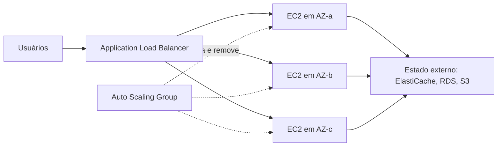

---
aliases:
  - Aula 12.1
modulo: 12
aula: 1
parte: "III Computação e armazenamento"
dominios:
  - 2
  - 3
  - 4
lida: false
tags:
  - aula
  - saa-c03
  - modulo-12
---

# Aula 12.1: Escalar horizontalmente e aplicação stateless

[[12 - Balanceamento de Carga e Auto Scaling|Voltar ao módulo]]

> [!question] Pergunta que esta aula responde
> Por que a AWS (e a prova) empurra você para "muitas instâncias pequenas atrás de um balanceador" em vez de "uma instância enorme", o que exatamente impede uma aplicação de funcionar assim, e o que fazer com sessão de usuário, arquivos enviados e cache local quando o servidor deixa de ser único?

## Por que isso existe

Uma [[EC2|instância EC2]] tem capacidade finita: um número de [[vCPU|vCPUs]], uma quantidade de memória, uma banda de rede. Quando a carga passa disso, o usuário percebe lentidão ou erro. E uma instância tem um segundo limite, menos óbvio: ela é **um único ponto de falha**. Se o hardware do host falha, se o processo trava, se você precisa aplicar um patch que exige reiniciar, a aplicação inteira some.

Dois problemas diferentes, então: **capacidade** (o que acontece quando a demanda cresce) e **[[Disponibilidade|disponibilidade]]** (o que acontece quando algo quebra). A resposta da nuvem para os dois é a mesma ideia: ter várias cópias da aplicação e uma peça na frente que reparte o tráfego entre elas. Este módulo ensina essas duas peças: o **balanceador de carga** (o [[Elastic Load Balancing]], aulas 12.2 a 12.5) e o **grupo que cresce e encolhe sozinho** (o [[Auto Scaling Group]], aulas 12.6 a 12.9). Esta primeira aula responde por que a ideia funciona e o que a aplicação precisa fazer para merecê-la.

> [!info] Ligando os pontos
> No [[01 - Nuvem e Infraestrutura Global AWS|Módulo 1]] você viu que a [[EC2]] é um recurso **zonal**: vive em uma única [[Zona de Disponibilidade|AZ]]. Foi isso que tornou "várias cópias em várias AZs" a receita de resiliência. No [[09 - EC2 a Fundo|Módulo 9]] você viu como escolher família e tamanho da instância; agora a pergunta muda de "qual instância?" para "quantas, e como o tráfego chega a elas?".

## Escalabilidade vertical e horizontal

**[[Escalabilidade Vertical]]** (scale up) é trocar a instância por uma maior: de `m7g.large` para `m7g.4xlarge`. **[[Escalabilidade Horizontal]]** (scale out) é somar instâncias do mesmo tamanho: de 2 para 8 `m7g.large`. A redução tem os nomes simétricos: scale down e scale in.

| Critério | Vertical ([[Escalabilidade Vertical\|scale up]]) | Horizontal ([[Escalabilidade Horizontal\|scale out]]) |
|---|---|---|
| Como funciona | Trocar o [[Instance Type\|tipo de instância]] | Adicionar ou remover instâncias |
| Interrupção | Em geral exige parar e iniciar a instância (a aplicação fica fora do ar) | Nenhuma: as instâncias existentes continuam atendendo |
| Teto | O maior [[Instance Type\|tipo de instância]] existente | Praticamente a cota da conta e a capacidade do balanceador |
| Resiliência | Continua sendo um [[Ponto Unico de Falha\|ponto único de falha]] | Perder uma instância reduz a capacidade, não derruba o serviço |
| Exige mudar a aplicação? | Não | Sim, se ela guarda estado local |
| Reduzir capacidade | Exige nova troca de tipo (com parada, de novo) | Só remover instâncias; o grupo faz isso sozinho quando a carga cai |
| Quando aparece na prova | Banco relacional que não escala por escrita; aplicação legada que não pode mudar | Qualquer pergunta com "[[Alta Disponibilidade\|highly available]]", "scale automatically", "handle unpredictable traffic" |

A coluna "Exige mudar a aplicação?" é o coração da aula. [[Escalabilidade Vertical|Escalar verticalmente]] é fácil de ligar justamente porque a aplicação nem percebe. [[Escalabilidade Horizontal|Escalar horizontalmente]] é a escolha certa para quase tudo na AWS, mas só funciona se qualquer instância puder atender qualquer requisição.

> [!example] Duas formas de absorver a Black Friday
> Uma loja virtual aguenta 1.000 requisições por segundo em uma instância `c7g.2xlarge`. Na Black Friday a previsão é de 4.000. Opção vertical: migrar para uma `c7g.8xlarge`, com uma janela de parada, esperando que o dimensionamento esteja certo, e sem ninguém para atender se essa instância falhar às 10h da manhã. Opção horizontal: quatro `c7g.2xlarge` atrás de um balanceador em duas [[Zona de Disponibilidade|AZs]]. Se uma instância cair, restam 75% da capacidade e o serviço continua. E depois da promoção o grupo volta para duas instâncias sozinho.

### Elasticidade

A [[Elasticidade]] é a propriedade de a capacidade acompanhar a demanda automaticamente, nos dois sentidos. [[Escalabilidade Horizontal|Escalabilidade horizontal]] é o mecanismo que a torna possível; o [[Auto Scaling Group|Auto Scaling]] é a automação. A diferença entre "escalável" e "elástico" cai na prova de forma indireta: se o enunciado pede que o custo acompanhe o uso (pagar só pelo que precisa em cada hora), a resposta precisa encolher também, não só crescer.

## O que impede uma aplicação de escalar horizontalmente: o estado

**Estado** é qualquer informação que a aplicação lembra entre uma requisição e a seguinte. Uma aplicação **[[Stateless]]** não guarda nada importante na própria instância: toda requisição traz (ou busca em um lugar compartilhado) o que precisa. Uma aplicação **stateful** guarda dados na memória ou no disco local do servidor.

O problema do estado local é simples de ver com duas instâncias. O usuário faz login e a instância A grava a sessão na memória. A requisição seguinte cai na instância B, que nunca ouviu falar dele: pede login de novo. E se a instância A for removida pelo scale in, a sessão desaparece.

Onde o estado costuma se esconder:

- **Sessão do usuário** na memória do processo (`express-session` com `MemoryStore`, sessão do servidor de aplicação).
- **Arquivos enviados** pelo usuário gravados no disco da instância (uploads, relatórios gerados).
- **[[Cache]] local** (um `Map` em memória, arquivo temporário) que precisa estar consistente entre instâncias.
- **Tarefas agendadas** dentro do processo (um `cron` interno que, com 6 instâncias, roda 6 vezes).
- **Contadores e filas em memória** (rate limit local, fila de jobs em array).
- **Conexões longas** (WebSocket): a conexão é inevitavelmente presa a uma instância; veremos o efeito na [[12.03 - Application Load Balancer a Fundo|aula 12.3]].

> [!tip] Você provavelmente já fez isso
> Um serviço NestJS rodando no [[ECS]] [[Fargate]] com várias tasks já obriga essa disciplina: a sessão vai no [[JWT]] ou no Redis, o upload vai direto para o [[S3]] com uma [[Presigned URL|presigned URL]], e o agendamento fica em um serviço separado (ou em um [[EventBridge]] Scheduler). A aula só põe nome no que você já pratica: **externalizar o estado**.

## Para onde levar o estado

A regra é a mesma para todos os casos: o estado sai da instância e vai para um serviço compartilhado e durável (ou para o cliente). O "para onde" depende do tipo:

| Tipo de estado | Destino na AWS | Por quê |
|---|---|---|
| Sessão (curta, leitura frequente) | [[ElastiCache]] ([[Redis]] ou [[Valkey]]) ou [[DynamoDB]] | [[Latencia\|Latência]] baixa, [[TTL]] nativo, acessível por todas as instâncias. Detalhes no [[14 - DynamoDB Cache e Bancos de Proposito Especifico|Módulo 14]] |
| Sessão auto-contida | Cookie ou token assinado ([[JWT]]) no cliente | O servidor valida a assinatura e não guarda nada; qualquer instância serve |
| Arquivos enviados | [[S3]] (objetos) ou [[EFS]] (sistema de arquivos compartilhado) | Durável, compartilhado, independente do ciclo de vida da instância |
| Dados transacionais | [[RDS]] ou [[Aurora]] ([[13 - Bancos Relacionais RDS e Aurora|Módulo 13]]) | O banco é a fonte de verdade, não a instância |
| Trabalho pendente | [[SQS]] ([[15 - Desacoplamento Filas Eventos e Workflows|Módulo 15]]) | A fila sobrevive à morte do consumidor |
| Logs | [[CloudWatch Logs]] | O disco da instância some com ela |

Existe uma ideia por trás da tabela: as instâncias passam a ser **descartáveis**. Você pode terminar qualquer uma sem perder nada, e é exatamente isso que o [[Auto Scaling Group|Auto Scaling]] faz no scale in e na substituição de instâncias com falha.

## Sticky sessions: o atalho com custo

Se a aplicação não pode ser alterada, ainda há uma saída parcial: o balanceador **prende o cliente a uma instância**. Isso se chama **[[Sticky Sessions]]** (afinidade de sessão): o balanceador grava um cookie na primeira resposta e, nas próximas requisições do mesmo cliente, manda tudo para a mesma instância. O [[Application Load Balancer]] suporta isso por **cookie gerado pelo balanceador** (duração configurável entre 1 segundo e 7 dias) ou por **cookie da própria aplicação** (verificado em novembro de 2026).

Por que é um atalho e não uma solução:

1. **Distribuição desigual.** Um usuário pesado fica preso a uma instância, que fica sobrecarregada enquanto outras ociosas. Depois de um [[Escalabilidade Horizontal|scale out]], as instâncias novas recebem pouco tráfego porque os clientes antigos continuam presos às antigas. A documentação cita essa redistribuição manual como necessidade após escalar para fora.
2. **Perda na falha.** Se a instância some, a sessão some junto: o balanceador escolhe outra e o usuário perde o estado.
3. **Atrapalha o scale in.** O grupo quer remover instâncias, mas elas têm sessões ativas.
4. **Restrições.** O cliente precisa aceitar cookies. Se o alvo fixado sai do ar ou é terminado, o balanceador escolhe outro alvo e a sessão guardada nele se perde (o detalhe de [[Sticky Sessions|stickiness]] no [[Target Group|target group]] está na aula 12.5). WebSocket é inerentemente "pegajoso" de qualquer jeito.

> [!warning] Pegadinha clássica
> "A aplicação guarda sessão em memória e perde o login quando há mais de uma instância. Qual a solução MAIS resiliente?" A resposta não é [[Sticky Sessions|sticky sessions]] (isso só disfarça). É mover a sessão para um armazenamento compartilhado como [[ElastiCache]] ou [[DynamoDB]]. Sticky sessions aparece como resposta certa quando o enunciado diz que **a aplicação não pode ser modificada**.

## A peça que faltava: um ponto de entrada único

Se há 6 instâncias, o cliente não pode conhecer 6 endereços. Precisa de **um nome estável** que distribua as requisições entre as instâncias saudáveis e esconda as que saíram. Esse é o papel do [[Elastic Load Balancing|balanceador de carga]]. Ele resolve três coisas ao mesmo tempo:

- **Distribuição**: reparte o tráfego pelas instâncias.
- **[[Disponibilidade]]**: verifica a saúde de cada uma (os [[Health Check|health checks]]) e para de mandar tráfego para as doentes.
- **[[Desacoplamento]] do tamanho do grupo**: instâncias entram e saem sem o cliente saber.

E o [[Auto Scaling Group|Auto Scaling]] cuida da outra metade: decide quantas instâncias existem e as registra no balanceador. Juntos formam a arquitetura mais cobrada do Domínio 2:

## Arquitetura em camadas e escala por componente

Uma aplicação real tem camadas: **web** (recebe [[HTTP]]), **aplicação** (regra de negócio) e **dados**. Colocar um balanceador entre cada camada permite que cada uma escale **de forma independente**: a camada web pode precisar de 10 instâncias enquanto a de aplicação precisa de 4. Há dois tipos de balanceador por escopo:

- **Internet-facing**: tem endereços públicos e recebe tráfego da internet; vive em [[Sub-rede Publica|sub-redes públicas]].
- **Internal**: só tem IPs privados e recebe tráfego de dentro da [[VPC]]; é o que fica entre a camada web e a de aplicação.

As instâncias de aplicação ficam em [[Sub-rede Privada|sub-redes privadas]] (sem endereço público, para reduzir a superfície de ataque) e só aceitam tráfego vindo do [[Security Group]] do balanceador. O balanceador **interno** existe pelo mesmo motivo de fundo: a camada de aplicação não precisa ser alcançável da internet, mas continua precisando de distribuição de carga e de [[Health Check|verificação de saúde]] entre as suas instâncias. Isso é o desenho de [[06 - VPC a Fundo|Módulo 6]] aplicado: o balanceador é a única porta de entrada exposta.

Se a camada de aplicação tem trabalho lento (gerar um relatório, processar uma imagem), o ideal é que o balanceador nem espere: a camada web grava uma mensagem em uma fila [[SQS]] e outro grupo de instâncias consome. Esse é o [[Desacoplamento]] do Módulo 15, e o [[Auto Scaling Group|Auto Scaling]] pode escalar o grupo consumidor pelo tamanho da fila (aula 12.7).

## Escala horizontal não é só EC2

O padrão se repete em outros serviços, cada um com o seu mecanismo: tasks do [[ECS]] atrás de um [[Application Load Balancer|ALB]], [[Read Replica|réplicas de leitura]] do [[Aurora]], capacidade do [[DynamoDB]], concorrência do [[Lambda]]. A [[12.10 - Application Auto Scaling e Arquiteturas Completas|aula 12.10]] mostra o serviço que cuida de todos além da [[EC2]] (o [[Application Auto Scaling]]). O raciocínio é o mesmo desta aula: se o componente guarda estado local, adicionar cópias não ajuda.

## Como isso cai na prova

Esta aula cobre os pilares conceituais das **Task 2.1** (arquiteturas escaláveis e fracamente acopladas), **Task 3.2** (computação elástica) e **Task 4.2** (escalar horizontal vs vertical e custo sob demanda; a [[Hibernacao de EC2|hibernação]], que é um recurso de [[EC2]] e não de escala, está no [[09 - EC2 a Fundo|Módulo 9]]).

Palavras-chave que apontam para a solução:

- "**handle unpredictable / variable traffic**", "**scale automatically**": [[Auto Scaling Group|Auto Scaling]] atrás de balanceador.
- "**[[Alta Disponibilidade|highly available]]**", "**[[Tolerancia a Falhas|fault tolerant]]**" com computação: instâncias em **múltiplas [[Zona de Disponibilidade|AZs]]** atrás de [[Elastic Load Balancing|ELB]].
- "**session data lost when an instance is terminated**": externalizar a sessão ([[ElastiCache]], [[DynamoDB]]).
- "**without modifying the application**" / "**legacy application**" com sessão em memória: [[Sticky Sessions|sticky sessions]].
- "**decouple**": fila entre as camadas.
- "**[[Stateless|stateless]]**": a resposta quer que o estado saia da instância.

Pegadinhas:

- **[[Escalabilidade Vertical|Scale up]] para [[Alta Disponibilidade|alta disponibilidade]].** Instância maior não elimina o [[Ponto Unico de Falha|ponto único de falha]].
- **[[Sticky Sessions|Sticky sessions]] como solução definitiva de sessão.** É só paliativo.
- **[[EC2]] sozinha em "[[Multi-AZ]]".** Instância não tem Multi-AZ: o que existe é **várias instâncias em várias [[Zona de Disponibilidade|AZs]]**.
- **Armazenar upload no disco local** ([[EBS]] ou [[Instance Store|instance store]]) com várias instâncias: o arquivo só existe em uma.

| Requisito no enunciado | Resposta provável | Por quê |
|---|---|---|
| Tráfego imprevisível, custo deve acompanhar a demanda | [[Auto Scaling Group]] com [[Target Tracking\|target tracking]] atrás de um [[Application Load Balancer\|ALB]] | Escala para fora e para dentro automaticamente |
| Sobreviver à falha de uma [[Zona de Disponibilidade\|AZ]] | Instâncias em pelo menos 2 AZs, balanceador [[Multi-AZ\|multi-AZ]] | A AZ é o domínio de falha da [[EC2]] |
| Sessão perdida ao trocar de instância | Sessão em [[ElastiCache]] ou [[DynamoDB]] | Estado compartilhado, instâncias descartáveis |
| Aplicação legada que não pode mudar, sessão em memória | [[Sticky Sessions\|Sticky sessions]] no [[Application Load Balancer\|ALB]] | Prende o cliente à instância sem tocar no código |
| Uploads de usuários com várias instâncias web | [[S3]] (ou [[EFS]] para sistema de arquivos compartilhado) | Disco local não é compartilhado |
| Camadas web e aplicação com perfis de carga diferentes | Um balanceador e um grupo por camada | Cada camada escala sozinha |

## Resumo

> [!abstract] A aula em uma frase
> Uma instância é limite de capacidade e [[Ponto Unico de Falha|ponto único de falha]]; várias instâncias iguais atrás de um balanceador resolvem os dois, desde que a aplicação seja [[Stateless|stateless]], e é por isso que a prova trata "[[Escalabilidade Horizontal|escalar horizontalmente]] [[Stateful e Stateless (Firewall)|com estado]] externalizado" como o desenho padrão.

**A lógica, em 5 passos**

1. Uma instância tem teto de capacidade e é um [[Ponto Unico de Falha|ponto único de falha]].
2. [[Escalabilidade Vertical|Scale up]] aumenta o teto, mas mantém o [[Ponto Unico de Falha|ponto único de falha]] e costuma exigir parada.
3. [[Escalabilidade Horizontal|Scale out]] soma instâncias iguais; qualquer uma pode falhar sem derrubar o serviço.
4. Isso só funciona se qualquer instância puder atender qualquer requisição: o estado precisa sair da instância.
5. Um balanceador dá o ponto de entrada único e o [[Auto Scaling Group|Auto Scaling]] mantém o número certo de instâncias.

**Tabela-síntese**

| Estado | Vai para | Evita |
|---|---|---|
| Sessão | [[ElastiCache]], [[DynamoDB]] ou token assinado | Login perdido ao trocar de instância |
| Arquivos | [[S3]] ou [[EFS]] | Arquivo existir só em uma instância |
| Trabalho pendente | [[SQS]] | Perda de job quando o consumidor morre |
| Logs | [[CloudWatch Logs]] | Perda de log no scale in |

**Na prática, isso significa**

- Desenhe toda instância como descartável: pode ser terminada a qualquer momento sem perda.
- Prefira mover a sessão para um armazenamento compartilhado; use [[Sticky Sessions|sticky sessions]] só quando o código não pode mudar.
- Use um balanceador por camada para permitir escala independente.
- Em pergunta de [[Alta Disponibilidade|alta disponibilidade]] com [[EC2]], procure "múltiplas [[Zona de Disponibilidade|AZs]]" na resposta.

> [!tip] Liga com
> Vem do [[09 - EC2 a Fundo|Módulo 9]] (a instância e as formas de pagar) e da ideia de [[Zona de Disponibilidade|AZ]] do [[01 - Nuvem e Infraestrutura Global AWS|Módulo 1]]. Segue para [[12.02 - A Familia Elastic Load Balancing|a aula 12.2]], que apresenta os tipos de balanceador.

## Erros comuns

- **Achar que "escalável" é o mesmo que "elástico".** Escalável pode crescer; elástico também encolhe automaticamente. Se o custo importa, o enunciado quer os dois sentidos.
- **Resolver [[Disponibilidade|disponibilidade]] com uma instância maior.** O [[Ponto Unico de Falha|ponto único de falha]] continua.
- **Usar [[Sticky Sessions|sticky sessions]] para esconder estado local.** Funciona até a primeira instância cair ou o primeiro [[Escalabilidade Horizontal|scale out]]: o tráfego fica desigual e as sessões se perdem.
- **Gravar upload ou relatório no disco da instância.** Some no scale in e não é visto pelas outras instâncias.
- **Rodar `cron` dentro de cada instância do grupo.** Com N instâncias, a tarefa roda N vezes.
- **Esquecer que o balanceador também precisa estar habilitado nas [[Zona de Disponibilidade|AZs]] das instâncias.** Instâncias em uma AZ que o balanceador não atende ficam sem tráfego: metade do desenho sem uso.

## Pratique

**1.** Uma loja online roda em uma única [[EC2|instância EC2]] `m6i.4xlarge`. Nos picos a CPU chega a 100% e, quando a instância falha, o site fica indisponível. O arquiteto precisa melhorar a capacidade E a [[Disponibilidade|disponibilidade]], com o MENOR [[Overhead Operacional|esforço operacional]] possível depois da migração. Qual solução atende?

- [ ] a) Migrar para uma instância `m6i.16xlarge` e criar um alarme do CloudWatch que reinicia a instância se a verificação de status falhar.
- [ ] b) Colocar a aplicação em instâncias menores em um Auto Scaling group de duas AZs, atrás de um balanceador de carga.
- [ ] c) Manter a instância atual e adicionar uma segunda instância idêntica em outra AZ, com o tráfego dividido manualmente por registros DNS fixos.
- [ ] d) Habilitar a hibernação na instância para que ela retome mais rápido depois de uma falha.

**2.** Uma aplicação web grava a sessão do usuário na memória do processo. Depois de colocar duas instâncias atrás de um balanceador, os usuários são deslogados de forma aleatória. A aplicação pode ser alterada. Qual solução é a MAIS resiliente?

- [ ] a) Ativar sticky sessions no balanceador com duração de 7 dias.
- [ ] b) Aumentar o tamanho das instâncias para que a memória nunca acabe.
- [ ] c) Gravar a sessão em uma tabela do Amazon DynamoDB ou em um cluster do Amazon ElastiCache compartilhado por todas as instâncias.
- [ ] d) Gravar a sessão em um volume Amazon EBS anexado a cada instância, e usar um script para replicar o conteúdo do volume entre as instâncias.

**3.** Uma empresa tem um sistema legado cujo código-fonte não está disponível. Ele guarda a sessão na memória do servidor. A empresa quer executá-lo em três instâncias atrás de um balanceador sem alterar o código. O que permite isso?

- [ ] a) Sticky sessions no balanceador, para que cada cliente continue sendo atendido pela mesma instância enquanto ela existir, sem alterar o código da aplicação.
- [ ] b) Um Amazon EFS montado nas três instâncias para compartilhar a memória do processo entre os servidores do grupo.
- [ ] c) Um Network ACL que descarta pacotes de clientes que trocam de instância.
- [ ] d) Amazon CloudFront na frente do balanceador para guardar a sessão nas edge locations.

**4.** Qual característica diferencia a [[Escalabilidade Horizontal|escalabilidade horizontal]] da vertical no contexto de [[Disponibilidade|disponibilidade]]?

- [ ] a) A horizontal exige reiniciar a instância para aplicar o novo tamanho.
- [ ] b) A horizontal soma instâncias, e a perda de uma delas reduz a capacidade em vez de derrubar o serviço, ao contrário da vertical, que continua sendo um ponto único de falha.
- [ ] c) A vertical remove o ponto único de falha porque a instância maior tem mais redundância interna de hardware e rede.
- [ ] d) A vertical é a única que permite o custo acompanhar a demanda.

**5.** Uma aplicação de imagens permite que usuários façam upload de fotos. As fotos são gravadas no disco local de cada instância web. Ao escalar para 4 instâncias, usuários às vezes não conseguem ver a foto que acabaram de enviar. Qual mudança resolve o problema com o MENOR [[Overhead Operacional|overhead operacional]]?

- [ ] a) Gravar as fotos no Amazon S3 e servi-las a partir do bucket.
- [ ] b) Ativar sticky sessions para que o usuário sempre volte à instância que recebeu o upload.
- [ ] c) Copiar as fotos entre as instâncias com um script rsync agendado a cada minuto.
- [ ] d) Montar um volume Amazon EBS Multi-Attach em todas as instâncias.

**6.** Uma aplicação tem três camadas: web, aplicação e banco. A camada web recebe 10 vezes mais tráfego que a de aplicação em picos de campanha. O arquiteto quer que cada camada escale de forma independente. Qual desenho atende?

- [ ] a) Um único Auto Scaling group contendo instâncias que executam as duas camadas juntas, escalando pela CPU média de todas as instâncias do grupo.
- [ ] b) Um balanceador internet-facing para a camada web e um balanceador interno para a camada de aplicação, cada um com seu Auto Scaling group, de modo que cada camada escala de forma independente.
- [ ] c) Uma única instância grande por camada, com tamanho ajustado manualmente antes de cada campanha.
- [ ] d) Um balanceador internet-facing apontando diretamente para as instâncias do banco de dados.

**7.** (Escolha DUAS.) Quais itens são exemplos de estado local que impedem uma aplicação de [[Escalabilidade Horizontal|escalar horizontalmente]] sem alterações?

- [ ] a) Sessões de usuário guardadas na memória do processo.
- [ ] b) Configuração lida de variáveis de ambiente na inicialização.
- [ ] c) Arquivos enviados por usuários gravados no disco da instância.
- [ ] d) Logs enviados continuamente para o Amazon CloudWatch Logs.
- [ ] e) Consultas feitas a um banco de dados compartilhado.

**8.** Uma empresa quer que o custo de computação de um site de eventos acompanhe o uso: pagar pouco fora dos eventos e absorver picos durante eles, sem intervenção manual. Qual conceito descreve o que a empresa precisa?

- [ ] a) Alta disponibilidade, obtida com instâncias em duas AZs.
- [ ] b) Tolerância a falhas, obtida com instâncias redundantes em ativo-ativo, que mantêm o serviço funcionando durante uma falha.
- [ ] c) Elasticidade, obtida com capacidade que cresce e encolhe automaticamente conforme a demanda.
- [ ] d) Durabilidade, obtida com a replicação dos dados em várias AZs.

**9.** Um arquiteto distribui 6 instâncias entre duas [[Zona de Disponibilidade|AZs]] atrás de um [[Network Load Balancer]], mas habilita o balanceador em apenas uma das AZs. O que acontece?

- [ ] a) As instâncias da AZ sem balanceador habilitado não recebem tráfego do balanceador, desperdiçando metade da capacidade.
- [ ] b) O balanceador distribui normalmente para todas as instâncias, porque a habilitação de AZ é opcional para instâncias registradas no target group.
- [ ] c) O balanceador falha e se recusa a rotear qualquer requisição.
- [ ] d) As instâncias da AZ não habilitada passam automaticamente para um Auto Scaling group separado.

**10.** Uma aplicação executa um job agendado (`cron`) dentro de cada instância para enviar e-mails de cobrança. Depois de escalar para 5 instâncias, os clientes recebem 5 e-mails. Qual é a causa raiz e a correção mais adequada?

- [ ] a) O balanceador duplica as requisições para cada instância; deve-se desativar o cross-zone load balancing para que cada requisição chegue só uma vez.
- [ ] b) O agendamento está embutido em cada instância; mover o job para um serviço externo, como o EventBridge Scheduler acionando uma função.
- [ ] c) A instância é pequena demais; migrar para uma família otimizada para computação.
- [ ] d) O Auto Scaling group está acima do tamanho máximo; reduzir o máximo para 1.

**11.** (Escolha DUAS.) Quais afirmações sobre [[Sticky Sessions|sticky sessions]] em um [[Application Load Balancer]] são corretas?

- [ ] a) Se a instância à qual o cliente está preso for removida, a sessão armazenada em memória nela se perde.
- [ ] b) Elas eliminam a necessidade de externalizar o estado da aplicação.
- [ ] c) Depois de um scale out, instâncias novas podem receber menos tráfego porque clientes existentes continuam presos às antigas.
- [ ] d) Funcionam sem cookies, usando apenas o endereço IP de origem do cliente.
- [ ] e) Distribuem a carga de forma perfeitamente uniforme independentemente do comportamento do usuário.

> [!success]- Gabarito
> **1. b)** Várias instâncias menores em duas [[Zona de Disponibilidade|AZs]], atrás de balanceador e com [[Auto Scaling Group|Auto Scaling]], tratam capacidade e [[Disponibilidade|disponibilidade]]; a) só cresce o teto e mantém o [[Ponto Unico de Falha|ponto único de falha]], c) divide o tráfego manualmente por [[DNS]] sem [[Health Check|health check]] nem escala, d) [[Hibernacao de EC2|hibernação]] não melhora capacidade nem disponibilidade.
> **2. c)** Sessão em armazenamento compartilhado torna as instâncias intercambiáveis; a) mascara o problema (a sessão se perde se a instância cair), b) memória maior não compartilha a sessão entre processos, d) [[EBS]] é anexado a uma instância, não é compartilhado.
> **3. a)** [[Sticky Sessions|Sticky sessions]] resolvem sem mexer no código; b) [[EFS]] compartilha arquivos, não memória de processo, c) um [[Network ACL|NACL]] não tem relação com sessão, d) [[CloudFront]] não guarda estado de sessão da aplicação em memória do servidor.
> **4. b)** [[Escalabilidade Horizontal|Escalar horizontalmente]] soma instâncias e a perda de uma só reduz a capacidade; a) descreve a vertical, c) instância maior continua sendo um [[Ponto Unico de Falha|ponto único de falha]], d) a [[Elasticidade|elasticidade]] automática é típica da horizontal.
> **5. a)** [[S3]] é compartilhado, durável e dispensa gerenciar servidores; b) sticky não ajuda quando o usuário é atendido por outra instância ou a instância é removida, c) rsync é frágil e tem janela de inconsistência, d) [[Multi-Attach|EBS Multi-Attach]] é restrito (mesma [[Zona de Disponibilidade|AZ]], tipos específicos) e exige sistema de arquivos cluster-aware.
> **6. b)** Um balanceador e um grupo por camada permitem escalar cada camada de forma independente; a) mistura camadas no mesmo grupo, c) escala manual e sem redundância, d) balanceador não deve expor o banco de dados.
> **7. a) e c)** Sessão em memória e arquivos em disco local existem só na instância; b) variáveis de ambiente são configuração igual em todas, d) logs externos são exatamente a boa prática, e) banco compartilhado é estado externalizado.
> **8. c)** [[Elasticidade]] é a capacidade acompanhar a demanda nos dois sentidos; a) [[Alta Disponibilidade|alta disponibilidade]] trata falha de [[Zona de Disponibilidade|AZ]], não custo variável, b) [[Tolerancia a Falhas|tolerância a falhas]] trata redundância contínua, d) [[Durabilidade|durabilidade]] trata a persistência dos dados.
> **9. a)** Instâncias em uma [[Zona de Disponibilidade|AZ]] não habilitada no balanceador não recebem tráfego dele; b) a habilitação de AZ determina onde existem nós do balanceador, c) o balanceador funciona, apenas com uma AZ, d) não existe movimentação automática de grupo.
> **10. b)** O agendamento embutido em cada instância é estado local replicado N vezes; mover para um agendador externo executa a tarefa uma só vez. a) o balanceador não duplica requisições, c) tamanho não influencia, d) reduzir o máximo para 1 elimina a escalabilidade.
> **11. a) e c)** A sessão em memória some com a instância e o tráfego fica desigual depois do [[Escalabilidade Horizontal|scale out]]; b) é falso, a externalização continua sendo melhor, d) o [[Application Load Balancer|ALB]] usa cookie, e) a distribuição não é uniforme justamente por causa da afinidade.

## Para aprofundar

- [ ] [What is Elastic Load Balancing?](https://docs.aws.amazon.com/elasticloadbalancing/latest/userguide/what-is-load-balancing.html) (documentação AWS): a definição oficial da família e dos serviços relacionados, base de toda a parte de balanceadores.
- [ ] [What is Amazon EC2 Auto Scaling?](https://docs.aws.amazon.com/autoscaling/ec2/userguide/what-is-amazon-ec2-auto-scaling.html) (documentação AWS): visão geral de grupos, mínimo, máximo, desejado e recursos do serviço.
- [ ] [AWS re:Invent 2024 - Optimizing ELB traffic distribution for high availability (NET401)](https://www.youtube.com/watch?v=EhbFossuQhI) (AWS Events): sessão sobre distribuição de tráfego e [[Alta Disponibilidade|alta disponibilidade]] com [[Elastic Load Balancing|ELB]]; vídeo não assistido, descrito só pelo título e canal.

Próxima aula: [[12.02 - A Familia Elastic Load Balancing|Aula 12.2: A família Elastic Load Balancing]].
