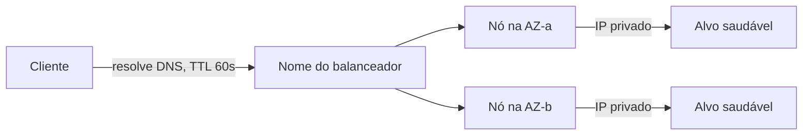
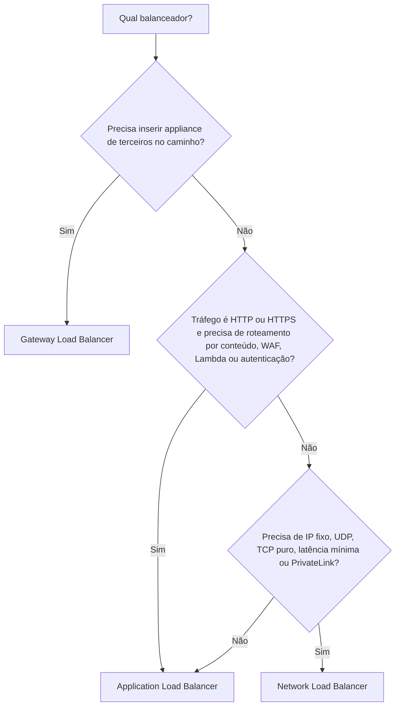

---
aliases:
  - Aula 12.2
modulo: 12
aula: 2
parte: "III Computação e armazenamento"
dominios:
  - 2
  - 3
  - 4
lida: false
tags:
  - aula
  - saa-c03
  - modulo-12
---

# Aula 12.2: A família Elastic Load Balancing

[[12 - Balanceamento de Carga e Auto Scaling|Voltar ao módulo]]

> [!question] Pergunta que esta aula responde
> O que é, por dentro, um [[Elastic Load Balancing|balanceador de carga]] da AWS, por que existem quatro tipos ([[Application Load Balancer|ALB]], [[Network Load Balancer|NLB]], [[Gateway Load Balancer|GWLB]] e o legado Classic) e como escolher entre eles lendo só o enunciado de uma questão?

## Por que existem vários balanceadores

Na [[12.01 - Escalar Horizontalmente e Aplicacao Stateless|aula anterior]] vimos que várias instâncias precisam de um ponto de entrada único. O **[[Elastic Load Balancing]] (ELB)** é o serviço que entrega isso: distribui o tráfego recebido entre alvos (targets) como [[EC2|instâncias EC2]], [[Container|contêineres]] e endereços IP, em uma ou mais [[Zona de Disponibilidade|AZs]], monitora a saúde de cada alvo, manda tráfego só para os saudáveis e escala a própria capacidade conforme o tráfego muda (verificado em novembro de 2026, na documentação do ELB).

Mas "distribuir tráfego" significa coisas diferentes conforme a camada em que você olha o pacote. Um balanceador que entende [[HTTP]] pode decidir "tudo que começa com `/api` vai para o grupo de APIs". Um que só vê [[TCP]] não sabe o que é um caminho de URL, mas é muito mais rápido e pode manter um IP fixo. Um que opera na camada de rede pode passar o tráfego por um firewall de terceiros sem que a aplicação perceba. Cada uma dessas necessidades virou um tipo de balanceador.

> [!info] Ligando os pontos
> O [[03 - Fundamentos de Redes para a Nuvem|Módulo 3]] ensinou as camadas: IP ([[Modelo OSI|L3]]), [[TCP]]/UDP (L4) e [[HTTP]] (L7). A família [[Elastic Load Balancing|ELB]] é exatamente a resposta "uma ferramenta por camada": o [[Application Load Balancer|ALB]] trabalha em L7, o [[Network Load Balancer|NLB]] em L4 e o [[Gateway Load Balancer|GWLB]] em L3. Se a camada estiver clara, a escolha do balanceador vira dedução, não decoreba.

## Por dentro: nós, DNS e alvos

Um balanceador não é uma máquina única. Quando você habilita uma [[Zona de Disponibilidade|AZ]] para ele (indicando uma [[Sub-rede|sub-rede]] naquela AZ), o [[Elastic Load Balancing|ELB]] cria um **nó do balanceador** (load balancer node) nela. Cada nó é quem de fato recebe conexões e as encaminha. O ELB cria e remove nós conforme o tráfego sobe e desce (isso é a "escala automática" do serviço).

O cliente descobre os nós pelo [[DNS]]. O nome do balanceador (algo como `meu-alb-123456.us-east-1.elb.amazonaws.com`) resolve para os endereços dos nós, e o registro tem **[[TTL]] de 60 segundos**, para que os endereços possam ser trocados rapidamente quando o [[Elastic Load Balancing|ELB]] escala. Por isso você nunca usa IPs de balanceador: usa o nome (e, no [[Route 53]], um registro [[Alias Record|alias]], assunto do [[18 - Borda e DNS CloudFront Global Accelerator e Route 53|Módulo 18]]).

Dois detalhes que explicam várias pegadinhas:

- O nó recebe a requisição, escolhe um alvo saudável e **fala com ele pelo [[RFC 1918|IP privado]]**. Por isso os alvos não precisam de IP público, mesmo atrás de um balanceador que enfrenta a internet.
- Se um alvo está em uma [[Zona de Disponibilidade|AZ]] **que não foi habilitada** no balanceador, ele não recebe tráfego, mesmo registrado (documentação do [[Application Load Balancer|ALB]]).

### Esquema: internet-facing ou internal

Ao criar o balanceador você escolhe o **esquema** (scheme):

| Esquema | IPs dos nós | Quem alcança | [[Sub-rede\|Sub-redes]] dos nós |
|---|---|---|---|
| **internet-facing** | Públicos | Clientes na internet | [[Sub-rede Publica|Públicas]] (com rota para o [[Internet Gateway]]) |
| **internal** | Só privados | Quem tem acesso à [[VPC]] (peering, VPN, [[Direct Connect]]) | Privadas |

O nome [[DNS]] de um balanceador internal também é resolvível publicamente, mas aponta para IPs privados, então só é alcançável de dentro da rede. Uma aplicação em camadas costuma ter os dois: um internet-facing na frente da camada web e um internal entre a web e a aplicação (aula 12.1).

Um erro de configuração frequente (e de pergunta de troubleshooting): balanceador internet-facing criado em [[Sub-rede|sub-redes]] **privadas** não responde à internet. A documentação lista isso como a primeira causa de "clients cannot connect to an internet-facing [[Elastic Load Balancing|load balancer]]".

## Os quatro tipos

### Application Load Balancer (ALB)

O **[[Application Load Balancer]]** opera na **[[Modelo OSI|camada 7]]** (aplicação). Ele lê a [[HTTP|requisição HTTP]] e decide para onde mandar com base em caminho, host, cabeçalhos, método, parâmetros da URL ou IP de origem. Fala HTTP e HTTPS (com suporte a HTTP/2, WebSocket e gRPC) e aceita como alvos [[EC2|instâncias EC2]], endereços IP e funções [[Lambda]]. Pode autenticar usuários ([[OIDC]] ou [[Cognito]]) e integra com o [[WAF]]. É o balanceador padrão para aplicações web, APIs e [[Microsservicos|microsserviços]]. Detalhes na [[12.03 - Application Load Balancer a Fundo|aula 12.3]].

### Network Load Balancer (NLB)

O **[[Network Load Balancer]]** opera na **[[Modelo OSI|camada 4]]** (transporte). Não olha o conteúdo: escolhe um alvo por [[Hash|hash]] do fluxo (protocolo, IPs, portas) e encaminha a conexão [[TCP]] ou [[UDP]]. Suporta TCP, UDP, [[TLS]] (e, segundo a documentação atual, QUIC), lida com milhões de requisições por segundo com [[Latencia|latência]] muito baixa, oferece **um endereço IP estático por [[Zona de Disponibilidade|AZ]]** (e permite associar um [[Elastic IP]] por [[Sub-rede|sub-rede]]) e preserva o IP de origem do cliente em vários cenários. Também é o balanceador que fica por trás de um serviço exposto por [[PrivateLink]]. Detalhes na [[12.04 - Network Load Balancer e Gateway Load Balancer|aula 12.4]].

### Gateway Load Balancer (GWLB)

O **[[Gateway Load Balancer]]** opera na **[[Modelo OSI|camada 3]]** (rede). Serve para **inserir appliances virtuais de terceiros** (firewalls, sistemas de detecção e prevenção de intrusão, inspeção profunda de pacotes) no caminho do tráfego e escalá-los conforme a demanda. Combina um gateway de rede transparente (um único ponto de entrada e saída) com distribuição de tráfego. Escuta todos os pacotes IP em todas as portas e troca tráfego com os appliances por um protocolo chamado **[[GENEVE]]**, na porta 6081 (um encapsulamento: carrega o pacote original intacto mais metadados do fluxo entre o GWLB e o appliance). Detalhes na aula 12.4.

### Classic Load Balancer (CLB)

O **Classic [[Elastic Load Balancing|Load Balancer]]** é a geração anterior, com recursos em [[Modelo OSI|L4]] e L7 misturados e sem as regras de roteamento modernas. A AWS recomenda migrar para um balanceador de geração atual (existe um assistente de migração). Na prova ele aparece como **legado**: se uma resposta oferece "migrar o Classic para [[Application Load Balancer|ALB]] ou [[Network Load Balancer|NLB]] para ganhar recursos", essa costuma ser a opção certa; se o enunciado diz "roteamento por caminho", o Classic não serve.

## Comparação lado a lado

| Característica | [[Application Load Balancer\|ALB]] | [[Network Load Balancer\|NLB]] | [[Gateway Load Balancer\|GWLB]] | CLB (legado) |
|---|---|---|---|---|
| Camada OSI | 7 (aplicação) | 4 (transporte) | 3 (rede) | 4 e 7 |
| Protocolos dos [[Listener\|listeners]] | [[HTTP]], HTTPS (gRPC sobre HTTPS) | [[TCP]], [[UDP]], [[TLS]], QUIC | IP | TCP, SSL/TLS, HTTP, HTTPS |
| Tipos de alvo | instance, ip, lambda | instance, ip, alb | instance, ip | instâncias |
| Roteamento por conteúdo (path, host, header) | Sim | Não | Não | Não |
| IP estático / [[Elastic IP]] | Não | Sim (por [[Zona de Disponibilidade\|AZ]]) | Não | Não |
| Alvo [[Lambda\|função Lambda]] | Sim | Não | Não | Não |
| [[WAF\|AWS WAF]] | Sim | Não | Não | Não |
| Autenticação [[OIDC]]/Cognito | Sim | Não | Não | Não |
| [[Terminacao de TLS\|Terminação TLS]] com [[SNI]] | Sim | Sim | Não | Não |
| [[Cross-Zone Load Balancing\|Cross-zone]] padrão (explicado na aula 12.5) | Sempre ligado | Desligado | Desligado | Console: ligado; API/CLI: desligado |
| Uso típico | Web, APIs, [[Microsservicos\|microsserviços]] | [[Latencia\|Latência]] mínima, IP fixo, [[TCP]]/UDP não [[HTTP]], [[PrivateLink]] | Firewalls e inspeção de terceiros | Sistemas antigos |

Origem: tabela de produtos da página de recursos do [[Elastic Load Balancing|ELB]] e documentação dos guias do [[Application Load Balancer|ALB]], [[Network Load Balancer|NLB]] e [[Gateway Load Balancer|GWLB]] (verificado em novembro de 2026). A linha de [[WAF]] e de autenticação segue a documentação do ALB e do WAF: o WAF só se associa ao ALB entre os três.

> [!tip] Macete de prova
> Três perguntas decidem quase tudo: (1) o requisito fala de **conteúdo [[HTTP]]** (caminho, host, header, autenticação, Lambda, [[WAF]])? Então [[Application Load Balancer|ALB]]. (2) fala de **IP fixo, [[UDP]], [[TCP]] puro, [[Latencia|latência]] mínima ou [[PrivateLink]]**? Então [[Network Load Balancer|NLB]]. (3) fala de **firewall ou appliance de terceiros no caminho do tráfego**? Então [[Gateway Load Balancer|GWLB]].

## Árvore de decisão

### Combinações que a prova adora

- **IP fixo com recursos [[HTTP]]**: [[Application Load Balancer|ALB]] não tem IP estático, mas o [[Network Load Balancer|NLB]] aceita um ALB como alvo. Então "NLB na frente do ALB" entrega IP estático e roteamento [[Modelo OSI|L7]]. A outra solução comum é o [[Global Accelerator]], que dá dois [[Anycast|IPs anycast]] estáticos e aponta para ALB ou NLB ([[18 - Borda e DNS CloudFront Global Accelerator e Route 53|Módulo 18]]).
- **Exposição privada de um serviço a outras contas**: [[Network Load Balancer|NLB]] atrás de um [[Endpoint Service|endpoint service]] ([[PrivateLink]]).
- **Inspeção de tráfego**: [[Gateway Load Balancer|GWLB]] com endpoints de GWLB nas [[VPC|VPCs]] consumidoras.

> [!example] Escolhendo para cinco cenários
> 1. Uma API REST em [[Container|contêineres]] no [[ECS]], com `/pedidos` e `/clientes` em serviços diferentes: **[[Application Load Balancer|ALB]]** (roteamento por caminho; ECS escolhe portas dinâmicas e registra no [[Target Group|target group]]).
> 2. Servidor de jogo em [[UDP]] com milhões de pacotes por segundo: **[[Network Load Balancer|NLB]]**.
> 3. Parceiros que só liberam o seu IP no firewall deles e a aplicação é [[HTTP]]: **[[Network Load Balancer|NLB]] com [[Elastic IP|Elastic IPs]] apontando para um [[Application Load Balancer|ALB]]**, ou [[Global Accelerator]].
> 4. Firewall de próxima geração de um fornecedor, inspecionando todo o tráfego entre [[VPC|VPCs]]: **[[Gateway Load Balancer|GWLB]]**.
> 5. Aplicação que protege o login com SSO corporativo sem alterar o código: **[[Application Load Balancer|ALB]]** com ação de autenticação [[OIDC]] na regra do [[Listener|listener]].

## Peças comuns aos balanceadores

Os quatro compartilham o vocabulário de **[[Listener|listener]]** e **[[Target Group|target group]]**, que as próximas aulas detalham:

- **[[Listener]]**: processo que escuta conexões em um protocolo e porta e aplica regras para encaminhá-las.
- **[[Target Group]]**: conjunto de alvos com seu protocolo, porta e [[Health Check]]. O [[Application Load Balancer|ALB]] e o [[Network Load Balancer|NLB]] podem ter vários, e o roteamento é feito independentemente por target group.
- **Alvo (target)**: o destino final. O tipo de alvo é definido ao criar o [[Target Group|target group]] e **não pode ser alterado depois**.

Os alvos podem ser registrados manualmente ou, no caso de [[EC2]], automaticamente por um [[Auto Scaling Group]] associado ao [[Target Group|target group]]: instâncias lançadas são registradas e instâncias terminadas são removidas, sem trabalho seu (verificado em novembro de 2026, documentação do [[Application Load Balancer|ALB]]).

## Requisitos de rede ao criar

| Item | [[Application Load Balancer\|ALB]] | [[Network Load Balancer\|NLB]] |
|---|---|---|
| Número de [[Zona de Disponibilidade\|AZs]] | No mínimo 2 [[Sub-rede\|sub-redes]] em AZs diferentes | Pode habilitar uma AZ, mas o desenho de [[Alta Disponibilidade\|HA]] pede mais de uma |
| Tamanho da [[Sub-rede\|sub-rede]] | Pelo menos `/27` com no mínimo 8 IPs livres por sub-rede, para escalar | Não aplicável da mesma forma |
| [[Security Group\|Security group]] | Sim, na criação ou depois | Opcional, mas só dá para associar se já foi criado com um; sem isso nunca é possível depois |
| IPs estáticos | Não | Um por [[Zona de Disponibilidade\|AZ]], com [[Elastic IP]] opcional |

O requisito de [[Sub-rede|sub-redes]] do [[Application Load Balancer|ALB]] é uma pegadinha comum de infraestrutura: se a sub-rede ficar sem IPs livres durante um [[Escalabilidade Horizontal|scale out]] do balanceador, o ALB fica com capacidade insuficiente e pode causar erros 5xx ou [[Timeout|timeouts]] (documentação do ALB). Quem planeja CIDRs no [[06 - VPC a Fundo|Módulo 6]] já deve reservar espaço para isso.

> [!warning] Security group do NLB
> Se você criar um [[Network Load Balancer|NLB]] **sem** [[Security Group|security group]], não poderá associar um depois. Isso é confirmado na documentação do NLB. Quem ainda tem NLBs antigos sem security group precisa recriá-los para ganhar o controle. Quando há security group, as regras de entrada nos alvos podem referenciar o security group do NLB, o que garante que os alvos aceitem tráfego do balanceador mesmo com preservação do IP de origem.

## Como se paga

O [[Elastic Load Balancing|ELB]] cobra **por hora de existência** mais uma **unidade de capacidade** consumida ([[LCU]] no [[Application Load Balancer|ALB]], NLCU no [[Network Load Balancer|NLB]], GLCU no [[Gateway Load Balancer|GWLB]]), mais a [[Data Transfer|transferência de dados]] normal da AWS. Valores de exemplo da página de preços para US East (N. Virginia), verificados em novembro de 2026:

| Tipo | Por hora | Unidade de capacidade |
|---|---|---|
| [[Application Load Balancer\|ALB]] | US$ 0,0225 | US$ 0,008 por LCU-hora |
| [[Network Load Balancer\|NLB]] | US$ 0,0225 | US$ 0,006 por NLCU-hora |
| [[Gateway Load Balancer\|GWLB]] | US$ 0,0125 por [[Zona de Disponibilidade\|AZ]] (a página de preços cita "per Availability Zone") | US$ 0,004 por GLCU-hora |

No [[Application Load Balancer|ALB]], a [[LCU]] mede quatro dimensões e você paga pela de maior uso na hora: novas conexões por segundo, conexões ativas por minuto, bytes processados e avaliações de regra por segundo (as 10 primeiras regras são gratuitas). Consequência prática: um ALB ocioso ainda custa o valor por hora, então ambientes de teste devem ser apagados no fim do dia. Além disso, ALB e [[Network Load Balancer|NLB]] **internet-facing** pagam pelos **[[IPv4|endereços IPv4]] públicos** que usam (cerca de US$ 0,005 por IP por hora desde fevereiro de 2024, conforme a página de preços de [[VPC]]; a página do [[Elastic Load Balancing|ELB]] apenas remete a ela), o que pesa em balanceadores com um IP por [[Zona de Disponibilidade|AZ]]; uma forma de reduzir é usar [[IPv6]] em dualstack onde os clientes suportam. Existe ainda a *LCU Reservation*, uma capacidade reservada de LCU, que não costuma cair na prova. Consulte sempre a [página de preços](https://aws.amazon.com/elasticloadbalancing/pricing/) para o valor atual; o curso só usa os números para comparar ordens de grandeza.

## Como isso cai na prova

Esta aula cobre a base das **Task 2.1** (load balancing com [[Application Load Balancer|ALB]]), **Task 3.4** (selecionar a estratégia de balanceamento) e **Task 4.2** (ALB Layer 7 vs [[Network Load Balancer|NLB]] Layer 4 vs [[Gateway Load Balancer]], citado literalmente no exam guide). Cada balanceador também aparece em segurança de rede (**Task 1.2**), e o capítulo de custos está no pilar de otimização de computação.

Palavras-chave:

- "**path-based**", "**host-based routing**", "**route to different services by URL**": [[Application Load Balancer|ALB]].
- "**static IP**", "**[[Elastic IP]]**", "**whitelist the IP address**", "**[[UDP]]**", "**ultra-low [[Latencia|latency]]**", "**millions of requests per second**": [[Network Load Balancer|NLB]].
- "**third-party virtual appliances**", "**firewall**", "**deep packet inspection**", "**transparent network gateway**": [[Gateway Load Balancer|GWLB]].
- "**expose a service privately to other [[VPC|VPCs]]/accounts**": [[Network Load Balancer|NLB]] + [[PrivateLink]].
- "**Layer 7**" e "**Layer 4**": a camada é uma dica direta.

Pegadinhas:

- **[[Application Load Balancer|ALB]] com IP estático.** ALB não tem. Respostas "ALB com [[Elastic IP]]" estão erradas; as certas são [[Network Load Balancer|NLB]], NLB na frente do ALB ou [[Global Accelerator]].
- **[[WAF]] no [[Network Load Balancer|NLB]].** Não se associa. WAF vai em [[Application Load Balancer|ALB]], [[CloudFront]], [[API Gateway]] e outros.
- **Classic [[Elastic Load Balancing|Load Balancer]] como escolha nova.** É legado.
- **Balanceador internet-facing em [[Sub-rede Privada|sub-redes privadas]].** Não funciona.
- **Acreditar que "o balanceador é de uma [[Zona de Disponibilidade|AZ]]".** Ele é regional e tem nós nas AZs habilitadas.

| Requisito no enunciado | Resposta provável | Por quê |
|---|---|---|
| Rotear `/api/*` e `/web/*` para serviços diferentes | [[Application Load Balancer\|ALB]] | Regras de [[Listener\|listener]] por caminho |
| Cliente exige lista de IPs fixos de entrada | [[Network Load Balancer\|NLB]] (ou NLB para [[Application Load Balancer\|ALB]], ou [[Global Accelerator]]) | NLB tem IP estático por [[Zona de Disponibilidade\|AZ]] |
| Protocolo [[UDP]] ou [[TCP]] não [[HTTP]] em grande escala | [[Network Load Balancer\|NLB]] | [[Modelo OSI\|Camada 4]], sem inspecionar conteúdo |
| Inspecionar todo o tráfego com firewall de terceiros | [[Gateway Load Balancer\|GWLB]] | [[Modelo OSI\|L3]] transparente com [[GENEVE]] |
| Proteger a aplicação com regras [[WAF]] | [[Application Load Balancer\|ALB]] (ou [[CloudFront]], [[API Gateway]]) | WAF se associa ao ALB |
| Função Lambda atendendo requisições [[HTTP]] atrás de balanceador | [[Application Load Balancer\|ALB]] com [[Target Group\|target group]] do tipo lambda | Só o ALB aceita Lambda |
| Sistema que usa Classic [[Elastic Load Balancing\|Load Balancer]] e precisa de novos recursos | Migrar para [[Application Load Balancer\|ALB]] ou [[Network Load Balancer\|NLB]] | CLB é a geração anterior |

## Resumo

> [!abstract] A aula em uma frase
> O [[Elastic Load Balancing|ELB]] distribui tráfego entre alvos saudáveis por meio de nós em cada [[Zona de Disponibilidade|AZ]] habilitada, e existe em três tipos atuais ([[Application Load Balancer|ALB]] em [[Modelo OSI|L7]], [[Network Load Balancer|NLB]] em L4, [[Gateway Load Balancer|GWLB]] em L3) mais o Classic legado, cada um resolvendo um problema que os outros não resolvem.

**A lógica, em 5 passos**

1. Você habilita [[Zona de Disponibilidade|AZs]] e o [[Elastic Load Balancing|ELB]] cria nós do balanceador nelas.
2. O cliente resolve o nome [[DNS]] ([[TTL]] de 60 s) e fala com um nó.
3. O nó escolhe um alvo saudável e o alcança pelo [[RFC 1918|IP privado]].
4. A camada em que o balanceador opera define o que ele consegue decidir: conteúdo [[HTTP]] ([[Modelo OSI|L7]]), conexão (L4) ou pacote (L3).
5. Para escolher: conteúdo [[HTTP]] é [[Application Load Balancer|ALB]]; IP fixo, [[UDP]] ou [[Latencia|latência]] é [[Network Load Balancer|NLB]]; appliance de terceiros é [[Gateway Load Balancer|GWLB]].

**Números para lembrar**

| O quê | Valor | Por que importa |
|---|---|---|
| [[TTL]] do [[DNS]] do balanceador | 60 segundos | Os IPs dos nós mudam ao escalar; nunca fixe IPs |
| [[Sub-rede\|Sub-redes]] mínimas do [[Application Load Balancer\|ALB]] | 2, em [[Zona de Disponibilidade\|AZs]] diferentes, `/27` com 8 IPs livres | Requisito de criação e de escala |
| Porta [[GENEVE]] do [[Gateway Load Balancer\|GWLB]] | 6081 | Troca de tráfego com os appliances |
| Preço-base [[Application Load Balancer\|ALB]] e [[Network Load Balancer\|NLB]] | US$ 0,0225 por hora (us-east-1) | Ocioso também cobra |

**Tabela-síntese**

| Precisa de... | Use |
|---|---|
| Path, host, header, [[WAF]], Lambda, [[OIDC]] | [[Application Load Balancer\|ALB]] |
| IP estático, [[UDP]], [[TCP]], [[PrivateLink]], [[Latencia\|latência]] mínima | [[Network Load Balancer\|NLB]] |
| Firewall ou IPS de terceiros no caminho | [[Gateway Load Balancer\|GWLB]] |

**Na prática, isso significa**

- Pergunte primeiro "qual camada o requisito enxerga?" antes de olhar as opções.
- Para IP fixo com [[HTTP]], pense em [[Network Load Balancer|NLB]] para [[Application Load Balancer|ALB]] ou [[Global Accelerator]].
- Planeje [[Sub-rede|sub-redes]] com folga de IPs para o balanceador escalar.

> [!tip] Liga com
> Vem da [[12.01 - Escalar Horizontalmente e Aplicacao Stateless|aula 12.1]] (por que um ponto de entrada) e das camadas do [[03 - Fundamentos de Redes para a Nuvem|Módulo 3]]. Segue para a [[12.03 - Application Load Balancer a Fundo|aula 12.3]], o [[Application Load Balancer|ALB]] por dentro.

## Erros comuns

- **Decorar "[[Application Load Balancer|ALB]] para web, [[Network Load Balancer|NLB]] para rede" sem saber por quê.** A razão é a camada; sem ela, a pergunta que mistura os dois confunde.
- **Esperar IP fixo no [[Application Load Balancer|ALB]].** Os IPs dos nós do ALB mudam com a escala.
- **Registrar alvos em uma [[Zona de Disponibilidade|AZ]] não habilitada.** O alvo fica sem tráfego e o painel mostra `unused`.
- **Criar [[Network Load Balancer|NLB]] sem [[Security Group|security group]] e tentar adicionar depois.** Não é possível.
- **Esquecer que o balanceador também custa parado.** A cobrança por hora existe mesmo sem tráfego.
- **Usar IPs do balanceador em listas de permissão.** Eles mudam; use o nome [[DNS]] ou um IP estático de [[Network Load Balancer|NLB]].

## Pratique

**1.** Uma API em [[Container|contêineres]] expõe os caminhos `/orders` e `/customers`, cada um atendido por um serviço [[ECS]] diferente. A empresa quer um único [[DNS]] e menor [[Overhead Operacional|overhead operacional]]. Qual balanceador usar?

- [ ] a) Network Load Balancer com um listener TCP e um target group por serviço, escolhendo o serviço pelo número da porta.
- [ ] b) Gateway Load Balancer com um target group por serviço.
- [ ] c) Classic Load Balancer com duas instâncias por serviço.
- [ ] d) Application Load Balancer com regras de listener por caminho apontando para dois target groups.

**2.** Um provedor de pagamentos só aceita conexões vindas de endereços IP previamente cadastrados. A aplicação da empresa roda atrás de um balanceador e usa [[TCP]] na porta 8443. Qual solução atende com o MENOR esforço?

- [ ] a) Application Load Balancer com um Elastic IP associado a cada nó.
- [ ] b) Network Load Balancer com um Elastic IP em cada sub-rede habilitada.
- [ ] c) Application Load Balancer, informando ao parceiro o IP atual que o nome DNS resolve.
- [ ] d) Classic Load Balancer com nome DNS alias no Route 53.

**3.** Uma empresa precisa inspecionar todo o tráfego de entrada e saída de várias [[VPC|VPCs]] com um firewall de próxima geração de um fornecedor, disponível como appliance virtual em [[EC2]]. Qual serviço permite implantar e escalar esses appliances de forma transparente?

- [ ] a) Application Load Balancer com regras de listener baseadas em IP de origem.
- [ ] b) Network Load Balancer com TLS listener e certificado do ACM.
- [ ] c) AWS WAF associado às sub-redes das VPCs.
- [ ] d) Gateway Load Balancer em uma VPC de inspeção, com endpoints do Gateway Load Balancer em cada VPC.

**4.** Uma aplicação [[HTTP]] precisa de proteção contra [[SQL Injection|injeção de SQL]] e [[Throttling|limitação de taxa]] por IP usando o [[WAF|AWS WAF]]. A aplicação roda em [[EC2|instâncias EC2]]. Qual balanceador permite associar um [[Web ACL|web ACL]] do WAF diretamente?

- [ ] a) Network Load Balancer.
- [ ] b) Gateway Load Balancer.
- [ ] c) Application Load Balancer.
- [ ] d) Nenhum; WAF só funciona com CloudFront.

**5.** Um jogo online usa [[UDP]] e precisa de [[Latencia|latência]] mínima e escala para milhões de pacotes por segundo. Qual balanceador é o mais adequado?

- [ ] a) Application Load Balancer, porque suporta WebSocket e HTTP/2 em todos os listeners.
- [ ] b) Classic Load Balancer, porque opera em L4 e L7.
- [ ] c) Gateway Load Balancer, porque opera em L3.
- [ ] d) Network Load Balancer, porque opera em L4 com suporte a UDP.

**6.** Uma função [[Lambda|AWS Lambda]] deve atender requisições [[HTTP]] vindas da internet, com roteamento por host e [[Certificado Digital|certificado TLS]] gerenciado pelo [[ACM]], sem servidores para administrar. Qual combinação se encaixa?

- [ ] a) Application Load Balancer com target group do tipo lambda, que converte a requisição HTTP em evento.
- [ ] b) Network Load Balancer com target group do tipo lambda.
- [ ] c) Classic Load Balancer com a função registrada como instância.
- [ ] d) Gateway Load Balancer com a função como appliance.

**7.** Uma empresa criou um [[Application Load Balancer]] internet-facing, mas os clientes na internet não conseguem conectar. As instâncias estão saudáveis. Qual é a causa mais provável?

- [ ] a) O balanceador foi criado em sub-redes privadas, sem rota para um internet gateway.
- [ ] b) As instâncias não possuem endereço IP público.
- [ ] c) O balanceador está em duas AZs, e deveria estar em uma só para receber tráfego da internet.
- [ ] d) O ALB não suporta a porta 443.

**8.** (Escolha DUAS.) Quais afirmações sobre a família [[Elastic Load Balancing]] estão corretas?

- [ ] a) O Network Load Balancer pode ter um endereço IP estático por AZ habilitada.
- [ ] b) O Application Load Balancer pode ter Elastic IPs associados aos seus nós.
- [ ] c) O Gateway Load Balancer troca tráfego com os appliances usando o protocolo GENEVE.
- [ ] d) O Classic Load Balancer é a geração mais recente e recomendada para novos projetos.
- [ ] e) O tipo de alvo de um target group pode ser alterado depois de criado.

**9.** Uma empresa tem um serviço [[TCP]] exposto por [[PrivateLink]] para clientes de outras [[Conta AWS|contas AWS]]. Qual tipo de balanceador deve ficar por trás do [[Endpoint Service|endpoint service]]?

- [ ] a) Application Load Balancer.
- [ ] b) Classic Load Balancer.
- [ ] c) AWS Global Accelerator.
- [ ] d) Network Load Balancer, que oferece IP estático por AZ.

**10.** Um arquiteto registrou instâncias em duas [[Zona de Disponibilidade|AZs]] em um [[Target Group|target group]], mas habilitou o balanceador só na AZ A. O que acontece com as instâncias da AZ B?

- [ ] a) Recebem tráfego normalmente, pois o target group registrado abrange instâncias das duas AZs ao mesmo tempo.
- [ ] b) Não recebem tráfego do balanceador, ficando sem uso até que a AZ B seja habilitada.
- [ ] c) São removidas automaticamente do target group.
- [ ] d) Passam a receber tráfego apenas se o health check falhar na AZ A.

**11.** (Escolha DUAS.) Uma empresa precisa de IP estático para os clientes e também de roteamento [[HTTP]] por caminho. Quais soluções atendem aos dois requisitos?

- [ ] a) Network Load Balancer com Elastic IPs, tendo um Application Load Balancer como alvo.
- [ ] b) Application Load Balancer com Elastic IPs associados diretamente.
- [ ] c) AWS Global Accelerator apontando para o Application Load Balancer.
- [ ] d) Gateway Load Balancer com regras por caminho.
- [ ] e) Classic Load Balancer com sticky sessions.

> [!success]- Gabarito
> **1. d)** O [[Application Load Balancer|ALB]] roteia por caminho para [[Target Group|target groups]] diferentes; a) o [[Network Load Balancer|NLB]] não entende caminhos de URL, b) o [[Gateway Load Balancer|GWLB]] serve a appliances de terceiros, c) o Classic não tem roteamento por caminho e é legado.
> **2. b)** O [[Network Load Balancer|NLB]] oferece IP estático por [[Zona de Disponibilidade|AZ]] e aceita [[Elastic IP]]; a) o [[Application Load Balancer|ALB]] não aceita Elastic IP nos nós, c) os IPs dos nós do ALB mudam com a escala, d) o Classic também não tem IP estático.
> **3. d)** O [[Gateway Load Balancer|GWLB]] com seus endpoints insere appliances de terceiros de forma transparente e escala os appliances; a) o [[Application Load Balancer|ALB]] opera em [[Modelo OSI|L7]] e não é um gateway transparente, b) o [[Network Load Balancer|NLB]] com [[TLS]] termina conexões em vez de inspecioná-las em linha, c) o [[WAF]] inspeciona [[HTTP]] em recursos específicos, não é associado a [[Sub-rede|sub-redes]].
> **4. c)** O [[WAF]] se associa ao [[Application Load Balancer|ALB]] (além de [[CloudFront]], [[API Gateway]] e outros); a) e b) não suportam associação de [[Web ACL|web ACL]], d) é falso, o WAF também protege ALB.
> **5. d)** O [[Network Load Balancer|NLB]] opera em [[Modelo OSI|L4]] com suporte a [[UDP]], [[Latencia|latência]] baixa e milhões de requisições por segundo; a) o [[Application Load Balancer|ALB]] só trata [[HTTP]], b) o Classic é legado e não é o recomendado, c) o [[Gateway Load Balancer|GWLB]] serve a appliances, não a balanceamento de aplicação.
> **6. a)** Somente o [[Application Load Balancer|ALB]] aceita Lambda como alvo e entende roteamento por host; b) o [[Network Load Balancer|NLB]] não tem [[Target Group|target group]] lambda, c) o Classic registra instâncias, d) o [[Gateway Load Balancer|GWLB]] trabalha com appliances.
> **7. a)** Balanceador internet-facing precisa de [[Sub-rede Publica|sub-redes públicas]] com rota para o [[Internet Gateway|internet gateway]]; b) os alvos não precisam de IP público, c) o [[Application Load Balancer|ALB]] exige no mínimo duas [[Zona de Disponibilidade|AZs]], d) o ALB suporta a porta 443.
> **8. a) e c)** O [[Network Load Balancer|NLB]] tem IP estático por [[Zona de Disponibilidade|AZ]] e o [[Gateway Load Balancer|GWLB]] usa [[GENEVE]] com os appliances; b) o [[Application Load Balancer|ALB]] não aceita [[Elastic IP]], d) o Classic é a geração anterior, e) o tipo de alvo não pode ser alterado depois.
> **9. d)** O [[Endpoint Service|endpoint service]] do [[PrivateLink]] é fornecido por um [[Network Load Balancer|NLB]] (ou [[Gateway Load Balancer|GWLB]], para appliances); a) o [[Application Load Balancer|ALB]] não é o front de um endpoint service padrão, b) o Classic é legado, c) o [[Global Accelerator]] é outro serviço de borda.
> **10. b)** Alvos em [[Zona de Disponibilidade|AZ]] não habilitada não recebem tráfego; a) o [[Target Group|target group]] não substitui a habilitação da AZ, c) não há remoção automática, d) [[Health Check|health check]] não altera isso.
> **11. a) e c)** [[Network Load Balancer|NLB]] com IP estático na frente de um [[Application Load Balancer|ALB]] entrega as duas coisas, e o [[Global Accelerator]] dá [[Anycast|IPs anycast]] fixos e envia para o ALB; b) o ALB não aceita [[Elastic IP]], d) o [[Gateway Load Balancer|GWLB]] não roteia por caminho, e) o Classic não tem IP estático nem roteamento por caminho.

## Para aprofundar

- [ ] [What is an Application Load Balancer?](https://docs.aws.amazon.com/elasticloadbalancing/latest/application/introduction.html) (documentação AWS): componentes, benefícios sobre o Classic e visão geral do [[Application Load Balancer|ALB]].
- [ ] [What is a Network Load Balancer?](https://docs.aws.amazon.com/elasticloadbalancing/latest/network/introduction.html) (documentação AWS): algoritmo de fluxo, IP estático e tipos de alvo do [[Network Load Balancer|NLB]].
- [ ] [What is a Gateway Load Balancer?](https://docs.aws.amazon.com/elasticloadbalancing/latest/gateway/introduction.html) (documentação AWS): como funciona o gateway transparente com [[GENEVE]] e endpoints.
- [ ] [Elastic Load Balancing pricing](https://aws.amazon.com/elasticloadbalancing/pricing/) (AWS): preços e definição das unidades de capacidade.

Próxima aula: [[12.03 - Application Load Balancer a Fundo|Aula 12.3: Application Load Balancer a fundo]].
