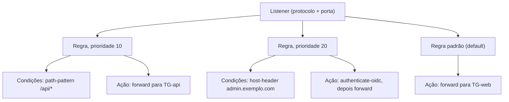

---
aliases:
  - Aula 12.3
modulo: 12
aula: 3
parte: "III Computação e armazenamento"
dominios:
  - 2
  - 3
  - 4
lida: false
tags:
  - aula
  - saa-c03
  - modulo-12
---

# Aula 12.3: Application Load Balancer a fundo

[[12 - Balanceamento de Carga e Auto Scaling|Voltar ao módulo]]

> [!question] Pergunta que esta aula responde
> Como o [[Application Load Balancer|ALB]] decide, requisição por requisição, para onde mandar o tráfego, como ele termina [[TLS]] e autentica usuários, e por que ele devolve erros 502, 503 e 504?

## O ALB lê a requisição

Como o [[Application Load Balancer]] opera na [[Modelo OSI|camada 7]], ele **termina a conexão do cliente**, lê a [[HTTP|requisição HTTP]] inteira, escolhe um alvo e abre uma **segunda conexão** até ele. Existem, portanto, duas conexões independentes: cliente para ALB e ALB para alvo. Quase toda particularidade do ALB nasce daí:

- O alvo **não vê o IP do cliente** na conexão [[TCP]] (vê o IP do nó do balanceador). Para saber quem chamou, a aplicação lê o cabeçalho `X-Forwarded-For`.
- O [[Application Load Balancer|ALB]] pode **trocar o protocolo** entre as duas pontas (HTTPS fora, [[HTTP]] dentro) e por isso é o lugar natural para terminar [[TLS]].
- O [[Application Load Balancer|ALB]] pode **gerar respostas por conta própria** (redirect, resposta fixa) sem nem chamar um alvo.

> [!info] Ligando os pontos
> No [[03 - Fundamentos de Redes para a Nuvem|Módulo 3]] vimos que [[HTTP]] carrega método, caminho, host e cabeçalhos. O [[Application Load Balancer|ALB]] é a primeira peça do curso que **usa** esses campos para decidir. Na [[12.02 - A Familia Elastic Load Balancing|aula anterior]] a pergunta era "qual balanceador?"; aqui é "como configurar o ALB para o caso".

## Listeners, regras, condições e ações

A configuração do [[Application Load Balancer|ALB]] é uma hierarquia curta:



- **[[Listener]]**: escuta um protocolo e uma porta (por exemplo HTTPS:443). Um [[Application Load Balancer|ALB]] pode ter vários listeners.
- **Regra**: tem uma **prioridade**, uma ou mais **condições** e uma ou mais **ações**. As regras são avaliadas em ordem de prioridade, da menor para a maior; **a primeira que casa vence**.
- **Regra padrão (default)**: existe sempre, não tem condições e só roda se nenhuma outra casou. Ela não pode ser apagada.

### Condições disponíveis

| Condição | Casa com | Exemplo |
|---|---|---|
| `host-header` | Nome do host da requisição | `api.exemplo.com`, `*.exemplo.com` |
| `path-pattern` | Caminho da URL | `/images/*`, `/api/v2/*` |
| `http-header` | Valor de um cabeçalho específico | `User-Agent` com `*Mobile*` |
| `http-request-method` | Método [[HTTP]] | `POST`, `GET` |
| `query-string` | Pares chave/valor da query | `?versao=beta` |
| `source-ip` | IP de origem ([[CIDR]]) | `10.0.0.0/8` |

Verificado em novembro de 2026, na documentação de regras de [[Listener|listener]] do [[Application Load Balancer|ALB]]. Condições diferentes na mesma regra se combinam com **E** (todas precisam casar); valores múltiplos dentro de uma condição se combinam com **OU**.

### Ações disponíveis

| Ação | O que faz | Quando usar |
|---|---|---|
| `forward` | Envia para um ou mais [[Target Group\|target groups]] (com pesos) | Roteamento normal |
| `redirect` | Devolve 301 ou 302 para outra URL, porta ou protocolo | [[HTTP]] para HTTPS, mudança de domínio |
| `fixed-response` | Devolve código, tipo de conteúdo e corpo escolhidos | Página de manutenção, bloquear caminho com 403 |
| `authenticate-oidc` | Autentica o usuário em um provedor [[OIDC]] antes de continuar | SSO corporativo (Okta, Azure [[Active Directory\|AD]], Google) |
| `authenticate-cognito` | Autentica via [[Cognito]] [[User Pool]] | Login de clientes com User Pool |

Ações de autenticação vêm **antes** do `forward` na mesma regra: o [[Application Load Balancer|ALB]] só encaminha para o alvo depois de o usuário se autenticar, e passa as informações do usuário ao alvo em cabeçalhos. O ALB aceita tanto [[OIDC]] quanto [[Cognito]], o que permite federar com [[Identity Provider|provedores de identidade]] sociais ou corporativos sem escrever código de login na aplicação.

> [!example] Redirect de HTTP para HTTPS
> [[Listener]] [[HTTP]]:80 com uma regra padrão cuja ação é `redirect` para `HTTPS`, porta `443`, código `HTTP_301`. Todo acesso inseguro é empurrado para o listener seguro, sem tocar na aplicação.

### Encaminhamento ponderado

Uma ação `forward` pode apontar para **mais de um [[Target Group|target group]] com pesos**. Com pesos 90 e 10, o [[Application Load Balancer|ALB]] manda cerca de 10% do tráfego ao segundo grupo. É a base de **implantação azul/verde** e de **canário**: sobe a versão nova em um target group separado, dá 5% de peso, observa métricas e aumenta aos poucos. Pode-se combinar com [[Sticky Sessions|stickiness]] de grupo para que um usuário não alterne entre versões.

## Cabeçalhos que o ALB adiciona

Como o alvo só vê o [[Application Load Balancer|ALB]], o balanceador anexa cabeçalhos com a informação original:

| Cabeçalho | Conteúdo |
|---|---|
| `X-Forwarded-For` | IP do cliente (e proxies anteriores, em lista) |
| `X-Forwarded-Proto` | Protocolo usado pelo cliente (`http` ou `https`) |
| `X-Forwarded-Port` | Porta de destino a que o cliente se conectou |
| `X-Amzn-Trace-Id` | Identificador de rastreio da requisição |

`X-Forwarded-Proto` resolve um problema clássico: a aplicação recebe [[HTTP]] do [[Application Load Balancer|ALB]] e não sabe se o cliente usou HTTPS. Com esse cabeçalho, ela decide corretamente se precisa redirecionar ou gerar links seguros.

> [!tip] Macete de prova
> "Registrar o IP real do cliente em logs da aplicação atrás de um [[Application Load Balancer|ALB]]" é resposta de **`X-Forwarded-For`**. Se o enunciado exige que o **alvo veja o IP do cliente na própria conexão**, o ALB não resolve; o [[Network Load Balancer|NLB]] preserva o IP de origem (aula 12.4).

## TLS no ALB

### Terminação e certificados

Num [[Listener|listener]] HTTPS você associa pelo menos um **certificado** (do [[ACM]], do [[IAM]] ou importado) e uma **política de segurança** (security policy), que define versões de [[TLS]] e cifras aceitas. O [[Application Load Balancer|ALB]] descriptografa no balanceador e, se quiser, **recriptografa** até o alvo (alvo em HTTPS). Terminar TLS no ALB tira dos servidores o custo de criptografia e centraliza a renovação de certificados: certificados do ACM se renovam sozinhos.

### SNI: vários domínios, um listener

Com **[[SNI]] (Server Name Indication)**, o cliente informa o nome do site no início do handshake [[TLS]], e o [[Application Load Balancer|ALB]] escolhe o certificado correspondente. Assim um único [[Listener|listener]] HTTPS atende `loja.exemplo.com` e `blog.outro.com`, cada um com seu certificado, num só ALB. Se nenhum certificado combina, o ALB usa o **certificado padrão** do listener. ALB e [[Network Load Balancer|NLB]] suportam SNI; o Classic não.

### Autenticação mútua (mTLS)

O [[Application Load Balancer|ALB]] também pode exigir **certificado de cliente** ([[mTLS|mutual TLS]]). Em modo *verify*, valida a cadeia do cliente contra um trust store; em *passthrough*, repassa o certificado ao alvo para a aplicação validar. Em prova, "autenticar dispositivos ou clientes com certificado no balanceador" aponta para mTLS no ALB.

## Alvos, protocolos e recursos do ALB

- **Tipos de alvo:** `instance` (ID da instância), `ip` (endereço [[RFC 1918|IP privado]], inclusive de fora da [[VPC]] por [[Direct Connect]] ou VPN) e `lambda`.
- **Protocolos:** [[HTTP]]/1.1, HTTP/2 (do cliente ao [[Application Load Balancer|ALB]]), WebSocket e gRPC (este último com HTTPS e [[Target Group|target group]] com versão de protocolo gRPC).
- **[[Lambda]] como alvo:** o [[Application Load Balancer|ALB]] converte a [[HTTP|requisição HTTP]] em um evento JSON, invoca a função e converte a resposta de volta em HTTP. É uma forma simples de expor uma função sem [[API Gateway]], embora sem os recursos de API (chaves de uso, planos de limite).
- **Integração com [[WAF]]:** associa-se um [[Web ACL|web ACL]] ao [[Application Load Balancer|ALB]] para bloquear [[SQL Injection|injeção de SQL]], [[Cross-Site Scripting|XSS]], IPs ruins e aplicar [[Rate-Based Rule|limite de taxa]].
- **Logs de acesso:** gravados em um [[Bucket|bucket]] [[S3]], uma linha por requisição, com tempos e códigos. São desligados por padrão.
- **[[Timeout]] de conexão ociosa:** 60 segundos por padrão; se a aplicação demora mais para responder, ajuste o valor ou o [[Application Load Balancer|ALB]] encerra a conexão.

## Erros que o ALB devolve

O [[Application Load Balancer|ALB]] tem uma família própria de erros, e entendê-los é troubleshooting de prova.

| Código | Significado | Causas típicas |
|---|---|---|
| **502 Bad Gateway** | O alvo respondeu algo inválido ou fechou a conexão | Aplicação caiu no meio, resposta malformada, keep-alive do alvo menor que o do [[Application Load Balancer\|ALB]] |
| **503 Service Unavailable** | Os [[Target Group\|target groups]] não têm alvos registrados (ou todos estão em `unused`) | [[Auto Scaling Group\|ASG]] não associado ao target group; com [[Cross-Zone Load Balancing\|cross-zone]] desligado, uma [[Zona de Disponibilidade\|AZ]] sem alvos. **Alvos todos `unhealthy` não geram 503**: o [[Application Load Balancer\|ALB]] faz fail-open (aula 12.5) |
| **504 Gateway [[Timeout]]** | O alvo não respondeu a tempo | Aplicação lenta, [[Security Group|security group]] ou [[Network ACL\|NACL]] bloqueando, timeout ocioso baixo |
| **460** | O cliente fechou a conexão antes de o [[Application Load Balancer\|ALB]] responder | Cliente impaciente |
| **463** | `X-Forwarded-For` com mais de 30 IPs | Cadeia longa de proxies |
| Outros 4xx do [[Application Load Balancer\|ALB]] | 400 requisição malformada, 401 falha de autenticação ([[OIDC]], [[Cognito]] ou [[JWT]]), 403 bloqueio do [[WAF]], 408 cliente não enviou dados antes do [[Timeout\|timeout]], 413 e 414 requisição ou URL grande demais, 505 versão [[HTTP]] não suportada | Cada um tem causa própria na doc de troubleshooting |

Códigos 460 e 463 são específicos do [[Application Load Balancer|ALB]] (verificado em novembro de 2026). O ALB também consegue **verificar [[JWT]]** no próprio [[Listener|listener]] (falhas viram 401, ou 561 e 562 quando o token ou a busca das chaves falha), recurso recente que a prova raramente cobra. Os demais 5xx também podem vir **do alvo**, e o ALB os repassa; as [[Metrica|métricas do CloudWatch]] distinguem `HTTPCode_ELB_5XX_Count` (gerados pelo ALB) de `HTTPCode_Target_5XX_Count` (gerados pela aplicação).

> [!warning] O 504 mais comum
> Quando o [[Application Load Balancer|ALB]] mostra 504 e a aplicação parece saudável, olhe os **[[Security Group|security groups]]**: o security group dos alvos precisa permitir entrada, na porta do alvo, vinda do **security group do ALB**. Sem essa regra, o [[Health Check|health check]] falha ou a conexão expira.

## Segurança de rede em volta do ALB

O desenho recomendado usa **referência entre [[Security Group|security groups]]**:

1. [[Security Group|Security group]] do [[Application Load Balancer|ALB]]: entrada em 80/443 de `0.0.0.0/0` (se público).
2. [[Security Group|Security group]] dos alvos: entrada na porta da aplicação **somente do security group do [[Application Load Balancer|ALB]]**.

Assim, ninguém acessa as instâncias diretamente, mesmo sabendo o [[RFC 1918|IP privado]], e o desenho continua funcionando quando o [[Auto Scaling Group|Auto Scaling]] troca instâncias. Isso responde à pergunta clássica "como garantir que o tráfego só chegue aos servidores pelo balanceador".

## Laboratório (opcional): ALB com roteamento por caminho

> [!warning] Conta pessoal e custo
> Execute somente em uma conta pessoal de estudo, com um [[Budgets|AWS Budgets]] configurado antes. Um [[Application Load Balancer|ALB]] custa cerca de US$ 0,0225 por hora mais LCUs (verificado em novembro de 2026, us-east-1), então um laboratório de uma hora custa centavos, mas só se você **apagar tudo no fim**. Este curso não executa nada na sua conta; os comandos abaixo são para você rodar com os seus próprios IDs.

Cenário: dois [[Target Group|target groups]] (`tg-web`, `tg-api`) com instâncias já existentes, e um [[Application Load Balancer|ALB]] que manda `/api/*` para a API e o resto para a web.

```bash
# 1. Target groups (tipo instance, porta 80, health check em /)
aws elbv2 create-target-group --name tg-web --protocol HTTP --port 80 \
  --vpc-id vpc-0123456789abcdef0 --target-type instance
aws elbv2 create-target-group --name tg-api --protocol HTTP --port 80 \
  --vpc-id vpc-0123456789abcdef0 --target-type instance

# 2. Registrar instâncias (use seus IDs)
aws elbv2 register-targets --target-group-arn <ARN-tg-web> --targets Id=i-aaaa
aws elbv2 register-targets --target-group-arn <ARN-tg-api> --targets Id=i-bbbb

# 3. ALB em duas sub-redes públicas de AZs diferentes
aws elbv2 create-load-balancer --name lab-alb --type application \
  --subnets subnet-aaaa subnet-bbbb --security-groups sg-0123456789abcdef0

# 4. Listener com ação padrão para tg-web
aws elbv2 create-listener --load-balancer-arn <ARN-alb> --protocol HTTP --port 80 \
  --default-actions Type=forward,TargetGroupArn=<ARN-tg-web>

# 5. Regra: /api/* vai para tg-api
aws elbv2 create-rule --listener-arn <ARN-listener> --priority 10 \
  --conditions Field=path-pattern,Values='/api/*' \
  --actions Type=forward,TargetGroupArn=<ARN-tg-api>
```

Teste com `curl http://<DNS-do-ALB>/` (deve cair na web) e `curl http://<DNS-do-ALB>/api/x` (deve cair na API). Observe o estado dos alvos com `aws elbv2 describe-target-health`.

**Limpeza (obrigatória):**

```bash
aws elbv2 delete-load-balancer --load-balancer-arn <ARN-alb>
aws elbv2 delete-target-group --target-group-arn <ARN-tg-web>
aws elbv2 delete-target-group --target-group-arn <ARN-tg-api>
```

Apague o [[Application Load Balancer|ALB]] primeiro (os [[Listener|listeners]] e regras vão junto), depois os [[Target Group|target groups]] e, por fim, as instâncias de apoio (`aws ec2 terminate-instances`); um target group ainda referenciado por um listener não pode ser removido. Confirme no console que não restou balanceador.

## Como isso cai na prova

Esta aula sustenta a **Task 2.1** (design de arquiteturas escaláveis e fracamente acopladas), a **Task 3.2** (computação de alto desempenho e elástica) e a **Task 4.2** ([[Application Load Balancer|ALB]] Layer 7 citado literalmente no exam guide), além de tocar a **Task 1.2** (proteger aplicações e redes: [[WAF]], [[TLS]] e autenticação).

Palavras-chave:

- "**route requests based on URL path / hostname / header / query string**": [[Application Load Balancer|ALB]], regras com condições.
- "**redirect [[HTTP]] to HTTPS**": ação `redirect` no [[Listener|listener]] 80.
- "**authenticate users with corporate SSO / social login without changing the application**": [[Application Load Balancer|ALB]] com `authenticate-oidc` ou `authenticate-cognito`.
- "**multiple domains and certificates on the same [[Elastic Load Balancing|load balancer]]**": [[SNI]].
- "**[[Blue-Green Deployment|blue/green]] or canary with a percentage of traffic**": forward com [[Target Group|target groups]] ponderados.
- "**client IP in the application logs behind the [[Elastic Load Balancing|load balancer]]**": `X-Forwarded-For`.
- "**[[HTTP]] 503 from [[Application Load Balancer|ALB]]**": [[Target Group|target group]] sem alvos registrados (o [[Auto Scaling Group|ASG]] não está associado, por exemplo). "**504**": alvo não respondeu a tempo.

Pegadinhas:

- **Regras avaliadas em ordem de prioridade.** A primeira que casa vence; uma regra genérica com prioridade baixa pode "engolir" uma específica.
- **IP do cliente na conexão do alvo.** No [[Application Load Balancer|ALB]] não se vê; use o cabeçalho ou troque para [[Network Load Balancer|NLB]].
- **[[Application Load Balancer|ALB]] para Lambda sem [[API Gateway]].** É válido; escolha o API Gateway quando o enunciado cita chaves de API, [[Usage Plan|planos de uso]] ou transformação de requisição.
- **[[Security Group|Security group]] dos alvos aberto ao mundo.** O correto é referenciar o security group do [[Application Load Balancer|ALB]].
- **[[WAF]] "no alvo".** O WAF se associa ao [[Application Load Balancer|ALB]], não à instância.

| Requisito no enunciado | Resposta provável | Por quê |
|---|---|---|
| Rotear por caminho ou por nome de host para serviços distintos | Regras de [[Listener\|listener]] com `path-pattern` ou `host-header` | O [[Application Load Balancer\|ALB]] decide em [[Modelo OSI\|L7]] |
| Forçar HTTPS para quem acessa por [[HTTP]] | Ação `redirect` no [[Listener\|listener]] 80 | Resposta gerada pelo próprio [[Application Load Balancer\|ALB]] |
| Login corporativo sem alterar o código | `authenticate-oidc` na regra | Autenticação antes do forward |
| Dois domínios com certificados diferentes em um [[Application Load Balancer\|ALB]] | [[SNI]] com múltiplos certificados | O ALB escolhe pelo nome do site |
| Enviar 5% do tráfego para a versão nova | Forward ponderado entre dois [[Target Group\|target groups]] | Canário sem mudar [[DNS]] |
| 503 constante, instâncias aparentemente de pé | Verificar se o [[Auto Scaling Group\|ASG]] está associado ao [[Target Group\|target group]] e se há alvos registrados | 503 significa nenhum alvo registrado; alvos `unhealthy` ativam fail-open |

## Resumo

> [!abstract] A aula em uma frase
> O [[Application Load Balancer|ALB]] termina a conexão do cliente, avalia regras de [[Listener|listener]] por prioridade (condições em caminho, host, cabeçalho, método, query ou IP), executa uma ação (forward, redirect, resposta fixa ou autenticação) e abre outra conexão até um alvo saudável, devolvendo seus próprios 502, 503 e 504 quando algo falha.

**A lógica, em 5 passos**

1. O cliente abre conexão com o [[Application Load Balancer|ALB]], que termina [[TLS]] usando o certificado escolhido por [[SNI]].
2. O [[Application Load Balancer|ALB]] avalia as regras do [[Listener|listener]], da menor prioridade para a maior; a primeira que casa vence.
3. A ação roda: autenticar, redirecionar, responder ou encaminhar (com pesos, se houver).
4. No forward, o [[Application Load Balancer|ALB]] escolhe um alvo saudável e abre nova conexão, anexando `X-Forwarded-*`.
5. Falhas viram 502 (resposta inválida), 503 (sem alvos registrados) ou 504 (tempo esgotado).

**Números para lembrar**

| O quê | Valor | Por que importa |
|---|---|---|
| [[Timeout]] ocioso padrão | 60 segundos | Respostas mais longas precisam de ajuste |
| `X-Forwarded-For` acima de 30 IPs | Erro 463 | Cadeia de proxies longa demais |
| Preço-base do [[Application Load Balancer\|ALB]] | US$ 0,0225/h (us-east-1) | Apagar o laboratório ao terminar |

**Tabela-síntese**

| Quero... | Configuro... |
|---|---|
| Separar serviços por URL | Regras com `path-pattern` ou `host-header` |
| Forçar HTTPS | `redirect` no [[Listener\|listener]] 80 |
| Autenticar sem código | `authenticate-oidc` ou `authenticate-cognito` |
| Canário ou azul/verde | `forward` com pesos |
| Ver o IP do cliente | Ler `X-Forwarded-For` |

**Na hora H**

- Leia a requisição do enunciado como se fosse [[HTTP]]: se há caminho, host ou cabeçalho, é regra de [[Application Load Balancer|ALB]].
- 503 aponta para [[Target Group|target group]] sem alvos registrados (alvos `unhealthy` não geram 503, por causa do fail-open); 504 aponta para lentidão ou bloqueio de rede.
- Segurança de rede: [[Security Group|security group]] dos alvos referenciando o do [[Application Load Balancer|ALB]].

> [!tip] Liga com
> Vem da [[12.02 - A Familia Elastic Load Balancing|aula 12.2]] (escolha do tipo). Os [[Health Check|health checks]] e o comportamento dos [[Target Group|target groups]], que decidem se um alvo recebe tráfego, estão na [[12.05 - Target Groups Health Checks e Cross-Zone|aula 12.5]].

## Erros comuns

- **Priorizar mal as regras.** Uma regra ampla (`/*`) antes de uma específica (`/api/*`) captura tudo.
- **Esquecer a regra de entrada no [[Security Group|security group]] dos alvos.** Resulta em alvos `unhealthy` e 504.
- **Pensar que o alvo vê o IP do cliente.** Ele vê o nó do [[Application Load Balancer|ALB]]; o IP real vem em `X-Forwarded-For`.
- **Terminar [[TLS]] no [[Application Load Balancer|ALB]] e esquecer `X-Forwarded-Proto`.** A aplicação entra em laço de redirecionamento porque acha que o acesso é [[HTTP]].
- **Esperar que o 504 seja culpa do [[Application Load Balancer|ALB]].** Em geral é o alvo lento ou a rede bloqueando.
- **Deixar o [[Application Load Balancer|ALB]] de laboratório ligado.** Cobra por hora mesmo sem tráfego.

## Pratique

**1.** Uma empresa hospeda duas aplicações atrás de um único [[Application Load Balancer|ALB]]: `loja.exemplo.com` e `admin.exemplo.com`, cada uma em um [[Target Group|target group]]. Como configurar o roteamento?

- [ ] a) Criar dois ALBs separados, porque um ALB só consegue atender um único nome de host por vez, mesmo com dois target groups.
- [ ] b) Criar duas regras de listener com condição `host-header`, cada uma encaminhando ao seu target group.
- [ ] c) Usar um Network Load Balancer com um listener por nome de host.
- [ ] d) Criar duas regras com `source-ip` apontando para cada target group.

**2.** Os usuários acessam o site por [[HTTP]] e a empresa quer que sejam levados automaticamente para HTTPS, sem alterar a aplicação. O que fazer?

- [ ] a) No listener HTTP:80, usar uma ação `redirect` para HTTPS:443 com código 301, sem alterar a aplicação.
- [ ] b) Desativar o listener HTTP e orientar os usuários a digitar `https://`.
- [ ] c) Alterar o código da aplicação em todas as instâncias para devolver o redirecionamento.
- [ ] d) Criar uma regra `fixed-response` com 200 e um texto pedindo o uso de HTTPS.

**3.** A aplicação precisa registrar o endereço IP real de cada cliente nos logs, e os servidores ficam atrás de um [[Application Load Balancer|ALB]]. Onde a aplicação obtém essa informação?

- [ ] a) No IP de origem da conexão TCP recebida pela instância.
- [ ] b) No cabeçalho `X-Forwarded-Proto`.
- [ ] c) No cabeçalho `X-Forwarded-For`.
- [ ] d) No cabeçalho `X-Forwarded-Port`.

**4.** Uma equipe quer lançar a versão 2 de uma aplicação para apenas 10% dos usuários, observar as métricas e depois aumentar gradualmente. As versões rodam em [[Target Group|target groups]] separados. Qual recurso do [[Application Load Balancer|ALB]] atende?

- [ ] a) Sticky sessions por duração em um único target group, fixando parte dos usuários a cada alvo.
- [ ] b) Ação `forward` com dois target groups e pesos 90 e 10.
- [ ] c) Cross-zone load balancing desativado.
- [ ] d) Uma regra por `source-ip` para os 10% de usuários.

**5.** Os usuários de uma aplicação interna devem entrar com o [[Identity Provider|provedor de identidade]] corporativo ([[OIDC]]) sem que a aplicação implemente login. Qual é a solução?

- [ ] a) Colocar o AWS WAF com regras de autenticação na frente do ALB.
- [ ] b) Usar o Network Load Balancer com listener TLS e certificado do cliente.
- [ ] c) Habilitar a ação `authenticate-oidc` na regra do listener antes do `forward`.
- [ ] d) Criar um endpoint de VPC para o provedor de identidade e liberar a porta 443 nos alvos.

**6.** Um [[Application Load Balancer|ALB]] devolve erros 503 para todas as requisições. O [[Auto Scaling Group]] está com instâncias em execução. Qual é a causa mais provável?

- [ ] a) O certificado TLS do listener expirou.
- [ ] b) O timeout ocioso do ALB está em 60 segundos.
- [ ] c) O WAF está bloqueando os clientes com uma regra gerenciada de reputação de IP.
- [ ] d) O target group não tem nenhum alvo registrado (o Auto Scaling Group não está associado a ele).

**7.** O [[Application Load Balancer|ALB]] devolve 504 em algumas requisições, mas as instâncias aparecem saudáveis no console. A aplicação demora mais de 60 segundos em um relatório. O que ajustar primeiro?

- [ ] a) Aumentar o timeout de conexão ociosa do ALB e otimizar o relatório.
- [ ] b) Trocar para um Classic Load Balancer, que tem timeout ocioso maior que o do ALB.
- [ ] c) Habilitar os logs de acesso do ALB.
- [ ] d) Associar um Elastic IP ao ALB.

**8.** Uma empresa precisa que um único [[Listener|listener]] HTTPS do [[Application Load Balancer|ALB]] atenda três domínios diferentes, cada um com seu próprio certificado. Qual recurso permite isso?

- [ ] a) SNI, com os três certificados associados ao listener, e o ALB escolhe pelo nome do site.
- [ ] b) Três listeners na mesma porta 443.
- [ ] c) Um certificado curinga obrigatório para todos os domínios.
- [ ] d) Network Load Balancer com TCP listener.

**9.** (Escolha DUAS.) Quais condições de regra de [[Listener|listener]] o [[Application Load Balancer]] suporta?

- [ ] a) `path-pattern`
- [ ] b) `cpu-utilization`
- [ ] c) `http-request-method`
- [ ] d) `availability-zone`
- [ ] e) `instance-id`

**10.** Os servidores web em [[Sub-rede Privada|sub-redes privadas]] só devem receber tráfego pela porta 8080 vindo do [[Application Load Balancer|ALB]], mesmo quando o [[Auto Scaling Group|Auto Scaling]] troca as instâncias. Qual configuração é a mais adequada?

- [ ] a) Regra de entrada 8080 de 0.0.0.0/0 no security group dos servidores, deixando o ALB com acesso livre.
- [ ] b) Regra de entrada 8080 no security group dos servidores, tendo como origem o security group do ALB, que acompanha a troca de instâncias.
- [ ] c) Regra de entrada 8080 com os IPs atuais dos nós do ALB.
- [ ] d) Network ACL liberando toda a faixa pública na porta 8080.

**11.** (Escolha DUAS.) Uma [[Lambda|função Lambda]] atende requisições [[HTTP]] por um [[Application Load Balancer|ALB]]. Quais afirmações estão corretas?

- [ ] a) O ALB converte a requisição HTTP em um evento JSON e invoca a função.
- [ ] b) O target group do tipo lambda também pode ser usado por um Network Load Balancer.
- [ ] c) A resposta da função é convertida de volta em resposta HTTP pelo ALB.
- [ ] d) A função precisa estar dentro de uma VPC para ser alvo do ALB.
- [ ] e) O ALB exige que cada função tenha um Elastic IP.

**12.** Uma empresa quer bloquear [[SQL Injection|injeção de SQL]] e limitar requisições por IP em uma aplicação que roda atrás de um [[Application Load Balancer|ALB]], sem alterar o código. Qual é a abordagem?

- [ ] a) Associar um web ACL do AWS WAF ao ALB.
- [ ] b) Instalar um agente de firewall em cada instância.
- [ ] c) Configurar uma regra de NACL bloqueando as palavras SQL.
- [ ] d) Habilitar os logs de acesso do ALB e analisar depois.

> [!success]- Gabarito
> **1. b)** Regras com `host-header` roteiam por nome de host em um só [[Application Load Balancer|ALB]]; a) um ALB atende vários hosts, c) o [[Network Load Balancer|NLB]] não lê hosts [[HTTP]], d) `source-ip` olha a origem do cliente, não o domínio pedido.
> **2. a)** A ação `redirect` do próprio [[Application Load Balancer|ALB]] resolve sem tocar na aplicação; b) deixa o acesso [[HTTP]] quebrado, c) exige alterar o código, d) uma resposta fixa não leva o usuário ao HTTPS.
> **3. c)** `X-Forwarded-For` carrega o IP do cliente; a) a conexão [[TCP]] mostra o nó do [[Application Load Balancer|ALB]], b) indica protocolo, d) indica porta.
> **4. b)** Forward ponderado entre [[Target Group|target groups]] é o recurso de canário; a) [[Sticky Sessions|stickiness]] só fixa o usuário a um alvo, c) [[Cross-Zone Load Balancing|cross-zone]] distribui entre [[Zona de Disponibilidade|AZs]], d) `source-ip` não divide por percentual.
> **5. c)** `authenticate-oidc` autentica antes de encaminhar; a) o [[WAF]] filtra requisições, não autentica usuários, b) o [[Network Load Balancer|NLB]] não autentica, d) [[VPC Endpoint|endpoint de VPC]] não é autenticação.
> **6. d)** 503 vem de [[Target Group|target group]] sem alvos registrados, e alvos `unhealthy` sozinhos não geram 503 porque o [[Application Load Balancer|ALB]] falha aberto (fail-open); a) certificado expirado gera erro de handshake, b) 60 s é o padrão e não gera 503, c) o [[WAF]] devolve 403 ao bloquear.
> **7. a)** O 504 vem do tempo esgotado e o [[Timeout|timeout]] ocioso padrão é 60 s; b) o Classic não resolve lentidão, c) logs ajudam a diagnosticar mas não corrigem, d) [[Elastic IP]] não se aplica ao [[Application Load Balancer|ALB]].
> **8. a)** [[SNI]] deixa o [[Application Load Balancer|ALB]] escolher o certificado pelo nome do site no handshake; b) um [[Listener|listener]] por porta e protocolo, c) o certificado curinga não é obrigatório, d) o [[Network Load Balancer|NLB]] não é necessário e o [[TCP]] listener não escolhe certificado.
> **9. a) e c)** O [[Application Load Balancer|ALB]] suporta `path-pattern` e `http-request-method`; b), d) e e) não são condições de [[Listener|listener]].
> **10. b)** Referenciar o [[Security Group|security group]] do [[Application Load Balancer|ALB]] acompanha a troca de instâncias e restringe a origem; a) abre ao mundo, c) os IPs dos nós mudam, d) uma faixa pública é ampla demais.
> **11. a) e c)** O [[Application Load Balancer|ALB]] faz a conversão nos dois sentidos; b) [[Target Group|target group]] lambda é recurso do ALB, d) a função não precisa estar em [[VPC]], e) [[Elastic IP]] não se aplica a funções.
> **12. a)** O [[WAF]] se associa ao [[Application Load Balancer|ALB]] e aplica [[Managed Rule Group|regras gerenciadas]] e [[Rate-Based Rule|limite de taxa]]; b) exige trabalho em cada instância, c) [[Network ACL|NACL]] não lê conteúdo [[HTTP]], d) log não bloqueia.

## Para aprofundar

- [ ] [Listener rules for your Application Load Balancer](https://docs.aws.amazon.com/elasticloadbalancing/latest/application/listener-update-rules.html) (documentação AWS): condições, ações, prioridades e encaminhamento ponderado.
- [ ] [Authenticate users using an Application Load Balancer](https://docs.aws.amazon.com/elasticloadbalancing/latest/application/listener-authenticate-users.html) (documentação AWS): configuração de [[OIDC]] e [[Cognito]] no [[Listener|listener]].
- [ ] [Troubleshoot your Application Load Balancers](https://docs.aws.amazon.com/elasticloadbalancing/latest/application/load-balancer-troubleshooting.html) (documentação AWS): causas de 502, 503 e 504.

Próxima aula: [[12.04 - Network Load Balancer e Gateway Load Balancer|Aula 12.4: Network Load Balancer e Gateway Load Balancer]].
