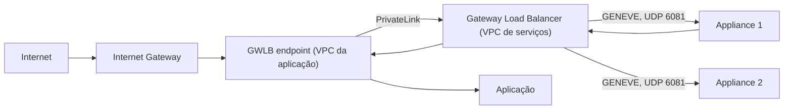

---
aliases:
  - Aula 12.4
modulo: 12
aula: 4
parte: "III Computação e armazenamento"
dominios:
  - 2
  - 3
  - 4
lida: false
tags:
  - aula
  - saa-c03
  - modulo-12
---

# Aula 12.4: Network Load Balancer e Gateway Load Balancer

[[12 - Balanceamento de Carga e Auto Scaling|Voltar ao módulo]]

> [!question] Pergunta que esta aula responde
> O que muda quando o balanceador deixa de ler [[HTTP]] e passa a trabalhar com conexões ([[Network Load Balancer|NLB]]) ou com pacotes ([[Gateway Load Balancer|GWLB]]), e que problemas reais isso resolve?

## Descer uma camada

O [[Application Load Balancer|ALB]] paga um preço por entender [[HTTP]]: precisa terminar a conexão, ler a requisição e abrir outra. Quando o requisito não é "entender conteúdo", e sim **velocidade, IP fixo, protocolo diferente de HTTP ou passagem transparente**, descer de camada compensa. É por isso que existem o **[[Network Load Balancer]]** ([[Modelo OSI|L4]]) e o **[[Gateway Load Balancer]]** (L3).

> [!info] Ligando os pontos
> Na [[12.02 - A Familia Elastic Load Balancing|aula 12.2]] a camada foi o critério de escolha. Aqui mostramos o que cada camada entrega por dentro. O [[06 - VPC a Fundo|Módulo 6]] (tabelas de rota, endpoints, [[PrivateLink]]) e o [[03 - Fundamentos de Redes para a Nuvem|Módulo 3]] ([[TCP]], [[UDP]]) são pré-requisitos diretos.

## Network Load Balancer

### Como escolhe o alvo

O [[Network Load Balancer|NLB]] não lê o conteúdo. Para [[TCP]], ele calcula um **[[Hash|hash]] do fluxo** com protocolo, IP e porta de origem, IP e porta de destino e número de sequência TCP, e escolhe um alvo. Todo o tráfego daquela conexão TCP vai ao **mesmo alvo** enquanto ela durar. Para [[UDP]], o fluxo é identificado por protocolo, IPs e portas, e os pacotes do mesmo fluxo seguem para o mesmo alvo (documentação do NLB, verificado em novembro de 2026).

### O que oferece

| Recurso | Detalhe |
|---|---|
| Protocolos dos [[Listener\|listeners]] | [[TCP]], [[UDP]], TCP_UDP, [[TLS]] e QUIC |
| Escala | Milhões de requisições por segundo com [[Latencia\|latência]] muito baixa |
| IP estático | Um endereço por [[Zona de Disponibilidade\|AZ]] habilitada; pode associar um **[[Elastic IP]]** por [[Sub-rede\|sub-rede]] |
| Tipos de alvo | `instance`, `ip` e `alb` |
| [[Terminacao de TLS\|Terminação TLS]] | Sim, com um [[Listener\|listener]] [[TLS]] (certificados do [[ACM]] e [[SNI]]); com um listener [[TCP]] o TLS passa intacto até o alvo (veja "TLS no [[Network Load Balancer\|NLB]]") |
| [[Security Group\|Security groups]] | Sim, se associados na criação (não dá para adicionar depois) |
| [[PrivateLink]] | Pode ser o balanceador por trás de um [[Endpoint Service\|endpoint service]] |

> [!tip] Macete de prova
> **IP fixo** ou **allowlist de IP em parceiro**, **[[UDP]]**, **protocolo próprio sobre [[TCP]]**, **[[Latencia|latência]] de microssegundos** e **[[PrivateLink]]**: tudo isso é [[Network Load Balancer|NLB]].

### TLS no NLB: terminar ou deixar passar

O [[Network Load Balancer|NLB]] oferece duas formas de lidar com HTTPS, e a diferença cai em prova:

- **[[Listener]] [[TLS]] (terminação no [[Network Load Balancer|NLB]]):** o NLB descriptografa o tráfego usando um certificado do [[ACM]] (com [[SNI]] e uma security policy) e fala com o alvo em [[TCP]] simples ou em TLS recriptografado. Tira dos servidores o custo da criptografia e centraliza a renovação do certificado.
- **[[Listener]] [[TCP]] (passthrough):** o [[Network Load Balancer|NLB]] **não olha dentro** do tráfego, apenas repassa os bytes. O handshake [[TLS]] acontece **entre o cliente e o alvo**; o certificado fica no alvo, que também vê o certificado do cliente em caso de [[mTLS]]. É o desenho de **criptografia ponta a ponta em que o balanceador nunca descriptografa os dados**.

O [[Application Load Balancer|ALB]] termina [[TLS]] por definição, mas pode **recriptografar** até o alvo; serve quando basta que o tráfego esteja cifrado em cada trecho, e não quando o enunciado proíbe qualquer descriptografia no balanceador.

### Preservação do IP do cliente

Com **[[Client IP Preservation|client IP preservation]]** ligada, o alvo enxerga o **IP de origem real** do cliente na própria conexão, sem precisar de cabeçalho. Na documentação atual, essa opção vem **ligada por padrão para alvos do tipo instance** e **desligada por padrão para alvos do tipo ip** com [[TCP]] e [[TLS]] (verificado em novembro de 2026). Quando está desligada, o alvo vê o [[RFC 1918|IP privado]] do [[Network Load Balancer|NLB]], e para recuperar o cliente se usa o **[[Proxy Protocol|proxy protocol v2]]**, um cabeçalho binário que o NLB acrescenta no início da conexão e que a aplicação precisa saber interpretar.

| Situação | O alvo vê |
|---|---|
| Alvo `instance`, preservação ligada (padrão) | IP real do cliente |
| Alvo `ip`, preservação desligada (padrão) | [[RFC 1918\|IP privado]] do [[Network Load Balancer\|NLB]] |
| Preservação desligada + [[Proxy Protocol\|proxy protocol v2]] | [[RFC 1918\|IP privado]] do [[Network Load Balancer\|NLB]] na conexão, IP real no cabeçalho do proxy protocol |
| [[Listener]] [[UDP]], TCP_UDP, QUIC ou TCP_QUIC (qualquer tipo de alvo) | IP real do cliente: a preservação vem **sempre ligada** e não pode ser desligada |

> [!warning] Quando a preservação não funciona
> Segundo a documentação (verificado em novembro de 2026), a preservação **não tem efeito para tráfego que chega por [[PrivateLink]]**: o [[Endpoint Service|endpoint service]] sempre entrega o [[RFC 1918|IP privado]] do [[Network Load Balancer|NLB]], e a saída é o **[[Proxy Protocol|proxy protocol v2]]** (que pode carregar o ID do [[VPC Endpoint|VPC endpoint]] de origem). Também não é suportada quando os alvos são alcançados por **[[Transit Gateway]]** nem em **hairpin** (um alvo atrás de um NLB interno que se conecta ao mesmo NLB).

Se a preservação está ligada, **o [[Security Group|security group]] do alvo precisa liberar o IP do cliente** (ou uma faixa ampla), pois o tráfego chega com a origem original. O truque que a documentação recomenda quando o [[Network Load Balancer|NLB]] tem security group: liberar nos alvos o **security group do NLB** como origem.

### NLB em frente do ALB

O [[Network Load Balancer|NLB]] aceita um [[Application Load Balancer|ALB]] como alvo (`alb` target type). Isso combina **IP estático do NLB** com **roteamento [[Modelo OSI|L7]] do ALB**: um parceiro que só libera IPs fixos fala com o NLB, e o ALB cuida de caminhos, [[WAF]] e autenticação. É uma das respostas mais cobradas quando o enunciado pede "IP estático e roteamento por caminho".

### Cross-zone e custo

[[Cross-Zone Load Balancing|Cross-zone]] no [[Network Load Balancer|NLB]] vem **desligado por padrão**. Desligado, cada nó só envia tráfego aos alvos da própria [[Zona de Disponibilidade|AZ]], e a distribuição fica desigual se as AZs têm quantidades diferentes de alvos. Ligado, equilibra melhor, mas o tráfego entre AZs é **cobrado** como [[Data Transfer|transferência de dados]] (no [[Application Load Balancer|ALB]] não há essa cobrança porque o cross-zone é intrínseco). Detalhes na [[12.05 - Target Groups Health Checks e Cross-Zone|aula 12.5]].

### Timeouts de ociosidade

O [[Network Load Balancer|NLB]] mantém o estado do fluxo e o descarta após um período sem tráfego (documentação do NLB, verificado em novembro de 2026):

- **[[TCP]]:** padrão de **350 segundos**, **configurável de 60 a 6000 segundos por [[Listener|listener]]** (atributo `tcp.idle_timeout.seconds`).
- **[[TLS]]:** **350 segundos, fixo**, não pode ser alterado.
- **[[UDP]]:** **120 segundos**.

Para conexões longas há duas saídas: o cliente ou a aplicação envia *keepalive* antes do limite, ou se aumenta o idle [[Timeout|timeout]] do [[Listener|listener]] [[TCP]]. Sem isso, a próxima tentativa recebe um **RST** (um pacote TCP *reset*, que encerra a conexão de imediato). Se o valor passar de 350 s, o tempo de rastreamento de conexão da [[ENI]] do alvo precisa ser igual ou maior. Esses valores não são o "60 segundos" do [[Application Load Balancer|ALB]]; é uma pegadinha confundir os dois.

## Gateway Load Balancer

### O problema que resolve

Empresas com requisitos de conformidade querem **inspecionar todo o tráfego** com um firewall, um IPS ou um sistema de inspeção profunda de pacotes de um fornecedor. Esses appliances precisam estar **no caminho** do tráfego, escalar quando o volume sobe e continuar funcionando se um deles falhar. Montar isso com rotas manuais e instâncias avulsas é frágil. O [[Gateway Load Balancer|GWLB]] combina duas funções em um serviço: um **gateway de rede transparente** (um único ponto de entrada e saída) e um **balanceador** que distribui o tráfego entre os appliances.

### Como funciona por dentro

1. Em uma **[[VPC]] de serviços** (a dos appliances), cria-se um [[Gateway Load Balancer|GWLB]] com um [[Target Group|target group]] de appliances (alvos `instance` ou `ip`).
2. O [[Gateway Load Balancer|GWLB]] é exposto como um **[[Endpoint Service|endpoint service]]** (via [[PrivateLink]]).
3. Em cada **[[VPC]] de aplicação**, cria-se um **[[Gateway Load Balancer|GWLB]] endpoint** (GWLBE), um [[VPC Endpoint|endpoint de VPC]] do tipo "Gateway [[Elastic Load Balancing|Load Balancer]]".
4. As **tabelas de rota** da [[VPC]] de aplicação mandam o tráfego (de entrada pelo [[Internet Gateway|gateway de internet]], ou de saída das [[Sub-rede|sub-redes]]) para o GWLBE.
5. O GWLBE leva o pacote ao [[Gateway Load Balancer|GWLB]], que o **encapsula em [[GENEVE]]** (porta [[UDP]] **6081**) e o entrega a um appliance saudável. GENEVE é um protocolo de encapsulamento: carrega o pacote original intacto mais metadados do fluxo entre o GWLB e o appliance.
6. O appliance inspeciona, decide e **devolve** o pacote pelo mesmo caminho; o [[Gateway Load Balancer|GWLB]] o encaminha ao destino original.

### Propriedades que valem prova

- Opera na **[[Modelo OSI|camada 3]]**: escuta **todos os pacotes IP em todas as portas**.
- **Transparente**: nem a aplicação nem o cliente percebem; a origem e o destino do pacote são preservados.
- Mantém a **afinidade de fluxo** (flow [[Sticky Sessions|stickiness]]) por tupla de 5 elementos, para que todo o fluxo passe pelo mesmo appliance, o que firewalls [[Stateful e Stateless (Firewall)|com estado]] exigem.
- Usa **[[Health Check|health checks]]** nos appliances e redireciona o tráfego se um falhar.
- A aplicação consumidora e os appliances ficam em **[[VPC|VPCs]] separadas**, com um modelo de "serviço" compartilhado; a conexão passa por [[PrivateLink]] e **não exige peering** nem rotas entre as VPCs.
- Em desenhos com [[Transit Gateway]] e várias [[Zona de Disponibilidade|AZs]], o **[[Appliance Mode|appliance mode]]** do attachment mantém o fluxo simétrico na mesma AZ do appliance (assunto aprofundado no [[07 - Conectividade Hibrida e entre VPCs|Módulo 7]]).

> [!example] Inspeção centralizada
> Uma empresa tem 30 [[VPC|VPCs]] e quer um único conjunto de firewalls de um fornecedor. Em vez de instalar firewall em cada VPC, mantém uma VPC de inspeção com [[Gateway Load Balancer|GWLB]] e appliances, e cada VPC ganha um GWLB endpoint. Escalar o firewall é só adicionar instâncias ao [[Target Group|target group]].

## NLB e GWLB lado a lado

| | [[Network Load Balancer\|NLB]] | [[Gateway Load Balancer\|GWLB]] |
|---|---|---|
| Camada | 4 | 3 |
| Papel | Balancear conexões e pacotes para sua aplicação | Inserir appliances de terceiros no caminho |
| Encapsulamento | Nenhum | [[GENEVE]] (porta 6081) |
| IP estático | Sim, por [[Zona de Disponibilidade\|AZ]] | Não se aplica |
| Cliente enxerga | O [[Network Load Balancer\|NLB]] (ou o IP real, se preservado) | Tráfego transparente, sem [[NAT]] |
| Exposição a outras [[VPC\|VPCs]] | [[Endpoint Service\|Endpoint service]] ([[PrivateLink]]) | Endpoint service ([[Gateway Load Balancer\|GWLB]] endpoint) |
| Preço-base (us-east-1) | US$ 0,0225/h | US$ 0,0125/h por [[Zona de Disponibilidade\|AZ]] |

## Como isso cai na prova

Esta aula serve à **Task 2.1** ([[Desacoplamento|acoplamento fraco]]), **Task 3.2** (rede de alto desempenho), **Task 1.2** (proteger aplicações e redes: inspeção de rede, [[TLS]] e IP estático) e **Task 4.2** ([[Network Load Balancer|NLB]] [[Modelo OSI|L4]] e [[Gateway Load Balancer|GWLB]], citados literalmente).

Palavras-chave:

- "**static IP**", "**[[Elastic IP]] on the [[Elastic Load Balancing|load balancer]]**", "**partner allowlists our IP**": [[Network Load Balancer|NLB]].
- "**[[UDP]]**", "**[[TCP]]**", "**millions of connections**", "**ultra-low [[Latencia|latency]]**": [[Network Load Balancer|NLB]].
- "**preserve the client source IP**": [[Network Load Balancer|NLB]] (com preservação), ou cabeçalho no [[Application Load Balancer|ALB]].
- "**end-to-end encryption, the [[Elastic Load Balancing|load balancer]] must not decrypt the data**": [[Network Load Balancer|NLB]] com [[Listener|listener]] [[TCP]] (passthrough).
- "**expose a service to other [[VPC|VPCs]]/accounts privately**": [[Network Load Balancer|NLB]] + [[Endpoint Service|endpoint service]].
- "**third-party firewall / IDS / IPS / DPI in the traffic path, scale transparently**": [[Gateway Load Balancer|GWLB]].
- "**[[GENEVE]]**", "**port 6081**": [[Gateway Load Balancer|GWLB]].

Pegadinhas:

- **[[Application Load Balancer|ALB]] com IP fixo.** Não existe; use [[Network Load Balancer|NLB]], NLB para ALB ou [[Global Accelerator]].
- **[[Gateway Load Balancer|GWLB]] como balanceador de aplicação.** Ele não distribui para servidores web; distribui para appliances.
- **Inspeção "em todas as [[VPC|VPCs]] com peering".** O padrão é [[Gateway Load Balancer|GWLB]] + endpoint, não rotas e instâncias manuais.
- **[[Network Load Balancer|NLB]] sem [[Security Group|security group]], tentando adicionar depois.** Não é possível.
- **[[Timeout]] do [[Network Load Balancer|NLB]].** [[TCP]] 350 s por padrão (ajustável de 60 a 6000 s por [[Listener|listener]]), [[TLS]] 350 s fixo, [[UDP]] 120 s; nunca os 60 s do [[Application Load Balancer|ALB]].
- **[[TLS]] terminado ou passthrough.** [[Listener]] TLS descriptografa no [[Network Load Balancer|NLB]]; listener [[TCP]] deixa o TLS intacto até o alvo.

| Requisito no enunciado | Resposta provável | Por quê |
|---|---|---|
| Parceiro só aceita conexões vindas de IPs cadastrados | [[Network Load Balancer\|NLB]] com [[Elastic IP\|Elastic IPs]] | IP estático por [[Zona de Disponibilidade\|AZ]] |
| Aplicação [[UDP]] de jogos, [[Latencia\|latência]] mínima | [[Network Load Balancer\|NLB]] | [[Modelo OSI\|L4]], UDP, muito baixa latência |
| IP estático mais roteamento por caminho [[HTTP]] | [[Network Load Balancer\|NLB]] com [[Application Load Balancer\|ALB]] como alvo (ou [[Global Accelerator]]) | Combina IP fixo e [[Modelo OSI\|L7]] |
| Alvo precisa registrar o IP real do cliente na conexão [[TCP]] | [[Network Load Balancer\|NLB]] com preservação de IP | O [[Application Load Balancer\|ALB]] só entrega via cabeçalho |
| Firewall de terceiro inspeciona o tráfego de várias [[VPC\|VPCs]] | [[Gateway Load Balancer\|GWLB]] com GWLB endpoints | Gateway transparente com [[GENEVE]] |
| Expor um serviço [[TCP]] a clientes de outras contas | [[Network Load Balancer\|NLB]] + [[Endpoint Service\|endpoint service]] | [[PrivateLink]] exige NLB ou [[Gateway Load Balancer\|GWLB]] |
| Criptografia ponta a ponta, sem descriptografar no balanceador | [[Network Load Balancer\|NLB]] com [[Listener\|listener]] [[TCP]] | O [[TLS]] passa intacto e o alvo guarda o certificado |

## Resumo

> [!abstract] A aula em uma frase
> O [[Network Load Balancer|NLB]] balanceia conexões e pacotes em [[Modelo OSI|L4]] com IP estático, [[UDP]] e [[Latencia|latência]] mínima, e o [[Gateway Load Balancer|GWLB]] insere appliances de terceiros de forma transparente em L3 usando [[GENEVE]] e [[VPC Endpoint|endpoints de VPC]], para inspecionar o tráfego sem que a aplicação perceba.

**A lógica, em 5 passos**

1. Sem ler o conteúdo, o [[Network Load Balancer|NLB]] escolhe o alvo por [[Hash|hash]] do fluxo e mantém a conexão no mesmo alvo.
2. Por isso consegue ter IP estático por [[Zona de Disponibilidade|AZ]], [[UDP]] e [[Latencia|latência]] muito baixa.
3. A [[Client IP Preservation|preservação do IP do cliente]] decide o que o alvo enxerga; sem ela, usa-se [[Proxy Protocol|proxy protocol v2]].
4. O [[Gateway Load Balancer|GWLB]] expõe appliances como [[Endpoint Service|endpoint service]]; as rotas das [[VPC|VPCs]] mandam o tráfego a um GWLB endpoint.
5. O [[Gateway Load Balancer|GWLB]] encapsula em [[GENEVE]] (6081), os appliances inspecionam e devolvem; a afinidade de fluxo mantém firewalls [[Stateful e Stateless (Firewall)|com estado]] funcionando.

**Números para lembrar**

| O quê | Valor | Por que importa |
|---|---|---|
| Porta [[GENEVE]] | [[UDP]] 6081 | Liberar nos [[Security Group\|security groups]] dos appliances |
| Ociosidade [[TCP]] no [[Network Load Balancer\|NLB]] | 350 s (60 a 6000 s por [[Listener\|listener]]) | Keepalive ou aumento do [[Timeout\|timeout]] |
| Ociosidade [[TLS]] no [[Network Load Balancer\|NLB]] | 350 s (fixo) | Só keepalive resolve |
| Ociosidade [[UDP]] no [[Network Load Balancer\|NLB]] | 120 s | Idem para UDP |
| [[Cross-Zone Load Balancing\|Cross-zone]] padrão no [[Network Load Balancer\|NLB]] | Desligado | Cobrança entre [[Zona de Disponibilidade\|AZs]] se ligar |

**Tabela-síntese**

| Preciso de... | Uso |
|---|---|
| IP fixo, [[UDP]], [[TCP]], [[PrivateLink]] | [[Network Load Balancer\|NLB]] |
| IP fixo e [[Modelo OSI\|L7]] | [[Network Load Balancer\|NLB]] para [[Application Load Balancer\|ALB]], ou [[Global Accelerator]] |
| Firewall de terceiros no caminho | [[Gateway Load Balancer\|GWLB]] |

**Na hora H**

- Procure "IP estático" e "[[UDP]]" antes de qualquer outra coisa: levam ao [[Network Load Balancer|NLB]].
- "Appliance de terceiros" leva ao [[Gateway Load Balancer|GWLB]]; "[[GENEVE]]" confirma.
- Para IP real do cliente em [[Modelo OSI|L4]], preservação ligada ou [[Proxy Protocol|proxy protocol v2]].

> [!tip] Liga com
> Vem da [[12.03 - Application Load Balancer a Fundo|aula 12.3]] ([[Modelo OSI|L7]]). Na [[12.05 - Target Groups Health Checks e Cross-Zone|aula 12.5]] entram os [[Target Group|target groups]], [[Health Check|health checks]] e [[Cross-Zone Load Balancing|cross-zone]], comuns a todos os tipos.

## Erros comuns

- **Achar que [[Network Load Balancer|NLB]] "não faz [[Health Check|health check]]".** Faz, por [[Target Group|target group]]; só não lê [[HTTP]] a menos que o health check seja HTTP.
- **Esperar que o alvo atrás de [[Network Load Balancer|NLB]] com IP-target veja o cliente.** Por padrão vê o NLB.
- **Esquecer o [[GENEVE]] nos [[Security Group|security groups]] dos appliances.** Sem [[UDP]] 6081, o tráfego não chega.
- **Configurar rotas sem [[Gateway Load Balancer|GWLB]] endpoint.** O pacote nunca entra no GWLB.
- **Trocar [[Network Load Balancer|NLB]] por [[Application Load Balancer|ALB]] e perder o IP fixo.** O ALB não tem IP estático.
- **Esquecer o [[Timeout|timeout]] de 350 s do [[TCP]].** Conexões ociosas caem sem aviso, a menos que haja keepalive ou o timeout do [[Listener|listener]] seja aumentado.

## Pratique

**1.** Uma empresa de pagamentos precisa receber conexões [[TCP]] de parceiros que só liberam IPs específicos no firewall. A empresa quer a menor sobrecarga operacional. Qual solução?

- [ ] a) Application Load Balancer, informando aos parceiros o IP atual que o DNS resolve.
- [ ] b) Gateway Load Balancer com um endpoint por parceiro.
- [ ] c) Application Load Balancer com Elastic IP em cada nó.
- [ ] d) Network Load Balancer com um Elastic IP em cada sub-rede habilitada.

**2.** Um provedor de jogos usa [[UDP]] e prevê milhões de pacotes por segundo com [[Latencia|latência]] mínima. Qual balanceador?

- [ ] a) Network Load Balancer com listener UDP.
- [ ] b) Application Load Balancer com HTTP/2.
- [ ] c) Classic Load Balancer com listener TCP.
- [ ] d) Gateway Load Balancer com target group de instâncias.

**3.** Uma empresa tem 20 [[VPC|VPCs]] e quer inspecionar todo o tráfego com firewalls de um fornecedor, disponíveis como [[AMI]]. Qual arquitetura reduz a administração?

- [ ] a) Instalar o firewall em cada VPC e gerenciar regras separadamente.
- [ ] b) Usar peering entre as 20 VPCs e rotear tudo por uma instância de firewall única, com a rota padrão de cada VPC apontando para ela.
- [ ] c) Criar um NLB na frente de cada VPC com TLS listener.
- [ ] d) Implantar os appliances atrás de um GWLB em uma VPC de inspeção e criar GWLB endpoints em cada VPC.

**4.** Um serviço [[TCP]] em uma [[VPC]] precisa ser consumido de forma privada por clientes de outras contas, sem peering e sem expor à internet. O que fica na frente do serviço?

- [ ] a) Network Load Balancer, usado como base de um endpoint service do PrivateLink.
- [ ] b) Application Load Balancer internet-facing.
- [ ] c) Internet Gateway com Elastic IP nas instâncias, liberando o acesso pela internet pública.
- [ ] d) VPC peering com todas as contas.

**5.** Uma aplicação atrás de um [[Network Load Balancer|NLB]], com alvos do tipo ip e preservação de IP desligada, precisa registrar o IP real dos clientes. Qual opção atende?

- [ ] a) Ler o cabeçalho `X-Forwarded-For`, que o NLB sempre adiciona às conexões TCP e TLS.
- [ ] b) Habilitar proxy protocol v2 no target group e fazer a aplicação interpretar o cabeçalho com o IP real.
- [ ] c) Trocar o NLB por um Classic Load Balancer.
- [ ] d) Associar o security group do alvo ao IP do NLB.

**6.** Um arquiteto precisa de IP fixo para clientes corporativos e também de roteamento por caminho (`/v1` e `/v2`) com [[WAF]]. Qual solução?

- [ ] a) Application Load Balancer com Elastic IP associado a cada um dos nós do balanceador.
- [ ] b) Network Load Balancer com Elastic IPs, tendo um ALB como alvo.
- [ ] c) Gateway Load Balancer com regras por caminho.
- [ ] d) Classic Load Balancer com sticky sessions.

**7.** Os firewalls virtuais atrás de um [[Gateway Load Balancer]] não recebem tráfego, e os [[Health Check|health checks]] passam. Qual configuração provavelmente falta?

- [ ] a) Cross-zone ligado no GWLB.
- [ ] b) Um certificado TLS no listener do GWLB.
- [ ] c) Regras de tabela de rota apontando o tráfego da VPC de aplicação para o GWLB endpoint, que o leva ao GWLB.
- [ ] d) Um Elastic IP associado a cada appliance, para que o GWLB os alcance pela internet pública.

**8.** Uma aplicação mantém conexões [[TCP]] ociosas por até 10 minutos atrás de um [[Network Load Balancer|NLB]], e os clientes recebem RST ao retomar. Qual é a causa mais provável?

- [ ] a) O cross-zone está desligado.
- [ ] b) O NLB descarta fluxos TCP ociosos após 350 segundos (padrão do listener, que pode chegar a 6000 s), e faltam keepalive ou um timeout maior no listener.
- [ ] c) O security group do NLB bloqueia a porta de destino usada pelas conexões TCP dos clientes.
- [ ] d) O alvo é do tipo instance em vez de ip.

**9.** (Escolha DUAS.) Quais afirmações sobre o [[Gateway Load Balancer]] estão corretas?

- [ ] a) Opera na camada 3 e escuta todos os pacotes IP em todas as portas.
- [ ] b) Distribui tráfego HTTP por caminho de URL.
- [ ] c) Troca tráfego com os appliances usando o protocolo GENEVE na porta 6081.
- [ ] d) Exige peering entre a VPC dos appliances e cada VPC consumidora.
- [ ] e) Termina TLS e autentica usuários OIDC.

**10.** Uma equipe liga o [[Cross-Zone Load Balancing|cross-zone]] em um [[Network Load Balancer|NLB]] para equilibrar a carga entre [[Zona de Disponibilidade|AZs]] com quantidades diferentes de alvos. Qual é a consequência de custo?

- [ ] a) Não há consequência de custo, porque o cross-zone é sempre gratuito em qualquer balanceador.
- [ ] b) O NLB passa a cobrar por regra de listener.
- [ ] c) O tráfego entre AZs gerado passa a ser cobrado como transferência de dados.
- [ ] d) O Elastic IP é desassociado automaticamente.

**11.** (Escolha DUAS.) Quais recursos o [[Network Load Balancer]] oferece?

- [ ] a) Alvo do tipo Lambda.
- [ ] b) Endereço IP estático por AZ habilitada.
- [ ] c) Roteamento por condições de caminho e host.
- [ ] d) Listeners TCP, UDP e TLS.
- [ ] e) Associação direta de web ACL do AWS WAF.

**12.** Uma aplicação de [[Streaming de Dados|streaming]] [[TLS]] precisa que a criptografia seja terminada no balanceador, com baixa [[Latencia|latência]] e certificado do [[ACM]], sem entender [[HTTP]]. Qual balanceador?

- [ ] a) Gateway Load Balancer.
- [ ] b) Network Load Balancer com listener TLS.
- [ ] c) Classic Load Balancer.
- [ ] d) Application Load Balancer, mesmo sem tráfego HTTP.

**13.** Uma operadora de saúde exige criptografia ponta a ponta: o tráfego [[TLS]] dos clientes nunca pode ser descriptografado no balanceador, e o certificado deve permanecer nos servidores. Qual configuração atende?

- [ ] a) Application Load Balancer com listener HTTPS e certificado do ACM.
- [ ] b) Network Load Balancer com listener TLS e certificado do ACM.
- [ ] c) Network Load Balancer com listener TCP na porta 443, repassando o TLS intacto aos servidores, que guardam o certificado.
- [ ] d) Gateway Load Balancer na frente dos servidores.

> [!success]- Gabarito
> **1. d)** O [[Network Load Balancer|NLB]] oferece IP estático por [[Zona de Disponibilidade|AZ]] e aceita [[Elastic IP]]; a) os IPs do [[Application Load Balancer|ALB]] mudam, b) o [[Gateway Load Balancer|GWLB]] não serve a esse caso, c) o ALB não aceita Elastic IP.
> **2. a)** O [[Network Load Balancer|NLB]] suporta [[UDP]] em [[Modelo OSI|L4]] com [[Latencia|latência]] mínima; b) o [[Application Load Balancer|ALB]] só trata [[HTTP]], c) o Classic não suporta UDP, d) o [[Gateway Load Balancer|GWLB]] é para appliances.
> **3. d)** O [[Gateway Load Balancer|GWLB]] centraliza appliances e os endpoints levam o tráfego das [[VPC|VPCs]] até eles; a) multiplica a administração, b) cria gargalo e [[Ponto Unico de Falha|ponto único de falha]], c) o [[Network Load Balancer|NLB]] com [[TLS]] não inspeciona em linha.
> **4. a)** [[Endpoint Service|Endpoint services]] do [[PrivateLink]] usam [[Network Load Balancer|NLB]] (ou [[Gateway Load Balancer|GWLB]]); b) o [[Application Load Balancer|ALB]] internet-facing expõe à internet, c) o [[Internet Gateway|IGW]] expõe publicamente, d) peering não entrega isolamento por serviço.
> **5. b)** Com a preservação desligada, o [[Proxy Protocol|proxy protocol v2]] entrega o IP real à aplicação; a) o [[Network Load Balancer|NLB]] não adiciona `X-Forwarded-For`, c) o Classic não resolve e é legado, d) o [[Security Group|security group]] não revela o cliente.
> **6. b)** [[Network Load Balancer|NLB]] com IP fixo e [[Application Load Balancer|ALB]] como alvo reúne IP estático, caminhos e [[WAF]]; a) o ALB não aceita [[Elastic IP]], c) o [[Gateway Load Balancer|GWLB]] não roteia por caminho, d) o Classic não tem IP fixo nem caminhos.
> **7. c)** Sem rotas apontando para o [[Gateway Load Balancer|GWLB]] endpoint, o tráfego nunca chega ao GWLB; a) [[Cross-Zone Load Balancing|cross-zone]] não é pré-requisito, b) o GWLB não usa [[TLS]], d) [[Elastic IP]] não se aplica.
> **8. b)** O [[Network Load Balancer|NLB]] descarta fluxos [[TCP]] ociosos após 350 s por padrão, e as soluções são keepalive ou aumentar o idle [[Timeout|timeout]] do [[Listener|listener]] (60 a 6000 s); o enunciado pergunta a causa; a) [[Cross-Zone Load Balancing|cross-zone]] não afeta ociosidade, c) um bloqueio impediria também o início da conexão, d) o tipo de alvo não muda esse tempo.
> **9. a) e c)** O [[Gateway Load Balancer|GWLB]] é [[Modelo OSI|L3]] e usa [[GENEVE]] na porta 6081; b) e e) são recursos do [[Application Load Balancer|ALB]], d) o GWLB usa [[PrivateLink]] e não exige peering.
> **10. c)** [[Cross-Zone Load Balancing|Cross-zone]] ligado no [[Network Load Balancer|NLB]] gera cobrança de tráfego entre [[Zona de Disponibilidade|AZs]]; a) falso, b) não existe cobrança por regra assim, d) não há efeito sobre [[Elastic IP]].
> **11. b) e d)** O [[Network Load Balancer|NLB]] tem IP estático por [[Zona de Disponibilidade|AZ]] e [[Listener|listeners]] [[TCP]], [[UDP]] e [[TLS]]; a), c) e e) são do [[Application Load Balancer|ALB]].
> **12. b)** O [[Network Load Balancer|NLB]] termina [[TLS]] em [[Modelo OSI|L4]] com baixa [[Latencia|latência]]; a) o [[Gateway Load Balancer|GWLB]] não termina TLS, c) o Classic é legado, d) o [[Application Load Balancer|ALB]] só se justifica quando há [[HTTP]].
> **13. c)** O [[Listener|listener]] [[TCP]] é passthrough: o handshake [[TLS]] ocorre entre cliente e servidor; a) o [[Application Load Balancer|ALB]] descriptografa no balanceador, b) o listener TLS também termina no [[Network Load Balancer|NLB]], d) o [[Gateway Load Balancer|GWLB]] serve a appliances e não entrega ponta a ponta.

## Para aprofundar

- [ ] [Network Load Balancers: how they work](https://docs.aws.amazon.com/elasticloadbalancing/latest/network/introduction.html) (documentação AWS): algoritmo de fluxo, IP estático, preservação de IP e tipos de alvo.
- [ ] [What is a Gateway Load Balancer?](https://docs.aws.amazon.com/elasticloadbalancing/latest/gateway/introduction.html) (documentação AWS): arquitetura com [[GENEVE]], endpoints e afinidade de fluxo.
- [ ] [Create a Network Load Balancer](https://docs.aws.amazon.com/elasticloadbalancing/latest/network/create-network-load-balancer.html) (documentação AWS): passos de criação, [[Security Group|security groups]] e [[Elastic IP|Elastic IPs]].

Próxima aula: [[12.05 - Target Groups Health Checks e Cross-Zone|Aula 12.5: Target groups, health checks e cross-zone]].
