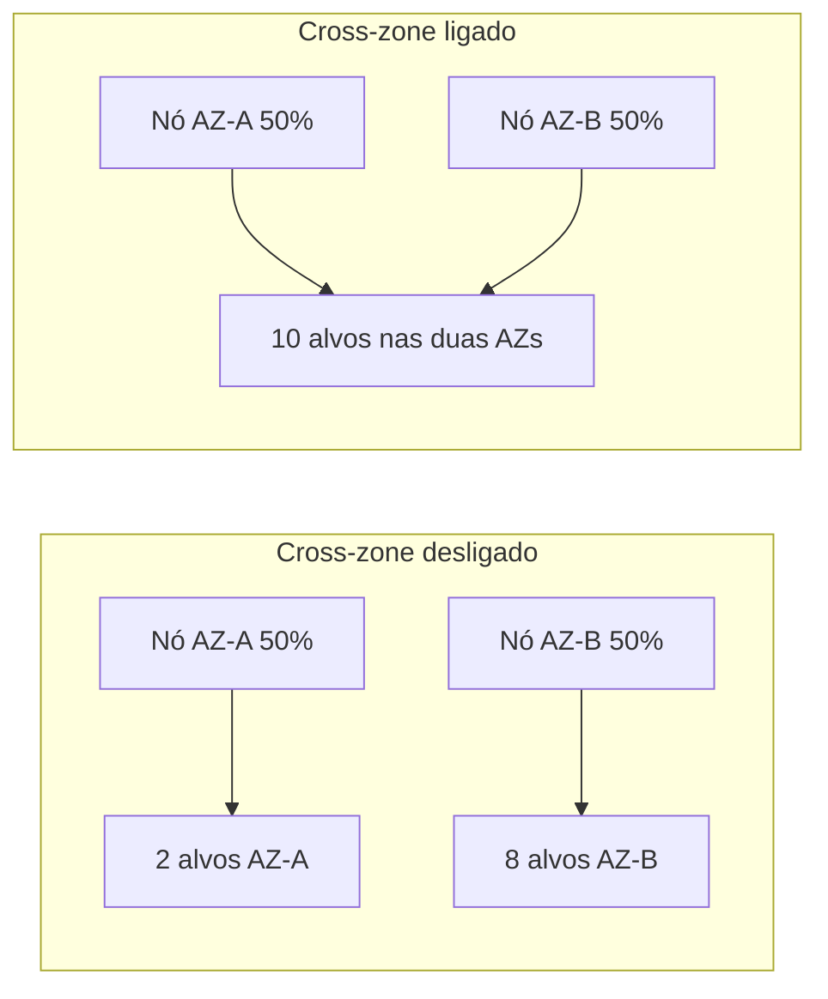

---
aliases:
  - Aula 12.5
modulo: 12
aula: 5
parte: "III Computação e armazenamento"
dominios:
  - 2
  - 3
  - 4
lida: false
tags:
  - aula
  - saa-c03
  - modulo-12
---

# Aula 12.5: Target groups, health checks e cross-zone

[[12 - Balanceamento de Carga e Auto Scaling|Voltar ao módulo]]

> [!question] Pergunta que esta aula responde
> Como o balanceador sabe que um alvo está saudável, o que acontece com as conexões quando um alvo sai do ar, e como o tráfego se divide entre [[Zona de Disponibilidade|AZs]] com quantidades diferentes de alvos?

## O target group é onde a saúde mora

Um [[Target Group]] agrupa os destinos e guarda **tudo o que diz respeito a eles**: protocolo, porta, tipo de alvo, [[Health Check|health check]], [[Deregistration Delay|tempo de drenagem]], [[Slow Start|partida lenta]], [[Sticky Sessions|stickiness]] e algoritmo de roteamento. O balanceador (via [[Listener|listener]] e regras) escolhe o target group; o target group escolhe o alvo.

**[[Container|Containers]] ([[ECS]] e [[Fargate]]):** com Fargate, e com tarefas ECS em modo de rede `awsvpc`, cada tarefa tem a sua própria [[ENI]] e IP, então o [[Target Group|target group]] é do tipo **`ip`** e o ECS registra as tarefas por IP. Com o launch type [[EC2]] em modo `bridge`, o ECS usa **mapeamento dinâmico de portas** (dynamic port mapping): cada tarefa recebe uma porta alta aleatória no host e o ECS registra `instância:porta` no target group (tipo `instance`). A pegadinha de prova é "Fargate atrás de [[Application Load Balancer|ALB]]: qual target type?", e a resposta é `ip`.

Três escolhas são feitas ao criar e **não mudam depois**: o **tipo de alvo** (`instance`, `ip`, `lambda` ou `alb`), a **[[VPC]]** e o **protocolo**. Para trocar, crie outro [[Target Group|target group]].

> [!info] Ligando os pontos
> Nas aulas 12.3 e 12.4 vimos como o tráfego chega ao [[Target Group|target group]]. Aqui entendemos como ele **sai** de lá: só para alvos saudáveis. É também o elo com o [[Auto Scaling Group|Auto Scaling]] ([[12.06 - Auto Scaling Groups e Launch Templates|aula 12.6]]): o ASG registra e remove instâncias do target group sozinho.

## Health checks

O balanceador envia periodicamente uma sonda a cada alvo registrado. O resultado define o **estado**, e só alvos `healthy` recebem requisições novas.

### Parâmetros

| Parâmetro | O que faz | Padrão no [[Application Load Balancer\|ALB]] (verificado em novembro de 2026) |
|---|---|---|
| Protocolo e caminho | Como sondar ([[HTTP]]/HTTPS com caminho, ou [[TCP]]) | HTTP, caminho `/` |
| Porta | Porta da sonda (a do tráfego ou outra) | A do tráfego |
| Intervalo (interval) | Tempo entre sondas | 30 s |
| [[Timeout]] | Tempo para o alvo responder | 5 s |
| Limite de saudável (healthy threshold) | Sucessos seguidos para virar `healthy` | 5 |
| Limite de não saudável (unhealthy threshold) | Falhas seguidas para virar `unhealthy` | 2 |
| Matcher (códigos de sucesso) | Códigos [[HTTP]] aceitos | 200 |

O [[Network Load Balancer|NLB]] usa padrões próprios (intervalo de 30 s e limiar de 3 para saudável e não saudável, segundo a documentação do NLB). Vale lembrar a lógica, não decorar a tabela: **tempo para marcar um alvo como doente ≈ intervalo × limite de não saudável**; **tempo para voltar ≈ intervalo × limite de saudável**.

> [!tip] Macete de prova
> Se a questão fala em "detectar falhas mais rápido", reduza intervalo e limite de não saudável. Se fala em "evitar remover alvos por falhas passageiras", aumente o limite de não saudável ou o [[Timeout|timeout]]. É uma troca entre sensibilidade e estabilidade.

### O que a sonda deve testar

Um [[Health Check|health check]] que só responde `200` em `/` verifica que o servidor web está de pé, **não que a aplicação funciona**. Dois erros opostos:

- **Raso demais**: `/` estático responde 200 mesmo com o banco fora do ar; o alvo recebe tráfego e todas as requisições falham.
- **Fundo demais**: um `/health` que consulta o banco faz **todos** os alvos reprovarem juntos se o banco cair, e o balanceador deixa de ter alvos saudáveis, transformando uma falha parcial em indisponibilidade total.

O ponto de equilíbrio comum é um endpoint leve que valida o processo e as dependências **essenciais e locais**, sem depender de serviços compartilhados.

### Estados de um alvo

| Estado | Significado |
|---|---|
| `initial` | Em registro ou sendo verificado pela primeira vez |
| `healthy` | Passou nos checks; recebe tráfego |
| `unhealthy` | Falhou; não recebe tráfego novo |
| `unused` | Sem registro, ou em [[Zona de Disponibilidade\|AZ]] não habilitada, ou sem [[Listener\|listener]] |
| `draining` | Sendo removido, drenando conexões em andamento |
| `unavailable` | [[Health Check\|Health check]] desabilitado |

### Fail-open: quando todos reprovam

Se **todos** os alvos de um [[Target Group|target group]] estão `unhealthy`, o [[Application Load Balancer|ALB]] e o [[Network Load Balancer|NLB]] **enviam tráfego a todos** (comportamento *fail-open*). A lógica é que servir a algum alvo possivelmente doente é melhor do que recusar tudo. Isso explica por que, com todos reprovados, o usuário às vezes ainda vê respostas (ou erros da aplicação) em vez de um 503 imediato. Por isso, com alvos registrados porém todos `unhealthy`, o cliente **não** recebe um 503 do ALB. Para o ALB, o 503 por "sem alvo" aparece quando **não há alvos registrados** (ou todos estão `unused`), conforme a documentação de troubleshooting (verificado em novembro de 2026).

### Health checks do balanceador versus do Auto Scaling

São dois mecanismos diferentes:

| | [[Health Check\|Health check]] do [[Elastic Load Balancing\|ELB]] ([[Target Group\|target group]]) | Health check do [[Auto Scaling Group\|ASG]] |
|---|---|---|
| Quem faz | O balanceador | O [[Auto Scaling Group]] |
| Efeito | Deixa de enviar tráfego ao alvo | Termina e substitui a instância |
| Padrão | Sempre ativo no [[Target Group\|target group]] | Só [[EC2]] (status da instância) |

Por padrão o [[Auto Scaling Group|ASG]] só olha o **status da [[EC2|instância EC2]]**. Uma instância com o processo morto, mas ligada, é "saudável" para o ASG e "doente" para o [[Elastic Load Balancing|ELB]]: fica sem tráfego e **ninguém a substitui**. Para o ASG substituir, é preciso habilitar o **tipo de verificação ELB** (`--health-check-type ELB`) (verificado em novembro de 2026, documentação do [[EC2 Auto Scaling]]). Veremos na aula 12.6.

## Deregistration delay (drenagem de conexões)

Quando um alvo é removido (desregistrado, terminado pelo [[Auto Scaling Group|ASG]] ou reprovado), as requisições **em andamento** precisam de tempo para terminar. O **[[Deregistration Delay]]** é esse tempo:

- Ao desregistrar, o alvo vai para `draining`; **novas** requisições não chegam mais, as **em curso** continuam até acabar ou até o tempo expirar.
- Padrão: **300 segundos**; configurável de 0 a 3600 s.
- Se as requisições são curtas, reduza (ex.: 30 s) para acelerar implantações e a saída do [[Auto Scaling Group|ASG]]. Se há downloads ou sessões longas, aumente.
- Com 0, a conexão é cortada na hora.

> [!warning] ASG e drenagem
> Em um scale in, o [[Auto Scaling Group|ASG]] desregistra a instância do [[Target Group|target group]] e **espera a drenagem** antes de terminá-la. Um delay de 300 s com requisições de 1 s deixa a instância "esperando" 5 minutos e atrasa a redução de custo; ajuste ao perfil da aplicação.

## Slow start (partida lenta)

Um alvo recém-registrado pode estar "frio" (caches vazios, JIT sem aquecer). Receber a parcela cheia de tráfego de imediato o derruba. Com **[[Slow Start|slow start]]**, o [[Application Load Balancer|ALB]] aumenta gradualmente o tráfego enviado ao novo alvo durante uma janela de **30 a 900 segundos**. Valor 0 desliga (padrão). Vale para alvos instance e ip de [[Target Group|target groups]] [[HTTP]]/HTTPS no ALB; não se aplica ao [[Network Load Balancer|NLB]] nem ao tipo lambda (documentação do ALB). Está ligado ao conceito de *warmup* do [[Auto Scaling Group|Auto Scaling]] na aula 12.7.

## Algoritmos de roteamento (ALB)

O [[Application Load Balancer|ALB]] oferece três algoritmos por [[Target Group|target group]]:

| Algoritmo | Como escolhe | Quando usar |
|---|---|---|
| **Round robin** (padrão) | Revezamento entre alvos saudáveis | Requisições de custo parecido |
| **Least outstanding requests** | Alvo com menos requisições em andamento | Requisições de duração muito variável; evita empilhar em um alvo lento |
| **Weighted random** | Sorteio entre os alvos saudáveis, com mitigação automática de anomalias | Quando se quer que o [[Application Load Balancer\|ALB]] reduza o tráfego a alvos com comportamento anormal |

O [[Network Load Balancer|NLB]] usa o [[Hash|hash]] de fluxo (aula 12.4), sem esses algoritmos. Segundo a documentação do [[Application Load Balancer|ALB]] (verificado em novembro de 2026): o **[[Slow Start|slow start]] não funciona com least outstanding requests nem com weighted random**; e o **weighted random não pode ser usado com [[Sticky Sessions|sticky sessions]]**. Com sticky ligado, o algoritmo escolhido decide só o **alvo inicial**; as requisições seguintes do mesmo cliente vão ao mesmo alvo, ignorando o algoritmo.

## Cross-zone load balancing

### O problema

Cada [[Zona de Disponibilidade|AZ]] tem um **nó** do balanceador, e o [[DNS]] reparte os clientes entre os nós de forma **equilibrada por nó**, não por alvo. Se uma AZ tem poucos alvos e outra tem muitos, e cada nó só fala com os alvos da própria AZ, a carga fica desigual.

**Exemplo numérico**: duas [[Zona de Disponibilidade|AZs]]; a AZ-A tem 2 alvos e a AZ-B tem 8. Cada nó recebe 50% do tráfego.

| [[Cross-Zone Load Balancing\|Cross-zone]] | Parcela por alvo da AZ-A | Parcela por alvo da AZ-B |
|---|---|---|
| **Desligado** | 25% (50% ÷ 2) | 6,25% (50% ÷ 8) |
| **Ligado** | 10% | 10% |

Desligado, os 2 alvos da AZ-A recebem **quatro vezes mais** carga que cada alvo da AZ-B. Ligado, cada nó distribui entre **todos** os 10 alvos e a carga se iguala.

### Padrões por tipo (verificado em novembro de 2026)

| Balanceador | Padrão | Pode alterar? | Custo de tráfego entre [[Zona de Disponibilidade\|AZs]] |
|---|---|---|---|
| **[[Application Load Balancer\|ALB]]** | Ligado | No nível do balanceador não se desliga; **por [[Target Group\|target group]]** é possível desativar | Sem cobrança extra |
| **[[Network Load Balancer\|NLB]]** | Desligado | Sim, ligar | **Cobrado** como transferência entre [[Zona de Disponibilidade\|AZs]] |
| **[[Gateway Load Balancer\|GWLB]]** | Desligado | Sim, ligar | **Cobrado** |
| **CLB** | Ligado se criado pelo console; desligado se criado por API ou CLI | Sim | Sem cobrança extra |

> [!tip] Macete de prova
> "Os alvos de uma [[Zona de Disponibilidade|AZ]] estão sobrecarregados e os de outra ociosos, com [[Network Load Balancer|NLB]]" é resposta de **habilitar [[Cross-Zone Load Balancing|cross-zone]]**, aceitando o custo de tráfego entre AZs. "Reduzir [[Data Transfer|custo de transferência]] entre AZs em um NLB" é o oposto: **desligar** (e manter quantidades equilibradas de alvos por AZ).

### Cross-zone e alta disponibilidade

[[Cross-Zone Load Balancing|Cross-zone]] também ajuda na falha: se **todos** os alvos de uma [[Zona de Disponibilidade|AZ]] reprovam, com cross-zone ligado o nó dessa AZ ainda encaminha para alvos das outras AZs. Desligado, o nó da AZ sem alvos saudáveis não tem para onde enviar. Por isso a recomendação de projeto é ter capacidade em **pelo menos duas AZs** (e que o [[Auto Scaling Group|ASG]], na aula 12.6, também se distribua por elas).

## Stickiness no target group

Já vimos na aula 12.1 o que são [[Sticky Sessions|sessões fixas]]. Aqui o detalhe: a stickiness é **configurada no [[Target Group|target group]]** ([[Application Load Balancer|ALB]]: por cookie gerado pelo balanceador, duração de 1 segundo a 7 dias, ou por cookie da aplicação; [[Network Load Balancer|NLB]]: por IP de origem no nível do target group, para [[TCP]]/UDP/TLS). Com stickiness ligada, o algoritmo do target group escolhe apenas o primeiro alvo, e o weighted random não pode ser combinado com ela (documentação do ALB, verificado em novembro de 2026). O custo conhecido: alvos desiguais e perda de sessão quando o alvo cai.

## Como isso cai na prova

Esta aula sustenta a **Task 2.1** ([[Alta Disponibilidade|alta disponibilidade]] por [[Health Check|health checks]] e [[Zona de Disponibilidade|AZs]]), **Task 3.2** (desempenho e [[Elasticidade|elasticidade]]) e **Task 4.2** (custo de tráfego entre AZs do [[Network Load Balancer|NLB]]).

Palavras-chave:

- "**[[Deregistration Delay|connection draining]]**", "**in-flight requests**", "**finish current requests before termination**": deregistration delay.
- "**newly launched instances are overwhelmed**", "**gradually increase traffic**": [[Slow Start|slow start]].
- "**uneven distribution across [[Zona de Disponibilidade|AZs]]**", "**[[Network Load Balancer|NLB]]**": [[Cross-Zone Load Balancing|cross-zone]].
- "**requests with very different durations**": least outstanding requests.
- "**instance running but app dead; [[Auto Scaling Group|ASG]] does not replace it**": [[Health Check|health check]] do ASG precisa ser tipo [[Elastic Load Balancing|ELB]].
- "**all targets unhealthy, what does the client see?**": fail-open, o [[Application Load Balancer|ALB]] envia a todos; sem 503.
- "**[[Fargate]] tasks behind an [[Application Load Balancer|ALB]]**": [[Target Group|target group]] do tipo `ip`.

Pegadinhas:

- **[[Auto Scaling Group|ASG]] só com [[Health Check|health check]] [[EC2]].** Não substitui instância com aplicação travada.
- **[[Health Check|Health check]] profundo demais.** Derruba todos os alvos de uma vez se a dependência cai.
- **Todos unhealthy gera 503.** Não: o [[Application Load Balancer|ALB]] faz fail-open; o 503 vem de [[Target Group|target group]] sem alvos registrados.
- **[[Cross-Zone Load Balancing|Cross-zone]] do [[Network Load Balancer|NLB]] é gratuito.** Não: tráfego entre [[Zona de Disponibilidade|AZs]] é cobrado.
- **[[Cross-Zone Load Balancing|Cross-zone]] do [[Application Load Balancer|ALB]] desligável no balanceador.** É intrínseco ao ALB; a opção existe por [[Target Group|target group]].
- **[[Deregistration Delay|Deregistration delay]] baixo com downloads longos.** Corta conexões legítimas.

| Requisito no enunciado | Resposta provável | Por quê |
|---|---|---|
| Terminar sem cortar requisições em andamento | [[Deregistration Delay\|Deregistration delay]] adequado | Drena conexões |
| Novas instâncias caem ao receber carga total | [[Slow Start\|Slow start]] | Aquece gradualmente |
| [[Auto Scaling Group\|ASG]] deve substituir instâncias que o [[Elastic Load Balancing\|ELB]] marcou como doentes | [[Health Check\|Health check]] type ELB no ASG | Integra os dois |
| [[Network Load Balancer\|NLB]] com carga desigual entre [[Zona de Disponibilidade\|AZs]] | Habilitar [[Cross-Zone Load Balancing\|cross-zone]] | Distribui entre todos os alvos |
| Detectar falhas mais rápido | Menor intervalo e menor limite de não saudável | Tempo ≈ intervalo × limite |
| Requisições com duração muito diferente | Least outstanding requests | Evita empilhar em alvo lento |

## Resumo

> [!abstract] A aula em uma frase
> O [[Target Group|target group]] decide quem recebe tráfego por meio de [[Health Check|health checks]] (intervalo × limite), drena conexões na saída ([[Deregistration Delay|deregistration delay]]), aquece alvos novos ([[Slow Start|slow start]]), escolhe o alvo por algoritmo, e o [[Cross-Zone Load Balancing|cross-zone]] define se a carga se divide entre alvos de todas as [[Zona de Disponibilidade|AZs]] ou só da própria.

**A lógica, em 5 passos**

1. A sonda roda a cada intervalo; falhas seguidas até o limite tornam o alvo `unhealthy`.
2. Só alvos saudáveis recebem tráfego novo; se todos reprovam, o [[Application Load Balancer|ALB]] e o [[Network Load Balancer|NLB]] falham aberto.
3. Ao sair, o alvo entra em `draining` por até 300 s por padrão, terminando as requisições em curso.
4. Ao entrar, o [[Slow Start|slow start]] aumenta o tráfego gradualmente (30 a 900 s).
5. O [[Cross-Zone Load Balancing|cross-zone]] define se o equilíbrio é entre alvos (ligado) ou entre nós (desligado).

**Números para lembrar**

| O quê | Valor | Por que importa |
|---|---|---|
| [[Deregistration Delay\|Deregistration delay]] | 300 s (0 a 3600) | Drenagem em scale in e implantação |
| [[Slow Start\|Slow start]] | 30 a 900 s | Aquecimento de alvos novos |
| [[Health Check\|Health check]] [[Application Load Balancer\|ALB]] | 30 s, [[Timeout\|timeout]] 5 s, 5 e 2 | Velocidade de detecção |
| [[Cross-Zone Load Balancing\|Cross-zone]] | [[Application Load Balancer\|ALB]] ligado; [[Network Load Balancer\|NLB]] e [[Gateway Load Balancer\|GWLB]] desligados | Cobrança e equilíbrio |

**Tabela-síntese**

| Problema | Ajuste |
|---|---|
| Conexões cortadas na saída | Aumentar [[Deregistration Delay\|deregistration delay]] |
| Alvo novo sufoca | [[Slow Start\|Slow start]] |
| Carga desigual entre [[Zona de Disponibilidade\|AZs]] ([[Network Load Balancer\|NLB]]) | [[Cross-Zone Load Balancing\|Cross-zone]] |
| App morta, instância viva | [[Health Check\|Health check]] [[Elastic Load Balancing\|ELB]] no [[Auto Scaling Group\|ASG]] |

**Na hora H**

- Leia "tempo", "gradual" e "desigual" como pistas de delay, [[Slow Start|slow start]] e [[Cross-Zone Load Balancing|cross-zone]].
- Pergunte sempre: o [[Health Check|health check]] testa a aplicação ou só o servidor?
- No [[Network Load Balancer|NLB]], [[Cross-Zone Load Balancing|cross-zone]] ligado custa tráfego entre [[Zona de Disponibilidade|AZs]].

> [!tip] Liga com
> Vem das aulas [[12.03 - Application Load Balancer a Fundo|12.3]] e [[12.04 - Network Load Balancer e Gateway Load Balancer|12.4]]. Segue para o lado do **escalonamento**: [[12.06 - Auto Scaling Groups e Launch Templates|aula 12.6]].

## Erros comuns

- **Confundir [[Health Check|health check]] do [[Elastic Load Balancing|ELB]] com o do [[Auto Scaling Group|ASG]].** O primeiro retira tráfego; o segundo substitui instância.
- **Usar `/` estático como [[Health Check|health check]].** Passa mesmo com a aplicação quebrada.
- **Colocar o banco no [[Health Check|health check]].** Uma falha do banco derruba todos os alvos juntos.
- **Deixar o delay padrão de 300 s em aplicações de requisições curtas.** Atrasa deploys e o scale in.
- **Achar que [[Cross-Zone Load Balancing|cross-zone]] sempre é grátis.** No [[Network Load Balancer|NLB]] e [[Gateway Load Balancer|GWLB]] não é.
- **Registrar alvos em [[Zona de Disponibilidade|AZ]] não habilitada.** Ficam `unused` e sem tráfego.

## Pratique

**1.** Um [[Auto Scaling Group|ASG]] mantém instâncias atrás de um [[Application Load Balancer|ALB]]. Uma instância está ligada, mas o processo da aplicação travou. O [[Elastic Load Balancing|ELB]] a marca como `unhealthy`, porém ela nunca é substituída. Qual ajuste resolve?

- [ ] a) Aumentar o deregistration delay do target group.
- [ ] b) Habilitar o slow start no target group.
- [ ] c) Configurar o health check type do ASG como ELB, para que ele substitua instâncias que o balanceador marca como doentes.
- [ ] d) Habilitar cross-zone no ALB.

**2.** Durante o scale in, os usuários reclamam de downloads cortados no meio. Os downloads duram até 10 minutos e o [[Deregistration Delay|deregistration delay]] está no padrão. O que fazer?

- [ ] a) Aumentar o deregistration delay para cobrir a duração dos downloads, drenando as conexões em andamento.
- [ ] b) Reduzir o deregistration delay para 0.
- [ ] c) Trocar o algoritmo para round robin.
- [ ] d) Desligar o health check dos alvos para que nenhuma conexão seja removida.

**3.** Instâncias recém-lançadas recebem a parcela completa de tráfego e travam por estarem sem cache. Qual recurso do [[Application Load Balancer|ALB]] mitiga?

- [ ] a) Cross-zone load balancing.
- [ ] b) Sticky sessions por cookie de duração.
- [ ] c) Weighted target groups.
- [ ] d) Slow start no target group.

**4.** Um [[Network Load Balancer|NLB]] distribui tráfego para 2 instâncias na AZ-A e 8 na AZ-B, e as duas da AZ-A estão saturadas. Qual configuração equilibra a carga?

- [ ] a) Habilitar cross-zone load balancing no NLB.
- [ ] b) Desabilitar o health check.
- [ ] c) Habilitar proxy protocol v2.
- [ ] d) Aumentar o deregistration delay para 3600 segundos.

**5.** Uma empresa usa um endpoint `/health` que consulta o banco de dados compartilhado. Quando o banco ficou lento, todas as instâncias foram marcadas como não saudáveis ao mesmo tempo. Qual é a melhor correção?

- [ ] a) Reduzir o intervalo do health check para 5 segundos, mantendo a consulta ao banco compartilhado no endpoint.
- [ ] b) Aumentar o número de instâncias para o dobro.
- [ ] c) Trocar o ALB por um NLB.
- [ ] d) Usar um health check leve que valide a aplicação local, sem depender do banco compartilhado.

**6.** Um [[Application Load Balancer|ALB]] atende requisições com duração muito variável: algumas de 10 ms, outras de 30 s. Alguns alvos acumulam requisições longas enquanto outros ficam ociosos. Qual algoritmo ajuda?

- [ ] a) Round robin.
- [ ] b) Least outstanding requests.
- [ ] c) Hash de fluxo de cinco elementos.
- [ ] d) Sticky sessions por IP.

**7.** Um engenheiro quer detectar mais rápido um alvo com falha. O [[Health Check|health check]] atual usa intervalo de 30 s e limite de não saudável 5. O que reduz o tempo de detecção?

- [ ] a) Aumentar o limite de saudável.
- [ ] b) Reduzir o intervalo e o limite de não saudável, pois o tempo de detecção é intervalo vezes limite.
- [ ] c) Aumentar o timeout do health check para 120 segundos.
- [ ] d) Desligar o cross-zone.

**8.** Todos os alvos de um [[Target Group|target group]] do [[Application Load Balancer|ALB]] estão `unhealthy`, mas o balanceador continua enviando requisições a eles. Qual comportamento explica isso?

- [ ] a) Slow start, que aumenta o tráfego gradualmente em alvos novos e recém-registrados.
- [ ] b) Deregistration delay.
- [ ] c) Fail-open: sem alvos saudáveis, o balanceador envia tráfego a todos.
- [ ] d) Cross-zone desligado.

**9.** Uma empresa usa um [[Application Load Balancer|ALB]] e um [[Network Load Balancer|NLB]] internet-facing em três [[Zona de Disponibilidade|AZs]] e quer prever o custo de manter o equilíbrio de carga entre AZs. (Escolha DUAS.) Quais afirmações estão corretas?

- [ ] a) Por padrão, o ALB tem cross-zone ligado.
- [ ] b) Por padrão, o NLB tem cross-zone ligado.
- [ ] c) No NLB, ligar o cross-zone gera cobrança de tráfego entre AZs.
- [ ] d) No ALB, ligar o cross-zone gera cobrança de tráfego entre AZs.
- [ ] e) O cross-zone impede o balanceador de usar alvos de outras AZs.

**10.** Uma equipe cria um [[Target Group|target group]] do tipo `instance` e depois precisa de IPs de fora da [[VPC]] como alvos. Qual é o caminho?

- [ ] a) Alterar o tipo de alvo do target group existente para `ip` pelas configurações do console.
- [ ] b) Registrar os IPs manualmente, mantendo o tipo `instance`.
- [ ] c) Criar um novo target group do tipo `ip` e apontar a regra para ele.
- [ ] d) Habilitar o slow start.

**11.** (Escolha DUAS.) Quais ações reduzem o tempo de uma implantação em que o [[Auto Scaling Group|ASG]] substitui instâncias, quando as requisições da aplicação duram menos de 5 segundos?

- [ ] a) Reduzir o deregistration delay para algo próximo de 30 segundos.
- [ ] b) Aumentar o deregistration delay para 3600 segundos.
- [ ] c) Ajustar o health check para detectar rapidamente alvos saudáveis (menor intervalo e limite de saudável).
- [ ] d) Desligar o health check do target group.
- [ ] e) Trocar o tipo de alvo para lambda.

**12.** Uma aplicação atrás de um [[Application Load Balancer|ALB]] tem duas instâncias no [[Target Group|target group]]. Um deploy defeituoso faz o [[Health Check|health check]] falhar nas duas ao mesmo tempo. O que o cliente observa?

- [ ] a) O ALB devolve imediatamente 503 para todas as requisições.
- [ ] b) O ALB faz fail-open: continua enviando tráfego às duas instâncias, e o cliente recebe as respostas ou os erros da própria aplicação.
- [ ] c) O ALB redireciona as requisições para outra Região.
- [ ] d) O ALB devolve 504 porque o health check expirou.

**13.** Uma API em [[Fargate]] usa `awsvpc` e deve ficar atrás de um [[Application Load Balancer|ALB]]. Qual tipo de alvo o [[Target Group|target group]] precisa ter?

- [ ] a) `instance`, registrando o ID da instância do cluster.
- [ ] b) `lambda`.
- [ ] c) `ip`, porque cada tarefa tem seu próprio IP na VPC.
- [ ] d) `alb`.

> [!success]- Gabarito
> **1. c)** Sem o tipo [[Elastic Load Balancing|ELB]], o [[Auto Scaling Group|ASG]] só olha o status [[EC2]] e não substitui a instância; a) afeta a drenagem, b) afeta o aquecimento, d) afeta a distribuição.
> **2. a)** Aumentar o delay dá tempo para os downloads terminarem; b) 0 corta imediatamente, c) o algoritmo não afeta drenagem, d) desligar o [[Health Check|health check]] não ajuda.
> **3. d)** [[Slow Start|Slow start]] aumenta o tráfego gradualmente em alvos novos; a) trata de [[Zona de Disponibilidade|AZs]], b) fixa usuários a alvos, c) divide entre [[Target Group|target groups]], não aquece.
> **4. a)** [[Cross-Zone Load Balancing|Cross-zone]] no [[Network Load Balancer|NLB]] distribui entre todos os alvos das duas [[Zona de Disponibilidade|AZs]]; b), c) e d) não alteram a distribuição entre AZs.
> **5. d)** Um [[Health Check|health check]] leve evita a falha em cascata; a) piora a sensibilidade, b) não resolve a dependência compartilhada, c) o tipo de balanceador não é a causa.
> **6. b)** Least outstanding requests envia ao alvo com menos requisições em curso; a) revezamento ignora a duração, c) [[Hash|hash]] de fluxo é do [[Network Load Balancer|NLB]], d) [[Sticky Sessions|stickiness]] por IP concentra usuários.
> **7. b)** O tempo de detecção é aproximadamente o intervalo vezes o limite de não saudável; a) afeta o retorno, c) aumenta a demora, d) não influi.
> **8. c)** Fail-open envia tráfego a todos quando nenhum está saudável; a), b) e d) tratam de outros comportamentos.
> **9. a) e c)** O [[Application Load Balancer|ALB]] tem [[Cross-Zone Load Balancing|cross-zone]] ligado por padrão e, no [[Network Load Balancer|NLB]], ligá-lo gera cobrança de tráfego entre [[Zona de Disponibilidade|AZs]]; b) o NLB vem desligado, d) no ALB não há cobrança, e) é o oposto do que o cross-zone faz.
> **10. c)** O tipo de alvo não muda depois de criado; a) é impossível, b) o tipo instance não aceita IPs, d) [[Slow Start|slow start]] não resolve.
> **11. a) e c)** Um delay curto e um [[Health Check|health check]] que marca saudável rápido aceleram a troca; b) alonga a espera, d) remove a proteção do tráfego, e) o tipo lambda não se aplica a instâncias.
> **12. b)** Sem alvos saudáveis o [[Application Load Balancer|ALB]] falha aberto e envia tráfego a todos; a) o 503 do ALB vem de [[Target Group|target group]] sem alvos registrados, c) o ALB não redireciona entre [[Regiao AWS|Regiões]], d) 504 é [[Timeout|timeout]] do alvo e não efeito do [[Health Check|health check]].
> **13. c)** Com [[Modo de Rede awsvpc|awsvpc]] cada tarefa do [[Fargate]] tem IP próprio e é registrada por IP; a) não há instância gerenciada por você no Fargate, b) lambda é para funções, d) alb é alvo de [[Network Load Balancer|NLB]].

## Para aprofundar

- [ ] [Health checks for Application Load Balancer target groups](https://docs.aws.amazon.com/elasticloadbalancing/latest/application/target-group-health-checks.html) (documentação AWS): parâmetros, estados e fail-open.
- [ ] [Target groups for your Application Load Balancers](https://docs.aws.amazon.com/elasticloadbalancing/latest/application/load-balancer-target-groups.html) (documentação AWS): atributos como [[Deregistration Delay|deregistration delay]], [[Slow Start|slow start]] e algoritmo de roteamento.
- [ ] [Cross-zone load balancing](https://docs.aws.amazon.com/elasticloadbalancing/latest/userguide/how-elastic-load-balancing-works.html) (documentação AWS): padrões e custos por tipo de balanceador.

Próxima aula: [[12.06 - Auto Scaling Groups e Launch Templates|Aula 12.6: Auto Scaling Groups e launch templates]].
